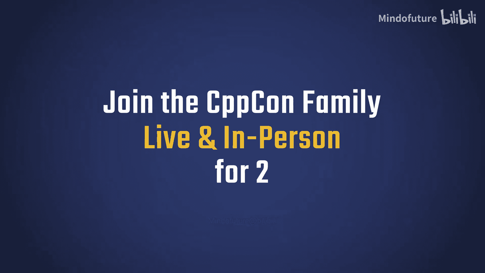
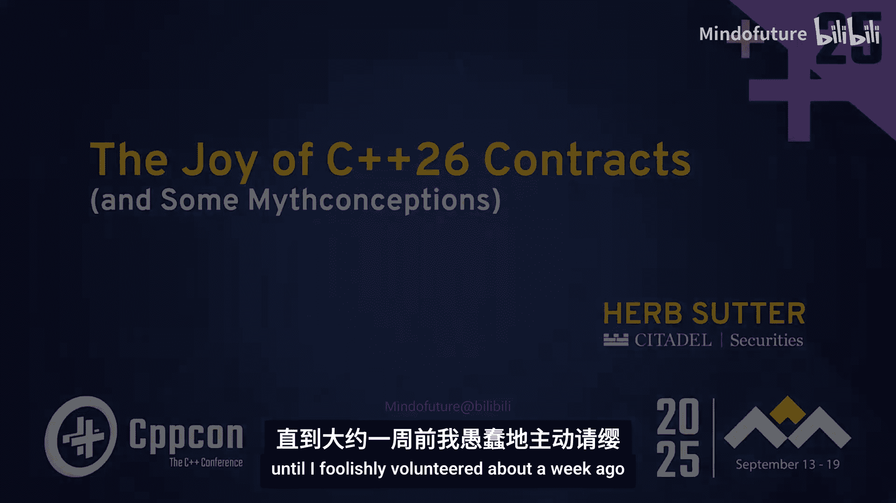
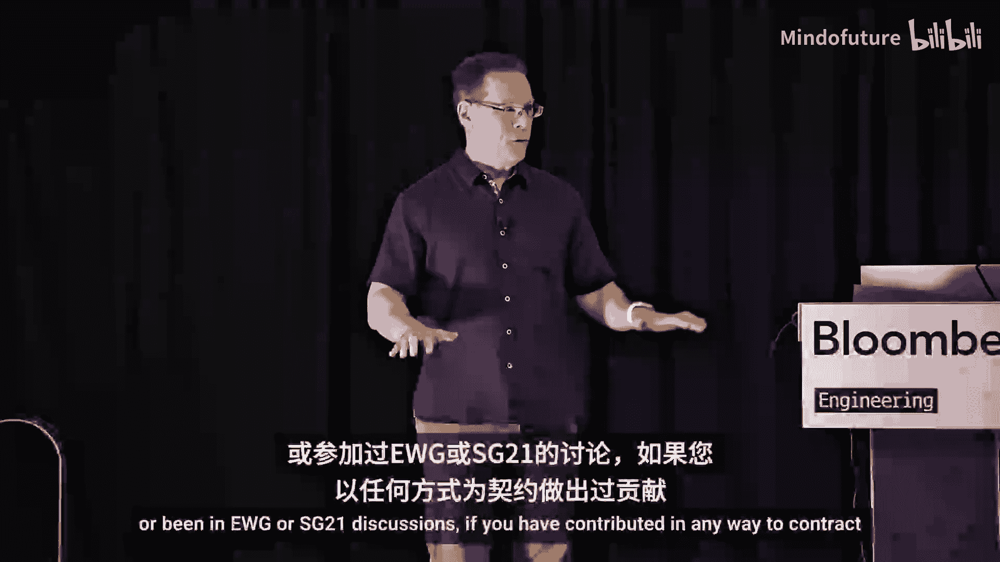
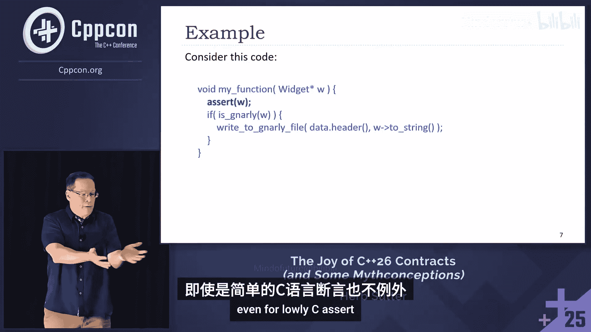
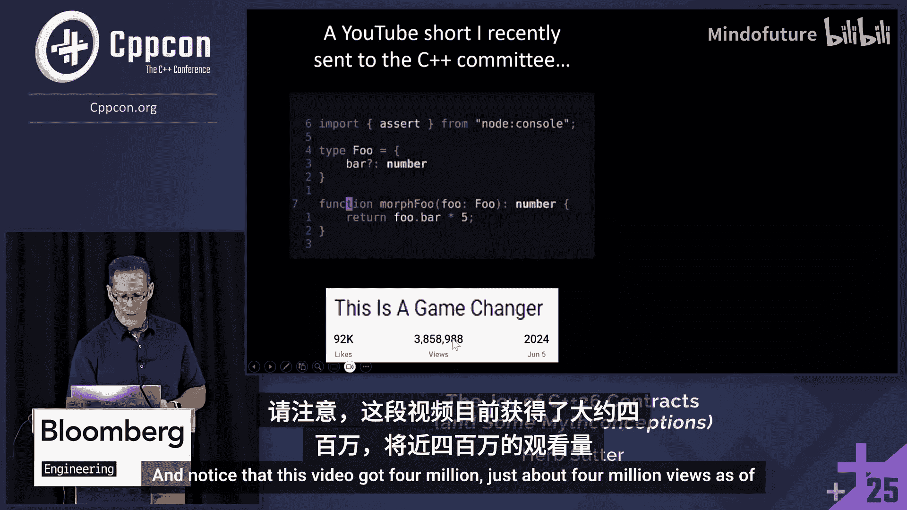
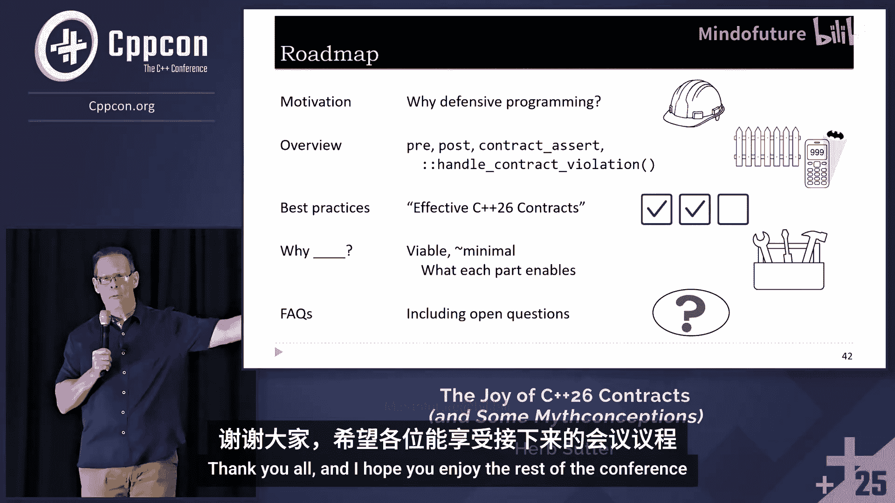

# Cppcon-2025-｜-C++-｜-C语言--｜-汇编-｜-编译器-｜-操作系统-｜-Linux-｜-Windows-p76-P76_C++26契约的乐趣——神话、误解与防御性编程-Herb_Sutter--BV1wyPBzrEeu_p76-

A lot of interesting stuff happens in the hallway。 It happens。 you know you get to walk out of。

Of a session and there's a collective experience that you just went through and so there will be a hallway conversation that springs up discussing the material。

Well， welcome to a session that I did not know I was going to give until I foolishly volunteered about a week ago。

I've actually not given a talk about。 I've mentioned it in a couple of slides。

 I've not given a talk about contracts。I am a Johnny come lately。

There are lots of people in this room who know much more about this than I do。

 so I'm going to do my best in the errors or mine， but I would also like to acknowledge that this has been going on since the run up to C plus host 20 to0。

 not 6 so。Because we have folks in the room， if you have ever written a paper or written in a line of code of implementation or participated in reflector discussions or been in E W G or SG 21 discussions。

 If you have contributed in any way to contract， would you just please stand up right now。

Can we give them a hand， please， all the things。He's just a subset of the folks who worked hard on。

So the current status is that they are in draft C+ S 26。

 the committee experts had consensus to do that in February。There remain questions about it。

 We have two more meetings of technical fit and finish before C plus S26 is actually cast in stone。

 and we are going to talk about contracts again in November at our next meeting。

 including whether to fix it or whether to delay。 So what's in there now is what I'm going to describe。

 But every concern will continue to get a full hearing。

 I just want to represent the status of correctly。 And this talk summarizes my best understanding。

 but a， I can be wrong and often am， by the way， being wrong is good because you learn as long as you welcome being wrong。

 And so you should treat all the answers in here also as provisional。

 depending on changes that might yet happen。 But let me describe what I know from talking to folks who have concerns and also who've worked hard on this feature。

And I'm going to start by making myself a target。Because a lot of people are interested in contracts。

 but there are two groups with very strong opinions about it。

 There are many experts who strongly believe that C plus S 26 contracts are beautiful and ready to go。

 and there are others who think they are not ready and shouldn't ship yet。

How many of you think that I can offend both of those groups in two sentences。Come on。

 a little more faith。C plus 26 contracts have open questions and do not yet have widespread deployment experience。

Just offended some people。We likely， likely will not get a substantially better design than C plus S 26 contracts without wishing for magic link improvements。

I have now offended other people。Let's go。We're going to talk about motivation。

 Why does virtually everyone agree that some contracts in some form is a great idea。

Then we're going to talk about what's there today， best practices that we're starting to learn and explore some rationale and some frequently asked questions。

 but let's start with safety。Because yes， contracts are about safety。

 but they're not about type and memory safety。The bottom of the slide。

 type of memory safety are about guarantees that you can give in the language。

 like that every no point or de reference gets trapped。 if we ever have a rule like that。

 that's a language guarantee that a certain category of memory safety error cannot happen。

You didn't have to write special code。 It's just a guarantee you get。

 and that includes guarantees by static analysis tools if you refuse check in if they don't if if your code doesn't pass static analysis right。

 So it's build time rules give guarantees。 that's the bottom half of the slide。

Contract in the top half of the slide。They're about functional safety。

 They're not about directly about， did I do a buffer overflow。 They're about。

 does my system meet its requirements， Does my car accelerate and especially stop when it's supposed to。

Does my medical device operate on do the pacemaker？Does it keep rhythm。

 does it respond in time in real time messages， things like that that we want to use assertions for？

And there we basically get a knob we can turn because the more assertions we write。

 the more coverage we get in our code， but that's not a guarantee right。

 it's a work harder or get more effort whether it's an assertion you wrote or in a library you wrote right it's a dial and so functional safety is not the same as memory safety。

Where the overlap could come in is if in the future， if we continue to have C+ S26 contracts。

 if we in the future， make language guarantees like we actually did a bit for the the hardened standard library that are expressed in terms of a contract check。

 So if null point or dereence is a contract check， the contract assert， not null。There's the overlap。

 but you get the memory safety， not because it's a contract。 that's an implementation detail。

 It's because the language feature happens to use the contracts feature。

 It's a uses relationship right， So it does just tease those apart。For the rest of this talk。

 I'm not going to talk about the safeties， but that's just to demarcate the line。

You're doing code review。You see this function。What could be better， What comment might you make。

 Just shout it out。Take a reference。 Okay， let's say you're gonna take a pointer。

What else can we say about the body of the function。Check forll。 Thank you Oleg。

 So's when I recognize。 So yeah， you'll notice that there is an unconditional dereence here of the pointer。

 And so immediately， you can see into the mind of the author of this code。😊，And you know。

 one of two things is true。They either knew that， and they think they know because all possible code paths that could flow to this function。

And structurally， it could never be null。 so they don't check it。Or they forgot。We've been been both。

 we've been both of these， right， How do you know reading this code， You don't。

 if you write one more line， now you do。You've expressed your intent。

 if you've ever seen one of my talks， you are going to get tired of me saying we want people to express their intent directly。

 we do that now not only does the code reader who's going to read the code which could be us a year from now。

 understand the assumption that's being made。But tools can check it for us， even for lowly。

 see assert。

Now， we've had this advice for a long time when Andre and I wrote the book C plus coding Standards。

 we collaborated lots。 We each wrote different items and then edited them together。

 Andre wrote this one。 Andre， are you in the room。Wave， if you are。Now， oh yeah， there he is。

 all right， Andre。Thank you for writing this， because I knew about C Asert before you told me about it。

 like I've known about it since the 80s， right， One of the things we learn。

I did not realize how important it was to systematically use it because no one taught me。

 and I never worked in a shop where that was the culture。We can all have blind spots。And。

The assertion I've highlighted a few things must always be true。

 and otherwise it's programming error。 So it's about programming bugs。

Never write expressions aside side effects。 We'll talk about that。

 But let me read the bottom quote and。I want you to see how useful this book。

 because I'm pretty sure you wrote this text Andre because it's written in a kind of professorial voice。

It's not a bad thing。 It's just a different thing。Because when you get a certaint religion and you start telling other people。

 hey， you should write asserts more， whether it's a c or your homebrew version or contracts or something else。

One of the pieces of resistance that you will encounter。Is you will encounter people who say。Look。

 I've been programming X， I use them here and there。

You are wasting my time if you are telling me to write the assertion here in this my favorite function that I know very well。

 because I know that this assertion that you were telling me I should write could never fail。

Like I just， that is a stupid assertion to write because it's not something they could ever fit。

 Okay， you are going to hear this。Andre's response， I will not Romanian in accent。

According to information theory， the quantity of information in an event is inversely proportional to the likelihood of that event happening。

Thus， the less likely some assert is to fire。 the more information it will bring you when it。是吧。

So do you see the Judo move？The judo move is that person who just told you why this is the assertion of all assertions that is stupid to write。

 because it will never fire。 They just gave an ironclad reason why that is the one they absolutely should write。

 Because if it ever does fire， it is the most valuable assertion they will have ever written。Also。

 that smart person。May even be right that assertion will never fire today。If the code is successful。

 it will get maintained。We know what happens when we write code， including in maintenance。

 when we write code， we write bugs。Always true。So I I have never。

 until this one time actually sent a YouTube video to the C+ S committee。

 I actually sent a YouTube short to the committee because I thought it was important to see your customer to understand the value the community sees and assertions in this particular video。

 I just happen to be going through YouTube shorts one day， as one does。And this example came up。

 and this is not even in C++， the programmer is writing Typescript。

 they're using no dotjs assertions。And notice that this video。Got 4 million。

 just about 4 million views as of right now。

And I want you to see this video for yourself。 So let's just go and listen。To our customer。

In my program， I， let me start it at the beginning。

I just changed the way I program after doing it for 20 years。 It's called negative space programming。

 Let's take this function right here called Morfo。 It expects food dot bar to be a number at this point in my program。

 I know that food dot bar is actually a number， despite its definition saying， hey。

 bard might not be a number。 Therefore I'm going to assert that this behavior exists。

 I am effectively programming in the invariance in my program to guarantee behavior and when my program crashes than I know either that I was wrong about my worldview or two I have a book that demands fixing。

 I cannot tell you how much better this has made my life and the quality of the programs I build。😡。

I just changed the way I program after doing it for 20 years。That is a delighted customer。

That is what we want to do we hope with contracts。We can make a mistake here， though。

It would be very easy to say， oh， I don't know who that is。

 Maybe it's some jock programmer who's self taught and is now a YouTube influencer。 And， oh。

 maybe I don't even want to see the code he writes。 And after 20 years， come on， I'm the C S grad。

 and you know。20 years he shouldn't know better。 I just told you it took me 20 years because nobody taught me。

I am him。I didn't know to use asserts systematically until well into the middle of my career。

So let's see the delighted customer， but let's all welcome someone learning。 This is a good thing。

So we talked about motivation， why defensive programming。

 Now let's see what is in the current design of C plus S26。This might keeps cutting out。

 I don't know if you might have an alternate， but we'll try to keep going。哎呀。I asked a certain AI。

 and maybe I'll just use a handheld if， if you have got one。Give an example。

 C plus plus function that should use a c in three different ways。 Now。

 the reason I did this is because I decided that I was， I was about to write an example myself。

 but then I。Testing， great。 I was about to write an example myself， and then I thought， well。

 maybe I can accelerate this。 So I asked Cha E P T to do this。😊。

And here is what Chat GT came up with。Anyone spot the bug。It won't compile。

This is make fun of our favorite AI Day。Going once。Going twice， shouted out if you see it。

There's no declaration for some。 Good try， Though， Cha GPT。 in the top right。

 you'll see that I actually did a second prompt as well。 That prompt was。

 show me the chat GT logo with amusing little red devil horns。😊，And it did a pretty good job。

So I said， well， this is a good start， but let me fix this function。

 We just take the level a little down。Fix this function。

 And here is what a similar function would look like in C plus S 26 contracts。

 So we see we can move some of the assertions out of the body of the function into the interface。

 So the precondition we can now state up front。 One of the benefits of that is it's visible to callers。

 It's on the declaration。 not just human callers， but also with static analysis tools will have a much easier time with this。

 There's a talk about this later in the week。😊，The post condition where if the post condition is wrong。

 it's a bug in this function。Is now also stated in its declaration。

And then we have a contract assert in the body of the function。

 and what that is doing is essentially checking a precondition it turns out in this case because it's checking input。

 but it's doing it while processing the input so we don't have the overhead of a second path。

So that just gives you a flavor for the kinds of things that can be done with contracts。

 preconditions， post conditionsition， and contract assert， why is it not spelled， assert？Backros。

There are four ways to treat contracts， they're called semantics。Ignore， observe。

 and force and quicken force， and here is what they do in one slide。

 you will notice that they not coincidentally handle exactly every combination of the right two columns。

We initially had just the first three and then Apple pointed out we need number four。

 and so we added number four， quick and enforce。One of the nice things is that for the first combination of the two columns where we don't call a isolationlation handler and we don't terminate。

We also don't even evaluate the predicate。So there's zero cost if we are in ignore mode。

Two of these might be familiar because ignore and and force are what we're used to with say sea assertert。

Finally， we also have a way to handle a contract violation。

 This is a global function that you can write your replace it， just like you do a new handler。😊。

And what that lets you do is if there is a contract violation and if you're in one of those modes that call the violation handler。

 observe or enforce。Then you can get information about it， including typically the source location。

 the quality of implementation guidances for preconditions to give the source line of the color of the function。

 which is useful because the bug is in them if they fail to meet the precondition。The comments。

 which could be a pretty printed version of the predicate and other similar information。

Like all global replacement functions is provided at link time。

 so you write at once for the whole program， you don't get to change it at runtime。

 there would be security issues there。By the way， you'll notice that the icon I use for this is intended to be ecumenical。

 It is both the UK and the US since the UK US schism back in was a 1000 No， no。

 that was a different schism。 We have had different ways of calling emergency numbers，9，9。

9 is the oldest in 1937， London。Got the 9，9，9 code， which at the time。

 I'm showing a push button phone， but that's an anachronism。

It's because if you were in a fire and you couldn't see it was dark or there was smoke。You could。

 with a rotary phone， easily tell which was the number adjacent to the stock。

And you could find that by touch in a smoke filled room And she， yes，9 was longer。 Why not just do 1。

1，1， because it's easier to find 9 when you're blind。Are wine dead。 And so that's important。

 The US version is the bat signal。 That's what we use everywhere else throughout the United States here today。

By the way， I say， don't be Thomas Duffy because mere days after 9，9，9 was instituted。

 Thomas Duffy was arrested， was reported and arrested for burglary。 So it started working right away。

 As soon as you start providing away to。To report violations， good reports come in。

So we talked about pre post contract assert。And handle contract violation and the four semantics。Now。

 here is where we would love Scott Myers to come and write effective C++ contracts。

 so good news and bad news。The bad news is as well， he's retired。 and I try。

 I actually tried to get him to this conference。 and he just wouldn't take debate ba。 He's。

 he's still very much retired。 The good news is， I。😊，We're going to learn more， of course。

 But so far， I only know a handful。 So it's actually going to be a very short book at the moment。

 Here's what I know so far。Before I get to item 0， because we start at 0。

Let's please crisply distinguish between program bugs。And runtime errors。

And I use the example of vector subscripting。 I've subscript a vector index to， to index。

 the index element。Is that a bug or a user error， Well。

 it depends who's responsible for the value of index， right。

 If index is something that you computed in your program in code。And it's out of bounds。

I am very sorry。 you have a bug。 go fix your bug like the user could not do anything。

 You gave them a broken program。 So go fix the bug。

 contract As is or a precondition or a post condition is the right tool for that job。

Reporting an error to the caller like just returning an error code from the function， for example。

 or throwing an exception usually， although we'll talk about exceptions in a moment。

For normal error reporting is just not not really appropriate， because by definition。

 the program is in a state that you never expected it to be in when you wrote the program。

 It was it's in a state。 it wasn't expected to handle。 If that index is wrong。

 It is likely other things are already wrong， too。Having said that。

 there is sometimes some recovery we can do。However， on the right hand side。

 if index is read from user input， they typed in the index on the console or you read it from a data file or on a network stream and it's out of bounds。

 user go fix your data， go fix your input， that's a runtime error and we want to check that with an if and then with error handling logic。

So the bottom line assertions are not for runtime input validation。

 and now we can generalize this a little bit。So item zero。

 and these are all drafts I reserve the right to improve these or decide I was wrong。

 but this is the first draft of this item for me。Never use contracts or assertions for program logic。

One example is using contracts for runtime input validation， it's not what it's for。

Another is to use contracts for normal program behavior to rely on things like side effects。

Not what it's for。And I love this quote by Lisa Lipencott。 And thank you， Timour。

 for showing this to me mere hours ago。😊，From a talk that she gave here at CPP gone last year。

 So I appreciate the reminder， Eli Lisa says the first thing to know about assertions is they are redundant if you're writing something that's not redundant。

Don't use an assertion。This is a basic fact of information theory。

 there is no error in here we're talking about program bugs， not runtime errors。

 there is no error detection without redundancy， that's what CRC is for。

 that's what sharding and duplication is for in a a resilient database， right。You want air detection。

 It means you want redundancy。 It's inherently the case。 So item 1 is actually a corollary of item 0。

Or a corollary， depending where you're from。Don't do side effects in a contract check。

 And this is true of any contract anywhere。 It can be C assert。 It could be C+ plus S 26 contracts。

 It could be in other mechanisms and other languages in C assertt， why not， Well。

 because the predicate might be evaluated or not， might execute or not。In C+s 26 contracts。

 the answer is because it might execute。0 or more times。

 might execute not or multiple times depending。So the good news。And this is a little controversial。

 But even if you're in the camp that thinks this is controversial。

I think you will look in this example on this slide。

It is good that this is actually a compile time error。

The reason it's a compile time error is because one of the things that was fiercely debated about contracts was that they implicitly。

 when you refer to a variable， it is implicitly consed。

Specifically to make it harder to write side effects， Trust me， you can still write side effects。

 We know you C++ programmers， we know how to do things， right， even without concast。

But many things can be caught， including this one， and this will be a compile time error。

 which is way better than absurd。Number two， avoid splitting compound conditions。To me。

 this actually。It comes down to a much simpler thing， it's not always applicable。

 but it is in many of the examples I've seen。If you want short circuit evaluation。

 you have to type double n percent。 That's true all over the language。

 We have lots of cases where people have said， oh， I didn't get short circuit evaluation。

 but they didn't write double n percent。 I mean， that's just how it is。

 You need the built in and to get or or to get short circuit evaluation。

So if you have the first contract condition， P is not nu and de referenceence P。

You're guaranteed to never dereference the P because of short circuit evaluation。 If P is null。

 you'll never get to the second part of the predicate， Yea。

If you split them up as in the bad example。And you're running with the observed semantic。

 which means we check the predicate。We call the violation handler if it's false。

 but then we continue。 We don't terminate。 We continue。 We're just observing。

Then it's possible that you will get undefined behavior in the second one。

 the second predicate check if P was known。But。Even in observe mode。

The first check will still get checked。 Your violation handler will get called。

 So when your program crashes， you will have the information of the smoking gun saying you have violated effective contracts item 2。

It might even say something like that。 If not， you'll remember this example from this talk。

 hopefully。It'll tell you what you did wrong。Item 3 is。

 does it make sense to use a violation handler。That throws an exception。Can that be reasonable。So。

The first case where it's reasonable is not a normal use of contracts。

 It's not you're checking things about your program。

 It's that you're testing the contracts themselves。

 you're in a test harness where contracts are code so you may want to test them。

 I generally don't do this， but many good hygiene shops do do this。They say。

 I want to make sure that my assertions fire when they're supposed to， if I made a mistake。

 and so they test them。If you。Test them by deliberately violating the assertion。

And then you terminate your program， and then you spit up a new program and you go to the second assertion and try that one and do negative testing。

There could be overhead and just restarting， you're getting basically one assertion checked per execution。

If you throw and assume you do the cleanup so that you're not actually in a corrupt state， wink wink。

Then you can go and do and test more of these with an exception for each one without loading the executable end number of times。

 So that's the idea。It's to optimize testing the contracts themselves。

But now let's go back to regular uses of contracts。There are legitimately cases where it is。

Not acceptable to terminate。And I generally find。This isn't always true。

 but I very frequently find when I talk to people in this situation。

 whether they're developers of autonomous space vehicles or autonomous land vehicles。

 whether they're operating system developers。They want either an exception or a terminate because if they want terminate。

 they want it for a subsystem， they can restart。If you're in a whole C+ S program and you terminate。

 the whole program goes away， if you throw an exception。

Then you can use normal stack on wine to do some cleanup。 you're in a corrupt state。 Like， lets。

 let's be clear。 that subcomponent has failed。 It's not that the tire is under inflated or the tire blue。

And you are trying now to go back， take off the tire， put on a new one， restart the subcomponent。

 So that's the idea of seeing nos in the audience， some of you do this， but for part of your program。

That's a perfectly crmulent way pardon the Simpsons reference to do a throwing exception violation handler。

But theware and by the way， there's prior arts for this， as I note in the bottom。 you what was Josh。

 you're here somewhere， aren't you。Oh， no， he isn't here okay。Josh Byne。

 who did a lot of the work here。 He， he recently sent me a quote I think the exact words were。

 you can't swing a rat without hitting a dozen languages that throw exceptions circum contract violations。

 I mean， they all do it。 And Brna， thank you for telling me at the very same point。 Ada， Eiffel Java。

 like everybody does this。😊，But as we often remember， C plusau is not like other languages。

 necessarily。 All languages are different， just because language A does something doesn't mean language。

 B does something。 Now， in this case， is's pretty close。But there is a wrinkle for C++。

If you're throwing an exception。So that you don't terminate。

Anybody spot the flaw or the potential flaw， Steve。You must not throw another exception。 Yeah。

 it better not be another exception already active。 You you better not be unwinding。

 You better be not in a no throw function that doesn't have a try catch protecting it because it never thought an exception would happen。

 But somebody inserted a contract underneath， right。So。One way you can mitigate this。

 especially for the stack of unwinding case。 And I， I am saying on the slides。

 this is totally experimental。 I have not tried this。 I wrote this on the slides by hand。

 I don't even know if the code compiled because I didn't try。 I know the triple。

 I know the triple slash doesn't compile。If you're going to install a throwing violation handler。

 it seems like a good idea。 but take this as provisional advice that we're still learning。

To at least test the not unc exception。That you're not currently unwinding。

Because if the whole point was you didn't want to terminate。

 you probably don't want to throw an exception then。Because you might。

 depending on which part of unwinding you're in。Item 4。Understand how build modes combine。

Some of what I'm going to say now is going to reflect that I've spent a large part of my life in Windowsland。

And can reflect that either A， I don't understand Windows land as well as I think。

 or I am making generalizations that are not true in Linux land and other nicer environments。

So take this with a grain of salt。It is well known in at least some environments。

 you don't link debug and release builds。They may actually link to completely different runtime libraries with different names。

 different Ss， different DL Ls。En debug is not that， but it's often part of that。

 EndDbug is often set in conjunction with those those build modes and those flags in the Microsoft compiler。

 it's often set in conjunction with underscore debug which absolutely the heck affects AI because it does iter or debugging and add adds extra information。

So we already tell people。Hey， build everything in the same mode。

 do not link debug build code with release built code。At least in some ways， look。

 there are a million switches。 Many of them are compatible， right。

 But here are two big buckets we generally know about。And that will give you no ODR violations。

But sometimes we can tolerate benign ODR violations， we can。

 if we're otherwise in the same build mode， say we're building in release mode。

And some of our files have Nbug turned on and some don't。

That generally still works because even though it's technically an ODR violation。

 the same function may have maybe be compiled with debug and without debug。

And if it makes it all the way to the linker and the linker sees two copies。

 it way flip a coin or equivalent， flip a bit and decide which one it's going to take。

 So you have to know those things today。 I hope I'm not saying anything new。

 This is the world we live in。Because we are at a multi translation unit。O DR violation。

 O D R is not strictly enforced， and the linker will help you if it can， world。That is our world。

Contracts offer an improvement。While staying in this world， one of the design questions was。

 should we require better linkers。The answer currently is no。 The pitfall of saying yes。

Is now we've de standardardizing a feature that relies on tools that don't exist。

And what's the danger of relying on tools that don't exist where you're not just making a language change。

 but you say， and the tools have to be updated before you can use it。

 I could name other features we did that with。But the key thing is then you'd be delaying adoption by at least a decade。

For those tools to be reliably available。Because it's not good enough if they're available on one platform because we so many of us write portable code。

And having it available on one platform， great， That's a great start。

 Call me when you've got it on all the five platforms I need。Then I can consider adopting it。

And that's the reason why we don't rely on new linkers。

The current GCC and Kang contracts implementations， which have not been upstreamed。

 but which one of which might start upstreaming in the next couple of weeks。Fingers crossed。

Do allow linking translation units built with any configuration。

 the standard does not require that be possible the standard allows platforms to put restrictions in。

But the two implementations currently underway do let you mix and match。Those modes。

 And I'll show you that that can lead to what could be viewed as pitfall。

 So I'm going to talk about that later。Well， actually here here is the now we're at later。

 here' is the example。 This is a brand new paper that just became available in the last couple of weeks。

 I think it was it was this month。 Imagine you have a header with an inline function that contains a contract assert。

And as I describe this， think of Hads， how similar or different this is from a regular assert。

F does a contractor that its parameter is positive， it's greater than zero。

Now I have two translation units that use it， so let me point to those。There we are。

We have the first translation unit on the left， it's built with Quickenfor now it has a function name G。

 which calls F out of contract。That should fail because 0 is not greater than 0。

 So that that's a failure。 And it should terminate right away without calling the a violation handler because it's built with quickened force。

So far so good， I have a second translation unit。Which。Also calls F。And it's in contract。

 And that is expected to pass。If the whole program has two copies of F， well。

 the linker will just pick one。And so an issue we have here。Is。

If the call on the left hand side was in lined。Then it will be governed by the quicken force。

If it was not in line， then you're at the mercy of the Lier。My understanding， and I could be wrong。

 is that you can guarantee that local semantic per translation unit it。

 You can guarantee on the left hand side， you will get that quickened enforce。

 but you have to force in line。This is not as as this is much more easily said than done。

 you have to force in line， remember inline functions includes every template you ever wrote。

Because they're all in line in headers。Because C++。

But if you can arrange to make sure that the contract assert is in the body of the CPP file。

 it actually makes it to the body and is compiled， then you're good。

 then you know the quicken force will happen。And the benefit is that not only do you get that。

 so you get what you want on the left， but the author of main Dos EP gets what they want。

 they get guaranteed ignore with zero runtime cost。

And this is actually will link without an ODR violation， which is a huge improvement over assertt。

 I should say it will link in current implementations that are now close to being upstreamed or being proposed or upstream in both Kang and Gcc。

Your platform provider may decide to put on additional restrictions。

 but the compilers support mixing this。Without even a benign ODR violation， which is kind of nice。

So how do you know if your compiler supports this mixing， read the documentation。

 the expectation as you probably can？But we haven't upstreamed yet。 So we don't know。

 but you still have to know about inlining in templates， if you want guarantees。

Of things happening in your translation unit。Item 5。

Is understand the limitations of this really version one of contracts。

We don't get to put custom error messages in， you remember when we added static Ast and then in a later standard we added static assert where you could comma quote error message useful right。

 we added it later， we'll add it later here， the same idea。

 but you don't get that in the first iteration， which means that your automatic fingertip instinct to write am am percent quote string explanation string still work same as assert。

 and string literal in your assertions and you'll still get a reason but we'd like to do better。

We don't yet support them on virtual functions or pointers to function。

 and we don't have contract groups or labels right now。

And those are things that are being actively worked on。

 We have per to semantics today with the limitations of item 4 and a single global violation handler。

So those are a few best practices。They're all the ones I know about right now。

 but we're learning this， but it's a fairly short list so far。Now。

 why are certain parts of the design as they are？Much has been made of the committee trying to make a minimum viable product after we failed to get it into the contracts into C+ 20。

The group tried very hard。To decide， okay， what's minimal and viable。

 What's a thing we can build on that doesn't close any doors， but that's useful on its own。

And so this slide is to go through the major features and I will defend to you why I think they're pretty minimal。

 not entirely， but pretty minimal because these things are necessary。Let's start with pre and post。

 By the way， pre is the important one， post is also nice。

 but I could have lived without post in Z+ plus S 26。Pre is the important one。

 Why it is a major advance to put your assertions out of the body and glorify them up to the declaration where everybody can see them。

 including tools can see them。Yes， tools can go into bodies right now。 It's so much easier on tools。

 If you just say your precondition in the declaration， rather than force them to go spunking。

 force them to have to have a function body and then do lo to figure out what you meant。

 what preconditioned you intended。This makes it so much easier for tools。Oh。

 and contract Aser is also better than a macro。Nough said。The semantics， well， of course。

 we need at least the first and third， ignore and enforce。 I mean， even see As cert gives us that。

 right。But observe and quicken force。 And here I am speaking from my own point of view as someone who I started looking at this in the last couple of months。

Not just because I heard the concerns and wanted to know for myself and take a deep dive for the first time and look for myself。

 but also because I'm now wanting to use these in production。And I have requirements to see。

 can this be something I can use at my company？And it is very important。

 very important thing that C assertert has never given me that I can turn checking on in production because I am not terminating in production。

 Let me tell you， at least not for at least for all my code， some code， maybe not all code。

 So C asserter。Sionara in production， like that's an non starter。But observe。

 lets me enable checking in production。And which is also useful for testing new predicates。

 I add new contracts， but not 100% sure yet。 so I want to see if they fire first。

 Oberve mode is great for that because it will check them。And called the violation handler。

 So I can see what fired in production。And then quicken force enables enforcing in production with the absolute minimum impact on size and perth。

 and where do you want that， especially in security hardening applications？So again。

 I'm not saying the contractor our security feature， but when， for example。

 the hardened standard library provides guarantees。

And implements them as an implementation detail as contract asserts it darn well wants fail fast。

In those security applications， in fact， quicken enforce was。

 if I recall correctly motivated by Apple for that reason。And the violation handler。 finally。

 the fact that we even have one。 Oh， we need that so badly。 Why。

 Because every single one of us has our， our logging framework， our error reporting framework。

 where we have a dashboard， We send it off to our CTO when bad things happen。

 And then then they re us out， and we promise to do better。 You know， all those things。

 we have our frameworks for this。 All it is a hook。Give me just a hook。

 and I can call all that existing rich infrastructure I've got。

 and I can plug it into my dashboards by monitoring， and I can send that。Should I say this。

 send that pager alert to somebody at three in the morning， like。

 go fix your bug now and or maybe in the morning after breakfast。So to me。

 I see value in contracts in two directions。 And again， here I'm just speaking from how I see it。

 I have not been told this by anybody else。 This is just what I've intuited and the value I see for my uses。

Shift left is huge， the earlier we find bugsre the cheaper they are to fix right， it just always。

 every step earlier， an order of magnitude cheaper to fix。

 it is way easier to fix bugs at test time if I can find them at test time than in production usually in front of my CTO's favorite customer。

Right， so shift left is a no brainer。 It's obviously good。

But then I want to also run them in production， at least in observe mode。

To enable to find things that went through， because maybe I didn't test every code path。

 Maybe I didn't test every data possibility。And I still want to know as a safety net。

 that's not where I want to find them。 I do not want to find them in production。

But it's better than not finding them at all。And wise as viable。

 it doesn't close the doors to future evolution to things like customary messages， virtual functions。

 function pointers。Labels and groups。Let me give an example of one of those things。And and thank you。

 Nina for pointing this out to me， Nina is one of the implementers of the GCC implementation of contracts and our committee secretary。

 you'll see some of these same people， by the way at the Committee of Fireside Cha panelel this evening。

One future extension example that we can add post C+ S 26。

Is the idea of a no acceptance force or observe。 So the idea is， what if。

We actually embraced throwing violation handlers。And then。

Programs that did not want an exception but wanted to termminate could just say so。With a semantic。

That's what no accepted force and no observe would be， and these are implemented in GCC。

 but their extensions， they're not part of what's in C+L+26。And I want to quote Va Vota linein here。

One of the UWG evolution Cha emeritus and a GCC hacker guy， that's an undersstatement， smart guy。

 and I want to read you exactly what he said about this way of dealing of unifying potentially throwing violation handlers。

 even for code that doesn't want to throw by letting them opt out with a no accept enforce or observed。

The breakthrough realization， the epiphany and the stroke of genius。Villa is finished。

 He doesn't normally give glowing praise like this。 All right， Like。

 this is not culturally correct like he's。He is very impressed。 The breakthrough realization。

 the epiphany and the stroke of genius there is that instead of trying to cater to two different crowds by making the violation handler no except or not。

We conser two crowds with the same violation handler。

If it throws the authors of components that don't want exceptions to escape， get what they want。

The authors of components that want exceptions to escape get what they want。

The different decisions can be mixed in the same binary。

 and one violation handler does what both audiences want。Author A comp with no acceptance force。

 author B Comp with regular enforce。 The same violation handler works for both。 No linker magic。

Remember what I said about novel magical linkers， no linker magic， no tricks。

 just different compilation of the violation handler calls。Done in the wrapper functions。

 meaning the implementation inside the compiler， the wrapper functions we already have。

This is an example of the previous slide of。This design has been thoughtfully put together to try to keep future extension doors open。

So， we talked about。The rationale， Now， let's talk about some frequently asked questions， including。

I'm going to make so far in the talk， if I hadn't said the thing at the beginning， at this point。

 the folks who love contracts will think， hey， herbs's mostly got on our side and the other is maybe more grumpy。

 I'll just hold on for that when we get to the open questions part。

So let's talk about frequently asked questions and open questions。

Do C++26 contracts have lots of implementation defined behavior， yes？

About two pages worth in there's a description of the papers。 about two pages worth。However。

 there are things that we usually do make implementation to find。

 There's some discussion about a couple of them， but basically some of them are compiler switches。

 and we just never tell in the standard what a compiler should do， what switches it should support。

 what build modes it should support。 Those are things that are beyond the standard。

And that's totally fine because that's the world we live in。

 We know the switches are different in different compilers。

 We know the the the groups of switches to use。 they usually provide convenient defaults that are right for their platform。

😊，So you do want to give latitude to things at least like switches and gold modes。

Our C+26 contracts hard to implement now I just mentioned this because over the past couple of years。

 sometimes I've heard， oh， certain detail pointing at a certain line in the proposal。

Is super hard or impossible to implement。If so， they've been removed because we have two。

 I'm told by the experts， including people who have looked at the code who weren't the authors that we have in Gcc and Kang two complete implementations with lots of extensions as well。

 So it' super set of what's in the standard， not been upstreamed yet when they'll be upstreamed。

 hopefully starting in the next couple of weeks， then we'll get more eyes on it and validate that。

 but so far no， not hard to implement。 one place where this came up be is if you have two predicates in a row。

 there used to be a bug this used to be true where one could allli the other。

 I think I've got a f on that。And what we fixed that， we put in an observable checkpoint。

 which is pretty much like an opaque function call。 We already do this for opaque function calls。

 We don't know if it might have side effects， so we basically used very similar ideas there。

 It might require the compiler to do that check in a new place， which can require some updates。

 but it's not like a ground shaking new feature。Is it true that CFFALs26 contracts don't help static analysis？

I happen to know a fair amount about static analysis， but I am not a static analysis expert。

 so I will refer you to the talk on Thursday by people who are GiHub code， QL and its experience。

With and expectations。Of being able to work with contracts。 Now。

 there is one distinction that I can make。So is it true that CFFLOS contracts don't help static analysis？

The argument for no is， well， they do。 They， they move the predicate out into the function declaration where you can see it。

 And that does make it easier for static analyzers。

 They put the expressions up where the analyzer can do less work to see them。

That is strictly less work to do the analysis they already do。However。

 statictic analyzers do other things besides expressions。

And some had hoped that contracts would let you express non expression kinds of things， too。

These do not do that。So does CFALS 26 contracts light up static analyzers， yes or no。

 yes for expressions， no for not expressions， but that could be a future extension。

 but that's an important distinction， but see that talk to hear from people who actually know what they're talking about。

Is there a portable default behavior if I just write a line of code and put it in a book that says。

 hey， contract assert， can I reasonably expect that people who read the book on who knows what platform and compiler。

Can try that out and get reasonable results， get results that I can tell them about。Very likely， Yes。

 So the sea fossilil standard says the recommendation is that implementations the compilers。

Default to enforce semantic。And that the default violation handler prints the source information and the predicate that failed。

 things like that。And that's， in fact， what GCC does Here is a cut and paste of a current GCC message。

 I shortened the file name to save a couple of lines because it was a really long file name。

 but the rest is is a cut and paste exactly as it was。Which is pretty reasonable。

 So is there a reportable default behavior。In practice， yes。

 even if the standard doesn't deliberately require it。

 it certainly strongly recommends it and the two current implementations are following suit。

And this is the one I talked to already on the previous slide。

 do contracts have a flaw where if I write undefined behavior in code protected by a contract。

 it can silently eliminate another contract check by time travel optimization。

 and I'm not going to explain the example because anything with time travel optimization is deep and weird。

And especially because the answer is not anymore。 That was a problem that we fixed it。 So thank you。

 And that's the observable checkpoint， semantics that I refer to。So fortunately。

 we don't have to teach that at least， so that's an improvement。

What happens if you try to write pre your post on a virtual function or a point a function？

Doesn't compile， not supported yet。I've seen that described as a pitfall。

 I'm not really sure why in C+ S 11 we had the arrow auto return type for lambmbdas deduc return type for lambmbdas。

 but not for regular functions， if you try to write it on a regular function。Didn't compile。

 So there was a feature that worked on some functions， but not others。And then 14。

 the feature was popular， so it was added to other functions。

 and we intend to support pre and post on virtuals as well。There is still。

Some constipation about constification there。 I said it。

This idea that in a predicate things are implicitly coned。

 which can affect overload resolution right， like it can make the predicate do something different than it would have if you wrote it in a contract assert than if you'd written it on the line before outside the contract assert。

absolutely true。That has freaked out some people， including freaked out me。

I'm feeling much better now。 And the reason is twofold。 The first reason is。

I remembered I already lived this nightmare。And and it wasn't so bad。

 I lived this nightmare back in the 2000s when we were adding lambda functions to C plus S O X。

And people argued strongly that by value capture is constant by default。

 How many of you have written a Lada capture or you've captured by value。

 tried to modify it and scratch your head for five minutes。

 trying to figure out why it didn't compile。And then you learned you have to write mutable on the landing。

And you went on with your life。So did I。I still think it's a little quirk， but。It's not so bad。

 This one is better justified。With the Lambda case， it was just， oh。

 you might accidentally have a side effect， but it's my object。Get your fingers off my object。

 I know how you captured it by value。 I did that on purpose。 right here。

 it's so easy to write an error。 This is actually has more value in the implicit con than with the Lada capture。

 So anyway， we have prior art， and it really wasn't so bad。 hasnsn't really been a major problem。

 The other reason is。Is because no one has yet， not despite lack of trying。

 has actually come up with a any close to realistic problem example。

And in the same talks where I see people give a non realistic problem example。

 they have other examples where the constification actually found a bug they wrote。

So we have prior that it finds real bugs， including by people who are trying to prove it useless。

And we don't yet have a positive example where this is actually harmful。

 And we have prior art in the standard。 So I feel better about it than I used to。

 But I that's a year ago， asked me a year ago。 I would have said I was more uncertain because I didn't know as much。

This relates to why aren't C+S26 contracts a drop in replacement。

 I already have assertions in my code using my homegrown library。

But I can't just replace my assert with contract As。I've seen this mentioned as a pitfall。

 but all of the examples I've seen fall into two categories。 The first category is。Yeah。

 it's different like the parameter order might be different or it's because your library uses a macro and this is a language feature。

 a language feature is better than a macro， and it just will be different in some ways than a macro。

But usually in good ways that we want， right？And the second set of examples was constification。

 They said， my assert of this thing always compiled。 I changed that to contract assert。

 and it wouldn't compile。 Why， because he wrote a side effect in his contract in his assert。

 So the fact that it didn't compile was a feature， not a bug。And that， too。

 made me feel better about constification。But at least for once。

 I got to say the people are constipated about constipification。

Don't that sometimes when things just fly a stream of consciousness。

 you don't think there's anything objectionable。 And now I'm going back thinking。

 is there anything bad about that， I sure hope not。If it is， I apologize， I don't intend anything。

Open questions。 There are things we do not know。 I started off by saying， we do not have。

The implementation experience we wish we did。Contracts have not been used and deployed widely。

 I know a couple of companies have done that with prototypes。

 They have not been in shipping compilers。 They have not as as non standard extensions。

 They have not been deployed by multiple large companies in anger。So there's a lot we don't know。

 we think we're safe because of mitigations of lack of knowledge。

 but we there are things we don't know， One of the things we don't know。Right now。

 if you do say a precondition or a contract assert。And that predicate。iss true。 Nothing happens。

 if it's false。You terminate or call the violation handler or whatever you enforce it。

If it doesn't tell you either true or false， but instead it throws。

The current design says that is treated as if it had returned false。

That a failure to even evaluate the predicate is a failure of the predicate。

That turns out we think to be cheap to implement on attaintanium A， but again。

 more measurement is needed。 So there's two questions about this。 First， are those good semantics。

Some say， hey， that sounds pretty good。 And some are still worried about that。

 The second question is， is the run time cost acceptable。And here is where you need to know a truth。

The only way you can implement that is to essentially put a try catch around the predicate evaluation。

And then rely on being able to optimize that away。 Hence the the hopeful conjecture。

 If most predates are trivially no， except non throwing， we can aide most of these checks。

 I'm going to call out Java think here。Because that's how Java designers think。They say， well。

 let's have this overhead。And hope we can optimize。 We'll probably be able to optimize that away。

 That's not how C plus else normally does things。The way C plus plus does things is we have  zero overhead by default。

 and you opt into overheads。 This is not that。 And that's why it should be a concern。 Now。

 so we can maybe alleviate that concern with measurements。 It might be okay。 That doesn't。

 That doesn't mean it's damn to prediction。But it means it really does bear scrutiny。Also。

 it can be mitigated by a suggested extension of evaluation semantics that don't translate predicate exceptions into contract violations。

 So even if it is a problem， a future extension。Could also solve the problem and eliminate the overhead。

Finally， we on this slide， we can't yet write functions that don't exhibit undefined behavior when a precondition is violated。

 So there are suggestions to post C plus O 26， Add a label， for example， to be able to say， hey。

 I want this precondition always to be quicken enforce。 even if the rest of the contracts around me。

 might be observed or quicken forest or forest or something else。And the key to me here is。

 as far as I know。 And again， I could be wrong。 but as far as I know。

These are compatible extensions that could be added on the foundation。And here's one more。

Groups and labels that I just talked about， G C， I not sorry， not Gcc。 Kang has gone ahead。

 and here's a screenshot of some of the documentation has actually give it granular labels to have hierarchies where you can actually have groups of things named groups of things。

 and they have custom switches for it。This is exactly an example of what of a benefit that if we ship。

Contracts in the standard。That enables these experiments。

Because we'll never get these experiments in experimental branches。

 We'll never get a production experience until a vendor in trunk。Ships and extension。

 even if that extension is labeled experimental， now people can actually try it in real code。

And it can get some adoption and we can get more data。

 This is one of the reasons why having at least a minimum viable product to start with。

Help bootsottrap helps accelerate。That covers the motivation， why defensive programming。

The overview of what do we have， what are the best practices。

 Why is each piece there and some frequently asked questions， including open questions。

But I'll go back to what I said before at the beginning。

 It is absolutely true that there are open questions and some serious concerns about the design。

I think it is also true that it is unlikely that we could do significantly better than what we have。

 flaws and all。In a world where we have translation units and today's linkers， our current model。

Without。I don't want to dismiss it as wishful thinking without hoping for future magical linker improvements。

That would take time to deploy。It's a tough problem and the important problems are never easy， right。

 It was easy。 anybody could do it， and we would have had it in C+ 20。

 but thank you to everybody who's worked on it。 Thank you also to the people who continue to critique this to make it the best it can be。

 And if we find a show stopper feature， we'll a show stoppper problem， we will deal with that。😊。

There's still two meetings left to review。 But that is the current state。 As I understand it。 Again。

 I am not one of the people who've been in the fray for the last six years。 So any errors are my own。

 But thank you to everyone who answered my questions and email。

 including late at night on the weekend， as I tried to put this talk together over the last couple of months。

 But when I tried to put this talk together in the last week or so。

Thank you all and I hope you enjoy the rest of the conference， thank you for your time today。

