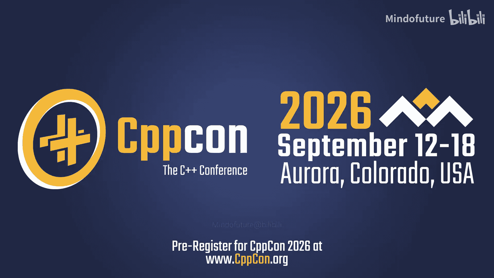
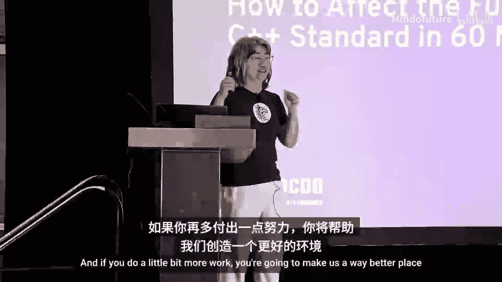
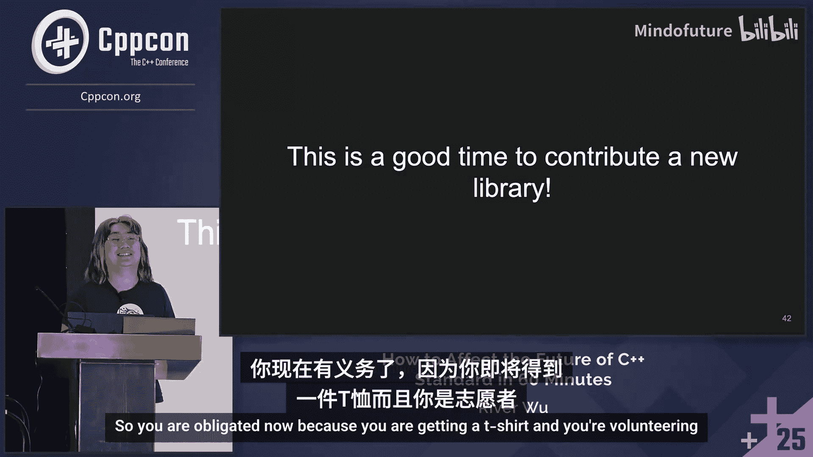
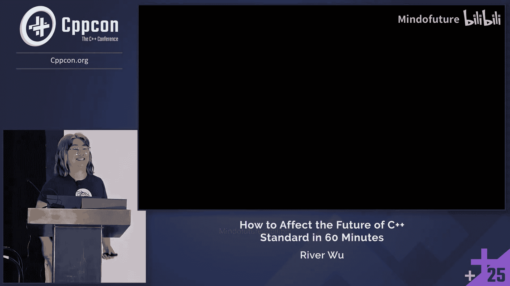
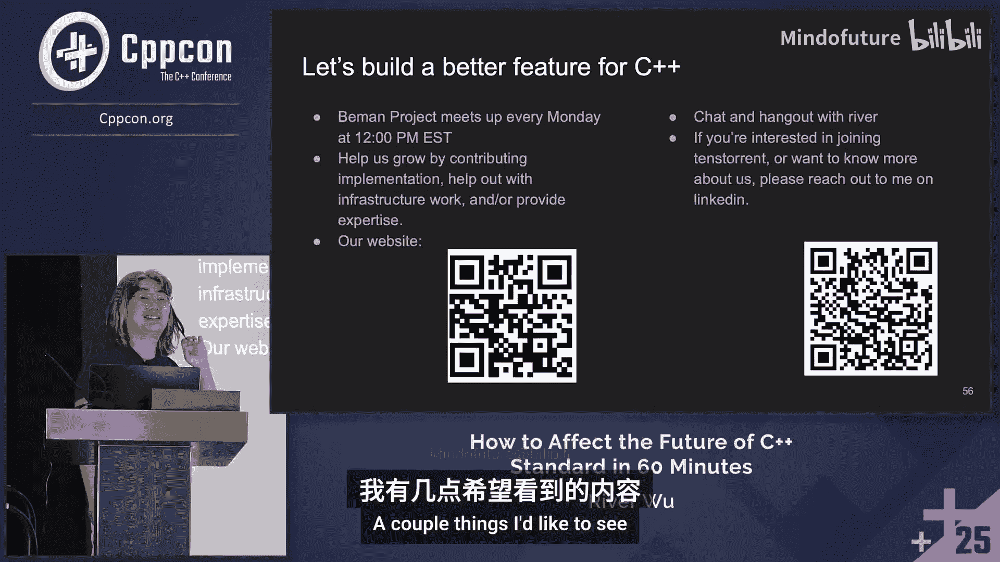
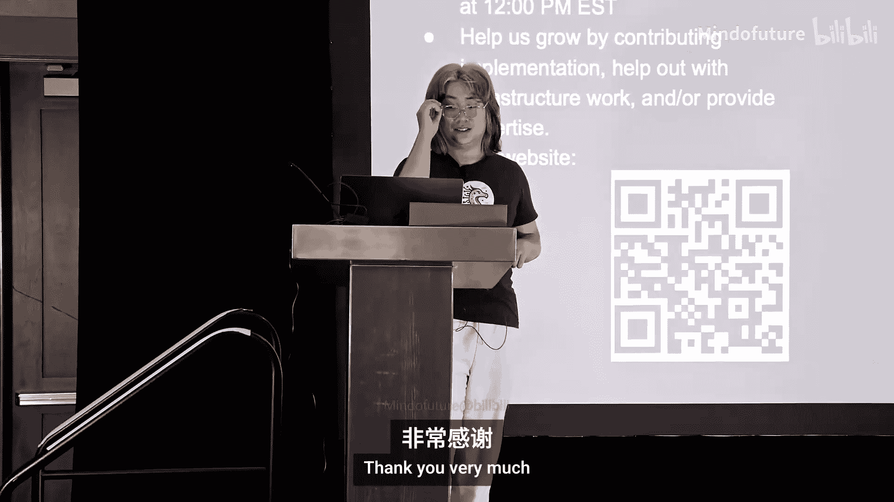
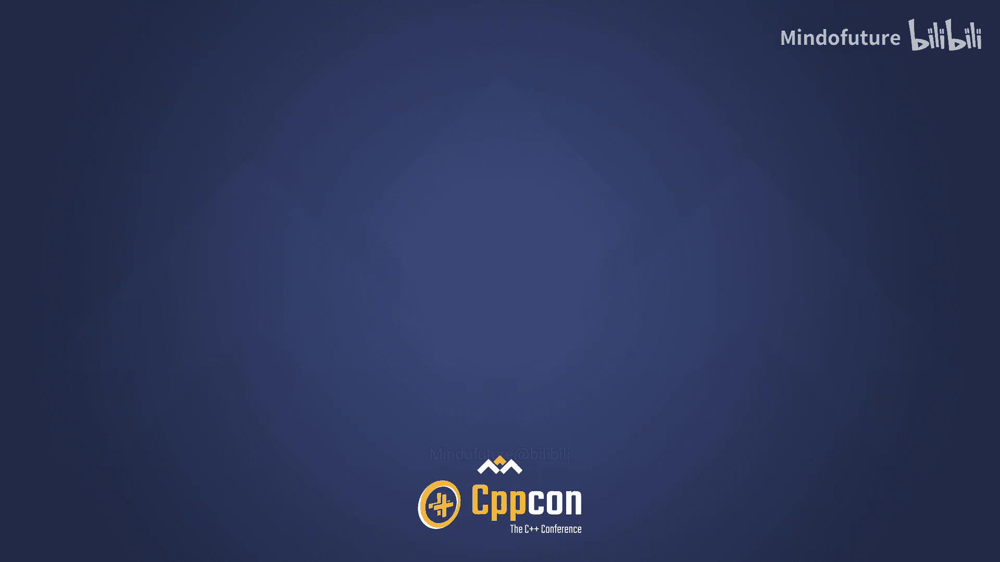

# Cppcon-2025-｜-C++-｜-C语言--｜-汇编-｜-编译器-｜-操作系统-｜-Linux-｜-Windows-p77-P77_对C++标准库不满意？加入Beman项目_-River_Wu--BV1wyPBzrEeu_p77-

🎼I always feel like it's a lot harder to let your mind wander。

 And you really have that like you are here， you are learning。

 There are people around you who you can also ask call ups， even if they're not the presenter。

 The energy of the room really helps you stay in the mindset of I'm going to be learning about things。

 I'm going to be experiencing this world a lot more directly。😊。

My talk is how to affect the future of Silfa standard in 60 minutes。 If you booked it yesterday。

 it was say 90 minutes because I forgot to update my title for VP now to the V account。

 So if you just sit here， you are。😊，Margiinally changes to the future of C Center standard。

 And if you do a little bit more work， you're you're gonna make us a way better place。

 So little a little bit about myself。 As I just said。

 I recently graduate from University of Michigan Ann Arbor。 yay。

 I'm a core contributor of Bman project， which is the project I want to talk about。

 And I'm currently building a star at Ts Torrent。 And I'm looking for new cool friends that can just like。

 hey， you are freshing in in the industry。 Let me tell you all the cynical things about this industry。

 So I get depressed and stuff。😊。

And sorry， this is gonna be a recurring thing of this feration。

 I hope I don't have to do that this much， but I have kind of a gen Z humor。

 I'm also looking for new colleagues。 If you are experiencing the embedded engineering， automotive。

 HVC， performance， critical applications， We're building a research chips for neural network computing。

 If you're interesting that， please come talk to me。 And I do not recommend that my。

 my employer and this talk has nothing to do with whatever I do at work。😊。

And I also want to stress out of like very significantly， who I am not。Okay。

 there's two people here getting the joke。 I'm not an Ohio State graduate。 I'm a UF M graduate。

 of course， And I'm also not a with decades of experience。

 So I'm kind of delivering my point of view like stuff from a kind of a junior perspective。

 And I do think this is valuable。 And I especially want to stress that I'm not an IO member who knows the in and out of the standardization process。

 I am not a center library committee members。 I do not think I should be one yet because I'm still learning so much。

😊，I'm gonna start my talk This is the second time。 say this with urban planning。

 which is completely relevant to our conversation。 It fascinates me。

 I spent way too much time during school looking through like old planning documents and newer planning documents and just sitting like planning commission meetings and listening to whatever the hecks happening。

 I like it。 And I find it fascinating because it affects everybody like the fact that we're sitting here。

 probably because some years ago a group of developers bought this plan of gaylor to to to Denver or city planning and they somehow decided it's a good idea to build a commission center in the middle of nowhere。

 It requires both longter visionary and practical investment because。😊。

They are very constrain on resource， but sometimes leaving a special place for future development are very important because it's really hard to revert bad choices。

 Highways are really expensive to maintain waterlines。 You name them。

 And it kind of makes or breaks a place。 I know people kind of argue that it's the people who makes or breaks a place。

 But if like there's no building here。 We will not be here。 right。

And I think this is where I connect。 If I just change the last sentence here。

 Make a break a language。 This is the underlying language evolution。

 I feel like this represents really good like language evolution is affects everybody。

 affects everybody who uses tool。 is this is if you are like someedgy game developer who does not use standard library and think it's shit。

 you can you are still impacted by the core language features that are introduced because standard library having a new construct。

 and it also requires longter vision or imp practical investment like context where we have to we do not have the manpower to do everything all in one single standard。

 So we have to， you know， foresee well problems we're gonna have and we're gonna we need to push it and have this longter thinking while understanding that we are a very constrain on resources。

 and it's really hard to revert bad choices。 C plus are famous for some of it's horrible。😊。

Defaults and initializer lists and vector bulls。 But we got to live with it。And， of course。

 the urban planning part is not really panning out in the states， isn't it， because this is， I think。

 quite a famous picture on what new urban hellscape it looks like in the states。

 And I do kind of question when you look at this and you just step back and be like。

 is this really where we want to live。 And I do think the same applies to your language。 we。

 we in the future or here we're looking at mistake of choices made back then and think， oh。

 is this really what we want for the future of language。

 It's really something I want to keep interacting with。😊，And in urban planning context。

 the core tool is something called community engagement meetings。 It's as boring as it sounds。

 Usually it's a sticker stamped on what on the impacted area。

 it's how boring it is is I cannot find a picture of it。 nobody really pays attention。

 So when you go to the when you show up at the actual like planning meeting and it's usually the people who are just having have very opinion ideas and have some back takess and they have extra time and greater people who live in the impacted region are not like like involved。

 And I kind of argue that this is also like very much with accessibility because you need to be sitting in the room listening to to our meeting and understand the nuances。

 And I'm getting there。 I'm getting somewhere， at least。

 I think now that we look at language evolution。 It should be a lot easier， right。😊。

If you think about it， language proposals， which is how we evolve standardization。

 is kind of like those people on Reddit who post their personal libraries that they think are really cool。

 And usually what they do is they post a Github link。 and everybody go check us out。

 And if it's really good by word of mouth， everybody start using it。

 And then I would imagine as somebody who's in college。

 languagen center library development should probably work like something like that。 And it's easier。

 way easier。 You know， I need to go to a meeting room。

 And I probably understand what the hecks going on。😊，As I mentioned before。

 how do we really evaluate a new library， right， We go to its Github page。 We re the readme。

 which is often short concise documentation on what this library does a single， motivating example。

 and you will just look through a document， you just pull it。

 And you start messing around with examples and plugging in to your own toy project。 And later on。

 you find this as an exceptionally good idea。 You put in pro and you break everything。😊。

And but why try my hand on understanding some of the newer library construct。

 I can find this is not the case。 We do something called papers， which are 2030 pages long。

 And it's I've been told the actual useful part is the to the actual standard the actual specification。

 which is standard is not cold。 I've been trained at school for four years in copy heartache for three years and two months on new jobs。

 I can like parse struck really quickly and understand what it does。

 And I can probably know how in checks with other parts of the system。

 but cannot read standard because it's paragraphs of paragraph 20 pages。

 And the standardation process opaque。 you have to be guess or a member of IO to even get into the discussions to understand why choices are made and to understand if your concern has been heard or if or if you just want to check if you're asking a dumb question or not。

 And there's also not a central。Ay low implementation， you usually like like I referenced。

 Reddit is where I usually find people posting stuff and also YouTube and stuff like that。

 And you usually always get directed to Gitth。 I'm familiar with Github or Gila when somebody feels like it。

 it it just， it feels of like exploring center library proposals because there are libraries。😊。

So I think we need a new。 well， this is not necessarily new。

 We need a more accessible way and a more uniform way to evaluate library proposals as libraries。

 We have such great tool chain that's built from this few decades of improvement。

 Github Github issues discourse and all these like standard way of us like or not standard。

 like everybody like used to this kind of working。 I think we should bring ordinary folks who are just interested in the next evolution of C plus closer to this ideal where it is almost as if somebody posted on Reddit。

 But inside of Reddit， it is a very scary few thousand pages booked long document that that is beyond production。

 that is supposed to be beyond production ready。😊，And this is kind of what my personal pitch or I'm personally understanding of what the Beaman project is。

 If you talk to folks that is not me who who started a Bea project。

 they will tell you a different story。 But I think this is what Beaman project is。

 I think I want to we it's better to look at it as a accessibility project。

 and accessibility project for for both people who are interested and also for library implementationers。

 Well we are， we are a collection of library proposal implementations where literally a Github organization。

 You can look on our Github。 You can see all the reoss available and you can check them out。

 And you can you play around it。 And we want to be ready for production。

 That is the goal for every single implementation because standard library is the most product should be the most production ready。

😊，Shing ever to be done for like software of this kind of scope。

And we also want to be an accessible platform of feedback cycles and discussions。

 I want us to have backgrounds。 I want when people search up， oh， I want to know like， for example。

 optional like why someed is optional I people to search it。

 And if it's hosting project issue showing up or discourse showing up。

 So you can look through all the design choices or reasoning behind some of the the implementation details that you can learn a lot about the language。

 you can get a better understanding of what the next gonna look like。

 And this is a little bit heartwarming， we're also folks。

 were also welcoming community of folks interested in events in this。

 We are group of people who is highly as very interested in the of the language or simply the evolution of language。

 And you know， when nurse talk to nurse， they want more you。

 And that is a good feedback cycle for stuff of the scale where it's impacting。😊。

Anybody who's going to be consuming surpl。So this is our mission statement。 I know I。

 I kind of approach our mission statement from another angle。 But this。

 the ultimate like documented goal for us is to support the efficient design option of the highest qualities of our standard libraries。

 And my view to is more accessibility， more transparency。 More folks easier to test stuff out。

 Library proposals be like libraries。😊，And for the greater committee， as I said。

 library as libraries accessible。 And for library implementers。

 this means that there's people who are interested in like just trying out new new tool chains or new infra that are like exceptionally great with working with existing tools like Seem。

 like Github actions。😊，That is painful。 And this is not officially a place for them to experiment with it。

 but they come in and they can best practices to us so that library implementers only need to care about about the implementation itself。

 It does not need to care about， hey， am I doing to see me correctly， Hey。

 is this export target correct。 Hey， will upstream be able to consume me if I export to like a package library。

 Oh， is this Yeah， I'm running correctly。 and how does Github work。😊，And here， because I acknowledge。

 I have no idea how IO works。 I volunteered instead said。

 she wantna give a little bit more context surrounding this idea of publishing libraries as library proposals as libraries。

 And the fact that is not a new thing at all。 And she's gonna talk a little bit about history。

 And to not have me misinterpre him， whatever is happening。😊，Thank you very much。Thank you very much。

 Oh thanks So I just thank you very much。 by the So we talked so first of all， E Mio。

 I'm library revolution chair。 that is the group that was referred to the one that inside of the standardizing process that works on Southern libraries。

 I'm also one of the Beaman project leads as I do care about this topic as well。

 I was and thank you so much River for inviting me。

 So I just wanted to give you a hints on what we really do care about for my experience。

 and I've been doing this role for three years not forever and the committee have been existing way more than than when I was doing this role。

 but I just wanted to give you a bit of a background。 So when we standardized libraries。

 we do care about implementations and other things are we do care about those things very deeply and you can see here the link that I've posted that is。

😊，Li to the library revolution group Github。 So we want to make sure that people do aware of what's happening with the proposal。

 So if you go to the Github C plus plus link that you see here。

 you can actually see the evolution of the standard the issue tracker their tracks。

 different stages of proposals and some proposals have links to their implementation there。

 some proposals have them on Godbolt， etc。 The second thing I wanted to show you is that as River is saying。

 it's very important for us to do look at field experience。

 And you can see here the checklist that we do before we forward the proposal。

 and we have here field experience implementation experience Use experience and deployment experience。

 So I just wanted to thank River for his enthusiasm。

 But I also wanted to give you the broader spectrum of what were trying to do in Io。

 And we are we will be really excited to see your comments， your inputs and please go into the Giub。

in general and， and go over the issue tracker and see the states of the proposal。 Now。

 I'm going to give back。 Thank you， River。Thank you for inviting。 Yep。

 so that's some context from an Io。 And I think something else we should add is this is not being designed as a requirement for any paper to getting。

 It's just， we， we think it's very logical for us to build a common space for hosting like per library implementations and。

A lot of， not a lot of times， but sometimes library implementation contributors are not paper authors。

 So， hey， if you just care about implementing cool， cool libraries and have to bragging rise about。

 hey， I implemented a F shop you applause。He， you very track to us。 But if you。

 if you wanna get like a little bit more details， we also encourage discussion on papers in our own issue trackers and discourse。

 But you can also check out L E W G's official Gith。Okay。

 so get so I think everybody probably got the picture I'm giving out and all the disclaimers involves trying to give。

 And Bman project was actually a pretty young project。

 It was created at CB P now last year about like， I think。😊，May， yeah， May。 Okay。

 so it's been like a year and almost a half。 So we， what have we done this past year。

I want to give library highlights because we are， in principle。 We want to provide libraries。

 and I want to give specialized to Beaman the optional whose author is right here。 Stand up， Steve。

Was was his gray hair？It'll be released soon。So， so how many people， wait， So I'm I'm。

 I'm gonna do a pop quiz。 What happens when you put a reference typing in optional。Right now。这子。

It does countile。 It doesn't。The it not allow to become power is it undefined， Is it ill form， Is it。

 I'm gonna ship my pen。Put a standard breath at。Senator K， yes， that is。 if you want to know more。

Oh damn， I forgot to change the slides。 Steve is giving a talk later this week about stood optional T ref atP Now。

 I'm sorry。 if you're interested in more details about it and it' really interesting。

 please go to his talk。 I know it seems like a very easy easy construct which can learn so much from it。

 this is the most mature project Beaman。 And' one of the first beam project if not the first beam project。

 And it feels an intentionally left open hole stood optional Or from what I've been told when design stood optional they kind of left this T ref thing out because they are unsure wna when to optional T。

 you wna change optional or you want to change what T points to。

 If you not wanna know the answer to that。 go to Steve's talk。

 And this also gives this also optional range support。😊，Just makes it into。

 you can adapt the range out of it。 And they are already in 26 draft。 So if you。

 if you are interested in backpointing it when you， whenever 26 comes out。

 I think optional supports simple plus 20， if you wantan to backport it in your own project。

 you can just grab it from Bman。And this is some this is an example。 I still from Steve's slides。

 but I changed the cat name to my cat。 So let's say you get you say fine cat。

 And maybe this is within a scope of your your room and you wna mutate the cat。

 whatever that means like give it like pet it or feed it， you， you get a cat ra because you know。

 cats be mysterious and hides under the table or sink or whatever they do。

 because I cannot find them sometimes。 this effectively replaces currently when people have this pattern。

 they return a optional cat pointer， which gives this question of hey， if this optional。

 it has a volume。 I it possible for the cat pointer to be no。 Is it possible for your mom to say。

 hey， I found the cat， but then just tells you I have no idea where the cat is。 So it's nice and。😊。

Ens future nice citiesties that that can be added to containers like， for example， map。 we can。

 maybe this is a proposal that we can add like a get member function that you give when you give a key。

 you it returns the optional of the of of the value type of the map type instead of you having to do this whole end of iteration check。

 It's a little bit more ergonomic。😊，It's quite cool。

 And you can probably imagine your own containers doing stuff like this。 I think it's really helpful。

😊，And， and according to Steve Beman helped him by exposing it to for more attention。

 And this leads to external contributors coming， finding a major bug in implementation that also exists wide across。

 I been told it's optional can be stolen。 again， if you wna know the details， Go to Steve talk。

 And library also also says， I don't have to understand more Github action than I need to。

 As the person who wrote most of Github action code。

 I can more than agree because nobody should be required to understand Github action than needed。

 It's， it's kind of like See me。 our。Is， is video here。 We not here good。 There are。

 there are still leftover infrastructure cleaning works that needs to be done。

 If anybody who's interested in this， this can help us publish optional B P K G。

 So folks can consume it a little bit better。 So if you have some spare time come talk to me if you're a student。

 you w to learn how this stuff works。 If you wanna make some contributions， come talk to me。

 Ill tell exactly what needs to be done。😊，And this is also the first library we have that is currently under production ready tech that has a caveat。

 It APIM undergo changes。 What this means is， oh you can also see this， this thing。

 which links to the beam maturity model， which is kind of what this is thinking at the lifetime of a beamman project heavily ps what the underlying paper is right。

 because we， we want the the core idea of it is to distribute the future of standardization proposal。

 the future of standard library as proposal implementations。 So if Io says， hey。

 you need to change this， you need to change that， were gonna listen to Io So depending on is gonna be a breaking change but this does expose you to the future。

😊，And it sounds cool。 And also， if it doesn't fit you， your use case。

 you can be the person who's breaking everybody else's code。 But also later on。

 when it's actually in a standard， be like， yes， this is such a good idea。

 And I'm glad I propose it because I use it in production。 or I using my Toy project。

 And I think this user pattern is really helpful。😊，So here。

 when the library implementation got just got submitted。 maybe the repo got created yesterday。

 Maybe it's a big project。 Maybe we're still working on some test。 This is the grey dragon。

 which is under development， not ready production use because。

Because and then when we evaluate that has sufficient tests and it meet some of our standards。

 we evaluate it as production ready。 That means we think it's a very high quality library that you should go try and please try it out。

 And then once the underlying draft gets gets approved， it becomes this colorful dragon， which。😊。

I still haven't changed it is， is， is， is meant as production ready and a stable API is as good as send library is。

 And I think this is a hidden。 perk of Beaman is one we have some iterations of send libraries。

 You're able to say， hey， I will like this 26 feature。 but I'm stuck in 20 because it's。😊。

I don't know。 its it's really hard for your company to upgrade and you can check out beamman have implementation。

 and well still maintain it。 and you can use it as backport for two standardation cycles。

 which is what we figure out that the usual lag time between adoption and new standards。

 And I would say this is very useful。 I have seen so many re of st spanm in a 17 code base。

 And then later on， it becomes dragon jerky， as I like to call it。

 it becomes red and said because it's retired。 This can also happen one and underlying paper gets rejected。

 This is stood dump， which from my understanding， wanna implement basically Pythons print。

 if you passing multiple items and it formats it as like still format with space is delineator between them and get print out get dumped out。

 But unfortunately， this proposal got dumped。😊，😀Yeah。Good， everybodys still listening？

YeahBecause people don't find they have enough time on working on this。

 And this is another example I wna give is any you。 Patrick Roberts。

 whos the author and one of the co-ausors of the paper， contributed this implementation。

 It target 29， but it's not officially 29， because there's not。 yeah。Because because isil。

 because isil。What， what it does is right now， if you wanna pass views around， like， for example。

 you， like everybody have their like， when they break a view。

 you see that horrible dump of compiler vomiting out， hey。

 this is a filter view path with a transform， pass with transform， plus with filter。

 And it's you don't wantna type that out。 And that's like when you use Al， right。

 but you cannot do that across interface boundary because you don't know what the heck this thing does。

And if you want to do it across linkage， then this is unlinkable， because it's。

Because this is a template and bla， bla， bla。 Now， with any view。

 it provides a type erasure on this is a kind of view that holds an element type。

 And you can say that what kind of view it is。 Maybe it's input range。

 Maybe it's input output and stuff like that。And I specifically w to include this interview because later on after V P now。

 after interacting with Patrick Roberts， I I become pretty good friend with him。

 and I learned a lot and a lot from him。 not only from understanding the implementation of Beaman any and also understanding how type Ra work and like how concepts in other languages work and stuff like that。

 It's， it's such a learning experience experience to me。 I think。😊。

Like we need more folks to be in this project so we can learn from each other so we can educate the next generation of folks who's gonna become cynical after you tell me all the cynicalness of this industry。

 But library also said， now I have a community of folks that is obligated to talk to me。

 And that's that's his main selling point for Beman。

 I've been told by him that he feel crunching after seeing me coding that by think this kind of illustrate the core idea of Beaman pretty well as well。

 we are after all， a bunch of folks， a bunch ofnerds was interested in this。

 And the library authors are interested more use case examples of any you。

 So if you find spots that will make sense for any you， try it out and post issue and says， hey。

 this is how I tried it out and this is how it worked out or how it did not work out。

 And if youre extra you are an extra chat check out the performance impact and let us on how it work how it goes。

😊，And just if you want to talk with the author of the。裏げ。

actually in this conference just talk reach out Well author the。 Yeah， yeah，11th and But yeah。

's a paper also of interview is here so you can go talk to him even though there that that is not the person who's like you're upload G to talk to me。

 but。😊，So we have， I did not update this for P now， which about， which is about half a year ago。

 We have 16 projects。Happening Re I we have more。 A lot。 Most of these are still in fly。

 People are still implementing it， and we have had quite a sizeizable。Discussions and PRs and issues。

 We are pretty active is what I'm trying to get here。

 I actually maintain any place vector and holy crapab It's different from what I understand vector from from school。

😊，And all of projects are actually on compile Exper。 So this is truly like fun。 if you。

 if you wanna like， just see， oh， I wna try to use itator interface and see if it works on my idea。

 if it compileos thank Gaba for having such a fantastic tool and thank think Radu and Radu and Doris at B Perig。

 who's trying to like。😊，Sveing to compile Explorer。 Thank you， Matt bold。 I got bold。😊。

If you're interested in contributing to any single library。

 if anything here looks interesting to too， like contributing implementation or as simple as just checking it out。

 say that， hey， this is my usage experience。 I'm neutral。 I'm happy。

 I'm unhappy with implementation or the idea of this this construct。 of of them are very valuable。

 And we would love to have any kind of conversation with like library usage because those are。

 as you can as inbo hinted at core parts moving forward a paper and evaluating a paper and changing a paper for the better future。

😊，Also， I want to point out this is also a fantastic swap to contribute your new libraries。😊，Jeff。

 do you have the， the， the shirts ready， What's everybody's favorite or most look forward to like center library proposals。

 If you answer anything， we'll give you a shirt。😊，That may or may not fit that probably fits you。

Tsask。Yay， Ta is already a Beaer library and。Dmar made a talk on it。一个。Sorry right， sorry right。

Task is oh task is already， yay， yeah， it is。It's not done。 Yeah X contribution Anybody else。 what。

 what else you， Yes， U TF view， fantastic。 U TF U is also a beam project。

 That is's that you double I。😊，I one of those in my hand。I think you want。Yes， lady over here。

 I'm really for optional with preferences。 Yes， optional with references。 That is so original。 Yy。

 Steve said to be so happy。😊，You， you， you are going to this talk， right， yes。

The dude in the back with the blue shirt， what。ch synchronize value。

This is the first time I heard it。 But yeah， it sounds really cool。 I I'm sure it's gonna be。

 I'm sure it's gonna be really fonting of him because it's just sounds。

 let me answer that one because Yes， go ahead。 As it turns out。

 I also have a personal interest in that。 And if you're interested in implementing a the library。😊。

That one is one that's pretty straightforward， I think。 And so it's a great， I think。

 starter library， if you will。 And we definitely should be proposing that for 29。

 That's something I'd like to see。 And I will talk about how you can start your own libraries right after this。

 so。😊。

You are obligated now because you are getting a T shirt and you're volunteering。

Oh。スupパー nice。else， one last。 Yes， the， the deal is a really nice head。😊，Yeah呵。What。

 I cannot hear it what Oh networking。 yay， we have implementation on too。 but yes， come check it out。

 come use it and let us know how it works out not yet， but。😊，Okay。

I think I can steal one more do with， oh， you guys do the rock paper scisor。You too， over there。Yes。

 so what units units Yes， that。That we do not have limitation of that yet。

 but that is something that's on the table。 A lot of folks said they are interesting as well。

 I guess I was just exhausted。 And the dude was the black boost star or T shirt。

In in in place factor， you should come talk to me because I maintain it。

 And I think it's to the point where we should try usage of it。

 and we should be able to move it to production ready stage。😊，Yay， okay。

 so I'm gonna start talking about， okay， I think I'm gonna wait for。

 I'm gonna wait for the Thir to be distributed。他这呢我不要。Sorry。Is there somebody else over here？

So a video。You large， we have more white。So it， sorry it， sorry it。Okay， let's him。Yay。

 everybody got their T shirt besides of people who did not speak。So I I。

 not only were there like 16 libraries that we're implementing。

 I also think the the first year we spent a lot of energy and time。

 definitely a lot of meeting times furing our infrastructure and how we want our workflow to work out。

 It's not fully down here there are still questions remaining on packaging and I'm releasing them to。

 to packages。 If you're interested。 come talk to me Re or Bt Brown setting back there。 Y。

 but I would like to give everybody an overview of the。

 the infrastructure we have set up for folks who are interested in contributing。

 I I I lot country a lot of them myself。 I'm quite proud of it。😊，Beaman dot exemplar is the en。

 the entryway into how we organize， or at least deliver our infrastructure。

 This is the template you use to start off your beamman implementation。

 It's Beaman's sensor to minimize setup frictions for library authors。And also library users。

 I should have put that in。 So bootshainghaing a Beaman library is easy。

 You just go on Github and click use this template because Github settings doesn't really carry over nicely。

 unless you use this Github template， which is not really a template because it kind of sucks。

 But we added a cookie cutter a template to exemplar。

 So the next thing you do is youre going into the cookie cutter and you tell it all your secrets。

 You're gonna make optional， you're gonna have a support from 20。 the paper。😊，Or planur， thanks。

 Eddie。 owner。 I'm not Steve。 I'm fake， Steve。 Im description optional optional with a ref。

 And you can put a gobble link if you already done with it and you have already had a gobble link。

And you can start hacking。 Everything's gonna be set up for you。 We have a bunch traffic We。

 we have C I。 We have LinkedIn。 We have the stuff that needs to be done with Github and。

I think that is， oh， and T May get forgot that that was the most important part。

So comes with the template See make。 It turns out it's actually really hard or really tricky to get your sea make。

 right， even for a trivial library。 So Brad Brown， who's sitting the back。 Stan up， Brad Brown， yay。

😊，He， he contributed and streamline our Cic process。

 and he used his expertise as infrastructurely at Bloomberg， right， to， to， to cur the。

 the best start of simplest start of seemic possible。

 and he has at talk the best practices that he thinks are， are。😊，Are very valuable。

 and he actually uses exempr as the example for his talk， which I think is so cool。

And because I don't understand Seeic， you could go to his talk to understand。

Those but I do understand Cic preset because it's， it's a long J file and get kind of painful when you make it。

 But it provides a one line approach to run Seeic confi build and test。 So you don't have to guess。

 oh， what kind of build parameter we have。 You just say Cm。

 It know wide St but C make workflow preset and you say， oh， I want to do G debug you just do it。

 And we figure out by our own configurations the best arguments for you And that's suitable for the Gcc or you can also have I did for this on S。

 But we can， we also haveoe I that how you're supposed to it new canoe LVM Apple even though I would not imagine most library implement to support that MS SVC。

 which。😊，I will put diag same bucket as Apple。 but hey， maybe maybe we can support that。

 but the themic structure，mic preset structure to support it is in place。

 And we also have two flavors of configuration that is sensible of course。

 debug and release when you have the debug preset we spend the time energy to come up with the reasonable combination of sanitizers across all the compilers。

 So if you are on good do you are are fantastic， we can enable address sanitizer leak sanitizer point compare subtract and sanitizers。

 And so some of them。 So all the， we cannot enable all the all the sanitizers。

 but we enable the subset that we think are the most valuable for general beam development。

 And if you use like MSBC it's known for like substantially smaller range of sanitizer support。

 we can we can still figure out hey。😊，This is M VC。 This is the only sanitizer it supports。

 And this is the way you're supposed to passing the argument because somehow they like slash instead of。

Well， they like slashing inside of slash。 I dont why。And code pay code space poor。

 How many people know dev container or code space。Okay， you should know that。

 or you should check out our codespace support because that is essentially V S code on the web。

 When you go to a Github repo， you can press， I think it's a dot button on your keyboard or you can do you can you can click the button where usually get the the get clone command。

 there's a codespace button。 And I will just bring up a virtual machine for you and you can develop in it。

 So ideally， what we strive to do is whenever folks find out a beb project either through like through like a paper through Reddit or just word off mouse or even。

😊，As depressing it is LinkedIn， you can getting， you can open up cold space。 you can run that。

 that you can run See， Seem preset。 And you， and you are ready to go。

 you are ready to play with an example that we provide and see if it's doing what you are expecting it to do。

😊，And of course， gobo， it's also。Supported on a lot of the repos。

 So if you are simply interested in the compiler output， you got that， too。 Thanks， Matt。Yep。And。

 of course， everything needs to be automated automatically tested。 I mentioned Github actions。

 which is Github， C I system multiple times。 We have painstakingly also。😊。

Don a lot of work having a very extensive C I system up。 So when you create the repo。

 we automatically populate this unit testing matrix。

 that is by default tests across all available platforms。 Gi up actions。 That is Windows。

 Macas and Linux。 and across all compiler， CC decline and the other two。

 And we exempr support 17 to 23。 But we have kind of informally， think everybody will be at least 20。

 And we also provide support for See make arguments and error sanitizers。

 And those are all put into a giant matrix that spins up， I think60 test cases。

60 to 70 test cases to make sure that hey， our stuff is ultra production ready。

 and everybody can use it。😊，And we， I initially drafted the system。 And Eddie Olan。

 whos who who said they interested in UTF view。Yes。

 Eddie Nolan contributes the implementation of UF U for Bman。 He's fantastic。 He。

 he looked at the Github actions and be like， this is so painful。

 I'm I'm just gonna write it declare declaratively and hide all this implementation details to the back so you can just。

 as a library as a library implementation author just。😊。

Look at it and you can probably read them through what these are。 For example。

 this is to declare a GCC group test。 It tests on G C 15。 You can also test on 14，13。

 and whatever we support。 and you can turn and test for default。

 release T1 Max and double era dynamic coverage and be decorive as， as much as you want。

 And we will handle all the horrible methods， Gith action in the back end。😊。

And we also have cold quality enforcement because you w to be able to make sure that your co is uniformly formatted and just stuff like of of NF lines and training my space and in the future。

 So maybe more heavier sanits。 We might want to experimentally try to support them。

 But we found that this great tools got pre commitmit。 Who here use pre commitmit。😊，Yeahah。

 it's a great group of people。 it， it's， it's， it's， it's。

 it's a toolbox that has a launch button on it。 when you。

 usually you just press a launch button on the toolbox。 But if you wanna change it， you。

 you open it and just， it's， it's very simple to configure。

 This is kind of what the configuration file looks like when you do preing up。😊，Precomit install。

 it pulls all the， there's more linkers down there。

 but they pulls all the linkers down and it make sure it's isolated correctly。

 and it runs the LinkIn and tells you what's going wrong。And PSA。

 please double check if your linker tools are maintained。

 It actually took me a while to find good linkers for all the file types that we w to support。

 because I know Seem Lier sheer is something that everybody's been asking for， but。😊。

Everybody who tried have abandoned it。 like think those two examples are from pastmic Liers。

 either not maintain active， maintain or crying for help。

 If you have extra time contributing to those are also very valuable。

 But please check if the Li has recent commits and appear to be actively maintained。

 The listing Beaman project is being checked by me and if so， if you are interested。

 still and can out， please go ahead。And we have a secret weapon。 How many。

 people here know review dog。W， you are the cool dude。😊，ちすご。You're just aware of it。 So。

 so what it does is when you run Li， sometimes it reformat it。 like， for example， cloudown format。

 right， it can see and it fails a C I， but it does the formatting。

 it can take the the diff out and format it as a Github action code review So you can just click this commit suggestion and it just gets it just gets adopted it。

 So for example， like when you have a small change and you forgot to run formatting。

 it will just tell you， hey， you only need to just click these button instead of running pre commitmit locally。

 which usually is not that big of a hassle， but this is quite nice。

 just be aware if you have a giant diff and you have a giant formatting issue can get overwhelming and don't be scared。

😊，It's going to bark a little bit louder。So this is mostly my talk。 I am 10 minutes。 Yeah。

 have 10 minutes for questions。 Im this is the call for everybody to build a better C plus or just。

 you know， it's really fun to build your own like C plus libraries or experiments And you're helping everybody。

 and just checking them out playing with it。 even like spending 15 minutes on。 Hey。

 this look like a good idea。 I tried these code。 I think this will be useful for this kind of place is gonna helpful。

 Give us any feedback。😊，However， you think it's trivial。 It's going help us a lot。

 If you want to be more involved， come talk to me， come talk to Brad， come talk to inbo。

 come talk to。But there's also。Wed Wednesday morning。 also， Wednesday morning。 I forgot about this。

 Thank you for the for the reminder。 If you are a morning board， which okay， I。

 I should not have prex with that。 we have a open content that is exclusively about Beaman that is a mini hackon or you。

 if you're just interesting helping out and。😊，You know， talking to folks here。

 we were gonna have it on Wednesday，8 AM。 Yeah where， where is it， I don't know。 It's on it's。

 it's on somewhere。 Yes， so。😊，Oh， anyway， so our website that we have newly built after CBP now。

 and we're quite proud of it。 It links to the discourse that we use。 We meet every Monday。

 or I should put that here， well。😊，We meet every Monday on 12 PM E S T。 Oh。

 I put it here and you can get the link by talking to me， browsing through this course， it's。

 it's up there。 And if you wanna chat and hang out with me because you are so cool or you just。😊。

So cool。 Or if you're interested in joining Tensorium。

 which is a company I work for or wanna know more about us。 I'm not the spokesperson for the company。

 but hey， would like to know more people that' in our industry， Please reach out me。

 reach out to me on my LinkedIn。 Am I spelling that correct， Linkin， I guess it is correct。😊。

And talk to students。 And， and this is the end of my tech talk， which is it。1 the year。Any questions？

Do oh， we have stickers。 So whore also gonna promise they're gonna implement more libraries。 I'm。

 I'm joking。Are there other ideas for libraries of people？This is actually also helpful， yes。

Or you can say that。我的。

A couple of things I'd like to see。 one is expanding the probability distributions in the standard Okay。

 and the other is the。The probability functions that are in boost its。So those are my ideas。 Oh。

 yeah。 this is something I forgot to put forgot to mention。

 even though our lives kind of strictly ties with a paper。

 But if you have an orange idea and we want to try it out， discourse is really good place。

 we can give you context of if nursing has been proposed。

 And if this is something you are truly passionate about how to write a paper we can help you with and also。

 I just want to say there is a proposal for statistics。 if for the standard Library for 29。

 So if you want， I'd love to introduce it to the author and you can work together and collaborate to implement。

 yeah。😊，Yeah炮。I saw the reflection talk this earlier today and that was really inspiring So I think that's going to open up the opportunity for a lot of different tooling。

 I think in Ba you spoke at that like something some standard way of like format as where it could format and print any type other tooling the speaker showed an example of derived the bug where itll just give you the ability to print any object。

 I think something like that would be really cool to implement and try out in BM that is an awesome idea also I want to mention that because we have cospace support and we control the image behind it it's currently experimental but if you do not like right now no major version GCC or sea lion that supports reflection but there are branches of set compilers that supports reflection will be able to soon package those into cospace so even if。

You do not have a compliant compiler。 You can just open it on cold space。

 and you can start hike around with reflection stuff。

 So this is a really good time to pi around with reflection and。😊，Probably overdo it。

Anybody else have any ideas or you have a topic you want a chat。Yes。

 I don't think there are any seven libraries。But having so。And argued to parer for CLI。There is。

 There is。 There is。 There is。 That was yes， Oh， yes， sorry。 for the camera。

 lady here proposed as a library for CI parsing。Come on on interface parsing。 And my answer is。

 I believe there is already a papering fight and that it's one of a one of the paper that we're interested on people contributing implementationation to that was actually。

I think it only just unifies an argument。Yeah。Okay， a unit。Closese enough。Standard RF， I agree。

But it doesn't do the part， it's a problem solve I would also bring up the point that in the reflection paper。

 there's actually an example of parsing implementation team reflection。

 But that would be interesting to see Yeah， so you can first go in and see this。 And second。

 if you want， you can chat that you can show us implementation that you might。Oh， so。

 to repeat the comments here。The first of all， I was incorrect And there is not a。

Commently argument parser。 But there is a standard way to access arguments now。2， to pass arguments。

 And number two is in the reflection paper， it's already kind of prototyped out or have an idea of。

 hey， under reflection， we're able to do command line paring like this。Using reflection。

 which is going to be so cool。Yeah。Okay， cool。 Yes， friend。Bb， I to want to say something too。麻。

そ research。Oh， that's gonna be Wednesday morning。 Yeah， Oh， yeah。 If you're interesting。

 like adopting modules for like。Libraries， we have were doing experiments on that， and。

You showed talk to Brad Brown。Beo about that。 Yeah， it's， if you wanna know how to use modules。

 which I don't think a lot of people know。 I don't， I don't know how to that will。

We need more people who knows what module us sent。そにて。All right。That's all。 O。

Thank you very much River and last thing I wanted to bring up is that we have committee meeting a committee group meeting Wednesday afternoon one that is S T14。

 that's low latency group So if you want to be more introduced to how standard works。

 you're also welcome to join that one and find out about the processes Thank you River and of course you're welcome Thank you Thank you very much。

😊。

Yeahー。

