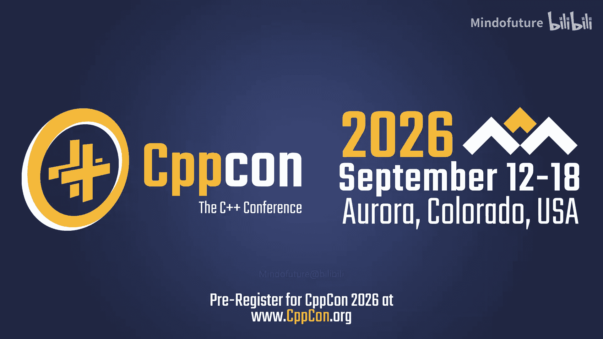
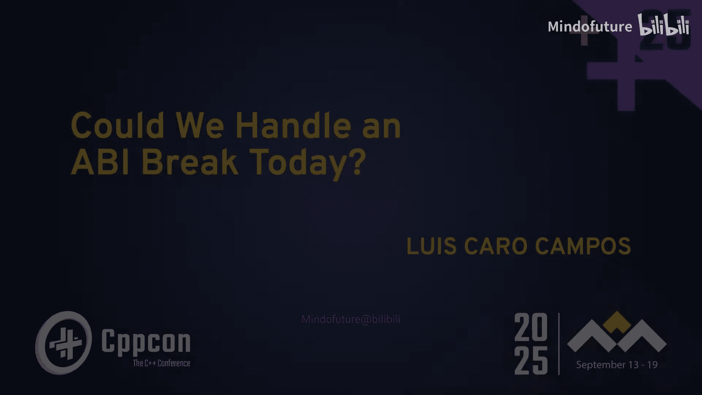
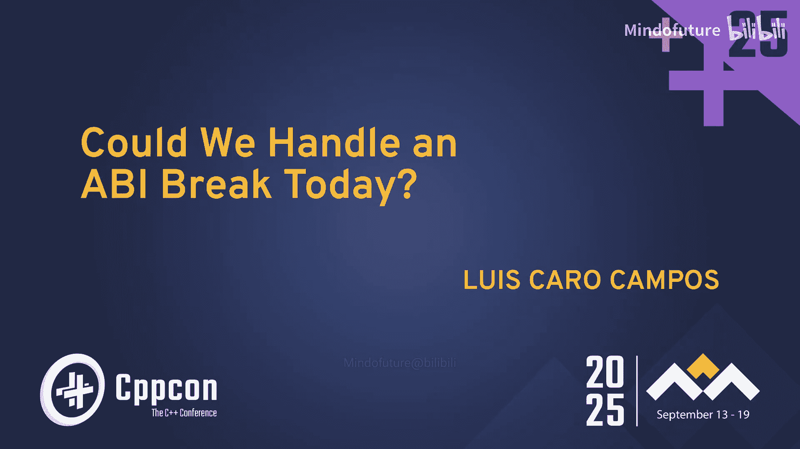
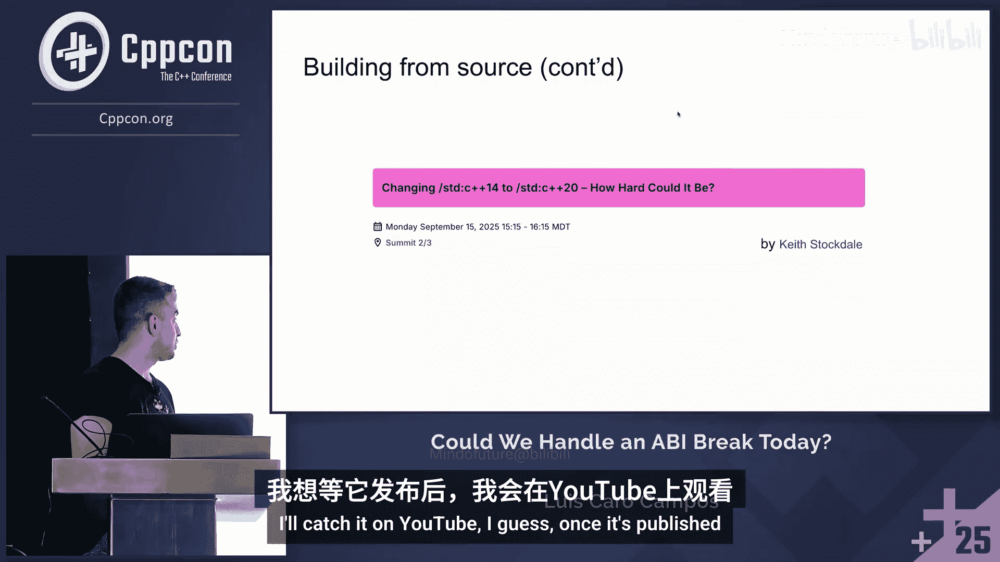
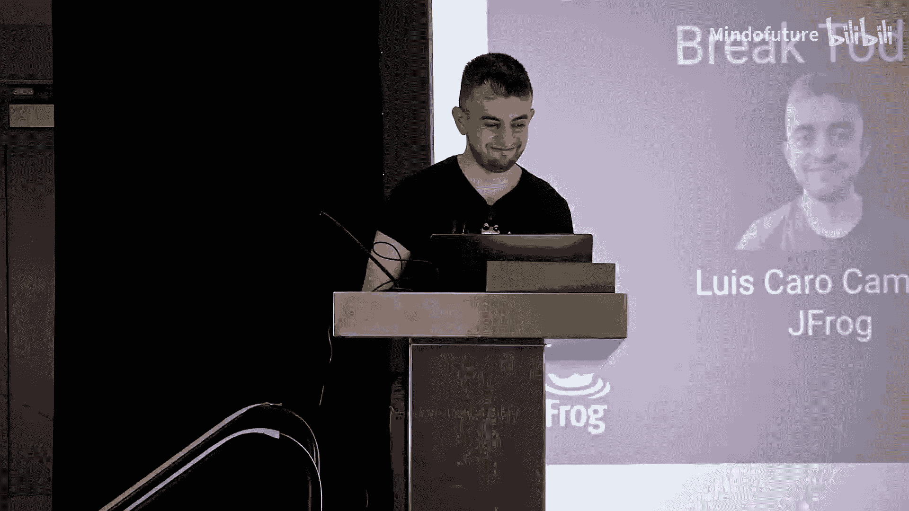
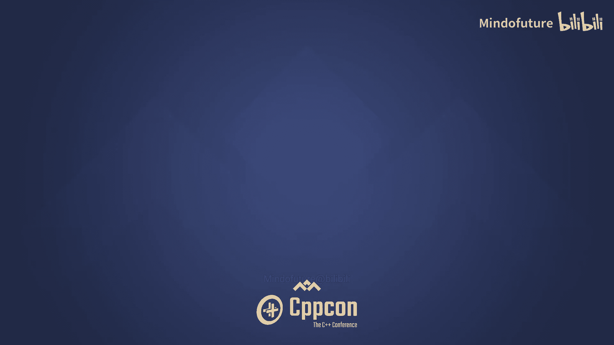

# Cppcon-2025-｜-C++-｜-C语言--｜-汇编-｜-编译器-｜-操作系统-｜-Linux-｜-Windows-p78-P78_C++开发者今天能应对ABI破坏吗？-Luis_Caro_Campos-CppCon_2025--BV1wyPBzrEeu_p78-

You think of the language that as just kind of a static tool that you're using and it's not。

 it's growing and there are other people that are researching it is really important to get out of the office and be exposed to those people and how they're making changes to the very tools that we use。

🎼，🎼，🎼没。

Cool， hello everyone， welcomelcome to my talk today。 My name is Lu。

 for you who don't know for those of you who don't know， I'm a tech in the Con team or Jfrog。

 and if there is something we care about， especially my team is binaries and what I'm going to talk about today。

😊。

Is actually collection of learnings from know the past three years working at the current team at JF。

 But also when I was a C pluspa developer before that。 And but first。

 I want to clarify why I'm not going to be talking about。

 which is this isnt a talk about whether or not we should have an AI break or the benefits or disadvantages of doing so or presenting arguments in favor or against doing that。

 I don't have a horse in in this race， right， from at least from my perspective。

 what we care about is developers not being。Not facing issues link in the programs， right。

 But what this talk is about after giving giving you guys a brief a brief context， initially。

 I thought， oh， this is going to be hypothetical of if we broke the AI today， what would happen。

 how would the ecosystem reactor or what is the tooling adapted to to be able to， to do this， but。

Working in this presentation， I kind of like eventually switched it around a little bit。

 which is first， I'm going to like be discussing examples of like how we've dealt with C plus plus APII breaks in the past。

But most importantly， how we're still dealing with linking capabilitiesil almost daily。

 depending on on what team you're in and what libraries you you're using。 And lastly。

 I'm actually going to talk about how some of the tools that didn't even exist or barely exist to 10 years ago could actually be key to。

Fhasing a new APII break in the future， if and when it comes。

 I think it's more of a case of when rather than than if。 But first。

 let's talk about very briefly about what's in AI。It's application binary interface and I think there's a really good paper about this。

 and I think from a CPP can't talk for about five four years ago as well a very very detail on what the A is but for me the takeaway here is when you have a built translation unit。

 a compositelation unit is how it talks to entities in different translation units。

 whether they are built from different source files with the same compiler compiler version or whether part of that code is in a library may have been built with a different compiler or a different compiler version So details if you want more technical background is in this paper or the resources as well and the next bit is。

Why is it a concern of the C+ plus standards Committee whether or not to break A B。

 The AB is actually outside of the scope of the standard。

 The standard covers mostly the language and the standard library， which includes templates。

 cluster functions， anything used to describe as standard library and the AB itself is actually very platform and vendor specific。

 We have different ABs for different operating systems。

 CPUU architectures like the compiler vendors as well。

 So that's way outside of of the scope of the standard。 however。

The things from the Stanley Library there are in scope for the Stan committee。

Changes to some of those things can actually result in forcing the compiler vendors to have to。

Break the A in a future release if they want to be standards compliant。 So， but then again。

 even if I have to do that， because A B is platform and and vendor specific。

 So is the way of how the developers are going to experience that。 What are they going。

 what are going to have to do。 So rather than talk about the different ways in which we can implement an A break。

 whether it we're going call the standard library a different name。

 which is happen happen before macroism when they switch from from one to another。

 or maybe we're gonna bump the S O name version。Things like that。

 I want to talk about this from a perspective of the developer。 How do we experience an AI break。

And usually， I'm， I'm gonna go from less sorry， from， from more preferable to less preferable， right。

 The first one would be an obvious linker error。 This is the， the most common way of signal。

 This is when， when I'm trying to link objects that have been built with like different A Bs。

It would be very useful。 And the linker told me， oh， hey。

 you're mixing objects that are not compatible。 This is not gonna work and have an error rather than that。

 What usually happen And， and most of the examples that I'm going to be showing today。

Is very crypto blinker errors。 This one a lot of you may be familiar with。 some of you may not。

 but I will clarify later。 but there are instances when。

 when we have an A compatibility in compatibility。 sorry that we may actually have runtime errors。

 We're gonna get a Se fault that maybe a little harder to diagnose and trace back to an actual A compatibility。

 And that's if we if we're lucky， if we're not lucky the program is going to run it may exit correctly。

 but it's not actually going to behave the way we expect。

 I've seen issues if you try to mix the open and run times in a bad way， it's just not gonna work。

 or actually， it's gonna it's not gonna do the calculations correctly that you're expecting。

 So it's it's not a fun thing to to see to be honest because you don't have much information about this happening。

嗯。Late last year， I think it was。 There was a paper that was published by the language evolution workinging group by Herb Sautter。

 which is reaffirming the design principles for future C plus plus evolution。 This was， I think。

A bit of a contested topic as well because I think for a number of years。

 there's been an intense debate on whether or not we should break the A or whether we should do it sooner rather than later。

 So I think this paper was good in the sense that it actually expresses that as a principle as a design principle for C++ to actually retain。

A BI compatibility， at least indefinitely， the way this is expressed in in that paper is kind of adding to something that was already there。

 You know， we C plus plus is link compatible with C。 So the。

 the design principle is that it should also be link compatible with previous C plus plus。

 And I'll cover that in a second。 And I also want to highlight that one that we used。

 And I think it's also very， very useful for for all of us in the lung。

 which is that new C plus plus code should be link sorry should be source compatible with all the C plus plus code。

 like new new standards should still be。😊，Comatible right but when we talk about retain link compatibility with previous C+ what do we actually mean by that right bear in mind。

 I remember the Abi is completely outside of the scope。

 So the implementation of the compiler vendors do about this is also way of the scope。

 So here are some examples again， trying to think as a developer when we're talking about retaining link compatibility does that mean that if I have the same version of the compiler I should be able to link。

 you know I should be able to build some sources some source files with C26 hypothetically and link with other source files or libraries that we build with23。

 I think we can all agree at least with the same compiler version， then the answer should be yes。

 but it gets a little trick here when we're mixing binaries that we build with one compiler version and link in with binaries that we build with an earlierier compiler version as well or for some teams。

 it's important to actually be compatible with binaries that we build like many。

 many years ago like 2020 plus。And the other way around is like。

I may have a library that uses C plus plus and numerousmer C plus plus like 26 in its implementation。

 but the actual interface is still C+ plus 17 compatible。 I've seen some libraries。

 We have quite a few of those incon center as well。

 So what are the limits to the actual statement of retaining that。That link compatibility。 So next。

 I'm going to be talking about， and you see a pattern in in this talk。

About past Cospa AI breaks and how developers experience this， right？

 I think one of the most famous ones is how the the Vi S compiler would every release of Vi studio until Vi Studio 2015。

 they would break the fully break the AI compatibility。 if you had。😊。

Object that were built with Vi Studios。 say 2005， you you couldn't link link them in a program that was built with Vis Studio 2010 in a way that C plus objects could interact。

 They were workarounds but you shouldn't have objects crossing what they call the CR T boundaries。

 the runtime boundaries， and that caused some some problems。

 So just to illustrate how often or frequently this happened until Vis Studio 2015。

 this is the Vi studio releases until 2015。 And to be honest。

 it looks like they were breaking the A very regularly every two to4 years。

 So sometimes I do find it surprising when people discuss whether whether we should break AB or not。

 because this was happening quite frequently back in the day。 although on the other hand。

 having been a Windows developer myself， it was a bit。I wouldn't say frustrating。

 but it could be disruptive for some warflows or some teams as well how frequently this was happening。

This is an example of a linker error that you could get if you were mixing a match in different runtime versions to me。

As far as linker errors are concerned， this is probably one of the friendliest ones that you're gonna see。

 you're gonna see today。嗯。One of the most frustrating things about this one is that you had to keep a map in your brain of the different versions of Vi Studio。

 depending on on what it was。 So Vicious2 to 2010， I think that was a lucky one because it was also visual visual C 10。

 right？ But the other one is like， oh， Vicious 2 to 2012 is version 11。

 but the error that I'm gonna get is， is gonna reference 1700。 This was actually， in my opinion。

 that was the most frustrating frustrating certain。😊。

About the linkers having to remember all the different versions。

 depending on what specific component we're talking about。😊，One thing。

And this is before the era of C class package managers like Kin and V package。 you may have。

Teams that had to maintain binaries for multiple versions of Vi Studio。

 And you would see folders like this。 You would see V C 11， V C 12， V C 14。 This was fine。

 Those binaries were compatible with that specific version of Vicious Studio。

 Perhaps you had to spend additional time building them。😊，If anything。

 the biggest problem is that like tooling， let's say Cm， if you do find package open Cv。

 which one does it find， right If you're not careful about which one you're supposeding to Cm。

 that's when your developers would experience like linker errors or random errors and things like that。

 So that's just the summary of the Vi Studio breaks before， Vis Studio 2015。

 although I'll talk about later about the current ones that we still experiencing to this day。

 But I'll move on to what happened to Lit C plus when Gcc5 was released。

 they decided that it was it was finally time to have the implementations for string and list to be actually C plus plus 11 conformant with with the standard。

 But rather than implemented in the way that Vi Studio was doing。

 which is of sort of whole wholesale A break what they did is the newest version of Lit C。

What it had was the implementations of both。 And they used nested na spaces to do this。

 So the mangling of the symbols inside the library were， were different。

 So these require no source changes at all。 And most， most。

ABI breaks don't require any any source changes at all。

 The same library was backwards compatible with both the old A and the new A。

 The only problem that you could have。 And I think this was very common back in the day is when you were linking objects that were built some were built with the old A and some were built with the newer A and you would get linker errors。

 And the way those linker errors look like。IThis is something that I got from stock overflow where somebody is trying to mix。

A library that was built with Ubu2 1404 with a library that is being built on aun to 1604。

 So a twoy obu2 LD jump。 and you would see I link error like this。

 Now if you're an experienced C++ developer from back then。

 these were very common and you knew exactly what to look for。 but had in the super errors。

 you had to look for AB column C X X 11 or something like STD column column and the score on the score Cx X 11 to the point where the rest of the error was almost irrelevant the information that this was given you is you have to do one of two things。

 either you build a current object with the old A or you rebuild the older object with the new A。

This is exactly how it was documented by， by Gcc。In in the page that I have here on the left is like if you see errors related to to this that mention this。

 this is， this is what's happening， right， and， and it gives you instruction on how to。

 how to rebuild with one AI or the other。 But bringing a fine print。

 what they say is like for a given GCC build。 The default value is bakegged into that build。

 You could have the same version of GCC on different distros actually be used in different different A Bs。

So if I'm not mistaken， I think U to fairly quickly decided to use a new AI。

 but obviously for compatibility reasons， Red Hat was stuck even for GCC5 on the old AI for a couple versions。

 if I'm not mistaken。 So bear in mind。 what I'm trying to illustrate here is don't trust that binaries built。

 but different versions of Gcc are actually link compatibleatible with each other。

 that's not not necessarily the case。 But another issue with。Stute Le C plus plus。

 perhaps less common one that I experimented with the other day。

 But I remember actually seeing this had to do with the implementation of a student file system。

For GCC 7， this was still fully experimental。 So the compiler flag was not even C+ plus 17 was C+ plus1 z。

 The heater was include experimental slash file system。

 The namespace had the world experimental in it。 And if you wanted to create a program and link it to use the file system functionality。

 you had to actually explicitly link these two C+ plus file system library。Now， Gcc8。They。

 they changed this。 So the compiler flat was different。

 The header no longer wasn't the under the experimental sub folder。

 and the namespace also was just like what the standard assert to file system。

 But you still had to link to additional library， so。That change in G GCC 9。

 when the implementation was actually included as part of still lip C plus plus。 Sorry。

 I type the is lips C plus。And。😊，Do you think that if I build a binary that uses。

The file system functionality with Gcc 8， I could then reuse a binary with Gcc 9。 I tried。

 So let's say I have a library， a share library。 I build it with Gcc 8 on a version of Ububu2 and I fold instructions to to use file system functionality。

 and then I tried to link a program that uses a functionality from that library。

 And in its interface it was passing， I think still file system path object right So when I tried to run it。

 I got an immediate sumitation fault right The reason for this reading the finer print of of Gcc。

Documentation is that the actual A B for C plus plus 17 features was not stable until Gcc 9。

 So and what was happening is that that file system library that you're needed in Gcc 7 and 8 was actually a static library。

 So the objects of that were inside my share library and were they were probably conflicting with the ones from the actual standard library in Gcc 9 or or above。

 So raise your hand， if you're using Gcc and C plus plus 1 year projects。Quite a few people。

 So according to the documentation of GCC as of today， it's still experimental。 So technically。

 there could be an A BI break for C plus last 20 in， in GCC。In the future， right。

I would expect that at this point， it's unlikely。 But bear in mind that that' a reality today， right？

 And then lastly for， for Gcc and even in Mac S， this were less recent。

 The last time there was an actual full break of lips C was in 2004。

 It was fully incompatible with the preview and everything had to be rebuilt unlike the one with C plus plus A where some things had to be rebuilt。

 depending on what they were using in in their interface。

 But the old version could still be installed。 And even to this day， at least on Intel systems。

 you could install the older version in the system and problems would run on the condition that you don't load both versions in the same in the same process。

 And then Mac S， I think it was around 2013， they transition from lips C to lips I think very successfully。

 I don't remember much。😊，Issues with this， although there were quite a few。

But beyond the actual linking compatibilities， that are in the scope of。嗯。Compiled vendors。

 we have others that are affecting developers or have affected developers in the past。

 I'm sure some of you may remember this one。 At some point， I would say in know，6，7，8 years ago。

 Linux is switched to using generating programs as position in the panel executables。

 There were security reasons behind it。 But if you had static libraries that had been compiled before that was the default。

 then you would get a link in linker error like this。 Now， as far as linker errors are concerned。

 the recompild with F is the friendliest linker error that I'm gonna to show you today。

 because all the others that come later， believe me they they're not。So I'm sure remember this。

 And the solution to this was， unfortunately， you have to make a decision。

 Either you rebuild the all library from source as position independent code or did you just choose that your executable is not gonna have is not going to be a position independent and everything is going to be loaded at I think the the zero address if I'm not mistaken。

 but you're probably given in a way that sort of security feature。

There was another one that we were getting inconcent reports， I think like two， three years ago。

 specific version of GLC removed some symbols from， from the library。But surprisingly。

 it only affected if you had like static libraries built that used the fastmat functionality。

 So if you were trying to use it in newer systems that had neurogipsy， it just wouldn't link。

 It was telling you that there were， there were missing symbols。

And I looked into I was recently to how how this happened。 and I found this email in the Gy， I think。

 mailing list where one of the Gcc maintenances was actually saying if you have static libraries that were built with all heaters of older G does not actually support the backwards compatibility case。

 I was， to be honest， I was a little shocked。 I didn't know this。

 And it turns out that a lot of the backwards compatibility tricks that G C that involve the linker and symbol version know things like that。

 But when you create a static library， the linker is not even involved。

 So when you were trying to link it in the future， those particular binaries didn't。

Wouldn't link at all。 So you actually had to rebuild them or do some tricks to to disable some some functionality。

 So that was， that was interesting。 I think I found a stack overflow while people were saying， well。

 you can sort of define the symbols yourself because as a global symbol space that a different story to call the actual implementation present in the in the current version。

 So there were tricks。 but I always find it funny when we tried to say that there's。😊。

Long term backward compatibility when it comes to AI in C plus plus， maybe。

 but we're still affected by， by things completely outside of the scope or the control of C plus less maintainers。

 So as a summary for these past AI breaks。 And I think some of these are the the more。Important ones。

MS SVC was breaking。A BI， roughly every every2 to four years with every version of of Vi studio until 2015。

 we're still compatible with that lives to C plus plus We have the C plus plus 11 A that was with GCC Gcc 5。

 And keep in mind， C plus plus certain， according to the documentation as of today。

 still experimental。 I I'm hoping that the AI will not break who knows。

 And then I think you're all familiar with this， if you have binaries built with G and Linux。

 They're not always compatible。 you may have issues with the actual versions of the GC symbols that they have or like I show you was this or even。

The same version of lipst C plus plus on different distance might might not work。

 and you get incompatatiibilityities completely unrelated to。

2 C plus plus Another one that that I saw the other day is not even strictly A BI。

 but it still introduces an incompatibility。 I think G C 236 removed。

 it was generating binaries with two hash tables format。

 So the same hash table in two different formats。 and they remove one of them。

 and they only kept the gen U1。 and this broke the ability to run and start certain games I were using cheat components。

 So I was research into this。 And I found a block pose the title I found super interesting。

 which is win 32 is the only table AI Linux。 and its like that's the wine emulator， I think。 So well。

 one is not an emulator。 But that's actually not necessarily a lie to say the list。

 So its it definitely there were some some emotions involved in in that one。😊。

Now I want to talk about current C++ APII issues that go after those points that I mentioned in the past when the compiler vendors were breaking ABI that developers are still experiencing today。

Returning in compatibility with with previous C plus plus， we have the Cus standards Committee。

 I'm a compiler vendors。 I think they're doing a very good job and keeping things stable。

 I think it's it's a good goal to avoid disruption， right， we don't， we don't want disruption。

 But on the other side of of this， we have library authors。 So not the standard library。Where， you。

 you know what， I understand your concern with the C plus on the library。

 but I don't have that concern with my library。 So， and not only that。

 we've been giving library authors every single tool to actually have。

AI is gated on features from either the S standard or the compiler version or whether there's some include or not。

 depending on the version of the compiler as well。 And this actually leads to the same heater files red in in in compatibleatible As when they are linked in different translation units。

 So as an example here。Let's say I have a header file that has one of those macroconditionals and the binary library is a share library that I build with C plus 14。

 And in my code， because I really like C+ plus 20， I just include a header file and I use C++ 20。

 if I have some of those features that actually result in a different API。

 even with no source changes on the on the consumer side on the color side。

 I'm going to be getting linker errors。 And this is。😊，More common than， than you realize。

 And I'm going going to be showing you some examples。Now， one way of dealing with that is， and I。

 I think I've seen this in the VC package maintainer guide to avoid having headers like that and actually hardcode the decisions in the header files so that they're the same both for the library when you build it and for the consumers as well。

So that should mean that even if the library supports multiple implementations for the same classes。

 for instance。Like using the library building a library and consuming it from different levels of the C plus plus standard or different compiler versions。

 It should still work。 So I'm going to show you an example with Appel that has this this functionality as well。

 they actually provide a file options that age that if you modify it and you hard code the decisions it should achieve that binary compatibility across different versions of the C plus plus standard。

 pertaining to the actual binary of apps cell that you that you compile。

 or at least that that's the promise， right， So that's what this header would look like。

 And then in the file that implements， let's say the variant appel variant， right well。😊。

If you're not using the student library standard library implementation， it's going to have its own。

 its own implementation right there， so。Recently， and this was about four months ago。

4 or five months ago， there was a version of GRPC that was released that required C plus plus 17 as the minimum。

 and it wouldn't be otherwise。 And I had binaries for pro and Appel had built with C plus plus 14。

 And I also had that options H hack that it was hardcoing the decisions of what classes it was using what actually what what was the actual implementation for stood variant。

 And it was used stood variant implementation provided by App rather than the standard library。

 So I tried to。Build GRPC 1，72， and I couldn't even compile it。 We're not talking。

 We're not even talking about linkers。 I was getting the most cryptic。 Well。

 I think they're all are crypto when it comes to when it comes to templates， it's my cryptonite。

 I don't understand it。 But what I could see， and I highlighted in in different colors is that。😊。

GBC was using still variantant， but then some， some of the types that I would have expected to come from the standard library were actually coming from apps out。

 So I wonder if it was ADL or something getting mixed up there。 What actually happened。

 and I I could trace it to the actual comment。Was this？

They moved to requiring s plus plus 17 as the default。 and following that， they said， you know what。

 because we know that we are in C plus 17 and we know that stood variant is available。

 Let's use that in our code。 So rather than using apps variant in that name space。

 They moved to stood variant And that actually broke the encapsulation that Appel variant was providing。

 which was causing my compiler issues as well。 So encapsulation went out the window because I just simply assume you know what。

 we are in C plus 17， we're not even to we're not even going to consider apps that was built with anything less than that without support。

 So okay， I thought， all I need to do is rebuild appsa with C plus plus 17， which which I did。

 But I completely forgot about Proto when I just continued using the binary had built with Proto with C plus plus 14 and apps with 14。

 So the result was it compiled。But let's see if I can get to the video here。So you can actually see。

What happened next。嗯。Liiner errors。 And it was not just like a little linker error。 It was。

Constant stream of， of linker errors。 So the compiler was happy The linker wasn't。

 And it was just a string of missing symbols， right， so。😊。

This was a little puzzling at the beginning。 But eventually， once I build Appel Proto and GRPC。

 all of them with C plus plus 17， it all magically worked。 Obviously， read the manual。

 Appel says that this is this is how it works， right， But it also says this is something。

 it also says， but you can use options that age for static configuration。 that didn't work。

 that didn't work because GRPC actually made made a decision to completely broke that。

 And shortly after that， GRPC also updated read me that yes。

 you should be consistent with the use of of the standards。😊，On the standard level。

 But I know what some of you may be thinking oh， this is Google。 This is upal。 This is terrible。

 not my words by red online， but it's not just upal。

 I've seen this with multiple libraries in Can center。

 I think we have like different implementations of student optional。

Some of which actually have very similar functionality and and were the same as App。

 The first time I experienced something like this wasn't even Ab。 It was with boost。

 So we were moving from in the team that I was at， we were moving from C plus plus 11 to C plus plus 14。

 And I thought， oh， we can just， you know， use C plus plus 14 in our code， enable that flag。😊。

Boo wouldn't link because there was a type or a function somewhere that was had those macros。

 that if you're in Z 14， do something else。 it's not just up， as this is， I think optional light。

 again， if available， if you include this heller。 And if it's available。

 stood optional iss going to be used， this is how you get AB，I incompatbilities between libraries。

This more。 and this one also we find we found it an app， but it was not not their fault。As you know。

 if you have an an inline in。Inside one of these。It is required be prior to C+ plus  17 to declare like this in order to actually define the symbol。

So what happened was if。You build Li that CPP with say C plus plus 11。

 and then you build main that CPP and and try to link them with c plus plus 17。 It doesn't link。

 right。 And I found this in actually， the explanation for this in a。G C bug。

 where I think the discussion goes， am I expected to be able to link objects built with C plus plus 11 and C plus plus 17。

 The expectation is yes， Does it work， not in this case， right。

 And I don't think I don't think it's the solution。 it's still open as a bug。

 I think they discuss different ways in which the symbol tagging should work for the link or to decide on one of the symbols。

 but is actually broken。 at least for this。 So this is something that users may or may not be experiencing。

 Another one completely unrelated as well， is that。😊，Visos to。

 like Windows developers are using Vi Studio。 They're actually dealing with like four different incompatible Windows runtimes。

 And I would like to say that this is happening mostly without issue。But if you' are not careful。

 and I think this has to do with either the tooling that you're using or the toggles that you're tweaking your Vi studio projects。

You're going to get a very friendly linker error。 This is good。

 What's less good is that this works well when you're dealing with static libraries or object files。

 But if you're loading DLLs。 It is possible to actually load the two dynamic run times in the same process。

 So this would be the optimize one and the debu1。 and I had a program I did a toy project to test this where I ran the program and it was not crashing at all。

 it was just not giving me the result that I was expecting。 So again。

 this is something that I mentioned earlier， there are things that can happen。

 that you're not even gonna know because it doesn't crash。 like a crash is。 A linker is good。

 a crash is less good， but still good when it doesn't crash， It doesn't do anything properly。 That's。

 that's the worst possible case。😊，Now， remember that I mentioned earlier， oh， Vis Studio。

 they have remained backwards compatible since Vis Studio 2015 and you are able to link objects and libraries that would build with different versions on the condition that the linker must be from the version of the toolet that is as recent as the most recent one from all the objects that you're building。

 right？When that doesn't happen， because you cannot guarantee that。

 you're going to get crypto errors like this。 And this one， this happened last week to us。 Well。

 we were working in the demo that we had in the booth there。 and you may， you may see Appel there。

 App has nothing to do with this。It was the fact that like if you had a slightly older version of the Vis Studio C plus tool set and the linker that was older than one of the options that you were trying to link。

 You have errors like this。 So Vis studio at the moment doesn't have a way of telling you， hey。

 this is what's happening。 you should fix it。 You maybe update to a newer version。

 So I was googling this error。 and it actually happened。

 it was reported by a lot of people using Github actions。

 Apparently there was some library that they were trying to link that was built with a newer version than the tool set that was available in the Github actions runners right but you don't know this is some internal implementation thing that like if you don't know you don't know。

 and then this happened to one of my teammates because。

They did have the most recent version of the visual Srus tool set。

 What happened was that there was a bug in the installer that。

 depending in what order you install things， it will default to an older one。 So it's very difficult。

 very difficult to trace。So this is still happening。 another one that， remember。

 this is guaranteed by the at least the documentation of V C plus plus that each of the newer tool set is still backwards compatible。

 since we should Studio 2015 is still backwards compatible with the previous， except when it isn't。

 and we've had。Isues like these reported in Con center as well， because we。

 we do provide binaries for some of， for some of the libraries。

And I saw this the other day as well reported by a user that say， ideally， we would be on the latest。

 but we have a close library， but there was an actual AI break。 And I've seen this before， like。

 if you follow the minor versions of。The visual C plus plus compilers that sometimes there's unintended AI breaks that they revert in in later versions。

 But at that point， the damage is done or they are。Known and documented。

 but they don't affect many people， but they still happen。 And you still see like。

 very crypted link errors。Another one that I I've sort of mentioned before is。

 let's say I have G C 13。And I have three different Linux systems。

 If I build a share library with G 13 in any of this。

 I it actually going to work properly on the other two， right， the。

 the the answer at least for these ones that I chose specifically， I think the answer is no， right。

 You really have to know。 So G 13 is probably going to have the lips to C plus plus。For G13。

 but on Red Ha 8。You're gonna have Lit C plus plus， the share library from an earlier version。

 And if you download the newer tool set， anything， the difference between the versions is going to come in a static library that's gonna be linked in Safa。

 So they're not necessarily going to be compatible。 And Alpine uses the muscle Lise runtime。

 So they're probably gonna be incompatible altogether。

 But a lot of developers don't actually know this。 They just focus on their file name。 And if they。

 they like need a library with like Li food do So they're just gonna。Find it somewhere。

 I don't know where。 And they're gonna try to link。 and things are not， are not going to work。

 which leads me to these really good blog posts that I found here today。 I mean。

 they use the word atrocious here。 I'm not sure I would， I would use that。😊。

But it's actually a really good article like explaining all the different binary in capabilitiesatbilities that you may find where you're trying to build libraries that actually work across multiple systems。

 Although I would like to point now that I would try to separate the concerns of runtime concerns like。

 is these library going to actually run on a certain system。

 from the can I link it in different from different compilers。

 compiler versions or different C standards， I think there's a slightly different。While Microsoft。

 for instance， they， they broke AI over2 to four years。 You can still run really。

 really old binaries， even in current versions of， of Windows。

 even on the Windows on arm that has the emulation。 like you， you can really， you can really do this。

 so。As say summary， summary for this。Microconitionals cause AI incompatibility between libraries that developers experience。

 Sometimes it's documented。 A lot of times they aren't， but it still forces developers to have to。

Investiggate why it's happening and they have to rebuild things from source。

And then the other one is like， this the better intention of the compiler vendors and the standards Committee。

 there are things that just don't actually work in terms of like being A BI compatible。

 backwards compatible。Another one is， like。At least for MS SBC。

 And I would like to say we're successfully deal with multiple incompat runtime because it's true。

 Like when you like， if you're bill in Dbug libraries， you are， you are doing this。

 I think the tooling for these， the naming conventions， they're not ideal， but it kind of works。For。

 for developers， to me that the worst bit is the crypted linker errors。

 I think I kind of wish that somebody just like got the output from the linker。 and like。

 I don't know， if Fi need to train some AI to actually tell you what you should actually do because in most cases。

 in some cases， it can probably can probably tell you。 And again， the last bit is like on Linux。

 the situation with compatibility is， is not， is not great。 You can probably。

 you can probably even guarantee compatibility。😊，On different versions of the same of the same distro。

 depending on which distro you have。Now。And remember， I mentioned earlier， it's not a matter of if。

 but when。Virtually like all， all of the three main implementations。

 they already have like a list of A BI breaks that are coming。 So Microsoft hasn't。

 and you can see on， on Github as well， because it's， it's open source。

They're planning all the little AI breaks that they're going to have all the features that require an APII break。

 And I think in the Vicious studio developer community。There's actually a feature that you can vote。

 People are actually requesting an API break。 I was， I was surprised by that。 LBM V plus。

You can also。Build lipsy plus plus with。And ABI incompatible changes from from， from the other。

 And this is good。 You can， you can actually do this。 And actually。

 lipst C plus plus has added more ABI breaks since the GCC5， the last famous AI break。

 more minor ones as well。 But they are documented。 if you， if you wanna look at the。😊。

I did documentation。😊，The last thing that I want to be talking about is how developers are dealing with incompatible A Bs。

 And I'm not talking about how we would deal。 What would we do if there was an A BI break in a newer C standard。

 But what's happening today，And。What I would like to point out is like， this is not good。 right。

 the on the scale of the the linker errors or that were more evident。 the cryped ones。

 the randomtime errors or the worst case scenario error where problems run。 But they beh incorrectly。

 I think there's room for tooling。To either give you a much earlier error there， hey。

 you're about to link in compatible binaries。 I'm not even gonna bother。 right。

 It's great if it happens  10 seconds into the build。

 It's not so great if you have like really large programs。

 because link usually happens happens at the end。 But the better case scenario is that there's no errors and you build a structure in a way that it just works because it knows what can be rebuilt。

 right。And I think tooling today is able to get us there， and I'll show you some examples。

We have good。 You're using the package manager or a bill system that will like alert you of incompatiilbilities before it even starts the bill。

Probably better is， you know what。I know I have prebuil binaries。

 I'm not even going to consider them。 I'm only going to consider bin that are know that are compatible with a target with your bill target。

 And if I don't have them， I'm just gonna tell you。

 I'm missing a binary for the desired configuration。 The best case scenario。

 If you have the ability to rebuild things from source is that your。

 your tool is able to just build a set of compatible binaries and you don't have to deal with this。

Maybe the worst pain point here is that extra time that you have built those additional bin。

 But I think it's still much prefer than crypto linker errors。

 And then a bonus for like super slot developers as well is like some of the tool actually allow you to。

Build more special bin like LT O， for instance， if you， if you be libraries with LT O enabled。

 they're only compatible the specific version of the compiler。

 I think the some of the sanitizer runtime are also AI and compatibleatible across different versions as well。

 So if the tool lets you build those as well。 That would be great。 Li to and Windows。

 I think it doesn't guarantee AI compatibility across versions of plan。 So so far yet。

 So there's that。 So I think that that would be a good。😊，Good outcome for for tooling。 Right。

 So let me start with one that actually implemented one one of these， which is Hurew。

 when Mac S switch from。😊，Lipsster simpleus plus to lipipus plus back in the day。 And I think。

 it was around 2013。 Well， Home was affected。 Like you may have had。Before certain updates of Xcode。

Libraries that were built with the old runtime。 And Horew， when you were installing new things。

 it would tell you， hey， I will refuse to install software。 it was。

 if it was built with an incompatible library， This is still much better than getting a linker error。

It may not be ideal， but it's， it's better。Linux Dis as。 well。

 they are really good at isolating all the system libraries that you're able to see。

And I would call it， I call this compatibility islands， right。

Different versions of the same disstro or different disstro。 They are more。

 most of them have a system package manager。 They're really good at isolating the。

 the compatibility binaries， so。The if we look at the app sources configuration for Uuntu。

 the words noble and the architecture。 that's all it takes to sort of describe the compatibility layer here。

 right， So that actually means， okay， this is Gcc 13， that defaults to C plus plus 17 using G C 2。39。

 technically， if you were to find a different Linux distro that targeted the specific versions。

 they are more likely to work。 So if you can sort of back translate the information of the of the version of Uuntu to the specific versions。

You may be luck here when it comes to using binaries that are built in different environments。

V C package， for instance， it does have the ability to define triplets。 They have some builtin ones。

 You can add your own custom ones as well。 So I'm thinking if we introduced a new C plus plus standard or new compile version comes along that breaks the A。

 I could you know， duplicate the relevant one and be like， okay， A B new A too。 you can。

 you can do this already if you wanted。 So if you wanted to model the incompatible versions of Li C plus plus because you want to have some bin built with the stable Li plus plus and some bin built with the unstablely C plus plus you can probably customize the triplets and to model that。

 no problem。 So V package will be able to will be able to handle that to me that that's new。

 although what I found interesting is In the fact that for the past 10 years。

 we have allegedly A B compatible。😊，Compilr runtimes and things like that。

 They still default to building from source to ensure maximum compatibility。

 So all of these things are that I've been showing you that are happening to some developers。

 There's a chance that like a lot of developers are not experience experiencing it at all because they are building from source regardless。

 so。😊，Again， trade ups of building from source。 And if you， if you're able to do that， but。

We already living in a world where a lot of developers actually not experiencing the disruptions。

Conon is slightly different。 So instead of having a concept of triples。

 we have the concept of profiles that describe the platforms that you're targeting。

 right so we have some of the settings that go in a profile are the operating system， the compiler。

 the compiler version， something that we have added in Canon 2 is the as mandatory is the compiler C plus plus standard。

 So the way Canon works is that any variation in some of these variables is going to result in a different binary package in the Canon cache。

For a given library， K actually treats if they're built with different compiler versions。

 to treat them as differently as different， sorry， so。Conon by default， if you're in， I don't know。

 If you're a Mac OS with Apple Clang 17， is's not going to consider binaries built with Apple Clang 16。

 even if they are compatible， just Conon by default doesn't do that。

 You can very much configure Canon compatibility mode。 so you can get Conon hey。

Please consider because I know Apple guarantees that theyre compatible。

 like binaries available earlier versions of the compiler。 you can do the same with。

 with Windows as well。 But we have found this as a as a good compromise as well， to say。

 at least get them by the compiler compiler version。 What we introduced in Conon in Conon 2。

 as I was mentioning is。😊，This was a very much requested feature by Kon users。

 which is I want to build some binaries with to force the version of the standard that I'm building them with。

 right and which leads me to to this discussion here。

 I've been in teams in the past where whenever we were advancing the version of the C standard that we were using。

 I was told， hey， Lewis， we need to build all the dependencies with C back in the day would have been 17。

 And I I was like why they are supposed to be A B compatible。 We shouldn't have to。 But then again。

 Ill just show you earlier all all the issues that that can happen。

 So I used to be on the left side of the discussion。

 Now I'm probably more on the right side of the discussion because。In a lot of cases。

 that actually guarantees like fewer or less probable linker errors， right。But in Canon 2。

 what we've done actually， is the compatibility mode around the C plus plus standard。

 So if I'm installing a recent version of boost and I'm working with C plus plus 17， right。

 Conan is actually gonna look。 if I don't have binaries built for that in my in my local Canon cache is going to check against the con remote mode that I have configured。

 and it's gonna check， hey， do you have it built with C plus plus 1， because I'll take that one。

 right， And this is the way we model that。😊，Compatibility that the compiler vendors guarantee。

 But what do we do with Appil。 The reason I ended up in the apple compiler and linker errors before it was because K was actually considered incompatible。

 So what we can do for libraries like Appel is in the K recipe for App cell， we say， hey， you know。

 the comp， the compatibility for the C plus plus standard。 This library doesn't doesn't do that。

 This library is fully incompatible across C plus standard。

 So Kon now will only consider binaries for Appel for the specific version of the C plus standard that you are requesting。

 and for additional safety。 we add for the consumers of Appel。

A guarantee that if you're building pro with a version of the C++ standard that is not the same as Appel。

 it is going to show an error。 Why is this， Because in K， you can actually tell gun and， hey。

 build this recipe with C plus plus 14。 but this other one with C plus+ 20 is not usually the default way。

 but we have the flexibility。 So in this case， we added those lines to actually show an error to the user So they don't waste their time dealing with dealing with linker or compiler errors。

And if you tell Kan， hey， we now go from the issues that we were seeing with App。

 the compiler errors， the in errors， and things like that。

To we support multiple A BI incompatbilities built of App And instead of having errors in Lier or compiler。

 Conan is either going to tell you hey， there's a missing binary for maybe GRPC or App for the request and configuration。

 And if you tell Conan build it from source， it is gonna build it from source and it's going to work hopefully。

 unless you're trying to mix and match manually in that case， it's actually going to tell you hey。

 what you're asking is not possible。嗯。And this is something I wanted to。

 to illustrate because it is true that we've had for the most part。

 A BI stable C runtime for the past 10 years or so。 We're talking Vi Studio 2015 and G 5。

 by Canon and V package or even seem in F content They didn't really exist before then we're not really that popular。

 So I'm thinking that if we had a new AI break。Today。

 people using these tools are probably not necessarily too exposed to the issues。

And at the same time， I know some some developers that actually use prebi binaries and therefore they would need to ask their vendors。

 but vendors also have now， because of the tool the ability to target the platforms that their customers need。

 And it's much easier than than before， for Linuxux again with all its compatibility challenges。

 we have Docker Now， Docker was not necessarily that popular back in in 2015， Vi Studio。

 the licensing model has changed as well。 I think I think for the better since then。

 I think now it's probably free for small teams。 and they've been really good at like bundling the older tool sets with the newer versions of of Vi Studio as well。

 which I hope they continue doing if and when they break the A， So that's actually。You know。

 things that we didn't have necessarily back when the last AI's breaks happen。

So some thoughts and conclusions about this。Obviously。

 while we had the big A BI break disruptions 10 years ago。

 we still have disrupted linking compatibilities that never actually went away。

 And I'll just show you a list of those that most of the ones that I show you， actually。

 we experienced in my team or were reported like in the last six months。

 right or maybe the last the last year or so。 So as far as I'm concerned。

 and perhaps we're more exposed because we're incon center as well and we deal with like making sure that people have compatible binies will they build。

😊，It's still happening， right， This also， and I didn't discuss it here。

Take any long enough period of time。And there's going to be things that have nothing to do with Cuspl that are going to force you to rebuildt anyway。

 Maybe Apple will decide that they abandon Intel and all of their laptops and the computers are gonna use a different CPU architecture。

 That's the thing that has actually happened。 So you're gonna have to eventually。

 you're gonna have to build from source anyway。 It is possible to actually retain long term backwards compatibility。

That count on trade ups。 like， I could choose to use a really。

 really old binary that I have been like， carrying for， I don't know。 20 years or so。

 if I disable position independent executables， if it's a static library or if I force to the compiler to use the pre C plus plus 11 AI as well。

 so。Compbiners have been really careful to actually enable that as an obtain if you， if you need it。

 And then lastly。I think， personally， that。When it comes to the the tooling that people are using now。

 it would be a lot easier to like a lot of people don't experience these incompatibilities。

Because they are able to build from source， even across different build systems and。

 and things like that。 So that's easier。 But on the topic of building， building from source。

 I'm going to conclude with this。😊，Obviously， the solution to most of the problems that I've shown you is you have to rebuild something from source。

 right， And that actually works。 Oh， you have to rebuild it with a a of Vicious studio or the same flags or。

Or with this， yeah， with the same flag with the same standard version。 But not everybody。

 not everybody can do this。 There are people， developers that are using closed source libraries as well。

 But like I mentioned， I think even software vendors are in a much better position to provide the under。

 the binaries as the。Compils are updated or new standard libraries are provided。And by all means。

 you should probably have a good agreement with your supplier so that when that happens。

 they're ready and you're not disrupted。 And also， I'd just like to point out from the annual C class developer survey that the library source code for third party dependencies the first response year after year is the library source code is part of my build。

 so。I don't necessarily like it， but。If you're doing this or you're using K VC package。

 it does enable you to build from source if some of these things change。By that only works。

 and that only protects you against A BI incompatibilities。 if you can actually build from source。

 And bear in mind， this is actually a design goal of the C plus last standard， right。

 and the wording of the use here is， in my opinion， like very strong guarantees，100% S。

 fractionction free。😊，Must always be available。 It like， it should be like source compatible， right。

 But then we got things like。This reported in Con Center， which is all these libraries。

 like one of our contributors tried to build with Cus 20， and they were getting failures， right。

 it could be small things。 It could be that it's actually old code that was not updated under using a keyword that is now no longer supported。

 but it does actually happen。 for me， I think that would be a topic for a whole different talk。

 right， I'ml for me。 that talk has been happening a separate room right now， was big。

 So Ill I'll catch it on YouTube， I guess when once it's published。 But thank you so much。

 this concludes my talk。😊。

Any questions？Now， first of all。Thank you so much for this great talk。

 I really loved how you did this how you basically categorized and indeed did the work to identify and so first of all。

 nice to meet you I'm library revolution chair， the group in the ISO standard that is in charge of standard Library so nice to meet you I did wanted to highlight two things actually first is that。

When we talk about ABI compatibility in the standard， it's when I define a track， for example。

 and define its members， it's not necessarily the ABI compatibility of different implementations can do other things as well。

I guess maybe it would be good to do this separation。

 but I do agree with you on the general note of you know there are the issues that you floated or exist。

 And I also wanted to thank you you know for actually identifying or the tagging aspect of tagging the version tagging the compile the AB version of things。

 I think that's the way forward。 I think it's really， really useful。

 And I think you know as as an industry of you know software develops over time。

 And I think that's really great that that that feature that you showed of Conan is exactly the way that we can move forward。

 But anyway， I just wanted to thank you， first of all for the hard work of collecting those。

 I thought it was very insightful And second to thank you for the solution that you've been working on。

Awe， thank you so much。Thanks， Louis， terrifying talk。As a library maintainer author。

 what can I do to be a good citizen in this situation。 Good question。 Well， first of all。

 I think you have to choose whether you actually want to provide like AI compatible libraries to your uses。

 right， always talk about thes So have a look the concerns of the standard library maintainers like there are like there's very good documents and papers about this and talks。

 I think as well， if you want to be if you want to provide this as well。

 a lot of developers are not even aware of this， they're not aware that if you change the order。

 I think are like virtual functions or something like you can actually cause an AI break。

 And I've seen the S and T library， I've seen a couple of。

Involuntary A high breaks across releases that were fixed afterwards。 they they do happen。

 So I think there's there's some tooling that you can use to detect A B brakes in your C。

 I'm not sure if they like good with C plus plus， I think Abigail is a tool or library that can be used。

 So I'm trying to explore it as well for K incentive to detect whether we have these issues to avoid them happen in the first place。

 so。No worries。Any other questions？奥 one breath。Yeah one minute。This might be quick。

 How often do you find yourself patching packages to work around A issues like hard cutting。

 the standard flags or feing and something that shouldn't vendor or something like that。

 we do so because Canon users now， at least going to users expect the libraries to be built with a specific version of the standard that you tell in viaconon。

 right， We have to patch a lot of libraries is are hard code than the Cx。 So that's very。

 that's very frequent。 A BI issues。It's tricky because。As I show you from the linker error。

 sometimes it's not evident that it has to do with APII problems。 So we need investigation。

 So the actual GRPC one that took me like a whole week， probably of experimented things。

 but it's quite every few months。 I would say you showed be statistic about most。

Engineers claim to copy their dependencies， source code into their projects。

 And I just wondered if that caused problems within。Like conan packages like， oh， I。

 I just put my project in the conan。 And it includes the source code for protobuff or something。

 So I don't have any problems all my users do or something。 We。

 we try to not like in Con center to not have like vendoring libraries as well。

 So hopefully that mitigates the problem。 But yeah。

 like we it's only compatible if the libraries themselves are A compatible。 And then again。

 it takes somebody researching the linker error because we don't know beforehand。 Thank you。Hey。

 nice talk So over the Beaman project we've had a long， long， long conversation about this issue。

 specifically what we call flag forking， which is those options that you were talking about creating a potential ABI in compatibility。

And also the idea that your CMake would say set a certain version of the standard right And so we've taken a very strong position that your CMake for your library should not ever set that C++ standard and so what we're basically doing in the header。

 at least this is some of the libraries， it's not 100% consistent yet is if you require C++ 20 which most beamM projects actually do because they need concepts essentially you'll just fail to compile So if somebody just takes your you know header only library。

 for example and drops it in their project and they don't have their settings because see the flaw in the thinking of doing it all in the CMake is basically that they're going to use your CMake even if they're using CMake。

 they might have their own CMake and。The same thing with those options and flags。

 So you showed a slide where you had the you know， has include。

 I think at least where I've gotten to personally， I'm not sure the whole project is on this yet is that that's totally valid。

It's just that in the header， the library should set defaults that it makes sense。

 And then if the user wants to handwrite that options dot H for their project。

 they're free to do so and override the defaults。 And I think that's I think that's the best practice。

 you tell me if there's a better practice No， I fully agree， in fact。

 what you have described what you do in via headers。 That's what Conon does via the configuration。

 So I know that you could have a seem file that uses the compiler feature flags that will force the consumer。

 if they're on an earlier version like bump them to the newer one and transparently and they don't even have to do something about it。

 Conan is different。 Con， what they will do is like it will tell you what the minimum is。

 And in some cases， the maximum， because' as well。 And if you're outside of the balance。

 will on the consumer I will give an error and you have to figure it out。

 including sometimes not having a solution But we will not force consumers to。

Change their super plus standard level without them knowing that does not to say like they decide。

 right， Yeah， no， exactly。 I think that's a real problem。

 And so the last thing I'll mention is if anybody， if anybody knows about vector the hallway。

There's just one comment。 we're over three minutes over。 Okay， so went to。 Yeah。

 vector Bull has a great blog post on this just saying Thank you so much。 Thank you。 Thank you。😊。

