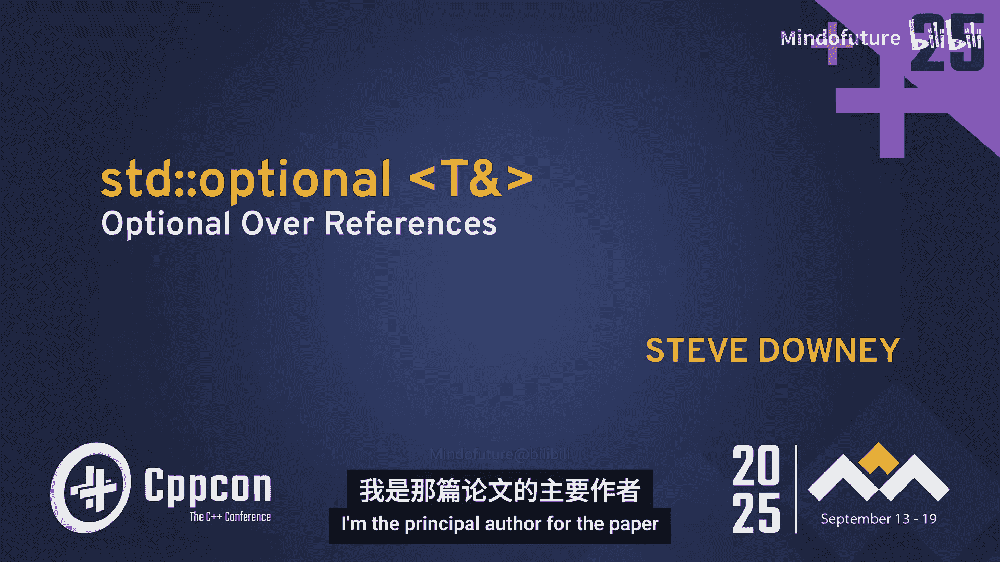
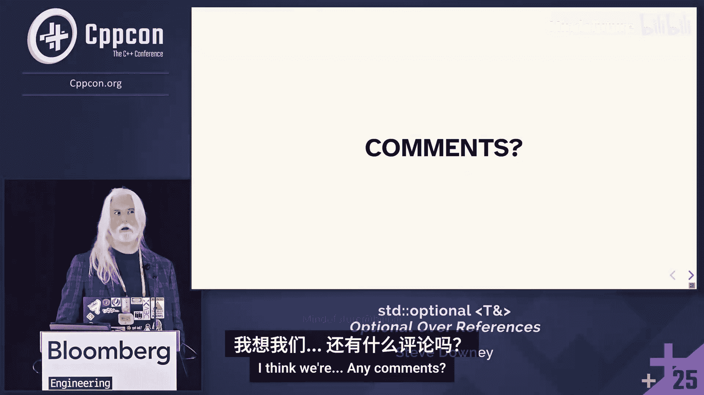

# Cppcon-2025-｜-C++-｜-C语言--｜-汇编-｜-编译器-｜-操作系统-｜-Linux-｜-Windows-p80-P80_std__optional的演进_从Boost到C++26-Steve_Downey-CppCon_2025--BV1wyPBzrEeu_p80-

Hi， my name is Steve Downey。 I'm with Bloomberg。 I'm the principal author for the paper that finally got stood optional over references into the standard。

 So be talking today。

About what we got in。

Why it took so long and what we expect to get out of this and what we don't expect to get out of this。

 And a bunch of things that we still need to do。Some with optional and some with other parts of the the standard。

Title slides。 So I don't accidentally lose the title slides。 Software used for preparation here。

 intent is that this should be accessible， legible， It's like for everyone。

 good contrast with colors， etc cea。So standardizing optional over references。

Optionals for first proposed in 2005， optional over a value We got in in 2017。呃。

Optionals for L value references were voted in at the Sofia meeting in June。呃。

The original proposals for optionals with references for optionals had reference semantics。

 which were pretty much what we've ended up with。Why this takes so long。

 And That's it considering that everyone was well meaning and had good reasons for disagreeing over what they thought what they thought should be going on。

So it's like， yeah， we had boost optional coming in with the reference semantics that it has today and。

There was a proposal that made it pretty far for C++ 20， which was not adopted， and then fortunately。

he Jeanhein Minz， who is now the editor of the C standard after getting frustrated not getting optional over references。

Did all the archaeological research to find out what things had actually been done and what were the competing reasons for things being done certain ways。

That LED directly to my paper， which is we should just do this thing。 And then， of course。

 it turned out there were far more details than I'd I'd thought there would be。Yeah， so why so long。

 It's like， how did we address concerns， It's like， what did we end up with， what remains to be done。

Core problems is basically reference semantics for a language reference。They're weird。

References do roughly three entirely different things in the language。

 They define a calling convention semantic。 you pass by reference。

 great for things like operators where you want to just operate on things or by。

Not making a copy for the thing that you want。 The other extremely useful thing giving some expression a local alias。

 which ends up taking no space。 The compiler just says， oh。

 you've given this thing a name that this dot that dot。

 the other thing arrow even something further out there。😊，You give it a name。

 the compilers like good， I will keep track of that for you。 It's just an alias。And then， there's。

We can put in a reference in astruct。And that's complicated and terrible。

 If you've ever put a reference in astruct and suddenly， you know。

 you lose all your special member functions。 All the default things no longer work。

Because references are strange。 It's like the fact that we can't reassign them is like very useful when you're treating it as an alias。

Doesn't come up when you're treating it as as calling convention。When it's an object and astruct。

 which is going to take up space。It's peculiar。So there was it's like a lot of strong theoretical justification。

 like， okay， well， then an optional with a reference in it should act like a like astruct。 Its like。

 it should have a reference member。 And once you bind it， you're done， right。

Except no one really likes that semantic。 It turns out to have a lot of additional problems。

 but it's well motivated that it's like it's like we'd like optional of holding a reference to act like a struct with a reference in it。

U。this this argument goes under the banner of a through or rebind。

 it's with a sign through being like just pass through and go to the underlying if or do we rebind on an assignment from a T and make this thing refer to something else。

And if it's actually a reference， well， you can't do that。The key observation that Jeanheed made。

Both through his own library and doing a lot of the research。If you make it state dependent。

Of what happens to in an assignment， if， if assigning to an optional that's disengaged behaves differently than an optional that's engaged。

We cannot reason about it。This is provable。 We have all the bugs that anyone who's tried to do this has created。

If you have to reason about the dynamic path your program took to figure out what it does。You won't。

 And that you want to be able to reason about what your program does by just looking locally at the code。

So what we've ended up with is that optional over a reference just has a pointer inside it。

We constrain a lot of things about that pointers， but it's just a pointer。This also has some other。

Issues with it。 So let's just do a quick option overview of what an optional of just a T is。

 Is it It's an owning type。There's， there's an an object in there。

 And there's one And this is a value semantic type。 You can copy it。 You can do everything。

 Anything that the underlying type lets you do。 You can do with your optional T。

 It just has one extra bit of information that there might be nothing there。

 So this is useful if you don't otherwise have like an out of band value。

 So it's like you don't have a way of expressing E OF because you don't have an extra value to say this is is out of band。

 It's like， I get one extra value from this。And that's the one that there isn't actually a T in the optional。

But。Very useful。 And yes， this is what null nullable pointers act like also。

 that null value for the pointer where it's like， oh， we've got an extra bit of information。

 Its because 0 is otherwise not a valid。Address， sometimes they're architectures， buts you know。

 algebraically， it's T plus1。 There's one extra value。

's say there's everything that you can do with the T plus one extra thing。 Loly。

 it's a stood variant of T and stood monot。Not actually implemented this way。

 but this is also important to keep in mind， because。

A big part of the long discussions about how to do this for optionals or actually proxies for what we really want to do with algebraic types like variant。

And expected and a lot of other earth things。But we ended up having the argument over optional。

 first。This is part of what's now we can start doing the rest of that。

 now that we figured out what the。Semantics that we'd like when we say we want reference semantics are。

 So the core use case for for an optional， iss like， I'm reading from a config file。

 It might be there or not。 And it's like， this gives me a better way of of modeling this in the code I less likely to forget how the case where the optional is disengaged because it's staring at me right there is being an optional。

In with C plus plus 26， we can use this cute bit of syntax。

 The syntax is a little bit controversial only because people aren't used to it。

 But this iterates over optionals now a。 It's not a container because container has a long list of of things that it has to support。

 Rnges just have to do begin in end。Begin an end for for an optional。 It's like if it's engaged。

 you get a pointer to it and end is one past the end， if it's disengaged。

 you just get the end pointer and this will iterate over the over the optional。

 either zero or one times。The nice thing about it is that if you know that if you're in the body of the loop。

 you definitely have a value and you don't have to worry about it after that。

Not a big deal on Slideware， where you've only got 1，2，3 lines of code。 I know in my own production。

 business logic code， there are big chunks of code where I have to go back and look to see if I've actually checked if something is null or engaged or not。

It's like having the optional It's like with something like this where I never get in。

It's a little easier to read and reason about locally。嗯。

It the other important use case for optionals are a default， optional parameter。This is useful。

 but it's also one of the reasons that optional is so complicated because we want to be able to use it interchangeably with the underlying type or things that are convertible to the type that we've got in our optional。

 So so you can say that I I have a default parameter of an optional int and by default。

 it's disengaged。 But you can pass me an int， it'll get promoted to the optional int。😊。

This adds a whole bunch of constructors and a whole bunch of conversions that。Make it。Challenging。

To implement correctly and not have any surprises。We're not good at reasoning about overload sets。对。

诶。There might be a couple of people in here who are。 but in general， like our normal instinct is， oh。

 I've it's like， if it's this， it's other over here， if it's here， and it's like。

 we go off on this side of the decision tree。The compiler just looks at the whole thing as a set at once and finds the best match。

 according to the rules。And that can be surprising， sometimes。

but here it's like we're using a default optional parameter。 I can。

 it's like call the same function with with just one inch or  two inch and works as expected。

 It's a nice convenience feature when you're working with with optional arguments。Okay。

 quick overview of optional T ref。 like what we generally want for it without without getting into a lot of the details about it。

 It's a nonowning type。 there isn't。 there isn't any value inside the optional。

 It's referring to something somewhere。 It has reference and value semantics， which is pointer like。

 Pointers are good values。 You can copy them。 You can compare them。 They've got their own identity。

 but they also can be dereenced。 They have reference semantics。

 And that's what we want for an optional T ref。 and they have one additional value representing the empty state。

 and weve。Essentially mandated the core optimization that that's the null pointer inside the optional。

 There's no extra space for extra bits that indeed for this。Core use case。

 looking up something for modification。It's like， so today， you've got a map。

 you find things in it and。This is unsatisfying。 You always have to deal with first and second for the it because the iterator。

 the reference type for a map is a pair of the key in value。 And if you just want the value。

 you've got it like。You know， right second or first or something。 and it it's noise， you。So以。

What we'd like is to just return an optional in ref， for example， and it's like。

We still have to check if we got one or not。But the code's a little more straightforward。

 in terms of。Being more likely to be correct。 there's there's some。

 the fact that it's an optional hints that you ought to check to see if you， if you found the thing。

啊。It's a and also， since it's a reference。We can mutate that value。 So you've got your collection of。

People in it's like enemies in the game。 And you can change their stake in them and， and。

Do the kinds of things that you'd like to do without having to deal with pointers per se。嗯。

There's also some utility for them as a optional reference parameter instead of a pointer。

 pointers have。Way too many possible semantics。Describing like this logger as an optional。

Tells you that the thing that's receiving it is not going to like try and delete it or do something else to it other than it's going to。

 you expect it to be valid。After the function returns， its like。Clear clear。

 implicit contract as clear as implicit ever is。So以嗯。And by passing it as an optional parameter。

 if someone doesn't pass you a logger， you can just skip over the logging part， for example。

It's not a great's dependency injection framework， but it's kind of a minimal dependency injection framework。

 It's， I've yet to see a really good C plus plus dependency injection framework。 there's。

Trade offs that it's like。I don't believe it's impossible， but。

There are some language proposals kicking around， it's like in the space of aspect oriented programming to make this kind of thing easier to express。

 but that's a 29 or 32 thing。Okay。Existing problems with optional。呃。

Construction and assignment from the underlying T or type convertible to a T。

Inevittable surprises and deep complication in the implementation， particularly because we want to。

For optional T ref， make it as safe by default as we can。

We have some new technology in the exposed in the standard library， though， that helps us。

 We can ask if， like， if this conversion would produce a dangling object， like。this might be convert。

 this U might be convertible to a T， but it's only convertible because it converted to a whole new object。

 And now I'm taking the address of it。 and it's about to vanish like。We can detect that。

And prohibit it。Basically， you'll get a compiler error if you。

 if you tried to construct that that thing， It does rule out some some valid use cases。

But in ways that it just means you have to write them slightly differently。 It's like。

 if you really want to pass something down like into a function where that conversion might otherwise be dangling。

 you can't manage the lifetime。Put it in a variable that you own before you call the function so that the lifetime is clear。

It was like。And then it's on you。 if the， if the function that you call staes a。

 the address or a reference to this thing that's going to go out of scope。 eventually。

 we can't make everything safe。But safe by default was a very much a design goal。

This overlaps a lot with the design problems for references， generally。But the core thing we had。

 as I alluded to earlier， is sign or re。It's like， I have two cats， Finnin， Loki， their brothers。

 both orange， share one brain cell。What do these assignments do。What do you expect them to do。

 It's like， I've got an optional cat reference that's empty。

 And I've got a second one that I've initialized to refer to thin。 I'd like。

What happens when I assign maybe f to maybe cat 1， What happens when I assigned Loki to maybe cat 2。

Reasonable people differed。对。And it's important that it's like very reasonable。

 very smart people differ about what we should expect for this。So， should they be allowed at all。

 for， example， it's a。We've。We've decided that。The rebind is the safe semantic that produces the fewest unexpected results。

Those two assignments will always red so that after those assignments， maybe cat1 refers to Finn。

 maybe cat2 refers to Loki。 And that's predictable。

 no matter what the states of those optionals were。Before those assignments。

 So you can always reason about what the code is going to do。 You don't have to try and figure out。

 was this engaged or not， Is there some failure mode。

 Maybe it should throw an exception if it's bound or just not do nothing or worse in some ways。

 It's like。Turn thin into Loki。Because as we've assigned assigned an engaged optional reference like。

So， the other。Serious concern is that this makes optional a somewhat non generic template。

The specialization for optional T ref is entirely different than optional T。

 A lot of languages with generic systems don't allow this for good。

Sound reasons that you want to be able to reason about the， the behavior of the a generic type。

 You want to be able to have them all behave the same。 We don't want to create another vector bull。

I hope is everyone here familiar with the vector bull problem。yeah。

 we specialized in the language in the library that vector Bo is magically different than vector of anything else。

 And it turned out to be extremely broken and is a problem to this day。😊，But not quite so broken。

 We can't just delete the delete it。 People are actually using it successfully。But the problem is。

References in C plus， plus are kind of weird and non generic to begin with。所以。The way I。

 the story I tell myself about this in terms of generosity， we're not actually saying。

 I want a T ref inside this thing。 I want reference semantics。And unfortunately。

 reference semantics in C plus plus aren't the same as value semantics。

 And you have to write things differently。 Lots of languages。 In fact。

 I don't think any other language at this point has something that looks like a C plus plus reference type。

We've had extremely good success with them。But also。

 a lot of edge cases that other languages have said。

I'll have pointers or something else that's more pointer like for this category of things。嗯。

So what were some of the design choices we had to make after just agreeing on this， because。

After it all this time， it I was like， okay， we finally got agreement on this。

 I just have to write that down and we're done， right。I was wrong。

Still took a couple of years of work sorting out all the other parts of the design choices。

 Big one was， what does make optional do， Now， it turns out make optionals mostly been replaced by CTt。

 You probably don't actually need to write， make optional in your own code anymore。

 You can just write the。The conversion from the the type to the that and it gets deduced。

 But make optional always returns an optional T。 even specifically if the expression that you you're doing over the make optional is reference。

 lots of expressions are references，We didn't want to change this。

 We didn't want to make any other surprises。 And it turns out today， you can write。

 make optional T ref， and you will get an optional T。Falls out from the fact that it's like。

 that's just the。Deduction from it because it's like the we want the the expression in make optional。

 even if it's got a reference。 It's like the return value from a function。

 You don't want to accidentally get an optional reference out of that。

 You just want your optional T the way it works today。 We don't want to change that。

It's kind of unsatisfying。But can you buy some reference wrap to get the option。No， but you can。

 you can do some things in that space。 It's like， it's easier just to actually just write optional T ref。

 whatever expression。 And you get it。 You don't need this at this point。

 We've improved the language that you don't need the a lot of these helper functions today。

Other important questions， what is the value categories effect on the value function。

What should optional T refs value if that optional isn't R value or R value reference。

 What should the， what should you get out of that。We're modeling pointers。

Which is a reference is a reference semantictic type。

The value category of the optional does not affect at all。What you get out of the optional。

 if you do referenceence it， it's shallow。Otherwise。

 you could accidentally move from that optional T ref。We found some bugs in this space。

 We'll get to that。 I's say。It's aops11，24。 Yeah， cons similar。 It's shallow or deep cons。

We're using shallow const。 the language， C plus plus the language itself。 Kst is shallow。

 saying you've got a cons thing with reference semantic doesnn't tell you anything about what happens when you dereference it。

 If you want a。Optional constant breath。 That's how you spell it。It's like， you can。All good。

 You just don't get it by default because the optional key ref happened to be constant。对嗯。Now。

 all language references are constant。And it doesn't matter where you put the const。

Because you can't red them。 So it's a little bit of non uniformity built in optional T ref just acts more like a pointer。

 And， in fact， there is just a pointer in there。But yeah， optional T ref。

 It's a reference semantic type。 It's not a reference。Conditional explicit was another one like。

How much， how much do I have to spell things out。I would have ex preferred actually having explicit everywhere。

Too much existing code， too much too much pain， too much noise， so。嗯。

We pay for it in the library design work， there's a lot more cases where we have to make sure that the conversions were falling into the right constructor that we want and we've worked it out。

But we're conditionally explicit based on what the underlying types explicit in this is for its construction。

嗯。Like value or was another one。 All the choices we had up had for what should value or return surprised someone and someone's code was not quite right for it。

Great。If you can't make anyone happy。Do the safest thing and come back to things later。

 which is what I am planning to do。 Val or is always now returning a value。 So it's like。

 if you say value or on your T ref， you're going to get a T out of it。对。嗯。

Ran out of hours in the day and time before we got to the end of the standard cycle。

There are a couple of proposals， including mine for like generalizing these functions。

 so we could have a value or that actually does。Way better on all of the things that are kind of optional。

 like， including pointers。 What we'd like to be able to do is like， for example， though。

 have it return the common reference type or common type of the things under question。 So you know。

 if you say value or。Reference to this U。 It's like， okay， I want the common reference of T and U。

 It's like as the return value of that。We couldn't say that。Until fairly recently。

 we just didn't have the library technology built yet to do it。But it's like。

 we're doing exactly what optional T does。 So your code's not likely to break。嗯。In place。

 T construction supported。But there's no place to construct in。 So we check for dangling。

 And it's like， if， if the thing is something that we can take the address of that isn't。

Immediately going to evaporate， that's the in place constructor。Right。

We avoid conversions that produce temporaries。 We have to avoid some confusion between。

 it's a construction from an optional U ref versus an optional T versus a U or a T。

 It's like there's a long list of constructors for this。 The nice thing that did we。

We did realize nearly at the end， but just in time， turned out we only needed one assignment， though。

 since we're just copying the pointer。呃。So principles in reifying the design。 we。

 we figured out the design， but we want to make this as good as we can。嗯。

Avoid taking references to temporaries。 like we check all that。

 we check the dangling properties so that it's like， if this conversion produced a temporary。

 that's not good because weve take the address of the temporary。

 It's going to vanish at the end of the expression。 It's like everyone here has written this bug。

 I am sure， because it's so easy to do。 we fixed it for a number of cases， in particular。

 range four loops。The temporary that's constructed in a range for loop now lasts over the entire for loop。

 It used to be that if you had map dot thing dot something， you could get a temporary and like。

It would a lot of times appear to work because the compiler wasn't aggressively cleaning things up until it hit production。

 and it was。so it's like， this rules out some safe cases。

 but it disallows so many more dangerous cases。嗯。We delete the dangling overloads rather than put a requires clause in。

 So that means that you get an error much。Sooner， and you don't fall into some other unexpected case in the long list of constructors。

 We， we want to tell you that the thing you wrote really doesn't work。 Not。

 We found a way to make it work。Or the compiler did， really。 That's it。

 assignment of an optional T ref。 It's equivalent to a pointer copy。

 and all assignments are through the single function。 It's nice from standardization。

 also turns out to be nice from a compiler optimization point of view。

 This is very transparent to the compiler。 It just does It does the thing that you hope it would do of just copying copying pointer values around。

😊，Mod， of course， the terrible things we learned about in the last session about pointers app and invalid pointers。

Hopefully that'll be fixed soon。嗯。The other thing I want to talk about。

 because it's important for stood optional and the reference implementation is actually Project beamman。

嗯。Began last year at C++ now， 2024。 I want to be clear this is before I get into it。

 this is not a requirement for standardization， but the important thing about standardizing things。

 it turns out all the details matter。嗯。We have done a lot of things that put into the standard thinking。

This is obviously， implementable。Sure， the implementation that you've got at home isn't something you know。

 is proprietary and has some extra craft in it or whatever。

 It's got some extra constructors because of the legacy of everything you've ever done with it。

And we've made mistakes these this way。It's like， you know， it turns out that it's like， oh， yes。

 that set of constructors is not good。 It's easy to make mistakes。 It's like。

We thought we could make this thing const or make it explicit。 But that turns out to cause problems。

 but it doesn't for your implementation， for whatever reason。

We really want to see an implementation of the exact thing that's being proposed。

 And that's one of the things that Project Beman is working on。It means that。

Before something is finally standardized， it's going to be A BI unstable in Project Beaman。

L E W G says， you know， we've decided we'd prefer this set of names for things。

It's not going to have two sets of names， It's going to have just one name。

 it's going to have the names that are functions that are specified in the standard。

 You're going to have to change your code to keep up or use an old version， whatever。

 but the goal is like we can reason about the things in the standard and the things we're planning to put in the standard because we've got something that is exactly that。

 and then we can easily answer questions like。What if I made this constant instead， Like。

 would that be better， And it's like。I made this con and five test cases fail。 Okay。

 maybe that isn't such a good idea then， Or maybe it is。

 And there's something wrong with those tests。 But it's like certainly much better than coming back after it's like an entire meeting cycle and saying。

 oh， yeah， the thing that you asked asked me to do。 It turned out to be bad。

 We've got to go back and reiscus it。嗯。Now， because。

I'm not smart enough to write standard ease without an actual implementation in front of me。

 I had an existing implementation。 so， and I was able to confirm live at the Tokyo meeting that the proposal to。

Turn optional into a range would work。 It's like， I put the functions in that we were being proposing。

 took a bunch of test cases that I had for competing range of 0 or one。 They all passed。 It was like。

 yes， this can work。It's like there's no particular problem with this other than do we want to do it at all or not。

 Its there's no tech， there was no technical barrier for doing it。

 And we decided that it would be better to have just one thing that was optional。

 like in the standard than two or three nearly related ones that fit slightly different use cases。

I'm not 1000% sure。 That's the best。Way to standardize things。

Other language ecosystems do have more choices， And you actually have to read the docs。

 Do I want this thing or this thing， because they're close， but not exactly the same。

C plus plus standard library tends to have one big one thing that does everything。

And sometimes that means it doesn't do everything well。Yeah。

Stood string has way too many things in its interface。 And we've always known that， it。Yeah。

 the only problem was was it with bringing it into Project Beaman is that my scratch framework for doing things was like written around CMake 3。

11。 And a bunch of things did not port forward cleanly。

 I was apparently relying on some bugs in CMake at the time。 and it's like up the version。

 And it's like， oh， yeah， that doesn't work anymore。 it's like，What I was doing to install。

 for example， never should have worked。Like it looked like it was working。

Which is the worst kind of working。sick。I don't know about you， but it's like。

When my code does what I expect。I think I'm dumb。Ship it like。It's like， okay。

 I got a package install working。 Great， O， move on to other real problems。 I nope。

 wasn't working at all properly。 If I never should have worked。 It did by coincidence。

Got a lot of help in fixing it up。The other good thing about having this in Project Beaman is lots more eyes on it while we were doing the standard proposals。

 A lot of people came in and were like， does it， does it satisfy my use case。

 This looks like it has a problem that I may have run into。 and we took。

 we got a lot of improvements built in， This in particular， The ref stealing bug。😊。

So I've got my cat fin。And I create a cat reference to Finnin。 Then I have an optional cat。

If I move that maybe cat ref to to maybe cat。Today， boost optional。Steals the cat and assigns it。

This is rather surprising。And's。It's an edge case， corner case doesn't come up that much。

But there are real bugs because it's like， once I fixed it。

Found a bunch of places in my own code where， oh， yes， this could happen。

 And it probably is causing this weird crash one out of 1 thousand times that。

Fixed it now for for optional reference。 I， it's not fixed， robust。It's， I think， fixable。

 but it would。 it might break some existing codes。 So but the core thing was。We're。

Optional was specified。To move the result of operator star。Once we had an optional T ref。

 the value category you got out from operator star was not predictable like because it was not always just T ref。

In particular， and our value optional。A PR value of optional。

 You can move from that because it's about to expire so you can enable move semantics from from that expiring optional。

 And it's a win。You don't want to do that for your optional T ref。

 because just the fact that the optional is expiring doesn't tell you anything about the thing you're referring to。

So。Now， this， this overload doesn't exactly doesn't exist。 It's implicit。

 but this is the core of the problem。This is an actual general principle I've figured out now。

Don't try and reason about what you can move。Don't try and think， well。

 I know what this function does。 and I can put the move outside of that。 It'll be fine。

You areYou can be correct today。 you may not be correct tomorrow。It's like operate。

 operate and move on the things that you know， you're entitled to move from and let let those things determine what operations are allowed on a move。

 which and a move is just a cast on the cast to PR valued object。

So you want to write stood move star right hand side， the thing that's coming in。

 rather than star stood move right hand side。You don't know if that right hand side is is like good to move from。

 And you certainly don't know if dereencing it after you've said it it can be moved from is really what you want to say。

The next time you're coming in with these things。Move semantics are。Difficult to reason about， but。

Like the best moves you can write are the ones you don't have to。 like return optimization。

 like that's always going to be moved。 Never write a move there。 If you cannot write a move。

 you're better off。Writing a move is explaining to the compiler something。

 And that's always risky because you are not。Necessarily smarter than the compiler。

 On a good day you are。Friday afternoon， I'm not。在。Okay， as weuded for the modal use case。

 the most common use case for an is looking up something and failure is not exceptional。

 like we don't want to throw an exception。 We found out。

 say you didn't find the thing you were looking for so you we want to write a getter for the for the key type in the map and get an optional reference out for it。

 We're going to add this for associative containers for C plus plus 29。

It's not in yet because having both C plus plus 26 and 29 in flight is way too confusing for everyone who has to deal with the standard itself。

It's a big it's know。3000 pages of lotte。 And it's like， yes， it's in get。 We could branch it。

 but no please。嗯。Yeah， so P 30，91， Pablo Halpern， better lookups for map， unordered map and flatm。

 It's been reviewed It just。We couldn't get to it in time for this cycle。

 It's going to show up fast because it's really easy to write it's like no implementer has any concerns about about this。

 just time in motion， though， It's like we were focused on things of much higher value。

 It's all the reviews for Cdy， the M span executors like。High value。

 important things that we all wanted。Just took priority， like only so many hours in the day。

But best time to get things， simple things in is really early。So I've got now a list of things。

 I want to start getting ready for 29。 So as soon as the gate opens， like， here's three things。

 They're all trivial。 Let's just do them。あ。Please use the microphone。Sure。In the audience， thank you。

Okay， well hold it's， yeah， since this was we had reached the last slide。 it's， but yeah， questions。

 remember， questions starts with who， what， when， where， how， why goes up at the end。

 More of a comment than a question。 Let's hold them for a moment，But shouldn。Sorry for the interrupt。

 on that last slide， it's vector race and that kind of stuff included in the vector doesn't have the lookup problem。

 Well， it does。 It doesn't contain infinite elements， right like。

The index has to be between serial size。 O，That hasn't been proposed。 It's like you could be。

 And it's like， honestly， that you could write that almost as efficiently as we could。嗯。

We can do it more efficiently inside the containers than you can outside significantly。 So。 I mean。

 as significantly as a two or three line function is going to be。

 But getting these into the interface into the as members of the the associative containers is a win。

Over like wrapping up， checking the index in a vector。 Yeah， I mean。

 as a replacement for at right which you have， for example， in maps as well， you have it in vector。

 So Yeah， But you could write essentially the same code and it would be exactly as efficient as the if we put it inside the container。

 understand this。Is not。 It's strictly more efficient if we do it inside the container。 I understand。

Cool， thank。Thanks for the talk today and thanks for all your hard work dealing with all the non intuitivetu cases over there。

 there was a question area about student reference Ra wrappper。 I didn't quite get the answer。

 How would you differ， you know optional of the reference very similar reference wrapper。

Its original design was part of the DSL for dealing with tuples。It's got some。

Peculiularities in its API。 It's like。You can do most of what we're talking about doing here with having an optional over a reference wrapper of T and reference wrapper of T really does just have a pointer inside it。

 It doesn't do all the things that we would like to do about not dangling， though。

 because when we wrote it， just。That wasn't a concern。And。We're basically， it's like。

Having reference wrappper and its semantics was at least a plus。 And it's like， look。

 we already have one of these in the standard。 Some people must like these semantics。

But using it is painful。It's a。And it's like I've done it。

 There were some versions of this that had some interruptop with with reference wrapper and some specializations。

 it just caused headaches with finding the right overload。

 It made the overload set too large in and the compiler kept saying I want to use this constructor and I'm like no。

 you don't want to use that constructor like， well。

 I don't want you to use that constructor I can now see why you want to use that constructor。I see。

 so yeah， it comes with some strange attach， but possibly can be used as a Puman polyfill until although I have not pushed the this is 1。

0 in beam only because I'm not happy with the docks right now。

 this is more a problem with oxygen than。Dxygen thinks that condition。

 conditional explicits are functions and wants to document them as functions。 And I'm like， no。

 you're getting the wrong part of the function， but。But it's stabled and done。

 So it could be one of the challenges is， though， that your optional T and optional T ref have to go together。

 In some cases， they need to interoperate and know about each other。

 or you get weird conversion problems。嗯。So it in particular with the monmatic functions。

 if you're applying a optional T ref returning function as the transform on your optional T。

 you want them to do the right thing and like the stood one would say no。

 the it's like T L optional doesn't have some of the other semantics。

 And it's like you want a coherent set of these。 But this beamman optional is a good drop in replacement。

 and。I know Live standard C plus plus already has this implemented in trunk。

 So this is going to show up quickly。 to。 Thank you。Hi， thank you。

 I was wondering about cons on these optional references。

 it seems like we could have an optional const reference or a cons optional reference or you know cont both places。

As far as for users， is there one we recommend its like it works just like pointers， okay so。

Your coned pointer。Can point to a mututable thing。Do they all have like use cases or theres ones who would。

 Yeah， you， I never want this to point anywhere else than where I where I said it was pointing。 Okay。

 so they all， they all may come up。 Yeah， it's like it。It may not be your use case。

 but it's somewhat Thank you。Thank you for the nice talk。

Was it considered to have an alias to optional underscore ref to create an optional reference。

So this would kind of remove the naming problem with make optional so you can sort then say make optional。

嗯。But that mostly that wouldn't wouldn't have solved the problem that I really want where I want to fix this for variant。

O， because I what I really， it's like， I ran is this problem。

 It's like as soon as C plus plus 17 came out， you can have a reference in a tuple。

You can't have a reference in a variant。Which means that。

You can't use a tuple as a heterogeneous container。

Because you'd want to convert the T ref U ref to of tuple to a variant T ref U ref。 And you can't。

Yes。It's nowhere near done yet。But we've got agreement in principle on what variant with a reference in it should look like now。

 It's like， we don't know if it's actually implementable， given the current existing variance。

 But that's。Standard library authors seem to actually be more convinced that it was possible than I was。

 So I'm like， okay， if you think it can be done， that's good。 Okay， good luck， yeah。😊，Hi， nice talk。

 You mentioned that optional T ref contains a pointer to a T instead of it。

 So what happens if T is Google。Oh yeah， it's。We， we try and be careful about that。 No， it's like。

 yes， you can do that。 And there's some test cases for it， like internally。嗯。

We're try and be careful about checking that we're null and not having just implicit。

 you never as a user of optional T ref， you never see the pointer。

So we just have to be careful about not using textual bull to convertible to bull to。Govern anything。

 I guess I was， I was kind of asking， like， did you implement that specialization or it's like it's pretty just doing the proxy thing that like that set does Basically。

 if you're careful， you don't have to do anything special for it。 You just have to write the code。

Like， long hand。It's like， compare against null pointer。

 not just if pointer or if D Ref pointer or anything like that。Thanks。😊，Thank you。 Great talk。

 Glad I won't have to type stood optional of the stood reference wrapper。

 If you can go back to slide 15。没币。😊，嗯，这这。No， too far， 11，12，13。Okay， yeah。

 so when you're doing the optional as a range， is this a bug in your slidewear where its auto as opposed to auto Ref。

 because normally when you iterate over Oh yeah， it's slideware。

 So it's like it compiles because I compile my slides。 but yeah， its like no。

 that should be an that should be like an L Ref ref to get the So there's different semantics when you're iterating over an optional of a reference。

 it works just like other ranges， that should be an yeah， and。

Auto M percent Am percent L to get It's like to make it a universal， not a R value。

 like the template rules， not the。Yes， okay， awesome。 Thank you。 Yeah。

 I did not mean to accidentally copy the logger there。Yeah。

 I think that that would have ended up copying the logger。In my the test case behind this。

 the logger was just a emptystruct。This isn't more of a sanitity check question。

 but in your swap implementation， it will red both optionals。 Yes， okay。It's underneath the hood。

 It's just a pointer swap。But yeah。And。嗯。Go forward， I think we're。嗯，对对对对。Any comments？

Thank you。

