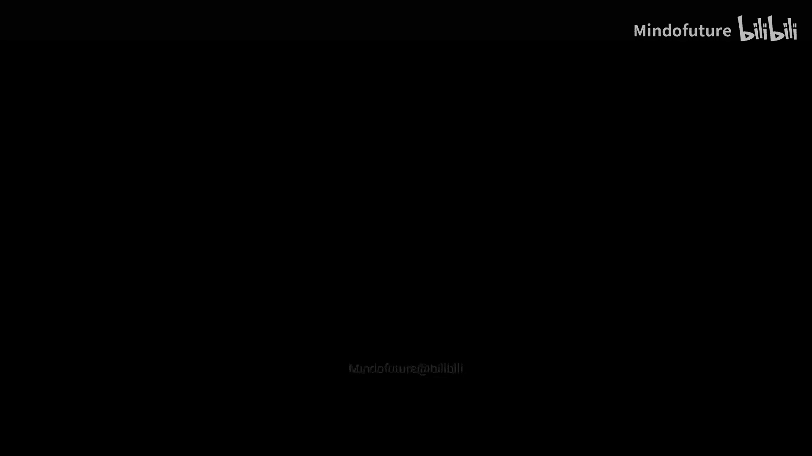
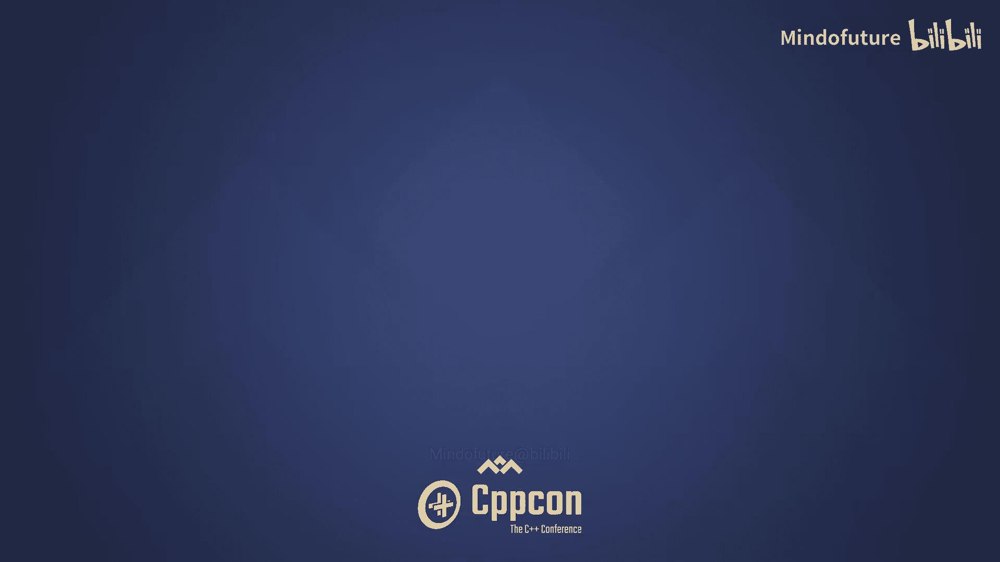

# Cppcon-2025-｜-C++-｜-C语言--｜-汇编-｜-编译器-｜-操作系统-｜-Linux-｜-Windows-p81-P81_基于概念泛型编程-Bjarne_Stroustrup-CppCon_2025--BV1wyPBzrEeu_p81-

Good morning。 It's good to be back。And。Well， I'm going to talk a little bit about programming。

And I'm focusing on。One aspect of C++ programming， which is generic programming。

 which started from the actually earliest days of C++， but got a major boost by Alex Deanoff。

 he had this nice， modest aim that it should be the most general， most efficient。

 most flexible representation of concepts， in other words， ideas。And he had some rules for it。

 Don't abstract for the sake of abstraction。 There are places where abstraction means bloat and useless complication。

 That is not what we are talking about。 We don't abstract for the sake of abstraction。

 but because we want to solve problems。We abstract from the concrete， from efficient algorithms。

 not from。Mmmm。A randomom thoughts。 And we maintain performance because in a huge number of the things that。

C plus plus used for performance still matters。 I remember being talk taught back in I think age3。

 that the performance efficiency didn't matter because we now had one。1 MHz computers。

The only thing that grows faster than computer hardware is human expectations。

 There are still huge parts of what we are doing that depends on writing really good。

 appropriate code。My work in this has been to represent concepts separately in code。

 to combine concepts freely， minimize overhead and。

To make generic programming as simple as non generic code。 And I'll show something about that。

There's three design criteria outlined in 1994， actually a bit before。

 but that's the accessible reference。We need to be general。

 I used to use the phrase must be able to more express more than I can imagine， which is fair。

 uncompromising efficiency， of course， I wanted to compete with the golden standard in any field if youre going to use C++ it should be as efficient as other languages for doing a similar thing like for systems programming it C for linear algebra。

 it's for China and such。 and I want to statically type interfaces C++ also comes from similar that had it and I couldn't do it now we can And the further requirements is that we shouldn't require sort of top of the line computers for everything because most people don't have them or we shouldn't have compilers that for。

us to drink too much coffee while waiting。And it should be teaable but teachable。

 I quoted my old friend Christ Nual that said， if we require PhDs from MIT。

 we have failed because most developers don't have PhDs and certainly not from MIT。

 nothing wrong with MIT PhDs， they're great， but we can't rely on having what is it7 million of them。

That doesn't work。So。I'm talking about generic programming。 And to discuss something。

 you have to start with with a problem rather than going with language features and theory and such。

 So Im， I'm going to start with a problem， which is implicit narrowing。

I never liked the fact that you could implicitly convert in both directions for between integers and between floating points and integers。

 So let's， let's try and deal with that。 There's some examples here on the slide of things that will surprise people。

People who aren't surprised or give the jobs to the people who will be surprised。

 and so we see these bugs， and let's try and get rid of them。I tried to design C++ not to heaven。

 but。Didn't get away with it， the sea crowd wanted to deal with it。And so first。

Let's deal with arithmetic types only。Well define a concept for that。A concept is a predicate。

 It's a function that returns a boolean through a force， and it can be evaluated at compile time。

 and it can take type types as arguments。 And here we have an example。 Let's see if this works。 Yes。

 see here， the concept number is either an integral or a floating point。

Integral and floating point was defined back in the early C days。

 You can find them in the first K and R。 And we know what they are。 They define the standard。

 And there's a slight strange syntax here。 I take a concept， and I parameterize it with a type。

 So basically integral of T means is T and integral type。It's not。

 I couldn't use round parentheses and things like that。 It's not。It's not rocket science， though。

 So integral and floating point is is not just in the text of the standard。

 It is actually in the standard library。 So that is real code。

And so we can now start using it and the way I'm using it here is I read the standard and see what it says。

 and then I write my own function， my own concept to do that。

 I want to know whether it's two types can narrow when you assign a u or T and well。

 if t is too small， obviously it's too small， or if the integral and has a floating point coming in so that could be desimal a fractional part。

 and we can tell you with the sizes of the same， there's rules we can see if the floating point an integral or if it's a sign integral or。

It's different from the between U and V。1 is T and U。

 One is signed and the other one is unsigned or the other way around。

 Now this is about a page of manual stuff or more。And it is messy， and it is tricky。

 All I've done is to translate it into code so that I can use it in my code。And， well。If。

 if you don't like it， get your time machine， go back 50 years and have a chat with Dennis Richie。

 This is just me formalizing what has been done a long， long time ago。And now we need a function for。

 for testing values， because what we really want to know is whether this value。

 this when assigned to that one narrows， whether it throws away information。 And so I start。

 if it can narrow。If it can't narrow。That's the con narrow， no problem。If。

If there's a mixture of signed and unsigned and it is one of these two large positives。Yeah。Then。'。

's， if it's too large to be positive。And it's unsign， then obviously it can。can can。Narrow。

 and if it's an unsign and assigned。 and if it's on， if you is less than 0， obviously。

 we have to return that it can。That， that it can narrow。 And then finally。

 I try to see if it actually does。So what I'm doing here is first。

 I'm doing all of this compile time stuff to make sure I never test something。

At runtime that I don't have to。I am testinging only the cases where there could possibly be an narrowing。

A loss of information。 So we， we're back to this。Initial criteria for。

Geneneric programming that says it should be efficient。So let's not do work that we don't have。

 don't have to。 We can do that this in any language， but it cost if you do it at runtime。Okay。

 then we have to decide to do what to to， what to do if it narrows。 And basically。

 if it narrows through an exception， Otherwise do the conversion。 Now， I like exceptions。

 and they are especially good for exceptional situations and in real code。

 there's not that many narrowings， especially not after testing。

 And so this is an extremely unlikely thing。 and therefore what exceptions are for after testing。

 maybe it's one in a million or。1 in 100 million， I don't know， but it's not one in 10。

Or something where we can worry。And now， we can test this。And we can take a whole bunch of tests。

 and we can use convert to integer cha， onign doubles。

 and it'll all test if it needs to test and if it doesn't need to test the answer will just come out immediately。

 It's just value。And you look at this code and it's verbose。Nobody is going to use this。In in。

 in real code consistently。 and we want guarantee。 We don't want just random。

Catching a few errors and not the rest。 We want this to be done consistently。Explicitly。

 testing is not going to be consistent。 We know that。 So we may get implicit。

 I define and number type。Number of T is a T that has been tested for conversion when it was created。

So I can now only create a number of， say， ins if my initializer can be converted to int without loss of information。

Goodd， this is simple。Looks like Slideware， but it actually is fairly good code。

Now we can test and we can write code that looks just like we would write normally number of un signed in。

Behaves just like an unsigned int， except that it tests and checks when needed and only when needed。

Fine。And， of course， we can't have arithmetic operations without arithmetic。 So we designed some。

Some moerators to do it so I want to add two numbers and they return some type in the standard library we have the common type concept which says what is the common type that you can use for results when you are combining two types。

 so I don't have to do that it's already in the standard so I can define plus I can define multiply and all the other operations。

 they are five lines each it is not as I said， brain3。

And we also badly need convert compassion operators because one of the places where you get bugs out of the rules of unsigned and signed is exactly in comparisons。

 Here is sort of the classical nasty system。-1 less than2 unsigned。Is force。

Because the rule is that we have to convert signeded number to an unsigned number that means minus1 becomes humongous and that is not what you would expect and som going to fix that so I define for two of my numbers here operator less than and it says if there's a mixture of sine and unsigned then if the value is less than zero return true it must be true which the other one is unsigned done otherwise we will just do a normal comparison because they are now both of the same same type and we do that for equality and less than an equals and things like that。

Not particularly difficult and the test and code like that now works if and only if you don't have narrowing conversions。

And。Let's see， before we go any bit further， we now have a set of rules that probably should have been built into to see in 1972。

 but it wasn't and by the time it was noticed how horrible it was and we needed explicit conversions and tests and such。

 there was a fair amount of code there and well， we still suffer from it today。

But let's see how we can use this。 The other thing that is， is problematic is range errors。

And there's an example there that I sort of like。 we use spans to say we want to be able to do range checking。

 A span is simply a pointer to a sequence of elements and a number of the elements that are there。

Dennis Richitchie tried to get it into C。 He called them fat pointers。

 but the C committee wouldn't have it。 They thought they were too expensive and not necessary。

 And all of these things。 Anyway， I talked to him about it。So here I have an example。

 We have unsed sizes。 That's especially the case when we are using the C plus plus standard library。

 There's a lot of uns signed sizes there。 But there I make a span of integers。

 and I have a and max minus。Whatever， whatever， I miss typepe 50。

And now that-500 becomes a humongous number， and I get absolutely no range checking out of that span。

Just because of a slate tablepo。 and just because。The rulers for。Conversions of building types。Okay。

 but now we can handle。Operations on on build in types signed and unsigned and catch all the errors。

 So let's do that。 I will start by designing something I call spanable there's actually something in the standard library。

 a continuous contiguous range that has that property， so I'll use it。

 but I name I give it a name so that I can so I can extend it later if I if I need to。

And now I can define a span。My span， of course， has a checking mechanism。

 checking whether an index into it， a subscript into it will。Go over the range。 What is different。

 different here is that it'll only take spanable。Initialized to spanable so I can initialize it with the data and the size。

And I can now use a number for the subscript， and。I run the check。

 And if you now try and fool this by negative numbers and things like that， it'll be caught。

And now I can try that。嗯。What do we have here is this I is a span of numbers of integers。

 you can I can make a subscript of 10， I cannot make one that says is minus-10 elements that'll be caught obviously compilers can catch simple examples like I'm using here like minus-10。

 but quite often we're using a number that we have computed somewhere else。

 and those are the bugs we want to catch。I have a span of doubles again。

 it'll throw if you try and have a negative number of elements and then I make a array。

 I use a span to the usual trickery there to see whether it will throw and here's sort of the more realistic example。

 I have the span I have initialized it with an element from another span。

 and I don't actually know what that value is。But don't throw unless it's a positive integer that fits。

ok。嗯。At this point， I got really tired of writing， span of double and span of int and things like that。

 so we use type deopuction， another part of the generic programming support in C++。

 so I will say that if if you have a spanable，Of R。

 then the span will be whatever is the element type。

For those of you who are not used to seeing CT Ts， class template type de， basically it says。

Use that as your as your element type。 And now I can write the code that start looking just like in the standard。

 I have a span S  one。Of A A， the compiler knows very well that A A A is a span of integers and that it has 100 elements。

So I don't have to say it again。 again， one of the properties of。

Gric programming is that you don't have to repeat what the compiler already knows and what you already know。

 so and I can start writing spans of going through the loop of S1 all the usual kind of stuff that makes it convenient to use modern C plus plus。

 that's much nicer than。Then say a sea dial loop。And。Unfortunately。

 that span had to fit on one slide and illustrate just the major issues。 It's not sufficient。

 We want to be able to do subpans。And to make a span or pointer we've been given。 that is this point。

 I know that this。This。This point are here point to a number of elements。诶。

You can't check that because we don't really know what that point through。

 we can look it up or we can use the information， but we know we get it wrong ever so often。

 but this one， if you make a span out of pointer and a number。

 it stands out like I so thumb for code reviews and static analysis and all the other good stuff。

 otherwise I can make a span of the first n elements or span of the a range within the other elements and the testing here just checks that it is within range and again I am using numbers so that I don't get fooled by the signed unsign problem。

And so they I need some more type deduction， but it its it's written there all two liners， one liner。

 if you put the template on the same line as what they are template of， but I tend to use too。

And we can test， and now the code looks。Robin nice。No surplus repetition。And。

Where have we got the troublesome。Now there's an array and I'm trying to make subars。

 and that was a super that doesn't work first elements range。And this one here， there's a pointer。

 came in up here。And I'm saying I want the first10 element of it。

 There is no way I or the compiler will know this looking at just that code。

 so it's unchecked your code review should should flag that one as a potential problem and if you're really good。

 you wouldn't have that kind of stuff， but sometimes we get pointers out of different systems and such。

 So it's a necessary thing to have。And。At this point。I was wondering， why on earth。

 am I writing number of in number of do and things like that。 It's tedious。I'm。

 I'm not a good typist。As a matter of fact， neither were the people who designed C in Unix as by the names are short。

But we can get rid of them。 We have type deduction， so。嗯。If I have a number with an initializer。

 I take the type of the initializer and make that into the the basic type of the number。

 and I can write a number of one one of un signed number of double。

 and I only need to be explicit when I actually need to。

 I wanted here a number of doubles that was initialized with an integer。

 Well I have to say that I want double。哎。Okay， so before I go further。嗯。

People have looked at the examples that have've been given here and said。

 is this really generic programming。I I would say that it is。

 it uses generic programming to attack some of the really fundamental problems in the language that are there for historical reasons。

 you could design a new language that that didn't have that problem。

 I just designed a little library that eliminated those problems。The， the stuff for doing。

The number that that checks is 37 lines of code。And to， to have a span like that span。

 we are less than than 100 lines of code。 This is。Whatuch shorter than the specification of what the language does in。

 in the manual。Anyway， let's go and see some of the classical uses of generic programming using concepts as。

 as I'm doing it now。 Remember， concepts were part of the original。

Ideal for generic programming by Alex Steanov。 It was part of my ideal for how I would write generic programming when I started C plus plus。

 I'll show you an example of that a bit later。 But let's attack this。 Here。

 we've got a classical sort。 there， it takes a type。 And it wants to。Elements of that type。

 a random itator first， a random it， axisator last and an implementation， and it says in the manual。

 what are the requirements of that type and for that first and that last。

And none of that is checked directly。 It is checked to seeing whether the implementation does the right thing with the effect that we have a spectacular。

 successful thing。When people use it right and spectacularly awful error messages。

 when people misuse it， because the information was not given to the compiler to do proper checking。

Okay， I tried to solve that back in 87 of thereabouts and I couldn't。

 I asked every expert I could find in C plus plus in other languages。

 we couldn't solve the problem under the constraints of performance and such。

 So let's see what we can do today。 So spectacular， successful， efficient， etca。 and。Well。

 what have we got here。Look at this one here。It's trying to sort a list。

And the list doesn't have random access， which means that you will be told that you can't use the plus operator and the iterator at some point。

This is horrible for an A message。 So let's use concepts for one of the things they were used for instead of having templates of a random type of any type we have。

Iterators that must be random access iterators。 They are there in the standard that the text of the standard always said what they were。

 Now they are in the standard library。 so I can now say。I want a random and access iterator。

 I want to predicate the tests the the proper way。 And I can say that you must be sortable。

Those iterators must be sortable with that predicate。 Soable again。

 is in the standard library so you can look it up what it is。 It It was always there on text。

 Now it's there code。 and it， it says that there must be random access。

 and there must be a predicate that can compare them and you must be able to swap other good stuff that you can learn if you read。

 but。We don't read as much as we should。So that's there。 Now it works better。And we could now。

Go back to and use the code exactly as before， we have not broken any code。

 the only difference here is that the bad example down here sort begin， sort the list。

 will now give it these narrow message。Okay， but we still have problems because we said that first and last should be a。

But I've seen in real life examples where they are not。I've seen begin and end swapped。

That is disastrous Run for the code because it'll keep going till it falls off the memory。

 It'll even take forever to to， to get the the runtime error， or you can have。

The begin into one container and the end into another container。 These are real。

And then the other thing I don't like。I mean。We， we need to be able to say from the beginning to the end so that we can say from the beginning to the middle and from the middle to the end and things like that。

 So， so the concept is。Reasonable， but by， it's a nuisance to us， bad typists and also readers。

 there's so much there to read。 So it's a both。 I want， I， I want to say， I want to sort Vck。

That's all I want to see， so let's do that。We define something。

 uses a range again that is in C+ plus these days， so you can do it。And if it。

You can actually implement the sorting of a range by just sorting it the old way。 it's。

It's just taking care of that。 And now we， we have vector of doubles， a vector of strings。

 We sort ascendants， we sort。we saw it with ranges greater or fine。It works。 And if you start。

Messing up， you get caught。But what if I wanted to sort strings Now。

 it is very arguable that I shouldn't implicitly sort strings。

 I should be lists if I wanted to sort a list， I have to say list somewhere to make sure I don't do it by mistake because lists are not very good as a representation of a container that you sort。

 It's a traversing lists and such a painful。 but here I've done it。

 just to demonstrate what can be done， I define myself forward sortable range， which is， of course。

 a forward range that can be sorted with the predicate。 I give it。 and as usual。

 I give a lot of default So I don't have to say the common thing you usually sort with less sense or the predicate by default is less than if you want greater than you can say greater then。

Okay， and then I have the sort function here and I just implemented it by copying it over to a vector。

 sorting the vector and then copying the elements back again。

 it's good enough for simple uses there are good algorithms for sorting lists and you can use those if you like。

 but here I just wanted to show what can be done just working your way through it。And。

One of the points here is that the。Overloading picks the most constrained function。 So here。

 if I sort a vector， it picks the random access because only the vector can can do。

Vita can can be done with random access。 If I want to sort the list。

 I have to use the forward list because that's the only one that that matches the overload rules for。

Template functions for generic functions with concepts are very， very simple。Now。

I've been saying concept and predates and such， but。Let's just go back a little bit。

 We've always had concerts。I mean， Dennis put them into the early sea， ins and floating point。

 The S T， L has iterators， sequences。Containers， though they don' aren't call that for a long time。

Math has monarch group ring， etc cetera。 for a couple of centuries。

Those of us who's had a math course was introduced to them there and the graph concepts that did a little bit of homework。

 they were started out in 1736。 The point here is this is not particularly C++ and it's not particularly new。

 it is well established and no generic programming could work unless the concepts were in the head of the designer。

Because。There has to be some idea。 Otherwise， they couldn't be generic。

 You couldn't pick the right stuff。 And the C plus plus concepts are simply。

The predicateates that we can put into the code， but we have to learn to use this properly。

 I have seen a lot of code that。Just basically don't seem to get it。 We have to。

Get to the point where we don't talk about template programming。

 but we talk about concept based generic programming。 It is much simpler。

 It is much safer and quite often much faster。So concepts tend to be built out of other concepts。

 we saw it earlier for number， but here here's example of a forward soable range that I show。

 So basically it says that oops， got what on earth okay。嗯。We， we， we， we see the forward range being。

嗯。Being the range and the iterator。Sorry about that。I got a new toy。

And it has buttons that does complicated things sometimes。Okay。

 I guess that illustrate that whenever you're doing something， there's a chance of error。

 and it's good if you can catch them。 So here I'm combining。

A forward range and disorderable concepts。 its， it simply and。 It's like writing a function。

Slightly different syntax， but just a function。 And we can build concepts out of。

Out of basic language features， here's the classical equality comparable。

 It says that if it has a T and a U， there。Equality comparable。

 if they have equality and nonequ and they yield a booleion， something that can be used like a boo。

This has been true since C plus plus 20 and for experimental implementations since about the。我要。

At least the mid teens。嗯。Okay， and requires is a low level mechanism for checking whether a construct is valid。

 That's what we use to implement the basic level of。Concepts。

 if you in your code here require requires you've probably done something wrong。

 You probably didn't think hard enough and define a concept with a meaningful name。The use patterns。

 which Ga has raised and I。Brought into to being in 2006 or thereabout basically allows you to specify requirements in terms of just about anything in the programming language。

 And one of the reasons we need them is to deal with the many ways you can implement functions and operators in C plus plus and to deal with mixed mode arithmetic and implicit conversions。

 So here I have。An A plus B。 And I want to say that is the requirement that you can do A plus B。

In a lot of languages and a lot of designs， that means that you have to pick exactly how your users are going to implement that plus。

 Is it a member function， Is it a freestanding function， Is there a constant arguments。

 Is there not constant arguments， What's the return type。That requires foresight。

 and it puts a burden on all the users with use patterns， it just says it must be done。And also。

 it means if somebody goes and reimples the operation。Then if the reimplementation still adds。

Then there's not a problem。 The， the interface here has become stable。 The compiler can handle it。

And that's important。And。The checking is implicit。 Some people worry about implicit things， so。

You can check if you want to。If you have a type that you know that you want to use with a concept。

 you can just check it。Early on。The set of things that are work is still open。

But you can do the early checking for whatever you know that the early checking is needed。

 And so here， yeah， I can compare and doubles。 I can compare integers with integers。

 and I can't compare integers with strings because we don't have implicit conversions of strings to integers in C++。

So you can check。So。Generic programming with concepts is an integral bar part of C++ I mention this because I don't like isolated sub languageguages that can only be used with themselves。

 I want features that where you can combine the features in the language with other things in the language there and there are some examples there I'm going to briefly go through the bolded the highlighted versions here。

From the earliest days， I was trying to get sort of a uniform notation that's required for generic programming。

You can't。 There's no syntactic difference between the way you use use it to find in a building type。

And I mentioned this because S and Java and such， you have to say new to the building， to the。

To the user to find types。 and you don't have to And in similar。

 you can't say new to a building type。And that that's just too。

 too irregular to ever get generic programming。 Similarly。

 if you can't do resource management as part of the design of a type， but have to do it explicitly。

 then you cannot just write code as if。Use as if AI I types and other types were the same because you have to write explicit allocations or delocs of release of locks and things like that。

 So that a little example down there。It was it came out somewhere in '79 and it is essential for what we are doing。

 and it's an illustration of how one part of the language feeds into another part of the language。

 in this case， the basic，Notation for creating objects feeds into generic programming。And。

Optional member functions are very popular。 user。は。Con concept works really well here here。

 Im making a smart pointer， and I want the error operator only if it's a class。

 because that's the only way that you have a member that you can point to。

 And so I can use them uniformly。 if you are just using the。Star operator。

 the data reference operator， but if you are。Using the error operator。

 it will not work if you have a smart pointer to an integer。 and that's what you want。

 The requires clause fromary programming works really nicely there。And you can try pair Also。

 I tried a pair here。 And in the standard， there is a convertible operator too。 So you can do a pair。

Of and another， you can。Carpy。Take a copy of a pair of one type into an another type。

 provided you can convert the operations。But。Yeah， that's what the standards says。

 But I looked at this and I said， look。Itll too。They't do narrowing conversions。系い。

I just said I didn't want that。 So let's get rid of it so we can do a pair。Of。

You just see if you can convert it and if you convert it， if you can convert both of them， it's fine。

 and you get the result， otherwise you will throw an exception。This is good。 I tested it works。

 And then I noticed， I can't do。Pears with things that aren't。And that that aren't。

Build in types that that aren't building numbers because convert 2 was designed to take a number。

Okay， overloading of concepts will based on concepts will take care of this。

 I simply take and make another convert to that overload with that one。

 So if I'm now trying to copy a pair of strings， it will work。嗯。It won't do any checking。

 but itll it'll make sure that that works。Then you think a little bit further， wait a minute。

We built a non narrowing rule into C plus plus about 15 years ago。 It's in C plus plus 11。

 If I use the the curly brace syntax here， then this will not work。 It'll give an error。

So there's actually instead of doing the overload and the initial version that I showed you that copied straight out of the standard。

 I can copy out of a different part of the standard。 I can simply say that I to for can narrow。

 I require that you can initialize。at a C with with a S。And now， I can just。

Do what I did before with the can narrow。 And now it also works for cha star and strings and。

The convert to the empire now works now。I'll just warn you about one thing。

 Don't confuse the example with what it's meant to be an example of。

I could have started with the version here。whoops。With with that version there。

 but that wouldn't illustrate how to build things out of other concepts and combining concepts and such。

 and it is not in every case， as a matter of fact， in most cases we have。

 we can't find a better version in the standard to build on。

This is just a result of some work we did 15 years ago because。Even then。

 narrowing conversions were a problem， and we couldn't solve it in general。

 but we could solve it for initialization。 the version that comes。Here the。That comes here。

 will work for。Other situations like assignments and comparisons。Okay， we can。 we。

 we are going to get something。New and relevant for this in C++ 26， at least I hope we will。

 static reflection will allow us to write much more code that depends on what the compiler knows about types。

And that is。Basis of a lot of generic programming。So this is the only thing I'm going to show you today that wasn't feasible five years ago。

This was not a language feature talk。 It was a programming talk。

 And but here I'm just going to look a little bit ahead。

 and you can you can try it on on Godbolt and other places today。 So it's not science fiction， so。

I would like to generate thescriptors of class members。Just so that I can use them elsewhere。

 There is， by the way， talks about static reflection at this conference。

 you can go and get much more of it。 But I'm just going to give a simple example。 So here。

I want a member the script just generated。A string that shows what the name of the member is of a class。

 the size， where is it and how big is it。I want to generate that。And I can do it。

There's an operatorrator Ha hatt that says get information from the compiler。

 what information do I want， I want the nonst members of that and that happens to be a sequencer of members and then I want to build an array of my member descriptors and of course that should be of the number of elements that there was a number of members。

That there was in。Whatever argument types I want the， the layer of。 And then I go down， I loop。

I looped through it and built the layout， returned the layout。This， of course。

 is efficient because we have moved semantics。And I can now write code like that。

 I have a type X with some members。It says， give me the layout。

 and X D there is now an array of data member descriptors and the values are examples there。嗯。

This is just a。Sort of a teaser。 You can do all kinds of stuff with it。

 I have seen so many systems that faked something like this with macros and forced you to write the right thing as as argument to macros and such。

 I'm looking forward to static reflectionion。😊，So major design decisions here， concepts of functions。

 concept can be partial constraints， concept can take value arguments， concepts are not just。

For template arguments and concepts， type matching definition checking。

 I will briefly go through this。嗯。Nothing else because I was asked to not take too much time。

So basically， we saw that concepts of functions， they compile time functions。

And we can use them in a variety of ways。 They are very flexible because they are functions are just about anything in the programming language and with static reflection。

 they are actually functions or things that you couldn't even express in the language without asking the compiler for help。

They are general and they are cheap at compile time， they tend to be quite small。

And rely rely on the use patterns to get more flexibility， to get stability of interfaces。

 to handle implicit conversions and such。 and concepts can have multiple arguments。

 I think that's important。 A lot of systems for constraining generic stuff conss one argument at a time。

But when a function， a generic function takes two arguments of different types。

You have to have a relationship to change those two types， Otherwise rather than one function。

 And so my experience is that。More than half of all concepts take more than one argument。

And so the fact that they are just general functions that take as many arguments as they need is important。

And concept can take value arguments That's occasionally important。 There's an example of。

Of a template that takes。Bable argument and using a concept。 this buffer space here。

 it says that there has to be at least。At least。1K elements and the buffer space size has to be a power of two。

And so it requires buffer space of S。That's fine。And I can now say 100。 That's an error。

 The buffer is too small。And I can see a bottle of。10000。

 That's an error because 10000 is not a binary。 I can take a buffer of。Of 2 K networks。

 So here again， the flexibility of what we are doing。

 This is getting very close to ordinary programming。

Except that we are throwing in types and values and things like that to express what we want。

 Comp time evaluation is important。 the is power of two is a perfectly ordinary function that happens to be at constant so I can use it at compile time。

 if it's zero it's false shift away the last bit so you find something that's not a zero and if there's only one bit left。

 it's a binary of true So it's a simple algorithm that you can you can write and use and I did。嗯。

Some people who listened to something like this and and read things that I have written up about it wondered about what's difference between generic programming and object oriented programming。

And basically generic programming is more flexible and doesn't rely on indirect function core。

 That's important。 On the other hand， classical object oriented programming。

 building with class hierarchies require indirect function cores in most cases and require that you define that initial interface early on。

And have the foresight to do that Well。 I decide， I tried several times to define a base class called called the。

嗯。Container。And you need a container that has to be at least a list and a vector。

And I never could get that right because the set of operations are not the same。

 the constraints of them are not the same doing it in generic programming is quite quite easy。

 You just put different requirements depending on what type it is and such。

But these are complementary。 There are people who go around saying object oriented programming was all wrong。

They are all wrong。The sometimes classical object oriented programming beats。嗯。B generic programming。

 if you really need open sets of types to be dealt with and in many cases。

 generic programming is superior， but just because it runs faster and it you can express more。

So they're complementary and furthermore， here's the traditional draw all example and well I'll draw anything that has a draw or range and I'll draw it the usual way and this will work for any class hierarchy that has a draw function and the virtual。

 but it also works on on anything， any type that has an arrow。

 even if it's not class hierarchy so this example here with the implementation or concept here。

Does everything the classical classical class hierarchy， object oriented programming does。

 and it also works as generic programming without having the constraints of the hierarchy。

 So we can do both they complementary and they work in combination too。 This is good。

 I never like the idea of paradigms being exclusive。

 I want things to work combination and they do here。

One thing that's important about concepts is that you don't have to get them perfect at the first time when we write code。

 our first version tend not to be concept perfect。 we haven't thought of everything。

 So there is a version of a number built from scratch as opposed to what I was doing earlier using the standard。

 and I'm just saying that a number is something that has the usual operations。

And if you look at that， it's not perfect。It doesn't say anything about copying and move and things like that。

 I'm just saying that it should be able to do the operations I really want first。

And then if I need more， I can add it later。And that is important during development。

 and it is important when a program evolves。So partial constraints are。Important。

And it took me a little bit of time to realize that， because we always go for perfection， right。

 We want something that is perfect， but we know we can't get it if we are realistic。

And there's people that says that you can look up and get the wrong things。That is what what if。

 what if something matches that isn't what we thought should match。

The classical example on the next slide is a forward iterator and an input iterator。

 they are basically the same， except for semantic constraints， but you know。

What is the chance of something that isn't a number to match that concept。

So when you have concept with a bunch of functions。

 you actually do matching better than you do a match of a name that is constrained by a type when you look up into a library or in a linker。

 this stuff is actually。More powerful for catching errors like that。

And then the force lookup of matches is avoided。 And if you really have something that is only semanically different。

 invent。A syntactic difference。That is， if you have four iterators and。And。

Input iters throw in a tag or a function or something that only one has so that I can write a concept that distinguishes。

It's just a programming technique we have。 Qui often。

 I've seen discussions of match of lookout matching， where I think the dog。

 the the tail is wagging the dog。 That is the whole design gets built。To solve this。

 this particular problem。And I don't want that。 I want the most elegant solution to the general problem。

 And then I have some kind of technique or patch for the the special case。

Concepts are not just for template arguments。 here。 We got a simple example of an integer。

 an in this integer， the simple integer here is。This is either short， an integer or an int or a long。

 and I can write code like down there， either with an integer or an int。

 we have this ugly auto that has to be thrown in all the time on usually redundantly but you can see how close we are getting to having generic programming being the same as ordinary programming。

There some advantages。嗯。Like everybody else， I thought initially that we had to。Be able to compile。

 compile。Generic functions in isolation。And I learned that that is not what we need。

 and it is not what concepts are awful。And the example here is a simplified version from the standard library。

 It's the advance， and it advances in in in。诶 element做。

But the point is that I want to lug that the advance have been。嗯。BeenBeen used。

And I find that especially in industrial software， not not in teaching software。

 not in student exercises， but in in large game industrial software。

 there are so many things that are thrown in to functions to help the infrastructure。

 There's logging， there's debugging， There's some forms of correctness testing。 There's to。

T telemetry and such tracing。Should I change the advance each time I get a new one of those， that's。

 again， interface instability will come into it。So no， I do not want to check。嗯。

Templates in isolation， even with concerts。 Itll catch most of the areas errors earlier。

 and it will catch if there's no log in the system that will be caught later。

 Ts will always type safe in that sense。 And by the way， look at that plus equals。

 What if there's no plus equals in an inputerator。 Should I reject this function。In the standard。

 it doesn't。And。So here is an example I'm advancing in a vector。And just advanced， too。

This code would not work if advance was compiled in isolation because it would reject plus equals。

 I would have to use plus。Plus plus and plus plus twice。This works。 It always worked。

 It was part of the reason that the ST TL worked。 and if it doesn't work。

 some algorithms change from ON to ON squared。Which is deadly for large numbers。

 So the conclusion is that。At least at this stage， we don't want separate compilation of templates。

And if we ever get separate combinationilation of templates。

 there has to be some kind of escape clause to be able to handle examples like this。

 because most of our software infrastructure has examples of that in it。

We're supposed to be practical rather than just theoretical theitians。

 so basically there's a summary。Genetic programming is。Just programming。The most general。

 most efficient， most flexible representation of concepts。

The concept here is the general notion of an idea and such not the。Not not not the language feature。

 it's based on classical mathematics， I mean you can look at Alex's books they're pure math if you don't like math don't read them a trade building and used it to find types uniformly scope naming creation cleanup that's important and it came in in C+ plus before five years before it was called C++ in 79。

And it's complementary to classical object oriented programming concepts are compile time functions。

 they could take multiple types and value arguments。To specify。What a。

Generic function requires from each document。But you don't specify how those arguments provide what's required。

That's an important distinction。And you can use them to select among alternatives， overloading of。

Of generic code， with。Concept is actually much simpler than overloading in ordinary types。 After all。

 if only one matches， that's it。If two matches， if one is the subset of the other。

 we pick the strictest， and if none of that's the case， it's an error。Okay。

 that was the first set of rules。It's， it's easier。 And so generic programming， using concepts。

 it enables us to build our own type system on top of what the C++ offered for defaultpot。

 What I did with that number type。And that span type was actually to extend the type system of C plus plus to take care of。

of of。Narrowing conversions and range checks。And do it if and only if a runan chest was needed。

Let's see， I think that's it。Bunch of references。 But yes， thank you。

I don't know how we organize the Q& A。Are there microphones？Okay。

 should we make a line somewhere so that people can line up for the microphone？And so。

He regret a chance。 Thank you for the nice talk。I like your slide about the comparison of traditional。

Yeah。Sorry。😔，About traditional inheritance schemes and upper an object oriented programming and generic programming。

The one difference I see is in tooling。So when you have traditional inheritance schemes。

 if I auto to complete on the durable object， I get to draw。

 if I do this in a generic programming environment， I usually get nothing。

 but's your solution to this or your opinion on this。嗯。I like all order complete。

 but you can't get order complete for everything。And I would rather be able to express exactly what I want than to get auto complete。

I am going to get。Actually， I have already auto complete for places where it can be done。

And I'm not going to， to lose the flexibility just because I can't get over。Okay， thanks。

 I my guess is that people will figure out ways of doing things like autocomplete by understanding things like concept overloading。

What。People haven't done it yet。Okay， thank you。Hi， thanks for the talk。 There was。

A mention where we can use value， value arguments with concepts。Honestly。

 I didn't know that you could do that。Well， Cru， oh sorry。

Under that you can do the same thing with context for functions。

 Is there any intersection between the two things， Is there specific use cases for each one of them。

Way back in。2010 and such gave this reason I proposed conbook。And it was very limited， what。

We could get then， because。There were people who claimed that cons or functions were both。

Impossible to implement and useless。That's what I heard a lot。Now。

 so we had to gradually improve the。what you can do in Constba and now in Constsbo Consteelle and Consttanit。

 you can do a lot and that's good。Now。The syntax for。Dealing with types in using。Brackets。

It it's just different。 And I use that for concepts。

 And so they look more different than they are internally， that both。Compile time functions。But。

They look a bit different。So is's the。A preference for one or the other。

 or is it just personal choice。We use constant for our constant de if we're doing calculation of numbers。

We use concepts to distinguish between different classes。

One of the reasons we did Con Expper was that people were using template meta programming to generate values。

If the answer is something like seven。The answer is probably con consexable。

If the result of a computation is a class。Then， it's probably a。

Tempate meta programgram kind of stuff。Sounds good。 Thank you。

Thanks for the talk in object oriented programming。

 it's pretty common to have interface classes with pure virtual methods only just to define how a class should interact with the world。

Do you think concepts completely cover the same thing and is the best way to do that to achieve that。

No I don't。I I use interface inheritance a lot more than implementation inheritance。

There's different ways of specifying interfaces。 The one is a fixed， strictly defined interface。

 and the other one is a flexible open。Flexible or a fixed set of functions in。 You need both。

 in my opinion。Do you have a rule of thumb when you use one over the other？No。

 not one that's short enough。 so I'll call it。A rule of thumb。There is。

 I've written a version of this talk as a paper。Which is about twice as long as what I was doing here。

 And it has some discussion of， of that issue in it。

I don't think I would it call my answer a good rule of thumb。But it's a greater discussion of this。

 It should appear this month。In CAM at Mark。So you， you will get them more。

Extensive answer from me this month， but not now。 Thank you。 Keep an eye out。

Thanks for the talk so when I first heard that C++ was adding support for reflection。

 I was very intrigued， I thought it was very surprising to add。

 it seems like very different of an implementation to Java is there ever a plan to add more runtime style reflection like Java based like for example。

 a class。4 name is heavily used in Java reflection I don't like runtime reflection。It costs too much。

 It creates too many data structures。 take up too much memory， which might be fine for Java。

 but it's not fine for the huge number of。C plus plus users that are in embedded systems and constraint systems。

What you can do and what my example showed is how you can generate the data structure that you would use in Java。

dynamicymic things。If and only if you need that data structure。In other words。

 instead of laying down a data structure for everything， you write a little piece of code。 I mean。

 the little piece of code I wrote was fitting on one slide and it was real。Grated the。

Object maps that I have used in serious programming， and it has the absolute minimal runtime。

Footprint。And so I think we can generate anything that you could use in Java。

But it would be cheaper and faster to use smaller。Thank you。😊。

It's why I always say static reflection， It's something we have been aiming for years in particular。

 David Van Dorder has been working on this for a very long time。Hey， Rina， thank you for the talk。

 So on the topic of concepts， I had a conversation with a fairly experienced Tpath developer recently about whether we should add concepts to our library。

 and he said that he doesn't want to go anywhere near concepts because once he introduces them to his library。

 he can never change them again。 And so if he if it turns out that he got the concept slightly wrong。

 then there's a big problem。 what should I reply to that developer。

I've heard this argument many times。I think。It has a lot to do with people going for the perfectionist view of things。

And I think they're basically wrong and haven't quite understood what is going to go on。

They should try it and see if their fears warrants it。I don't think they are。Thank you。

Thank you again for the talk。 I think on one of the slides you were talking about like kind of giving the example of the static reflection。

 you had like the class A A， B C and you were talking about you had like in the parentheses you had like or in like the return type you had like A in double quotes followed by some number can you explain what that actually means or was that just for like the specific implementation。

Let me see because I don't quite understand what you are asking。😔，So is that what you're asking。

 the answer down there， yes？嗯。It's it's that to see what the type is。It should be a strange view。

If I had written oops， if I had written。A subscript is V。It would have been clear， I think。No。

 it's history。Okay。I will look at it later。 He says it's a typo。 He's probably right。

 Let me not try and do it in real time。 O and thank you for finding a problem。And I see。

 I definitely are using the wrong quotes。Hi， thank you for the talk。嗯。

There are a lot of places in the STL today that I think can benefit from using more concepts。

I'm wondering if that's something you would like to see。 For instance， you know。

 vector kind of has a unconstrained type。嗯。How do you feel about？

Adding concepts to make it copyable or， or not。For instance。

 I think that the standard library could be improved。

 it has already been improved to a large extent using concepts。I think more is possible。

 but you have to be very careful。 People are doing things over the years just because they can。

 So they， for instance， use accumulate to concatenate strings。We。

 we would have to get one version for numeric stuff and another one for things that weren't numeric and things like that。

 We can't just go and break code because we don't know whose code we will be breaking。So， yes。

I think。A lot has been done。 More could be done， and we have to be very careful。So， maybe we。We can。

 Maybe we can't。Great， thank you。怎么。Thank you for your talk。

My question to you is what do you think comes after concepts in some sense。

 as they become more mathematical， for example， some kind of theory improving machinery in the language or something like these。

 What do you think comes after that， the concepts of concepts。

the paper version has a challenges section， which lists about 10 things that might be able to do。

However， I think。What we really need is more libraries。Depending on concept using concepts well。

 And that's the next stage more than trying to make the language perfect。

We have to let the language design be driven by real world problems that we are sure are worth solving rather than letting the well。

 tail wag the dog because there's a clever thing we might be able to do。And。

I'm not going to make any real statement right here because I think we still have a few years to learn how to use the techniques I was demonstrating here and see how the different parts of the language fit together。

嗯。People in general has not。Appreciate it or。Yeah。Or learned how to use that yet。 Okay。

 thank you very much。But， great， great，She' had been standing down there for， oh， I see。Thank you。

 sorry， misunderstood。第一个 sir。Oh。Okay， thank you。 thank you。😊。

