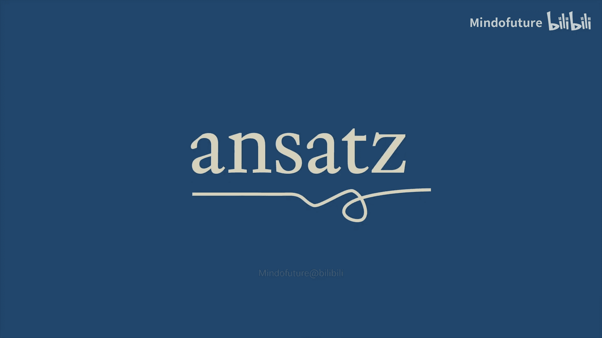
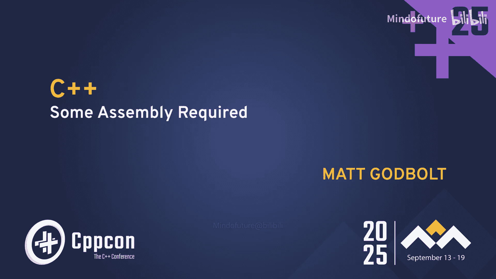
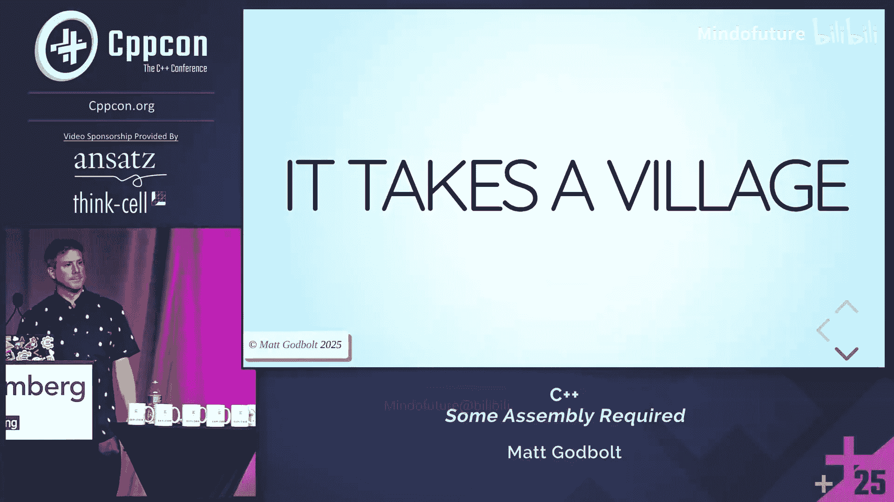
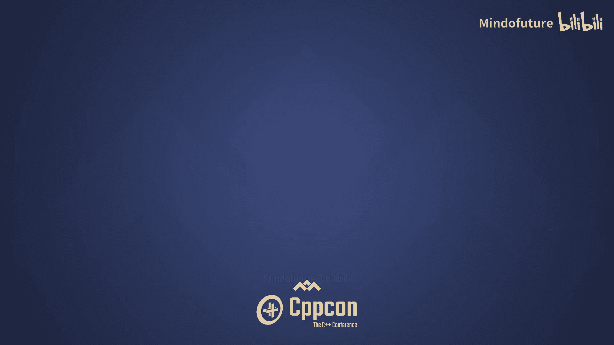

# Cppcon-2025-｜-C++-｜-C语言--｜-汇编-｜-编译器-｜-操作系统-｜-Linux-｜-Windows-p82-P82_C++_需要一些汇编-Matt_Godbolt-CppCon_2025--BV1wyPBzrEeu_p82-

H， Er。

Good afternoon， wow。There's a lot more people left than I thought there would be。

I couldn't put you off。 then， no。We had a good conference。Yeah。👏Fantastic favorite talk， anyone。

 shout out。😊，This， oh no， all right。 there are plants in the front row。 What was that。This one。

 another， this one。 All right， You're very， very kind。 You haven't seen it yet。

 You can tell me afterwards， if you think that's true。Game boy， yes， Tom Tes。

 I only caught the end of that， unfortunately， because I was preparing for this， but I'm。

Pattern matching。 Yeah， we've had tons and tons of really interesting talks。 I've had a great time。

 My favorite probably was bars on reflection like an actual practical demonstration。 Of course yeah。

 there's a different cls as well。😊，And herb showing us kind of what's going to be coming as well。

 Although sort of like the the surprise for me was going to see one of the unrecorded ones the Pixar gave。

 and they they LED us into some sorts of interesting things。 But you know。

 if you're watching this at home on the YouTubes， youre not gonna be able to see that when you're have to come next year to see the kind of quality content that they can't record。

 So anyway。😊，It's been a great conference。 It's been absolutely fantastic。😊，But I'm up stage here。

 And， you know， what I'm like， I love to talk about assembly。 That's my thing。😊。

And I kind of want to justify that。 So if you'll。If you're bear with me a little bit。

 I want to kind of give you some idea why I'm so obsessed with this thing。Cast your mind back，1986。

In a room in the southwest of London， me and my sister， I'll let you work out Who home。

La my sister in the spare room at the back of the garage that had been converted。

 It was freezing cold because there was no insulation。

 but we had room for a computer and apparently some pound puppies。

 which I don't think made it over here or maybe today day， anyone。Yeah， okay。

 some people about my age are ago。And you'll see that I'm working busily on a computer。

 That computer is a Zed X spectrum， which I'm sure a few people in this room know about。And。

 I'm programming。And I'm programming， and I'm， I'm learning already。

 though I'm only 10 ish in this photo。It was the only photograph I could find of， of me or I say I。

 It's the only photograph of my dad could find of me and my computer of anywhere in this era of time。

And how did I learn a program？ Well， on this bookshelf， you can't really see it from where you are。

 But there's a rainbow colored book。 Some of you might even recognize this。

 Certainly the British folks。 This is a book called Over the Spectrum。

Over the spectrum contained type in programs。 Who here learnt to program。

😀By typing in programs from like a reference， there's a lot of hands in here。

 And there are very rare people underneath them。Gray， gray head， gray head。 I'm sorry， not just gray。

A mean of me， isn't it。So I learned to program by typing in programs because you wanted to get a game or you wanted to get some kind of tool or a simple。

 like application。 And then you'd save it to cassette tape because that was the only thing we had that back then。

 But often， youd type it in very， very wrong。 And then you'd have to try and work out where your typos were。

 And that was my first sort of introduction to the wonderful art of debugging。😊，Now。

 these games were written in basic for the most part。 But as they got more and more sophisticated。

 Ba wouldn't cut it anymore。 And so you started typing in assembly。

And that's where I learned what assembly was and how important it was and what you could do with it。

Now， I've got a quick admission to make， actually， before I get too too far away。 Now。

 the asute among you may say they that doesn't look like a programming session going on on that TV screen。

 And it is a TV screen。 So， yeah， it isn't。 I zoomed in。I remember this TV so fondly。

 And I thought that looked like a game， but I couldn't place it。

And so what do you do when you find some weird image on the Internet or anywhere and you want to find out what it is。

Cha G P2， is that what I'm hearing。 Yeah， so I put it into all of the various AIs。

 and they all drew a blank。So AI is are not infallible。Was sorry is that。See， all rack。I。

 I didn't quite catch it。So AI doesn't solve all the problems of the world。

 I think we've discovered some of that this conference。

I posted this in a spectrum enthusiast channel， on Discord。30 seconds later。

 I got this image back saying， oh， it's musy。 So， you know， AIs are fantastic。

 but you can't beat somebody at their keyboard trying to prove you're right or wrong。😊。

I actually remember this game quite well。 This was it's like a gangster management game。

 You would like to allocate funds to bribing police and hiring。

 paying off people and beating up whatever。 And oh， no， it didn't load。 Hang on。If all had gone well。

 this image here that you're now looking at is a very sad thing。

 could the address could not be found。 This does not bode very， very well。 Let me reload the slides。

 Please cross your fingers from the area。So earlier this year。

 I actually took it upon myself to write， this is a complete aside。

 This has got nothing to do with anything。 I'm just showing off。

This slide here shows that the a spectrum emulator that I wrote in C plus plus and compile to Web assemblyly。

 And if it' good enough， we can actually play my game in my slides。

 which is a fun thing to be able to do。 So， you know， C plus plus is the future of web development。

 I think you'll agree。😊，Later on， I moved off from the books that I had。

 and I would buy magazines and type in the programs for magazines。For the younger amongsts。

 the magazine is like a sequence of blog posts that have been printed out and would be in the newsag once a week or once a month。

Sorry， I've got to get a few age jokes in。This was Acorn New magazine。 And again。

 one or two of you in this room will know what this， this magazine is。

 It's for an obscure British computer called the BBC Micro。 and later the Archimedes。

 And by this time in my life， I was about 14 or 15。I was sending in programs to magazines instead。

 So this was actually my program。 And I think Jason earlier today said that the very first time that he said my name out loud in in a conference。

 he mis feltelt it or misspoke it。😊，It's， it's， this has haunted me kind of most of my life。

 You know， I gold bolt there apparently。 But that is me。 And I my still my best friend。

 Rich Rich Q W。So by this point， we were sending in programs and getting 50 every program。

 which is a lot of money， even split two ways when you're in 1994 and you're 15。

 a lot of games you can buy。These programs were all in assembly。And they would be。

 You would be seeing it now if my clicker was there we are。

So there's probably about 20 pages of tiny font， which you can't read。

 I'm not expected to read in the magazine that some poor people would actually sit and type in。 Now。

 if you were very posh， you could buy the floppy disk that came with it and save yourself all the bother。

 But this is where I cut my teeth。 This is， these were the first sort of commercial programs I ever right。

 And they were all in pure assembly。Which is pretty painful， right。B later on。

 I discovered the Internet， as we all did， which is， you know。

 some of us may now discover think is a bit of a mistake。 But， you know， by and large， it's doing O。

 right， Who here remembers Internet relay chat。Oh gosh， that is a lot of hands。Wow。

 for the recording， that was about three4 of the of the audience。

 So I RRC was kind of discord ish before discord except it was federated。

 and you had to have a special client program that would talk to it。

There wasn't a special client program for it for my weird computer。 So by this time。

 I'd moved on to the Archimedes， which used this arm processor。

 this new arm processor that that you may have heard of a few times since。

The company that developed the arm processor coincidentally was the company were behind those computers。

 both the BBC and the Archimedes。 And they went sort of bust for the I P and the rest of the company that does all of the chips of kind of now ubiquitous。

But they have the 1 ft in， in Cambridge in the UK。 So by this time， I。

 I decided I wanted to write an I RRC client。 And so I did。And this is what it looked like。

 This is the one and only screenshot I could find that exists。 So thanks to my friend Ge。

 who still had a picture of it somewhere。 It's fully windowowed。 It has to talk TCP。

 It has to pause and send messages and format complicated strings。

 It has to allow you to do direct client communications to send files between each other。

 It lets you do there's a scripting language built into this。

 So I came up with my own sort of basic inspired scripting language。

 And I gave it dynamic allocation。 And I thought， hey， there must be I could do reference counting。

 So I implemented reference counting。 And then I discovered there's a problem with reference counting。

 know， the one where you have cycles。 So I came up with this whole idea where I could find the things that were no longer referenced and delete them myself。

 and then many years later， I spoke to a friend said， you invented Markwe garbage collection。

 I suppose I did I was doing a physics degree by this point。 I did no idea about computers。

 But this program and everything in it。100% assembly。 There's just nothing else。

 Its just pages and pages and pages All these are Gith if you want to go and have a laugh up the。😊。

Ludicrous names of labels and things that， you know， when you have to give a name to everything。

 you start losing the meaning between anything at all。 There's like， also。

 oh this one's got some good names in it。 Actually。 No， my favorite one in this is womble loop Jedi。

I have no idea what it meant。So， anyway。Assembly was kind of coming along with me for the ride by this point。

 And I was used to seeing it everywhere。That changed when I decided that I wanted to run a multius dungeon。

 I'm sure， again， some hands up here have played a multius dungeon on the way It's sort of like dungeons and dragons in textbo。

 multiplayer。 So you can connect into it。 You can group up with friends。

 You can go and kill monstersters cast spells， all that good stuff。

I couldn't write a whole multiused enginenge by myself。

 but we found some source code knocking around on the Internet。 And there were licenses were okay。

 This is before， you know， Github， before anything like that。

 There were sort of tables shared usually on IRC between people of source code。

 And this source code was in a programming language called C。 And it was actually pre K and RRC。

 So it's all the horrible format， you know， yes， everyone shaking their heads going， oh gosh。

And so this is what I learned。 I had to learn it。 If I wanted to write a game like a mud。

 I wanted to learn C。 And by this point， I was at university。

 I we were running this mud when we shouldn't be running the mud。 No。

 we weren't allowed to run long live processes。 But we found ways。

 But what that also meant is that the administration would find us from time to time and cut shut down our account。

 And then we would have to find a new computer， which would often be a different operating system and a different architecture。

 And so at this point， I learned the benefit of that being written in C because rewriting it all in assembly would just not have cut it。

😊，Towards the end of my time on Zania Mu， we found some source code in C plus plus。

 which was this newfangled thing that was coming along。 And we integrated it into the mud。

 And it was like an early L LM style more like Markov Chain in Lizabo。

 So you could talk to the the other NPCs。 and they would come back with， know。

 somewhat interesting things。 But that that opened my eyes to the fact that C wasn't just a jumped up macro assmbler。

 which is what I thought it was before then。😊，It could be so much more。

I got a job in the games industry， and pretty much everything in the games industry is C or C plus。

 plus or variant therein。Crock here is can entirely C， if I remember。

 And then the other ones here are mostly C plus plus。

 And so you might think I'd left the assembly behind by this point。But no。

 compilers were not very good back in the 90s and early arts。

Many of the instructions that the CPUs had had some like very specific games oriented extra instructions that the compilers didn't know about。

 And so if you wanted to take advantage of those things， you had to write an assembly。

So this is from Red Do Superior Firepower， which is an excellent dreamcast game that you should all rush out and buy。

 although it's perhaps a little late。😊，And you can see that my， my。

 my assembly code has gotten a little bit better。 is certainly better commented。嗯。And then obviously。

 this happened to me。 And that's why I'm standing on stage in front of you all。

I I've told the origin story a number of times before， but I'll do it one last time here。

 because I was basically arguing at work。 I've moved on by this point to finance。

 And so I was working in trading。 And my boss at the time said， well。

 we can't use this new C plus plus feature。 We don't know if it's fast or not。 And I'm like， well。

 we could benchmark it。 and we looked at the benchmarks。 But they were sort of ambivalent。

 And you know， him being very conservative like， lets let's just leave it alone。

 So we were debating whether we could use a range base 4 instead of just4 in I0 I less than know。

 size of array。 And in fairness， we had just been bitten by another programming language where that wasn't actually equivalent。

 And it did， in fact， slow things down。 So he was a bit sensitive。Anyway。

 I locked up a quick shell script， and we toggled backwards and forwards and had a ununuchix。

Tminal just kind of continuously show the assembly output。 And I thought， well， this is messy。

 And I sort grip mine Ved out some things and said it and piped it 3 C plus plus fill。 And I'm like。

 oh， this is， this is cool。 I can edit the code over here in Vim。 And on the right hand side。

 I get the assembly keep popping out this， there's something to this。😊。

And compiler Explorer was born。And so what I really want you to go home with today is the idea that even though in C plus plus。

 we tend to be， we tend to aim for higher abstractions。

 assembly is still super important for the language and for us。And I know what you're thinking。

I know that。I've said this before on stage， and I've talked about it again。

 But I'm just gonna go over a few bits and pieces。 And I think that there's some interesting stuff that we discover along the way。

So。I keep saying this word。What does it mean。So I went to the dictionary， dictionary。 And I said。

 what is assembly， And it says。It's a set of pieces that work together。

 It's the act or process of putting together a set of pieces。

 It's a congregation of people in one place， for a purpose。

It's a legislative body with the ominous politics。 military。

 a drum beatat signal for troops to assemble。 And then finally， the one that we care about。

 It's the ellipsis of assembly language。So when I say assembly， I've been saying it wrong。

 I've been mispeing。 I should be saying assembly language。 That's what I'm talking about。

So let's talk about assembly language。Many of you might consider assembly language very much like the inscription on this ring。

 It's sort of impossible to read， shouldn't be speech spoken out loud。

 And a dark cloud comes over you every time it gets close to you。

 But I really don't think of it that way。 And I'd like to think that compiler Explorer over the years as introduced enough assembly for you to get over the hump of scared being scared about it。

I think of assembly like Shakespearean poetry， like a sonnet or， or。Yeah， it's funny。 sorry。

 Re forget my assimles here。到底是。It's a beautiful piece of text。

You can kind of squint your eyes as you read it， and you get every other word。

 but you get the gist of it。 There seem to be some rules about which things go where and which things rhyme which with other bits and whatever。

 And while you can appreciate it， it's very， very hard to write。

 So I think it fits assembly pretty well。Assembly line。

And I'm hoping to show enough of it today so that you can have that appreciation too。

Most of my talks up until now have been very intelcentric。 So I'm trying to sort of rectify that now。

The three major vendors I'm going to be talking about today are Intel arm and risk 5， risk B。

 I never know how to say that。 Can someone， is it risk 5。It is risk5， good， okay。

I should have chated up before。 I was on stage， e。So。

This is what you see on compiler Explorer when you fire it up for the first time。

 So I'm sure you've all seen the assembly output that this generates。

 But we're gonna look at each of them in turn and kind of go a little bit of an overview of what's going on。

 And then I'll give you some hints about how to read it。

 Then we'll look at some compiler explorelorr stuff。 And then we'll see where we go from there。

So the first thing is， this is what that square function looks like in each of those I Ss。

For the Intel 1， I'm gonna be showing the win sorry， the Linux version。

 Windows is slightly different。 I will talk about that in a minute。So， first of all。

 a point of sort of clarity here。 And I've done this myself many times。

 possibly even at this conference。There is a difference between machine code and assembly code or assembly language。

 Machine code is the numbers of the O， F， A， F， F，F and all that kind of stuff there。

 That is the byte sequence in memory that the CPU is going read。

That it interprets as the instructions that the， the CPU is going run。

 And then on the right hand side is the assembly code。

 which is the human readable version of that code。So there is a one to one mapping。

 usually with some caveats between the two。 That is the， the。

 the machine code can be disassembled into the assembly code。

 and you assemble the assembly code to get the machine code。Now， obviously。

 we lose things like comments， and we lose things like expressions and stuff like that。

 But that's how the flow goes。So just to look at the Intel one for a starting point。

The first thing we're gonna to do is， well， this square function， it receives a number。

 It squares it， and it returns it。CPUus have registers。

 Registers are like global variables that are very limited in number， and each。

Processor and operating system have a different rule about which register means what and what you can do with those registers in order for everything to interoperate。

 This is the dreaded A BI， or at least the beginnings of the A。 There's a lot more to it。On Intel， E。

 D I， well talk about what that means in a second is where the input value is coming in。

 And that first instruction。Imail Imail， E D I， E， D， I says。Take E DI， multiply it with E D I。

 and then store the result back in E D I。 This is a peculiarity of X 86。

Almost all of the instructions take only two arguments， two parameters。

 And the left hand parameter is both a source and a destination。

 So it's sort of a destructive operation。 It's like value times equals value， which hopefully。

Iuess you could just about see。The problem is， though。

 on the system 5 A B I that Linux uses the the rules about which register means what the result has to go in the E A X register。

 So although we could square it in place， we now have to move it to where we wanted it to go。

 which is what this mo instruction is doing。Then we return and we go back to whoever called us。

 and whatever value they put in the E D I register is now squared and in the E A X register。

 as they would expect it。For arm， it's a lot simpler。 One thing you'll notice is that for arm。

 both of the instructions are exactly 4 by long， which is incredibly convenient。 Intel。

 every instruction， slightly different length is is very。Very painful to deal with。 Also with arm。

 the W register is both the first parameter and the expected output。

 So we get this rather nice mild W 0， W 0， W 0， which is rep value equals value times value。

 And it's a pretty similar story。On the risk 5。So so far so good。

 Let's talk a little bit about how the other operations。 sorry。

 about what the other operations might look like。 So I've sort of waved my hands and just sort said mild。

 And I think you'll probably guess that I multiply。 There are many different kinds of， of operations。

 and they may take 0 parameters，1，2，3， even 4， in some cases。😊。

Sometimes there are some instructions like the Res Do be， you can see up there。

 which actually have implicit parameters。 They just use only particular registers。

Which is really confusing。 Intel is the worst culprit for this kind of thing because it's sort of organically grown since the 1970s and they've sort of glommed on new things on top of the old things and kept backward with compatibility all the way。

 Does this sound familiar to  anyone。🤧Sorry。Arm， on the other hand was sort of a clean room implementation is a lot more orthogonal as is risk bit 5 here。

 So we're in a good shape。 Let's talk a little bit about the kinds of operation。

 sorry the kinds of parameters and arguments that we can have。

 Intel has some very complicated memory related things which I've got other talks that you can look at into。

 But for today， we're just gonna talk about the registers。

 So each register has a different name depending on what size you're talking about。

 So there is effectively one sort of a register， which is sort of the accumulator。

 It's the default destination for a lot of of implied instructions。

 And if you could trace it all the way back to the 8080。 That was， in fact。

 just the one of the few registers that we had。 it was the a register back in the 8 bit days。

 the accumulator。But when you say rackx， you're talking about a 64 B value。 When you say E A X。

 you're still talking about the same value。 You're just looking at the bottom 32 B of it。

A X is the bottom，16 B， A H and A and 8 bit sort of near the bottom。

 So as you're reading through the code， the type information from C may cause it to look at different names of the same register。

 So， for example， a routine that takes a 64 B value and then returns a 32 B value。

 You'll see it use racks when it's doing calculations on that input value。

 but it'll probably move it into。E， A X to say， I only want the 32 B。

There are some other weirdly named registers here。 They have un unhelpful names like Rax， R C， X。

 R D， X， R SP， RB，P， and all that kind of stuff。 And then thankfully。

 when AM M D increased the number of registers， when they went from 32 B to 64 B。

 they decided to call these 8 new registers that they were gonna give it。 R 8 through R 15。

 which is just a whole lot easier to remember。😊，We also have multimedia registers and things。

 but we won't have time to talk about those today。So I talked about the AI。

The bit that I care about the most when I'm staring at compiler Explorer Alper is which register are the parameters to my function in。

And so I'm primarily concerned with Linux。 I'm used to seeing R D I， R S I， RD X and so on。

 These are the first six parameters that are passed to any function。 Integer parameters。

 Flo point gets a little bit more complicated。But by and large。

 it's kind of a cool thing that we can get 6 registers any more than 6 gets pushed onto the stack。

 And then we start looking on the stack for those， those remaining extra arguments。

 Or if you use very arguments that kind of stuff。The output goes in racks， as I said before。

 for Windows users， we've got four parameters before you run out and start spiing onto the stack。

 and they're in different registers。 And this sometimes has some API design consequences。

 which well will kind of hint at as we go， but。This is the， this is what Intel looks like。

The arm is a lot simpler。 We've just got x 0 through x 30。

 And then if you wanna look at the 32 B version of it， you look at W 0 through W 30。

 If you w to look at 16 bit， you just and it with F F F F and so on。

Those registers have pretty straightforward mappings。

 I think we already saw this that like the result goes in x 0。 first parameter is in x 0。

 and then up through x0 through x 7。 When you've got 30 registers。

 you can pass you can afford to pass so many more parameters。 This is the 64 B versions as well。

 I know I'm looking in the front row at people who would have used 32 bit arm and who are going what。

😊，Risk risk 5 has one more register appears， and you think it would be straightforward。

 but you'll never actually see x 0 through x 31。 The compiler and disassembble rename all of the registers and give them these funny names。

 which seems confusing to have to remember。 But each of the names is actually the meaning of that register。

 So the T registers are all temporary variables。 You can do whatever you like with those。

 And if you call a function， you have to expect that that function is corrupted those T registers。

 The S registers， you have to store and save and make sure you put them back when you return to them。

 argumentsguments go in the a registers and so on。 And then there's some stack pointers and frame pointers in other nonsense。

Now， that's a lot of information， I know。And I can never remember this stuff。So。Excuse me。

 So as some people who in this room know， I have usually have a post it note stuck on the bottom left hand corner of my monitor。

 reminding me which register has things in which， which slot。 Oh。

 and something Ive forgot to say as well。 that these are like the low level parameters to function。

 So if we go back to the Intel 1， where are we there。

We might might not think about parameters being passed like this pointer。

 but it has to be passed somewhere。 So if you're calling a member function。

You this point will be in R DI in Linux。 And then the first real parameter that you passed it will be R S I and so on。

 And then even more complicated， if you're doing some return value optimization。

 the compiler is deciding that it's gonna initialize a structure in the parent call frame。

 You will often put another implicit parameter， which is like。

 I would like you to put the results of your function directly here， please。

So you have to be a bit careful。 But by and large， you're looking at simple functions like my squaring example。

 you know where things are going to be。But if you can't remember。Where are we， Yes， one more。 Oh。

 one less。There is now a blatant plug for the compiler Explorer A B I mug available now in all shop do compiler Explorer dot coms near you。

 All profit support compiler Explorr On one side， it has the logo on the other side， it has the A BI。

 At least a simplified version of it as much as I can get in， I used to have a lot more detail on it。

 But my old man eyes can't read them。 And this is primarily from me。

 So if you buy some that would be great， too。😊，Okay， we've done enough chatting。

Let me see how well I can use the screen down there。Os，Don't wobble things。So。

Here's a little example， bit of code。 I know I usually show something a bit more straightforward than this。

 but。Hopefully， you can get a gist of what we're doing here。

 I'm checking to see whether or not some kind of string view I've been given is a valid identifier。

 And my identifiers are 16 characters long， and they must only contain 0 through，9， A through F。

 And there is a million ways to do it。 And all them are better than what I'm doing here。

 But it suits my purposes。😊，So， let's load this up in。Compilr Explorer。Hope that it works， because。

The wfi here has been a little bit。Tempamental， and that is not quite the scale I was hoping for。

You see， okay。All right。I think there's conflicts between my old man make everything twice as big for my poor eyesight and whatevers happening with this screen here。

 But anyway， I think that's mostly readable by everyone here。 So we can see。

 and most of you know these things already。 But I'll do a very super quick thing as I'm mousing over the C plus plus code。

 you can see that on the right hand side， the assembly code corresponding to that is highlighting。

 and actually the same is in reverse here as I go over these in fact。

 some of these in even the line which none of these apparently。

 But there there's the false going in and so on and so forth。 No So at the moment， we're using G152。

 And we've got just01 on00 tends to be so very literal that everything you've asked it to do it just does as dumbly as possible。

 which is great for debugging。 But sometimes it's even hard just a reason about because you can't see the wood for the trees。

So。What we can see immediately， this yellow segment over here corresponds to the yellow segment on the left hand side。

 which is checking to see if the size is 16。Now， we've got one argument to this function。

 And I know that you can't quite see it at the moment。

 I'm just gonna scroll it So you can see we're taking a string view。 What is a string view。算。

Pointer and a size， exactly。 So a string view is astruct that has two members。

The AI actually allows the compiler to pass those in consecutive registers。

 So although we're not you would think maybe passing a structure means as we pass by reference in some way or whatever。

 in this instance， it's being passed by value in the first two registers of the A。

 So the first thing we're doing over here is we're comparing our D I。

 which is the second or the first one。 Oh gosh， you see this is why I need a mug And unfortunately。

 the month that I have on display here for good questions are the old ones。

 O G ones that don't have the A on。 So I can't But anyway， we're comparing one of the length。

 one of the registers that contains the length for 16。 And if it is equal to 16。

 we go on to do some more complicated stuff。 Otherwise， we return。 And if we've returned。

 we put the value 0 into E A X， which is to say we put the false value there。

 So that is our if size is not equal 16， return false。 Great， fantastic。😊。

And then we scroll down and scroll down and scroll down。

 And then we're into a little area where there's no color highlighting。

 And this is because we've inlined several of the functions that the S T L has provided for us。

 or rather， the compiler has done。 And then we kind of we don't try and track it back to the S T L because we're not showing you the S T L code in our left view。

 So it just unfortunately shows white， but。I know about you。

 I was sort of somewhat surprised to see a caught a meture in the middle of that。Ca I'm doing fine。

 first， not of。And I'm， I'd never really stopped to think about how that might be implemented。

 But we can see here。 But before I go on that， I'm just gonna show you what other things happen when we start fiddling around with01。

 And this is quite difficult to do。 O2。 So with O2。It's slightly less code。

But we've basically got the same structure here。 And we've got this sort of check at the beginning。

 a few other bits and pieces and then some complicated stuff involving memture。

 and then sort the things that my eyes are drawn to immediately when I'm looking at bits of code are loops。

 And so what I'm looking for is a label where there is a jump back to it later on。

 So this L 4 and this J E L4 forms a loop body。 And so for some of the things that I would do where I'm looking for vectorization and stuff。

 I think anyone who is at my compile exploreer talk。

 that is what I look for to sort see where the the atom of the inner loop is。

 And then you can just see how fast it's moving the pointers forward to get an idea about how many elements it's doing at once now。

😊，Here， we're not doing that。 In fact， we're just calling meur multiple times。

 So I'm a bit confused about what it's doing here。 but nevertheless。

 we could sit down and work it all out。 I'm sure0，3， do we get anything better。Well，03。

 what seems to have happened here is we no longer have a loop。

 But what we have instead is a massive copy of that me over and over and over and over again。

 And so what it's actually doing behind the scenes here is for each of the input characters。

 And we know that there are a 16 because we just checked there are 16。 We're saying。

 can we find this character anywhere inside the the0 through 9，8 to F。 And if we can't。

 it must be a character that is not in that set。 in which case we know that we fail the test。

 And we we， we say that was an invalid character and we return。 So that's kind of cool。

 But this is a great example of like using compiler score to see the difference between 02 and 03。😊。

I don't know if just looping 16 times is just fine because we're calling meture in the middle of it anyway versus unrolling it and potentially blowing out my instruction cache。

 I don't know。 Let's have a quick look at what Klang does， though。 So let's go over to this。

Hs type clang X 66 trunk。Enter and hope that we've got enough Internet access。

 or I've got it in my cache， hay。Ting， largely， has done。Something。Quite clever。 In fact。

 that is not what it was doing before。 Oh， I hate it when it changes。

 I'm sure it was doing something different。 What have I done here。Oh， how peculiar。

This was not in the script。 Let me no。 This is live debugging。 What could go wrong， a。

Let me tell it it's running on a sky lake。 That might help。 No， it didn't help at all。

 I'm really confused earlier， clang， which absolutely loves to unroll everything。

 was unrolling everything。 And， in fact， I know what probably happened。 You know what this says。

 This says， what， what version of plan I running。😊，Trunk， what happens with trunk。Yeah。

 I tell people often doing this。21， next 86， were we on nowadays， Yeah， that'll do。 Allright。

 let's see if I can recover what I was supposed to happen。Yeah， there we go。 Right。

 exactly as I was planning。So Kang absolutely adores this kind of trick here。

 is quite a different look to it。 And there's all these complicated looking instructions。

 And there's no me in here。 It's sort of in lined it and done something clever with it。 And frankly。

 I don't know what's going on anymore。 And there's this strange number over here。

 which if I mouse over compiler Explorr tells me is sort of what looks suspicious to me， here。

 suspiciously like a bit masked to me。 But I can't really see what's going on。But， you know。

 we can play around with settings and we can learn about what's going on。 And hopefully。

 with a bit of the things that I've been talking about。

 you get some gist about where you'd start looking。 And， in fact， you know， as you mouse over this B。

 T instruction， which I'd never seen before， What does it say。

Nothing because nothing ever works in a live demo。 Let's try it again。 There we are。

 Selects the bit in a bit strings。 I don't。So。Hopefully， you can see that like。

 you can get a gist of what's going on。 even if we can't see exactly what every single instruction is doing。

 We've got the idea about what's going on。 I can see how many loops there are。

 whether there are loops where there are calls out to other functions that I was were not expecting。

But a new feature that we've just added or will just add。Is。This。

Because everything else is involved AI， right。So what we've got here。

 and I'm just gonna zoom in a little bit over here。

 because one thing my slide thing doesn let me do is pre game the size。Is we can submit。

The code and the assembly output to an L LM and say， can you help me understand what's going on here？

 And with all the very many caveats that that has and with full consent and only with full consent every time。

We'll do this。 And I should have clicked this before because it doesn't have take a little while when like the only person in the world that's using it is me。

Because something something lambs， something something AWS。So talk amongst yourelves。 So。 and again。

 so this has to be taken with a pinch of store。 And this is a beta feature。

 And unlike any other feature I have in compiler Explorer。

 this might go if it becomes expensive or it's been proves itself to be very misleading。

 I only wantna have this to be a net benefit。 But so far with all the things I've thrown at it。

 it's done pretty well， at least as well as most people I over here trying to explain assembly to each other。

But I'm sure it's a lot more confident sounding than they are。 So that's one thing to bear in mind。

 So it tells you this is what the registers are。 It says， know it annotates the assembly。

 gives us some idea。 It says the compiler uses a clever bit manipulation technique to validate characters And it actually explains the bit test because what that happened is it's packed in one bit for is this okay or not into a 64 B value。

 And then it shifts down the ASI value。 and it looks up is that bit set or clear。

 that's a clever little trick that it's doing。 So anyway， that's Clade explain。 Its a new feature。

 And in a few seconds time。 actually if I go and press enter on this dialogue over here。

 it will be unleashed upon the masses。Or at least it hopefully will be。So， oh。

 I forgot he was gonna all tab over to this。 but that's me actually deploying and compiler explore it in the background。

 What could possibly go wrong。But again， AI is shown to be an interesting technology。

 and one that's certainly pervasive and there's been a lot of discussions about it。

 And people have opinions about it。 And I just want to add before you kind of start throwing absolutely everything at this。

 a cautionary tale。😊，And that caution retail is。Don't always press the computer。Please， hold。

 there we are。So， I was visiting my parents。Earlier in the year。And。

It's the village that I grew up in a slightly different place from where you saw the photograph from earlier。

And I was just coming back with some shopping in the car。 and the normal road that I go down。

 a lorry had shed its load。 sorry， a truck。Had dropped its cargo。

 I don't know how to translate these things。But anyway。

 a road was closed off and a main road that I normally go down as， was closed off。 And so I thought。

 well， I know I'd just go past the entrance of a road。 I'll drive down to the next village。

 I'll do a left。 I'll turn around again。 and I'll come back around the other side。 No problem at all。

Now， bear in mind， I lived in this place for 15 years。

 and I delivered newspapers to every house around me for 6 or seven years of those。

 So I know the area pretty well。As I was driving down the road to the next village。The Sainav。Please。

 wait。Get the focus in the right window。The satnv， there we are， said， hey。

 if you take this left road， although it's a private road， you can get down the end of it。

 and then you can get out on the other side。 and that'll save a whole like 20 minutes of， of driving。

 I thought， fantastic。😊，I had no idea you could drive down that road。You can't drive down that road。

It may not be that obvious， but that car is wedged in tight down a bridal path。

So I had to wait about 4 or 5 hours while dog walkers kept coming past me going。 Are you all right。

 I'm finally。 And they said like， don't worry， the the delivery vans get stuck down here all the time。

 And I like， well， that doesn't really help me because there's no I can reverse out there here now。

 So it took 4 or 5 hours to get out and a lot of pride。 But amazingly， the car。

 the rental place took it back without even saying anything。 So did all right there。😊。

I did the honorable thing， and I went to OpenStreetmap afterwards。

 and I fixed the damn thing on their plans to say， no， you can't drive a car down this。

And even if you could get past this bit， it was closed off at the far end。 So it was。

It was a nightmare。 But yeah， so don't trust technology blindly。

 even though it looks confident and sounds plausible， check it。嗯。Oh。I got 50 minutes left。

This is awkward。啊。I suppose。I suppose we could go back to the definition of assembly。

What other things might be valid in C plus plus。A set of pieces that work together。

 What does that sound like。Anyone。Programs， no， anything assembly。 I mean， obviously。

 that's those fit together。Production， yeah no。Ex。I， this is a terrible plan。

 I was thinking lots of audience interaction， but I can't hear half of you， but anyway。

What I think of when I think of a set of pieces that work together。

 I think about all the libraries that we use and how they can be made to fit together。

 or they do fit together well。And so I started doing some digging。 I thought， well。

What is the Uber C plus plus library， What do you think of as like the。

 the the best example of a C plus plus library。O， yeah， al right。 What else， Anything else。Abs Sa。

 what one that everyone can use。The STL。Thank you。We got that。

One of those things where I'm asking you question is， you have to say the right answer。 Okay。

 I should have seeded this before I came out。 the S T， L。Now， I didn't know this。

 but John Cal did an excellent presentation on Stepanov earlier in the week。 And I went to it。

 And I learned a bunch of things。 And I was like， oh， down， I've got slides for this。

 Id to hurriedly correct a few。But the S T L， as we all know。

 is a library that was started in like the the early 80s， late 70s， early 80s by Alexander Stepanov。

 And it was his idea about trying to get generic algorithms。

 That is algorithms that don't have to explain what types are involved or what objects or what functions are needed。

 Just like， if I'm gonna to write a sort algorithm。

 I want to write a sort algorithm for all time and then be done with it。Rather interestingly。

 when I learned this， when I actually started looking to the the programming more formally。

 as opposed to just reading the random books I could find and magazines I could find。

I've got a copy of canoeth' books。 And Kauth also kind of goes over all these algorithms things。

 And Kath' approach to this was I'm going to design my own really fancy assembly code。

 And then I'm going implement all my algorithms in that。

 And that's a very different thing from what Stepanov is doing here。 But I say， no。

 I'm just gonna live in a very generic world。 So the first version of this generic library。😊。

Look like this。What language is this， anybody。Oh， I fluoxed you。Mutterutterings。

 No one's confidently calling out。 That's fine。 You know， I would not expect anybody to know this。

 This is。This is Tectton， which is Stepanov's own language that he invented in order to explain these generic concepts in his first paper in 1981。

So he was at G E at this time， and he was trying to find his feet about how to express the things he thought were important。

So obviously， after this， what language did he go to。People hearing， muttering。 You know。

 that's not the right answer。 Don't you otherwise， I wouldn't be asking you。It was not Ada。 It was。

 It was skiing， actually。 So this is what。The， the， the。The。

 the make the accumulate function is in in， in scheme。 So this a bit later on。He moved onto scheme。

Then he went to Ada， whoever shouted that out。Ada is， in fact， available on compiler Explorer。

 So you can go and play with some of these things。 The。

 the example paper that I found of his did not have the implementation for this particular function here。

 Unfortunately， I couldn't find one implementation that was common in all four places because obviously after this。

 after hed found Ada。 and he moved on to another language， which is one you probably know of。

But the interesting thing about Ada is that Ada has explicit。Instaniation of like generic functions。

 You have to tell it ahead of time what functions you want and what types you want them to have。

And Stepanov thought this was a good thing。 And， in fact。

 when he finally decided to move over to using C plus plus。

 the early C plus were in like the early 90s， late 80s， early 90s now。

He was arguing with Bianna and said， no， I think that they should be explicit。 Bianna is like， no。

 implicit is the right way to do this。And later on。

 Stepanov said it was absolutely critical that they were implicit。

 The SD D L could not have been written without beyond his insight there and instinct。

 So Stepanov is a genius， but doesn't get everything， right。嗯。So by this point。

 we were in the early 90s。C plus plus was on the brink of sort of being standardized。And。

In let me check your notes。Yeah， January， the beginning of January 1994。

 as the C plus plus standardalization process was going。

 Stepelov had his S T L and he was sort of experimenting with it。

 but it wasn't meant to be part of C plus plus。 But Andrew Koig emailed him and said。

 is there any chance that you could make a proposal。For this to be standardized。

 we think it's a good idea。And Stephanov said， well， when he said， well。

 the 24th is when we need to make a decision。 And he's like， it's the 20 days。 Are you crazy。

Lieral quotes there， as opposed to the general thing。 But so Stepov and his colleague。

 Meng Li worked 80 hour weeks。To rewrite the whole thing for the proposal， finding tons of issues。

 fixing them and write the paper that to this day is still the largest proposal that the C plus plus Committee has ever accepted。

 It was voted in with an 80%。 Yes， so either standards were lower then。Or he did an amazing job。

 What an amazing sort of start to this。😊，So Stepanov calls the S T。 L hit the Stepanovn Lee Library。

 He's retired now。 But for me， the S T。 L set the tone of C plus plus。

 That is kind of what I think of when I think of what C plus plus libraries can look like。

The S T L is there as a sort of shining example。 And loads of things have been built around the really clever concepts like iterators and。

 and， and the complexity time guarantees that we get from。The SDL。Now， a note on nomencl here。

I save the S T L。 I'm sure we all do when we mean the standard library， they are different things。

The standard library contains some of the things that we're in。Stepanovs S T L。

 but it has many other things， too。 And incidentally。

 the S T L carried on being developed when Stepanov moved over to H P。

 And I think some of us probably saw the S I， the SG I implementation。

 There have been many implementations of that over the years。 And some of have included things。

 you know， like hash maps and things that the， the standard library did not have。

So the standard library is more than the S D L。It contains。All of these kinds of things。

What do all of these libraries or the headers have in common。咁 quiet。Anyone。

So each of these started life in was either lifted wholesale or heavily inspired by the Bo project。

So， a whole bunch of what we think of that's now part of the language started out as a standalone library boost。

Boot is about as old as the C plus plus library is。 Its it was released first officially in 1999。

 and it's kind of proving or it it was a proving ground for high quality libraries to sort of show industry experience and gain ideas before it could potentially be taken for standardization as many of those headers you just saw were。

Not everything in Bo is going to be standardized or should be standardized necessarily。 So we've got。

 you know， things like boost spirit for Ps， acommodators， Python， Comp， Windows， API type stuff。

 You know， that doesn't sound like the thing that should be in a standard library。

 but it's a great place to go and look and find good quality code。

 And it's certainly been a source of excellent。😊，Libraries， the standardization。32月。In 2020。

 one of the founders of the boost org sadly passed away demon Doors。 And sort of in his honor。

 a new project was started in 2024。 At least it was announced in 2024 by David Sannkel。😔。

The Beaman Project is sort of a cousin of the Bo project。

 Many of the same people or the original people are involved with it。

 And it sort of has a slightly different take about how to get things into the standard or how to produce libraries。

 All of the libraries in the Beaman project are slated or intended for standardization。

 It's like a fast track relatively low overhead process by which a library is submitted。

 There's a lot of support around merging and fiddling with the standard library。

 which is not a straightforward thing to do。 and then to sort of bring it forth with a paper for standardization。

 So it's hopefully going be a convey belt for getting new features in。

 have them battle tested and then merged into the standard as when is' ready。

We've got things already like the optional extensions。

 which I saw Steve Downey gave a talk on earlier， like。Thank heavens。 We finally have optional T ref。

 I mean， I've been using null pointers forever， but it just makes me feel dirty every time I use a null to mean there's not something here。

 It doesn't seem right， does it。So I'm looking forward to that。 There are scopes and tasks。

 And then any view， things like that。 There are， I think。

13 different projects within the Beaman project， including an exemplar。

 which is like showing how it should be done， which is just the identity， which is quite cool。😊。

And again， this is sort of complementary to boost。 It's not in competition with it。Am I click。

Of course。Boost and Beamon are not the only sources of libraries that are high quality and have made it into the standard。

 We are absolutely blessed to have people who are prepared to go through the gauntlet of taking their personal library and then go working through the wording with other people and finally getting it into the standard。

 So here we've got Barry Revin's Rangs。 Victor Vervich's format。 Howad State Library， which。😊。

A Gods end span and M D span。 Both of these last two libraries here are absolutely。

Wilst fan is is is ubiquitous in all of my code these days。

 I haven't had an opportunity to use M these fan。 Yeah。

 but it's kind of interesting because a huge consortium of mostly GPU vendors and large HPC installations were interested in it。

 So some cool things there。 So it's not just massive projects with multiple sub projectss that are getting into the standard。

 Individuals can get their code in on small consort。 Well， I guess that's a very large consortium。

 Actually know， I think about it can get into the standard。😊，And obviously。

 there are modes of libraries that don't make it into the standard or never intended to be in standard。

 They are just standalone high quality libraries that we can reach out and get。

You mentioned someone of them earlier when I said about this。 If someone said Ab Sa， I heard。

 And you know， we've got some great examples here of some of the really high quality C plus plus code that's available to us。

😊，So。C plus plus， some assembly required。I think a set of pieces that work together。

 we can check that one off。 That fits。What's next， the process。Of putting together a set of pieces。

What do you think of。Linker， yes， What else。Packaging， yes， what else。I， I can't hear that was I， I。

 I keep asking。No， anyway， although， I， I'm sorry， I'm asking you questions。

 and I'm unable to hear the responses， but。You know， I'm just trying to keep you awake。

 It's Friday afternoon。And I'm in between you and the bar。

 And I know that I've got 39 more minutes of your time。 and I'm going to keep you awake。So， yeah。

 I think of all of those things。You know， the， the putting together C plus plus code requires a lot more than just C plus plus。

 It requires， well， first of all， I need to get my code written。

And we all know that the best compilers。 Oh， damn。 I've got the wrong slide。

 I was looking at the next slide。 We all know that we have some great compilers there We are I'll try and save it。

😊，We've got G C Kang， Microsoft， there as E D G， there are， I mean， there's quite a lot of compilers。

 And you can ask me how I know that。There are a lot of compilers， but they are high quality。

 and some of them are community maintained， and we're very lucky to have them。 You know。

 we've come a long way since the original C plus plus compiler。

 which was essentially a transpir that Bna wrote that took C plus plus code and turned it into C code that you could then feed into a regular C compiler。

 which incidentally was my first C plus plus compiler， was actually a C front based compiler。

 Who Who here has actually suffered through that。😊。

Oh there's a few sad how hands being raised up here。 Yeah。 I mean。

 it certainly teaches you what's going on under the hood， right。

 If you look at what a virtual function is doing and then you like look at what the C code is generated。

 it's kind of cool。 But anyway， we don't have to worry about that anymore because everything can compile C plus plus。

And now we get onto to the best editor。I might as well ask spaces or tabs。 Okay， hands， spaces。Oh。

 that's quite a lot tabs。Oh， that's。 Oh， I was thinking that would be split 50，50。Wow， okay。

 that ruins my joke。But， I mean， I' gonna say it anyway， because nothing's going stop that。 But like。

 I like to use a space and a tab so that everyone's unhappy。 There we go。 Allright。But obviously。

 we've got V I， We've got vim or whatever， whatever you wanna call it。

 I know there's a V V I and vim。 or gosh， all of these cool textbased editors。 And then obviously。

 if you like something a little bit more bells and whistles included， we've got all these I Ds。😊。

My favorite is sea lion down there。 But there are other other editors that are available。 And。

 of course， that means that your， your C plus plus editing experience can start with something that looks like this。

😊，Or， it might be something that looks more like this。我。

Visual studio code starting to get a bit more feature featureful。

 although I I know I know you can put hateful comments in there。

 I know you can trick out V I and Emax。I know。 I know you can do in the language server protocol or whatever。

 But I'm lazy。 And I just want the I D E to do it for me。 So my idea， again。

 is like this one normally。 although increasingly， my idea looks like this with me trying to say。

 what the hell is my code。 Can you explain this code to me。 I only wrote it last week。

 but I can't remember。Some dark business there about interrupt handlers， whatever。

So we have a rich way of interacting with and editing our code。

We have a ton of ways of building our code。Right， although we have this compiler。

 we've got the source code， we need to actually compile it。 And it's not trivial。

 as we've discovered。 And anyone who's spoken to me about modules and tried to explain to me how it's not that hard to get it working can definitely relate to this。

I learned about Pixie while I was here at this， this conference where I had to update these slides。

 So， you know， come to conferences。 It's great to learn new things。😊，嗯。The build systems are。

As diverse as we are， as developers。Right， it's it was refreshing to go to other languages where the build system sort of comes with the compiler。

But。The diversity of things that we do with our build systems。

Sometimes means that the flexibility we get of rolling our own just gives us that much more。

I guess flexibility。 sorry I've the circle with that。

 But what I was trying to say is like I've worked with some of the other languages in the last a few months。

 And while it's certainly useful to get off the ground， it's a bit like a framework。 You know。

 sometimes a framework， if it's the right fit for your job， it's helping you along。

 you just need to specialize a few bits here and there。 And then when you get to something。

 you can't do in the framework。 youre suddenly swimming upstream against the framework。

 And then it's harder。 And with some of these more like packaged。

 build systems that come with other languages that you find want to do something and you can't where we don't have that problem。

 We probably have the reverse problem， which is you to you've got too many things。

 you don't know what's going on。Anyway， we have a lot of build system。

We also have a lot of ways of getting our code that we didn't write。

 So we've got this wonderful set of libraries， but how the heck do we even get them down。😊。

We range from tables to gi sub moduleles， although that has comes with those sharp edges。

BC packaging Koan are doing sterling jobs， trying to make the sense of this whole world and make it as easy as possible。

 And then thanks to Jason and I learned about CPM， which is like a c make based package manager。

 And so I can't really stand up here and， you know。

 pretend that it's all milk and honey when it comes to putting down packages。 We do have choices。

 We can get it down。 It's a bit。 It can be difficult， but we've got them。 So。

We also need all those other bits， the bits between the bits， the bits that glue things together。

 the bit that check our code is okay。 The bits that give us the tools that allow us to introspect our code and generate like code off of it。

 know， lip clang， for example， or know， some of the other lis here。 But， you know， obviously。

 the theme of this conference has very much been reflection is coming。 and we should use it。

 So some of these will be fantastic to be able to phrase natively in C plus plus。

 And I'm really looking forward to doing that。 In fact that's the thing I'm most excited about is I've got some ideas about my emulators。

 and I'm gonna go home and start doing reflection based stuff so。😊，Very cool。So。

Those are all the different things that help us assemble or contribute to the process of assembling C plus plus programs。

 But it's theyre not the most important thing。The most important thing when assembling a C plus plus program。

Is us， the humans。I've been maintaining compiler Explorer now。

 which is not a C plus plus project per se， which has its own problems。For like 14 years。

And I've learned very slowly。How hard it is to run a team of volunteers when you don't concentrate on the people。

 because it's the people that make the changes。And so if your project is awkward。

To build if your project is awkward to find and download。 If your project has。

 make sure you pseudo app install these 400 global packages。

 and then they're not compatible with your computer。

 then you're not helping yourself because no one else can come in and help you。Obviously。

 that's the open source mindset here。 But equally well。

 if you're in a company where you've got access to other teams code。

 if you can make that code as easy as Gi toone， make or you know， equivalent。

 then suddenly you'll find people will be incentivized to fix things in your code base。 They like。

 we found this bug。 And we fixed it because it was really easy to get into your code to build it to make a change to send you a PR。

😊，The documentation was there is great。 Think about the humans。

 It's a really important part of what we do。 And I know we like to pretend that it isn't。

 might just put our fingers on the keyboard and all， but。It is important。It's also。Useful。

 because if your project is easy to jump in and out of。If it's open source。

 you are incentivizing people to drop in， make a change， and then maybe leave and not come back。

 But if you are interested in AI agents， you're giving them a leg up。 if you're giving them a nice。

 sane environment that is relatively good to understand without having to explain tons and tons of background。

 so。There's that， too。The process of putting together a set of pieces。I think so。

 I think that kind of assembly is important for C plus， plus 2。Oh。What's next。A legislative body。

What could I possibly mean。how， how convenient。That joke is for one person in this room。So。

 the C plus plus committee。Or to give it its magic name。W G21。

 So if you want to let people know that you know your stuff when it comes to C plus plus。

 you don't say the C plus plus committee。 you say W G 21。At least that's what I've learned to say。

So I so。What is this W G21 that everyone speaks of， I kept getting it wrong， Actually。

 I kept saying W G 22， which exposes me as a fraud。Well， it turns out。

That when one international standard organization， which is actually not called the International Standards Organization。

 It's called the International Organization for Standards， because French。

When one stand body loves another one very much。This is the International Electro Techchnical Commission。

They come together， and they have。A subcommittee。 No， a joint technical committee，1。

Which has the name of the Information Technology Standards Committee。And then obviously。

 the C plus plastic， no， no， there's more。So within that， there was no， no logos for this bit。

 So we just have wall of text。 I'm sorry。 So the Io slash IEC， JT C 1， slash S C 22。

 which is subcommittee 22 of that is thenly named programming languages。

 their environments and system software interfaces。So surely now we're done， no。Within that。

 we have these working groups， many of which you'll see are gray and blurry because they are no longer with us。

They have done their thing。 They've changed the world。 They've moved on。

 But the green ones that are left。Are the ones that are active right now。

 And you'll see such classics as Cobal， Forttn， Ada， C。Prologue， Linux， programming。

 language vulnerabilities， and， of course。C plus， plus down there。Now， I'm told this is not to scale。

 And if I were to draw it to scale， you wouldn't see the other ones。 It's just C plus plus。

 Everyone else has got two or three people like。No， more than that， a few dozen people。

 but C plus West dwarfs it。I'm also rightly wondered wondering what binding techniques and conformity are。

Very strange sounding things。 but never mind。 Allright， So just a recap。

 we've got the Io and IEC C that comes together for the G TC 1。

 which comes together for the sorry S C 22。 And within that， we have W G21， our we're done。Right。

Yeah， no， no， within W G21， we have all these other subcommittees。

 both the administrative point of view from the sort of core evolution point of view and these other S Gs that we hear so much of。

 So what have we got within the S Gs， these study groups we have all of these。 Again。

 the same mnemonic。 The green ones are active and open。 The grey ones that are blurry。

 We've completely finished and we're done with。 We never to look at them again and they' are solved。

 right。Yeah， near enough。Who here is plagued by undefined behavior。 I know I'm not。No， allright。

 thats unkind。 That un kind of my friends。 And hopefully you'll take it in with the love that I mean it。

 But there are lots of them in here。 And lots of the people in this room are involved in those。

 And so I shouldn't speak ill of it really。 And then so how does your cool idea for what needs to change in C plus。

 plus make it。😊，And this is probably the slide I'm most nervous about。

 because I didn't get anyone's actual brain。 I just read the website and tried to do it。 So， guy。

 you can tell me off。 and I've got this wrong。 So you've got an idea。You write a paper。

 You send it to the mailing list or the reflector or some other weirdly named thing that I've never quite understood。

 but it's a mailing list， and。It will be rooted to the correct study group for discussion。

 It will sit and percolate in the study group as the experts in that field will give you feedback and you work on the paper and you revise it and revise it。

 And then at some point， it becomes sort of ready for a bigger audience to see how it might fit into the wider C plus plus。

 If it's a library feature， it goes to L E W G， which is the library evolution working group。

 If it's a language feature， It goes to E W G， which is the evolution working group。😊，I think。

Haven you got that in my notes。And then it will sit there a bit longer。 And when it's ready。

 it will go from that evolution。To the sort of core group that then makes the wording changes to the actual hallowed document that is the standard。

And then eventually， assuming everyone's happy with it， it goes to a plenary vote。

 and everyone gets to vote on whether or this is O or not。

 And then you get your feature in C plus plus 32。😊，Or 35，38 or something。I probably。

 those are probably not real years。 are they。 I've just realized they haven't done the math very well。

So it's a lot of work。 And you might ask yourself。You might ask yourself， what about other languages。

 How did they do this？ So I actually took a quick look。And I wondered how we compare。

 So Ru has a different philosophy。Rust has a sort of single implementation philosophy。

 So whereas in C plus plus， we have this， this document that then all compilers。Try to stick to。

Rust has an implementation， and effectively， the rust source code。Is the specification。

 or rather the tests within the rust source code are the specification。

 which is a really interesting thing。 I mean， it's nice to have an executable test。 right。

 If anything passes it， then it is effectively a valid rust compiler。😊。

That means they can move a little faster because， you know， you just update。The， the， the compiler。

 you check it in， somebody approves it。 And now it's in the next version of Ru。 right。

 That's kind of cool that everyone gets it。😊，There is a leadership council。

 and there is a sort of process of RF Cs， but it's a little lighter weight。

 At least I'm LED to believe。 again， there may be people in this room who will shout me down at the end and tell me how wrong I am about this。

 But this is my superficial reading of things。Python。For a long time。

 Gido Van Rossen was the benevolent dictator for life。

 but apparently not for life just until 2018 when he retired。So he got to call the shots。

 He got to decide what went into the language and what didn't go into the language。 And I think。

 by the end。It was a difficult process。 There were disagreements within the community between Giidto and some of the people who wanted features。

 not toably things like the wrus operator。 And so I think it was probably in everyone's best interest。

 he took a step back。 And now they have a sort of community governance model。

 They have a steering committee of five people。 They have their own sort of RFcs called Peps。

 And they try and get a release out every year。 So it's a little bit lighter weight。

 but it's not as formal still as the C plus plus Javascript notionally has a standards body behind it Ecma。

 but I haven't heard of Ecma before。 So I only knew about Ecma because jascript is often called Ecma script in certain places because that's what it's technically called it's sort of a vendor run show because each of the individual vendors call the shots。

 And then between all of them。 they make a decision。 There is a committee behind it。

 and there is a process。 So don't get me wrong about that。

 but it's a relatively lightweight process so。Wow。😮。

C plus plus has this complicated and long winded process。 The thing that C plus+ has is longevity。

 And while these languages， other languages have been around a bit， too。

 I think we there's a lot to be said for that， so。Don't。

 it's not always better on the other side of the fence。The grass is not always greener。Anyway。

 that is to say。We should thank all the people in this， this blurry picture。

 because these are the standards committee， many of whom are in this room here， and they work really。

 really hard。 Yes， thank you。 yes。😊，👏The amount of work that goes into it is absolutely phenomenal。

 I mean， I I， I catch up with some of the people involved。 and like。

 I just can't believe how much of their life they dedicate to making this language a better place。

 And obviously， the companies that sponsor them and their families who don't mind them disappearing offer a week to Hawaii。

 and then coming back saying。I promise， I promise I was just in a hotel room the whole time。

 I didn't go out at all。So anyway， a legislative body。

I think that's part of the assembly of C plus plus。I think so。What's next。

A congregation of people in one place for a purpose。What do you think， yes。U law。

 we're here in a room together。Hundreds of us for a common cause， for a single purpose。

And so we've had a difficult few years。 There was this thing。 I don't know。

 some kind of germ thing a few years back。 Don't really remember it now。 I've sort of blanked out。

But C plus plus conferences are doing well。 There are 11 major C plus plus conferences。

 international ones this year， which as far as I can tell， is the highest we've ever had。😊。

And so you can see the little dip there where our Covid thing hit us。

 But we've recovered pretty quickly and we're still going up。 So it's it's pretty cool。

 So come to conferences。 I'm sure everyone in this room agrees that it's been a valuable time And not just because of the content。

 There's the hallway track。 And then there's that sort of bumping into or wandering into talks that perhaps you wouldn't pick off of YouTube。

 you just kind of hear someone talking like， that sounds interesting。 And you walk in and you see it。

 And then it's， it's just fantastic to hang around with everyone else who kind of has a common purpose。

😊，But it's not the only way you can get involved in a sort of congregation。I bet you。

 within 100 miles of where you live， there is。A meetup。A C plus plus meter。

 because there are1 33 of them。At least there were when I checked。

And so you will find a local meet up where you can meet similarly minded people and discuss C plus plus。

 or not other things。 I， you know anything， but you will have something in common with these people。

 it's， it's really quite something to be able to spend time get to know other people and have those kind of informal conversations where you。

 you know， again， without sharing like trade secrets。

 But you can at least discuss techniques and things that have worked for you or whatever。

 it's just nice to have that and be in an informal setting。😊，Now。

 a meet up can be as simple as going to a pub and sending a message to a bunch of people saying。

 I have my laptop。 I'm at this pub。 I'm going be SAT there for three hours。 If you come and join me。

 we can talk to you plus， but otherwise， I'm gonna sit and have my one pint and I'm gonna go home。😊。

And I reckon you'll have more than， more than one person join you。Or it could be a big。

 like organized one， like some of these bigger ones on here where。

 where a company generously gives up some space。 You get external speakers。 they have。

Formal slides like this。 They stand up and talk in front of you all for an hour。 That's great， too。

But there are so many other ways of doing it。 You can have like lightning meet ups。

 You can have just a mingle and chat， a car cover in an environment where you can sometimes you can find some food or something。

It's really cool。Our community grows well when we are， when we talk to each other。

 And this is one way。 Of course， this is all inper stuff。 And obviously， you all are happy with that。

 But I know there are people are watching this who are like， I'm not so keen with the humans。

 At least like in person， And we've got a place for them too。 If you prefer to meet online。

 There are loads of places。 There is obviously the C plus plus S by the C plus plus All。 sorry。

 by the C plus All I've just freaked out the poor sound guy。 There are loads of different discoursed。

 These are just four of my favorites down here。 And compiler Explorr has a discord too。

 and you'd be welcome there。😊，So you can come along and discuss with people。 And honestly。

 the amount of amazing support that new learners and experts get alike on all of these places is fantastic。

😊，Now， if we cast the net a little wider。We could sort of argue that some of these websites that we flock to。

That also allow us to sort of communicate and modify。 unfortunately，s CP P reference。

 which at the time of recording is currently read only。 But we're hoping that would come back， but。

You know， I know there are certain websites associated with me。

 but you're more likely to find a CPP reference tab open than a compiler Exper tab on my machine。

This is an amazing resource， and it's community driven and community run。 So that's fantastic。😊。

And then apparently， there are websites where you can put code into it and share links and stuff。

There are so many more of them。 I know， right。So。A congregation of people。In one place for a purpose。

Think so。 I think that definition fits。Now， the asute among you may have noticed that in my definitions list before。

 I missed one out because it didn't sort of fit。 But I think we should talk about it。

A drumbeat signal for troops to assemble military。No。Let's call C plus plus coders to assemble。

 This is your time。This is your community。C plus plus is amazing not just because of the companies。

 but because of the people behind the companies， the people who work in open source。

 the people who run websites， the people who organize things like these conferences。

 this the amount of work that goes into this is phenomenal。 I've had a little glimpse into the world。

 and it is quite something。😊，But the C plus plus community is all the better for it。

It really does take a village。 Every one of you here and online can contribute and make C plus。

 plus better。Whether that's starting your own meetup。

 if you don't have one near you or joining the local meetup。

Whether it's coming to a conference and meeting like minded people。

Whether it's coming to a conference and standing up on stage and looking back at loads of faces。

 looking at you and going， why am I doing this again。Maybe you could open source something。

 Maybe you can engage with the community that way。Maybe you can actually get involved with the C plus plus Committee。

 I hear they're looking for people。There's a nodding in the front row。So you can be involved in this。

 You don't have to be passive。 You can get involved。

 You can make C plus plus better for you and for everyone else。

I think C plus plus requires some assembly。Thank you very much。👏And as I have 17 minutes。

 somehow back。I will take questions， comments， concerns， thoughts。

 And and the most interesting among them will win a compiler Explorr mug or the coveted final pair of compiler Explorr socks。

 aren't well， Fi pair that has not been opened and worn by me。😊。

I don't know if I should charge more for those。Guy Davidson。 Hello， Matt， it's nice to see you。

 Love to see you。 Fancy seeing you。 I am the convener designate for the committee。

 just in case the explanation of jokes， which makes them fun。 Yes， indeed。

 So this is a comment more than a question。 Oh dear。

 comment describe Barry Revson as man in charge of ranges。s man in charge of reflection。

 man in charge of ranges Eric Neler。 mylly，'s awful of closing gave keynote here in 2025 that when we back in Seattle。

 I should the record you all of us on the committee are quite keen should be。

 thank you very apologize really thank you for outlining Eric the。 Yes， thank you Gu。

 I do appreciate you correct。's unfortunate。 I will apologize。 Ho。😊，Hello， can you hear me？

 I can perfectly。 Thank you。 I have a question that's semi related to C++。 My question is。

 what is your favorite architecture and within that architecture。

 What is your favorite instruction and why no， these are difficult， Madeline。

 you're making this hard on me。😊，当然呢。So I think I would have to say my favorite architecture is the arm。

 the original arm，32 B。Because it was just so beautiful。 It was so well designed。

 It was so orthogonal， even to the point of stupidity。

 So every single arm instruction had four Bs that were the condition code。

 So every single op code was conditional， it would either always run or it would only run if the flags were equal or less than or greater than or ever。

 But because they would being so orthogonal， every bit representation had its opposite。

 So less than or you know， greater or equal。 But that also means that if you always run。

 theres a never run。😊，And so literally， every instruction with with F as the first four bits was a never run instruction。

 which eventually meant meant that one 16th of the entire address addressable instructions were nots。

 which seems like a bit of a waste。 But my favorite within that is the test equivalentvalence。

 if equal setting the process a bit， because it sounds like some kind of God。 It's tech X P。😊。

So it does， it's a pointless instruction really unless you're doing operating system stuff。

 but it amuses me because it has a funny name。 Yeah， that that's valid。 Yeah， thank you。

 Thank you for the question。😊，Hello， hello， thanks for the talk。

 I think that when most people are writing simple words nowadays。

 we're trying to target X 86 as an architecture。 And I wonder if you place some code， for example。

 in compiler Exper， is it worth trying to learn the sorcery that is X 86。

 Is it worth trying to just change it to risk risk5 or arm and risk the chance that maybe it's going to be a little bit different than what would be exported in X 86 or would it be worth now trying to use that AI feature to just interpret what is in the assembly。

 Are you， you asking that because the the arm and risk five a little bit easy to understand。 Yes， so。

😊，That's an interesting question。So I think at lower levels of optimization， yes。

 the kinds of things that it does at lower levels of optimization are sort of。

Fungible between architectures， you know， like， hey， I got rid of， I eliminated a bunch of code。

 I in lined a bunch of code。 I found constants and propagated them。

 And I didn't actually have to do that calculation， those kinds of things。

But at 02 and 03 and you know， and some things are 01。

 Some of the really architecture specific things start coming out。 Now they don't always hit。

 So you're looking at like average code， you don't necessarily see them。 But like you know。

 my poster child for this is the instruction that can like count how many set bits there are in a number。

 And that might not exist in the target instruction on risk。

 I probably certain risk five do and certain architectures do。

 So I think it's a bit of a dangerous thing to rely on too much。

 But I think certainly from getting the gist of the kinds of things that the compiler is doing at like the higher levels of opt as in not high levels of as in increasingly more optimal。

 I mean， high level inlining decisions as opposed to low level picking of instructions。

 I think it could be valid。 But yeah， give the AI feature ago。

 give us feedback if if you discover it doesn't work or it's misleading and we'll see if we can make it better。

 But no， thank you for the question， I appreciate it。Hello， on the other side， I'm gonna ping pong。

 even though this is just not really a time order。 Thank you for a nice talk。

 Do you miss writing assembly。Not really。So my hobby， my other hobby， my other other hobby。

 I don't know how many hobbies in we are now， is， is writing like code for these old computers that I love。

 So I get to write assembly there where， where it was tractable and fairly easy to understand。

 And you could keep it all in your head。😊，The Hitachi S H 4 instructions that I put up earlier。

 that's probably about the limit of what I think a normal human can do。 Now。

 that's not to say that there aren't。Places where writing a large body of assembly is not valuable。

 right， You still， still can can get a lot out of it。 I visited a company not that long ago。

 And they were like， well， we couldn't convince the compiler not to spill registers in this absolutely hot loop。

 And so we just handro the whole thing。 And then they have a C version or C plus plus version and the assembly version。

 crossche and everything， but。I wouldn't want to do that。

 I don't think that's just too much effort and work。

 And especially when in this sort of agile world where somebody says， well。

 can we make 18 of them now， you're like， oh， I've just had it fits perfectly for 16。

 And now I have to completely rewrite it to make 18 of them fit or whatever。 So I don't miss that。

 But I do miss this of intellectual intellectual challenge。

 But I get enough of that for my retro stuff。Thanks， thank you for the question。Hello over here。

 Thank you for his heart。 So having had the pleasure of using basil for bitter part of past seven years。

 I just wanted to mention that Basil is also now a package manager since I didn't see it on the package managers with the basil central repository。

 Oh， cool。 also kind of a package manager， too。 Oh， fantastic。 That's useful to know。

 I know Basil has definitely got some interesting spins， I mean。😊，I knew it when it was bllaze。

 and there were some cool things going on back then。 But then， you know。

whether it survived the process of coming out of its alma matter or not， I don't know。

 Hello on this side。Hello， thanks for great talk。 I thought that I abused Ar assembly in my talk。

 Apparently， I haven't。 You went full throttle。 Thank you。 It was a joy to， to listen and watch。

 I've got a question on assembly。😊，I couldn't find any sort of support in compiler Explorer for a fundamental architecture。

 which is Donald Kth's mix or M mix。Is it coming anytime。

 It has been mooted amongst the compiler Explorr authors。 Yes， I would like to get it in。

 It's a question of time and priority。 You'll find that there are， if you look hard enough。

 we do actually allow you to compile to Commodore 64 and to sayga master system and then run emulators inside compiler explore。

 It's kind of Easter egg territoryory， though， But having mix would be cool or M mix， as you say。

 would be， would be cool as well。 Are there any compilers that target it。

 or are they you have to assemble everything。😊，I'm sure there is like an emulator， at least。

 I'm sure there is two。 Yeah， now we， it was we， we're an open project。

 We have a very welcoming discord and hopefully easy to get into codebase if you're interested。😊。

Who let us know。 I get the message。 Thank you very much。 Thank you。😊，Hello。Thanks for the talk。

 My question is in a world where most people can very easily finish university without having seen or worked on C。

 or C plus buscode。How do you bring new people into this assembly。That is an excellent question。

 It's one of the ones that I think about a lot。 And honestly， about 20 years ago，15 years ago。

 I thought that。The unique position that I had been in， you， you've seen my home set up where。

 you know， a computer that you have when you're age 8，9 or 10， you turn it on。

 and all you have to do is the only thing you can do is type stuff in。

 And you kind of have to just learn by osmosis， what the heck's going on。 And so I thought that's it。

 there's no more generations left that are going have this lowlevel thing。

 And then many years later at Google， I was finding graduates who were coming in they were hacking on lowlel hardware that they'd found they were trying to break like the train systems contactless payment system。

 And I'm like there's hope people are still finding。

 So what I think is changing is a generation about my age were exposed to it。

 And we kind of the people who like that kind of thing stuck with it for 40 years。

 and are now ons stage talking to you。And then nowadays。

 the people who still would like that find it their own。 They find their own path to it。

 And so maybe they weren't towards it at university。 But if they like that kind of thing。

 I think they will find it。There's plenty of content on。The YouTubes。

 for people who are interested in that kind of thing。 So I'm not too worried about it。 Actually。

 I went through a period where I was。 And now I think these people will find a way。

 So I don't know if that fully answers your question， But I think I'm still hopeful for it。

 I don't know that we have to do anything。 I think people will will discover the content that makes。

 makes that interests them。Thank you。 Thank you for the question。 All，'ll over here， hello。

Thanks for the talk。If you had the power， what would be one feature you'd add or remove from C plus plus。

Oh， no， this is how to win friends and influence people， isnn't there， If I could remove one feature。

我 add。嗯。I probably。If we could get rid of the pre processorces， but replace it。

 So this is adding and removing， you know， finish off the job that we've already started of like making the preprocesor less and less important。

 and then finally， get rid of it entirely， that would be great， I think。😊，So。I don't know。

 I don't know。 Yeah， I'm trying to be diplomatic in my answers。 I've been here as well。

 But thank you for the question。 That's very challenging。😊，Hey， Daisy。 He Matt。

 So you spent a lot of time with agent codinging recently。

 and you've spent a lot of time designing tools for humans。

 compiler explorers very much a tool designed for humans very visual cors。 You know。

 exactly where designed is a bit strong， but you know， grown。 Yes， you know。

 you mouse over the the line， And then you see the assembly and you get colors。

 and you get a thing highlighted。 What does the analog of compiler Expr for an agent look like。

 that is a really interesting。 So there are Mps that let you ask questions of compiler Expr。

 But the thing about compiler explorers， Although it's backend APIs do a good job of returning Jasonson documents that kind of give you the information you need。

 It isn't very agent friendly。 and it's usually gigantic。😊，So amongst the developers of Comp Expau。

 we're kind of kicking around some ideas about。Exposing tools that have sensible。

 agent kind of output and like allow them to search within things。 So we're。

 we're thinking it's being kicked around as as even earlier today when I was going back to my room and I was looking at the chat and the discord。

 And people are coming out with ideas。 So hold that thought， I would say， hold that thought。

 And if you could make it as the M protocol isn't such a cluster to implement on a server。

 that would be great。😀Yeah。I say that advisedly。 I'm with love in my heart。 I'm sorry。

Hello on the side。 Hi Matt。 Ho assembled a great assembly。 Oh thank you。 Good pun。

 But I do have a question。 So when you see surprising assembly output。

 How do you usually know whether it's basically like a compiler optimization or you be undefined behavior or just maybe the actual target architecture that's been the problem。

 Gosh， that is a very difficult question。 in some cases。

 the compiler will emit instructions in the stream where it thinks I can't possibly get here。

 So I'm gonna I don't know。 So oftentimes if you fall off the end of a switch statement in a function that should be returning a value。

 you might see it puts like a U D2 or equivalent， which is like a trap instruction。

 So if you see one of those， and you think there's any plausible way you could get to it。

 then that's assigned the compiler said hey， dragonagons here， right I won't get here。😊。

But the honest answer is Google， probably。 I just look at the instructions。

 I look them up and look at the compile grow up and go， does this make any sense at all。

 Unfortunately， there is no magic want to wave and say， oh。

 is this UB or not UB because I think whether they say about sophisticated magic civilization technology。

 sophisticated technology is indistinguishable for magic。

 And I think the same is true of compiler optimizations。

 And it really is a lot to reason whether or not that was just smart。

 And the compiler has done the right thing or you've underspecified something And the compiler has done something valid。

 will break your code。 So sorry， I don't have a good answer for you， but。That's how it is。

 I'm afraid。 that was a great answer。 Thank you so much。 Thank you for your question。😊，Hello， oh。

 yeah， You might want to bend that down。 There we are。

So I'm really excited for the LLM feature and compiler Exper。😊。

I've been using L L Ms to do assembly programming for a very， very long time。

 and I've been noticing a lot of accuracy problems in the past。 So I'm very curious。

 have you noticed accuracy problems， Are you depending on like the raw knowledge of the model。

 or are you like uploading the entire respective spec for the instructions that architecture。 It is。

 that's a great question and a great observation， We are currently for。😊。

Cost reasons using the cheapest version that we can possibly find。

 And with a relatively small system prompter doesn't have very much detail in it。That said。

 I've been pleasantly surprised about how。Well， it does。 As long as you coach it enough to say， like。

 if you're not 100%00，2000% sure， then don't say this is an optimization。 Please don't you know。

 So that's gonna change as we， as we go through and learn from what people do and send us feedback。

 But I think probably it's easier to intuit。And guessimate and sort of extrapolate。

 maybe with a little overconfidence from an existing assembly program that it is to generate one from scratch。

 where if you did invent a new instruction， that's just a fatal mistake。

 So I think I'm cautiously optimistic。But will they。 Thanks for the question。Hello， April。

Matt so you， you spoke about， oh， it's louder than I thought。

 you spoke a bit about how you think there's still room for it to be valuable for people to write assembly today。

 What do you， do you have any thoughts about the way that instruction sets are developing like 50 years ago。

 they were designed to be written by hand。 Now， it seems like they're more designed to be generated by compilers at the expense of being hand read or written。

 Do you think that's。Worrisome or fine or do you disagree。 I， I don't know that I do agree， actually。

 I don't know that I disagree strongly， but I think like the， the way I I S A has developed。

 at least the experience that I've had of new instructions coming through and new ideas。

 They always target a particular。Demographic of， of needs， you know， be it like， hey， you know。

 you look at the， if you open up the Intel manual and you look at like the parallel compare maximal difference instruction。

 you're like， what on earth is this for it， compares all possible 16 combinations with all other 16 possible combinations。

 finds the maximum difference between the world。 you like。

 this is stupid until you read the specford motion Jpeg。 And it's like， well。

 this is just the motion compensation instruction。Right。

The changes that I'm seeing in the I S As are usually domain specific。

 And then humans usually go and write those particular snippets。 You know。

 we've may teach a compiler how to do that。 but that's incredibly specific。

 So I don't know that they've changed hugely in the direction of。

 of being antagonistic to human writing them， but you know， I I， yeah， I I don't I don't think so。

 But I I'd be happy to chat more about it later on。😊，Good。 thank you。 Thank you very much。 Okay。

 we've， we've got two more questions。 I think are we good for two more questions。 Okay。

 we'll take yours and then behind you。 Dara， Ho， hi so。😊，Fascinating talk。

The asler that comes with bins or your compiler tends not to be the best asmbler for human written assembly。

 And I've kind of like come across a few assembs。 like。

 and mostly they like asm with a letter in front like Nasm Tasm Yasm， Yes。

 do you use any of those because a lot of them seem to be， not actively maintained。

 Is there a space for a new forhuman asmbler。 That's a fascinating question。 Quite possibly， yes。😊。

I'll be honest， I haven't had to write X 86 assembly for a very long time。 So I。

 it's not about having to write I haven't written X 86 assembly for a long time。 So， yeah， no。

 it would be interesting to see what a modern take on an asmbr would look like。

 So I'm intrigued with what you might have in mind。 we should talk afterwards。😊，So very quickly。

 then last question behind you。 Thank you， Laura。 thank you for the talk。 Sorry。

 it's not so much question。 It's kind of a comment based on what Harry said。 And I don't know。

 because。Not assembly person， obviously， but I do believe the LLM example that you had there。

 I want to say it got it wrong because it said R S I was the length。I could be wrong。 So yeah。

 you could。 you may。 It may well be wrong， actually， I can't resist an opportunity put。 No。

 absolutely， no， And you'd be right to So if you're gonna use that。 No。

 absolutely grain of salt with it。 And also， it's nondeterministic。 So if you again。

 you might see it might get it right。 So that's interesting。 I I'll take a look at it。

 But thank you for the comment。 And with that， I think we're done here。 So thank you all very much。

 And I'll hand over to Mr。 Calb。 Thank you。😊，Thank you all。

