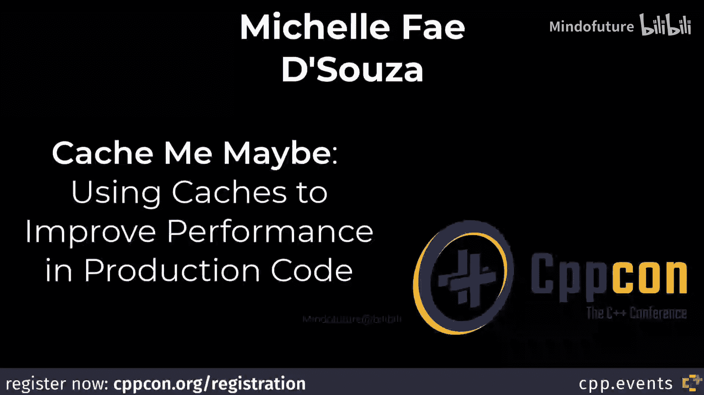
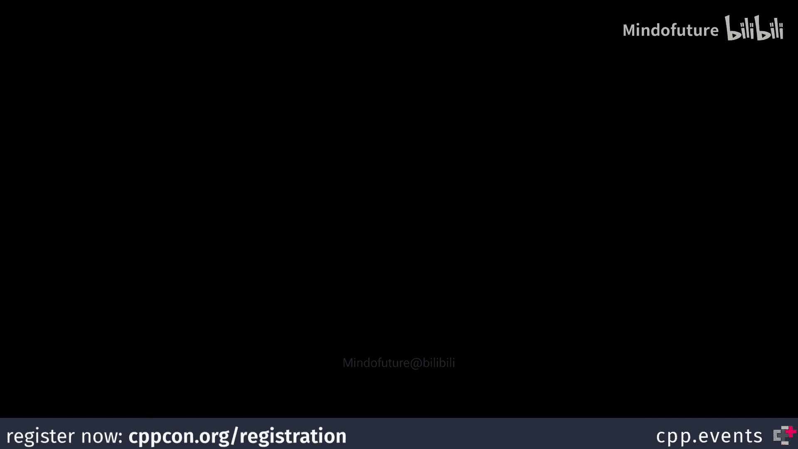
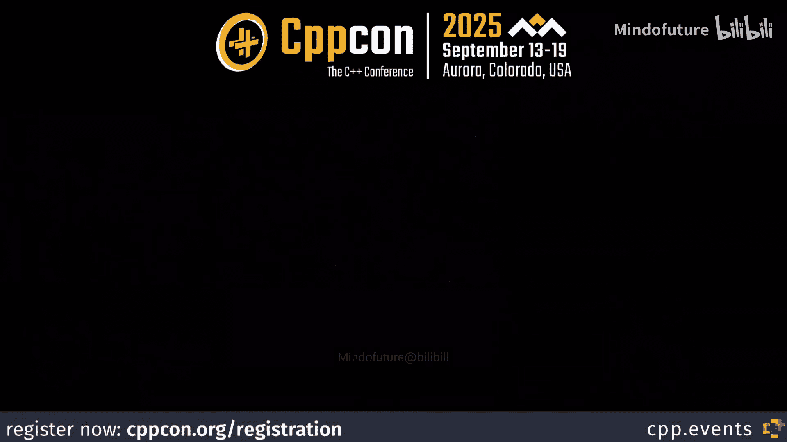
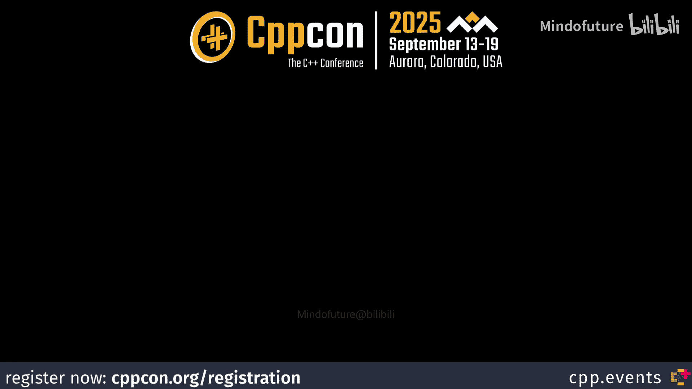

# Cppcon-2025-｜-C++-｜-C语言--｜-汇编-｜-编译器-｜-操作系统-｜-Linux-｜-Windows-p83-P83_在CppCon_2025向彭博社工程师学习C++性能秘诀_--BV1wyPBzrEeu_p83-

Welcome back everyone， Kevin Carpenters C++ events and I'm speaking with one of my favorite speakers who I haven't got to talk to before。

 well I mean not in an interview， Michelle Fey to Suusza， Michelle and I met at C++ onC。

 I think it was like three years ago now Yeah a while。

And so I have to share this story because we're sitting at the table。

 we were sharing the same table and this particular C Sani。There signals， you know， if you go there。

 you get the shirt with everybody's speaker's name on the back and Michelle being the smart developer that she is。

 she had another thread which in this case is a whole nother human being。

Who wanted to go around with a shirt and get signatures from everyone And Michelle， you know。

 as a smart programmer did the coa weight thing and just waited till all the signatures were caught。

 then asked to hold up the shirt and get a picture with it。 so it looked like it was hers。Yeah。

 optimizing life， then why not， you know？😊，So Michelle is a software engineer at Bloomberg where she developed C++ code on the order trade entry modification system that's got to be like a lot of traffic if I you know。

And we'll leave it there I do credit card transactions with you've seen interviews before you know and it is kind of funny at least for me when I'm staring at my screens and we're moving traffic around transactions are just scrolling by so fast it's almost a blur she's an active member of the C++ Guild and technical rep with Bloomberg she has her bachelor's from California Berkeley。

 but the US we couldn't keep her， she had to move to London。

 I don't know if that was fair but you know。We'll roll with it and president of the Computer Science Honor Society。

就 just呃。This is a bit too much， honestly， I'm just fellow。

The things that we do so that we can get into the positions that we have， right I？No。

 I honestly did it for fun， did not think about it being used anywhere else。

 and I really enjoyed doing what I did then， but yeah。😊，No， but that's what I mean。 I so I didn't。

 you know， I didn't go to， I didn't do a four-year university。 I you know， I just learned everything。

 It's like I had to pick up a book and learn。 And it's not that we you know there's plenty of people my age that have done university it just wasn't for me and but that's where I'm like the things that we do I mean。

 even all the volunteering and things I do at the conferences has been to you know I love being with everybody from the conferences。

 but then you know when when you look at the longterm part of your career。

 anything you can do to help build what you love I mean I think that's a beautiful thing So last year。

 you did C plus plus RVO return value optimization at CPBcon for performance and your code bases but this year you're going to do。

Oh boy， you know what's the talk title that you have this year it's Came maybe so it oh cash me maybe going to be a very interesting talk it's going to be very fun guaranteed but yeah you should be that you love it well I'll absolutely be there I mean fortunately we're not back to back like we were last year so you know。

This are a really big shoes to feel like Kevin was speaking right before me and I was so nervous because Kevin is such a good speaker and your talk was amazing。

😊，So having to go off。I appreciate that， but let's be clear about the statistics for everyone watching my talk had like 16000 views Michelle's when I just looked was sitting at like 34000 for last year's talk so numbers on numbers it doesn't matter like quality wise Kevins was better。

A right。I you know， I like doing the back to basic kind of stuff because I think I like working with the analogies。

 but I am really curious so so when it comes to caches， okay。

 so I did hear that you know you like to throw things when you're in this talk so like should people come with a baseball glove you know？

So this time it's not going to be stress balls， it's going to be something different。

 but I will be throwing for sure， it'll be fun and it'll be something you'd want to catch。Okay。

 if you want to bring a baseball glove， you can if you want to bring a baseball helmet。

 that might be better， but yeah。😊，Okay， so it's going to have weight I mean， you know。

 if you want to throw laptops I'm sure people will be running up front I we can we can make sure to keep you know EMTs on the side so how much time do you spend working like in code with caching is that like。

Like daily， Yeah， this particular thing is something that can help people daily。

 like I keep this in my mind when I code when I PR review。And it's。

 I think good for every single programmer to know about， even if they're not。

That performance oriented per se like I was kind of ashamed when I didn't know about it and I learned this whole thing。

 I was like， oh my God， I wish I knew this earlier。

 but this is just not something that was taught to me before。 So yeah。

 I think people should know what is going to be presented。

I think it's interesting in C plus plus because especially when we're starting out there's so much。

 there's so much you can do with the language just you know。

 on its own and when you're doing modern stuff stuff。

 but to your point as you start to understand the。The relevancy of the hardware underneath。

 then it makes you think about your code differently right Yeah，100% and in a way。

 like you don't truly know your own code until you know the hardware underneath so。Yeah。

I can fair statement so do you find that you know because speaking of like the talk I gave last year you know and kind of bouncing both these so i'm like you know when you。

When you're starting out， that's why my talk was almost always vector， right。

 because as you're starting out， you know the that will get you 80% of the way there and the performance will be。

 you know， at least 80% of the way because so many people use it。How much custom is， you know。

 when I think about your what your talks going to be about on one hand， there's the。

 I will think about my code differently， but then on the other hand。

 how often are you having to write custom code to really take advantage of caches versus just thinking about the way you're going to use structures differently。

 how much does that split kind of happen？So it also depends because like sometimes when people make customized data structures。

 you get to reuse those things。 like that's what's been done with a lot of。

Third party libraries were also in the standard itself， hopefully in the future。

 but we'll come back to that in the talk。😊，But yeah so。If you want to create a customized thing。

 you can if you're at a bigger company or someone's already done it。

 making sure you use those customized things is super important。

And the it just also depends on how much time you have in a way and what you really want to do。

 So your use case would really define how customized you want to get。

So this weekend when I'm rolling back the server change that we tried to do at 1 a。

m and we're trying to put a patch in， that's probably not the time for me to be working on my cash efficiency No no。

 I don't think so， what do you think of？Come on， can we find the one line of code just to make this work？

No not not then， but there are other cases when you're not doing things at 1 a maybe yeah yeah you so do you end up having to use a lot of tools in order to measure I mean do you find that that's also important in this Yes。

 like observability if you don't have that。😊，I mean， it's like。

There's a quote from I think Evan Hansson or one of those players。

I can't remember it correctly and then people watching this are going to hate me if they are theatre notes。

 but's something about。😊，If a tree falls down in a forest and does no one around to hear it， yes。

 does it actually fall down yes， it yeah it' paraphrayse it's not exact quote but yes。

 I think you have it close enough so to that point it's like if you're not measuring it you don't know if it's really a problem exactlyact you definitely need to be measuring。

😊，So if you want to learn how to measure， well， I don't know about the measuring it。

 but if you want to know why it's super important and see some code examples and have things thrown at you and probably have a great time at a talk I'm super excited you got to come see Michelle's talk CPPCon if you don't have your tickets yet。

 I have to ask why we're less than a month out， you want to get these done。So Michelle。

 I really appreciate your time with me this evening， well afternoon， afternoon for you。Good question。

 sorry yeah afternoon。😊，And I look forward to seeing you in Denver here in about a little less than four weeks。

Yes， we do。 I'm excited for it too。 It's going to be super fun， Trust me。😊。

I believe you talk to you soon， bye bye see ya， bye。

