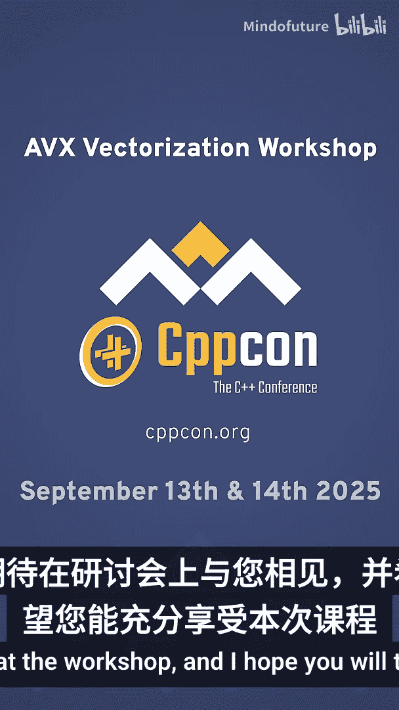
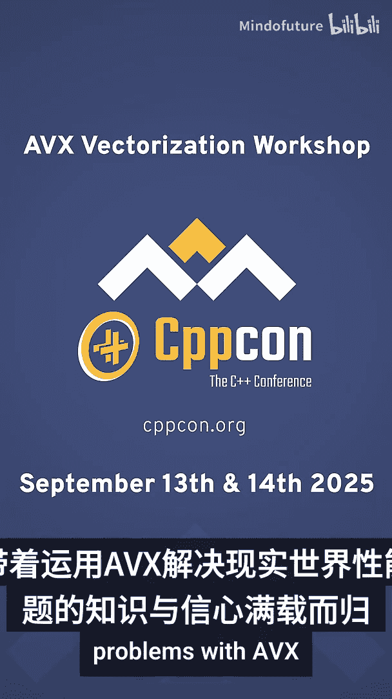

# Cppcon-2025-｜-C++-｜-C语言--｜-汇编-｜-编译器-｜-操作系统-｜-Linux-｜-Windows-p84-P84_想要8倍更快的C++代码？向C++性能专家Ivica_Bogosavljević学习掌握AVX向量化--BV1wyPBzrEeu_p84-

Modern CPUs are incredibly powerful， but most software only uses a fraction of that power Veization is one of the biggest levers for performance that we will often fail to use either because many developers think it's too complicated or that the compiler will take care of it In practice compilers rarely produce optimal syn code by understanding vectorization in AVX intrinsics you can unlock two times four times or even eight times speedups in your most critical code This is gamechan in domains like finance gaming data centers and embedded systems where every cycle counts If you want to become a vectorization expert My AVX vectorization workshop is the right place to be the workshop is structured as a mix of lectures and handson coding sessions Each topic starts with a clear explanation of intrinsics and techniques and then you immediately get to apply it in a lab exercise This way the concepts don't stay abstract you get to write and run the code yourself but gradually buildup starting from AVX intrinsics then going over various vectorization patterns and techniques。

Moving to vectorization inhibitors and finishing with advanced topics needed to reach big performance such as tuning the code for the memory subsyst。

 breaking depend dependency chain and avoiding CPU port congestion。

By the end you will not only understand the theory but also have practical experience needed to efficiently vectorize your code This workshop is designed for any developer with intermediatemedia C or C++ knowledge who wants to write faster software。

 you don't need a prior experience with S， everything builds from the ground up。

 whether you're in finance， gaming data center application or embedded systems。

 the techniques we cover applied directly to real world performance critical software。

My name is Iviza Bogoavi and I will be leading the ABX Specization workshopshop。

 I've spent the last 15 years working in embedded systems and high performanceform C++ specializing in squeezing every last cycles out of modern CPUs。

 I hope to see you at the workshop and I hope you will thoroughly enjoy it and live with the knowledge and confidence to tackle real world performance problems with ABX See you there。

