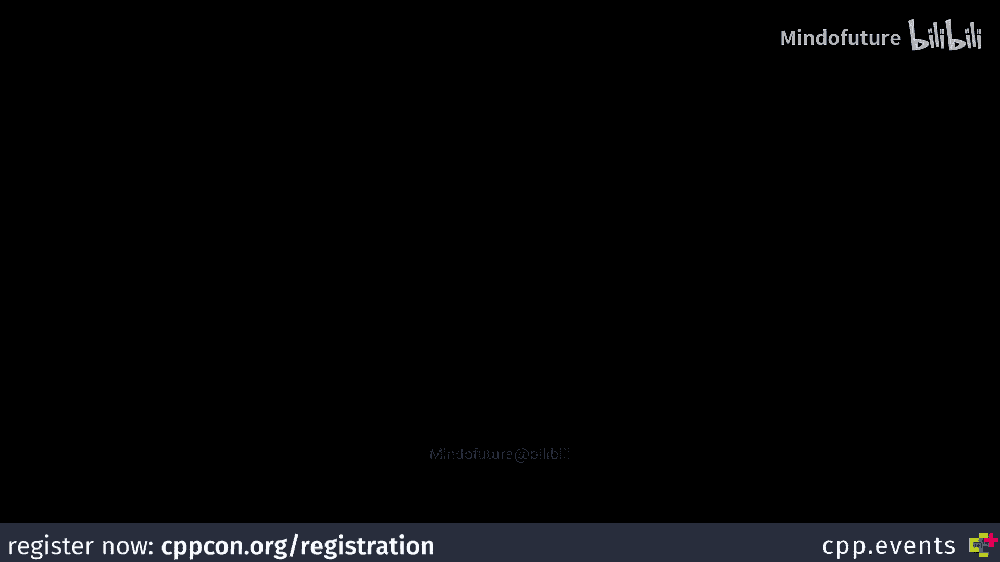
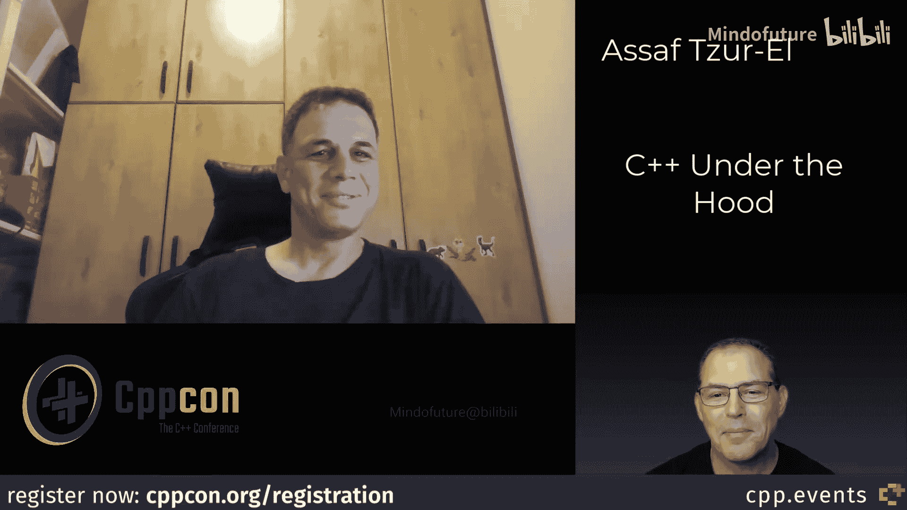
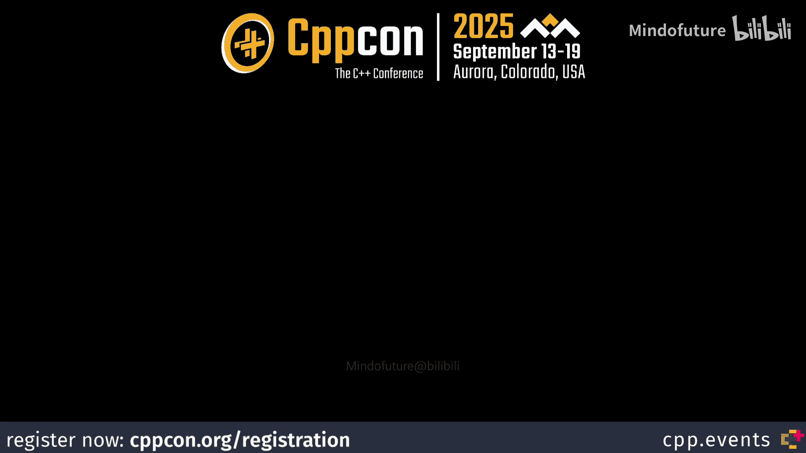

# Cppcon-2025-｜-C++-｜-C语言--｜-汇编-｜-编译器-｜-操作系统-｜-Linux-｜-Windows-p85-P85_与Assaf_Tzur-El在其CppCon培训课程中揭开C++内存管理的隐藏秘密_--BV1wyPBzrEeu_p85-

Welcome back everyone， Kevin Carpenter I'm here with Asof。

 we're going to talk about the C++ under the hood class that he's teaching this year it's a preconference class and he's giving a talk and I'm excited because As soft I've never got to do an interview with you so I appreciate I really appreciate you taking the time today how's it going。

It'Fine， looking forward to the interview。So As soft has been， you've been。

 I was looking at your LinkedIn， I mean to say 30 years of experience is kind of putting it mildly and it looks like you've been in doing instructing for。

We'll say for X years， you know， you can fill in some more of that。Yeah。

 my LinkedIn is a mess because my professional life is。Interesting。

I'll try to cover it from like 100，000 feet altitude developer for 15 years， started with C++。

 but then also worked with other I call them C asterisk languages like C sharpp Java。And。

After 15 years， I realized that I've been working for more than 10 companies。And I'm getting bored。

Yeah， that's an insight that took me 15 years to realize。

I started soul searching and tried all kinds of things and I realized that I'm doing 360 and I'm back at the same place。

 but。Now I'm a freelancer， I have consultant written on my forehead。

 which means that I'm not switching jobs， I'm switching projects and it's fine。And。

During the soul searching， a friend came along and said。

 do you want to teach a course in programming and I said， sure why not I'll try anything？"，And。

I loved it and the students didn't complain too much so I've been doing it ever since my first courses were C++ and then also C sharpp Java design patterns。

 architecture， all this stuff。And about the 30s， and I've been doing it for 15 years now。

So it's 30 years， almost 31 years in total。Yeah， so of all the stuff that you do， I do notice。

 you know， you one of your hobbies that you have， you。

 you volunteer as a as a judge for the robotics。right。

 that's first right for first first robotics competition， FRC， and I've been doing that since 2008。

And I always have here we go。I has have something from there， so this is from two years ago， I think。

that looks like the。That looks like the perfect cube to throw around at people like， you know。

 you're answering the question next， right， yeah， oh， maybe maybe I'll bring that to my class。

 good idea。Great idea。So your class's practical approaches for writing Sa C++ Oh no。

 I'm sorry that's your talk， look at me， I have a talk and I have class and look to the talk and makes up。

Well， I mean it's kind of interesting， we'll get to the talk in a few minutes。

 but because when I think about that， so C++ under the hood and。

Everything that happens when we hit build， right？Yeah。

 and so how does that help developers give me your insight of why you think that helps developers？

Well。First， I mean， there are some things there are anecludes， for example。

 the fact that the stack doesn't exist and the heat is figment of your imagination because the standard doesn't say anything about either stack or he。

Right。But that's eoteric， more interesting things is that you can't count on certain things that you learn to rely on when you're compiling or running your code or debugging it。

And on the other hand， if you know a few things， then you might be a better debugger。不。嗯。

I released a short video， a teaser for a CVP con about uninitialized variables。

 you know there supposed contain garbage， which is actually whatever was there before we allocated this piece of memory。

But if you take a look using some of the bugggs in the market today。

 you'll realize that this supposedly random bits is not random at all。Okay。

 there is a reason for that。And if you know that reason you can rely on it to be random or not random or the fact that the stack。

 I'm sorry it doesn't exist， but the stack that does exist on most systems it goes backwards。

 so if you have int I and then int J， the address of I will be after J。

Which is a useful thing to know when you're debugging and you don't want to be astonished by this fact。

And so when I was looking at your at the class description you're gonna to use visual Studio code a lot or excuse me visual studio visual visual studio and so I do think it's interesting because I'm lucky enough that I get to cross both sides of the fence in a day so I do a lot of visual studio code and Linux you or visual Studio code with Uniix B because Mac as well but then I use visual studio for a Windows application and it is kind of funny watching the debugger and C++ because this is a massive MFC app and watching you know you're stepping through and literally the debuggers showing it going backwards as it's going through a truck now I don't think that that directly correlates to what you're saying for how things are organized but。

I do think it's interesting when we watch things jump around in the debugger and it sounds like。

 you know， one of the things I can get if I take your class is more of that，Underlying framework。

 understanding of why some things might be happening the way they happen。Yeah， yeah and。

I like using Visual Studio for teaching because as the name suggests， it is visual。

 it has lots of things I can show instead of just telling you about the stack I can actually show you the bits。

And it's pretty easy to handle even for people not familiar with it。

 so my students are also encouraged to use that at least during the classes。

We're going to even dive into assembly。Okay， bringring your valve bags by the way。

 yeah we're going to look at assembly and I think that's part of what you're saying because C++ is nice。

 but actually what happens， what really happens is that we're running upcodes so we need to be aware of that。

And also about that。And that makes sense， and I was going to say that kind of makes me think of when they talk about C++ and the onion concept。

 just kind of the layers that you have， whether you know from the source code to the build to the linking and everything else。

 but it seems to me that yours is going to be more about when we're getting to that binary that's being processed than anything that's happening in the build process or linking。

 is that a fair statement that yours is kind of going from the source code to how it is running on the metal if we will and being able to look at the tools that you can use to see that？

Yeah， yeah， so as I said we're going to look at the code and assembly generated from it。

 we are going to look at the memory memory layout and parts of memory segment like the stack and heap。

And we're going to look at the build process at the preprocesor compiler linker and how do we see。

 for example， how can I see what the compiler sees because I see files。

 but the compiler only see one。Unit for compiling， so we'll be able to take the compiler point of view。

So yeah， we'll do running like runtime stuff。 We'll do compile time stuff。 We'll do edit stuff。 Yeah。

 it's gonna be a full day。 Very cool。 So I'm gonna， I w to， now I'm gonna jump around a little bit。

 just because now this has got my mind going on a couple spots。 So I want to go to your your。

 is a C plus plus inherently， you know， risky kind of an idea with， with your talk and。😊，So。

So the first question I kind of had was you know because I was talking with Andreas Fertish who's doing he's doing a class as well that's un embeddedbedded and it brought up MerRSA and so you know whenever I think of MerrsA you know generally I just think plain embedded space。

 but you mention it in your talk description which makes me want to say do you think MerA as a framework is good for all C++ projects or you know do you think it still lives mainly in that embedded space？

Okay， so that's a great question。And I have a whole lecture about us， programmers。Not。

Being paid to write more code， but to produce working quality software。

OkayAnd if you want to write more code， then go ahead and type away。

But if your goal is to write good quality software。

 it means that you sometimes have to slow down in order not to repeat yourself and go back and debug and。

Give the customer yelling at you because the code crashed or whatever。

So we'll need some guardrails because the language obviously doesn't provide us with enough guardrails and the one it provides。

For example， not allowing you to assign to a con。It then takes away by giving you a concast。R。

 wonderful so we need something from the outside and things like solid and design patterns and clean code and all these are nice but we need like more strict things。

 for example， it feels like when I was in kindergarten because it was so long ago。

 my teacher told me never used go to。Yeah， your people did that too， yep， yep， never use Go to。Yeah。

 and I never used Go to except in classes write to show them what not to do， right。

It's not such a burden not to use Go to， but it makes your code more structured。

 right let's prompt errors， problems with the allocationlocation and des and whatnot。

So this is just one tiny example of how following certain rules will make you better programmer and make your code better。

and so I understand what you're saying there because I kind of think about it to one of my big learning experiences over the years has been test drivenri development now I am not incredibly good at TDD even with all the time that I spend with Phil Nash but I will say that it did you know I used to not understand the issues of tightly coupling。

 you know I think when I was earlier in my career I would naturally write code that was more tightly coupled not really understanding that I was doing that。

 but as soon as you then need to turn around and you start learning TDD just the knowledge of having to separate and write a test case will at least for me help me suddenly see oh。

 so this is what tightly coupling looks like this is what the problem it causes this is what ends up coming out of that so I can relate to what you're saying there from you know having those extra guardrails to help us work and think better as programmers。

But I want to finish with one other question。Modern C++， you know。

 if we are coding and let me just go， I'll pick a standard like 17 forward if we're really writing modern C++ from a 17 forward。

 you know so you're not using raw pointers， you're using a lot of the standard library。

 do you still think if we're doing that as a base that C++ is still as inherently unsafe as it was？

C plus more than C plus equal plus 11 onward actually， yeah。

 it makes C plus+ much safer or optionally makes C plus+ safer because you can use smart pointers and all these things and never use the new again。

 but that's just one part of the problem are many other problems。嗯。

You can still forget the default in switchcase is more CL+ and you can still use because C++。

 how did Scott Mayers put it once？C+ he used to hear all the time that C++ is a language with its future in front of it most of C++ code wasn't written yet。

 and he said that I didn't hear that in a very long time and he said that before he quit before。

So C++ has lots of baggage， lots of legacy code， and that code uses new and that code might be using Go to and that code Sarah okay。

 so we need to be able to work with old code， we need to be able with people thinking with old code。

 I know people who are still working with CPP 98。Yes， yeah， okay， so they're not modern。

 they're writing you， I think I hope they're not using Maoc。Who knows？Yes， so yeah。

 we we all need to to have。More guardrails， I think。

 to help us write better code and it's not a shame it's not like。You know。

A grown up riding a tricycle， a kid's tricycle to be safer，We're grownnos， it's okay。

 but still if we can ride our C++ with some guardrails， I think that's a good thing。Well。

 I want to say thank you for taking the time this evening for you， morning for me。

 us off and if you haven't already and you need to understand more what's under the hood of your C++ then you want to head on over to registration。

 sign up for C++ under the hoodod with us off， that'll be running on Sunday， September 14th and。

I'm a little jealous， but not because he has inherently safe practical approaches to writing C++ Sa C++ on Monday。

 so he gets to one shot his week and enjoy the rest of the conference after Sunday and Monday。Yeah。😊。

I get to wait till later in the week， but I do look forward to， you know。

 I'm going to catch you because I want to talk about some memory stuff because my talk will be back to basics about memory allocators later in the week and so I look forward to seeing you in the halls at the Galord and wow。

 I think under four weeks now。

Yeah， yeah， it's a month from now。Yeah， so yeah， so I'll see you there you know Aurora， yeah。

 thank you very much， have a great day by bye。是啊。

