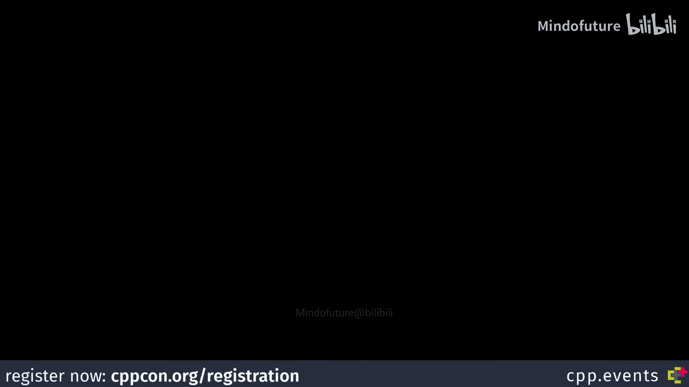
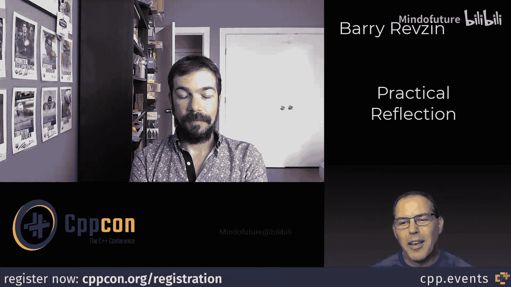
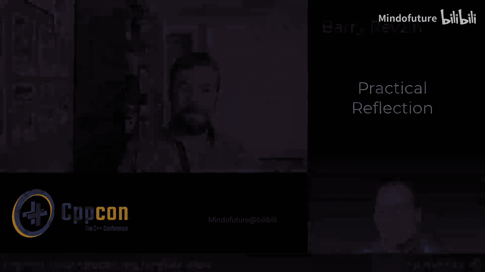
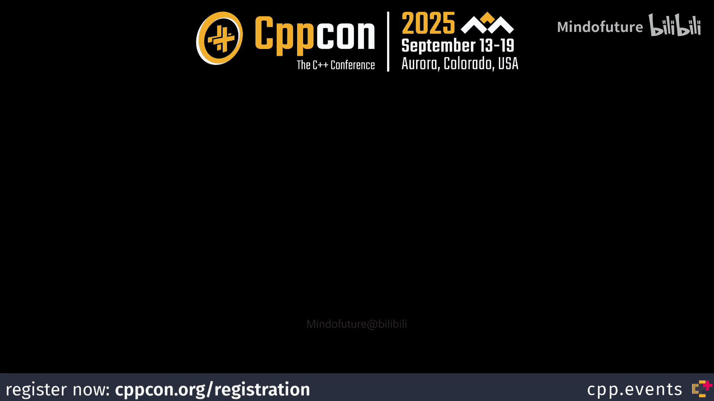

# Cppcon-2025-｜-C++-｜-C语言--｜-汇编-｜-编译器-｜-操作系统-｜-Linux-｜-Windows-p86-P86_在Barry_Revzin的CppCon_2025演讲中了解专家为何对C++反射感到兴奋_--BV1wyPBzrEeu_p86-

Welcome back， everyone， Kevin Carpenter is C++ events and talking with Barry Revzen。

 did I get the last name right， Barry， That's right， Yeah。

 we're getting ready for CPP con and this year is going probably be the year of reflection。

 which is why I'm super stoked to have Barry here because you get to go see him on Monday at 2 pm for practical reflection and。

😊，And I just happen to know and I'll get to it later。

 but there's a few other thing that there's definitely I think three or four talks that are reflection。

 especially without hitting the standard this year， right， or at least passing committee。Yeah。

 I mean， this is a big year it just got adopted at the last meeting in Sofiia。

 so I think everyone's pretty excited about it。So Barry is a senior C++ developer at jump trading in Chicago。

a I like that unreasonably active on stack overflow。That's， you know。

 I used to live on stack overflow， but I'm curious what's going to happen with AI now。

 I just have to say， you know， the questions will be answered equally wrong， right？

Well yeah it's kind of interesting it's going to be you know。

 I don't know it's going to happen to that site long term with how good the tools have been becoming at answering questions pretty well。

 but you know where where are they going to get the new information from like I don't know it's going to be interesting to see I certainly have no prediction。

I I'm just watching and， you know， the meme where you're sitting back with popcorn just kind of watching and waiting to see what happens I kind of get that。

So escalating。Your C++ by attending the standards committees starting in 2016， so what got you drawn。

 I mean， what drew you to that？No it kind of felt like the logical next thing like I started being very active on S Overflow in like 2015。

 started answering a lot of questions。 I learned a ton just by doing that because it was like I was like I don't actually know the answer to this question but I'm gonna to force myself to determine the answer to this question that I can answer it and I just did that over and over and over again and at some point you know I got a sense of like you know where are things in the standard。

 how to read the standard， how to find things and then' just like。

 okay well like well what's the next thing after that was like how do you how do you make changes to things It's like what about you know things that I find annoying or maybe a little bit wrong and then I came across and it's like oh well like。

You know， people actually work on this。 This is， this is the thing that people do。 you know。

 you could， you could just show up so I kind of just。Showed up one year kept coming ever since。

That's， you know， I've had a few people they， you know。

 with all the stuff I've done in conferences it's like， oh you should come to committee meetings。

 but I'm just not like there are things that I like and dislike about the language but when I think of some of the papers I've seen written by yourself or Hannah and just others I just don't have that detail level but I appreciate the fact for everyone on the committee that does。

 you know， because the amount of work you know， especially listening to like Team or talk about the way getting things pulled together at committee meetings it's like it's a lot of work and so you know from the rest of us that just end up using the language thank you for all of that extra work you do because it is appreciated。

Yeah， I mean it's it's definitely a ton of time， but it' it's a thing that like it's a skill just as much as anything else right and like anything else like you just gotta do it to get better like if you if you read like the first papers I wrote like they were not good I had no idea how to structure things and I had no idea how to make arguments but if you just do that relentlessly enough over time you kind of eventually figure out like oh this is this is like a good structure this is how to frame arguments。

 this is what people find interesting or not interesting or compelling and yeah just like over time I' gotten better at it。

That makes me think of my first full length talk I ever gave and how I wish it would just disappear into cyberspace forever。

 but compared to what I do now so I understand what you mean you know， from that perspective。

 that's for sure。So you're doing a reflection talk。

 but it sounds like your talk is going to focus on implementingstructive arrays。

 you know for an arbitrary aggregate and so you know when I think ofstructucive arrays， you know。

 it makes me think of like CMD because of you know data and contiguous layout you know and cash performance。

 but give us a sense， you know， can you give me more of a sense of what you're going to look at with that？

Yeah， so so one of the thing I'm definitely not going to do is really like I'm not trying to like motivatestructive arrays or talk about why it's interesting or good or the performance aspects of it like Victoria is going to do that at his keynote。

 he's much more like suited to talking about the stuff than I am what I thought about it is that it's a very interesting problem from the perspective of like okay like let's say you have you're in a situation where like you think that this is a better data layout for you like how do you restructure your data to have that layout well like today I mean that's kind of a pain like okay I have my one vector now I have to rewrite it。

 I probably have to like manually write multiple things like figure out how to do that and I'm not even sure yet if this is a benefit so like I have to do all this work restructuring a lot of code rewriting a lot of things just to find out if it's worthwhile and then I watched the Zig talk that Andrew Kelly gave when he was talking about like things that he was doing in the ZI compiler he was talking aboutstructive arrays briefly and he made a oneline code change from。

Aray list of T to multi arrayray list of T and it's like okay now I have structure arrays and it's like if it was that easy to do that in your code。

 you would just do it and then it's oh did this help me yes。

 no okay it did and now now I'm done and one of the cool things about reflection is that like oh I can actually I can actually do this like I can I can implement the same thing and so that like you can make that one line code change to find out if it's interesting。

And and what I like about that example in particular is that I think working through that example touches on a lot of。

Topics that are relevant and like well how do you do things with reflection so like my my broad goal is to try to touch on as many of those little topics as possible I'm gonna go on like a lot of little digressions about how to solve this subproble and that's all subproblem to kind of give people a sense of like are these are like this is like a brand new toolkit right likere kind of we're not even so much as inventing tools is we're inventing like the whole the whole tool she and like this is this is the kind of thing that you might want to do to solve this kind of thing this is the kind of tool that might be useful in the situation and so give people a sense of like this is what's out there right now we don't even know we don't even know what's possible really we're only just starting to scratch the surface。

It's funny you say that because when I was getting ready to chat with you。

 I stole the line from an upcoming release from one of our other keynotes and everyone can guess who probably made it。

 but C+ plus 26 marks the most transformative turning point in our languages history and so you know。

 when I thought of serialization， of course， the first thing that always came to my mind just because it was the only way I really used it before was automatic serialization。

 you know being able to easily because I do a lot of JO I do credit card processing and so from that end。

 you know the things that I would see with serialization and other languages just。I mean。

 it's not that I had to have it， but it certainly would have made it easier in C。 plus， plus。

 But that's not even。But in the scheme of things， it seems to me like that's not even 10% the of the landscape of what's going to be able to change。

Yeah this is what I think excites us the most about things it's like you know we've been working through a lot of examples over the years we started with like okay well these are the problems that we know that we want to solve and if we can't solve them then we then our design sucks and we need to iterate on the design until we can solve them and then we got that and then we start discovering new things that we can do and it really is just like discovering new things we can do and some of these are you know David thought that substitute would be an interesting function to add and he doesn't even remember why he thought that it was an interesting function to add and it turns out that this is sneakily one of the most useful functions in the entire library for like the breadth of things that we figured out that you could do with it and so know even on the flight back when we were flying home from Sofiia Dan through this example together of like oh well now you can hasbed a JSON file and during reflection time parse that and produce a type with named members of the fields of your JSON right's like I just have a random J。

File it has like some string key and an int value and now now I have astruct with like an int member named that thing populated with that value and' I didn't know that we could do that and and you can so you know what is and that's just like what we figured out so far So now a compilers are going to implement this you're gonna to have thousands of you know smart and curious people banging against this and like who knows what what people are going to come up with in the future it's going be it's gonna to be pretty exciting to find out I think it is kind of interesting because it just made me think about it like when when we put out a proposal or such and it gets approved it's really just like the parameters or the blueprint because then just like you said as everybody starts banging on it at the compiler and adding adding it in so that we can use it and then libraries end up getting built on top of it it's。

That's also kind of scary though， right， because it's always like you make an interface。

And it always gets used 20 ways that you didn't expect。So do you think it's going to do a lot with。

 I mean， so meta programminggram right type traits that's always been more compiler based now we could be doing type traits without compiler intrinsics。

 correct？Yeah and so one of the interesting things is it opens the door or too there are so many more things that you can implement as a library today。

 things that you could only have implemented as a compiler extension yesterday and so first that just like lets you do more things you know this one of the things that I was trying to pursue is extending the kinds of class types that you can use as non-t template parameters right so in TL it's funny we added support for using class types。

 but only types that have all public bases and members recursly all the way down so that's useful。

 but it obviously includes a lot of extremely useful types right you can't have string。

 you can't have vector you can't have Tple and so it turns out that reflection like I can implement as a library support for arbitrary types I wrote a blog post about this recently and so like well that's something like I mean eventually I want that to become a compiler feature but I can prove it as a library right now and there's so many。

Other things that fit into that boat it's like okay well this is a lot easier to implement as a library with reflection than it is to implement as a compiler extension and as a library。

 more people can use it and we've also seen that in other languages too like I know this has been big and so in Ru for instance there's a lot of things you can do with procedural macros like way more than we can do with reflection like all sorts of like you can embed compilers in other languages into your RuS program like sure but people can use that to like do an implementation of something that really kind of should be a language feature demonstrate that it's useful。

 get a lot of a usage experience with it and then at some point in the future it becomes a language feature that's heavily motivated by like the existing practice of this of this macrobased library and that's also really exciting because it's one thing to whenever we want to try to add new libraries into the standard it's like okay well obviously you want people to have used them you want。

There to be usage experience with them because like why would you standardize them otherwise。

 but that's always very hard to do with language features right because how are you going to get a lot of existing practice or like a usage experience with new things you need people to like download your compiler for it and build it and start like that that's hard but getting usage experience with with a library that's。

That's a ton easier， so I think it paves the way for like a very different。

Approach to even thinking about how we do language feature standardization。

That's really cool So to hit on something not C++ related just because I see the swimmers there on the side and and I saw that in your in your note on your bio so a big swim fan right Oh yeah so I have to ask did you ever watch Sebastian Theoophilll's Lightning talk guide to C++ conferences for swimmers？

😊，No know， I did not。Okay， so if you get a chance， you did it at C++ now' it's just kind of funny because I can't remember who it was it started off with someone doing a similar talk for runners and so he goes through and lists the different you know bodies of water or pools near each conference and which you would prefer to swim in you know。

 all the way from the coldest to the warmest。So。Well listen Barry。

 I don't want to take up too much more of your time today because I can just say like for everyone coming to the conference。

 Barry's talks on Monday 2 pm we only get him for Monday and Tuesday so your conference track with Barry is narrow so make sure you track him down after his talk and I really appreciate you giving me insight on reflection and I look forward to seeing you on Monday at the conference。

Yeah， come check it out。 I think it'll be， I think it'll be a fun talk and hopefully useful and informative。

 too。 So if you don't have your tickets yet， of course， you need to get your tickets CP Pcon。

 And again， Barry， thanks and have a great week。 All， thanks to you too。😊。

