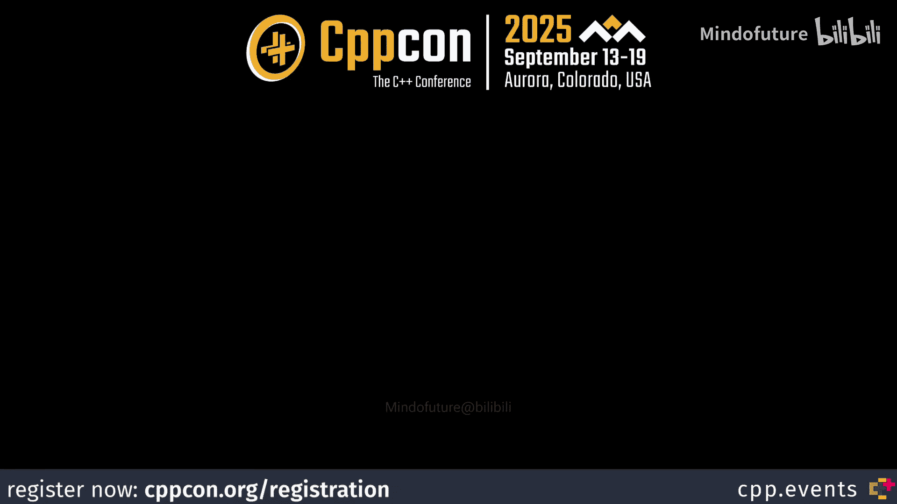

# Cppcon-2025-｜-C++-｜-C语言--｜-汇编-｜-编译器-｜-操作系统-｜-Linux-｜-Windows-p87-P87_安全高效的嵌入式系统C++培训课程——由20多年专家Andreas_Fertig主讲--BV1wyPBzrEeu_p87-

Welcome back everyone， Kevin Carpenter's CPP events and I'm here with Andreas Ftch。

 I think I did it right， you know I'm working my German pronunciations。

 so CPP cons coming up and Andreas is giving a class safe and efficiency plus plus for embedded environment。

It is 2025， so I think that's just kind of an add on to the title。

 I think the embedded environments has been useful for quite a while， right？Yeah。

 that's true simplycon did that to mark that it's the class of this year， yeah， you know。

 because it would be hard for us to tell。😊，I mean， we are programmers， right。

 so dates are challenging for us that this has been proven with the amount of libraries。

So if you don't know Andreas， he's a C++ trainer consultant and an expert， I mean。

 you've been doing this for how many years now？Oh gosh I always try to skip this question and it gets longer and longer so let's say 20 years plus it might be a higher number。

 but yeah 20 years plus that's a good way to roll with it right and you've been a member of the C++ standardization committee。

 you know so you're involved in the real knits and bits of the process writer。

 yeah I saw your co-routines book that you put out last year？Yeah and and speaker。

 so aside from coming to Andre's class he does back to basic static inline constantt Con Exp。

 which I have to say， you know， when Jason Turner was doing his constant expert for all things I didn't quite get it but now I do try to Con Exp a lot of things so if if you're not familiar with these tags that you need to be using you definitely want to come and see his back to basic talk and then of course C++ insights which is just an excellent tool I mean。

And you have time to teach， how does that happen？Well， a lot of sacrifice， I would say。

 and trying to manage the time as good as possible， but still having time to relax and enjoy。

The things are close together right so I often get feedback from attendees during classes so what might be helpful。

 for example， for C++ insights then or what could possibly end up in a book because a lot of people come up with the same question so it's the same how I compose my classes so when I see this is something where a lot of people struggle where the same question comes up more and more and I try to add more to that topic and make it clearer or。

Teaching back to basic talks because this is also what they are for right so going to the basics again it is like you know that I've gotten picked for a couple back to basics talks last year it was almost always vector and this year's on memory allocators I do like like there's you know。

I like analogies I guess， and I think there's kind of a fun part when you're doing it back to basics talk of trying to take something that's really complex and breaking it down so that it's that bite sizeized piece for someone new coming into it and so it is one of those tracks that I'm glad that CPPCon always runs you know if you're new coming into the industry。

 you're going to come and get a lot of content， you know even if you're a new C++ developer。

So that kind of makes me go to my first question I'll ask you so you know with embedded there's of course various different challenges。

 but you know in embedded you have Mra and autosR and SL， you know these industry standards。

 so how does that，YeahWhat is there a conflict or how do you manage like performance and memory safety in writing code in a way that meets these standards like are they。

 I don't want to say counterproductive， but I think you get the point I'm making， you know。

 do they clash a lot？I would say they clash at times， they are all there to。

To enable you to write safe C++， right to avoid undefined behavior， to avoid surprising behavior。

 so give you a safe path through all of C++。And that only works by letting things fall down the two sides。

 And yes， sometimes it is that we could write。For this specific piece， maybe。

More performant code or something if we sacrifice one of the rules， which on the other hand。

 is something you can do， so the idea of let's stick with Mira the others are the same is you have a set of rules and you can say I don't follow this rule。

E or just now and heres myration and you can see this in code basis sprinkled all over the place that people say。

 yeah， I know this is not 100% Mira but I know what I'm doing we discussed this and so this was to design decision to still follow Mira for the rest but not in this very specific line for example so kind of that same idea when we're using best practices or the yeah with C++ in general。

 especially as we've moved to modern C++。So yeah。Okay， and that makes more sense to me。

 I didn't know， you know， I guess that's more of an industry question of how hard is it followed depending on the industry that you're in。

 you know， from a failafe thing。It depends。 So you have， I think a lot of companies they。

I would express it as simply follow misRA rules because it's a good thing its's guidelines。

 but technically they wouldn't have to and then you have more regulated environments it was a long time medical so if you write code for medical purposes it's on the FDA regulation for the USA for example so they want a lot of paperwork and they want to see which process you follow and this is also something that MiRA gives you or all the other standards give you that you can say yeah I follow this standard here's my documentation and then you can have a lot of tooling around this that this is the other part of MiRA that they are trying to come up with rules that you can really statically check because all the other rules yeah well did we really follow that did everybody look at it in a code review or not so it should be possible to have them check with tooling and this is when you go into the regulated environments whether it's medical whether it's。

Autommobile or aviation。 Then you are in in a total different game。

 And then you have to follow these rules and document a lot of them。 And if you then。

Say I don't follow this rule， you have to make a good rational why that's okay that yeah。

 that makes sense， okay， I understand that。So with embedded， you know。

 one of the things I noticed in your class description。

 but you know I just know in general because the little bit that I've played with embedded devices is memory。

 you know， it's not like there's a lot of it and then embedded you are a lot of times restricted on heap。

 which leads to a bunch of different things but I'm interested。

 you know you don't have to give me the full spoiler but stood unique pointer。Without he。

Give me a 30 second bite of how that works。Well it's a unique pointer I mean it's righte right。

 it's resource acquisition initialization so you don't necessarily need dynamic memory and you can also say a lot of embedded systems。

From an outside perspective， do cheat。 So they do dynamic allocations， but from a fixed size pool。

 So they know how many chunks they have。 Okay， and they pre allocate locatedated。

 So the the basic idea is that you have。The knowledge that you have enough memory for everything that's coming for each of your applications。

 for each of your tasks， double it to be really sure， and then you are only tracking from that pool。

 you can control these pools better if you're doing it per task or whatever you do so you know it's not necessarily slower the more memory you consume you know for network stacks。

 maybe you have different packet sizes or different block sizes that you can get back。

 but you may over allocatelocate with each allocation， but that's fine。

 the basic goal is never run into and out of memory situation makes things reliable in timing measures and all that stuff So this is something where the unique pointer still comes into place so you have you locally and you want to not leak that so you give your memory back and then you have other things like devices that come and go。

Which。Is also something that you might manage in one way or with a unique pointer the Sha pointer is a more difficult construct because of the control block so where I can teach a unique pointer to stay only within the memory I wanted to but with the Sha pointer without touching the standard library it's I think it's really not possible。

Okay， and so I mean on the standard library because you show that there too。

 it's you know stood vector or stood string which can allocate on the heap so you end up covering how to use those right or variations thereof。

The usual thing is that you avoid these you have different sets of requirements for embedded systems so one is really no dynamic because your your device in physical size and in all the specs is so small that you cannot afford it you cannot even afford putting the allocator so lip see on it to manage everything and the other thing is that you can allocate up to a certain point during your application start phase so most of them call it an in it phase and during that in it phase you allocate everything you need even in terms of dynamic memory and then this is what you have to live with during the rest of the program runtime so some of them even use stood vector because the prelocate everything there but。

From my experience， it's it's more rare cases because then you also have to find the。Yeah。

 the case that the stood vector still might throw an exception。

 which is something that some embedded domains also do not tolerate。

And I was thinking Kahalil Etelle did a couple talks in the last year where he's talked about you the size and speed of exceptions and I want to say I thought he even brought up embedded in it。

 but I can see that part where you know because the other thing I noticed you talked about in there is like StChronno。

 you know and I understand that on different devices you had different clocks and so where I'm going to back that up for a second is like to the point of exceptions it all depends upon the hardware that we're on right and the constraints of that particular embedded system that helps direct us on how we're going to be writing our code this way。

Yeah， yeah， correct。 And and then you factor in something that you write a code once。

 but later push it to different devices。 you might not stay in full control， at least not。

Unless you can foresee the future right so what architecture so previously it was big Indian no it's little Indianan。

 we switch from input to arms， things like that that makes things harder and the other part is。

When Herb came out with his static exceptions proposal， I think it was called back in 2018， 2019。

 I was sitting down quite a bit and thinking about it。Because I liked it， I mean。

 one part of exceptions in C++ I think， which is problemsome is that you can never be sure that you catch or handle everything at a certain point because if a new exception comes in。

 it might simply fly by you。When I was thinking about it。

 most of the cases I had in this software at that time。They were error condition。

 so we rebooted the device if you look at the patient monitor。

 if I can show you the heart rate of the patient during a procedure。

I cannot bring up a pop up and tell you try it again in five minutes so it's rebooting and being up quick again hoping you're not running into the same situation again so the exception doesn't necessarily help me it doesn't help throwing up the calls deck and letting somebody else handle it because usually。

There is nobody that can handle it better it was an error and what shall I do re so this is why exceptions。

Yeah are a little bit more difficult to treat there because a lot of the things they are basically asserts they should never happen and if you run into the MBA you can make it an exception but it will not change and result a lot in most cases that yeah it makes sense I remember reading an article about the you know the Mars Rover I want to say it was that they said it literally rebooted like a thousand times a day it just you know that's just what it did it ran into a state it couldn't handle and then it would restart and so that that makes sense。

So modern C++， has it really in your mind changed the way we think about embedded development。

 has it made a large difference， or is it more about just the maintainability in the cleaner code like it is in the non embeddedded environments？

It's a large part of the last， so yeah it enables us to write cleaner code， less code。

 which makes it more maintainable， which is a huge factor because this is something I think it's true for a lot of our industries but especially in embedded。

I'm not sure if it ever was different but we don't throw away code right so code lives for a long time and even in embedded because it's tested so if you're in a regulated environment and you have code that's all there for 20 or 30 years you will not get better test coverage so if you rewiite that thing that the only chance I always say you have is make it worse right so fix it one buck and。

Go home and do something else so the modern standards allow us to write less code to achieve the same goal so everything we start writing from non of C+ plus 11 means basically we can write less code less code means less potential chances for bucks right so this is the good thing and then on top of that we have the denu abilities with constant expressions right so especially in a better environment if I can precalculate things shifting weight from run to compile time compile time。

That's great that might mean that I can squeeze in more features in my product because at the same time I got more runtime free。

 I also freed more footprint they are in for my smart device so I can put the next feature in and。

Battery lifetime。 So less computations I have to do at runtime means that my device runs longer。

 you mentioned before we started you're owning a Mac， right。

 I own one of these it's2 I think Mac and that's thing it's no advertisement for Apple but it's just amazing。

 I can compile plan in 10 minutes and it feels like it didn't even drop a single notch of battery。

 It's just oh yeah， give me more。 I'm here。 the battery is incredible Yeah this is what we are going for the question here is where do you draw the line what's an embedded device。

 but if you look at your phone that's usually the classic for an embedded device you cannot do much with it or just interacting but not more。

 So yeah the embedded device space also pros and the resources we have there are yeah。

Getting bigger and bigger as well， but still constrained。 So I will finish up by saying， you know。

 one for anyone that hasn't taken the class with Andreas， he is very much hands on。

 You are not gonna just be sitting in like hearing lecture， you know， bring your laptop。

 you're gonna work through problems。 You're gonna and I say that because I'm one of those ones。

 It took me a long time to really learn that that that mental grind that part that I'm trying to work through as I'm writing the code。

 you know， that's the part that sticks right at least for me that's where know。

 there's there's you know watching brain surgery doesn't make me a brain surgery and you know。

 you actually have to you know， take things open and and and Andreas gives you a safe way to do that on embedded systems。

 you know no embedded systems will be injured in this process。 but that said， if I wanted to be。

 you know， if I'm if I'm a C plus plus developer this could be a good。

I want to say you know almost like boot camp or jumpstart if I wanted to get go from C++ to embedded。

 this will be nice a nice frame or if I'm already in embeddedded。

 this can definitely help me improve my skills and I want to be taking your class right Yeah that's absolutely true so I also encountered the fact that a lot of people I meet in the embedded space are former C developers so there's room for them as well okay and yeah if you're coming new into this environment we can discuss the things that might be new to you so there is a lot of room and for each of the parties you will take something home for sure。

So if you're coming to CPPCon， which you should be coming to CPPCon。

The class runs September 13th and 14th it's a preclass so you can you get all loaded up on embedded before the whole week takes off by all means head over to the cppPCon。

org website and go to the Academy page and pick up on Andreas's class。

 lunch is provided during the classes so you know it's held at the gay Lordd it's a beautiful beautiful area and Andreas I look forward to seeing you there and I'm looking forward to your Con expert for talk。

Oh yeah yeah yeah I'm looking forward seeing you in person again it's been a year then right because I missed you at meeting C++ yeah I'm really looking forward to the conference and yeah to your talk and of course to mine and the class yeah I think it will be a lot of fun I'm really really looking forward to see you。

😊，Perfect， well， I appreciate your time this afternoon and I look forward to seeing you soon。

Thank you very much for the interview of， Kevin， take care and。

周。

