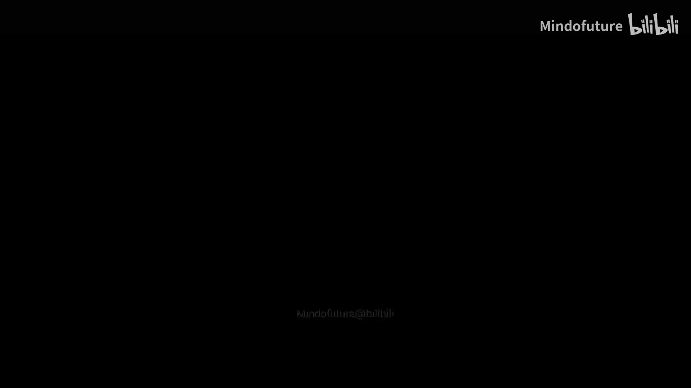
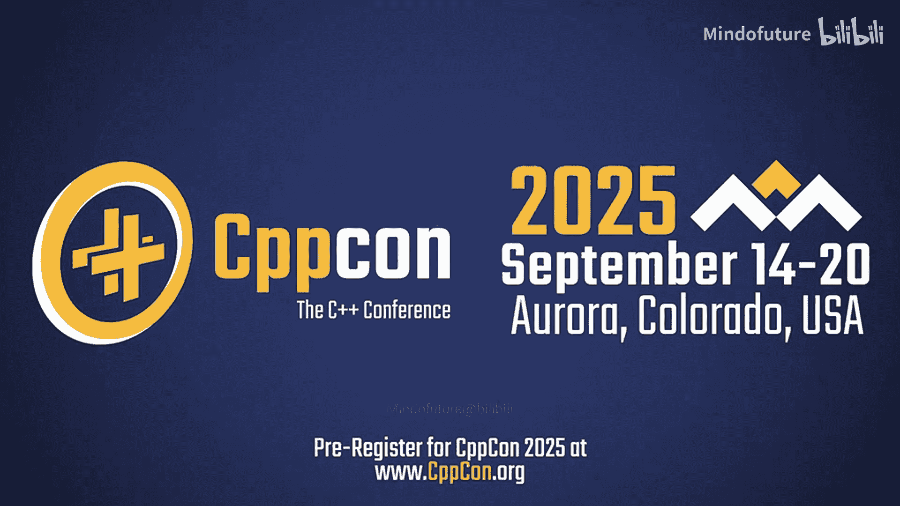

# Cppcon-2025-｜-C++-｜-C语言--｜-汇编-｜-编译器-｜-操作系统-｜-Linux-｜-Windows-p88-P88_宣布CppCon_2025——加入C++开发者、C++程序员和C++专家的C++大会--BV1wyPBzrEeu_p88-

🎼CPPCon is the event to engage with the C+ Slu community in my experience CPPCon is one of the best conferences。

And I feel like it's ramping up more than ever now。

🎼CPPCon is unique because it is the largest S++ conference that I've ever been to I think I believe it's the largest in the world and it has such a wide range of experience levels and perspectives There's a lot of representation in people in different skill sets within S++ You can take your own problems you have in your work area and talk to them with experts。

🎼Try to meet new people it's just super cool being able to talk to so many people and make connections with people you know throughout the industry Friends are the best thing you get from this conference if you come to this conference as a CQL++ engineer you already have a shared language with every single other attendee at this conference which means that you can connect on a deeper level because you already have something in common。

Coming here in person really opens up a world of possibilities I would run into people like this watching a YouTube video or discussing these issues on the internet or in an email channel。

The best of the best in this field， the CPP field are here， why not come here， meet them。

 learn from them， do it in person as we know that's a lot better than getting to do things virtually。

I think there are only few places。And time in the world where such a group of intellectual minds gather together and CPP Khan is one of those places and that makes it unique。

