# 【Cpponsea】C++-On-Sea-2025大会-p01-P01_扩展_std__execution_更高阶_发送者_和_异步程序_的_形态--BV17V4GzjE6p_p1-

Let's review the primitives we get out of the box with stood execution in C++ 26。

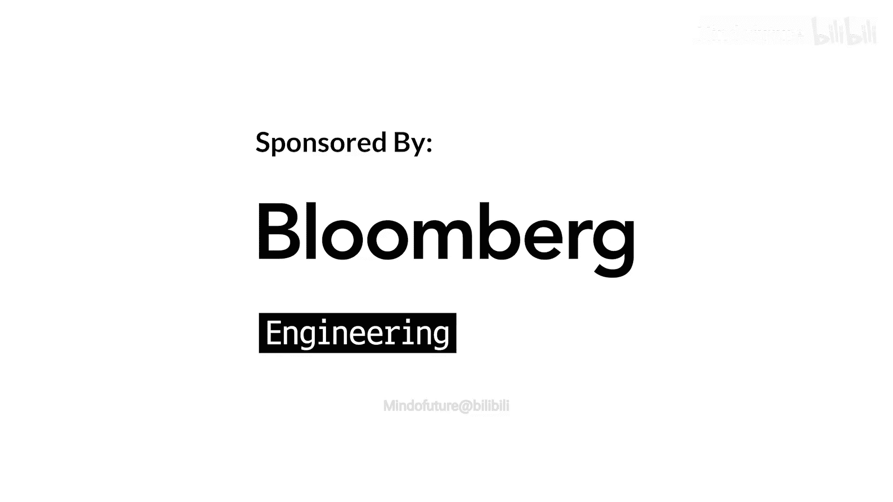

The first and most simple of these is the family of primitives known as just just error and just stopped。

 Each and every one of them forms an asynchronous operation， which ends as soon as it begins。

 which simply bootstraps us into the asynchronous domain by providing the given values。

 the given error or sending a stop signal。But in the asynchronous domain。

 maybe we want to do something more complicated， maybe something involving an operation。

 which is actually asynchronous。 And that motivates the family of primitives known as stood execution。

 then stood execution upon error and stood execution upon stock。

 Each of these has a predecessor asynchronous operation， which is allowed to run to completion。

 Thereafter， a regular synchronous invoable is invoked with the values provided thereby that synchronous invocable can perform some action and can return a new value。

 which is substituted into the pipeline as the asynchronous operation moves through to completion。

But in an asynchronous framework， do we really want to only predicate synchronous execution。

 or do we want to also predicate asynchronous execution。

 This justifies the prim as known as let value， let error and let stop。 Once again。

 a predecessor leads to the invocation of a synchronous operation。 But that synchronous operation。

 doesn't return values which are substituted into the output。 It instead returns as sender。 a sender。

 which encapsulates new asynchronous computations predicated on the values of the predecessor。

 which is then connected and started and allowed to run through to completion。

But these are perhaps the least interesting things you want to do with asynchronous execution。

 One of the important things that asynchronicity allows you to do is to do multiple things at the same time to allow two functions to make forward progress together。

 and this is the purpose of our last primitive stood execution when all。

 which allows child operations to make forward progress together。

 but in accordance with the strictures of structured concurrency。

 only ends the overall operation once each and every child has come to a close。

With this tour complete。 Now， we have to ask ourselves an important question。

 Do real programs actually look like this As we think back at all of the graphs we've examined。

 something common between them stands out。 They only feature arrows。

 which extend from the left to the right。 None which go from the right to the left。

 We don't have any dynamism。 We don't have cycles。 And these are things which are important to the kinds of programs we write in the real world。

 On the slide， you see a synchronous network server， which accepts an incoming connection。

 handles it and then goes back to accept yet again， This pattern is not unique to networking。

 However， Gui applications feature exactly the same pattern。

 repeatedly waiting for an incoming event， handling it and then going back for more。

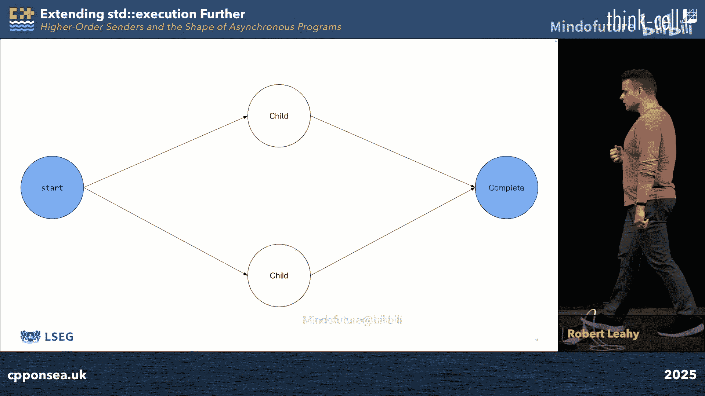

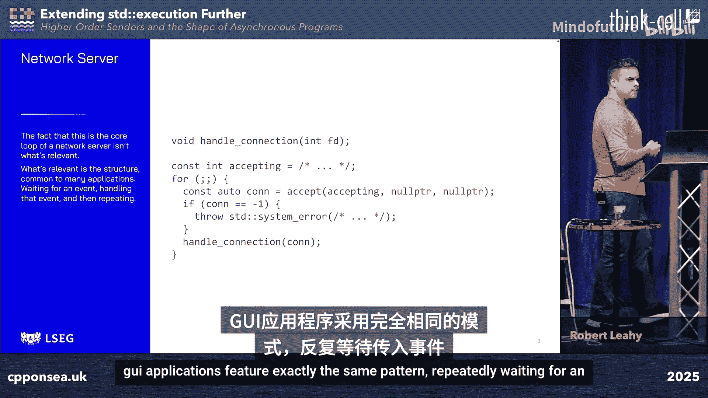

But despite the tour of primitives we just went on。

 we know for a fact that we can actually model this in stood execution because I said we could in a two hour long talk I gave last year in Tel Aviv。

 But unfortunately， even two hours was not long enough for a full exploration of the subject matter。

 Several important algorithms are not described in detail in that talk。

 And so I'm returning the stage to the stage to do exactly that right now。

 because the algorithm that we need is one that is called repeat。

 And here we can see the user facing API thereof。 If this looks daunting， don't worry。

 this is just the boilerp we have to write to make sure this new algorithm writing place nicely。

 both when it's used in a functional style and when it's used in the kind of pipeline we've come to expect from ranges。

 We can see here that it is a unary sender factory that it returns a sender when given a sender。

 which models that repeat algorithm。 But we also see we can nu reinvoke it。

 This is the glue that allows it to participate in pipelines to use that left to right readable syntax that everyone knows and love。

Regardless of the API， This is the asynchronous execution。

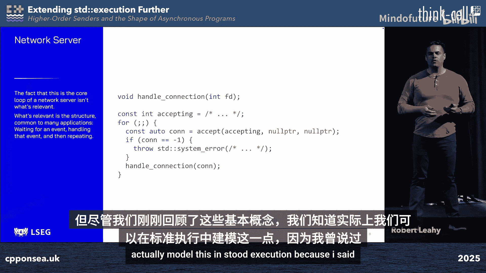

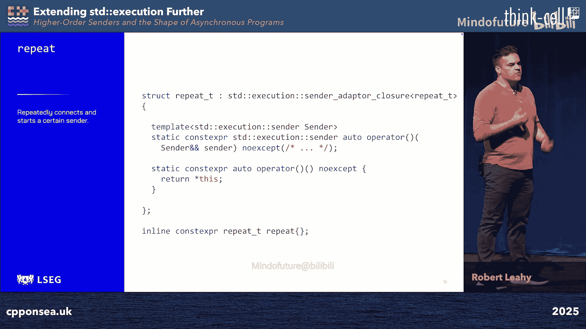

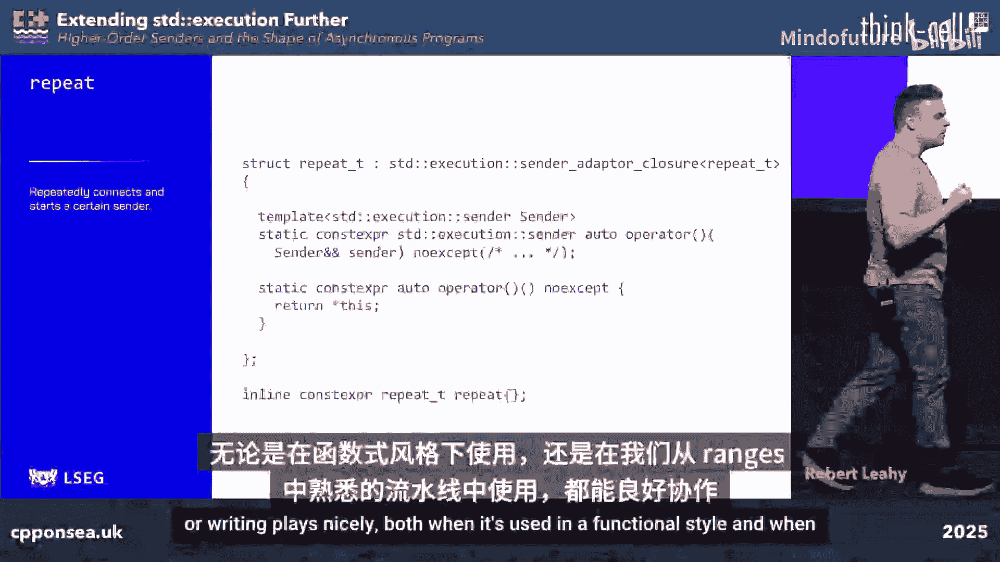

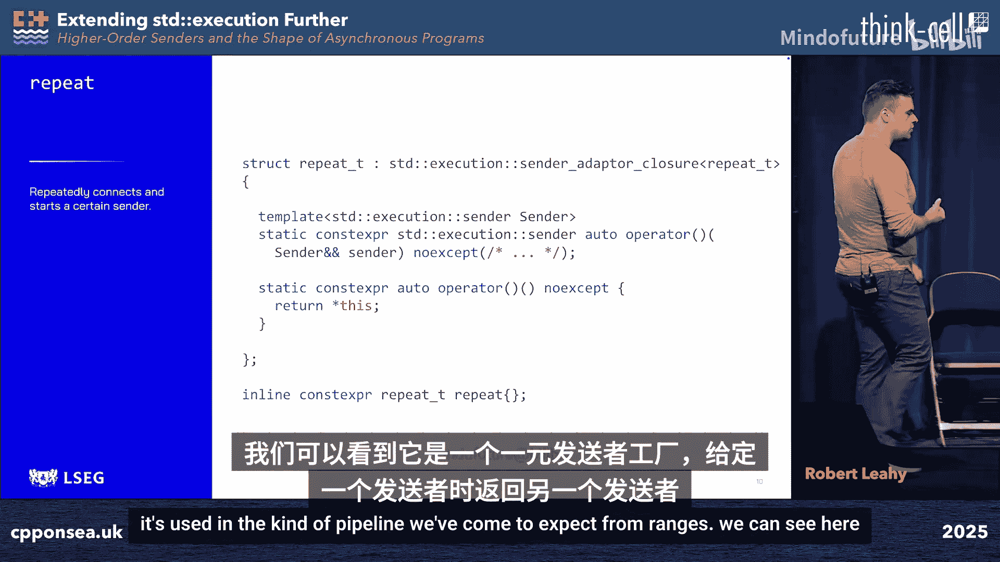

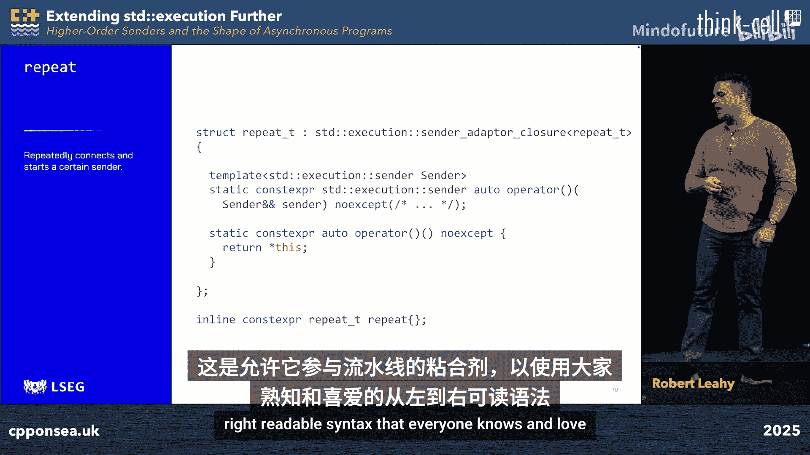

As the result of the repeat algorithm， a single child which is connected and started over and over and over again。

 finally giving us an arrow which extends from the right to the left。

 which allows us to model real world problems。But before we dive into the implementation of repeat。

 we need to do a brief review of the stood execution ecosystem to focus in on the parts that are important so we can get through this talk in only an hour。

 Despite the fact people colloquially refer to this as senders and receivers。

 I'm going to posit that senders and receivers are perhaps the least interesting parts of this ecosystem。

 A sender is merely a fully cur asynchronous function。

 The function to call combined with all the arguments in an indivisible unit。

 A receiver is simply the asynchronous version of the return channel of as synchronous function。

 an encapsulation of the actions that will be taken on completion。 separately。

 these two things don't do anything。 They're not asynchronous at all。

 It's only when we unite them with connect and obtain an operation state that we actually obtain a locus for asynchronous execution。

 and therefore， I'm going to posit that it is operation states that we should be focused on since that is where the actual implementation of the exciting asynchronous operation lives。

 If you want to understand the boilerplate that makes up senders and receivers。

 I would encourage you to。

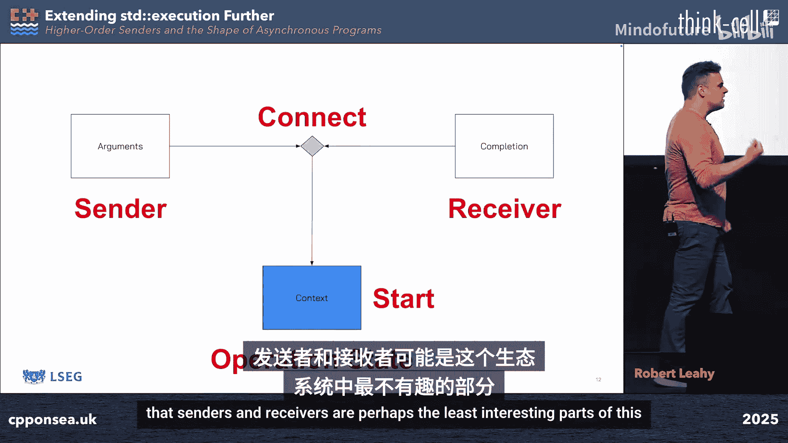

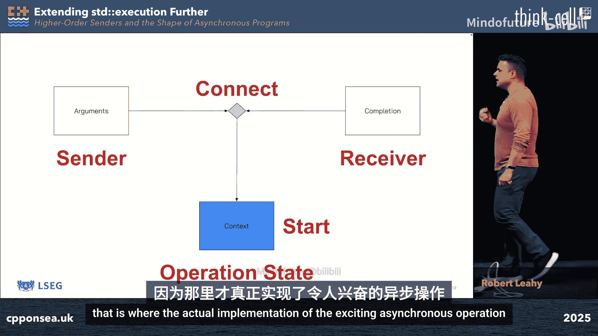

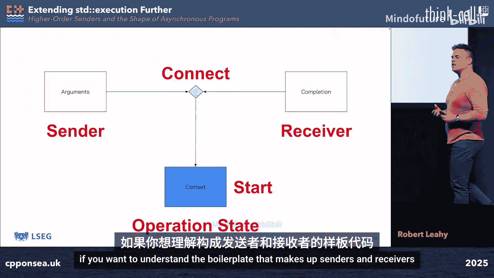

The talkk I gave earlier this year in Aspen， where I explored all of this and more in detail。

For the time being， we're going to dive right into the implementation of the operation state of repeat。

 and immediately， we see a slide full of code。 for the moment， ignore the two base classes。

 and we'll just walk through all of the type aliases and members we have in here。

 We have aliases for each of our base classes so we can refer to them more conveniently and we're bringing in something called get receiver so that we can use it without qualification towards the bottom。

 we have the important member variables of our class。 the sender。

 we're going to connect over and over and over again and in an engaged flag which evokes to us the idea that we're doing manual lifetime management。

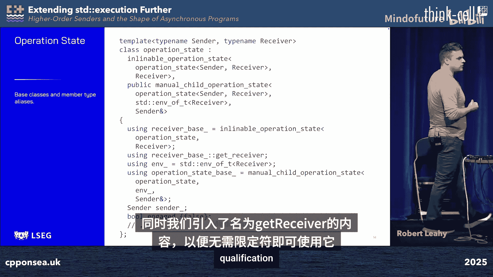

Which brings us back to the top of the slide， Which brings us back to those two opaque base classes。

 Both of these abstract away boilerplate that you need to write in every single operation state。

 The first deals with the problem that you need to store the receiver。

 you need to store the object to which you deliver your completion。

 And this motivates the fact we' bringing in the get receiver member function of that base。

 want to call it any time we want to retrieve that receiver to act upon it。

 The second abstracts away the fact that we need to store the operation state for that operation running over and over again。

 It's insufficient to have as sender。 Therefore， we need to be able to connect it into an operation state and this base class abstracts that away。

 If you want to understand the needness of these utilities or how they're implemented。

 you can read the paper， which discusses， but does not propose them。

 One written by Brian Stmore and Louis Baker， one which I covered in a lot of detail in my talk I gave earlier this year in Aspen。

 For now， we're simply going move on through the implementation and start looking at the public facing members of this operation state。

 In order to。

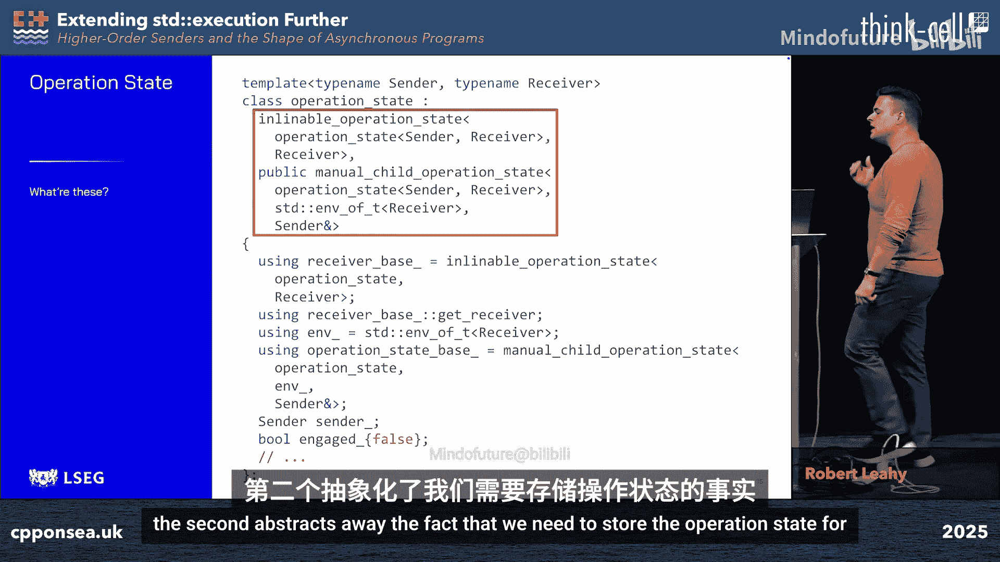

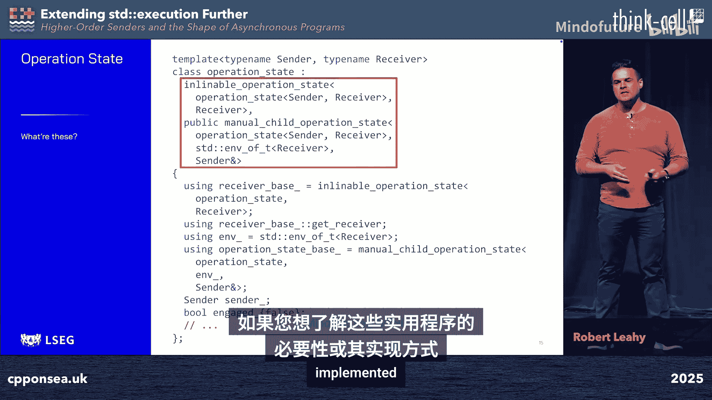

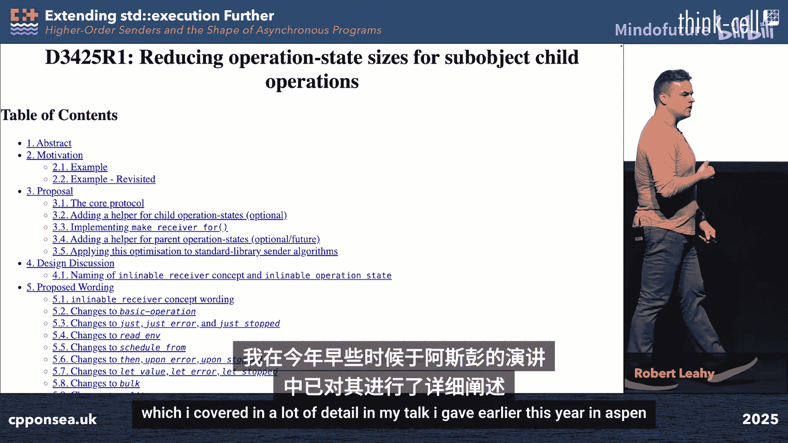

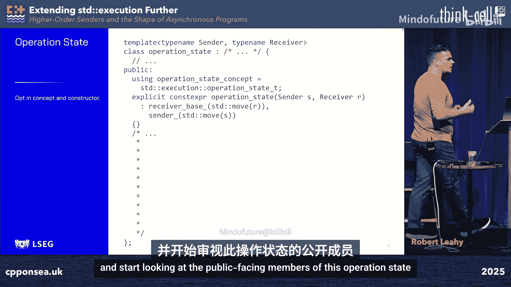

Be an operation state。 You must expose this fact to the concepts machinery of stood execution by having a needful nested type As called operation state concept。

 And so we do that。 And because operation states are returned from connect a binary operation over senders and receivers。

 we have a constructor which models this fact。But simply saying through a nested type alias that you are an operation state is insufficient to make it so。

 you also need to provide the fundamental basis operation of operation states。

 which is anury invocable member function called start。

 an operation state return from connect encapsulates only latent asynchronous execution。

 No forward progress is associated therewith It's not until start is invoked thereupon that asynchronous forward progress actually begins。

 and that is what we're encapsulating in this member function。

 We go after that base class that abstracts away Op state management from us。

 and we ask it to construct a contained operation state given as sender。

 But we know that operation states are a product of as sender and a receiver。

 So where is the receiver in this formulation。 This is a piece of power brought to us by this base class。

 So boilerplate abstracted away that base class synthesize the receiver for us and simply forwards this interface down to us via CRtP We don't need to worry about writing the boilerplate ourselves。

 we simply write a call to construct Thereafter we're now。

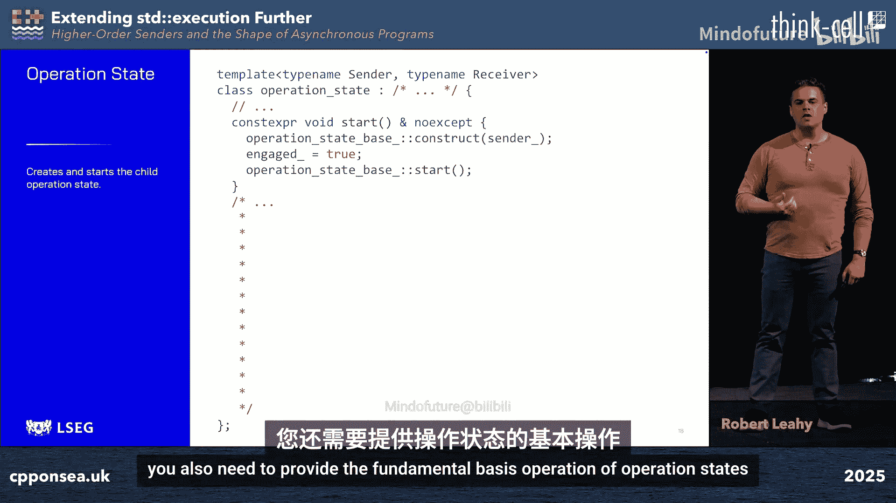

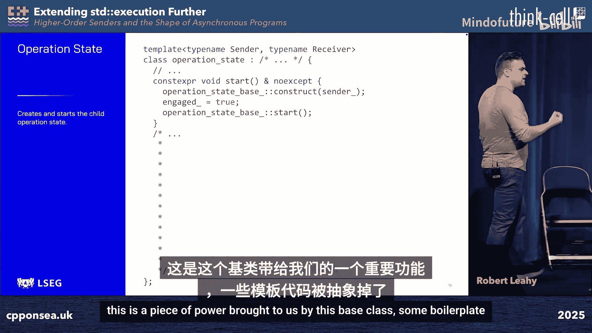

Mannually managing lifetimes， we said engage the true， and then of course。

 we need to ask that operation state in our base class to start making forward progress。

And this all makes sense when you first look at it。 But as you look long and hard at it。

 you encounter a problem because inside of construct。

 we call connect on a sender and a receiver and connect is an operation which can throw an exception。

 And if it throws an exception， that exception will bubble up and it's going to hit the no accept barrier at the top of the function and cause to terminate to be called not a desirable outcome and your first instinct might be okay。

 we'll just remove the no accept or willll make a conditional。 But this is also a nonstarter。

 The start operation of operation states is mandated to be no accept because it represents the surrender from the synchronous domain to the asynchronous domain。

 It would be inappropriate for start to use synchronous error reporting mechanisms like throwing an exception Once you call start。

 the stood execution ecosystem is totalizing。 The only way out is down with asynchronous reporting mechanisms such as sending a error through to the receiver。

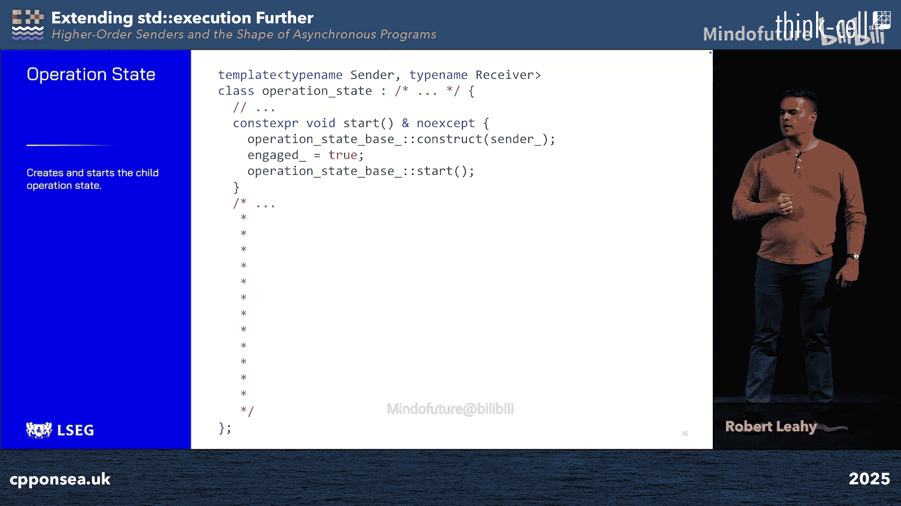

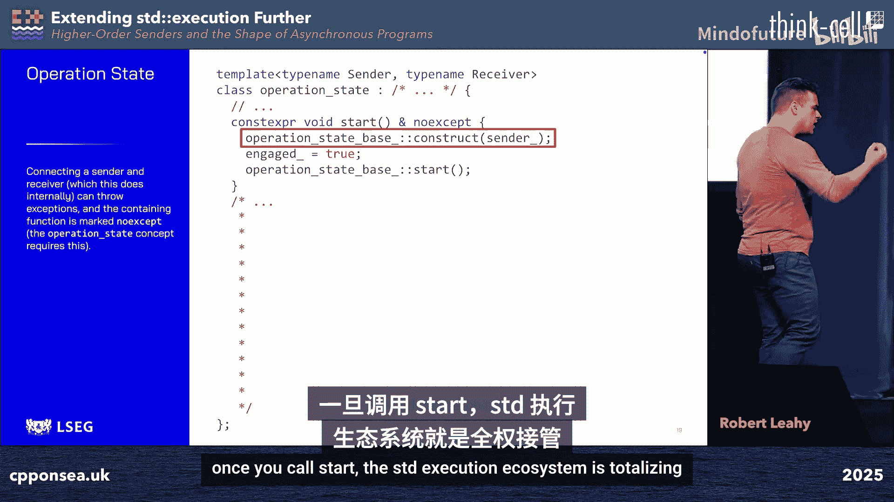

But maybe here and we have our answer。 Maybe we just need to rewrite this function。

 So it has a try catch when an exception is caught is now handled in the asynchronous way。

 not the synchronous way。 it's forced down into the receiver。But this， too， presents a problem。

 A problem you may not notice for a long time。 The problem is the user may provide you with a sender。

 which is noth connectible。 They may provide you with a receiver。

 which doesn't actually allow set error to be called with an exception because they know statically it's an impossible for an asynchronous exception to be thrown。

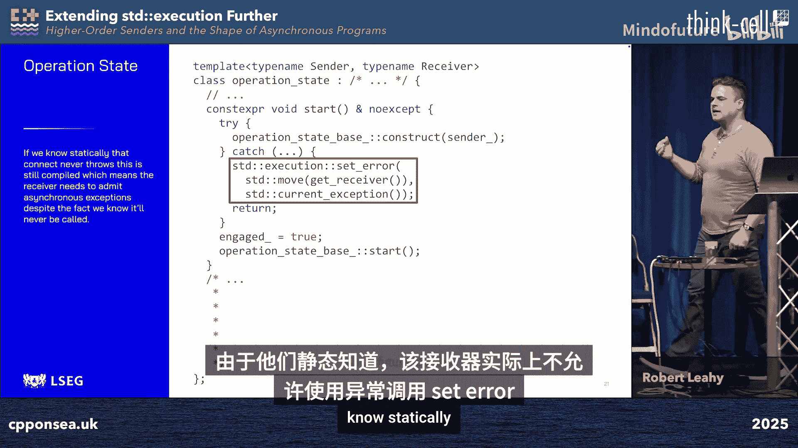

But the compiler doesn't know that。 It's going to generate the code outlined in red anyway。

 It's going to fail to compile in this most reasonable set of circumstances where our user reasonably expects they don't need to handle exceptions。

 And so we need to write the code on the slide yet again。

 we need to use if concept for to split our compile time execution in。

 If we know that connecting the sender and receiver doesn't throw exceptions。

 We simply invoke construct with no trycach。 We don't emit that problematic call to set error。 If。

 on the other hand， we know that connecting can throw an exception。

 It's now needful to o the trycach。 We now reasonably expect our consumers to handle this。😡。

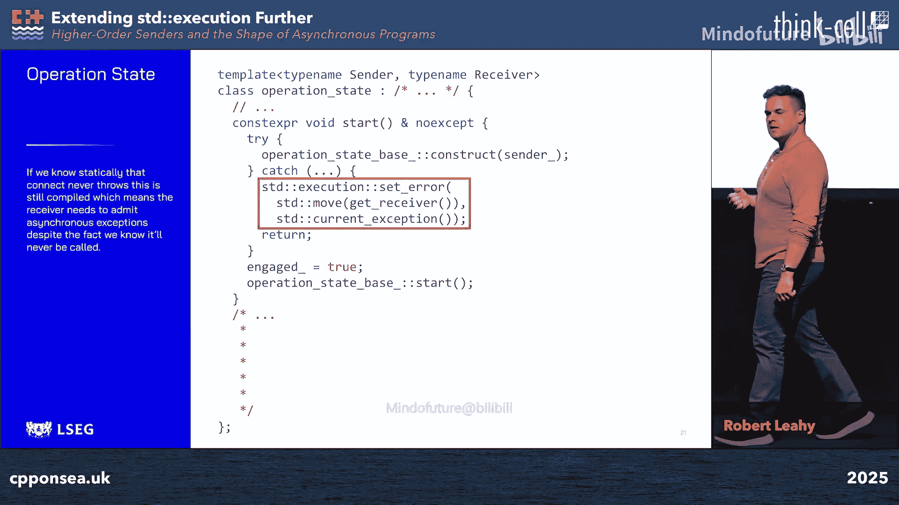

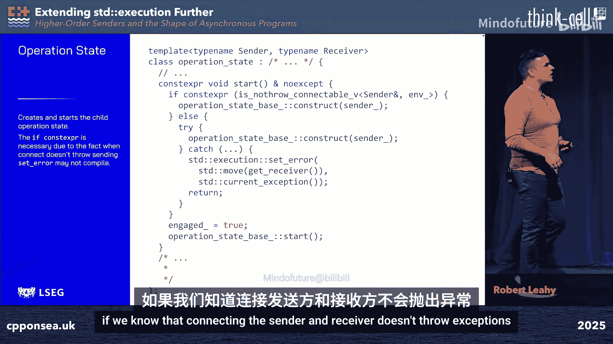

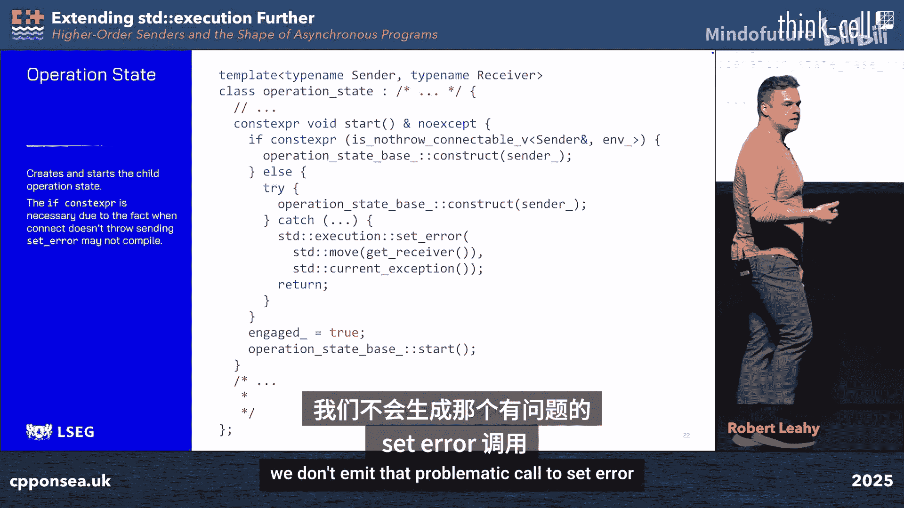

But the cascade of questions about this slide isn't over yet。 What is that is noth connectable V。

 And why isn't it in the execution namespace。 Perhaps more curiously。

 we know that connect is a binary operation over a sender and a receiver。

 but this trait is over a sender and an environment。 And the reason for this is a paper I wrote。

 which has been forwarded through library evolution working group。

 which makes it easier to determine when connect control exceptions。

 because there are important situations when you don't have access to the actual type of the receiver。

 and you need to figure out the answer to that question。

 The solution this paper proposes is to define the socalled salient properties of a receiver。

 those which are allowed to impact the throwingness of connect。

 The paper says that the only salient property of a receiver。

 Vis a V connects throwing this is its environment。 And so if you know the environment of a receiver。

 you can synthesize an archetype and check that and get an answer to your question。

 And that is exactly how is no throw connectable V is implemented。 We have a detailed namespace。

 And it contains inside of itself。 An archetype receiver。

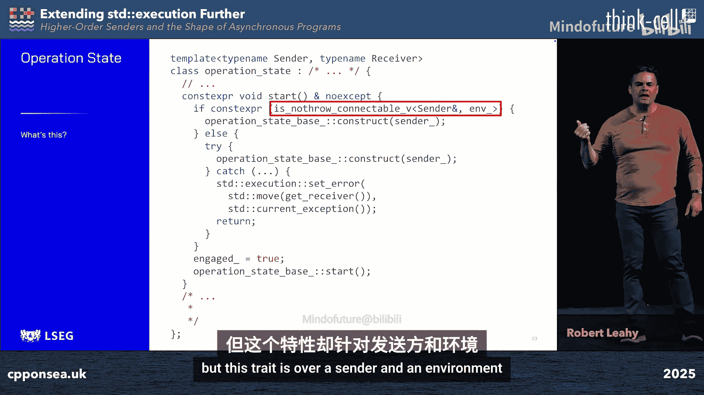

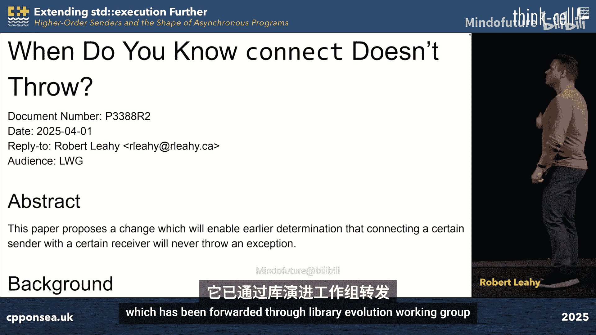

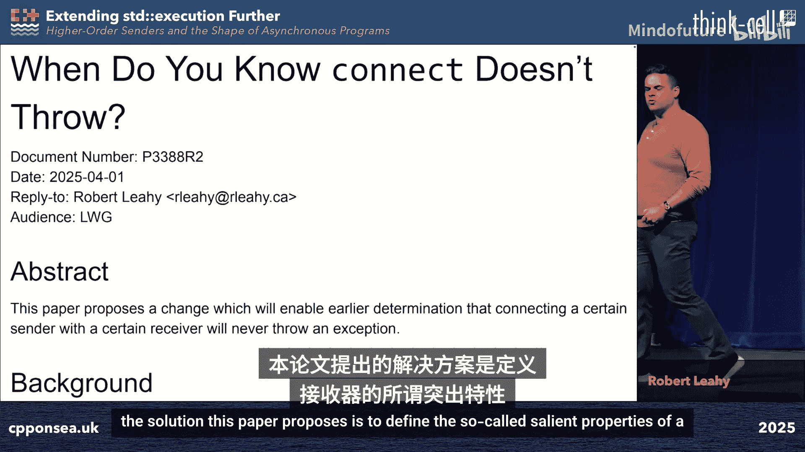

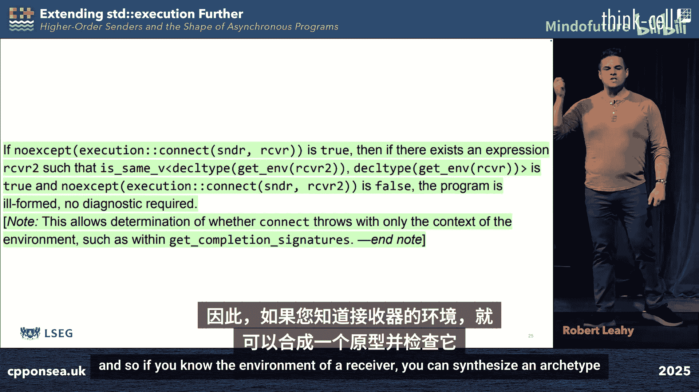

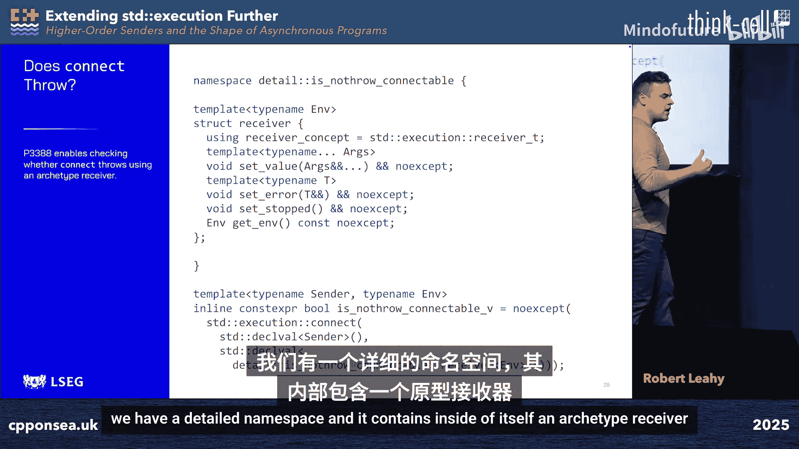

One， which accepts any completion signature， but which importantly has the correct environment。

 Then at the bottom of the slide， we synthesize a value for the trait by checking the throwingness of a statement which connects the concrete sender to a receiver with the appropriate environment。

With this journey complete， we can now return to the implementation of our operation state。

 to a de which of course we provide because we're doing manual lifetime management。

 if we haven't engaged in the base class， we go to the base class and we destroy it。

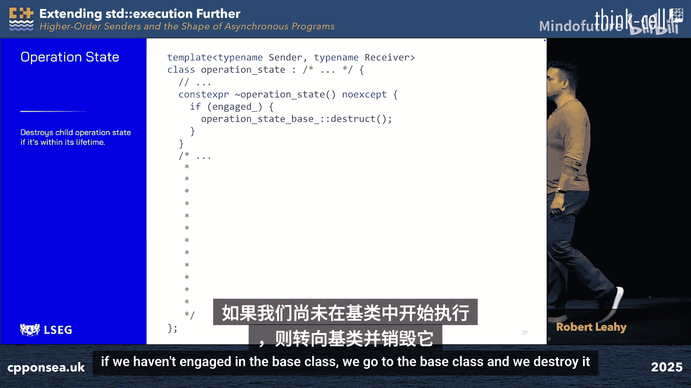

But none of this helps us actually handle the completion of our child operation。

 The body of our asynchronous loop。 For that， we need to deal with the fact that our CRTV based class is forwarding the interface thereof through to us。

 We're going to receive those member function Invocations just as a receiver would。

 And so inside of set value， the code executed when the body of the loop complete successfully。

 We simply need to set up another iteration in our infinite asynchronous loop。

 We go to the base class。 We ask it to destroy the operations state associated with the current invocation。

 We mark engage as being false， and we move on to the next iteration。😊，Handling errors and stopped。

 on the other hand， involves us actually ending our loop。

 It would be inappropriate for us to continue looping when the body of the loop requests to be stopped or fails。

 And so we simply pass this through to our receiver， ending the overall asynchronous execution。

 The only element of the receiver's interface we haven't addressed yet is， of course。

 get end so we simply return the environment associated with our receiver。

 transitively parameterizing our child on the same parameters we received from our receiver。

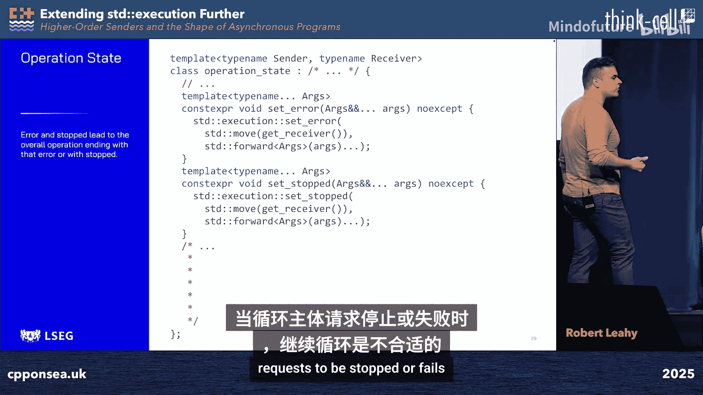

This actually completes the operation state of repeat。

 We can now go back and we can reimagine our synchronous example as an asynchronous one。

 We reimagine， accept and handle connection， not as synchronous functions， but as sender factories。

 which return a sender which can be connected and started to form asynchronous execution of the consequences of those functions。

 And then at the bottom， we synthesize a sender， which encapsulates our server loop。

 We accept asynchronously， and we pipe the value that's generated thereby into let value。

 recall that let value invoke some function and expects it to return a sender encapsulating success or execution。

 And that is exactly what handle connection does。 It accepts the file descriptor， returns a sender。

 that value connects and starts it， and then we take this composed operation。

 and we pipe it into repeat to do it over and over and over again。😊。

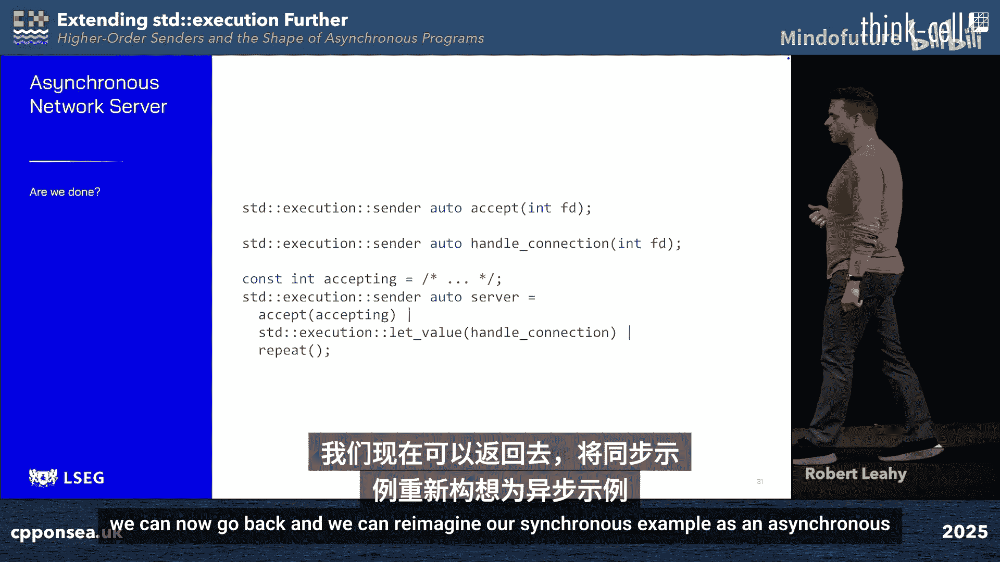

And so we' finally written our asynchronous server。

Or have we Let's reserve let's review what we've actually written。

 We know this is a graph of the asynchronous execution encapsulated by repeat。

 and we know this is a graph of the asynchronous execution encapsulated by that value。

 But this rendering of let value is generic。 We have specific details about our situation。

 we can say more than just child， we can say accept and handle connection。

 and that invocable is just irrelevant glue is just visual noise And so we remove it。

 Now we're ready to combine these two diagrams。 Were going merge them into one diagram of the asynchronous execution。

 We actually authored on the preceding slide。 Maybe the problem is clear from this diagram。

 But if it's thought I'm going to take， and I'm going to flatten it。

 I'm going to render it as a straight line。 I'm going to show you what actually happens when you run this program。

 You accept and then you handle a connection。 And only after you've finished handling that connection do you accept again。

 what we've written is an asynchronous network server， which handles exactly one client at a time。

 the sort of network server that would probably not be considered useful or interesting by most people。

😊。

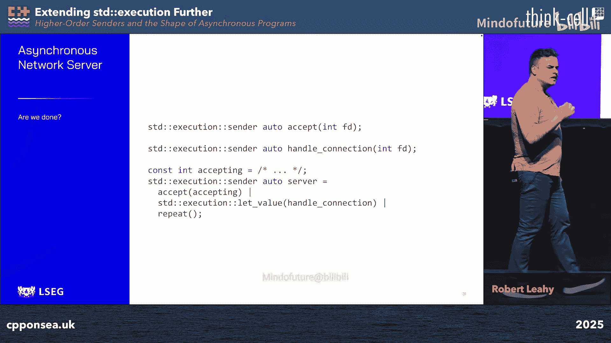

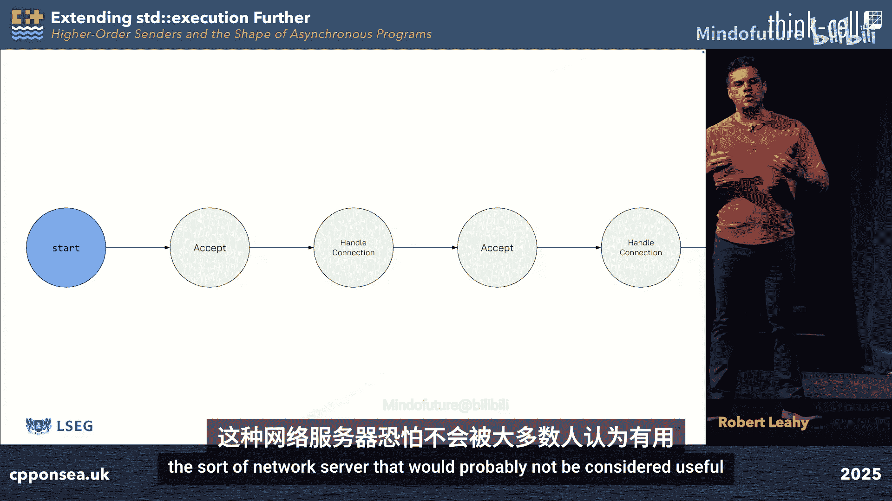

We need to go back and think about how we got hoodwinked into this conclusion。

 I think most of us looked at this slide and intuitively thought that handle connection goes off and does something detached in the background。

 So let's surface that expectation explicitly。 Let's wrap it in a thread and called detach on it。

 but already were're encountering a problem We're encountering a problem because we've called an evil member function on thread。

 We've detached it from the foreground scope。 It's now off Kaening in the background。

 how can we reason about when it's done。 How can we know when it's safe to leave this scope。

 How can we know when it's safe to clean up objects it may be using。

 And maybe we remain committed to this ad hoc approach to designing our program。

 We say that we can solve this problem by adding our own manual tracking of this property。

 We have some mut text and we have some counters and we have a weight lambda。 And at the bottom。

 we call wait to make sure that nothing is running in the background as we leave the scope。

 But as is the case in all ad hoc explorations of problem domains， we've missed something。

 We've missed the fact that at least at two points in this function， we can throw an exception。

 And if we do we don't wait and we're back in the degenerate case where we have Ka。

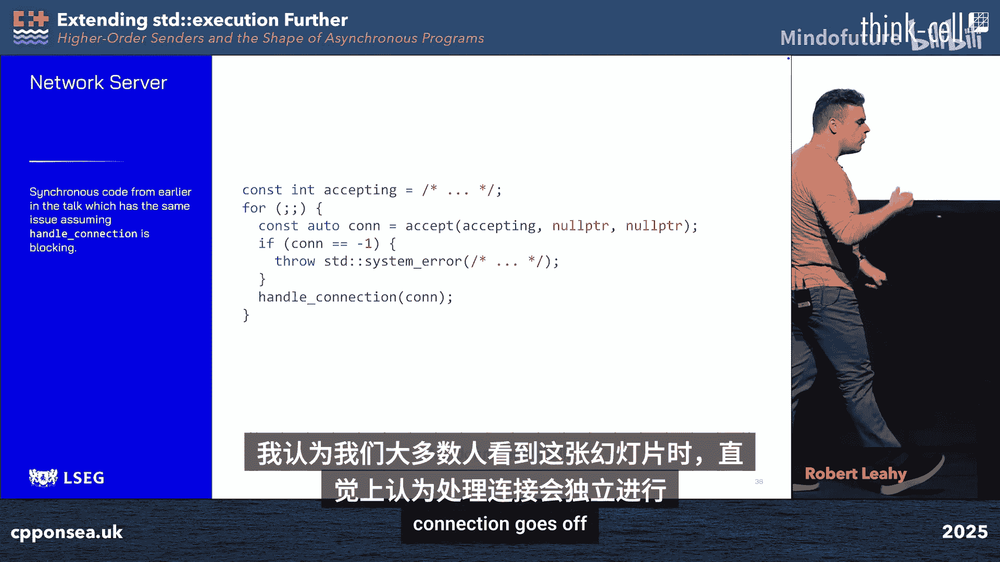

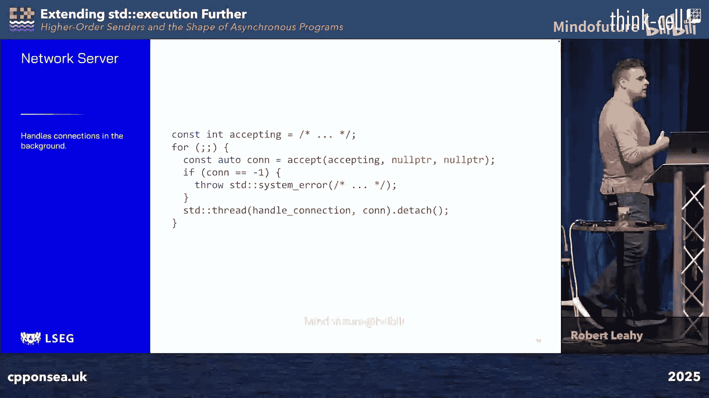

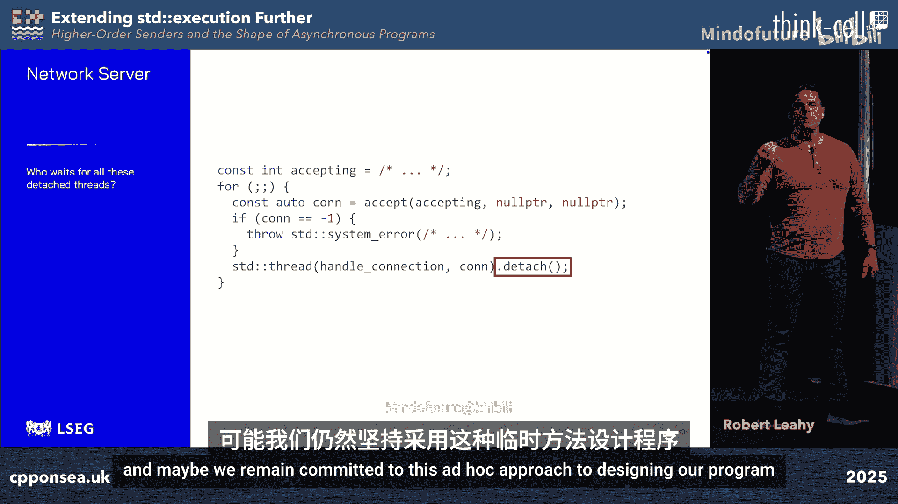

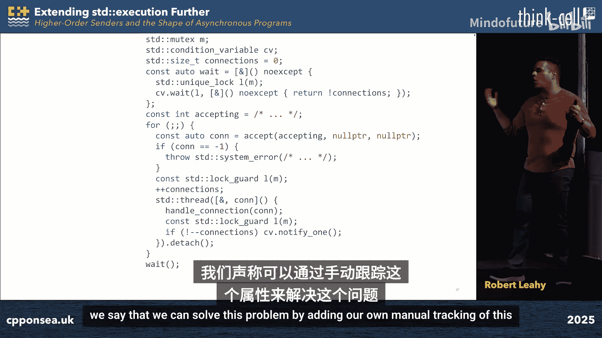

in the background as objects it's potentially using is cleaned up。But it's okay。

 The font size on this slide can go even smaller so we can try and fix this problem so we can wrap things up and try catch and wait at every exit point。

 But once again， we learn a lesson about ad hoc solutions to problems because there's still an exception safety problem here。

 We can still throw inside of the thread which will bubble up to the top of the thread and cause terminate to be called。

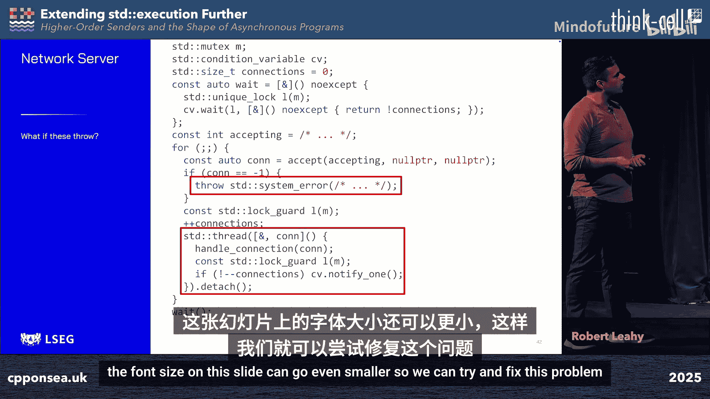

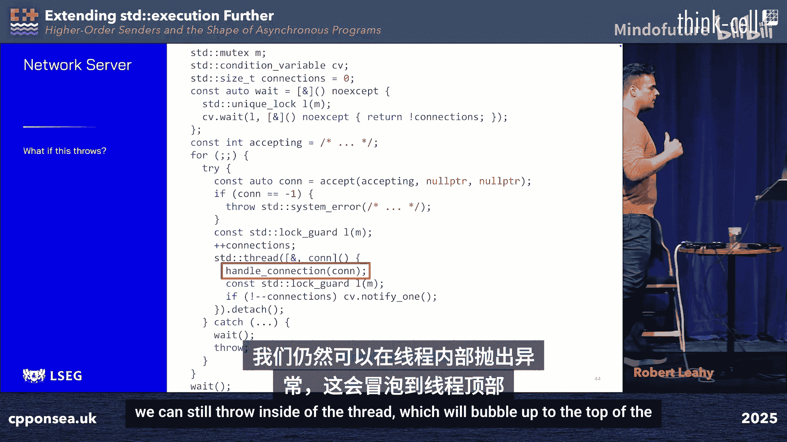

And maybe before we go and try and address this， we should take a step back and ask ourselves something。

 Is this good code， Is this maintainable， reusable code， Can I actually test this code。

 And I proud of this code。😊。

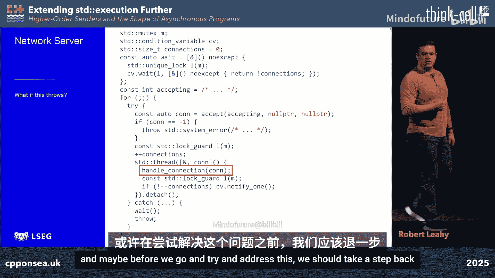

And most importantly， what's gonna to happen if I want to just shut the server down。

 How can I cancel all the work that I started， No， I have to wait for it all to finish naturally。

 What we need to do is abandon the ad hoc approach to design and ask ourselves。

 What do we actually want to do and what we actually want to do is model asynchronous execution that looks like this where we accept。

 and then yes， we handle a connection based on what we accepted。

 but we also go off and we accept again immediately。

 We don't wait for us finish handling the connection。

 We proceed what that name loop undisturbed by the factre spawning work。

 and that change of variable we did earlier， where we change from child to concrete operations we knew we were executing in this circumstance。

 We can just do the opposite transformation。 We can transform our specific diagram back to a generic one。

 and now suddenly we see the shape of a generic asynchronous algorithm emerging from this problem base。

 which leads us with just two questions。 The first and most important one。

 especially if you sit in LwG is what do we name this algorithm and we can fight about that endlessly。

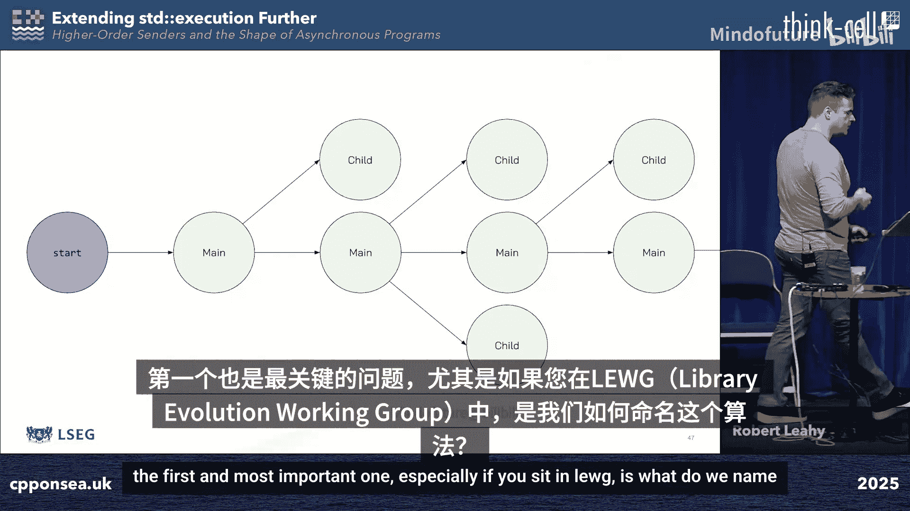

And verily I've fought about names endlessly before。

 but I'm going to say we're just going to name this after what it looks like。

 we're just going to call this branch because it looks like a branch。

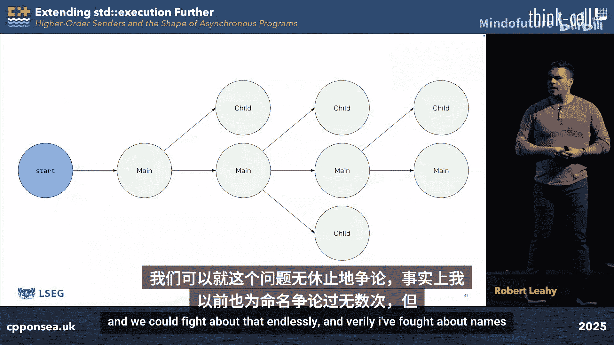

Which brings us to the second and more technically interesting question。

 How do we take this graph and surface it in a C plus plus API。

 How does this operation actually behave。And that's what I'm going start walking through here。

 Like repeat branch is a unary sender factory， meaning it accepts a single child sender。

 but unlike repeat， it admits senders which complete with more than just set value with no arguments。

 set error and set stopped。 It also admits senders which complete with set value whose arguments are one or more senders。

 The sender is expected to spawn asynchronous execution， which will at its completion， send senders。

 This is a higher order sender。 It is the asynchronous analog of a synchronous function。

 which returns to you another function when it completes。

 But understanding this doesn't help us understand the actual execution。

 it just help us understand the function， signature。

 And so we need to think about what happens when we connect and start a branch sender。

 Things start out looking very similar to repeat。 We take the main sender。

 we connect and start it and allow it to run through to completion。

 But when it completes and sends us senders， things start to change dramatically。

 We go through each and every one of the senders that was send to us。

 and we connect and start that operation。We don't wait for that to complete before we close the loop。

 We allow all those operations to start making forward progress。

 and then we immediately connect and start that main sender again。

 We allow that loop to continue generating work。 despite the fact work in a previously spawn is still running。

 On the other hand， if it sends us set value with no arguments。

 we interpret that as the moral equivalent of end to file。

 That is the main sender telling us it has no more work to generate and we should begin graceful fan in。

 this is graceful fan in because if we have outstanding work still running in the background。

 we want to allow it to run through to completion。 Contrat that with the next form of fan。

 we're going to consider when the main sender sends an erroneous completion signature。

 It sends set error or set stopped。 In this case we want to engage in abortive fan in。

 The conclusion of the operation has been decided， it will end with that error or was stopped。

 And so we go to all outstanding work and we ask it to fan in。 We request that it stopped。

 We take advantage of the fact that cancellation is the first class citizen in the stood execution ecosystem。

But we've talked before about how we want structured concurrency。

 We can't just let these children go off running andched in the background。

 That means we need to account for the fact that they complete as well。

 And so when a child completes and sense set value， we in some sense， do nothing。

 We allow everything else to continue working。 The child successfully completed one piece of work。

 but that doesn't affect our overall asynchronous execution。 On the other hand。

 errors and stop signal sent from children should not be ignored。 And so when those are sent。

 we once again begin abor a fanom。 We request the operation come to an end as soon as possible。

 and we pass that error or stop signal downstream to our consumer。Now。

 though we understand the shape of what we're trying to build。

 we can move on and start thinking about how we're going to build it。

 and we know from earlier that an operation state is the locust of asynchronous execution in execution。

😡，But an operation state is just a C plus plus class。 It's made up of parts。

 We can reason about what's inside of it。 And so on our diagram。

 we shouldn't have a single indivisible monolith， but we should instead have various parts that compose to make that operation state。

 A receiver， as sender a stop source and pending error or stopped。

 The last two are motivated by the fact that in that abortive fan and situation。

 we want to request that all our children cease executing。 for that。

 we need a stop source that we can request stop on， which will be fed through to all of our children。

 And pending error or stop is a reflection of the fact that when something ends with error or stop。

 it may not be the last child。 We can't block， waiting for everyone to finish。

 That wouldn't be asynchronous。 And so we need somewhere to record that completion so that we can retrieve it later and send it through to our consumer。

But this diagram still belies the most interesting thing that branch does。

 which is that it spawns a child。 and then another child。 And then if the child ends successfully。

 it simply allows it to go away and continues executing。 With this reflected in our diagram。

 we now have a map which will guide us through the implementation of this algorithm。

 We can visit each node。 We don't understand。 See how it's implementable。

 Take a step back and then look at how we can compose them together。😊。

So let's start that journey right now。 Let's try to think about what that stop source is going to look like。

 And I actually introduced this primitive in my talk earlier this year in Aspen。

 a primitive known as chain stop source。 know that it derives from an in place stop source and therefore is itself a stop source to which we can submit stop requests。

 But it also has a unary constructor， which accepts a stop token。

 And this is a reflection of the fact that our consumer is providing us with a stop token as well。

 We don't just have stop logic for our children。 We have a parent that has stop logic for us。

 and we need to combine them together by providing the stop token。

 We obtain from our receiver's environment。😊。

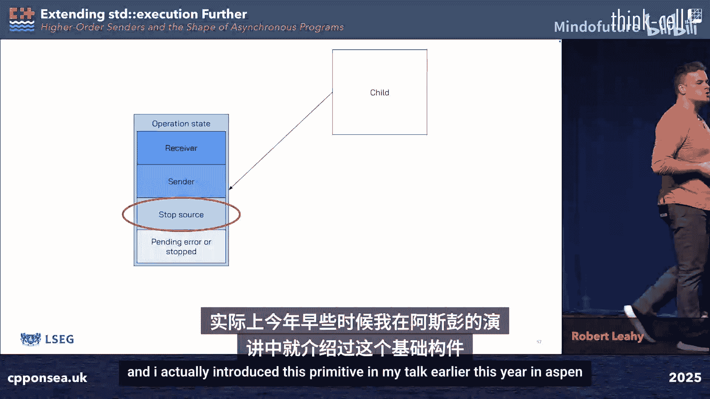

But after I gave my talk earlier this year in Aspen and presented this interface。

 it was brought to my attention that there's a problematic section of the standard。

 The standard says that I can't actually use the stop token in this way because it belies the fact that an operation state has two lifetimes。

 It has the regular synchronous lifetime， which is bounded by its constructor and destructor。

 but it also has a second lifetime。 It has an asynchronous lifetime。

 which begins when you call start and ends when you send a completion signal through to your receiver。

 and the standard as you see on the screen says that the use of the stop token by an operation state must be bounded not by the synchronous lifetime。

 but by the asynchronous one。 If we use the approach on the preceding slide where we pass through to our stop source。

 the stop token on construction， We will be bounding that use by the synchronous lifetime。

 we will deing this mandate by the standard。 And so we need to do something that will become routine to you as you write So executionbased code。

 We need to change the interface so that it allows us to reflect into it。

 the bound of the asynchronous lifetime。 We now have。😊。

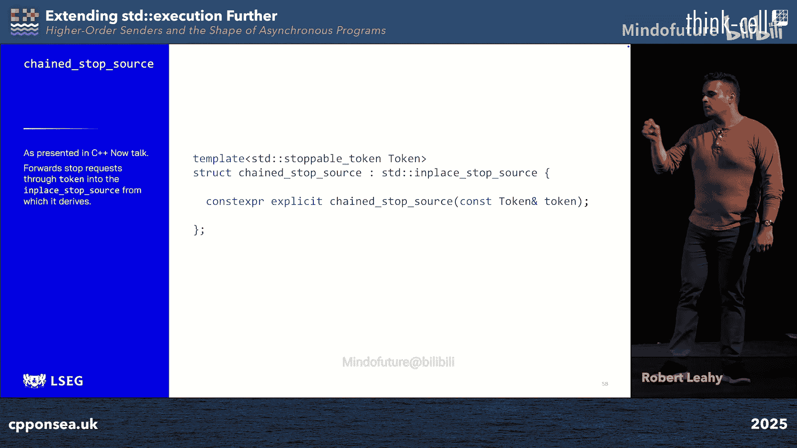

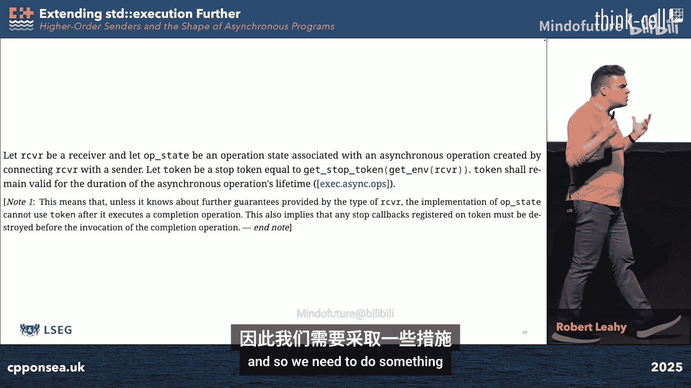

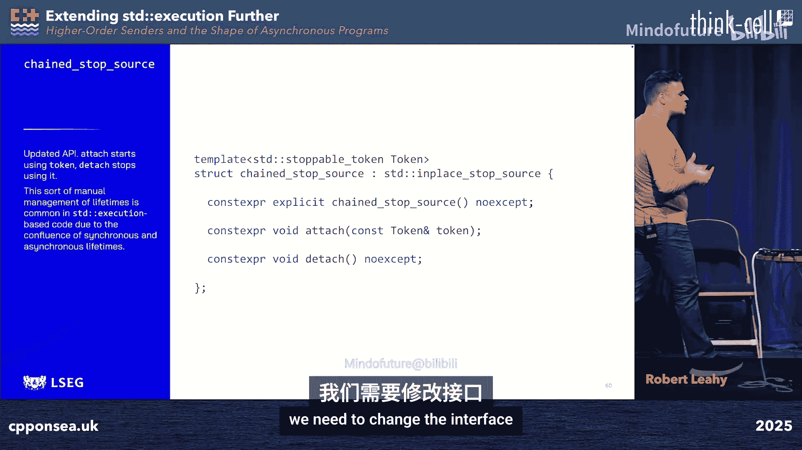

Default constructor， but we have two new member functions that are invoked when the asynchronous lifetime begins and end。

 At provides the stop token and constructs the internal stop callback and is invoked when we start our branch operation。

 Detaach， on the other hand， is invoked before we complete that operation and destroys the stop callback。

 So we obey with the standard demands。

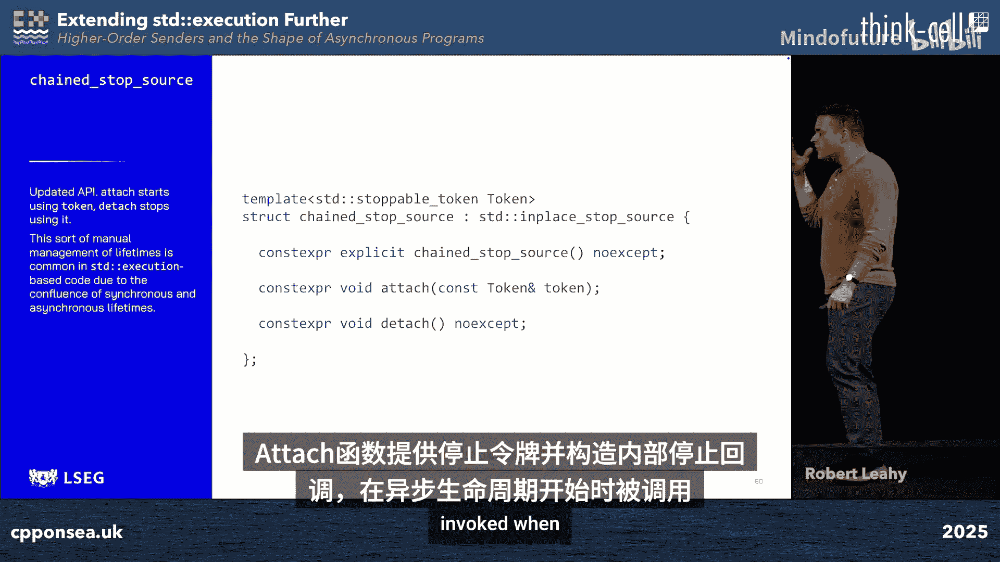

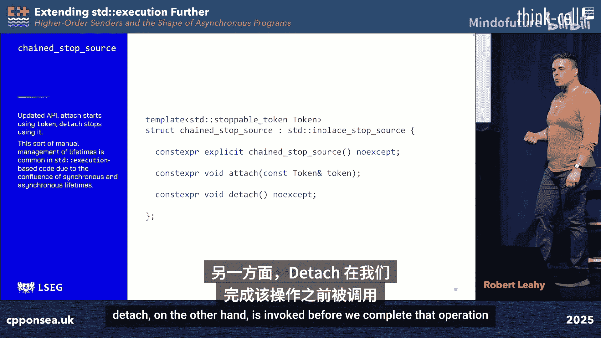

Which returns us to our map， which returns us to pending error or stopped That storage for all of the ways in which our children might complete erroneously。

 And I also presented a solution to this problem and my talk earlier this year in Aspen。

 something I call storage for completion signatures。

 We instantiated on the completion signatures and it has two relevant member functions， one。

 which allows us to arrive with some signature passing the tag type that indicates the channel on which it was sent and the arguments there too。

 if any， Thereafter we may call a visit， and we're going to have those arguments we stored invoked into a visitor。

 The visitor can then take and forward them through to our receiver。

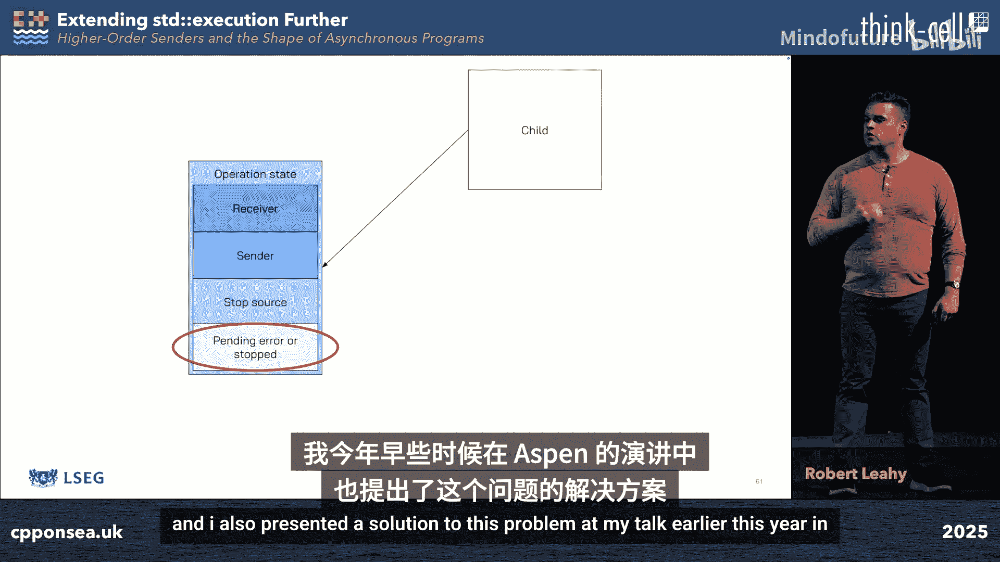

But there's no requirement that we have arrived at storage for completion signatures before we visit it。

 And maybe the case we didn't find anything store in here。 In that case， visit returns false。

 and it's up to us to decide what to do next。But there's something curious in the review of this slide。

 I said that we instantiate it with the completion signatures。

 but that's not something we've discussed heretofore。

 We know with regular synchronous functions that they have a signature that we can use to reason about the ways in which they complete。

 They have a return type。 They can be no except or not。

 but doesn it analog to that exist in the asynchronous universe given to us by stood execution。

 And the answer to that is， yes， you can interrogate a sender about all the ways in which it can complete。

 and it returns to you an instantation of stood execution completion signatures which communicates this information。

 Each and every template parameter there to indicates a possible way that sender will complete。

 And here we can already see the fact that stood execution brings us expressive power。

 we simply lack in the synchronous domain。 because we can report as a first class citizen that we complete successfully in multiple ways。

 We have no need for stood variant。 And we can report that when we complete successfully in a certain way。

 we simply send multiple values again as a first class citizen without any need for a stood topple。

 And perhaps most importantly， we can also communicate。😊。

Settop the fact that we have a way to report that we simply abandon forward progress。

 not that we succeeded or failed。

But the existence of this type in this mechanism raises the spec of something Vi V our implementation of branch。

 We now need to figure out all the ways in which we can complete so that we can advertise this through to our consumers。

 So let's walk through how that might look。 We have a main sender， and it can complete in two ways。

 It can send set value T， or it can send my sender。 note that this is a higher order sender。

 which is exactly what we demand。

And looking at this， we can immediately start filling in our candidate set of completion signatures。

 If the main sender can send set value T， that means it can report end to file。

 That means we can reach the end of the work。 That means that we can send set value T in turn。

 But we know that we're going to branch out to a bunch of children and to do that。

 we're going to need to allocate dynamic memory。 and that can throw an exception。

 So we also know that we can asynchronously throw an exception by sending seterity of stood exception puter。

But in this formulation， we've missed something because we're not just going to run the main sender。

 The whole point of branch is that we also run that child my sender。

 And so we go inspect it and we see its completion signatures。

 We see that it can report successful completion to us。

 but then it can also report erroneous completion， not using an exception puter but using an error code。

 And because of the fact we want to honor the erroneous completions， not just of the main sender。

 but also the childwork it spawns。 We need to update our set of output completion signatures to include this new error signature。

 And this is fine in Danny to walk through on a slide to hand wave away with arrows and types written on a screen。

 but how do we raify this transformation in C plus code。

 or we're going to write arduous regular template meta programming。

 the likes in which is incredibly rebose。 I'd rather not do that in an hour long talk。

But then we think to ourselves， this is a talk about stood execution。

 St execution is a C plus plus 26 feature。This is a C plus plus 26 talk。

 which means I can use all the features of C plus plus 26 to achieve this transformation。 I can。

 for example， use reflection if I so desire。 And so that's exactly what I'm going to do。

 I'm going to write a single reflectionbased helper。

 and then we're going to write a constantval function。

 which performs this transformation in reflection space。

 The helper that I need is make completion signature。

 which synthesizes the type which indicates a certain completion signature。

 recall that's a function type with the channel it's sent on indicated by the return value。

 and the values transmitted thereby represented as the parameters。 Therefore。

 inside of this function， I take the arguments sent there。

 and I flatten them down into a single vector。 I substitute them into my make completion signature impulse。

 which renders them as a function type。 But because this is an alias。

 What I end up with from that substitution is the reflection of an alias。

 not the reflection of a type。 and therefore I strap that layer off and return it。

Armed with this primitive， I can now begin writing the implementation of completion signatures。

 which synthesizes my op completion signatures at Consteveel time。

 Note that it's parameterized on a reflection of the completion signatures of the main sender and also a reflection of the environment。

 We're going to need both of these as we move forward。 We begin with a candidate set。

 which includes seterity of exception puter because we know we can know we throw exceptions because we're going to be doing dynamic memory allocation。

 Then we define an ad helper lambda to reflect the fact that a valid instantiation of stood execution completion signatures contains no duplicates。

 And so add simply neglects to add any duplicated signatures that are requested of it。😊。

With this boilerplate out of the way， we can move on to the bottom of the function where we actually start to do interesting things。

 We're going to loop over each and every one of the template arguments to the type indicated by our first parameter。

 We know our first parameter indicates an instantiation of stood execution completion signatures。

 And we know that each template argument thereto is a single completion signature。 Therefore。

 by traversing those template arguments， We are traversing each and every one of the completion signatures of the main sender。

 for each of them， we simply invoke signature。 and then we move on opaquely。

 If we didn't find any higher order completion signatures。

 Fo sender is going to be false for reasons we'll see in the slides to come。 In that case。

 we can't usefully implement branch。 It we branch which branches to nothing。

 And so we throw an exception to prevent us from reporting a nonsense answer in the scenario。

 Otherwise， we take all of the signatures we've collected。

 We substitute them into stood execution completion signatures。

 and we return a reflection of the resulting type。

But this just handways a lot of implementation details。

 What exactly is lurking inside signature that actually helps us to perform the transformation for each signature we extract from the main sender。

 And so we go ahead and we peek inside。 We see that we use return type of to extract the reflection of the return type of the function type。

 recall this is the channel on which that completion signature will be sent。 If it set value T。

 we have some complicated processing to do。 recall that set value T from the main sender has two meanings。

 It can mean end to file or it can transmit new work。

 And so we special case the case where there are no parameters。

 This is simply the main sender letting us know that it can report and to file。

 And so we simply copy that across to the output set， and we move on to the next one。😊。

If， on the other hand， it has arguments that it's sending。

 each and every one of those must be a child sender。 And so we loop over them and we invoke child。

 and then we're done。On the other hand， if a channel on which the signature is sent is not set value T。

 it must be an erroneous completion signature。 And so we call copy signature simply to propagate those through to the output set。

 And that is the next implementation detail Lambda we're going to descend into。

 What do we do when we try to transport those erroneous signatures over to our output set。

 Looking inside， we can see that set stopped is easy。 Se stop never has any arguments。

 And so we simply copy it across to the output set。

Set error T， on the other hand， can actually have an argument that represents the error。 In fact。

 it's mandated to do so。 which presents us with an interesting problem。

 We want to take this error type and we want to propagate it into storage。

 And thereafter we want to retrieve it and send it downstream。

 And to do this requires that we obtain not the type T， but it's associated storage type。

 which is obtained by decaying that type。 And so we decay the type。

 But then we realize that decay copying， isn't always possible。

 And so we check to see if we can decay copy this type at all。 If we can't we can't implement branch。

 And so we throw an exception and don't output a useless answer。 Otherwise。

 we make a new completion signature， which is set error T with the decay type。

 since that's the type we're going to go and get when we retrieve the stored error from storage。

But this lays out perhaps the most interesting part of the implementation。

 What do we do for each and every child。 How do we descend into them。

And in order to descend send into a child， we need to diverse its completion signatures。

 which means we need to extract them。 And we do this with some reflection code。

 We substitute the sender and our environment into stood execution completion signatures of T。

 And we obtain the reflection thereof。 But this is an alias And so we strip away the alias layer。

 which leads us through with the reflection of the appropriate instantiation of stood execution completion signatures。

This leaves us back doing something we already know how to do， visiting each and every signature。

 And so we loop over them。 and we branch， depending on the channel it's going to be sent on。

 recall that set value T from children is only tolerated if it sends no arguments because we would have no idea what to do with an argument if the child sent it to us。

 So if the child would send us arguments， we reject the instantiation of branch。 Otherwise。

 we actually handle the erroneous signatures in exactly the same way we do for the main centerer。

 propagating them and decaying appropriately。Now， that we understand how to obtain the completion signatures。

 we're actually ready to move on to looking at the implementation of the operation state of branch。

 We're ready to start walking through the code thereof as we flick over to the next slide。

 we see some familiar friends。 We see inlineable operation state and manual child operation state whose purpose we already understand And then we see a bunch of type computation that were used to by now。

 we provide aliases for both our base。 we extract the environment from a receiver using stood end of T。

 and then we decide on which environment we're going to use and we assign that to receiver end towards the bottom of the slide。

 you can see the forward declaration of the state that's going to hold the child。

 We're going to review that more towards the end of the talk。

 But there's actually an error on this slide。 The error on the slide is in the environment that we've chosen because that unlike repeat。

 we want to emit de novo stop requests。 We want the ability to admit a stop request in response system stimulus we're receiving from the completion of one of our children。

 And because of this， we need to not pass through the stop token provided to us by our receiver's environment but replace。

😊。

with the stop token from our stop source to do this。

 we're going to use yet another utility for my talk earlier this year in Aspen。

 we're going to use stop source and it wraps an environment type and forwards through all queries untrammeled except get stop token。

 It substitutes in the stop token given by an associated stop source。

 the stop source we manage internally， the one we use to submit stop requests。

 but not only that we use to submit stop requests。 The one that is receiving the chain stop requests from downstream。

 so we don't leave any stop requests on the table。 These operations will stop when we ask them to。

 And also when we are asked to stop by our downstream consumer。Now that we understand this。

 we can move on to the member variables of this class。

 We start just like we did with repeat with a sender， the main sender。

 which will be repeatedly connected and started in order to obtain the work that we're going to branch out too。

 Thereafter， we， of course， have the chain stop source， as we discussed earlier in the talk。

Underneath that， we start to get into management of our children。 We have an atomic sizei。

 which is outstanding and starts at one。 It starts at one because we're going to start by initiating the main center。

 and it's going to continue running for most of the lifetime of our operation。

 So we initialize this value to one。 It will track the number of outstanding children。

 It's how we ensure that we complete only once we fanned in all of our descendant asynchronous operations。

 Thereafter， we have arrived underscore， which controls for the fact that we can only store the first completion signature we encounter。

 not just for correctness of implementation， but also for thread safety reasons。

 And so this starts out as being false。 And we're going to set it to true before we store our first erroneous completion signature。

But that raises the question of where that erroneous completion signature will be stored。

 and that brings us to the code at the bottom of the slide。

 which is perhaps the most daunting code on this slide。But I assure you。

 it's only daunting because it uses features of reflection that not everyone is used to reading。

 If we read it from the inside out， I promise you， its purpose is quite simple。

 Let's go all the way to the bottom where we see double carro at end that it gets us a reflection of our end of type alias。

 a type Ilias for the environment associated with this computation。😊。

But we want the reflection of a type， not an alias。 And so we call deallias on it。

 And now we've established our second argument to completion signatures。

 just as we discussed a few slides ago。 Then taking a step up。

 we see that we instantiate stood execution completion signatures of T providing our sender and our environment。

 This obtains the completion signatures of our main sender。 Or rather。

 it obtains a reflection of a type alias for that type。 And so， of course， we pass in a deallias。

 And now we've correctly arrived at the first parameter to completion signatures。

 with both arguments deduced。 We can go ahead and we can simply call that function at con Evaline。

 And we know that function returns a reflection of a type which represents all the ways in which we can complete。

 This is the type we want to pass in as the only template argument to storage for completion signatures。

 And so we use a reflection splice operator to raify that type and pass it as the first template argument to our template that gives us the storage type that we want。

 We simply name it storage underscore。 and we're done and we can move on。

 A lot of characters but the operation overall。😊。

It's simple。Now we can actually start to look at the implementation of our operation。

 which brings us to perhaps the most important implementation detail function in this operation。

 maybe complete， which is invoked by each and every child as it completes to check to see if it is the child that's the last one in and should finalize the overall asynchronous operation。

And so， of course， the first thing we do is we go to that atomic and we see if we're the last child in。

 But importantly， this is the only place in the entire talk where I establish an interthread happens before a relationship with this single decrement with a choir release semantics。

 If we realize that we're not the last child in， we return and we neglect to finalized resting assured that the guarantees of structured concurrency will cause another child to arrive here at and perform the need for finalization when appropriate。

😊，If on the other hand， we discover that it is up to us to finalize this operation。

 we proceed with finalization。 The asynchronous lifetime of this operation state is coming to a close。

 And so we go to our stop source and we ask that it destroy its stop callback in accordance with the requirements of stood execution。

 we reviewed earlier in the talk。 And then we move on to the actual finalization。

 to transmitting the appropriate completion signal through to our receiver。

 We go to our storage and we ask if it has anything stored inside of it。 If it does。

 it will invoke the visitor with the tag representing the completion signal and the arguments。

 But the tag representing the completion signal is just the type of the customization point object used to send that signal。

 And so we can simply invoke that tag， move our receiver into it and forward all the arguments through therein。

 This completes our operation with the first reported erroneous completion signal for any of our children。

 If we invoke this visitor， of course， visit will return true and we return from this function because we've already finalized。

 and it will be dangerous to continue。

But what if the main sender sent end a file， If the main sender sent end a file and none of the children failed。

 then we want to complete this operation gracefully。

 And so that's exactly what we do if we don't find a stored error。 We call set value。

 We pass the receiver， and we pass no arguments。But we do this in a curious way。

 We do this guarded by if Const expert。 And this is for a reason we were already exposed to earlier in the talk。

 Maybe the user provided us with a sender， and they know that sender represents an infinite stream of work。

 It doesn't have set value T with no arguments in its completion signatures。 In that case。

 we statically know that our operation will never come to a successful clothes and will not reach this line of code。

 But if we didn't guard it with F Con for wouldn't communicate that intelligence through to the compiler。

 and the compiler will try to build it anyway。 Maybe the receiver that was provided to us doesn't actually accept set value with no arguments because it knows it can never arrive。

 And in that case， our algorithm would fail to compile for no reason。 Therefore。

 we have this needful。 if cont expertper。

Moving on， we have another helper function， which allows us to store those erroneous completion signatures I've been talking about。

 But recall we only want to store the first one。 So we go to arrive and we exchange and we check to see if we're the first person in。

 and if we are， we're going to proceed。But we use memory order relax here。

We use memory order relaxed here because I don't care about establishing aninth happens before relationship。

 I only care to establish that action happens once。 therefore， exactly as promised。

 despite the fact I'm using atomics。 I don't establish synchronization here。

 If I am the first one in if I am the one who's destined to store my completion signal。

 I proceed down to the bottom of the function。 I request that all remaining outstanding operations complete as soon as possible to finalize this operation as quickly as we can。

 And then I try to store the completion signal in the storage。

 But it may be the case of the completion signal can't be stored without throwing exceptions。

 Maybe it throws we try to store it。 The only way out of this asynchronous environment is down into the receiver。

 And so we're obligated to catch that exception and replace what wereoring therewith to ensure that it's sent on to our consumer in accordance with the requirements of stood execution。

Which brings us to start underscore， which actually starts each iteration of our main loop。

 We wrap the construction of the operation state in our base class in a tricach。

 And if we catch an exception， we handle it appropriately。 We store it。

 and then we proceed to possibly fan in。 We call maybe complete because this is the end of the main branch of execution。

😊，If， on the other hand， we don't throw an exception。 We're in the happy and common case。

 we simply call start on the operation state in the base and proceed with the next iteration of the main loop。

Which brings us to the most complicated implementation D shell function in the entire talk。

 spawn underscore， which is invoked for each and every child that we receive from our main sender。

 In of this， we're going to use functionality that I explored in my talk earlier this year to obtain the allocator associated with the receiver's environment。

 The reason we do this is because we're writing a generic algorithm。

 And we want each and every possible element thereof to be customizable。

 including our allocation strategy。Below this， I have an implementation detail Lambda solely to help organize things on the slide。

 rest assured on the very next slide。 we're going to be invoking I and dealing with all of the consequences thereof In of I。

 I do the needful song and dance to actually allocate memory and create an object in that storage with an allocator。

 noticeice that if I manage to allocate the memory。

 and then an exception is thrown constructing the child state。 I catch that exception。

 and I delocate the memory before we throw。 rest assured， of course。

 the child state will see later is constructable in exactly this way。

 If I succeed in both allocating and constructing the child state。

 I proceed at the bottom of the lambmbda， I add one to the count of outstanding operations。

 and then I ask that child operation to start making forward progress。😊。

And this slide make make some people uneasy。 People who are only used to reasoning about synchronous lifetimes might be screaming in their head that there is a leak on this slide。

 because I allocate a pointer。 I call a member function on the objective points to。

 and then I simply allow it to go out of scope。 But this is the promised revisiting of asynchronous lifetimes I mentioned earlier。

 because what we see here is an asynchronous lifetime。 We construct this pointer。

 We construct a child state therein。 And when we call start。

 we are surrendering to the asynchronous environment。 Start can't throw an exception。

 We're guaranteed that asynchronous operation completes once we call start。 We're not guaranteed。

 of course， that it succeeds。 but it will complete in some way。

 And as long as we do the needful cleanup when it completes， there are no leaks。

 because we have a structured concurrency environment。

 we can rely on the finalization of our operations to perform cleanup and avoid leaks。

 And that's exactly what we're doing here as we will see later in the talk。  moving on。

 I promise you we're actually going to invoke this implementation detail Lambda。

 And so that's exactly what we do here。We invoke it。 We catch exceptions emitted thereby。

 and we store them。 Thereafter we return false to report to our call that's spawning。

 This child failed。 Otherwise， we move on and we return true。

Which brings us to the public facing part of the operation state。

 Boer plate we saw earlier in the talk， Op state concept。 and， of course。

 that needful binary constructor。 This is not interesting。

 And so we move on to actually starting this operation。

 The first thing we need to do is we need to model the fact we're entering the asynchronous lifetime of the operation state by attaching our stop source to our downstream stop token。

 by ensuring those stop requests are mirrored through and reitted。 If that throws an exception。

 we simply end the operation immediately with that error and we return。 Otherwise。

 we call start underscore to start the first iteration of the main loop。

But we're using that base class again that reits the receivers interface to us that allows us to intercept all of its member functions。

 And so we need to be able to provide an environment to all of the asynchronous execution spawning。

 We need to provide get end。 But unlike earlier， we don't just return the receiver's environment because recall。

 we need to decorate it， We need to inject it with our stop token。

 And so we construct an end underscore providing our source so we can get a stop token therefrom。

 and then passing in the receiver's environment So all other queries can be passed to it。

Which brings us to handling completions。 The actual interesting things that receivers emit。

 The nullary completion indicates to us end the file， and it begins graceful fan in。 For that reason。

 we reach out to our base。 We ask it to destroy the operation state and we possibly complete。

 If we're the last child will finalize the operation。 Otherwise。

 we can rest assured knowing someone will do it later。😊。

Which brings us to our en overload is set value。 The one who receives work that the main sender wants us to spawn。

 We use a fold expression to try and spawn each and every one of those senders。

 and to sill it to a boole in which indicates whether or not we succeeded。

 Thereafter we go when we destroy the operation state representing the previous loop。

 and then we branch， depending on whether or not we succeeded in spawning all of the children。

 If we succeeded in spawning all of the children。 We want to simply continue with the next loop。

 and so we call start underscore。 Otherwise， there's no point in us continuing。

 We've encountered an error。 And so we call maybe complete to begin that abortive fan。

Which brings us to handling error and stopped。 We handle error and stop by simply leveraging the primitivees we've written before。

 We store them， and we requested that everyone fan in。

 We destroy the operation state that admitted this signal。

 And then we call maybe complete to possibly fan in。 if necessary。

 This actually completes the implementation of the operation state a branch。

 All that's left now is to wonder how we can possibly implement the child。

But just like the operation state， the child isn't an indivisible unit。

 It's going to be made up of members because it's a C plus plus object。

 It's going to consist of a reference back to the parents so that we can leverage all the state resident therein。

 And， of course， the operation states and it represents asynchronous computation。

 So let's dive right into it。 We see that it derives from manual child operation state。

 but not in lineable operation state， It doesn't need to store a receiver。

 because it's going to be passing through a signal to the receiver associated with our operation state to which we can see it has a reference towards the bottom of the slide。

 which gets us right into those implementation detail functions。

 which brings us rate to that promised point where I assured you I was going to clean up after myself when that child completed when it completed in accordance with structured concurrency when its asynchronous lifetime came to an end。

And so that's exactly what I do in complete underscore。 I reach into the base class。

 and I ask it to destroy the operation state associated with a child computation。

 Then I reach out to the parent and I ask it for its associated allocator。

 and I use that to not only destroy this object， but also deallocate its storage thereby ensuring we don't have a leak。

 But before I do this destruction， I go and I bind a local reference to self_s。

 I can't access self underscore at the bottom of the function。

 because I've already destroyed starness and that would be undefined behavior。

But if I didn't do what I do at the bottom of the slide， we would never fan it andcomplete。

 It's necessary for me to reach back to the main operation state and maybe be completed to indicate this child operation is finished。

 decrement that count and possibly finalize its computation。

Moving on， we see another convenience function， which encapsulates the action we take when the child fails。

 We go back to the main operation state and we possibly store the completion if no one else has arrived there at erroneously。

 and then we call complete underscore to do the cleanup and go back and possibly complete against the main operation state。

Which brings us with the public facing components。 It is constructable in exactly the way I promised you it would be just a few slides ago In of its constructor。

 We reach into the base class and we ask it to construct an operation state by connecting our sender with a receiver。

 Then we go into the base class， and we simply republish out its protected member function as a public member function。

 thereby allowing the external operation state to start the asynchronous computation。

That only leaves us paying attention to the fact that we get the receiver's interface forwarded through to us。

 It just leaves us handling all of the details of the receiver that's going to be provided by the base class when connecting a sender and a receiver。

 We passed through the environment of our main operation state。

 which is enriched with the appropriate stop token as we saw just a few slides ago。

 when we complete with set value， we simply call complete underscore。

 and we proceed with graceful fan。 When set error and set stopped。

 We handle by simply calling the fail underscore helper that we define just a few slides ago。😊。

And believe it or not， this actually completes the definition of repeat。

 It operation state and child operation state。 We can now return to where we started。

 We can now return to our problematic asynchronous server example。

 which only handles one connection at a time。And as we saw earlier。

 when you try to bridge this gap in the synchronous domain， you run into a lot of problems。

 a lot of sharp edges， a lot of things you need to handle that aren't obvious in how you should handle them and that lend themselves to writing ad hoc solutions。

So when we stare at this example on the screen， we wonder if maybe the same is true in the asynchronous world。

 Maybe the changes we need to make here are complicated。

 maybe to handle every single use case gracefully。 We need to write awfully complicated code。

 the likes in which we typically see when we solve this problem in the synchronous domain。

But I think I've built up the reveal long enough。 I think we should take this asynchronous server that handles one connection at a time。

 and we should transform it into an asynchronous server that can handle any number of concurrent connections at once。

 And unfortunately， that makes the code just a little bit longer。

 I need to take that middle pipeline and change it from let value to then。

 I need to transform the first two stages for being a normal sender to being a higher order sender。

 Once the higher order sender transformation is complete。 I pipe it into branch， and it just works。

Which brings us to the end of the talk， a talk where we explored the implementation of repeat and branch where we showed that stood execution can be used to model execution graphs that include dynamic execution and cycles。

 But in some sense， branch and repeat are the least important part of this talk。

 There are just two algorithms amongst an infinite field of asynchronous algorithms you may want to implement because the true point of this talk and the talk I gave earlier this year in Aspen is that stood execution is a generic lingua franca for asynchronous execution in C plus plus It's the promise of generic programming we first saw in the STL projected into asynchronous computation because at the end of the day。

 stood execution isn't about repeat or branch or any one asynchronous algorithm。

 It's not about one particular asynchronous program that you want to write。

 It's about providing us with a generic framework that we can use to implement any asynchronous algorithm and write any asynchronous program。

