# 【Cpponsea】C++-On-Sea-2025大会-p02-P02_不要被_C++_重载集_淹没-罗斯_迈克尔斯_2025--BV17V4GzjE6p_p2-

Welcome， everyone。 Thanks for coming today on day 3 of C+ Poson C。

 Hope everyone's having a good time so far。😊。

I'm Roth Michaels， I'm a principal software engineer at Native Instruments。

 we're a group of companies that came together a few years ago that work in the audio production space。

 making everything from software for mixing and mastering albums， postproduct film and television。

 DJ software， keyboard， synthesizers。

嗯。😊，But and in a lot of my talks， we use audio， for examples， today。

 we're just going to be nerding out by C++， so there's no audio in this talk。

 but if you want to talk to me about audio and the hallway track， please feel free。

Before we get going， something Id like to do before I begin all my talks is kind of give a call to action to anyone in the room or anyone watching online to consider giving a talk because myself or any of the other speakers up here or not some magical C+ deities but are just people that have learned something saw something interesting and wanted something to share and I'm sure lots of you out there might have something interesting to share as well if you haven't given a talk before。

 lightning talks are always a great way to get started。

 also if you're not aware of the include C++ group they have a discord that also is a great place to go for feedback on abstracts and materials for your talk so another great resource if you're thinking about getting into giving a conference talk and I encourage everyone to try it out sometime。

😊。

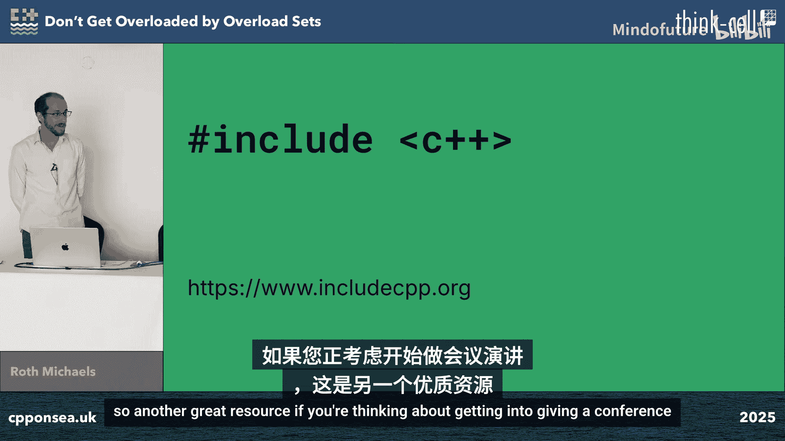

All right。So let's get going。 Don't get overloaded by overload sets。 As you'll see later。

 sets is the key word here。 I was actually， when I spoke to a few of my colleagues and other developer friends about what my talk is me about。

 And I said overload sets。 They're like， what do you mean， I'm like oh， yeah， function overloading。

 I'm like， oh yeah， yeah， I know what you mean。 But this concept of sets is something that people are not always thinking about。

 but is actually a key part of this。 So。

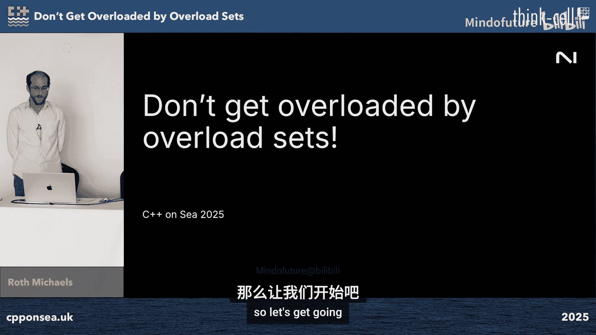

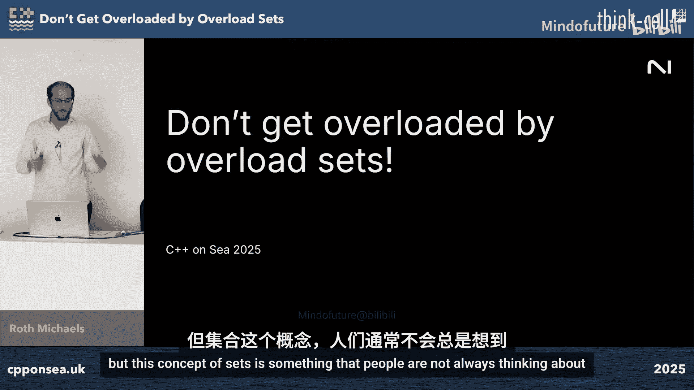

What is an overload set， It's one of the kind of fantastic parts of C plus plus that we got as we moved away from C that gives us a lot of power。

 So I'll show you one kind of small example of this。 In the C standard library。

 we have three functions for calculating the natural algorithm。😊。

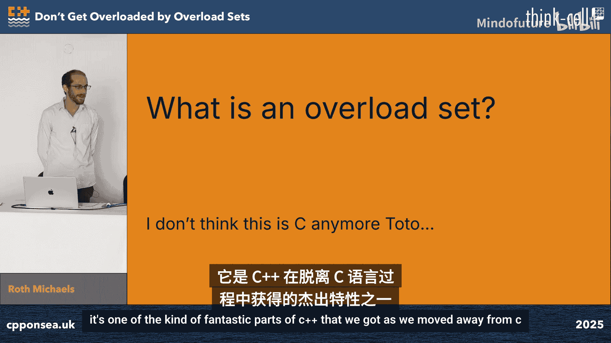

We have the original one， a log that takes a double and returns a double。

 but if you want to work in another position， there are two other variations。

 one with an F at the end that takes a float argument and another with an L at the end that takes a long double argument so often in see this is what you have to do if you want to have functions that take different argument types sometimes there's some magic you can do with macros to do other stuff。

 but yeah， don't worry about that that's pretty yucky。

 we don't need to care because we have C+ plus and we have this great version of the natural logarith。

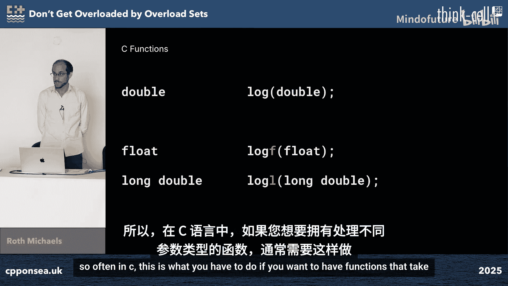

So as you see here highlight in orange， this is the overload set for the national logarithm in C++。

And you'll see there are four variations that take again。

 float double and long double and this extra one integer we'll mention a second。

 if you notice we don't have to have any special prefixes that are all just log and then this extra one log at the bottom can take an integer type you know any integer type and technically the template could take any type。

 but let's not worry about that right now it's supposed to be for integers and it will return a double because if you take a log or of an integer。

 you don't really want to int out that's not going to give you a useful answer so that's why it's always giving you double。

The nice thing about this is you can just call standard log and you don't need to really worry about what type you're passing in。

 you're going to get the right function every time。

 So let's look at another few other simple examples。

 let's imagine we have some hypothetical two string class。 This is kind of similar。

 We have a mix of some functions to take float double and long double and return a string。

 and then we also have a function template again on our non conceptcepted integer class look at my talk last year about concepts to maybe see how we could write that a little bit better。

 and that one returns a string And so you can see these all these functions are differentiated by their argument type。

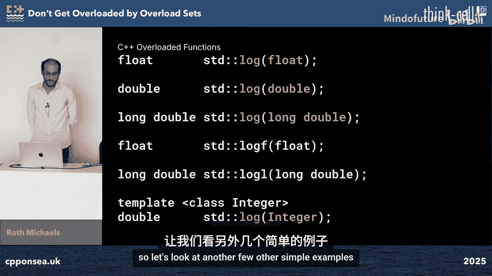

Now， imagine we want to do the opposite。 We want from string that they all take string arguments。

 but return float， double or long double。Yeah， this is not allowed and you'll get a diagnostic like this saying that functions that differ only in the return type cannot be overloaded。

 The under the hood reason is， I guess， design reasons。

 most of the name mag C plus plus like that information is discarded from the in the actual link binary。

 most of the time that's not true on MS PCC， but in general。

 that's that return type isn't part of the function signature。 It's just the name and its arguments。

But the one interesting exception to this is the template we're not going to get into a lot of this this talk。

 but I do want to call this out this template actually allows you to specify the return type because the template is actually kind of a special name that's applied。

You might see that we're not really going to get in that too much in this talk if there's some questions about that later。

Please feel free to ask and speaking of questions I forgot to mention at the beginning。

 if you do have questions along the way please raise your hand and I'd be happy to answer questions as we go。

 depending how we're doing on time， I might ask you to wait till the end or until another slide comes but happy to take them as we go because we're going to be covering a lot of material and some of the stuff gets a little weird。

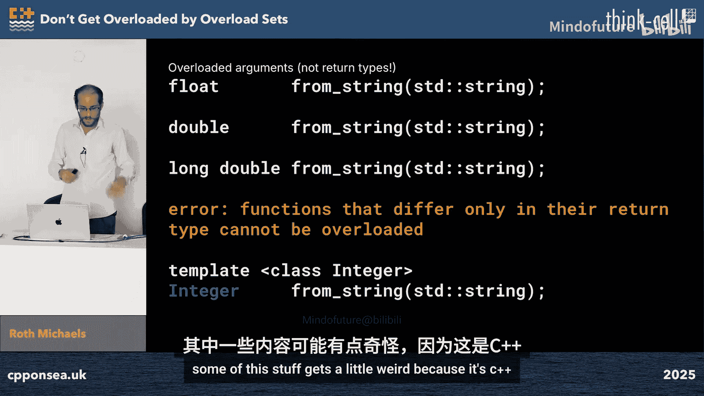

Because it's， you know， C plus plus。 So one place I'm sure all of you have encountered function overloading is with constructors and different types of constructor arguments。

 And vector is a great example of this。 So we have three different vectors being constructed。 First。

 we have an empty vector。Then second， I create a vector of five elements。

And then we create a vector that has five specific specified elements。

 and the second one that are all initialized to zero。

One thing to note is the third version is taking the initializer list with braces。

 but we have to use the parentheses for the second one to make sure we get the right overload later when we talk about how overload resolution works。

 we'll see actually why that is but just keep this slide in mind for later also interesting to note that we also get the right thing for the default constructor if we put the braces there。

 so there's two kind of special rules that pun overloading for braces again。

 this will come back later in the talk。So。😊，What do these actual constructors that are overloaded look like。

 This is a set of constructors for vector。 There's， I think， a little more in C plus plus 26。

 but don't worry about that。 This is what we need for the talk。 So we see these three constructors。

 The first one is the default constructor。 The second one is something we'll call the fill constructor。

 And the third is an initializer list constructor。

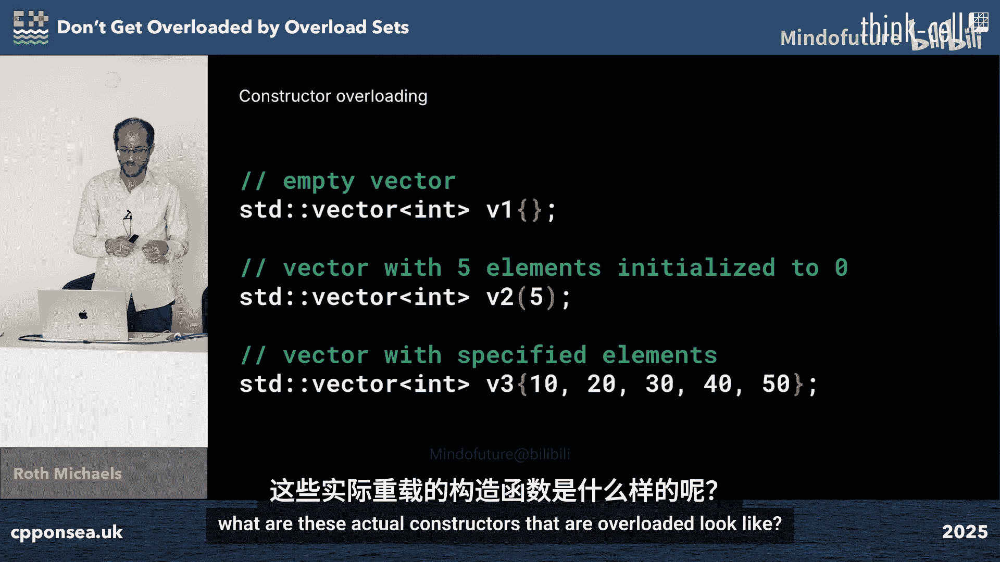

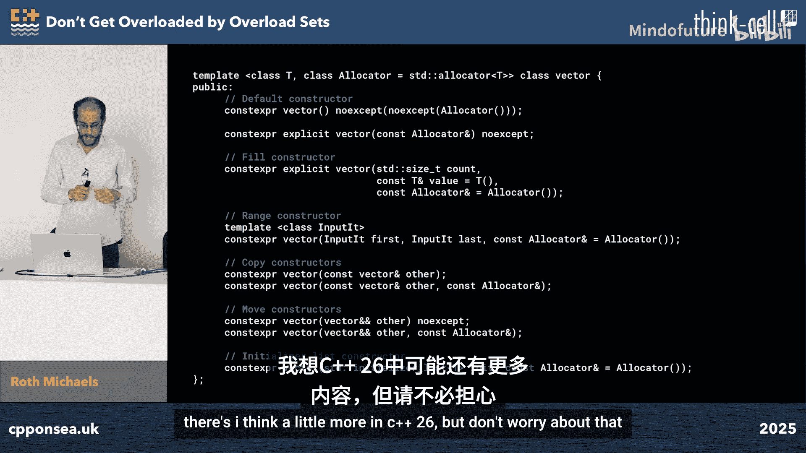

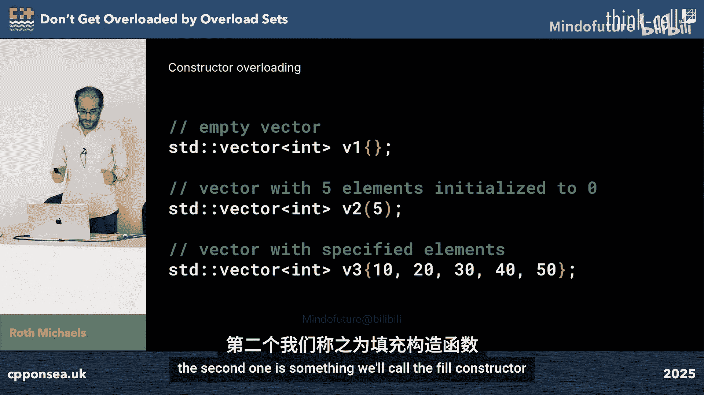

And we have these three highlighted in orange here。You'll also notice there's some default arguments。

 allocators， we don't really really need to worry about that stuff， but keep in mind。

 you later when this comes back that we have one constructor that takes no arguments。

 one that takes a size and some other stuff， but we're focused on size and the other that takes a special initializer list class。

Another kind of function overloading you might encounter a lot are the special member functions for copy construction of either L values or R values。

 we're not going to talk about that so much but I just kind of wanted to highlight that here as well。

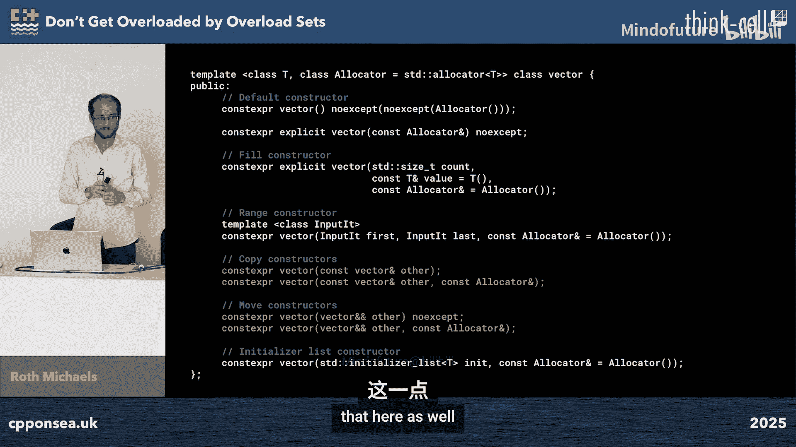

So what is an overload set？And what do I mean when I say set？

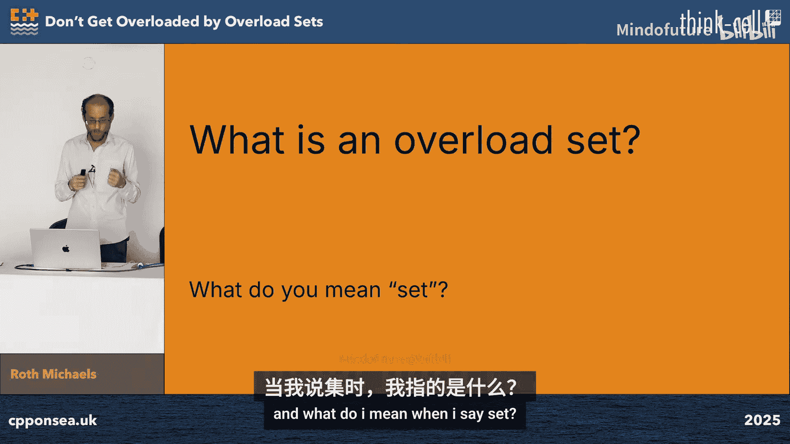

So imagine this situation。 The overload set is essentially a name representing a set of functions that are found through name lookup。

 So imagine this scenario。 We have an outer namespace a。

We declare some function foo that takes an int argument。Within that namespace。

 we have a nested namespace B。That has two different overloads for foo。

 one that takes a character argument and one that takes a long integer argument。

And then we have this function bar that takes an int as an argument and then passes that int on to fo。

So in this case， we kind of have three options of what's going to be called， is it option one。

 two or three， no， it's actually neither of them， the call here to Foo is ambiguous。

And we'll take a look at why that is in a moment。嗯。

The reason is because in the context of fo or I'm sorry bar。

 there are two copies of fo that are in the same scope， so when we're looking for names。

 those two names are found and that is kind of and that is our overload set。

But integer can convert to both character and to long。

 and the compiler doesn't know which one you mean。So that's why it's telling you that it's ambiguous we can fix this though if we know like oh yes。

 we don't want to lose precision， so we're going to cast this。

 sorry for the C cell cast and not static cast， this is just to make room on slides。

 please use static cast instead but if we cast this to along now option three will be chosen。

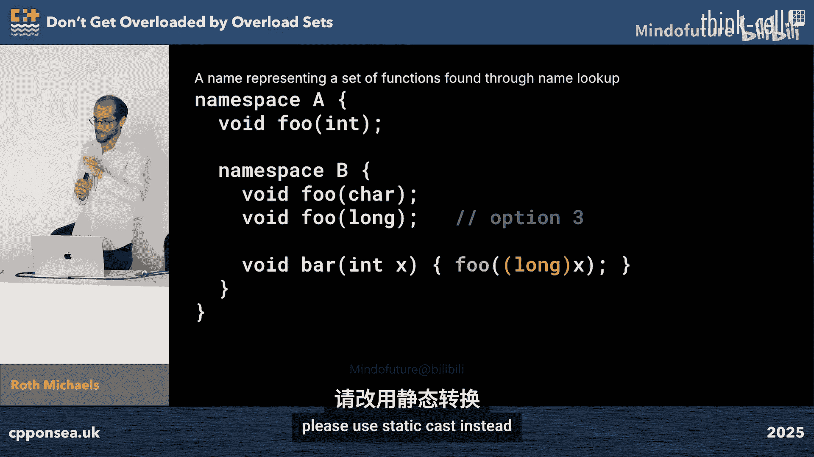

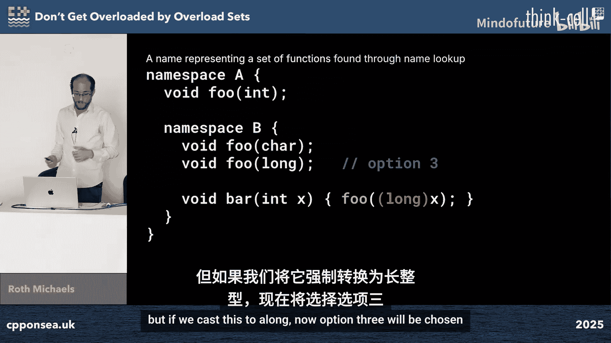

Or if we want to lose some data potentially， we could cast it to a character。

 and option two will be chosen。So again， looking back at this example。

 what if instead of bar being a namespace B， it's in a different nest of namespace C？

Which one is going to be chosen Any guesses show of hands for option one？Option2。Option 3， Okay。

 you guys are already， I think getting the the name of the game here。 Yes。

 is indeed option one because in this case， we find no foo in the scope of namespace C。 So we okay。

 we're gonna move up to the next namespace and look for fo there and we find option one the foo int。

 and that will be what's called。

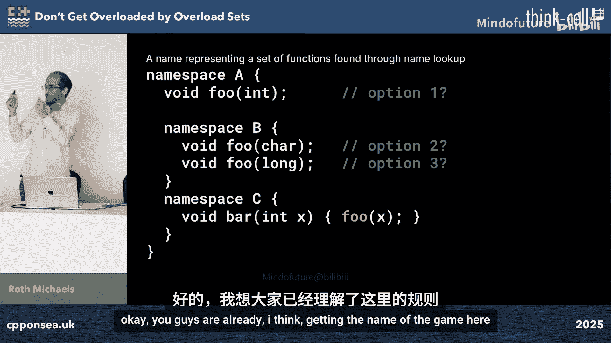

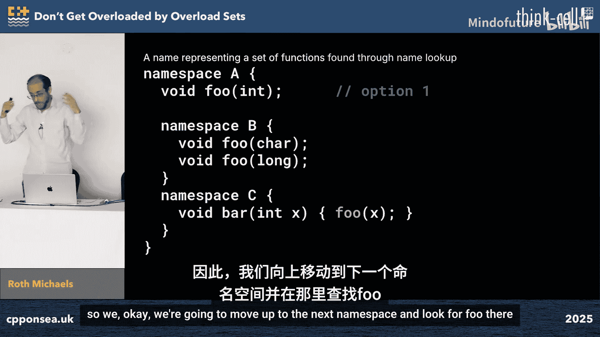

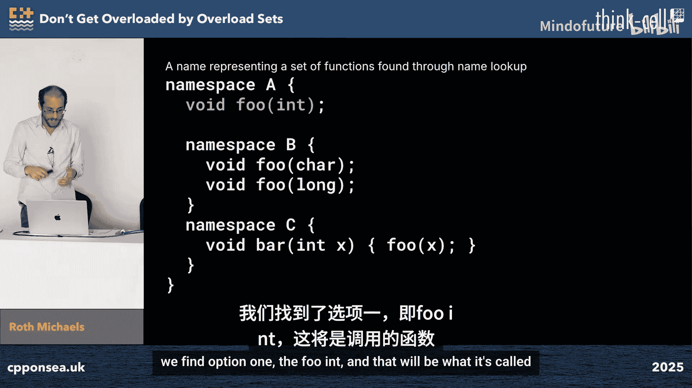

We could also select the overload set in the Naspace B if we're explicit。

 and we qualified that call not by just saying foo， but a， colon and， colon， B， colon colon and Fo。

 that means we only want the fo that's in Naspace AB。

And then that is the overload set again of the two foods taking the character。And long。

So now I'm going to kind of really illustrate what I'm talking about about overload sets。

If we use the type ID operator and call that on a colon and colon and F。

 thatll give us a type info object if you're not familiar with type ID。

 it's not really relevant here， but essentially it takes a type and then gives you a runtime value that can give you information about that type such as its name etc。

 and but what I'm trying to illustrate here is that works fine。

But if I call type ID on A colon and colon， B， colon and colon F， I'll get this diagnostic。

Reference to overloaded function could not be resolved。 Did you mean to call it。Hmm。

 did I mean to call it， no， why is the compiler asking me this？Well。

 I can't know what overload I mean if I'm not actually passing any arguments。

 And so I actually would need to call it。The same issue will show up with decoal type。

 it not familiar with decoal type， doesn't really matter for this talk。

 but essentially it will tell you the type of some declaration。And again， it's going to tell you。

 yeah， I don't know which function， like I don't know what type this is because you're talking about multiple functions and they have different types。

If you actually want to get at one of those functions， you can do this again。

 sorry for the C style cast， but if we cast this to a function pointer。

 then we can actually specify no， we mean the one that has a car。

So hopefully you're starting to see what I mean by overload sets is that you either have functions and those are single entities and you can take their address。

 use them as pointers， et cetera， but overload set is this concept of multiple things and you actually must call one for what to be chosen or cast it to one of the specific types。

 but normally we're not doing that and it's calling the functions and actually decide what's going to be the overload set。

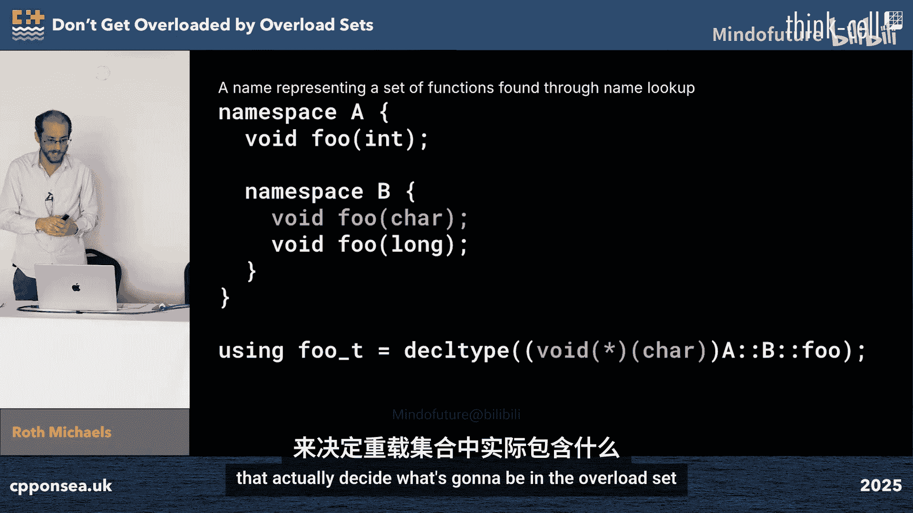

So before we talk about actually how the overload resolution works and how we find out what punctua will be called。

 we need to first find out how do we even find what overload set we're going to use。

There's a lot of details here， but I'm going to try to kind of you know keep this as simple as possible。

 but essentially。

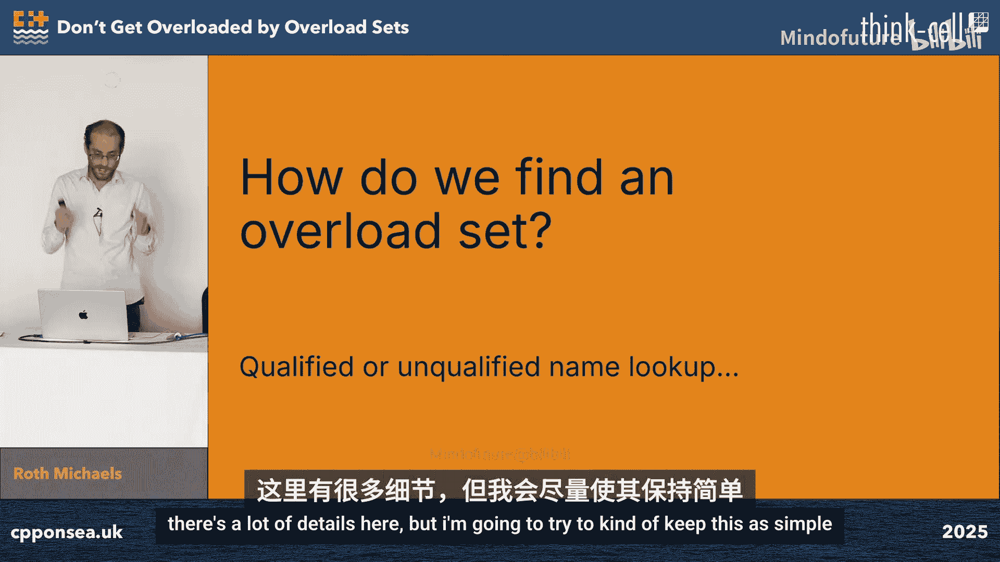

You're searching scopes。 So you're gonna search the current scope for a name。

 And I talk about namesays here。 Like if you have functions inside of functions。

 also the scopes searching there also kind of happens。 But let's just talk about name spaces today。

 So we're going to search the scope for a name， if we don't find it。

 we're gonna continue searching parent scopes for a name。 And when a name is found。

 all the overloads that exist in that one scope。 not some other scopes。Except for ADL。

 which we'll talk about in a minute， but that's the overload set you found。

If you're in a classcope calling a qualified static member function like C colon colon F or a member function。

 C dotF， then we're actually going to be searching only the classes and base classes looking for that overload set and interesting thing think about here classes are essentially also a namespace they do some other features。

 but really functionally they are namespaces。

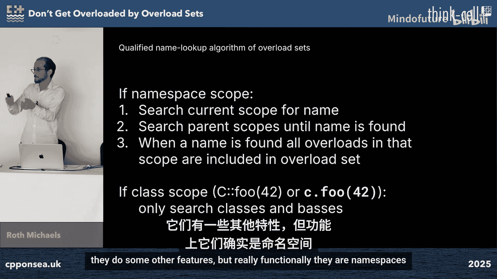

So what if we're not qualifying it with a name and we don't know what name and space to look in。

 like if you earlier we saw in this example， I'm qualifying it with the A colon and colon and F。

 but if there's no qualification， there's some extra stuff happens。

 that comes into play that maybe is sometimes surprising until you first find out about that。

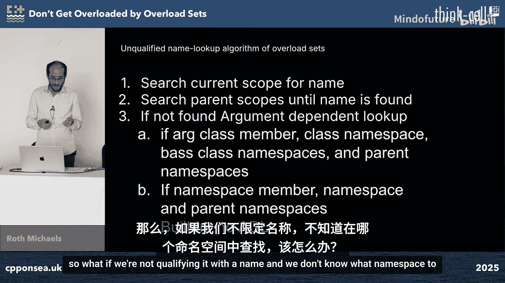

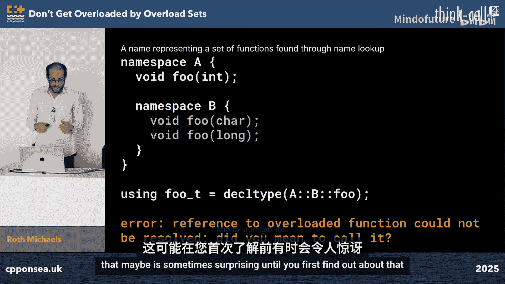

So again， we're going to search the current scope for names。

 we're going to search parent and if we don't find one。

 we're going to find look up all the parent scopes till we find some set of names find that name and then that set of functions。

 if we find a name that matches that， but is not a function like it's a name of a variable that that an account we're moving on。

And then。Actually，That should say if found or not， there's also argument dependent lookup that happens and the way this works is for your function call。

 if there's any argument is a class member， that class's namespace。

 the base classs namespace and the parents of all those namespaces will be also searched for potential names that match。

If it's a namespace member just will search parent namespaces， it's not just the arguments。

 even a template， the template parameters， their namespaces will also be searched so it's kind of spooky action at a distance where you have you search your scopes and then it' could be some other namespace over here that we also discover some potential matches and coalesce those into one overload set。

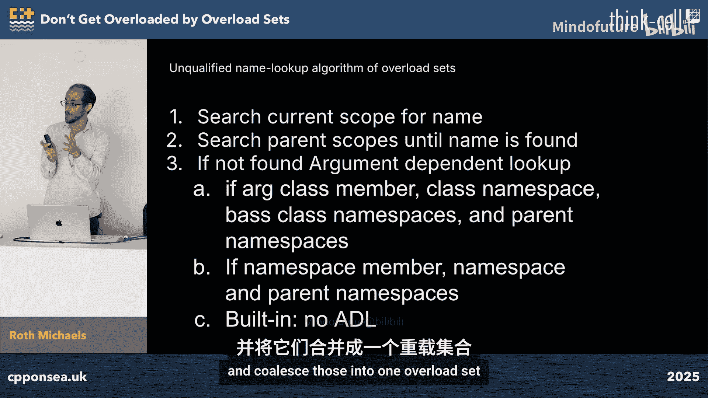

So let's take a look at this again， looking at our previous example of our namespace A with the oneFo overload。

 namespace B that has twoFo overloads。 but now we have this other namespace and in that namespace we have a struck S and a foo that takes an s as an argument。

And this time in bar， we're calling foo and passing an S object。 And sorry。

 I'm realizing that it should actually say other namespace， colon and call and S。

but what happens here is that assuming that other namespace， u it was actually there， we know that。

 oh。Let's look at our current namespace B。 Okay， we found two fos。 that's in our overload set。

 Now we're going to go the namespace that S comes from。And in that other namespace， we find oh。

 there's another food that takes an S。 And so in that case we have three functions in our overload set。

 two that are in our current scope and one that's from somewhere else， but it has a matching name。

 yes， please Oh， that's going to come back at the end so the question was why we're skipping variables like if we add a lambda variable that that could also take arguments。

Oh， it's spoil for the end that doesn't participate in overload resolution and it's a fun trick if you don't want overloading。

 make a variable function， but so we'll come back to that tip at the end。

 but that is why they don't participate。 A functional object is not going to participate in that overload resolution set。

So why do we have this ADL， like when I first heard about this， I was like， oh man。Oh， C++。

Crazy language。 but it's actually what gives C+ plus some of its most powerful features that is like I don't get to use in other languages。

 A big one in C plus plus is operator overloading。 earlier in my life。 I took a Java2 class。

 which was an antic+ propaganda class and they told me how horrible it was that you could overload operators。

 but it's actually something we do all the time because we don't want to deal with our basic built types。

 we want to be able to add geometry types like points or vectors or tensors。

 So there's all sorts of things that might make sense to add that aren't defined in the language itself。

 So kind of an incomplete example。 We have some type foo know does something and we define an overload operator plus that takes fo as arguments。

 And then we can have our end Con call and foo created with 40 and add it to another fo and that plus resolves the right operator and we don't need to actually know what namespace that came from。

 imagine。If any time youd added anything that wasn't a primitive object。

 you had to know what namespace the plus existed in。And then if you put that in there。

 it no longer looks like plus and the kind of point of overloading goes away。

 so that's one part of the beauty。The other reason we want ADL is generic programming。

 which is another big feature of C plus plus We're not going really talk about that too much in this talk。

 I've given if most of my other talks are talking about templates and meta programminggram and other stuff。

 know， please check those out if you're interested。 But this is one kind of small example。

 Imagine we have some template called Gi first。 that takes some type。

And it calls a git template on it， templated on zero and passes that type in。

So we can call this with the standard library pair。And then that gi is going to go hung。 Okay。

 there's no gi in scope。 but I have a standard pair as an argument。

 So let's look in the STD name space。 Oh， there's an STD Col and Col and git。

 That's what we'll resolve for that gi。 We can also use it with boost pair。 And when we do that case。

We go， okay， we don't have a get in scope， but we have a boost namespace in the arguments。

 so let's go hunting in that name space and then we'll find the right boost Col andqu and get and that's what be used in the second example。

Now keep in mind， of course， as C++， there's header includes， you haven't included it。

 it's not going to get found， there's no magic like this。No comment on modules。

 I've not been able to try that because of。You know， supporting Apple platforms and Xcode。

 and I don't get to try that out。

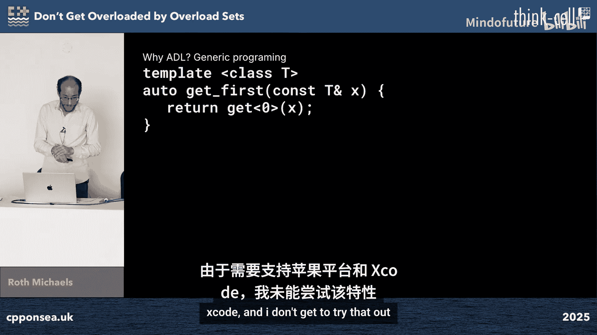

And but yeah， so， you know， generic programming is the other motivation for this。Okay。

Now that we know actually how we find the overload set。

 how does the overload resolution actually work， How do we pick what function gets called。

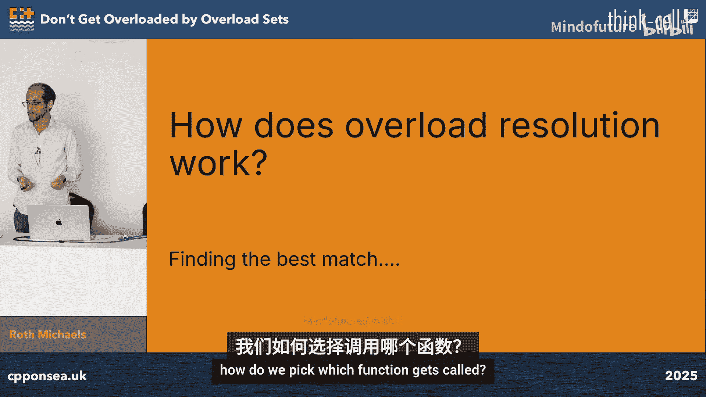

You' got to find the best one， right， you don't wouldn to want to call the worst function。

So how do we decide what is best Well， there's an exact match。

 the argument you pass in exactly matches the type of the parameter for that function。

If that is not an option， the next thing we try are promotions。

 so there are conversions from built in types that're not going to lose precision like a bo or a short being promoted into an int。

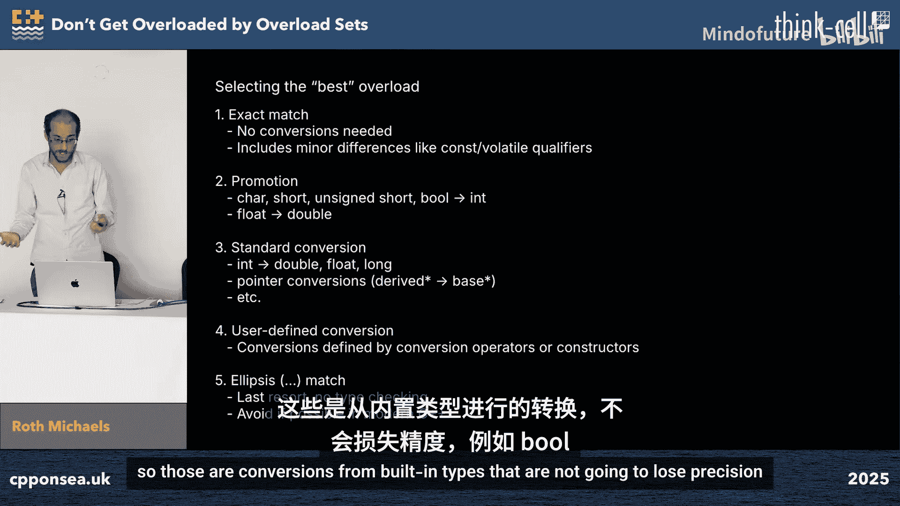

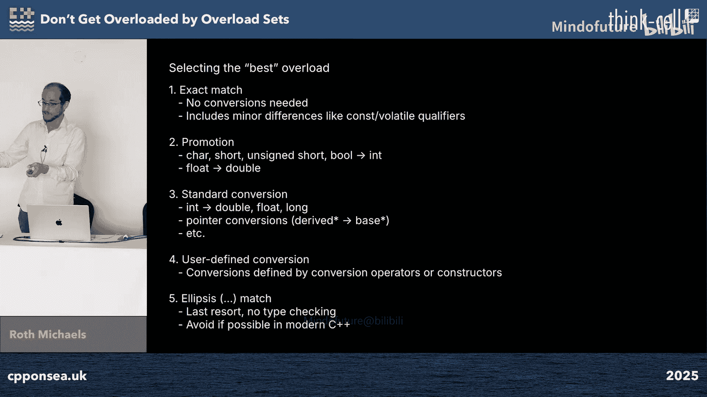

Next are other conversions like all the implicit conversions that we have in C++。

 please turn warnings as errors on W all or at least the W conversion ones so you don't get surprising bugs with this but。

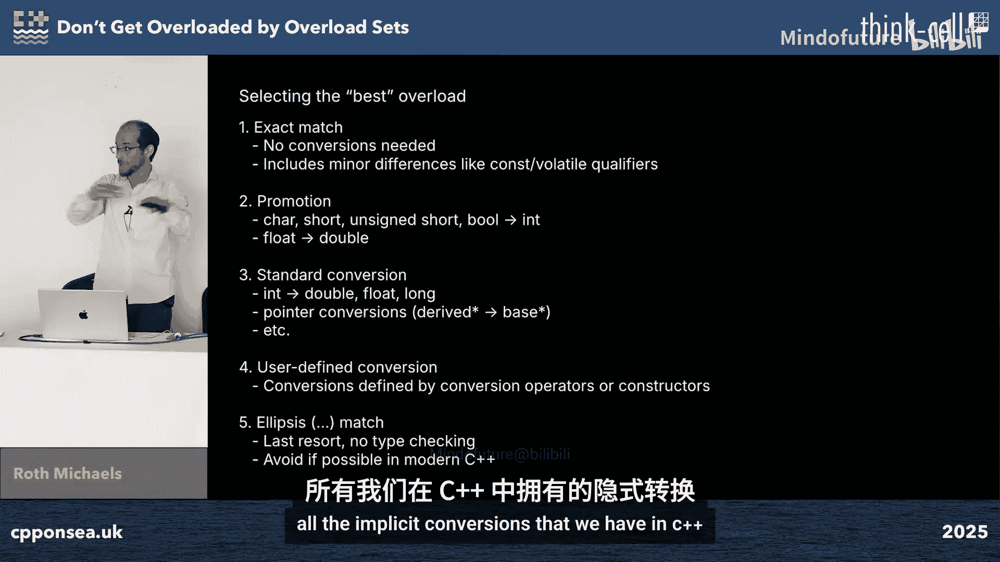

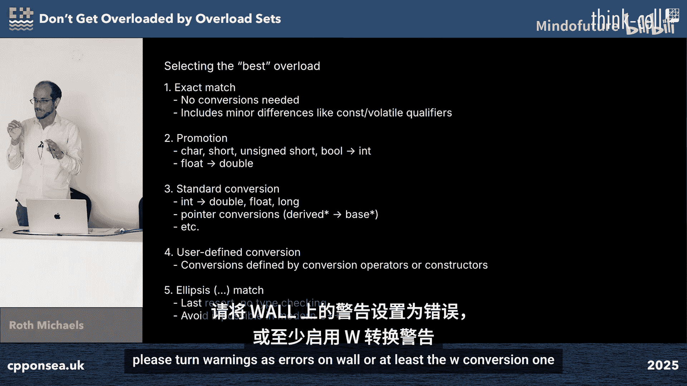

We try any， you know， mashing of numbers into other shapes to get that to work。

 And that's why we have these two levels。 We want to try promotions first because we know we're not going to lose any information but if that doesn't work。

 yeah， okay， we might lose some information， maybe not， we'll see。

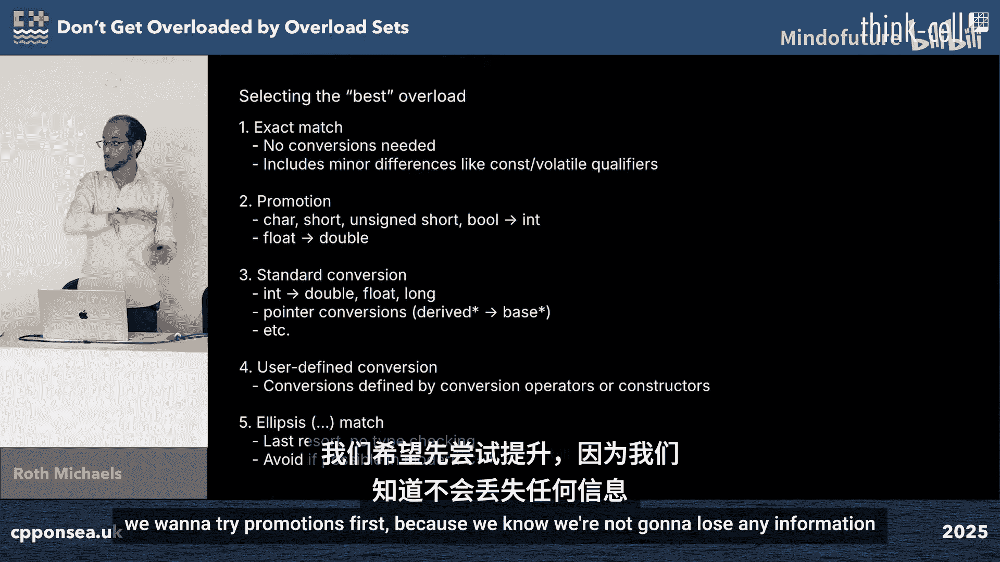

And then if that's not an option， we do what a user defined conversion is and that's essentially and I say user defined。

 it's not necessarily you， the standard library writers or also can write user defineded conversions that's essentially any time a type can convert to some other type。

 for example， if you use string view， you can convert a string to a string view counts as a user defined conversion。

And then also we have this ellipsis kind of from C that says， okay， yeah。

 we take some arguments and that's kind of the last default again。

Hopefully you never need to write the ellipsis， old meta programminggram stuff kind of needed it。

 but that's one example。

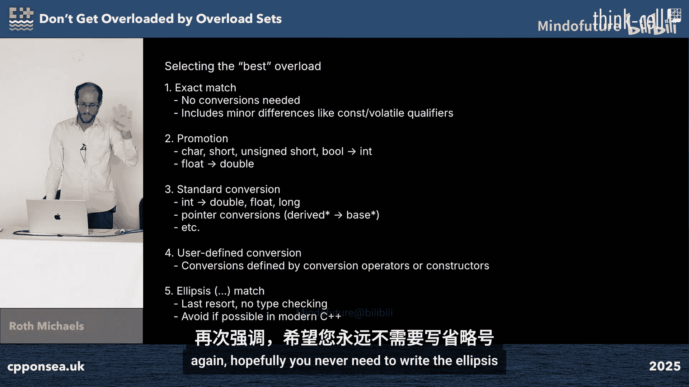

Let's check this out in practice。Imagine we have this set of， is it six functions Yeah。

6 functions in this overload set， taking inch， short， double， long string view and dot， dot dot。

So if we have an int 42 and we call this function。It's going to call the function that takes an in argument because this is we're doing exact matches。

 This is the we're going to go through all the examples in priority order。

 So this is the best is the best。Or if we have a short that's42。

 that's going to call this like function short because again， we got the best match。

Now we'll look at promotions， that's their next best option。

 So if we have a character A assigned to C。And we call this function with C。Well。

 there's no character in our overload set。 So all right， we don't have an exact match。

 but character is allowed to promote to int， so we'll call select function int。Same thing with bo。

 we have a bo B that equals true， there's no bo in our overload set。

 but we can convert a pool to an int， and again we'll call the select function end。

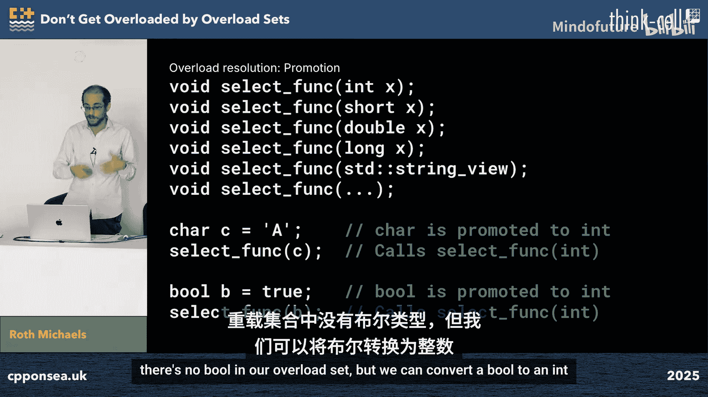

All right。

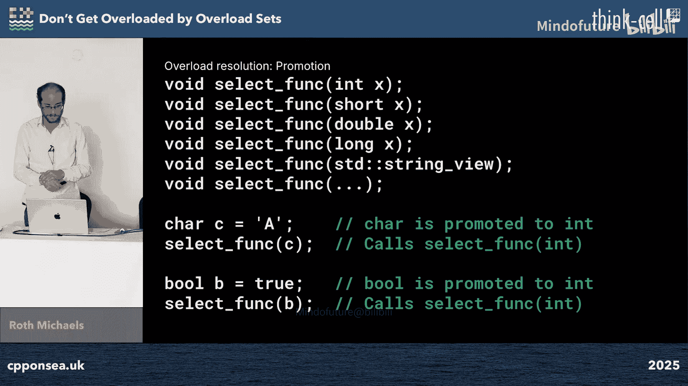

Now the one that hopefully you have warnings on for， but actually in this example。

 we're not going to lose precision hopefully because we're going from float to doubles。

 but if we have a function that just passes in 42。0 that's going to call the double version of the function。

 and if we have a float F 3。14 F and pass that in， well there's no float so we can pass that to the double version。

And now we're going to use a divine conversion。 So if I call this function with a literal string。

 which is a constant pointer to constant characters。Well， that's nowhere in our overload set。

But there's a constructor for string view that takes that as an argument。

 So that means we can convert that to a string view。And you're allowed one user to find conversion。

 You can't like go thing to thing to thing to thing。 Yes， please。 oh。

 the question was that this works because the constructor string view is an implicit as in no keyword。

 as usual a C plus the more dangerous thing is the default。

 but if you don't put the explicit keyword， these conversions happen automatically。

 if you have the explicit you must do a cast。 So the opposite， for example。

 the standard string has a string view constructor， but that is or actually。

 I'm sure if it as that or a string view has a operator。

 But the conversion the other way from like a string view to a string is explicit。

 And when we come back later， we'll see there should be an example later slides of explicit。

 but think for that clarification。 this only works。

 if you don't have the explicit keyword on the constructor or a conversion operator。

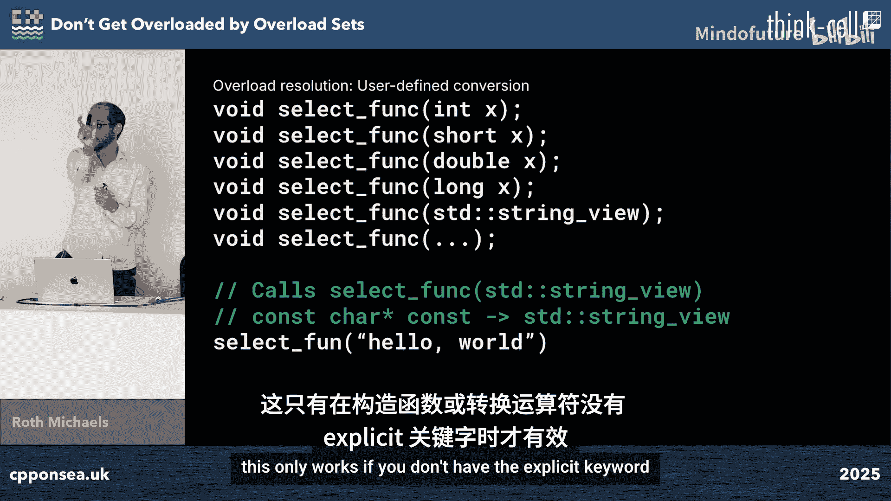

And our last kind of ugly example， we have somestruct the mystery type， we create one of those X。

 we pass it in。Mystery type is empty bodied。 Like there's no， you know。

 standard Library St view doesn't know about it。 It can't convert to any of these things。

 So we're going to call select funk ellipsis。

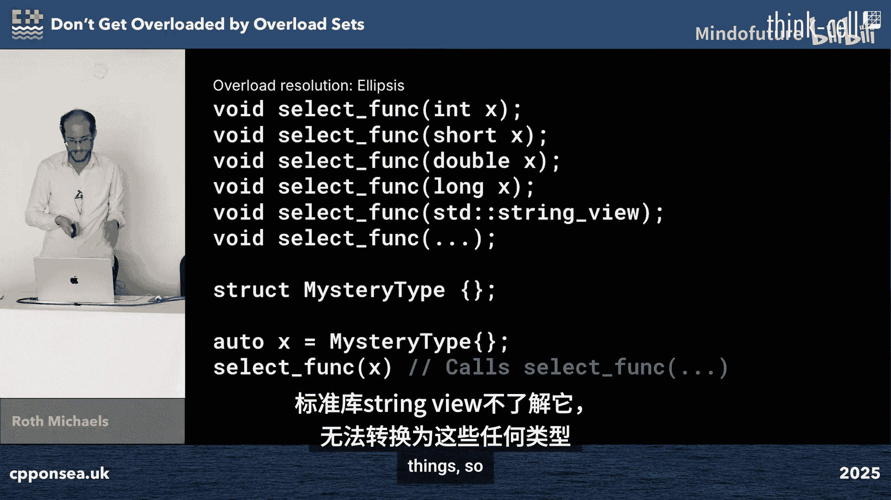

So again， going over what counts as the best match， we could look for exact matches， promotions。

Sandard conversions， user define conversions and then ellipsis。

But if you remember back to the beginning， I mentioned this braced initialization and we've got some special priorities that go on there。

So for any function in your overload set， if it takes an initializer list。

And you actually call that function with passing braced initializer lists in the arguments。

As long as the types of that can convert， that initialized list is going to take priority over any other matches。

 and that's kind of necessary to have the brace initializer list constructors work。

And then if you're talking about constructor overloading。

Constructing with braces even is a higher priority where the default constructor is going to get picked if it exists over passing nothing to an initializer list。

 So looking back to our original example。

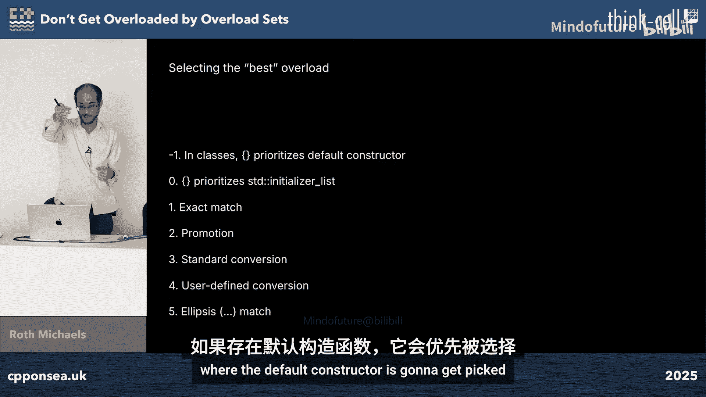

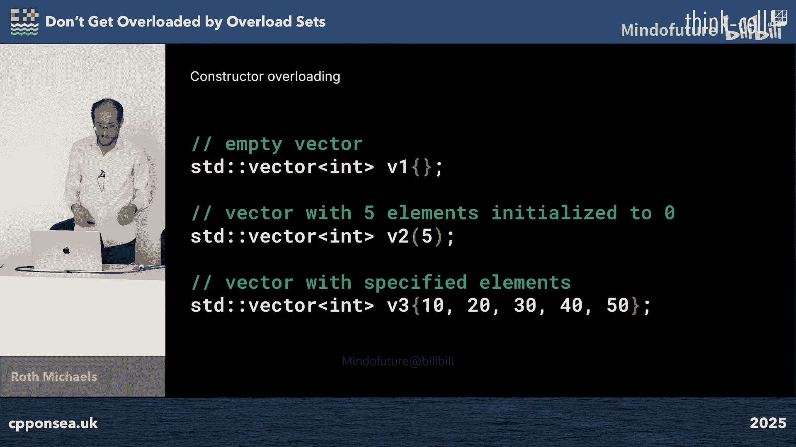

We see that the bottom， where we're specifying specific elements。

 that's going to call the initializer list constructor initializer list int constructor of our vector。

But if we pass it no members in the braces， that's going to even take higher priority in and say。

 oh no， that's not an initializer list。 that's a default constructor。

 And so and that's why the trick always you know I'm preferring to always use braces and the only time I don't is when I need to call some other one in this special case where we're pen and vectors of ints and if there's only one inch。

 I can't use the braces because that would if I did five there it'd make an element of one vector with five so I have to use parentheses so we're not prioritizing initializer list and defaulting back to the normal rules yes please。

Oh yeah。 so the question was about like the most suppose sometimes called the most vexing parse in C plus plus。

 he is asking about how we know that this is actually declaring a variable V2 where we're constructing it with five versus how do we know it's that versus this is in some function V2 that is。

Kingvent in this case， I wasn't prepared exactly for this question。

 but I believe the answer is in this case because we're actually passing in that five there and there's no types in the list。

 if we call that with no arguments， I think it might be kind of context dependent when that works but let's circle back to that question at the end because。

That's。Now。That is a great gotcha。 and I've got some other gotchas to show you。

 but I wasn't actually prepared for that one exactly。

 but let's circle back and we can maybe dig into that one at the end。

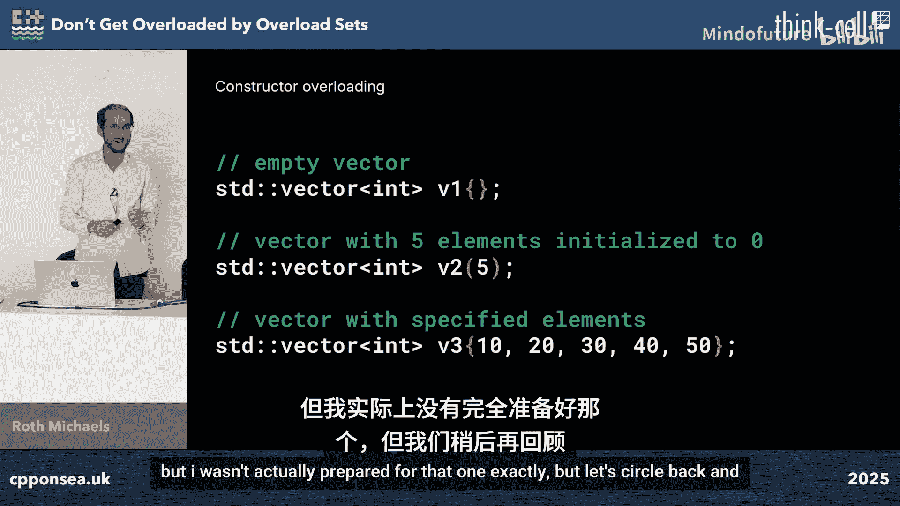

So。What if templates are involved with overload resolution？

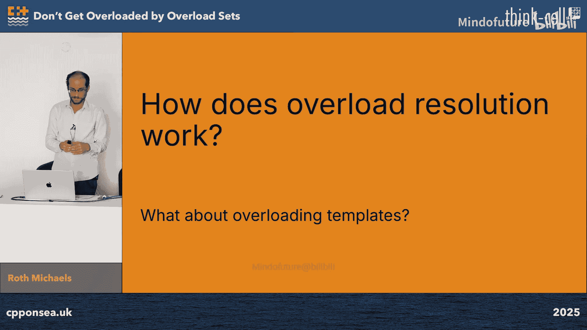

So let's look at this case where we have three overloads。

A template that can take any T and claims it's going to perform a square root。

Another template that takes a T in the template parameter。

 but the argument of the function is a standard complex of that T。

And then we have a square root of a float。

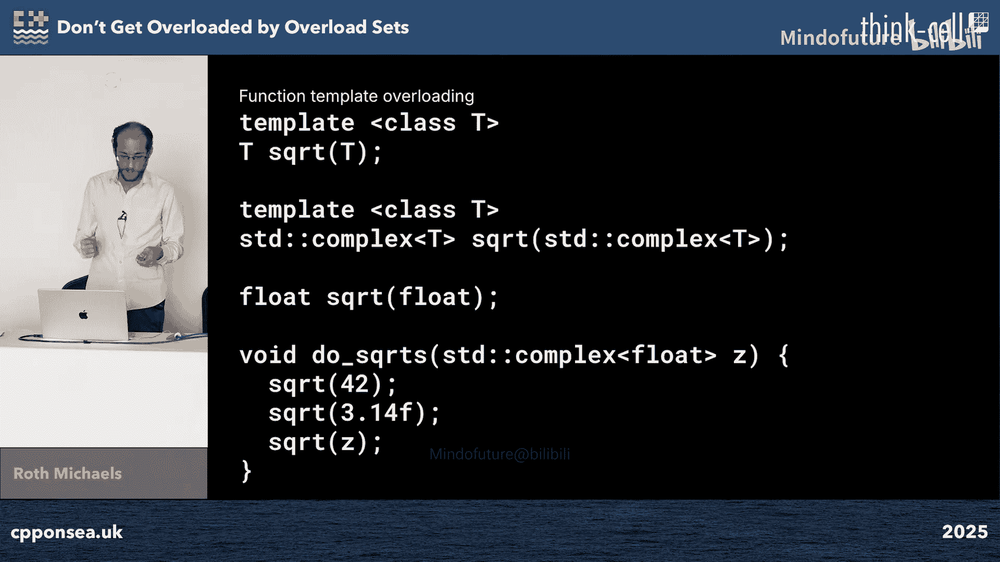

And so imagineing this function， do square roots that take some。

Standard complex float Z and then calls square root。

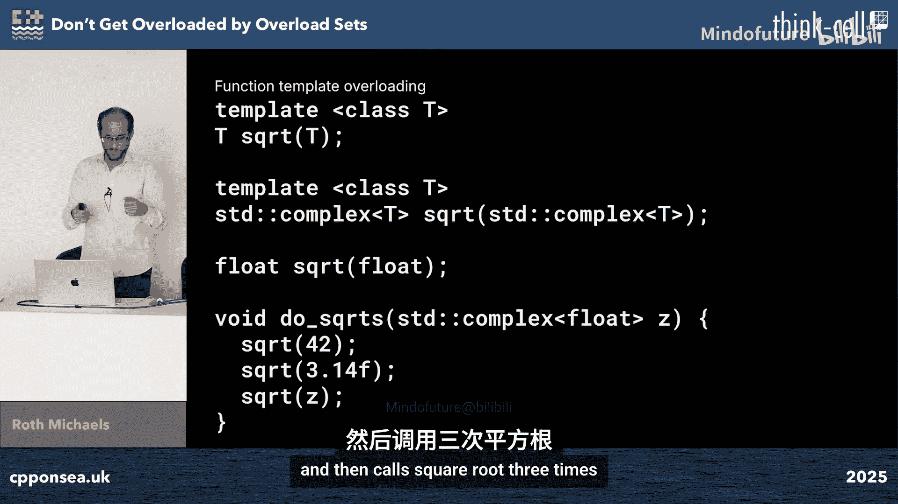

Three times。First with an integer， then with a float and then with our standard complex。

So the way this is going to work is first， we're going to take a look at the templates and see what templates potentially match In this case。

 the top template， we can definitely pass 42 to that。 There's no restrictions。

 but 42 is not a standard complex of any type。 So that template is is not going to work for this case。

 So in that case we have two options。 The square root template on the top and the square root float are in our overload set and float is not an exact match for 42 because that's an integer。

 but。Class T， you can insert integers there and that will match anything。

 and so it's going to pick the top one， the template。

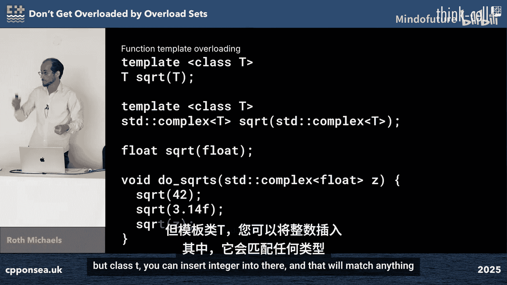

In the second example， we're passing 3。14 as a float in that case， again。

 we look at the templates available， we're allowed to use the top template with floats。

 no problem we can't pass a float to the second template because it wants a standard complex。

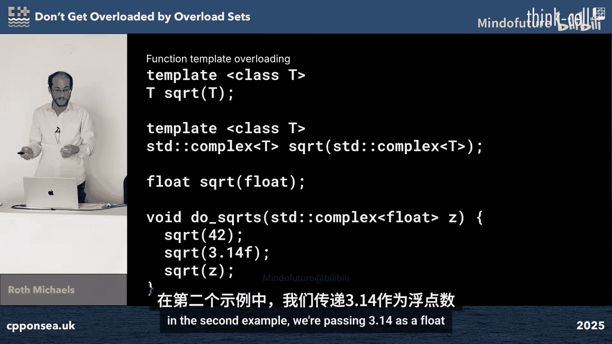

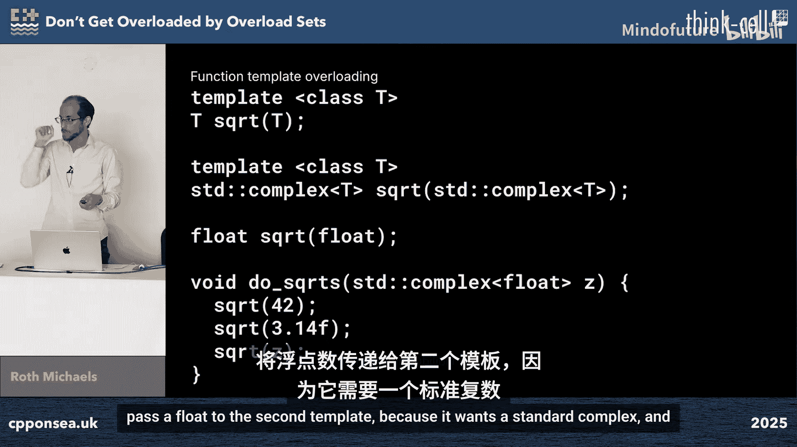

And we can pass a float to the square root float， so we have two options in our overload set。

 the temp at the top， and the function at the bottom。

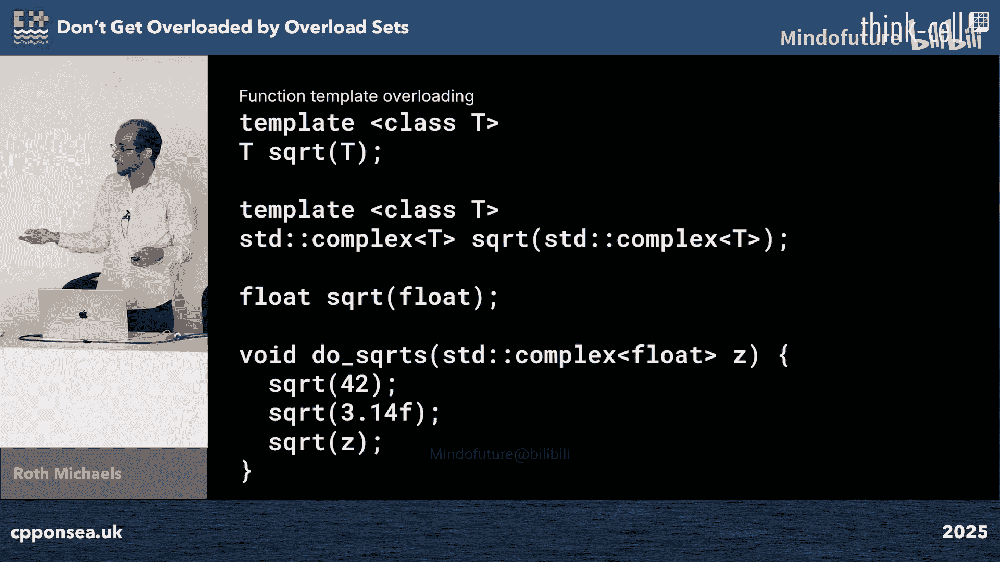

In this case， if you have two things that can win and one is a template and one is not。

 the real function wins， and we'll get to later one of the tips。

 but that's a reason to sometimes prefer playing functions if you don't really need to be using templates。

And the last example。We can see that again， if we go from the bottom up， okay。

 we can't pass standard complex float to the bottom one because that only wants floats。

We can pass to the middle one because that wants a standard complex of something afloat， it's fine。

And theoretically， we could also pass to the top one because that's going to take anything。

 So we have two options there。 And before we even get to overload resolution。

 we've got to pick the what's called the most specialized template。

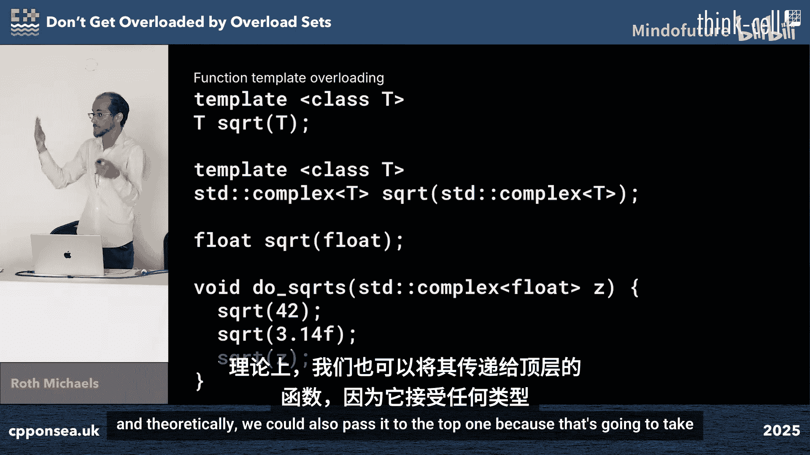

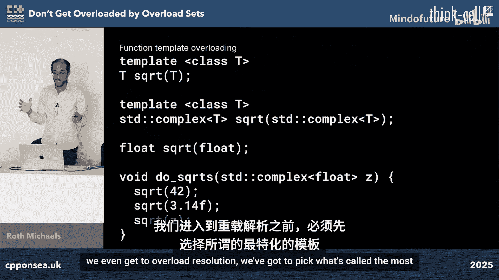

There's a lot of rules about this。 The way I like to think about it， though， is imagine。

Which template could take more other types？There's only a small set of types。

 basically stood complex something that will work in the second template。

 but really anything can work in the first template。

 which that makes the second one more specific or more specialized and so that's what's going to be chosen in that example。

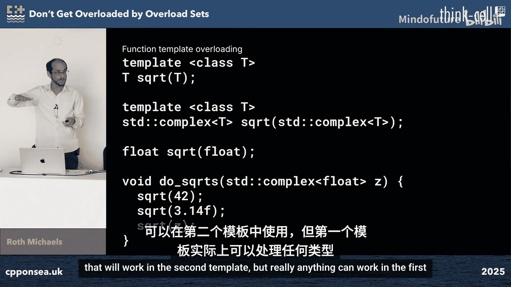

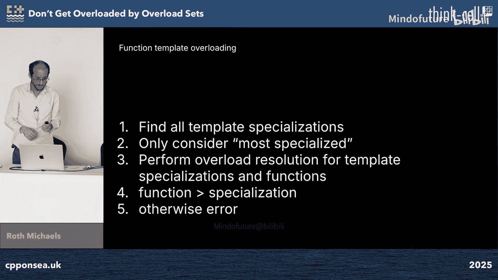

So again， to kind of go over what the rules for this are。

 first we're going to find all possible template specializations。

We're going to look at only the ones that are considered most specialized。 So in the last example。

 that was the standard complex one。Then we're going to perform overload resolution on our most specialized templates。

 plus all of the normal functions and try to find our best match。If two matches are equally ranked。

 the function wins over the specialization。And if there's no equal ranking or there's not a function。

 if there's equal rankings and what's not a function specialization。

 like things are really equal equal， we're back to that diagnostic from the beginning saying it's ambiguous。

 we don't know what to do。

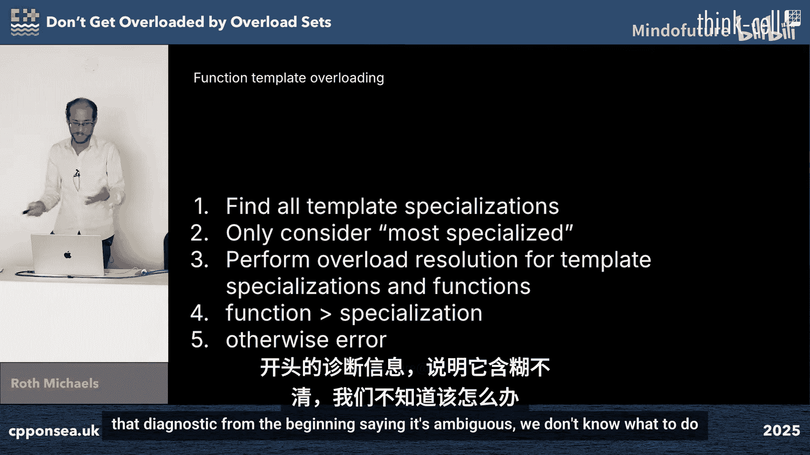

anyone surprised by this templates can be surprising。 a few years ago I was preparing a talk。

 And I asked， I think this is a chat GPT 3。5 for why one of my concepts examples wasn't working。

 And it told me。C++ templates are really complex。Then a quoted part of the standard to me that I don't it's kind of related。

 but didn't help。 but that was a few years ago。 these things are better。 but moving on， so。

In this example， we're going to kind of show you a surprise gotcha that you can get with templates and this is maybe a poorly designed class that causes this problem。

 but you'll notice it has a few features I'm going to kind of cut out some of the stuff in a moment because we don't really care about the constructors but basically this my int class is or maybe int sorry is think of it like a standard optional int but a little bit different so it。

Has two members， basically it has a potential value and a bo telling you whether it's valid or not。嗯。

But if you notice it how when I kind of slid this down so you can see there's a few conversion operators so we can convert this to Bo and we do that。

 that's how we check， is it valid or not。And the way it's valid is if we actually pass in a constructor argument for the int。

 if we default construct it， we consider that invalid。So if you pass in zero， valid， default。

 construct， the value is zero， but it's invalid。And then we also have a conversion operator to in the internal type so we can just like。

And there's no explicit。 So even if invalid， we're going convert this to in if we pass it to a function that takes in。

 And then we also have one that this is actually kind of based on something that was a template in real code that I saw that was a。

Less great standard optional because it allowed you to work with default constructed types and get values out。

 even if they were not valid。 And but okay， we're in the future。 C plus plus 17。

 We have standard optional。 So we want to be able to use that new code so we added a conversion operator thinking that will save us so that we can just again。

 implicit and we can just anytime we want want to pass a have a function that takes a standard optional of an int。

 we can think oh， well'll pass one of these things and it will work great。

 So if you look at the bottom， I have a little bit of code where I first initialize and maybe int。😊。

Then I assert that when I convert a bo that it's， you know false and you'll see that because I've default constructed it。

 so M valid is false， so the bull conversion will return that and it'll default false and the bang operator will make the assert true。

And I would hope that if I then created a standard optional with this。

 the desired behavior would be that that would also be invalid。

so that's why I have that assert there， but it's orange because no， it's not true。

 actually when we do this， the standard optional says it has a valid value and that value is0。

Why did this happen？Well， let's take a look at just some of the constructors that are overloaded for optional。

We have one that takes an optional of some other type that can be converted to and。I'd be like， oh。

 actually， like we would hope that this one is going to get called because we're going to go from our int。

 it has a conversion operator to optional which is what we want。

You'll still be invalid and all is good。

But。

So yeah， we are hoping that this one's going to get this conversion operator is going to get used。

And call this function， but actually we get this one。And this comes back down to best matches。

Because the first one requires us to convert our。Maybe into an optional。 So that is like number four。

 user defined conversions。

The second one。It's takenaking anything。Anything is an exact match for anything。So in that case。

 we just pass in in this case， U is maybe int and we pass that in and internally in the implementation of this that will then construct an integer from our maybe int and actually call the int conversion operator instead and yeah。

 this is，A real issue we ran into trying to merge a silly optional type and some legacy code into something real。

Also another surprise I've actually ran into this one implementing some custom random number generators。

And where you could take a seed sequence or an individual seed and the seed sequence constructor is a template。

 so if I have int X42， I'm just go seed with a single number。

 I would hope that would call the you know， you4 just the one that takes an intetrote。

 I'm not passing a seed sequence， why would I want this second one for seed sequences。But again。

 I'm going to get option two because int is not an exact match for you win 42。

 but it is an exact match for T because T can be anything and anything's an exact match for anything。

嗯。😊。

Yeah， be careful about overload sets with templates that can be surprising sometimes。

So what about member functions？And remember I said before classes are namespaces So in this case。

 this is pretty basic we have struck B1 as it overloads V int and double we create Ill sorry the typo I should be B1 there you'll see later slides it says D but if we create one of these objects and we call it with 42 Yes it's going take option 1。

 the in constructor。

Now， here's where things get tricky。 this concept of hiding you might have heard of。

 which is if we have a struck B1 with a foo with an int argument。

And then we derive from that struck D derives some B1 as a fool with a double argument。

And we create a D and call F with 42。Well， if we think all the foods are available， we think， yeah。

 we're going to get the into option option one， but we actually get option 2 because remember before I explained overload resolution。

 we first had to find the overloads in our scope。 So oh， D has a fo。

 So that's the one we're going use。

And there's only one overload in that overload said。

 were even we don't need to go up to any parent scopes because we found something。

Here's another kind of even actually， this is one of the examples inspired me to do this talk when a colleague ran into this。

 we have a lot of Nixon stuffuffs in our UI library that。

Brings in a lot of you know special functions that take emptystructs to do magic if you look at my CPPcon talk about GuI libraries。

 you'll see some info about that， but in this case we have somestructs S1 and S2 we have twostructs。

 B1 and B2 they each have a foo taking S1 and S2 respectively and then D derives from B1 and B2。

And we would think like， oh yeah， there's no ambiguity here。 like like S1 doesn't match S2。

 It does match S1。 So of course， we're going to get option 1， right， No。

 we have the diagnostic member fo found in multiple base classes of different types。 again。

 it because name look up happens first and then overload resolution。 And so we're going to， okay。

 we have no names indeed。Oh， we have names in B1 and B2， like which which one do you mean？

So if you're using multiple inheritance， again， one of the things that I was told as a teenager was the evils of C++。

 but it is actually can be quite useful if you're doing this， you can fix this by using the using。

Delaration where we're going to say using B1 fo and using B2 fo inside of D and what that's going to do is bring the names in from B1 and bring the name in from B2 and now these names exist in D and there's now both functions are part of that overload set and now when we call S1 it goes oh yeah。

 okay I found a name an overload set and D。

It has two options， S1， S2， S1s a match， we'll call option one。Yes。

 please the the question was that if we qualified that name with a colon colon。

 B1 or B2 to pick the option we want， would it select the right one。I believe it does。

The use case that like this example came from like no user code actually calls that it's a lot of machinery so that's why we had to do that because we actually want the full overload set to pick what we're going from。

 but yes that should' work to explicitly qualify that。

So what about member function overload sets？嗯。And that you can qualify them。

In addition to the normal， we just saw kind of normal overload sets。

 but now there's also qualification。 so sure， this is pretty familiar to folks seeing con on some member functions。

In general， it's a different topic for a different talk， but if you can if a function can be con。

 please put the cost keyword on it， your colleagues will be very happy when they want to use that as a constant somewhere else in their code they can still actually call that method so we have some data holder that has some big data of bytes in a vector and we decide to overload this with a con qualifier because if the members con。

 we don't want to copy this data out， we can just read it。

 they'll read only con copy and return a Con ref。

From the con object， the way this works is if the object itself， i。e。

 the implicit this pointer is cont like if I declare a cons data holder。

 then the cons qualified method will be called if have a noncon object the access data without the cons qualifier on top will be called and then we're going actually copy the data out So that's common use case for consqu another variation of this is we actually wanted the noncons version to be able to modify the internal data。

 we can return a reference instead of a copy know just depends really what you're designing for in your use case。

We can also qualify things with reference qualifiers you don't see this as often it's usually kind of you're making certain vocabulary types where this might be useful。

 but imagine we wanted to be able to move the data out we don't want to copy it out but if we had a temporary data holder we would want to actually be able to move that data out so we can actually make three variations we have the noncon reference so in this slide the first if you look at the first two the single ref on the first two overloads。

That's implicit in this case。 If you're not making it。

 there's an implicit reference qualifier on that。 But then we have this third one that takes the ref Ref overload for an R value reference。

 So if you have R value reference in a temporary， then we're going to， you know。

 cast our data with did move。 So it's now an R value reference。

 And then if you construct something else with that， you'll use a move constructor。

 I think I've written like。

I can count them on my hand， I don't know if it's two or three classes that have done this this doesn't come up very often。

 but I want to show you that it exists。And you often hear about this stuff as these qualifiers as constant volatile qualifiers。

 so you can do this with volatile at the end as well。

Yeah， forget volatile， just please don't worry about that， I'm not showing any examples。

So。I'd like to look at a few tips。

What if you don't want？Your overload set to be mysterious。You don't want to be confused by ADL。

You don't want someone else to open up a namespace and add more overloads。

You want to know your're designing component for reuse and you know you want your client code to be able to only。

Call these functions。One way of doing this is so in this example， we have， you know， Strs S1 and S2。

 And instead of just having free functions who that take an S1 or an S2 argument， we instead。

Create them。 again， there's a theme here of going back to my old young person learning Java days。

 We put them inside of a struct and have static methods。 instead。

 I'm not normally going for this style。 one the C plus plus core guidelines says if something doesn't need access to private data。

You should make it appear pure free function and this case， there is no data。

 this is just a struct that just contains some functions。

 but you get some interesting features out of this。

No one else can reopen my struct once I do that closing brace， that's it。

 that is all thats ever going to be that struck。 no one else can add some other header and add a S3 or a float to that overload set。

I can't use using to bring these functions out of the struct into some other namespace because you can't use using on members of a struct and also this defeats ADL you because you can't you have to name and qualify this like ADL is not going to happen so this is something I saw in John Lako's largescale C+ plus architecture and design book and it's kind of a way of making a component that is isolated you know like this is kind of the whole world of this component so。

😡，Just I don't use this often， but it's something to think about。Yes， please。

I stock stocks also break some。Yes， so that's that's very interesting question。

 The question was the difference between using a struct and a namespace。 sostructs and classes。

Kind of count as namespaces in the standard when there's a lot of things that say like you're searching namespaces for things。

 they kind of follow those rules， but they have extra restrictions and those extra restrictions are a few things。

 And that's what kind of gives this trick its power One is。

You can only open and close those braces once。 so if I had namespace my component。

 I could have these two functions in one file and then another header file have namespace my component and add more overloads。

 So this is kind of forcing that the whole API is in one place and no one else can add add stuff to this scope is one thing。

 The second thing is you can't。In some other scope， like I can't open Ross crazy namespace。

 Ross doing something crazy using my component colon colon foo。 It's gonna to tell you， oh。

 you can't using that into this。 So you always you always will have to qualify this with the my component colon colon in this case。

 And the third one that spooky argument dependentent lookup。 Imagine struct S1， S2。

 we're in some other namespaces。 we would never go looking in those namespaces。

 This is the full overload set。 So it's kind of a way of contraining everything。

 So ADl doesn't happen。 no one can add stuff to your struct。

 and there's no way to pull these functions out into some other overload set except for the inherent example I showed you earlier。

 but you can't like pull them out into global scope。Does this make sense？Thank you。Yes， so yeah。

 the issue that was just pointed out is that。If you get the signature wrong， like if in my。

The CBP file， I write， I'm trying to give a definition for this foo and instead of my component。

 F S1， imagine there's some S3， I use S3 instead。in the case of thestruct， when I have to。

 when I spell out my component， colon colon。F S3， it'll tell me。

 oh that that declaration doesn't exist。 There is no S 3 overload in this struct。

 But if you're just doing free functions in a name space。It just becomes， oh。

 I can just declare any new functions in my CPP file。

 so that's another bit of safety is to kind of make sure you're not going to accidentally define when you're thinking you're defining one of these declarations。

 actually I up writing a new declaration for a new function。Thank you。

 that's another piece of power that comes from this。Was that one also clear， thank you。Okay。

 another tip， when there's a choice。They actually don't write functional overloads if you don't have to。

 but use default arguments。 So this is actually the example from the C plus plus core guidelines for this guideline when we use。

 imagine we have a the you know bad example and orange in the bottom， we have two print functions。

 one that just prints just a string as is。And then one that printss string with some formatter to do some special formatting thing。

And you can imagine the way this is implemented is the first version might even call the second version with some default constructed formatter and if you have the option when you're having got different numbers of arguments。

 you can it's often a lot nicer to instead of writing an overload set to actually just write one function and default the other argument。

That's your next tip。All right。It's been spoiled， but we'll show it anyway。

Here's what I meant about the variables。 So if you want something not overloadable。

You can make a lambda and assign it to a global variable and it will behave just like a function。

 but there's no overload sets that name when he finds a name it's like it's not like oh。

 I found a function like here's my overload set。 Let me do overload resolution。 It's like nope。

 I found a function object。 It has a call operator and I'm gonna call on that so。

I haven't actually had a personal use case to do this。

 I know a few colleagues have I've seen write this。

 I don't know if it's just a personal style of liking writing things this way。 I'm not exactly sure。

 but this is a trick that if I wanted to say like， okay。

 I want my my my printer function to only take a string view。 I don't want anyone to like say， like。

 oh， it can take string as a value Also， I want to always be string view。 Yeah， this is just the one。

 the one and only。 yes， please。 so the question was， is this about lambmbdas。

 or is is about any variable for an object that has a call operator。 And。Yes。

 that is that is true that is because essentially what a lambda is is essentially syntactic sugar for making a function object that has。

 in this case， a single call operator。 But if you write a class that has multiple call operators that are all overloads。

 then those will overload with each other， but only within that class you're not gonna to get some other object。

 So again， you remember there's two phases， name lookup will find my printer。

And then we'll be able to call that。 in this case， there's only one overload。

 But if it was an overloaded function object， then overload resolution would happen on those members。

 Yes， please。Oh， microphone。 there is another thing Also。 if in this case。

 you have a fixed argument string view。 But if this had an auto so that it's essentially a template。

 then my printer is still one name that refer one object that refers to the whole overload set of all the templates。

 whereas if you had a freestanding function template。

 there is no way to refer to the whole overload set of all templates， templateunciations。 Yes， yes。

 thank you。 And， it's actually I like essentially I have a slide on this later。

 but essentially templates or template functions or essentially like recipes for overload sets。

 And then with auto in actually I love auto in lambmbdas for this for this exact reason that you can kind of create these overload sets this way。

 Yes， please。Yeah I'm still not getting how my printer would interact with the namespaces in this case。

 let's say you have a namespace A that has a function My printer a namespace B that's nested in a which has this Lada。

 and then you're unqualified calling my printer from an nested namespace C inside of that namespace B。

How。Oh yeah， so。Yeah， so it's going to do the same thing so we're to do because name lookup is a separate thing from function overload resolution because names can be anything and C+ plus they could be types。

 they can be variables， they can be templates they can be functions so in your most nest of namespace C that has no my printer。

It's going to find not things that okay， let me look at the parent namespace。

 you will find this context per Lambda， my printer and say， okay， job done。

 name found and now can call that and it's not going to keep looking for more function overloads in the other namespaces。

Also I。

Actually， I'm not。 that's an interesting question。 Maybe Van was interested in playing with the hallway。

 I'm not sure if this also defeats ADL or not。

I think it does， but I'm not。We should anyone wants to experiment with me in Godbot afterwards， will。

 we'll play around。 Yeah， it probably does。 Yeah， I think so and。😊，Accidentally copied that slide。

 sorry。But yeah， ADL is probably so yes， so you won't find from the name lookup， you won't find that。

 but unqualified， you probably will find other things via ADL。Yeah， yes。

 and I'm quite sure you're right， that is the case。

But again， if anyone wants to play with Godbd after we can check it out for sure， or sorry， Mr。

 Godbd compiler Explorer。 So another tip is， again， from the core guidelines。

Only overload for operations that are roughly equivalent。 So imagine we have two functions。

 one open gate for opening the gate to let us out of the conference before they lock us in and then F open for opening handle to a file。

These are both opens right， so're like hey， no problem， just we couldn't call them both open。

But this is really not what you want to do because you just will expect the same behavior regardless of the type。

 especially you in most cases， and really， that's how you should design your overload sets is that this is a name that does a thing。

 And then， yes， we're giving you a lot of overloads to lets you easily call this with various types。

 we're expecting it to do you know， one thing。 So in general， all of your overloads should have one。

User facing behavior， of course， you know， you know one of our graphics libraries。

 we have an image class and you can create it with a specialstruct with a string in it that will say。

 okay， looking for a resource embedded in the binary or you can construct it with。😊。

Aray of bytes or a few different other ways and under the hood。

 how it actually creates the PG from this is different， but to the user。

 the behavior is the same where I get a legitimate image object out of this regardless of you know what's happening。

There's one kind of saltty here where you might want to have it be this like it's the same purpose and use case。

 but there are maybe sometimes we do want a like user control over behavior。

And you could do different names， but there's this other functionality called tag dispatching。

And this is used in the standard library， so normally when we use the find algorithm for the standard library。

 we pass it to iterator to the beginning of a range， iterator to the end。

 and the value we're looking for。But in more recency++ there's this overload that also takes an execution policy as the first argument。

 and this will allow you to do steps like saying， oh。

 you can perform the fine in parallel and there's some other options。

And what those policies are are essentially strucks in the standard it says the bodies are undefined。

Normally when you're writing code that does tag dispatch。

 you just make emptystructs and just they're always a best match and that allows you to pick the overload that's going to do your special behavior and the reason why you might want to do this instead of actually giving it a different name like find parallel or find sequential is for kind of two reasons one。

People already use this API and you add this new feature or parallel。

 so they're used to looking up the dots and CB reference refine， they type find and their IDE。

 they get what they expect。And then also， if you remember from the of the talk。

 a lot of this power is from generic programming， so you can be writing some template that doesn't actually have a concrete struct that's passing in there but there could be some other constant expert stuff happening saying like oh。

 if my types are this or some other meta programming decision I've made。

 then I'm going to create a sequence policy and some other condition I could create a parallel policy and so that will work in the template because you can still find and just use the meta programgram to choose what emptystruct you pass in if they had different names。

You would have to have if Consexper call this name， if Cons Expper call this name。

 if Consexper call this name， and we're back to Sealand of a， you know， log with L and F on the end。

Also with overloads and classes， member functions and virtual。Watch out for hiding。

 and things can get a little funky。 So we have struck B。

 It has a virtual function food that takes an inch。😊，And I struck D that inherits some B1。

And it has a food that takes it double。So if we construct D。Call F42， Jove hands。

 I it going to be option one？Or is it going to be option to you？All right， yeah。

 folks in the room got an option to。 I think I'm probably leading with these questions when I say watch out。

 but yes， indeed， option two is called because again。

 we're gonna search up our scopes looking for names indeed D， we found the name fo。

Does only one function food job done？Yeah， it's not exact match。

 but integers are convertible to doubles， so it will work and we call option2。

Yes， please。When on came to sit maybe。The question about overriding and I think it might be answered in the next slides。

 but if it isn't， ask me again。Um， so now here's where it gets a little bit more confusing。

In this case， I was not calling fo through a pointer。But imagine I create a D object lowercase D。

Then take the address of that and store it in a pointer of type D1。

And then I call food through that pointer。

Is it option one？See a lot of hands， yes， it is indeed option one because through the pointer to B。

 we're now calling the virtual interface and we're getting fobe。

But if we had an override in our derived class and we called to that pointer so in this case we have two overloads in D。

 one that takes a double， one that takes an int that's our virtual function and in this case。

 if we call on our B pointer F42。

We're not going to actually be doing overload resolution with the double。

 but we're finding this virtual function name and theres an override instruct D and so we call the F and we get option two and。

I would suggest this is going to be a lot less confusing to。

Maybe avoid mixing and matching virtual and non virtual there's definitely use cases where you don't want to do that like maybe you have some convenience overloads and one that's the true customization point and they're always calling each other but。

Keep your whole overload load set in the base class。

 You don't want to be adding more overloads in the derived classes because you're just gonna get into the hiding problem from earlier。

 And then it gets more confusing because hiding problems happening。 If you're using， you know。

 references if you're calling through pointers， you're gonna get the virtual dispatch and it gets quite confusing。

 and you just really don't want to be in a situation you have to think about this。 yes。

 please repeated it。 But yeah， the question was about the override keyword being optional that if if that function signature exists as virtual in the base class。

 it's going to automatically be virtual in the。

Diveve class in the override is just kind of modern syntax for checking that stuff。

 but the fo double does not participate。 its not doesnt it doesn't become virtual just because of the name as the whole function signature describes it virtual。

Okay， if you're interested in some controversy on the issues with C++ core guidelines。

 as we're running low on time， if you noticed all of my examples pretty much I was passing by value。

 you can also overload using L value references and R value references and functions that we chosen based on the value categories of what's being passed in。

Not this chart mostly makes sense， but also there's some arguments that maybe if things are cheap to move。

 you also pass by value。 few of my colleagues are friends there's lot my colleague of mine。

 Russell McClellan and start a giant thread about this。 Titus Winters did。

 This is a big controversial。 This is actually one thing I like about our herbs CPP2 is that within and out parameters are named by their purpose。

 we don't have to worry about all this stuff but this kind of showing you this is another way of overloading functions that if I had two 75 minute talks。

 I might talk about this， but I' not because you should instead go watch Walter Brown's 90 minute talk from the first day of this conference in search of the perfect return where he goes into lots of detail about all of this stuff。

 Yes， please record Oh， I forgot he doesn't record。

Well， I will go leave a comment on YouTube and I'll make a chart that explains this because I was hoping I could direct people that and you're right。

's I I always go to his talks Live so I know he doesn't record。Well。Yeah。

 I'll make a note when this video comes out， I'll put some references on the video so somebody can find a useful source on this。

 But again， that's a talk for another day。And I said， as we were discussing earlier。

 one last thing to think about function templates， really what they are is a recipe for creating overload sets。

 and they're much easier to use if you use concepts。

 I talk about this a lot in my talk from C++ on seed last year， how and when to write a C++ template。

Thank you very much。

