# 【Cpponsea】C++-On-Sea-2025大会-p03-P03_超越_顺序一致性-利用_原子操作_获得_乐趣_和_收益-克里斯托弗_弗雷茨--BV17V4GzjE6p_p3-

Thank you so much， everybody for coming to my talk。

 I know that there were a bunch of other very interesting talks in this slot。

 So thank you so much for choosing me。 But yeah， this is beyond sequential consistency。

 So I'm part of the Bloomberg crowd， I work in specifically an organization called Tcker Plant。

 obligatory comment about we are hiring。 So if people， if you're interested， let me know afterwards。

 But cool， we can go ahead and get into it。😊。

So starting with an overview quickly for this so like what is this talk about the goal behind this talk here is to talk about the different memory ordering models that are available in C+ plus specifically along with the performance differences of those models that's what I think is kind of like the specific value out of this talk there's been a lot of talks over the years that kind of talk about the different memory ordering models like what they're for what their guarantees are but I've never really seen a talk that does very much in terms of kind of like apples to apples comparison of performance differences between them and I think that's kind of very relevant because as you move into the weaker memory ordering models like it's more work for maintenance it's more work for testing it's just kind of more work to get it correct and so like we should have an understanding of like what is the actual performance differential that's associated with this if we're going to actually do all of that work and so that's kind of specifically what this talk tries to do we talk about performance for a specific data structure。

And then also compare across a couple different architectures so before we actually get into like the meat of the talk I start with a quick introduction defining terms and core concepts I want the talk to be approachable to somebody who's not really done very much with lockfr programming before so if you are familiar the beginning of it will likely be review but yeah we go over core concepts before considering implementations and the different memory models to actually do the benchmarks itself we consider an elegant lockfr data structure that is extremely favorable for memory optimization memory ordering optimization it's a data structure that I spent a bunch of time working with at a previous job but turns out that it actually optimizes particularly well which makes it an interesting kind of case example and yeah we consider the different relative performance of different memory models for this queue we also consider some surprising outcomes where atomics are like not even necessary which is interesting。

But so before we actually get into the main meat of the talk here starting out with some disclaimers。

 so I would argue that lockfr programming is technically cool。

 it's fun to tell people that you do it but it tends to lead to complex solutions。

 it's hard to get right， it's hard to maintain it's hard to test in my experience it's often overused people just assume it's going to be faster and just go and like write a thing before they really benchmark if they actually need it So yeah I cannot stress enough benchmark benchmark benchmark computers are surprising you will often find very surprising results even if you are very confident in your outcome so make sure that you benchmark as you go performance is often usage and hardware specific so again it comes down to your particular use case one thing to keep in mind is that lockfr programming is not actually always faster like it very much depends on your use case for the most part with lockfr programming you kind of exchange doing more work on average before lower latency and better。

Progress guarantees and so it can be much， much faster for certain use cases。

 but your mileage may vary depending on your usage and so one other thing is that this talk focuses on the performance of the data structure itself and it also chooses a data structure that optimizes very well so you know if in your particular use case you pull something out of a queue and then you immediately go and like wait on a network socket or something like that probably the optimizations that we're doing here are not going to be terribly relevant for that particular application so it again depends on what your usage is and what your usage patterns look like but cool。

Another thing that I just want to start with here is that I had GPT kind of make this image here。

 the idea is that there's kind of an inherent conflict between performance correctness and maintainability for lockfr programming so again really consider if you need it because it's hard to prove correctness with these things it's hard to maintain over time you know you may have subtle bugs in your implementation that only manifest you once in a blue moon and they're very hard to debug so again just make sure that you're reaching for the really sharp knives on the table with this one so just make sure that you actually really do need it for your use case but cool so getting past all of the kind of initial disclaimers。

 what do we mean by lockfr programming probably make sense to define our terms here before we get started。

Well so colloquially usually what people mean here is avoiding the usage of muttexes and system calls to synchronize so specifically avoiding software locks like at the end of the day。

 if you have a multithreaded program and you need it to do something useful there is still going to be some kind of synchronization necessary like there's going to have to be some guarantee in terms of how your threads cooperate or interact with each other so there is still synchronization。

 it's just trying to do it at the minimum granularity possible and so we depend on hardware ands that depend that certain that guarantee that certain operations are uninterruptible or atomic and more formally lock freedom guarantees that for your algorithm at least one thread always makes progress and that maybe doesn't sound like such a strong guarantee and so what do we really mean by that like what does that look like so this is bad code like hopefully nobody would write this code but it it works to illustrate my point here so say that we have like a glow。

Co here in this case， just an integer and we want have this increment function。

 and we want to make sure that our accesses to this counter are like serialized and guaranteed to be threads save across the program。

 So a very lazy solution that one could do here is just slap a lock on the whole thing and then just increment your counter based on whatever value is passed in here This would be a correct if bad solution another bad way that you could do this would be instead so previously up here。

 we have a mutt and we have a global counter we now just have an atomic integer global scope here。

 we initialize it to zero our increment function here now actually calls the load function on st atomic and then attempts to use compare exchange strong So the way this function works here is you can see it takes two arguments so we first load the current value of the counter we then pass in what we expect the value of the counter to be and what we like to change it to and if at runtime the value of。

The counter is still the same。 The hardware will perform the atomic exchange to make sure that the incremented value then takes over for the previous value and this is not an infinite loop if this fails。

 this argument is actually taken by L value reference so it will actually be updated to the value that was in place if the exchange fails and so the thing that is kind of crucial to observe here is that if we make it into this branch like if we fail this ca it necessarily means that someone else succeeded like the only way that we can make it into the body of this while loop is if another thread came in here while we were working and itself actually did the work and so if we fail somebody else succeeded and so if we look at actually the assembly breakdown of these two implementations so on the right here we basically just have our lock comp exchange instruction which is our atomic compare swap and on the left you can see that we have a call to Pthread Mutex lock and Pth Mutex unlock and then here is the。

Actual ad， which is the work that we're actually trying to do at the end of the day and so。

On modern systems， the Mu text calls are like quite optimized。

 but in terms of the ways that these functions are actually specified。

 there's no formal progress guarantees on these things like you call P thread Mutex lock in theory the operating system could immediately put you to sleep and then kind of get back to you and give you exclusive access to this lock at some time that is convenient to it on modern systems。

 these are like very well optimized and you're probably not going to call into the operating system but there's no formal guarantees on this one where again on the lock free side here if we fail this comp exchange if we hit this J and and go back to label2 it necessarily means that another thread came through here first and itmade progress so hopefully that kind of demonstrates what I'm trying to get out here in terms of on the left side we could have any number of threads pile up for any amount of time in theory on the right side we have kind of stronger guarantees in terms of progress And so just because I was saying that the previous code was bad code in actual fact this is more of the code that you would write here。

The atomic class template does actually implement operator plus equals so you can just write that and then you'll just get the lock a that you actually wanted。

 so this is the code that you would actually write in practice but hopefully that gives some kind of understanding of kind of the specific point that we're trying to get at here so now that we know we're talking about let's focus in on the C plus memory model specifically so starting in C+ plus 11 we gained a formally defined memory model that includes multiple different memory orderings so prior to C+ plus11 the standard actually had nothing nothing to say about threading at all and obviously people had been writing multiplethreaded code and C+ for quite some time before that but previously you were just dependent on the you have to look up the semantics of your operating system your tool chain your hardware and hopefully use a library like boost or something like that that would abstract all of that away from you and then go off of the library guarantees but formally speaking there were no。

s from the standard， it had nothing to say about threading or any kind of kind of memory coherency。

 But starting in C plus plus 11， we did actually get this。

 And so there are multiple different models。 we have relaxed acquire release a cho release。

 which is just a combo of the previous two and then sequentially consistent。

 So for those that are for the pedantic in the room。

 there is also consume my understanding is that it never really worked the way it was supposed to。

 I think it was also added for a single architecture if I'm not mistaken。 something really exotic。

 in 26 it's formally deprecated and it's equivalent to acquire。

 but there is also this thing called consume if you look at the enum you'll also see that there as well。

 but so these are the models that we have moving forward And so like why all of these different orderings。

 What is this for What are we actually trying to accomplish at the end of the day。

 it seems like this is a lot of complexity。 Well， so on a modern symmetric processing multiprocessing machine。

 which is to say。Any computer that you have used in like the last 20 years all of your cores are simultaneously interacting with memory。

 you might have multiple cores in a single CPU， you might have multiple CPUs within different sockets in the in one machine all of them interacting with memory simultaneously and each individual core has its own data cache meaning that like different cores may have independent copies of the same data if you're working on the same data。

 you might have four cores on one CPU you know for an individual location and memory。

 you might have four separate copies of that particular address in the L1 cache and so if you're operating on shared data and each core has its own copy of that shared data like it kind of begs the question of who sees what changes when like do different cores even agree on the relative ordering of events like if you have two different cores that change two values that are sitting right next to each other in memory for the other cores in the system are there any guarantees about what order they see those happen in are they guarantee to see it。

In the same order like these are kind of interesting questions that come up once you start removing the locks out of your system you have to start thinking about this stuff and so the ordering the different orderings in the C++ memory model exist to give fine grain control over this to like basically allow the programmer to state exactly what they want and to put constraints on the implementation potentially minimal constraints to actually get what they need out of the program and bring order to chaos the way that you can think about it is that C++ defines an abstract memory model with several different available orderings that give different guarantees on how different threads and cores will observe events and then the hardware vendors and library authors go and leverage the platform specific intrinsics to actually implement and uphold this model So that's kind of at a high level what these are for and kind of what they do in terms of the ways that these are actually implemented at the end of the day So there's this concept of a thing called a memory fencer。

Memory barrier what it comes down to we don't have to think about this very much most of the time as programmers these days。

 but modern machines and toolchains can reorder the execution of your code at buildlink and runtime depending on how you actually build it the optimizer may decide to reorder logically independent operations under the as if rule like in general the optimizer is allowed to do anything as long as your program runs as if it was the program that you wrote but also at runtime。

 the CPU pipeline may decide to reorder instructions based on runtime data dependencies like at the end of the day the CPU's main job or the system at large the memory subsystem's main job is to try to ensure that CPU pipeline never stalls and so it may decide like hey。

 I can run this other stuff in parallel while I'm waiting for this previous load to resolve and so this stuff can get reordered at runtime as well and the cache coherency protocol between those different cores may also cause the loads and stores to be observed in different orders by different threads or cores。

And so what a single processor sees may attempt to violate commonense causality from the perspective of the program that you originally wrote and so this can be really challenging to work with and so we need a way to actually constrain this so that to put limits on what the implementation can and cannot do in terms of reordering and so memory fences or memory barriers。

 it's just two different terms to mean in the same thing are the lowest order primitive use to constrain these reorderings there's multiple different types of fences you can have a compiler fence which is basically I think it's like atomic signal fence or something in the standard libraries and example of this basically it exists purely for the build tool chain like if you put something like that in your program。

 you're telling the compiler like I need you to not reorder instructions across across this source line essentially like I need to know that all of the stores that happen above this and all the stores that happen them below this do not get reordered I need to have this is kind of a particular sequence point in。

My code there are also runtime fences so CPUs have different op codes that they actually respect that constrain the CPU pipeline and memory subsystem to ensure that you can enforce ordering at runtime so that like loads and stores can't get reordered across a specific barrier there's also multiple types of fences within those categories there's a store fence which forbids reordering of memory stores across the fence there's a load fence which does the same for loads and then you can have a combined or full fence which forbids any reordering across the fence and you can do this either a compile time or runtime and these are kind of the tools that are used at the lowest level by the implementation like inside of statomic like you'll have these things this is how statomic actually does its business to put limits on what the implementation can do I didn't say it at the beginning but if anyone has questions please ask cool so at this point now we know what we're talking about in terms of the。

Memory orderings themselves and so let's talk about them individually so the first one that we have here is sequential consistency so we have a very orderly train station there's a nice platform the you know customers are moving in an orderly fashion to get on their trains everything is kind of very clean and pristine and this is sequential consistency so with the sequential consistent ordering there exists a total ordering of all sequentially consistent operations throughout your program that all threads agree upon so this is a global guarantee with this so transitive visibility of operations is preserved which is basically to say that like the runtime behavior of your program appears to uphold the expected causal relationships that you declared in your original source program like all threads will agree upon the actual runtime ordering of all sequentially consistent operations and you know like if you if a happened then B happened then C happened all threads will agree。

On that And if a thread sees that C happened， it can know that a happened before it。

 So this is the default behavior。 there's a saying in C plus plus that all of our defaults are wrong。

 I think this is a situation where we actually do have a good default which is a nice thing to see but it is also the slowest behavior and so likes there's actually a fairly substantial cost that comes with this but this is this is reasonable this is a reasonable default because it means your program does what you thought it would for the most part。

 And so to take a specific example here。 So here we have three global atomic integers that are just initialized to zero at the beginning of the program and inside of our main implementation here we have this vector of jth if people are not familiar with J threadread I think it was added in C+ plus20's just it's a joinable thread's it's a thread object that in its deor calls join essentially so it guarantees that when this thing this program will actually wait for all three of these threads to terminate so like you know。

We construct our vector， we push in three lambdas， which actually fires up three background threads。

 We then hit the deor for vector， which tries to destroy the threads。

 which then waits for all the threads to exit。 and so in each of these threads here。

 you can see that we're doing just kind of random preincrements here In this case here。

 we're using the pre increment operator we're not saying anything about memory ordering。

 which means that we are implicitly requesting sequential consistency for these operations。

 So in terms of what will actually happen here。 we have no specific guarantees about what the ordering will be at runtime because the operating system could decide to start any of these threads in any order。

 it could decide to preempt them and you know temporarily deschedule them。

 we could have any ordering actually come out of this at runtime。

 we haven't put any kind of requirements in place in terms of what the runtime ordering will be。

 but what we do know for sure is that whatever the ordering is all threads will agree upon whatever that ordering was like you know。

If it's increment A， increment B， increment A， increment C， like whatever it is。

 every thread will agree upon that， and it is not possible that any threads could have kind of like a disagreement about what the actual runtime ordering was so that's the that's the guarantee that we get out of sequential consistency。

 there is a pretty high cost for doing this。The next one that we have here is a choir release。

 and I don't know that G really kind of got what I was trying to get it to do here because I was trying to get it to put multiple hands on that clock to try to show that like people don't necessarily agree about what time it is anymore。

 but the clock's doing something。 I don't know what exactly。

 but you can see here we still have a platform like we still the trains are still semiorderly the people look a little confused。

 things are getting a little weird， but like there's still some kind of sensibility to this。

 So a choir release is a very interesting ordering。 so。

Aqui release usage on a specific atomic variable sets up a synchronization point between threads。

 This is a lot of text， but I think this actually does a really good job of stating what acquire release accomplishes So if thread A stores into variable X with release ordering and thread B loads from that variable with ordering。

 it is guaranteed that B can see all of the transitive stores that were visible to a at the time it made the store into X。

 and so to restate that say that thread A is doing a bunch of stuff it's processing data it's creating objects like it's I don't know like writing stuff to global memory and then finally it decides to store5 into variable X with release ordering if another thread comes along and loads from X with a ordering and gets the value5 that was stored by thread A。

 it can now see everything that was visible from memory from thread A when it's stored that value essentially so everything that from the perspective of thread A happened before that store is now transitively visible。

to thread B and this is an extremely useful guarantee it is said that threadb synchronizes with thread A in this case the way that I think about acquire release is that it kind of sequential consistency is a global guarantee across all threads in your programs whereas acquire release allows you to kind of set up sets of threads that kind of hand off the ability like this causal relationship between each other there are no guarantees given for threads that do not synchronize in this way and so's that's the fundamental thing that's difference between sequential consistency and acquire release is that for threads that do not synchronize they have no guarantees about what order they see the operations in they could see arbitrary reorderings and so to give another concrete example。

I don't know why I used universal initialization there， but not for the other one。 but anyway。

 so I have two I have two bulls a global scope here。 one of them is an atomic。

 one of them is a nonatomic。 and I have two threads。 So I have producer thread and consumer thread。

 And so producer thread stores true into the non-atomic bullolean and then stores true into the atomic boolean with release ordering。

 and you can see down in consumer thread， we load from atomic with a cho ordering and then try to assert that nonomic is set。

 and these store， you can see the memory order release and memory order or。

 These statements implicitly set up a memory fence。

 And so basically this right here as a store fence。

 So this store into nonatomic cannot be reordered below this at any point in the tool chain same with this load down here with the cho like this load for nonatomic cannot be reordered across this load barrier at any level in the tool chain。

 And so the guarantee that we have here。 is that if this branch is taken in consumer thread。

It is guaranteed that that assertion will pass so it's not guaranteed that will take that branch because the operating system might decide to run consumer thread before producer thread starts。

 in which case we won't have stored anything into atomic and we won't take this branch。

 but if we do take that branch it is guaranteed that the assertion will pass because to get a little bit more formal about it。

 the fact that there is a store fence here means that there is a happens before relationship that is established between nonatomic and atomic here and so when we do the release ordering here。

 like we are publishing everything that happened before that that store essentially。

 so this is a guaranteed behavior if we make it into the F clause but cool and then finally we have relaxed。

 everybody knew this was coming it's total chaos。 the people are now on the tracks。

 there is no platform at all。 the clock has exploded。

 it looks like this train is actually literally running off the tracks I don't know what's happening in this picture。

 but it's all chaos。And so that pretty pretty well represents the model itself so the only guarantees if you're using the relaxed model are atimity。

 which is to say that like no thread can see a partial right。

 it's guaranteed to either happen entirely or not at all and this thing called modification order so I had never heard of modification order before I started researching for this talk。

 but basically modification order means that even though there are no guarantees at all about the visibility of like kind of stores with regard to different stores to different memory locations with regard to each other。

 there is still a a total ordering of rights to that one variable so you have no ability to reason whatsoever in terms of rights to different memory locations they can get reored arbitrarily but you do still have a total ordering of rights to an individual memory address if that makes sense。

And yeah， it establishes neither a runtime fence nor a compiler barrier。

 and so can therefore get arbitrarily reordered at either compiler runtime。 So yes。

 so what basically what does it mean what is what is a total ordering of rights to an individual memory location actually mean my understanding of that case there。

 So again， you have no ability to reason about the ordering between different like the visibility between different memory addresses。

 but you can't like all of the threads， you can't see logically inconsistent results with regard to a single location and memory。

 So like if X happens， then y happens then Z happens if a thread sees Z。

 it can't later see Y if that makes sense for an individual memory location Yeah， yeah。

 any other questions about this from anyone。It's a good question， Thank you。Cool， awesome。 All right。

 So then the example for this one here， this is a little bit more code。

 but it's still pretty straightforward。 So we have two variables of global scope here that are。

 again， atomic integers。 You can see all of our loads and stores here。

 Everything is done with relaxed order across the board and a valid output from this program I that both threads print 42 And like how could that possibly happen because the value 42 doesn't even show up until halfway through the execution of thread B。

 But what， and it's not guaranteed to print 42。 It's just that 42 is a valid output of this program。

 well。😊，What might happen。 And this is one of the ways that it might happen。

 It might happen a multitude of different ways。 The compiler might say， well。

 for my knowledge of this specific architecture， for whatever reason， for my compiler reasons。

 I would really prefer to do that store into two before I do the load from one And so we go and reorder those two things perfectly valid。

 it's allowed to do that and then at actual runtime when we go and run this program。

 the operating system might decide for whatever conceivable reason。

 that it prefers to schedule thread B before it schedules thread A And so in this particular case here。

 threadB starts up first， we store 42 into two， the OS then immediately descheduled threadb and decides to run thread A instead。

 we load 42 from2， we store it back into one。 and then the OS starts up thread B again。

 we load 42 out of one and congratulations now both of the threads think the value is 42 And so it kind of gives you an idea of the kind of craziness that you can see out of this。

Think that it probably would have been obvious to anyone that this program originally could print 42。

 but that that is a valid outcome of this， and it kind of gives you an idea of the the lack of an ability to reason about how your program is going to run So relaxed ordering gives the implementation total freedom to reorder at any or multiple levels it gives the program very little program or very little ability to reason about causal relationships but it is the fastest model that's available so those are the memory orderings themselves if anybody has any questions on any of that。

Cool， so to get into a practical lockfr data structure where we can actually apply these orderings and see what the differences are So I'm going to talk about what I kind of consider to be the prototypical example of a lockfr data structure that is extraordinarily useful。

 elegant and fast it's of course， a lock free ring buffer it uses a circular buffer of memory along with atomic counters to move data between threads the basic use case is a single producer single consumer queue。

 but it can be trivially extended to a single producer multiple consumer if anybody was at the talk earlier today on like interprocess synchronization via cues I actually end up talking about at the time。

 I think the term that was used for them was MCcast cues。

 I end up calling it a broadcast queue but I end up talking about the same kind of data structure but yeah it can be trivially extended to multiple consumers and to give kind of a highle idea here this is kind of what we're looking at here So we have this concept。

Of the infinite array you can imagine that if the easiest way to implement an Inthread queue if you had infinite memory is to just have two atomic counters。

 you have a producer index and a consumer index the producer index in like records where the producer is next going to write a record and the consumer index records where the consumer is next going to read and so in cues are performed by copying data into the array and then incrementing the producer index and deqes are performed by copying data out of the array and then incrementing the consumer index and so the consumer can know if there's data in the queue by simply comparing against the producer index and seeing if they're equivalent Yes so that's a good question the question was in this infinite array concept。

 why does the consumer need to be atomic it doesn't yeah it's basically just kind of trying to be consistent with the rest of the presentation for this trivial example it would not need to be atomic but a good question Thank you and a key point with this data structure is that。

Indexes increase monotonically which is to say that they can never decrease this is actually a very nice guarantee that allows gives us optimization opportunities in the future so going back to this example previously you can imagine here so the producer is about to write into this record here and the consumer is about to read from this record here and it just shoots off to the right essentially they just go on forever obviously in practice we don't have access to we only have access to finite memory like wouldn't it be nice but the design can be trivially adapted so our queue still maintains to atomic counters a producer index and a consumer index and the counters are still logically indexes into the infinite array。

 but we use modular arithmetic to map them into a finite buffer but we still have the guarantees that the indexes only increase because they are logically indexes into the infinite array and the buffer is used circularly wrapping back around to the beginning from the end when we fall off the end and so I don't really like this。

G whole lot to be honest， but this hopefully at least gives some idea here。

 So the producer is currently writing this record。 The consumer is currently reading this record and we spin kind of clockwise around the buffer as we produce and read values essentially And so to give probably a better example we can actually walk through some operations here so the starting state for our queue here is just the consumer and producer are both at zero。

 So the consumer knows that there is not data in the because its index is equal to the producer index which means that theres nothing to read the producer can then go and write values into the queue and now the consumer knows that it has three records to read because the diff between the two is three。

 they kind of continue to move off to the right the consumer kind of trailing the producer and reading records as it goes。

 and then we get to the wraparound case where basically in this case here there are 10 records in the queue。

 it probably would actually be a power of two it's not a great example but at the same time in this case here we have the queue is ofsized 10 so even though the producer。

I at index 12， it's actually going to be writing logical index 12 it's actually going to be writing into index 2 and so the producer in this arrangement has to consult the consumer like the consumer checks against the producer to make sure that they're not equivalent because if they are there's no data and the producer checks against the consumer to make sure that the di is not equal to the size of the queue because if it is。

 then there's no more space to write records。

In terms of an actual program to kind of drive this so for the initial example here。

 we're just going to be moving integers this code actually works very well to test that our queue actually works properly in terms of being a fiIFO data structure so our producer thread here just like spins over all the integers up to 10 billion and just pushes them into the queue one after another and the consumer pops them back out here and asserts on every one of them to ensure they come out in the proper order so like it's actually a pretty strong test in terms of making sure that we have the PIFO behavior that we expect in terms of the implementation of the data structure itself so in real code in real code this would be a class template on like type T for this case here this talk is not about templates so we're just going to consider to start with the case of an integer so this capacity here being the 15th power of two that's just in my testing that was kind of experimentally the best size for the queue that I got for performance reasons but。

In terms of the rest of it here， so we have this constructor that just initializes our counters to zero。

 we have our push and pop functions， we have a bunch of kind of implementation helper functions and then down here the next producer record this is our producer index and next consumer record this is our consumer index and then the stood array down here this is just the actual Q storage itself essentially and so this is probably about the simplest possible implementation of a ring buffer you could come up with in terms of the implementation of these functions here so the push function。

Is also very simple。 So you can see here our main predicate is that like while the size is equal to the capacity we have to back off essentially this spin counter is just used to keep track of how many times we've had to back off but in terms of the production here。

 So this map index function here， this just mods it by the capacity since we have this is a power of to the compiler is almost definitely going to implement this is a bit mask you could do that yourself but I think it reads more obviously this way。

 and the size is just the producer record minus the consumer record。

 So if there is data if there's space available in the queue then we just actually go and store into our data array and then increment our next producer record And since this is a statomic and we are using pre- increment this is implicitly requesting full sequential consistency if we look at the pop function。

 this is essentially exactly the same like to move back and forth between them。

 you can see it really not too many differences。 the main difference here is that this one sleeps as long。

the size is zero。 That means that there's no data in the queue。 But then afterwards。

 we just pull a record out off of our consumer index and then increment the consumer record。

 And again， this is gonna be sequential consistency。

 I have sleep down here just for completeness sake。

 this is just kind of a very lazy implementation of this I actually went through a bunch of different variance of this where I tried to I had like a spin lock to start with and then I tried adding liken or pause instructions and then I had like a thing that tried to yield before starting to sleep In my experience。

 this was actually just the simplest and easiest and best performing version of it that I had So that's how this kind of came out。

 but so we tried to spin at least 16 times before we eventually then start sleeping。

 but yeah in terms of the rest of the code here。 So this print stats function。

 this is just how I'm running my benchmark essentially So every second we load the consumer record and then we just di it against the previous second to figure out how what our queue velocity is essentially and the main implementation just fires up three threads the producer。

 consumer and the。Priter and then just runs until we produce all our records。

 And if you this is pretty much the entirety of the code。 there's really not too much else。

 If you run this， this is essentially what you'll get。 So I ran this for 600 seconds or 10 minutes。

 which was probably overkill。 but that's what I did。

 And this is roughly the curve that we get for the Q velocity for this one。

 So roughly about 10 million operations per second this was running on aion like an intel zon like server class chip And so depending on who you are。

 I don't know if 10 million records sounds like a lot but its it's really not。

 it's actually pretty terrible。 this particular chip was running at a frequency of 2。

6 gigHz So like at that frequency10 million records per second means that we're using roughly 260 cycles per record And like our queue is doing absolutely no work we're dequeing these things and immediately throwing them away and it's just moving integers。

 So like this is a tro。

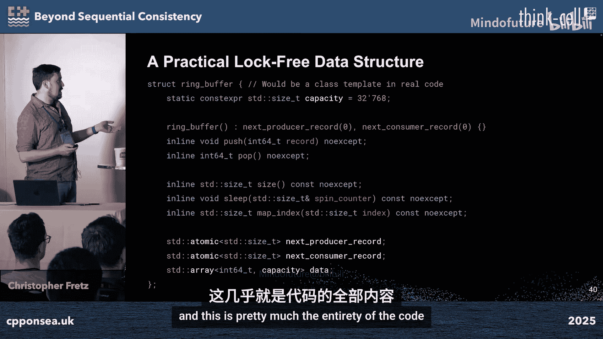

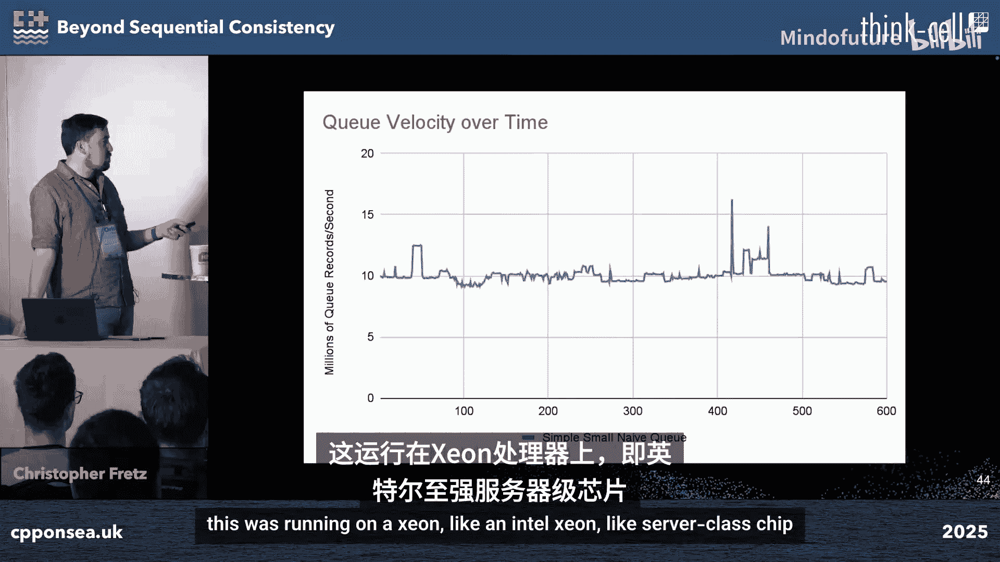

bad we should be able to go substantially faster。 Like why is this so bad What gives。

 And if we actually start looking at the code itself here， This is where compiler Explorer came up。

 But if we start looking at the code here， we can actually get a disassembly and it's really nice because the disassembly is actually super like easy to read in this case here。

 So up here， we load our two indexes for the producer in the consumer。

 we subtract them to get the Q size， we then compare against the size of our queue。

 if they're not equal， we jump into the production section。 otherwise we go into our nanoleep。

 and for the production section itself。 So the way this is written right now。

 we actually load the producer index a second time because sequential consistency requires that but we then just bit maskask it here to lo off the high bits and mod it into our array。

 we then actually just store it into the queue with a move instruction and then we have our lock ad。

 which is our pre increment on the producer index。 and then we just increment for the next。

The consumer is essentially exactly the same。 The main difference here is that now instead of subtracting。

 we just compare these two records directly if they are equivalent。

 then that means that what do you call there's no data in the queue So if they're not equivalent we jump to the consumption section which does the exact same thing it rereads the consumer index maps like masks it moves the stuff out of the queue and then actually increments the sorry increments the consumer index and then this comparison is actually our assertion check because all of this stuff gets in line and so if we look at this code here。

 like it's like add move comp like jump not equal like we have conditional branches we have move instructions。

 we have bit masks there's not anything terribly interesting happening in this code except for that lock a and so the only potential bottleneck in this code is the lock ad instruction like that has to be where this is coming from and so lock a is a read modify right instruction and issues a full memory fence。

What this means here is that when when we run that op code there。

 this has to load the value from memory， it has to then increment it and it has to store it back and all of this has to happen as a single atomic step essentially like it cannot be possible for any other part of the system to read an intermediate value here so we have to there's a reason that this is called lock like it has to actually lock the cache line that that this value exists on to be able to accomplish this and so do we really need this is this actually required by our data structure here so since we're using the default API on the atomic which is to say we're using pre increment we're implicitly requesting full sequential consistency and yet by using the pre increment operator。

 we are implicitly requesting this read modify write or fetch ad but the thing is is that the producer and the consumer are individually single threaded like there' are separate threads like the data structure at large has to handle the fact that it has two threads hitting it at the same time but from the perspective。

Of the producer or the consumer， there is no contention like they are individually single threaded and so like the only reason that we would need a read modify write like that is if somebody else is trying to hit the same index at the same time。

 and they're not and so like our access pattern here actually does not require full sequential consistency and we can actually avoid both And so if we slightly reorganize this code here。

 so we've now actually like refactor this into an explicit load to we then have this has space function here。

 which just does a load to acquire on the consumer record and then just diffs them to get the actual current size we store back into the queue and then the store here is actually an explicit store release that's done here。

 if we look at consume， it's again almost exactly the same。 it's just the opposite。

 so has data now does a load to on the producer record and subtracts the two to find out if there're zero or not and again the actual store into the consumer record here is done with the memory order release so。

Instead of like， you know， the plus plus is really nice in terms of like pretty code。

 this doesn't look as nice。 But this is a lot more explicit about what we actually need out of the implementation here。

 And if we look at the generated assembly for this。

 So the compiler got really aggressive in terms of reordering once I did this。 So it's interesting。

 This code in the actual program comes after this code， it actually reverse the order of it。

 But we can see that we still have roughly the same thing。 So we're loading the producer index。

 loading the consumer index， subtracting them， doing the comparison and then down here。

 this is the interesting bit。 so。😊，This line right here is incrementing the producer index。

 We then store it into the queue and just we're done。 Like there's nothing else here。

 Like you can see there there's no lock a in this case here。

 This is all move subs comps conditional branches and stuff like that。 And if we do this。

 this is what we actually suddenly get。 And so we've gone from roughly 10 million operations per second up to about 170 million。

 which is like astounding。 you can see it's like super noisy。 It's bouncing all over the place。

 but that's like almost a 17 x improvement just by like changing around a couple lines in our program。

 So like that's pretty awesome。 Yeah， and so the new code has literally zero atomic instructions or fences on x8664。

 which is very cool。 at 2。6 gigHz170 million records per second is roughly 15 cycles per record。

 It's actually so good that I was little suspicious to start with。 But like I have disassembled this。

 We're looking at the real disassembly like it is definitely doing the thing。😊。

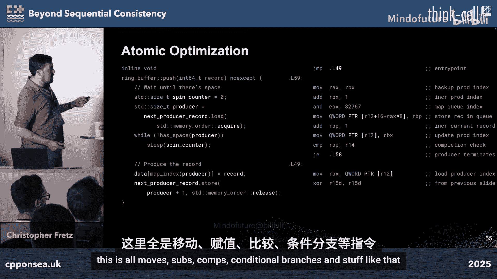

This case here， the test machine has 32 kilobytes of L1 cache and a megabyte of L2 cache this queue contains only integers and so the entire thing fits into L2 and about an eighth of it fits into L1 and we have like an extremely predictable access pattern here we're just scanning over this array over and over again and so I think this does actually make sense This queue is too small to be realistic。

 but it kind of shows what what the hardware is actually capable of can we still go faster that's always kind of a fun question and so this is another G image The idea here is that so we got a brother and a sister that are both trying to do their morning routine The brothers got to do his hair and the sister has got to brush or teeth。

 they're completely unrelated operations they have nothing to do with each other。

 there's no overlap in terms of the resource there's no overlap in terms of what they actually do but there's only one bathroom and so they have to wait on each other and so the tagline here is separate routines shared resource false sharing slows everyone。

And so the issue here is the way that we've declared these two records down here。

 This also came up during the inter processs communication talk earlier this morning。

 but the issue here is that so the size of this atomic is8 bys So we just have 16 bys here and the right next to each other in memory So they're almost definitely going to end up winding up on the same cash line。

 And so yeah， the current memory layout packs the producer and consumer index directly next to each other。

 and the problem here is that different cores are going to end up fighting to modify the same line concurrently so for most memory subsystems cash lines are the minimum granularity And so the problem here is so for Intel chips at least there's this thing called the messy cash protocol stands for modified exclusive shared invalid it controls like the state transitions that the individual cash lines go through。

 And so the problem is is that we have the producer running on one thread and the consumer running on a different thread when the producer increments its index because it falls on the same。

line is the consumer the producer CPU is going to have to invalidate the cache line that the consumer CPU has。

 And then right afterwards， the consumer is going to have to do the same thing。

 And so these things are going to end up bouncing this cache line back and forth fighting for exclusive access to modify these indexes there is actually a thing in standard C+ plus that exist to try to solve this hardware destructive interference size and so what we can use here is if we declare at the top here。

 we can just add a nice little like context per cacheline size here we can actually go and add an align as specifier on these to guarantee that these indexes fall on separate cache lines so it's now guaranteed that both of these things have to be aligned to a 64 byte boundary which is the size of the cache line on this particular CPU and so they're now implicitly both occupying 64 bys of memory in memory and so we now know that they're going to fall on different cache lines。

 and if we go ahead and actually just by adding this a line as specifier and nothing else we then get this。

So we get about like another 20% performance di or something like that just by adding the align as specifier this is now averaging something like 220 million opts per second which is pretty awesome so overall here including the align as specifier there is a huge difference in this particular case here when using different memory orderings like I said before this queue is too trivial to be realistic currently but how can we make the benchmark more realistic how can we find out if this is actually a durable effect that continues to manifest over different orders of magnitude the first thing that we would probably want to do is see how the performance trends as the data gets larger because right now we're just moving integers so like we're not really doing a whole lot of work so this is my naming is probably not super great this big fast queue here this is the one that is aligned and has the memory ordering optimizations and then the naive queue here is the one that is just straight sequential consistency and at 64 means that we're now moving 64 byte records。

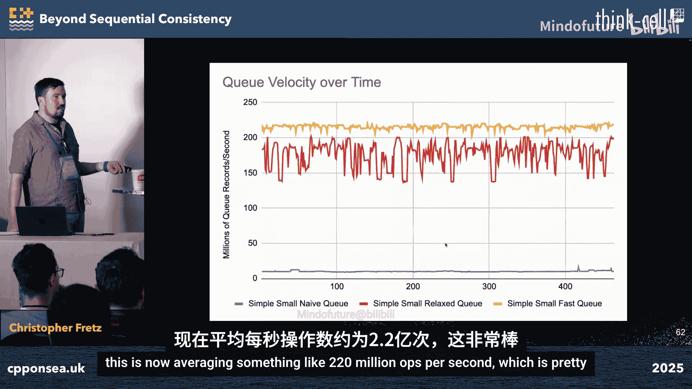

So at 64 bytes， we are still locked to 10 million for the naive queue and we're at about 70 million。

 so about 7x improvement at 128 we're still locked to 10 million for sequential consistency and we're somewhere around 50 million for the fast ones about 5x we then go down to about2 x for 256 bytes we are still locked to 10 million records for the naive implementation and if we jump to a full kilobyte then we finally find that the memory copies become more expensive than the actual synchronization itself but even in this case you can't really see it because of the scale of this diagram but the memory order optimized version is running at about 4 million ops per second and the sequential consistency is running at about 3 million so you're still getting like 3025。

30% improvement just off of the memory orderings themselves even at a full kilobyte and so even at substantially larger data sizes the performance diff is durable you have to go to a full kilobyte before the copy is the dominant。

Fact over the synchronization And even in this case， we save 25，30%， which is pretty cool。

 How else can we make this queue more realistic。 And this is where we get into the mcast queue that that I was mentioning before。

 So right now we have a single producer， single consumer queue know it's just passing data between two threads。

 but how can we make this more realistic。 so what I call like a work queue。

 which I think is what people traditionally think of in terms of a single producer multi consumerser queue is a cu that divides data between a pool of cooperating thread。

 So it would be something where like you have a workpo you have like I don't know some nicely embarrassingly parallel algorithm that you need to run。

 you have a producer that just throws pieces of work into a queue and then you've got some number of threads that just like you take like one thread you have a division here where each data record goes to a single thread that then goes and operates on it a broadcast。

As you by contrast， all consumer threads receive all data and so in this case each consumer maintains its own individual Q index and this is really useful in workflows like semantic analysis。

 intrusion detection classification situations where you have to we many different things need to be done on every single data record so like the specific example that I was using at the previous job we were doing semantic analysis like we started with semantic analysis than we were doing log processing。

 but situations where we're running you know tens or hundreds of different classification pipelines on every single data record that comes in and so it works very nicely to kind of expand out and broadcast this data to all of those different threads you can kind of think of it like Kafka except it's entirely in memory and lockfr so you have different threads that maintain their own indexes and receive all data across whatever topic you're actually receiving data from。

But multiple consumers adds a new problem， which is like how does the producer know if the queue is full。

 because there's now many different indexes that it needs to look at this morning。

 the solution was either that the producer doesn't care and just overtakes the consumers。

 which is one way you can do it The other suggestion was that there was like a special consumer and that one's supposed to be the fast consumer and we only look at that one。

 The solution that we've taken here that I took at the time was to add a new thread whose job is to identify the slowest consumer。

 let's call this new thread the collector And the idea here is that the collector continuously observes the consumer indexes and tries to find the slowest the slowest consumer or the consumer with this lowest index。

 which it records as its own index and which becomes the edge of the new circular buffer。

 So the producer now compares against this collector and the job of the collector is to constantly find what is the slowest consumer in the queue。

 So we still have。Garante in this particular case here， the producer never overtakes any consumer。

 so every consumer still receives all data， but it only compares against the collector index。

In terms of what this actually looks like here， so this like gold kind of outline here is supposed to be the collector we have two consumers in this queue right now and obviously a single producer and so you again these things kind of move from left to right so the collector is looking at C1 looking at C1 C1 now overtakes C2 in the next one and the collector still identifies the slowest one and the producer always checks against where the collector is in the queue so that's kind of how this data structure ends up working in terms of extending the code that we had it's a very straightforward modification so in this case here we now have this slowest consumer record which is our collector index and we now have an array of consumer context here instead of a single one this consumer context is just a struct that is again aligned to the cache line size and just like declares a nice little atomic inside of it that is its individual consumer record。

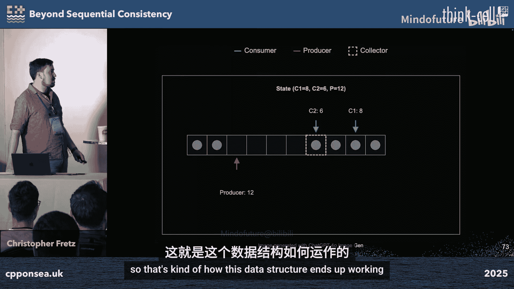

And then we still have our primary data array below and so this is and then we also have this collect function here。

 in terms of the collect function itself， it's very straightforward。

 we just like start with like numeric limits， max sized tea and then we just spin over all the consumers to actually figure out which one is the slow。

 just whatever is the lowest value that we see we take that and then we store it back into the collector pointer here or the collector index So the producer knows where it can actually go to。

 And the thing that's interesting here， you can see that we're issuing a relaxed load on all of these things。

 This is one of the things that's nice about the fact that we have this guarantee where the indexes can only ever increase because the collector it doesn't actually matter what order the collector reads these in it doesn't care at all because worst case scenario it is just going to pick an overly conservative estimate like you know say that it doesn't receive some update from some consumer。

 it doesn't really matter because the consumer could only have moved。

Forward and so it's just gonna to pick a value that is too conservative。

 and so its still guarantees that the producer cannot overtake any of the consumers and it makes this very nice and lightweight。

 Yes yeah yeah no it' Matt is very correct that guarantee helps us here because again。

 the assumption here I said before these indexes monotonically increased and the question that was asked is that it's hard to remember the question that was asked here is basically that we're calling back to the fact that the fact that we're loading this with relaxed ordering and this works comes down to this is a case where that modification order guarantee is actually useful the fact that even though like in terms of reading all of these consumers together。

 we have no idea how they relate to each other， it's kind of junk from that perspective but it's guaranteed that we can never read an older value than we previously saw And so yeah that that works to our benefit here。

 but it is nice because otherwise the collector really doesn't have to care about。

AnyIt just spins over the consumers and just looks at all of them。

 So the question is what happens if a consumer gets stuck。

 What happens if a consumer is not regularly moving forward in the queue Yeah。

 the entire queue blocks so that's one of the things where there's a couple there's a couple different ways you can try to do this this particular queue refuses to ever move forward past any consumer in practice for a production version of this queue what we ended up doing at the time essentially is just that we would have a watchdog process that would essentially just observe the queue if there's ever a consumer that got stuck for more than I don't know。

 pick a number out of the air 50 milliseconds or something like that just till it it's dead it got stuck but yeah。

 one thing that does generally come out of this approach of not ever allowing the producer to move beyond any consumer is this convoy effect where the slowest consumer will actually dominate the overall velocity for the queue And so this does require that things are kind of relatively equivalent kind of computational。

Papity to make sure the queue moves nicely together other ways that you can do it is as was mentioned before。

 just allow the producer to overtake the queue of the consumers and have the consumers detect if they've been left but yeah an actual practice what we would do is just eject the consumer if we found that something was too expensive but that's a very good question Thank you Yes and I'm sorry the question again was basically could you have the producer do the collection action itself and you certainly could you could have the producer run the same logic you just then have the producer doing things that is not just copying data but yeah any other questions these are good questions。

Yes， yeah， the the question was， have we ever thought about doing anything in a batch。

 So the idea there being basically， you have the producer increment many records at the same time and you have the right。

 right。 So， I mean， you still have to know the fact that there's many different consumers here。

 you still have to be aware of what the individual consumer states are Yes，Right。

 maybe we should talk more about that offline。 I'd be interested to hear the idea。 Yeah。

 because we have had situations where we allow the producer to in queue a batch of records all at once that get de queueed simultaneously。

 But even in that case， we still needed the consumer at the time。

 I'd be interested to talk more more after after the talk。 But cool， awesome。

 Any other questions from anybody。 this is really good。😊。

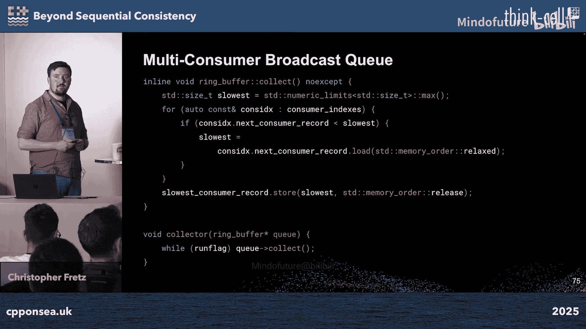

Cool， awesome。 And I will fix that。 I'd like to find out what happens。 But cool。 But yeah。

 so if we do this with multi consumerser queue， this is what we end up getting here。 So again。

 fastq relaxed queue naive queue。 My name is S。 But these are with8 threads each。 So let's see here。

 So this is millions of Q records per second。 So this is across all of these threads。

 So obviously we have 8 threads and in aggregate， we're doing something like 120 million per second。

 as we go to 16 threads。 this is what we see32 threads Even at 32 threads here。

 we're going from about 10 million up to over 50 million。 So we're still getting like and again。

 this is8 threads on both sides here。 So we're still getting about a 5x improvement on this one。

 And let's see one thing that's really interesting here。 So going from like sorry， actually。

 I'm looking at the wrong thing。 I'm misreading my own numbers。 these are the relaxed ones here。

 So yeah， the naive queue is like sitting down。😊。

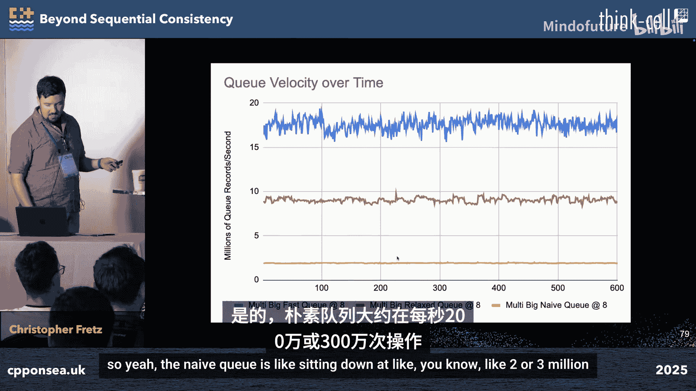

like like two or 3 million ops per second or something like that。

 So this first one here is like 50 to 100 x。 But what's interesting here is that now that we've thrown in a huge pile of threads this relaxed bit here。

 you can see the diff between the relaxed to the fast used to be something like 20% now in this case here we're getting 10 million to 50 million。

 So just the difference in the false sharing itself here has now become a very substantially dominating factor because we've thrown more threads into the pool。

 And so that starts to show that like as you start to add more and more threads that issue of threads fighting over cache lines really starts to become very substantial And yeah the naive queue its all the cases are superimposed over top of each other because they're just all the same thing。

 so the question again was am I using CPU pinning for this benchmark I was not pinning individual CPUs but I was ensuringuring the machine that I was running on had two sockets and twoneummen nodes So I was ensuring that everything was pinned to an individual。

Numman node to make sure that we weren't getting cross Numma memory accesses。

 which would have add a lot of noise to this， but good question any other questions from anybody。Yes。

 this The question again was the fact that we're not getting any memory fences or atomic instructions emitted。

 does it mean that the stood atomic like acquire release stuff is basically just a hint to the compiler in the case of Intel essentially。

 yes， but yes， the question is， how do I guarantee atity。 Why am I using power of two here。

 the reason that I'm locking these cues to a of a size that is a power of two is simply to make the mask instruction itself is cheap as I can。

 So the problem is that I don't know how many slides I would have to go back for this but is it worth it。

 No， it probably wasn't worth it， but I started doing it boy。

 really a long way I should not have done this， so the issue here is for this map instruction here by making this a power of two I can this is just this is a bit mask。

 It's just an and instruction， which is like the cheapest possible thing a CPU can do if I was making this an arbitrary number that was not。

a power of two， this then turns into a modulus， which is a division and division is like orders of magnitude more expensive than a bit mask。

 And so like that's the reason why I'm going with the power2 specifically just to make the actual mapping into the queue itself is cheap as physically possible but good question the question is I chose the 15th power of two to be the size of my queue in an actual real worldorld version of this you would make that like a template parameter and you would have that be configurable in my testing for this particular benchmark like on the specific machine that I was running it on and the synthetic load that I was using where I was just throwing stuff in and throwing it out if I changed it if I went higher or lower。

 the performance went down like the larger the queue gets the worst caching performance you're going to get and the smaller the queue gets if if the consumer gets descheduled and the producer runs out of space it's going have to stop and so you're kind of balancing between making sure that the queue is large enough that the threads can be。

lightly desynchronized with each other without having to stop while also balancing the fact that bigger the bigger that you make the queue。

 the more cash pressure there was going to be but so in my experimental testing for this particular use case。

 15th power of two is the best number that I found in an actual real worldorl application where you don't just have threads that are just hotly spinning on the queue over and over and over again。

 you may want more space just to make sure that you have more buffer， but you a good question。

 thank you。Any other questions from anybody？Alright， sounds good。 A。 So， yeah， interesting thought。

 And this is getting into what I mentioned before with the required release optimization。

 This code now issues 0 from time memory fences。 Like， do we actually need statomic。 Like。

 what is what is it doing for us And what happens if we drop it。

 And so here we have undefined behavior Q。 do not use this。 Yeah， so everybody's favorite thing here。

 I am now synchronizing via volatile。😊，So everybody loves it。 But yeah， so it's otherwise the same。

 I've just dropped all of the stood atomic。 and I'm now using volatile。 I've been asked before。

 why am I using volatile。 The answer is I don't know。 Like it's it's already U B。

 I'm just trying to encourage the compiler to not break my code。

 And in terms of the push implementation。 So this is exactly the same。

 I've also dropped this atomic signal fence here。 This is what I was talking about before。

 this is a compiler barrier。 I actually don't even know。 Well。

 if I had marked this whole if I had marked this whole array volatile。

 I probably wouldn't even need this because the compiler can't reorder them。

 But I have the signal fence there just because it's fancy。

 And it guarantees that the compiler can't reorder these two things because otherwise right now。

 since this is not volatile。 I think the compiler could decide to reorder if it wanted to。 But yeah。

 so this issue no runtime instructions。 This is purely a compiler fence。

 And the implementation is exactly the same as before。 It's just again。😊。

And this actually has to be written this way with like the separate plus equals because it turns out that plus equals on volatile and plus plus un volatile is deprecated。

 So getting warning。 So it has to be done like this。 But yeah。

 it's the exact same I've just ripped out all of the atomics And if you run this thing。

 you find that you actually get the exact same performance and it does actually work。

 which is kind of entertaining And so like it does work and the performance is identical So like if we actually compare the assembly it yields essentially the same code Jen。

 And so have we shown that atomic is unnecessary。 Well。

 so what happens if we try to run this exact same code undefined behavior queue on this laptop that I'm currently presenting from。

 if we try to do that， we find that it immediately explodes。

 So it's one thing that is nice is to find out that our assertions do actually work。

 but it's but yeah， this just immediately asserts and dies if I try to run this on arm。 And so like。

😊。

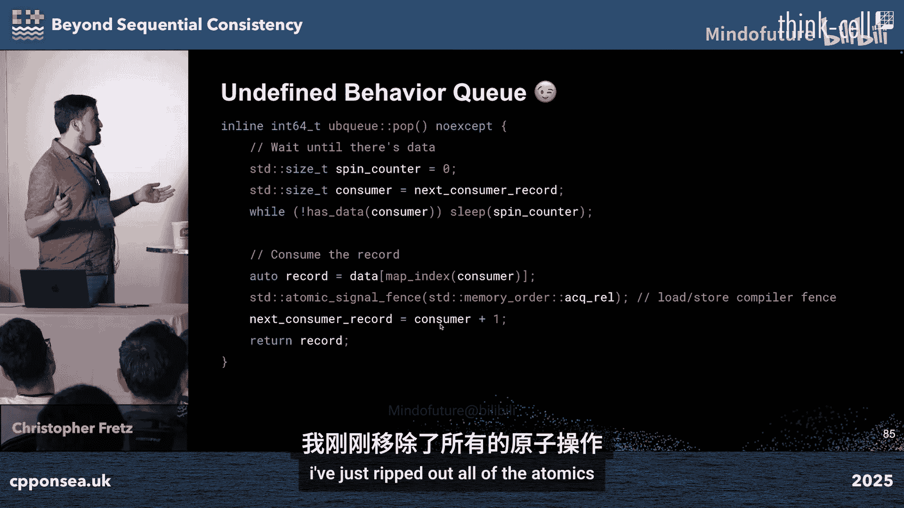

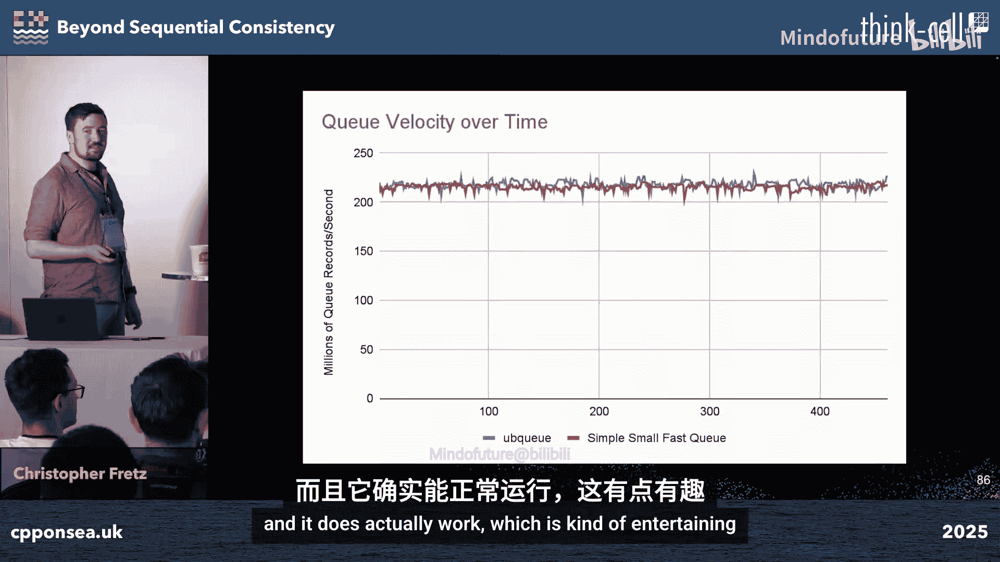

Yeah， good to know that assertions work But like what went wrong Why does this work on X 8664 but not on arm 64 with the exact same code so it comes down to platform guarantees so from the Intel X 8664 architecture specification neither loads nor stores are reordered with like operations stores are not reordered with earlier loads loads may be reordered with earlier stores to different locations Store are transitly visible and stores were seen in a consistent order by other processors so it's a whole bunch of text what it basically means is that Intel X 86 just implements acquire release like natively like on X86 acquire to release semantics are just essentially free because the platform is so coherent by default this is not true however。

 on more weekly ordereddered platforms like arm and power PC and so even though all of this stuff is academic and totally a no op on X 86 it is not on arm arm required。

😊，Explit load acquire and store release op codes to accomplish the same behavior。

 And if we actually go and use compiler Explorer again to get a disassembly out of this。

 it doesn't really matter too much。 I'm not going like I'm not going to read over all of it。

 But what you can see here is is that when we store the producer index we have this STLR store release and when we actually load the producer index and the consumer index。

 we have this LD are load acquire and so these op codes are actually adding implicit runtime memory fences to make this work and so if we build this on arm without using satomic these memory fences do not get issued and the code blows up And so like so we have an idea that we are missing fences but like what actually matters here。

Yeah， the fence instructions are missing， but why do they matter。

 Why do we actually need those fences。 Well， so let's think about what actually matters here。

 Does it matter if the producer reads the consumer's operations out of order。

 Like what would that even mean from the perspective of the producer， the consumer does one thing。

 like the consumer's job is that it has to read the data before it increments its pointer。

 But from the perspective or its index， but from the perspective of the producer。

 the consumer does one thing， which is increment its index。

 So it can't possibly read that out of order。 Does it matter if the producer reads the the collector's operations out of order。

 again， no， like its if it reads the collector's operations out of order。

 it's just going to take an overly and overly conservative estimate。

 Like it's just not going to see an increase that it could have seen and it's going to deduce to the queue is fuller than it actually is。

 But does it matter if the consumer read the producer's operations out of order。

 And this does matter。 And so specifically。It's this little， it's this little bit down here。

 So the problem is， is that we store into the the queue， we store into the data array。

 and then we increment our pointer， and it has to happen in that order。 And so the problem is。

 is that if it doesn't happen in this order。 we get this weird。

 bizarre situation where the consumer sees the producer move forward before it sees its queue updates。

 And so。Yeah， with the release fence on the producer side and the acquire fence on the consumer side Without that。

 the consumer can see the producer move forward before its queue updates are visible。

 The consumer then reads junk from the previous iteration。

 and stood atomic ensures that we always get the correct behavior on all platforms。

 And what I was actually seeing， which is especially indicative of what's going wrong here。

 is that every time this assertion would fail The expected value would be off by exactly the size of the queue。

 And it's because it was reading the it was reading the the update from the previous iteration。

 So you， you need the fences on arm to ensure that those two things happen in that specific order。

 And that's why needs to be a store release here and the load acquire on the consumer side is particularly important to make sure that these things are actually observed in the proper order。

But cool。 so if we do this on this particular laptop， this is not a server grade arm chip。

 unfortunately。 So we really can't directly compare these two things。

 I don't know that it would be meaningful to do so。 But this is what we see on on Mac O。

 so with the let's hear the sequential consistency version up to the fully aligned version。

 we still have over a 100% improvement。 So it， it still makes a very substantial difference。

 even at 64 byte records。 And I with this one， I just dump directly to 64 to show that it。

 it bears out even at large data sizes。😊。

But cool， awesome So one oh so I have good question yes so the question was at what level does the reordering happen on arm and the answer is is that the memory subsystem itself。

 the processor itself gives different guarantees like one way that you can think about it is that on Intel you're always paying for a acquire release because like the platform just gives that guarantee you remember that whole big slide with all the guarantees that you get on X86 arm just does not guarantee those things and so like the memory subsystem itself just exposes you to more exotic types of orderings than you would see on X86 and so the specific bit here it's these op codes here so like the compiler is prevented from reordering it but even in the previous example with the signal fence in place。

 the compiler still couldn't reorder it it's actually the runtime fences that prevent it Good question。

Are there any other questions from anybody？Yes， oh， that's interesting。

 So the question was is that apparently address sanitizer can't deal with atomic。Sorry。

 thread sanitizer， yes， thread sanitizer cannot deal with atomic signal fence that so that's。Oh， oh。

 okay， it can't， so let's see here， so you're not talking about where did I have this comm on？

You're not talking about we'll get there eventually this thing。

 and you're not talking about this thing。Oh， like that actually issues that's right。 Yeah。

 So I forget I guess atomic thread fence is the name of it。

 There's a version of this that just issues the fence directly without any of the surrounding st atomic machinery。

 So unfortunately， the answer on that one is that I've always been using for this for the purposes of this talk。

 I was either using Statomic or not And with this one。

 I didn't even try to throw this into thread sanitizer because obviously it was gonna blow up unfortunately have not encountered that myself。

 So I don't have an answer for you。 But that is really interesting。

 I had not heard that certainly I would hope that thread sanitizer would support everything in the STL。

 but that is interesting to hear And the question was without actually having what you call it the fence instructions。

 What does this look like what does this look like on the processor level， essentially。

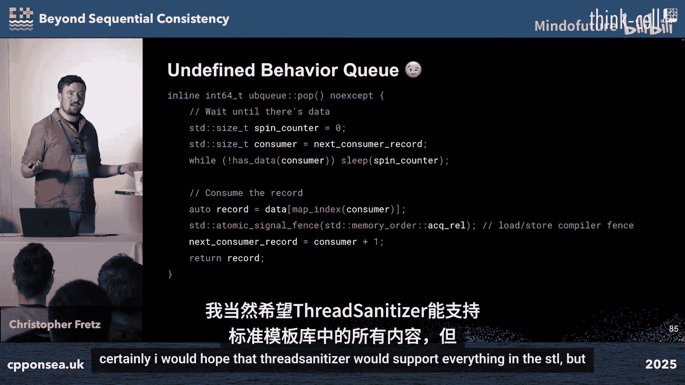

CoSo on X86， it's fairly implicit。 So like you still have this guarantee of like for a processor to be able to modify a cash line。

 it needs to have exclusive access to it。 So in terms of what that actually looks like the individual CPU have these load and store buffers。

 And so like if processor wants to modify something that it does not line that it does not currently have in the exclusive state。

 it has to broadcast， I think it's like I forget what it is called。

 but it's like a lock for exclusive ownership or something。 read for ownership。 there it is。 Yeah。

 exactly， it has to broadcast that out to all of the other course to say this is now mine Now what's interesting is that that goes into the load buffer for the other CPU。

 And so it takes some time for them to be able to see it。

 And what the fence is really control on X 86 and mine understanding is the flushing of the load and store buffers so that that becomes immediately evident like as part of the instruction itself。

 Like if you have like a lock that forces it forces。

Fluush of your store buffers and it forces a flush of all of the other load buffers across the machine so that all the cores see it at the same time without having the fence you don't have that flush so the other cores will see it eventually。

 but they have to get to it essentially but yeah so the question if I understood it correctly is how do we deal with if we want to actually add consumer dynamically and just not have them pinned like I've been doing in this example so that is actually how the real version of this data structure used to work the answer is that at the time we had an atomic bitmap so basically we had a registration process where when a new process would come up it would actually go through like an allocation process where we had a threadsafe bitmap where it would actually basically grab it would register for a particular consumer context essentially so it would do an allocation into that bitmap that would then tell what index in the actual consumer array is mine and then that would be the one that it would go and use but it's a good question Thank you。

Any other questions for anybody？Cool， awesome。 So the final optimization。

 this is one where to be honest， I originally was thinking。

 like perhaps this was beyond the scope of my talk， but it was just really cool。

 So I decided to include it anyway。 doesnn't have anything to do with memory orderings。 but so。😊。

Further research encountered a paper that I've linked to here well publish these slides。

 but basically this actually suggests further optimizing the cash performance with the introduction of cashd indexes for both the producer and consumer and so this adds an additional cash aligned index for both the both the producer and the consumer that hold a previous snapshot of the opposite index。

 So that probably sounds kind of confusing will get into it but what's crucial here is that the cash copies are updated only when the producer or consumer would otherwise need to sleep because they have no work。

 And so this resolves the final remaining cause of cash cash misses for this simple cu And so this is what this looks like So ignore this is a bunch of junk up here but what's important here is that so we have this next producer record and then we have the producers we have the consumer cash for the producer we also have the next consumer record and the producer cash for the consumer and so these actually。

Would not even need to be st atomic That was actually There was actually a screw up in my slides。

 Yeah So yeah， the actual version of this that I benchmarked。

 these were not statomic When I put it on my slides， I screwed that up。

 that 1 I know actually I did benchmark properly。 But so the interesting thing here is that so like the producer is only is going to exclusively work on these records as much as it can。

 and the consumer is going to exclusively work on these indexes as much as it can。

 And so what's cool about this is that like so you can imagine when the producer first comes up。

 it finds that there's like tons and tons of space。

 and it knows that the consumer is sitting at index 0。

 But when the producer eventually fills the whole queue and it says， oh， dn， there's no more space。

 then it goes and reads the consumer and updates this cash。

 And the consumer does the same thing with the producer。

 And so they only hit the other index when they actually need to。 And when you think about it。

 this makes a huge difference because otherwise， even though we've resolved the false sharing issue。

 because of that modified exclusive。😊，Shared and valid situation。

Any time that the producer has to look at the consumer index。

 it's going to take an L1 cash miss because like the consumer will have updated its value。

 So like you know the producer will look at the consumer index。

 it will have to load that cash line because it will have an invalid copy it will have to load it from the other core work with it and then it turns around and does some stuff comes back and the consumer will have again invalidated its cache line because it's off doing stuff。

 And so you still have a situation where the cores have to keep fetching know through like the Incore fabric because of the fact that these things keep invalidating each other。

 And so this is the original version that does not include this optimization。

 And so you can see we're getting about this was actually in terms of L1 dc misses this was actually a lot better than I was expecting。

 But what's interesting here is that we're getting 32% like last level cash misses。

 So like whenever we exit out whenever we hit the last level cash if we miss an L1 the amount of times that we go to actually miss if we hit the last level cash is a third of the time。

And that's like super duper expensive if we take the version of it that adds the individual cash variance。

 this is what we get And so you can see that the L1 accesses misses did actually go down a little bit went down by like 1% but it's L1 that's gonna make a huge difference but in terms of last level cash misses we go from 32% to 0。

001% and you can actually kind of see the difference here just in terms of the total L1 d cash loads we go from about 29 billion up to about 87 billion and you can see that the two things are running for almost exactly the same amount of time so we're going a lot faster here and what we end up seeing I couldn't even believe this like almost like choked on my food when I was benchmarking this because I expected it was going to make a difference but I did not expect it was going to make almost a 3x difference and like the numbers that I was getting on this were already so good I could barely even believe it that like this really made me wonder if I had a problem but I disassembled the thing and like it is doing the work。

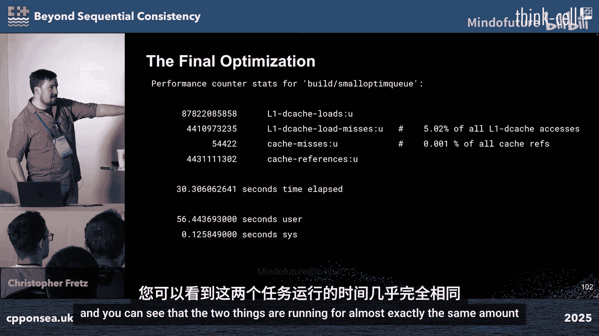

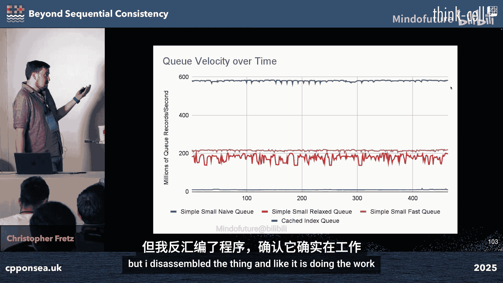

So it really does seem to be just the diff on the cash performance itself。

 This really seems to remove essentially all sources of cash misses for this synthetic benchmark you do have to be careful with making too many conclusions about this just because like a real worldorld application is not going to have this pristine of a cache like ever it's going to be doing other things but in terms of this kind of situation where this is also working on integers in this benchmark in this situation where we're working on very small data this makes a ludicrous difference in terms of the actual performance what we can see though so in this case here this is working with 64 byte records so this is the fast queue versus the cache index queue at 64 bytes it does still make you know like 2030% difference or something like that but as we start to make the data larger and larger the effect decays away like it really makes a difference for very small data。

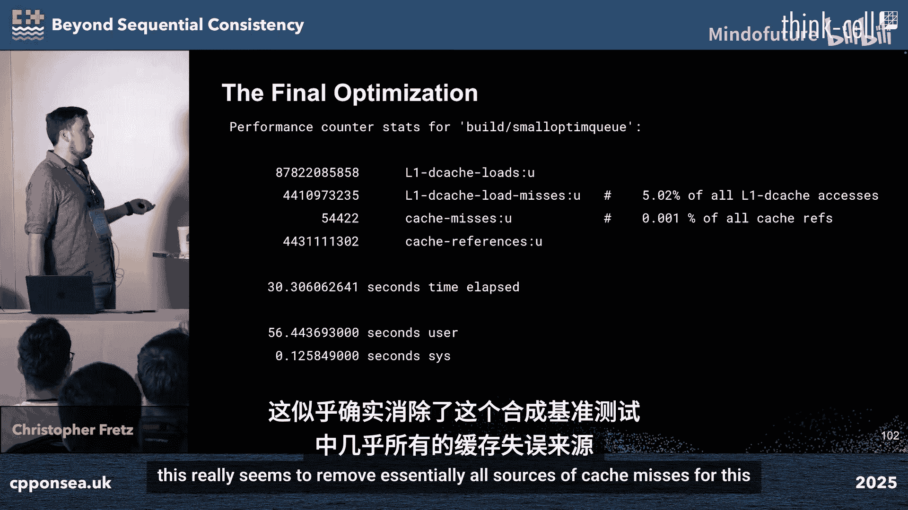

worldd use case of this might be something where you're passing pointers through a queue because that's going be the same size of60 as a 64 bit int I think practically speaking it's still going to be pretty difficult to actually capitalize on this because again。

 if your program does anything else probably this caching behavior is going to fall apart。

 but we have a question。

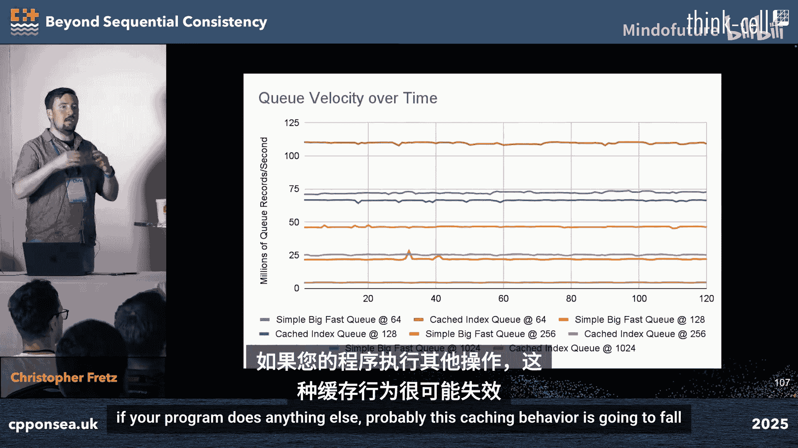

the main thing that I'll say that the observation from that is that doing it with the cache indexing here may actually be kind of logically equivalent to the batching that was suggested before。

 which definitely means that I should look into that as well。

 But yeah I found this to be extremely interesting just because I never imagined that this was going to be the result that I was going to get in real worldor code。

 like I said， I think it's probably going to be pretty difficult to really take advantage of this of this level of performance just because like at 600 million operations per second。

 it means that we're averaging something like four cycles to like move something in this queue and at that point you do literally anything。

 It's going to be the bottleneck。 So but it is very cool to see So yeah I was amazed by this for small queue sizes specifically。

 the optimization makes a massive difference。 Yeah， our queue is passing integers。

 a real world use case would be pointers Des as data sizes get large。

 It never seems to perform notice。

Wor in my experience。 and the interesting thing here。

 So now this may be because they did the work and discovered that it just doesn't matter for real-world applications。

 but this optimization does not appear to be implemented by either folly or boost so kind of interesting but cool。

 so in terms of final caveats and wrapping up As I said before。

 this is a data structure that optimizes particularly well in this particular case here。

 the performance is massive because the data structure is so naturally well aligned with a choir release semantics。

 like in this case here， it was possible to get us down to zero atomic ops on X86 that is not always possible。

 like there are a lot of algorithms where just a compare swap or a fetch ad is just fundamentally necessary and there's no way around it but in this case we don't need it。

 another thing to be aware of is that on X86 like with X86 it's kind of all or nothing in terms of synchronization there's not a whole lot of nuance And so fetch add and compare swap on X 86。

Always require a full fence regardless of what you ask for。

 And so that's that's something that you do have to keep in mind。 But benchmark。

 because it definitely always will matter。 in terms of other surprising results So the cache lines on M3 MacBook are 128 by long。

 which I had not seen before。 but the weirdest thing and I can't explain this is that the the optimum memory alignment in my testing was 64 byte and I have no idea why that doesn't make sense to me the other thing that I discovered is funny because it was mentioned in the talk earlier today that there is now a version of Apple Clang that does have hardware destructive interference size。

 it just returns the wrong value Well， maybe yeah， exactly， yeah， Yeah， because the Internet。

 it was just a Google search that told me that Maxs are 128 by maybe it is 64 because yeah。

 my testing was that 64 like 128 was always a pessimization in my testing but at least on the version of Apple clientang that I have right now。

 I don't have hardware destructive interference size。So I just had to pin it。 But yeah。

 in terms of conclusions。 using the right model for the job can make a massive difference。

 It depends on your use case。 performanceance can be hard to reason about。

 sometimes it yields surprises。 The standard memory models do an excellent job of ensuring that you cannot write better yourself。

 This talk originally， I originally started working on this talk because I knew that I could get it to work on X 86 without statomic。

 But then I discovered I could get just as good with st atomic。 And so there was no reason to do it。

 But yeah， relaxed atomics can be difficult to reason about。

 but can be worth it in the right context。 And that's everything I got。😊。

