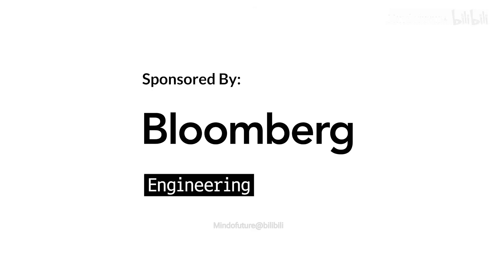
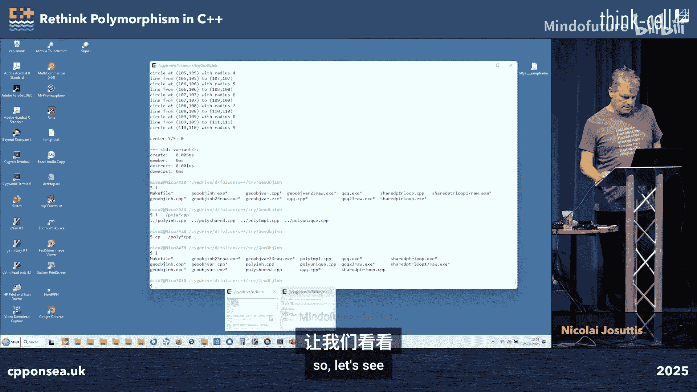
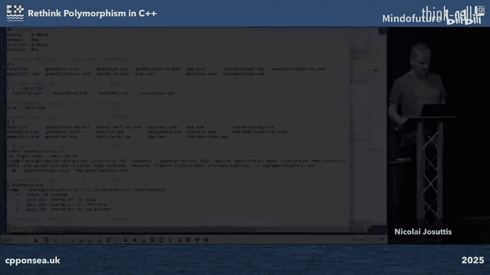
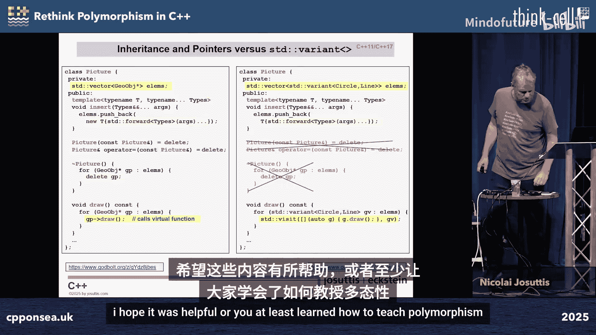
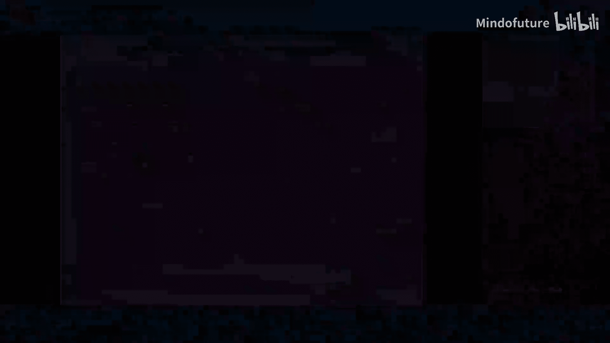

# 【Cpponsea】C++-On-Sea-2025大会-p05-P05_重新思考_C++_中的_多态性-尼古拉_约苏蒂斯_2025--BV17V4GzjE6p_p5-

Good morning， everybody。 Good morning。Good afternoon。 Good night， everybody online。

I'm getting a little bit nervous。My name is Nikko Yootts。

 You might have heard my name because I wrote a couple of books about C plus+。

And limited of service oriented architecturess。Doesn't exist anymore。And。

So it seems my role is a little bit in this community to describe whatever we be in in C+ class。

 So from time to time， I'm thinking about。How。How should I teach C++。

Because I sometimes give trainnies to begin as。Well， not beginners in programming。

 but beginners and C+ does。 Yes， they still exist。And。So。

I was thinking about what to contribute for this。Conference， and I thought， maybe I should have a。

Review。And you look to polymermorphphy。 So it's not that you will see something very。Creative。

 new of thinking， polymorph。 It's， it's more。 Where are we。Or do we have。

 what kinds of ways to deal with polymermorphence do we have and what are the good and the bad aspects of that。

So， this is more。Looking at basics of C plus plus。So。As we all know， and as we are probably。

 most of us learned。Po发。Well， it's the idea that whatever we do， we find out。At run time。

 what to do correctly， the word polymorphism just means one thing can mean different things。

So if I close something， it， I could close the door。 I could close a file。I could close a meeting。

And so the word close has a polymorphic meaning in a way that it can mean very different things。

 depending on the context。In programming， we have that to say， okay。

Maybe sometimes it's not clear which function we call。So for that， we have virtual functions。

 So we introduce interfaces like here say， okay， I have a base class like geometric object with virtual functions。

 One is a virtual draw function here as one example。 there should probably be more。 Well， in fact。

 this is not a function yet。 just the pure virtual function。 So no implementation yet。

 So just introducing the interface。😊，And virtual deor， deor， which you should always have。

 And then we derive from that abstract face class to have some concrete classes like circle and line。

 And there you really implement what different kind of concrete geometric objects you have。

Having different attributes and having different implementations of draw。 That's it。

So the cool thing we can do with that。 And that is what we all care about is we can program in homogeneous or heterogeneous collections。

😊，But unfortunately， you cannot declare them。To use the base type geometric object directly。

 because you cannot create a geo geometric object。 It's an abstract type。

 You cannot create such an object。 It's just introducing the interface。

 so you always have to deal with pointers or references。

 And as container types like vectors cannot deal with references。 They， we have to use pointers。

 Okay， so we declare a vector of geometric object pointers。

 We can create a line and the circle and we can push them into that data structure into that vector。

 so we put the line。😊，Into the vector， which means the vector refers to the line and refers to the center。

And yeah， great。 We have an heterogeneous collection。

 a vector containing different objects of different types。 in this case， a line and a circle。

 And then we can iterate， And here comes the magic。

 The magic is that we iterate over geometric object point us And once we call draw。

 we call the right thing， which is sometimes the draw function of circle。

 sometimes the draw function of line， How does it work。

 Because we have a virtual there and virtual means， Look， what it really is。

 if we are using a reference or a pointer。 And if you find out what it really is。

 Does it Does it has have its own implementation of draw。 and then take that， please。

 So that's the whole story of that thing。 many other。😊，Object oriented languages。

 implicit always have virtual functions。 but in CB bass plus we made it explicit because it takes time to do so。

Good， so easy。Let's teach that。 But now the problem are。

So let's create the picture in a helper function。 So let's create the vector line into the circle and push back them and return this whole pack vector。

 You see the data structure on the bottom here。 And the problem is that line is circle our local objects。

 we pass out the vector by value， which means it is either moved or got probably moved outside。

 And the problem is with that move outside of the vector。 We point to objects that no longer exist。

 So we are in trouble。That's a fatal run time。Errror and yeah。Good， we have undefined behavior。

 Hopefully， we have a call because there are worse things than having a poum， for example。

 not seeing a call until you deliver to this to your customer。O。So what do we have to do？ Well。

 there are a couple of things you can do。 One of the things is， well。

 let's make sure the local line and circle we introduce into the vector。 It does exist long enough。

So that means beyond the scope of the create picture function。 And one way to do that is， let's use。

Heat memory。 So let's create the objects on the heat。And so he I have here and violet。

 So let's create the object on the heap。And we get back a pointer。

 We push back these pointers into the vector。 And now if we leave the function， we have， okay。

 we have a return value。 And because we have created new line in circle with new。

 they are still there because nobody called delete yet。😊，Good， polymorphic called fall work。And， oh。

 okay， we should not remove the element from the picture from the returned picture。

 because then we have a memory leak。 Nobody will have ever any more access to the object。

 So before we do that。We should say， oh， let me first delete the objects in the vector。

 and then let's remove that。And just to be safe， this， well。So you iterate with the delete。

 and then you remove the elements in the vector。 This is， of course， error prone。

 And there are a couple of things that can go wrong。 By the way。

 you might think here about iterating with the reference to point us when you delete them because why you delete the object。

 you might say once I've deleted the object just because it's still stored them the vector。

 I made sure that I saw they are the nu pointer just in case somebody else。

 maybe from another thread is right now using something like that with the。😊，Necessary caveat。

 of course。 So just to be sure， oh yeah， I forget to call clear or whatsoever。

 So I have made sure that inside my vector， there is a no pointer。

 So I have the first element does no longer exist and point to nothing。Yes， in modern C， but plus。

 we can use an optional or something like that。Good。That's it。 Well。

 this is not solving the whole issue。 We might have expect exceptions。

 So in case we leave the function in the middle， or we just have a return statement there。

 we have still a problem。 So the better approach might be to create to have come up with a clean up picture function that calls delete for all the elements。

 and then we move them from the vector。So let's create picture。 That's clean up picture at the end。

 But still， if we have some。Exception in the middle。 we have to catch every exception and say， well。

 let's clean our picture here in case there's an exception。

 and then rethrow the exception further up。Programmers hate to write code like this。

And begin us especially。So that's， it's a basic problem that in C plus plus， we have no intuitive。

 nice working programming model for in homogeneous collections。Now， you might say。

 I've seen other things。 We come to that， like Che Poos， also。Let's。So， this is。

What you have to program。 So how can we do it better？ Well， first of all。

 we can learn from the A R AI I principle， which says resource acquisition is initialization。

 which means instead of us。Cleaning up memory for objects we no longer need。

 Some else should do that automatically。 There's a nice feature。

 It's one of the most important features I think of C plus plus。😊，Compared to C， for example。

 which is distract us， distract us clean up。 And that gives us a chance to really wrap。

Problems completely so that you don't have to deal with。Cleleaan up with assignment man。

 with copying and so on。So to clean up a resource initialize an object。 that's a method。 So and see。

 you have something like， let's open a file。 And later on， let's close it。

 If you have multiple levels up and some of these levels at the beginning have to open a file later on。

 close a fire， you， you cannot wrap this problem that sooner or later， I have to close the fire。

 except at least when my program should run for a while and not have plenty of open filess left because nobody closes filess。

 But which are temporarily opened。So， in C pass plus， we have the dis doing that。

 So we initialize a class that opens the file and the dis。Closeses it。 so。

 and it's guaranteed to be close here。 That's great。So what does it mean for us？ Well。

 let's introduce a class picture。Lastas picture saying， let's okay， in my， my elements are， yeah。

 there's a vector of geometric object pointers。 We have to use pointers。

 and then let me push back data， and a distractor will then clean up。😊。

So the corresponding code on the right bottom is， yeah， somebody calls new。

To create elements of this picture， then pushes them into this picture。 Well， he also in picture。

 uses a term pushback for that could also be insert or something like that。 So。

 but now this picture can be returned as a whole， and the objects will automatically be destroyed when I leave。

😊，When when the picture gets just right。So no memory leak also anymore on exceptions， because。

It doesn't matter why we destroy the picture because of the end of the scope or because we leave the scope for other reasons。

 we clean up。 Nevertheless， hundreds of problems can occur。One interesting problem is。

 we have a picture。And we copy the picture。 Then two pictures think they are the owner of the elements。

 So we should disable copying to avoid multiple owners， which is not that。It's tricky to do it。

 but we can。Still， here's really something not good。

 which is the place where we allocate memory is completely decoupled from the place where we clean up things。

😊，So the call， it's ir responsibility of the caller to call you。

 and to give me only a pointer to something that was called with new that was created with new。

 So think about you create a line locally here。 And then instead pass with pushback the address of a local line。

 that's an interesting， even more severe segmentation for than， than you have ever seen。😊，Okay。

 so that's still not good design。 We need new and delete together。 We have to see that。 Yeah。

 everything fits mine。 No， fits fine。 There's no problem of， of breakage。So the next option might be。

 okay， let's use insert line， an insert circle so that in that function。

 we can call new and the new calls。 And we see the delete。 So we have both there。 Still。

 we have to talk about copying。 But yes， we have an insert line insert circle。😊，Now。

 the application program I called looks great， as you can see， but we have a problem。The problem is。

 whenever we introduce a new geometric object type， we have to use。

 introduce a new line to insert something into the picture。

 So we have a tight coupling between our different types of geometric object and this picture that can deal with these types。

😊，That's not good。 But the good thing is， new and delete are completely encapsulated。Good。

 so how can we deal with that problem that we have too much tough coupling。

 So the usual trick is to introduce template parameters to say， yes。

 we have an insert function that takes as a first template parameter。

 What kind of thing do we want to insert into this picture。 And that is， okay， here。

 First type T that's a line or a circle， you see in the application program code we call insert line or circle。

 be explicitly specify the first type， because that type cannot be derived from what we pass。

 And then we have all these arguments。 And these arguments have to be passed to the underlying constructor of type T which you see on top with a new call that。

 So we are using have very templates。😊，That means。Whatever we pass to create a line or a circle doesn't matter how many arguments there are。

Doesn't matter what types they have。 We pass it forward to the constructor of T。

 So any number of arguments of any types is passed to T。 So with varietyic templates。

 we are able to do that。 And it looks like that。 But now you might say， what， wait a minute。

 we have move semantics。😊，Okay， moves the man because it's also there。

 So with perfect forwarding saying something to initialize a line， something to initialize a circle。

 maybe to initialize a string that is a geometric object， which allocates memory。

 So we might have to pass something forward， and it's worth to pass it forward。

 if we just pass forward integral values。 That's not a big thing。

 but we might pass forward a label that allocates memory。 So we want to have。😊。

Perfect support for move semantics。 And that is what you see here。That you say， okay。

 let's declare the arguments with type M percent M percent。

 So as an R value reference and then use SDD forward。

 so that we have here what we call a universal or forwarding references。 Unfortunately。

 theweana calls it forwarding reference。 which is a little bit confusing。 It's a universal reference。

 universal referring to temporary or nont objects。 And then with forward。

 you forward whatever that is to the constructor of this type。 So that's a code。 And with that code。

 you have more or less perfectly bubble good。😊，Performance。And it works fine。Now。

 how long do I need to teach that to programme us。So let's see what we need。 We need new delete。Yes。

 and programming， programmes are using U N lead， but they have an issue with。

Really understanding the difference between heat memory and stack memory。 Yes。

 they are not all as smart as you are。And then we have to talk about universal forwarding references。

 We have to talk about varietyic templates。Perfect forwarding。Yeah。Okay。Oh， copying constructors。

 Coing is still the problem。 We have for this area copying because again。If we copy a picture。

 we would have two pictures owning the same element。 That's also an issue。Okay。

That is usually the place where we say to begin us， oh， I have something cool for you。

 That's smart pointers。😊，So we have two kinds of small pointers that are usable here。

 which are shared pointers and unique pointers。 They are also R AII types because these types automatically clean up when there is a need to do so。

So。Let's look at this example with shared pointers。So on the left。

 we have our hierarchy still there with vocal functions。 abstract based class。

 the derived concrete classes。😊，And now on the right， I might introduce a type name and type Elilias。

 which is geopointer， which is a shortcut for Sha pointer Ge object。

 You can also make that with a type de declaration Anyway。

 it doesn't matter it's just a shortcut so that instead of writing vector of Sha pointer of geo object。

 I can write deck vector of geo pointer。Okay， that's a type。I want to use。And now。

 let me use that and write my create picture function。

 which returns now a vector of smart geom object pointers。 So the trickers we call make shared。

 Make Sha creates a Sha pointer plus。😊，New。So we allocate memory on the heap。So that's。

The object there with two and from。But for this object， we also create on the heap。

A reference counter。So we want to know how many。Pinas。How many places use on this， this object。

So at the moment， we have one owner。 and that is what we return as a return value from Masha。

 make sure it returns L P。Okay。L P is the account owner of this line initialized with coordinates to go from 1。

2，2，3，4。And the same way we can create a circle。 Please note。

 make sure it uses the same trick as the insert function for picture。

 which is the first template parameter specifies what we w to create。😊。

And then we pass all the other arguments to the constructor internally。Good。

 so let's push them into the vector。 and S I up。Again， point us already。

 We just push them into a vector。 And here you see on the left what's going on if you。Push this。

Shall pointer to a line in vectorov。Copying a shared pointer means we get a new additional owner。

 So you see the owner counter increments by one。 So we have two owners now， One is LP。

1 is the first element in the vector。And the same happens if we pass it to C， P。各。Okay， fine。

 We have our。Picture。So let's return it。 Well， that's interesting。

 We initialize a new geometric object pointer， which depends a little bit on optimization and。

 and copy illusion and move semantic what exactly happens there。

 Let's make it a little bit stupid and say， yeah， it looks like we have a return value。😊。

Vectctor of geometric pointer。That is initialized with the other geomed object pointer。

 So we copy all the elements to there。But in fact， it's not a copy。

 probably the vectorctor will internally move the data。

 If we use an array there then the elements are moved。 So there are a couple of things that are。

In fact， in practice happening slightly different。 But the key point is。If you see it that way。

 you can say it well， with picture， we have a third owner for both the line and the circle。

 But on the other hand， we leave the function and the local objects P the vector。

 we return an LP and C P。 the pointers are destroyed。 they de。 they decrement， the owner counter。

 So now in P， we have the only owners of line and circle。😊，Awesome， now we can。

Iterate over the elements。 That works。Like iterating with raw pointers。

 it's a polymorphic call with vertical functions。 So we go with from the shared pointer to the raw pointer that does a。

Polymorphic。 so a virtual function call finds the right draw function to call。

 So forth the line the draw the line and for the circle， the draw off the circle， great。

And at the end， it， if we remove all the objects now， here comes some magic。

 If we remove the elements from the vector， there， the elements are the last owners of the objects inside。

 So the distractor is automatically called。 Well， it's not the distractor。 It's we delete the object。

 and that called their distractors。😊，Good， great。😊，Awesome， it's great to do that。 It works fine。

 There are a lot of interesting tricks you can do with Sha pointers。

 and you can also have observers that do not own。😊，收。

Programs start to use chat pointers all over the time， but be careful。That's an issue。

So when we standardized shared pointers。In C plus plus， they came with C plus plus 11。

There was an issue brought up。The issue was。嗯。What happens。If we have multi threading。

 so multiple threads。And then。2 threads at the same time， copy a Sha pointer。So。

You see this scenario here。 We have a Sha pointer on the middle S P。 And on the left hand side。

 we have a threat。 That threat pushes back。 This Sha pointer push back， creates a copy of it。

And then on the right hand side， we pass a Sha pointer by value to a function。

Which let's called process。 And because we pass by value， that's also a copy。So two。

Different threats are simultaneously copying the Sha pointer。Well， we discuss that。

 you can see the link there in this link we discuss that in our internal working group before we ship C plus plus 11。

 And let's see a little bit more what exactly the situation is。 There is a Sha pointer。

 There is a control block that count counts how many owners do I have And currently I have one And we own a resource。

 And then。😊，Up and down， we copy the shared pointer。 And that means at the same time。

 they want to increment the owner account。嗯。😊，Multith is great。😊。

When different threats deal with different data。But we have a problem， if not。

How make a that problem？Well， we will see that in a moment。 But for the moment。

 we have a problem because from both sides， we increment and own our counter。That's not good。

 We have to synchronize that。 That's right excess of the same data， from different places。

So we discussed that in the C past Standard Committee and the library group。

 or now it wasnt S T1 So the concurency working group。 And we said， yes， we will support that。😊。

The programmers should not care for this。You might think， great， awesome。But waitai a minute。Okay。

 that means at the end。The on counter has to be something like。Anatomic。Type。Well。

 the real story is a little bit more tricky。 We have not only counting how many owners we have。

 We also have counting how many observers we have。 So we have two counters。

 So we have to make sure that even if one thread deletes the last owner and another deletes the last observer。

 Then still this works fine。 So this does not work with a simple atomic。

 Usually we have an atomic counter inside that is the sum of all observers and all owners。

And that is， if that goes to 0。Then we know， oh， we can give up the resource， we no longer need it。

OK。So here's a text that was。Invented， we。That yes， it's okay to do so。 changes in the use count。

 That's the number of owners we have。 Do not reflect modification that could introduce a data race。

 That's our magic wording in C plus plusta to say， don't worry。😊，At once， we can all that。But。

For a price。The price is that we。Have to synchronize implementation of a known account。

So the question is， how expensive is that。Please， know。This is only about copying。

 It's not that we are threat Sa What shouldp point us when we do something else， like。

Destroying something， assigning a you value whatsoever。So I brought you a program。

 That program is called Sha Pointer loop。That program does the following。

 Let's create a vector of Sha pointers。Let's initialize it with 1000 or whatsoever。Elements。

 so we 1000 times or so whatever this number is， call make chat for some type。To push back。

An element in this vector。 So we have kind of 1000 she pointers in a vector。

 Then let's iterate 1 million times。Over all the elements。And do something with that。Well。

 we use multipleable threats。 So every threat takes part of that。 So if。

 if we have 1 billion elements and we have four threads。

 then each thread has 250000 elements iterations over all elements。

And then here's a magic trick in this program。 That's this em。

 That am is optional that I can turn it on and off。😊，Well。

 I have two implementation of this function。 I can switch from one to the other。

 which means while we are using the object。We are either。Copying these shared pointers or not。

And that way， we can see。How expensive is it to use Sha pointers。In a program。I prepared this code。

 I， oh， I don't wna show。I， I want to show you that。 That's all。So， let's see。

Oops， no， that's wrong。Coook。Yes。So let me compile that。 make shared pointer loop。I don't know。

 Let's use a very modern C plus for 23 compiler。I'm using minus-02 for optimization， not the best。

 but the second best option。 And let's start the program。The program。You can。

 I can parametermetize for the number of threads I want to use。

And then I can switch between using shared pointers that are copied all the time before using the object or then pass by reference or using raw pointers so that you see how raw pointers are used。

 There's a hint here。Can I make that bigger， I can。

St Paner loop。Let's use one thread。And this thread should use by reference。

 So we don't copy any shared pointer。Oh，2 millise。So the object I use inside is an object where I can call a function to inement value。

 And at the end， I have incremented。Over all the iterationency elements。

 because Ive have 1 million iterations and 1000 elements。 I have 1 billion。As a result。

 so that's just the double check it。And yes， the printing is not。

Taken into account for measuring the time。Okay， here's， by the way， here's a message in this program。

 You can see that there hardware con currency that is my， my platform is telling me how much。

Physical threats can I use at the same time，12。 Yes， a lot of power on this little thing。

And I think it's 6 CPU and hyperthing。 So this is running。GCC on Windows emulated。In shall。O。Okay。

 let's use instead one thread and call by value。That's interesting。

What we essentially switched to is that whenever we。Use a shared pointer to deal with an object。

 We first copy the shared pointer。Then we do our work， our increment。

 and then we destroy the shared point out。 At the end。

 this should mean we increment the own encounter。 We increment the value。

 and then we decrement the own encounter。So ideally。

 you have seen how much it took to increment a lot of times。And then， so ideally。

 it should take 6 milliseconds。This is longer than 6 millisecond。That's a factor of 5000。One threat。

one threat。So we don't even need that。Why do we pay the price Because we using the time again。

That's the difference of an end to an atomic egg and dealing with that。 Well， it's not always that。对。

Trustpy， it's in other platforms， it the overhead might be 2 or 10。 It really depends。

 but there is significant overhead。 That's for sure。 Okay， let's use。8ight。Threat。

So still two milliseconds。 Well， yeah， we need some。

 some have some overhead to deal with the threats。 On the other hand， we are。

We have we have very slow times。 So that's a bad problem。It always depends where exactly run it。

 how this looks like。 So now let me switch to call by value， having8 rats。 And， but before I do that。

Let me use。My Windows system。To show you my CPUs。So you can see that。 Sorry。

 that's in German here below CPC CPU， there is 18% or 14% load。That's a lot we kind have。Yeah。

 that's where we are。So let me make this a little bit smaller， good。

So its use eight different threats and called by value。Look at the CPU load。100%。100%。

1 hundred percent。And what is also a little bit surprising。

 not it's not only eight threads that I use。It's all 12。All eight cars that I use， it's 12。But。

Magic operating systems。They sometimes do more than you are。And this， again。

 looks very different on different platforms。 But now you see， yes， we have effect of 10000。

 more than 10000。That's a price of shared pointers。Who knew that， by the way？O那。

You're sitting here still sitting here and not being bought， okay。That's fine。 Yeah。

 that's the question。Price of smart pointers or atomics in general。 It's a price。 The question is。

 is it the price of smart pointers or atomic in general。 That's the price of atomics in general。Yeah。

 another question。T trusted incrementalcr， incrementalcr reference count with always。Not even at all。

So we don't know what part they and what part they are talking。Of the cost。O。Robert said。

I have not explained why I have this factor。This is， it could be incrmenting， decrementing。

 It could be because I use an atomic at all。 So what exactly is there， what takes so much time。

 right， I don't care。I see the performance overhead。And you know what， This is。

This whole thing came from an interesting。An some an interesting story I， I， I， I had in my life。

 I was at a conference， and。😊，Somebody was putting on the screen an example with chat pointers and and saying。

 wait a minute。嗯。Why the guy on the screen always passes chat pointers by reference。 That's stupid。

 That's a pointer。 We should chat pass it by value。And I called up， and was working in。

 in a big data project， and I called up the system I taken and said。

 why the hell are we not passing by reference， Because the guy that had this slide has no clue。

 That was his answer because。That's a point。If you copy a shared pointer。

 what you do when you cause it by value。It's an expensive call。 It's like passing a screen by value。

To different performance， but。Kind of the same overhead comes or might come。So。

AndWhen I gave this talk just about ShaPoer， another company came got from another company said。

 yeah， and our company， we had the same。 We are created system， and we had to find rules to say， no。

 let's don't use。Shat point her that， that much。Pass him by reference。Past had point us by reference。

That's a key point here。 Okay， good。Have I tried different implementations， Well， I。

 I didn't try different implementations。 I just use the library as it is implemented。

No it's customizable。 the lock policy of the shared pointers。 It's to some extent。

 I know that's right。 I didn't try。 I would say， yes， the overhead it might be different。好像。

Whether we use spin locks ors or mutt also， of course， that makes a difference。

And Jesus he even has a flag。 A pre has a flag turning off。That this is an atomic。And。

 but that's not standard C plus plus， so。If we just use standard C plus plus。

 we run into issues like this。Or we can run into issues like that。 Okay。

 so that is usually one part of teaching where I say， no， let's we have an alternative。

 And the alternative is we use unique pointers and with unique pointers。

 you don't run into that trouble same trick。 It's introduce a type。

 That's a unique pointer of of the underlying object type。 And that means create a picture。

 make unique in， make shared。Yeah， you cannot copy a unique pointer。

 The whole trick of that is we don't have an own counter。 We at compile time。

 make sure that we never copy the unique pointer。 That's one of the few optimization that comes without any overhead。

 any runtime overhead， because what you do is you dis copy。So if the code comps is as fast as before。

 it's just that we make sure each and every object exists only once。

 You can still hand it over with move semantic to somebody somewhere else。 And with that。

 but you always have only one owner at a time。 So we don't need owner counters。 And that's it。

 So we can， we have to move the objects into the vector。

 So that means the elements in the vector becomes the owners。

 LPP are no longer the owners when they are destroyed。 it's good。 And。

 And when we then return the vector。 because we have move semantics also for vectors on other containers。

 that elements will be moved to the。😊，Picture here。 And then we draw here。 We have the count owners。

 When we call clear， we destroy the object， good。Well， other things are a problem， as you have no。

Copying， you cannot， for example， not use initializer list to initialize a container with a unique pointer。

And please also note that when you iterate， you have to use a reference because you cannot iterate by value because that would be copy And a few other things out there。

 I didn't show everything。This is more about putting my fist in the general。So， the question is。

So far， we have used Paulmorph first with inheritance。What we call runtime polymorphism。

 So we say at run time， we decide what to call and the trick is we use， yeah。

 something like this as a drawing。 And yeah， whenever we declare something because we use virtual functions。

 we say， let's look what it really is and call the right function at the right moment。

This supports heterogeneous collections， great。One reason for that price is because we need little function tables。

 So the virtual functions are implemented like that。 If you have a function with V。

A a type of vertical functions。 You have a table where we find out all virtual functions。

 and that also happens to the your classes。 So here I have a base class that even has implemented some functions like person has。

 for example， a printed function implemented and the get name function implemented on the vertical Disor。

And then a customer here is then。Overriding the print function。

So we also have a vertical function table there。 So you can， for each type， look up and see， hey。

 what is your print function， What is your print function， What is your get name function。

 And you see the get name function of customer is pointing to the。😊，他心。

Get name function because theres no new implementation by the print function is not newly imp implemented。

 and it points to death。 And the trick that is used then to implement the whole thing is whenever you create an object。

Part of the object is appointed to this table。So if you have vocal functions。

All objects need one more pointer than before。😡，And that is a virtual function table pointer。

 That pointer points to this table。 And in that table， you find what is my current print function。

 So P here， which is a person knows my print function I find there there in class P。

 And if you create a customer， you find the print function in type customer in class customer。

 But the。Pri the get name function you find in class person。So the code generated is。

 if I have a pointer， and I say， I point to something like， for example， P。

 And then I want to call some virtual functions。 The code generated is go to the objects ver function table and call that function。

😊，Which makes a decision at run time， because at run time， we look into the data of the object。

 which points us to the virtual function table。 and then we find it。 If I later on。

 say my pointer should now point to C。 the same code is generated。

 Go to the virtual function table of this object and call that function But the different function is called。

To some extent， compilers can optimize that。But， not far。And that is the reason why both function。

Makey code so much。Slower。And。As we care And C+ plus。For performance， more than anything else。

You have to turn on virtual function cards。W whichch is automatically turned on in many other programming languages。

 okay。So there's another way to deal with polymermorph。The other way is to say。

 let's use generic code。 Let's use templates。Let's go and say， for example， I have a circle class。

 a line class， a rectangle class。😊，No common base class， no virtual function。If you're write。

 generic。Coat。You can write polymorphic。 You can have polymorphic behavior like this。

 This is my draw for geometric object。 Gemetric object here is a template parameter。

 So it might be type line or circle。 And that's it。 That's called draw。 Once we know what it is。

 We compile it for the right thing。 Oh， let's。😊，Compute the distance between two geometric objects。

 each have， each has a position。So might， they might have different types。 So one might be a circle。

1 might be a line。 and that is what I can program。And I can iterate。

 but I can only iterate over homogeneous collections because I have no common type for everything。

That's the drawback。But that。Makes code way more， way more faster。We have here。Some numbers。

 this is a slide I have created 20 years ago。You can see GCC 2 dot 9，5。Okay， so yeah。

 that was we could see that in template code， we might generate more code。 Well。

 that wasn't at the beginning of optimization。 And。

 but the the time it cost could be a factor 10 better for simple example。

 still't take this too seriously。 But yeah， I look later up with， yeah， way later was G 5。4， but。😊。

Again， you see， yeah， kind of。Three times faster。嗯。Just to make it clear。

One of the key success factors of C plus plus is that we use polymorphphius templates instead of inheritance。

If we talk about， itererate us。I don't know if you know that。At the beginning of C plus plus。

 there was a library。Invented。By the national Road。Institute of Health of the USA。And I。NIh。NIH， yes。

 and then it was the NIH class library。This was a library。When C++ came up。Where I said， oh， oh。

 that's an object oriented language。 So let's program in C plus plus like we do in small talk。

And they did。And they said， okay， you know what。 Everything is an object。 B class for everything。

 All functions are virtual。 And then we have collections。And in that collection。

 and we have iterators， and。The trick was to iterate over a collection。 you， when you cough。

A generic plus plus call。 And at runtime， they look， what kind of iterator is it。

And then they choose the write plus plus implementation。 So that was due next year。Wheres it do next。

 And that called the plus glass operator。 And then at run time， we decided where to go。This library。

 everybody said， oh， that's great。 C plus plus now like small talk。😊，But it was a nightmare。

And at the end， somebody else came out with the S T， L。 The Telbo Library said， No， no。

 that's stupid。 We don't need runtime polimorph for iterators。

If we iterate over containers over iterators， but we don't change why we're iterating the type of a container of an iterator。

We know it at Comp time， what it is。So they implemented that each type has its own iterator。

 its own implementation of plus plus， go to the next element。

 And that was a key success factor for C plus plus。O。And then we had C plus plus 17。In C plus 17。

 we introduced the new type， and the type was called Vera。And among other things。

 this types of partss polymorphm without inherentheritance。O。Vant is kind of the union。Saying， yeah。

 I can be this that or that。 But yeah， I say I can be an end along off spring。

The API is I can assign whatever I like。So I don't have to say， I give you an in。

 I just give you something， and you will find out what it is， even with implicit type ofverence。

 like the hellello string little is converted to a string。And then you can ask at runtime。

 what do you call the own。 That's the difference to unions。

 which is a keyboard we have for objects that can either hold this or that。So。

This knows what it holds。So you have an index。 If you start hello， then the index is 2。

 because that's the third。Alternative type。We have stopped。Okay。

 and then you can put grab it with gat。And either passing the index or the type。

As C plus+ is a tight bound language， we have to know at compile time， what is returned。

 so we cannot。Program this at run time。Okay， that's roughly it。There's one trick I should tell you。

 if you don't know， which is this is usually the code you have。 You would say， if I have a variant。

 I don't know what's inside。 Let me look at the index。 If the index is 0。 I know， oh， this is。

 this is an in。 So let me call ga phone in ga 0。And do something with an N。

 and otherwise do something with a st。There are slightly different ways to do so。 But in principle。

 this is the way you program。But there's one feature which is you can implement a visitor and that says。

 hey， let's visit this variant with a function object that will tell what to do when it's an N and when it's a string or whatever alternative we have。

 So this visit function passes。😊，A data structure with multiple function operator calls。

And the variant。And we call the right thing， depending on the what the variant end holds。

And at Comp time， we check that everything is possible that there are， that we don't skip。

An alternative here。And you know what？Laanddas are function objects。

 So you can think about making this function call operator a generic function call operator。

 So think about instead of in an SD screen， that's a template parameter or auto。😊。

And that is what you get with a lambda， a generic Lada。 So you can pass a generic lambda。 and that。😊。

Says， okay。If it's an end， I， I compile this lambmbda for an end and print out the end。

 If it's a string， I compile this Lada for a string and print out the string。 Well。

 we compile both in case whatever it comes。 So for all all alternatives， we compile the variant。

 and that's it。And then we use at run time， whatever is inside。The ver。Good。

 so polymermorphphy this very end。Okay， let's say。I have。 my elements are either circles or lines。

That's create picture。This is surprisingly simple。There's no pointer inside。That's no new。

There's no reference thematics， just values。 variant is a value type。

 You can use it like in and string。If you copy a variant holding a circle。You get a new。

 independent object that holds a circle with the same with an equal value。

If the variant holds a line， the copy holds a line with that value。Okay， so that's it。Look。

 value semans。Just。Push into the vector， a line and a circle created on the fly， on the stack。Works。

 which hand the whole vector。And now， what you return is either a copy or a moved object。

Whatever this means for a vector。 But you have pure value semantic。 It's like returning。

A vector of an end of in vector of strings。So now let's iterate over the elements。And yeah。

 you can do the trick to say， let's look at the index and then call the right get function。

 But that is。Not good， because once you introduce and you。Type a new alternative。 This is not good。

 So this is the visit function。And that's a generic way to say。

 let's call the right draw function with that。The syntax is a little bit weird。

 Its I think this is the only function in the C personson where we have the lambda at the front。

 not at the end。And it should be a member function。 There should be a geo object God visit。

 And then you pass a lamb what you want to do。 It's on my to do list。Since 20 years， no。

 since 10 years， since it plus 17， that we wna have that now with。The new feature of。

In C plus plus 23， that this can be declared as a parameter。

And it's easier to implement that I only have to do the work。

But then it looks significantly more common。 The interesting thing is here。

 we compilely for each alternative。 So for circle in line。😊，This cult， please note， this is。Yeah。

 just calling draw。 This is something， something like creating a local robot function table。

And as we have value semantics， yeah， just call clear。 That's it。No memory leaks。So no pointers。

 no new delete， therefore， no memory leaks or using objects that are no longer there up。 By the way。

 objects are located together。inside the vector， which is not the case if you pointers because they point to some memory that's hopefully not too far with too much distance。

And then you know what， we don't use the basic type G object anymore。

 We don't you need virtual functions anymore。 We can， we can remove everything。

 We can say it's just class circle， class line。 Both have draw。 And if you think。但这。😊，Yeah。

 you might say， yeah， that's a comp。Of course， that has a danger that you might also put in a vector。

 a cowboy。Because a cowboy has draw with a totally different meaning， polymorphism again。

Go off a car bus means take the guy and。So if you don't want that。

 you can still have a base class and， and so on。 that's okay to do。

 But you don't need lot of functions。 And that also shows that about a lot of optimizations， yes。

On the other hand， we create in a visitor。Kind of。A local function table doing the indirect you have seen for function cards。

No point us， no new delete objects are located together。 no common base classes required。

 no virtual functions are required。Trawbacks， all elements have maximum size。So if you think about。

 you come up with an alternative。 that is。嗯。哎哎。Some geometric object with 1000。Connth。Polygon。

 whatsoever。 Then you need memory for that。 And inside。

 a variant holds as much man memory as it is needed for the biggest saying it could hold。

That's how the variant can make sure I put it on the stack。

 I don't have to allocate memory for my data。But that means for small objects。

 they still need that memory。Copying objects， of course。Can take time。

 but it's way safer pretty often。And don't underestimate how good compilers can optimize when you have call by value。

And then that's the biggest drawback。 We have a close set of alternatives。

 So that's really a big drawback。 If you have the inheritance approach。

And you ship your code to your customers。 You can add a new geometric object type。 and。

 and that's it。And every code that generically works with geometric objects still works。 While here。

 you can't。You have to recompile all code using that variant。That's it。But if it compiles。

Your code is way safer。Once it comps。Just value types。So what should I teach now to beginners？嗯。

Interesting question。 I have no answer out。 Some， Some， sometimes people ask， how about downcast。

 Here's a downcast variants have a function for that。 It's called get if。

 So let's try to downcast the variance to a circle。

 here we take the address so that if it's not a circle。

 it's another point of what we get So that we don't get an exception。

 And then we do something special for that。😊，O。So。Performance is， of course， an interesting question。

How about performance， So that's an R II type picture with inheritance。

 That's the R A I I type picture with a variantan。 So instead of holding geo meetinging object pointers。

 I would say I hold a variant can be a circle line。 Remember。

 if we add a new geo meeting object pointer， we need a change there or we have to。😊。

Declare all the possible alternatives in one helper type using that type everywhere， and recompre。

So that's the insert function。😊，And then copying is not no longer a problem。Well。

 we copy the whole picture of all the elements and we create an independent copy of it。

So we don't have to delete that。 We don't need a disruptor。 We don't have to clean up。

 That's not necessary。 And， but kind of a generic draw for draw all the elements in the picture has to use the visitor to。

Be called。So that's the difference between the two approaches。Don second。

I decided that the picture itself is not a geometric object， Well I could do。 I could say and。

 and therefore， everything is is， in both cases， is not a vital function。In your previous slide。

 you' show calling a Oh yeah。 Oh yeah。 That's a good question。 So I。

I want to show you the performance， although I did not remove Ver here。

And we you will see members in a moment， which is pretty okay because this is a variant that is a value。

So I don't clear a reference。 If it's a reference or pointer， I have to take virtuality into account。

 If not， I will， I can optimize a function call away。 I can directly call the function。 So therefore。

 it doesn't matter whether it's virtual or not。 But， yes， in general。

 we can think about on the left hand side to remove all virtualness or not。Yeah， it's just。

 let's look。So here are some numbers。Maybe。😊，We have time。 We look at， at the code。 I， I try to call。

 and you see the links here。To Godva， where you can see。The stuff yourself。So， yes。

 I make the phone bigger。So， this is the implementation of。

Picture using variant of circle  line as a helper type。That's the insert function。

 I have also reserve function because I internally use a vector。

 I wanted to make sure that not the whole memory that the time is。

 is taken because we insert and insert and insert elements。

 So we reserve at the can reserve at the beginning。

 enough memory In the picture for all the elements。😊，Copying is not disabled。Thestruct is not there。

 This is a draw function。 I guess auto to here here。Its。

I have also a function that moves an element to a different location。I have。 this is a downcast。

 This， this uses a ga if function to downcast the element。 If。 And if that's a specific center。

 I do something。 And this is my。Tes code with a couple of。Chrono， mela and soap， just。S book。

Not very precise measurements。So I can say how many elements do I wan to have。 That's this parameter。

 And then I create a picture with that many elements。 I measure how much that takes。😊。

Then I move these elements。 I measure how long that takes。 Please news。

 Please note that this move is one of the。Member function calls I can do with all the elements。

And then I check the downcast here。 That's a helper function that does a downcast。

And measure how much time that is。And then I measure destruction。

 So before and after leaving the distractor of the picture， let's see what that is。

 And here you see already some numbers。So now， because I raised the fund。是。

So this is for 1000 elements。This is latest GCC。 This is latest clang。

 This is latest result C plus plus。 So let me compare that。Worth using inheritance。Yeah。

 I think we don't have to go again through this code。

 Let me just make sure that you can compare that a little bit。 And yes， every time I compile and I。

 especially online， I get very different results。嗯。But you can see a general pattern there。So。

So let me just double check that I use the right term here， the right number， the same number。

So this is 1000 elements in each picture。 that's also 1000。 that's good。So what do you see。So this G。

 G， yeah。15000。No，15000 nanoseconds。This is a little bit less。 Oh I should not click on that then。

It's a one window on the other。 So， okay， then here， yeah， that's， that's the third。That's half。

 that's a distraction。That's。A 10th because he has one，0 more。And here， let's see， Kang。

Cin says creation takes more time or might create more time in this particular measurement。And。

But distraction is faster。And downcast is。A third。And。Here， this is the little C+ plus Vegas。嗯。

You see that destruction is effect of 10 faster。And downcast is also。Pctor5 plus。

Be very careful with these numbers。I， I might restart this measurements。

 I might have different numbers。 but the whole point here is。It might be worth to try it out。

To see whether in your specific platform with your specific compiler and maybe a more stable environment。

You have better numbers。 Well， for measurements， compile exploreer is really not the best thing。

 So let me come up with a local。Compilation of everything here。That is。Gil object with inheritance。

 Let's use I don't know， and 100000 elements。And then let's use here， on my platform。

The version with very end。And that is pretty stable this difference。So create this。Better move。

Similar， the is。8 factor of8 better。And down cost is。Also eight or something like that。哦。

You will find the code in the slides。It's surprising surprising few programmers know about variant and polymorphic programming with that。

And as I said， yeah， by the way， who， who knew that variant provides polymorphism。Okay， yeah。

 this is C plus pass on the sea。 Why are you cities here。He felt didnt knew everything。you entered。

 Okay， thank you。是对。Good， so， so but now let me， let me ask you of some question。 That was a trap。

The trap was， I need some insights from you。And I want to know a question。When I now teach beginners。

C plus plus。Should I teach polymermorphism with pointers or with variant。Think about it。

And so what should I teach first。So who thinks I should first teach inheritance and vital functions。

Okay， who thinks I should。Start to teach with variantan， Pomorphphy versusvarian。

That's significant less。O。So， I。Don't underestimate that people don't like change。 You learn。

 The first thing you learn is pause inheritance。Polymorphism Harry Yes。

 and there are still some benefits。 But as I said， it's interesting that。It。

 it might be have the similar complexity， but。Significant less mistakes can be made。

And that's a key thing。 Yeah， what do you think about called。

What do I think about stoodut polymorphic。Well， it's not in the CB bus bus done yet。26。

Is not there yet。😀Yeah。😊，は。Yeah， I think nothing。 I am currently writing the C+ Str theory。

So I will have an opinion in three years。Sorry， not an expert， as I said， Any other question。

I can not answer。Yes。Write these tests。 I'm always worried that。I like these little tests。

 And when I write them， I'm always worried that the optr would optimize the code that I'm testing out because the result is not really going anywhere。

 Is it something I should be worried about or not。Well。Go to Me Get both if you meet him and ask him。

 should I worry about my compilers optimizing， The answer will be no， Don't worry。Well。

 unless you have to。And。It's incredible surprising what is optimized away these days。

 especially all generic codes。 So all these Lambda stuff is optimized away。 generic Ladas optimized。

 All template stuff is optimized away。 So at the end。

 many of the calls are just in line and doing directly access to。😊，The elements。嗯。

I would not worry too much about。Optimize us using one or the other technology， unless。

I'm using strengths。Because strings are implemented so complicated with the short string optimization。

That if you look at the generated code。In places where you think that's clear。 I can optimize that。

 Your compiler won't do that。So。Usually if you， as an application programmer， deal with screens， Yes。

 pass by reference。Don't pass by value。 It could be optimized away， but usually it does not happen。

 That's surprising。 So one of our most important types is cannot be optimized well。That's because。

It is its internal complexity and the way it is implemented。That's it。 So， but in general。

 I would say， don't worry。And the general rulers。Better， you have a program that runs correct。

 but slow than the opposite set。And if you find that， you're。Pain pointss。Yeah， optimize。Yourself。

 but then after you measure， yeah。I understood the question a bit differently。

 worry about optimization in benchmarks。Wass that right。Yeah， so， I mean。

 my trick to that would be use a command line argument as input。

 Then the compiler cannot know what it will be and process optimize and print at the very end。

 one result in the output。 Then the compiler cannot optimize all the calculations away。Yeah， do that。

 And， and if you then look at the generated code， they， they optimize 10000 increments of I。

 and instead of saying that's 10000， they optimize it by， that's oxxy plus 10000。Something like that。

 whatever you take from the command line。It's not that easy。In that case， unfortunately or fortunate。

 So even with runtime values， code is highly optimized。That's my experience。

 But I'm not an expert in this field。 I think the previous talk by Chase and Bs mo， it's burninging。

He， is there a good way to write these， Visit Las if I want to do slightly different things for the various variant types。

So。Maybe one is has the draw functions。So maybe somehow has a slightly different draw function。

Slightly different way。You mean， just saying， drop。Oh whatever。 Well， probably， yes。

 I should never answer。 no， It's C plus plus on such a。 I'm not aware of one。

 So probably you could pass the member function I call and the arguments。

As Lambda parameters then calling another Lada， something like that should work。 Okay， thanks I。

Some know of the experts here， an answer to that， there is a way to do it for using the overloaded operator。

 So if you use that， you can。its for by various types， I think。My question is。

 are there any plans to make the。variarianant visitorsor is a bit easier。

 So to be honest I'm not happy to write lambda for each it each of the things I want to do。

 it's just making the code a bit harder to read。 So I would like to see instead of， I know。

 its SDV visits and lambmbda stuff just to。G throw， I'm not aware of any plants。I bet it's possible。

 The first thing I would like to have is G V dot visit and then the lambda。 and then。So。

 that's what I can do。For everything else， I need more expertise。 But if somebody has a good idea。

 yes。Say it again慢。P I'm matching。 Yeah， all but for reflection。

We can read the inheritance code and change it to lambda。 I don't know。Just。

Let's see what comes with C+ with 26。Any other question。 Yeah， sorry。

 I'm not expert enough to answer that。 I'm pretty sure there other options to do that。 The point is。

 oh， then。Mateus has the answer。 not the answer。 I would like to just mention with TV the visit。

 you will not be not be able to handle all the cases because with stood the visit。

 you can actually put more than one variant in the list and this actually the reason Why the lambda is the first one followed by the list of variant is an arguments may make multiple dispat on many variants at once。

 Matts explain why you have this nasty interface。 It is that you can call for one Lada。

 you can apply this Lada， this visitor to a couple of variants。

 How often have you done that Matt in your code。 Well， it happens， right。Yeah， yeah， so I don't。

 I don't。 I don't want to remove that， with it。You can still have it。 Su， I just want to say。

 I would like to have TV dot visit。 And then the lambda。 That's it。😊，Of course， that's yeah， So both。

 both make sense。 Yes， but you said， yeah， you said why we have that in that way。 Yeah， and actually。

 it's not like something not needed， right， I'm pretty sure that a lot of people in the audience actually had to do the the double dispatch pattern or the visitor pattern with gun go for。

 Yeah， and it's a way the same thing。 Yeah， much， much easier。 It's just that a common。

 the basic case should be supported best。And sometimes we are not good in that in C plus。

 plus standard committee。Okay， I think that's it。 Thank you very much。 I hope it was helpful。

 or you at least learned how to teach polymer pheasant。😊。

Thank you。

