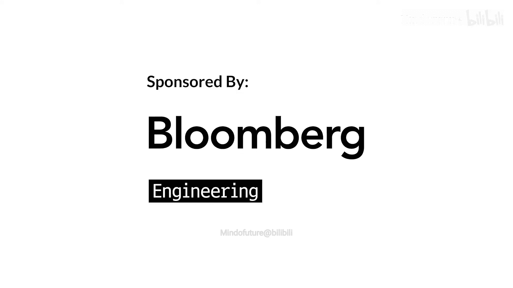

# 【Cpponsea】C++-On-Sea-2025大会-p06-P06_C++26_中的_契约-内部_概述-安德烈_齐苏_2025--BV17V4GzjE6p_p6-

Good morning and thank you for joining me today for CQL++ Con。

 a meaningfully viable product where I will attempt to present you with a relaxed and sometimes entertaining presentation of some of the more important topics related to contracts in C++ 26。

As to myself， I'm a standards committee member for the past three years。

 I've been particularly active in SG21， the contract subgroup and took part of most of the discussions in daily teles and in countless email discussions of the so-called internal reflector。

However， I'm not one of the main authors of the contract proposal also known as P2900。

I work at Morphyec， a cyber defense startup which provides automatic moving target defense in short AMTD。

Which hides important operating system resources and catches attackers while trying to。Attack。

And also that's coupled with an advanced ransomware solution。I want to be presenting contracts。

Diving only as deep as necessary and where necessary。Detail in some of the considerations。

 the aborted path and the controversies over many things along the way due to very difficult design considerations。

I will not be too much of a stickler on terminology or on theory。

 I will present some of the guiding principles which are part of P 900 and only in proper context。

And I will be borrowing much of the structure and even code examples from P 900 and from the accompanying rationale paper known as P 2899。

Now to a quick review only a small part of contract terminology。

The first type of contract is a preconition。The precondition term itself is the plain language term。

While inside the C++ specification， we use the term precondition specifier。

 which is comprised of the three keyword followed in parenthesis by a predicate。

 which is a boolean expression， if this boolean expression returns false or throw exception。

 then we get a contract violation， as we can see in this example。

Since the second parameter y was expected not to be0 into actually past a0。Similarly。

 we have post conditionsdition specifiers， unlike preconditions which are evaluated when a function is invoked。

 when entering the function， post conditionsditions are evaluated when a function returns normally not when an exception is thrown。

 and at that time the post conditionsditions are evaluated。

 and like preconditions they also have access to the return value， you can see it here has R。

 you can give it any name you want followed by the by the columns。And pay attention to the cons here。

 which for the first time in the language is important for parameters passed by value。

 we'll be talking about this later。The collective term for the pre and post specifiers we've just seen is function contract specifiers or in short contract specifiers。

I will usually refer to them for simplicity as just pre and post。

The third and final contract type is known as assertion statements。

which is represented in the code by the contract As keyword。

 unlike CAs which it directly replaces it is an expression and not a statement we'll also cover this later and of course it can show up anywhere in the code that any other statement could show up。

The collective term of all three contract types is contract assertions。

 this is the term I will most often be using and in the slides I will shorten this to CA。

 do not confuse this with code analysis。This was previously known as CCA short for contract checking annotation。

 which brought upon some objections and some people thought this what this is not correctly described by the word annotation。

 which more closely implies something like attributes which may being ignored by the compiler which is not the meaning we want to give this in the context of contracts。

 also do not something that has caused some confusion but no better solution has been found somewhere so far。

 that contract assertions is a term that collectively refers to preconditioned post conditions and assert certainion statement。

 however， when we say assert certainion statement， we only refer to what is represented by contract assert keyword。

So we have contract assertitization statements and we have contract assertions。

 which represents all the three contract types。The S++ Boolean expression inside a contract assertion is known as a contract predicate。

Usually the difference between contract assertion and contract predicate is not that important so we can。

More or less really mix and match them， but sometimes there are important differences in particular with Igno semantics。

 which we'll get acquainted with later in which the contract assertion is considered evaluated。

Even though the， the contract predicate is not evaluated because。Its ignored， obviously。

And now to some bike shedding in history with bike shedding being the quite surprisingly complicated art of choosing proper names。

In an attempt not to fight to death over them and do not， naming is very important in a standard。

 those names are going to be with us for the coming decades。

I've just mentioned the debate over the CCA term which wound up as contract assertions eventually this was one of the more seated debates and I have a link for a reflected thread 75 messages long which is actually not that long in SG21 terms。

Along the way there was a proposal which didn't quite gain traction to name them contract assertion annotations CAA but you'll note the word annotation is still there so that also didn't gain support。

 I myself proposed contract closes something out of real life there also obviously some objections to that so we wound up with contract assertions。

Even more neededed was the debate over the contract As keyword。

 which is actually more important because that's what you all have to live with in the actual code。

 not just in standard terminology。We would have wanted to use the assert keyword as most other languages do。

 unfortunately we cannot do that as it would conflict with the existing CM macro。

Wwhich might have a solution in the future， but we don't have one at present with a currently selected syntax for contracts。

 therefore we explored alternatives and there were over 40 of those。As you can see here。

 this is the first part， this one is actually mine。D assert。

 you can see where the CCA came from and you can probably understand why this was considered too clever。

And this is the second part。The two finalists were a contract assert and expert。

 obviously the contract As was the eventual winner。

 I voted against AserRT expert since I saw it as too closely resembles constant in a completely different context。

 which may be confusing。And in hindsight， that was an even better decision than I expected because at the time assertion statements were still actually assertion expressions。

 well cover this decision later of making it an assertion statements rather than expressions。

 so now with them as statements it would have been a better idea to name them assert expert which implies an expression。

On now to some restrictions imposed on the syntax of contracts and why we need to introduce those restrictions。

A precondition or a post conditiondition。Must be placed at least on the function first declaration。

 which is a location which includes a declaration of the function。

 which may or may not also include the value of the function。And from that location。

 no other declarationlar of the function is visible hence first declarationlar。

 this is what is a term that was previously implied but not explicitly defined in the standard。

 it is now defined in P2900。诶。The first declarations may differ depending on point of view and point of inclusion。

 if it's a header file， depending on where it's included for。

 it may have a different a given function may have different first declarations。

Any other declarations of the functions are known as reddlaration。

 and that includes the function body or implementation。Repeating a contract is allowed。

 not mandatory， but allowed， we'll cover what that means later。For several reasons。

 to be currently to users， if you can repeat the contract， especially in the function body。

 then the code becomes more readable。Also to support functions declared in multiple headers。

 we wouldn't want to add even more to DLL health。And due to some quark of friend declarations the standard allows their instantiation in any given order。

 which the programmer has no control over。Preconditions and post conditions。

 if they are repeated in redeplars， they must all be equivalent equivalent is mostly determined by token equality。

 meaning they have exact same strings。But not entirely do have some leeway in terms of names。

 specifically the names of function parameters and return values， which， as you will note。

 are two things that are not included in the type system。

So you may give the same parameter or the return value different names。

 but they must return refer to the same entity with synax they called example of this。

 therefore the meaning is retained。And for the same reason， those redelars and of course。

 also the first declaration as in the precondition or post conditionition itself。

 they cannot contain lambmbdas because lambmbdas produce a unique type。

 and if you repeat the same lambda even if it's the same one word for word and letter for letter creates a new type and thus it cannot be considered equivalent。

Here we have a well formed renaming， we can see the same parameter named X in the first declarationlaration。

 y in the reddelaration， but it's obviously the same one。

 so we have equivalent and the code is well formed。

Here we can see that the precondition in the first declarationlar and in the reddlaration。

 they refer to different parameters。Therefore， this code is ill formed。On to contract semantics。

One of the great controversies of contract at some point going as far as endangering contract in C++ 26 has been constification。

 officially called implicit constantness， way， way too many times autocorrected to you can read for yourself what exactly。

The main motivation has been helping catching bugs and avoid contract side effects。

 which as you'll see multiple times in this presentation。

 as side effects are something we very strongly discourage in contracts and Pi 100 even has a principle to this effect principle6。

 no destructive side effect we'll talk later about what destructive side effect is。

 this is not a clear cut things thing for example， does a expensive contract check involved many clock cycle。

 is that something that affects program correctness as in program behavior。

 which is something we don't want to do with contracts。

Quunification is implied on all entities which are external to the contract assertion that includes external objects。

 including globals which were initially not included in this。

 it also of course includes function parameters。The effect is to treat those objects as cons。

But the compiler does remember whether or not the original object was indeed cons。

 which is reflected if you apply the decoal type operator to it。

 this is very similar to what happens in cons member functions。

And what another thing to pay attention to and this is nothing new to the language。

 but it is very very much worth remembering is that we have char constantsonness in the language。

 especially when you're referring to pointers， if we have a pointer。

 then a conification is applied to the pointer itself， not to the object it points too。

Unlike references where consification， same as cont already in the language does always refer to the object itself。

 which is being pointed to as the reference is const anyway because it cannot be rebound。

As we can see in this code example， all the cases other than a pointer case are illform since they are trying to assign something to the kinds of objects I've just mentioned。

 and this applies to all threecon types， the two cases involving pointers are wellform since the assignment is applied to the object pointed to and as mentioned due to shallow con conification doesn't reach that far。

The only currently available and quite controversial way of opting out of consification is use by casting away the cont via con cast。

 concast， as you know are already discouraged then they may be dangerous。

 they can lead to undefined behavior， however its worth knowing that the undefined behavior actually occurs only if the original object was cons。

Otherwise it may be ugly， but in terms of the language it is well formed and even safe。

 so we can see here that all the casting away of constant from I。

 which was not originally constant are okay。From Jde this does run into undefined behavior same the two cases here in both cases this is well formed and meaning it will compile。

 it is discouraged but。It doesn't need lead to any actual bad results if applied to the object which are originally not coned。

Now naturally classificationification has drawn many objections。

 one of them is over the fact that it modifies overload resolution。

 you can have two functions which are overloaded period parameter which is the first time not cons the second time con。

They do different things now this can be argued as being bad code， but it does occur in practice。

 unfortunately。And we would have contracts that basically check a different thing here and here。

Then what regular code check， which is not subjected to constification。

 and that raises the question of what is the value of contracts in such cases if they don't check the actual code。

Now of course this generated a whole back and forth of arguments and counterar。

 we've seen something that can be argued as being bad code。

 and then the counterar is okay but must contracts be useful with real world code。

 not just having mind educating the programmers。And that was countered by saying that well actually contract one of their main goals is to encourage correct problem practices。

Another counter was that if you're worried about creating a different code path。

 not checking the actual one， then worry about the side effects that would be allowed if it were not for quanttification。

And yet another was that with constification， we get great help in discovering hidden side effects in what we're in and now see assertts。

 which is an old problem and now we have an easy way of discovering them。

 which has indeed happened in some cases。Another objection is over the things that I've described before in terms of shallow consciousnessness and the difference in behavior of pointers and references in this regard。

 which creates some inconsistency， which projects onto contracts itself。

 making contracts arguably incomplete and inconsistent。

The counter here is that this is a known language issue and it's nothing new I am partial as to this since the contracts do make this a more serious issue this is being countered by the solution being very hard to do as creating deep constantson would be something very deep and complex to specify and to implement and it would be a new thing on applying only to a contract。

There are also objections offer usability there are some。

wideidespread types of code which may or may not be necessary from contract predicates。

 you have C code the mainly operating system code such as Poics and wind APIs which have poor constant correctness and you have things like logging which are naturally not con and you may want to do that from constant from contract predicates。

And then there are things like the indexing operator in Ma。

 which you could argue that it's actually a very good thing that con correctness doesn't allow it because as you know it's an known footgum and may lead to default construction of map elements when keys and found in a map and in those cases it's better to use map E。

 which is cons。In all those cases， if you do need to have an escape catch， there is the concast。

 there are also a couple of other proposed escape catches that apply either to the entire contract predicate or to only an expression which is part of a CA。

Especially this operated no cons may be considering in the future because it allows a language solution which would safely provide dropping a con net for only if for object which origin not cons and that wouldn't lead to undefined behavior。

 this is only partly possible with a macro solution。Now on two cost conditions。

As you've already seen， post conditions have the ability of specifying a name for the return value。

 that name is only valued inside the post condition predicate and that works even if the function returns an unnamed temporary。

 which means the post condition becomes the only place where that temporary does actually have a name and can be referred to this is unique in the capability of being able in this way to refer to any returned value up until now this is only referred for types in which the user can provide a constructor for themselves。

The post condition names the return parameter if you opt to this is similar to having a reference to it。

 but not quite it it's like providing an additional name to that entity which is being returned。

Which is and this has been likened to structured bindings。

 it does behave quite similarly to references， but if you were to apply the decal type operator it would tell you that it is not a reference。

 as you can see in this code example， I have a post condition here and you can see that it fails because it isn't able to validate it as a reference。

Const casting away costness in an impose condition is actually a well defined behavior。

 even if the result of the function is ultimately assigned to a cont variable。

As we can see here in the first example， we have a post condition which concasts away。

And then ultimately this is assigned to as variable。

 this is okay since at the point the post condition is evaluated。

 the target when a variable is not yet bound to the return of the function。

So it's not yet coned same here we can see here we have F being invoked。

At this point the result is not yet cons so this is well defined behavior by the time it's returned and then the member function4 which is cons is called on it。

 we already passed the post condition so this too is well defined behavior。As previously mentioned。

 any function parameter which is passed by value in this ODR used as in consumed by a post condition in that function must be defined as cont which is a novelty in the language up now this cont wasn't important because cont by value parameters is not part of the type system now it does become important well get to motivation soon and one point to remember is that this must also be consistent if you have several redelaration of of that post condition on function reelareration。

 you must be consistent with that cont and we see here cases which are illform because we don't have that consistent in this case its in the definition the function body and this case。

BothThe first declaration and the function body are consistent with the con。

 but another redelaration is not so this is also ill。The motivation here is actually quite intuitive。

And if you have a post condition which refers to a function parameter。

We must be able to reason about those post conditions and allow them to be sound if those parameters may mutate during the execution of the function body。

 then we don't have that capability。嗯。So the way out of this is to not allow mutation of those parameters。

 this must be done consistently both in function declarations which are visible from coal sites and in function bodies which may or may not have a repetition of the contract and in both cases the compiler must be able to enforce this restriction。

诶。Now， you should note that this con restriction is only ill formed if that parameter is ODR used in a post condition。

 and in the future we may not have that issue once we get capture clauses。

 which I'm not discussing in this presentation。Where we'll be able to capture parameters explicitly and make our intent clear。

Onto how and when contracts are evaluated and how contract violations are handled upon detection。

Yeah。This is a rough sketch of the sequence of events inside a function in the presence of contracts。

So we have the function called， then parameters are initialized。Then we have preconditions evaluated。

Then we get to executing the function body。Which may include assertion statements if and when they are reached by the control flow。

Once we're done with the function body， we initialized lasting in a function body is initializing the result of object。

啊。And then we destroy the local variables and leave the function body。

Then we execute any post conditions。And finally， we have destruction of function parameters。

 and then we bind the result object to the target variable。啊。Now this。

Was designed in this way so that to allow several sequences which are important for contract。

 we can see that preconditions and post conditionsditions。

Are both able to see function parameters as they are in their scope between init and destruction？

We can see that the result object is initialized before post conditions are executed as post condition can inspect and return the object。

 but that's done before they are bound to the result object the coal site so any any con specification here does not apply yet。

 thus making casting away mass here safe， if you really really need to do that。啊。Also。

 where noting is that。Post is only evaluated on normal exit I've already mentioned that so we you won't have that with exceptions at this point at least。

And postOS is only evaluated after local variables are destroyed。

 since they may include logic that could affect the correctness of post conditions。啊。Also。

 this is only specific to Microsoft， as far as I know。

 the Microsoft ABI destroy is parameters on the coli side。

 therefore allowing post conditions to only be evaluated on the coli side if they refer to function parameters。

Which whereas other implementations may have more freedom in this regard。

Now I get to the very core of the whole contract feature。

 and that is the evaluation semantics and how they are selected。So we have four evaluation semantics。

 which are classified as checking semantics and one ignore semantic。The check semantics。

 which are the ones that actually check contracts。And evaluate them。

 they are further subclassified as in the observed semantics standing by itself。

 and there are two terminated semantics which terminate the program upon detecting a quantum violation。

Those are enforce and quick enforce， which was originally Nickckname， the Louisaman Pick Louis Dion。

 who came up with it。And the Norsonlantic ODR uses the variables it consumes and must be well formed。

 as previously explained。When detecting a contract violation， if this happens at Toronto time。

The observed semantic will invoke something called a violation handler。

 which we'll also discuss shortly and upon that violation handler。

 which is a function upon it returning normally as in not throwing an exception or doing a long jump。

8 oil container execution normally。The enforce semantic would also invoke the validation handler。

But upon。The violation handleer returning normally。

 it will terminate the program in a manner which is implementation defined。

Quicken enforce does not call the violation handler。

 it simply terminates as quickly as possible and with with its code needing to have as a small a memory。

A footprint as possible。 is those are the goals of this syn tickets it must be very fored with a very small code footprint。

Now a compile time Ob will generate awaring upon contract correlation。

AndFor and quick and enforce I identical， there is no violation handler。

 they will simply make the program ill and of course ignore both at compile time and in run time and it does nothing。

The contracts feature has been specified so as to afford maximum freedom to implementers to be able to satisfy different needs for different sectors。

So with this in mind。There is it's not specified at which。

Bill stage contract semantics are specified， or indeed， if it is。Any builds stage they they could。

 they could also be selected at runtime。Whi by itself allows all sorts of dynamic configurations。

 having some log application， allowing the user to reconfigure contracts on the fly and so on。嗯。

The up now we used to work with build modes， mainly debugging the release。 and of course。

 we can continue doing that and for example， having。

But having enforced contracts in debu builds and having observe or ignore in in release builds。

 but we have any other option that we see fit and and that the tool chain allows us to employ also。

The compiler may actually select different。Semantics for different contract assertions in the same translation unit or even different semantics for the same contract assertion during different evaluations。

As per P to 900 implementations are compliant as long as they offer at least one of the four contract semantics and that includes the ignore semantic。

Wwhich means you could have a compliant implementation only providing the enormous andlantic。

 which would imply that no contract predicate would ever be evaluated。

 remember that even in such a case， contract assertions are considered evaluated。

 and they must be well formed at all times to prevent long-term cold rot。

 and they are already are used which also entails some possible side effects。

 especially involving static data members of class templates which may get instantiated by such contract predicates。

Another thing is that the chosen semantic is。NotIt's forbidden to ever be detectable by code at compile time。

So that such code wouldnt be able to wouldn't have its behavior potentially affected。

 which could happen in several ways， it could branch on an cost expert depending on contract semantic。

Have a value returned by the non accept operator as we'll see later that would be somehow impacted by the presence of a contract and of course it could have Sney if if the very nature of the contract in some way would impact which overloaded function would be picked up by overload resolution。

On to religion and duplication。Any control assertion may be evaluated any number of times。

 including none at all this is required so to maintain。

Theupling between the color side and the color side。

Each one of which could have any any contract semantic selected independently of each other。

 so you could have both picking up ignore semantics， not evaluating at all。

 you could have both of them picking up sub checkinging semantic in which case such a contract would be evaluated twice once on each side。

诶。And by the way， this is why we don't like to have side effect in contracts because then they could happen exactly that number of times。

Inly you can see that in most cases， you don't really need more than two evaluation。

 one on each side， but there is some desire to to have more evaluation available for testing for purposes。

 namely testing for contract side effects which would be more easily detectable。

 the more evaluation you actually perform。嗯。As to what the P2900 requires of implementations。

 the only requirement is to have some upper bound defined。And there are two recommendations。

 which is to give users a way to configure the actual number of repetitions。

And to help by default one single evaluation per contract assertion。Okay。

Now unrelated to contracts and nothing new here actually E is where the compiler can prove that some engine will not affect the observed behavior of the program if steepped so then it's allowed by the standard to go ahead and skip it a well known example is copy lesion。

In contrast， the compiler is allowed to e contract contract evaluations。

In cases where it can prove that the outcome is preordained。

And that there are no side effects such as throwing， long jump or terminate。啊。

The cases in which it can prove that it's priordained it's either when the predicate on。

Which some conditions and some circumstances is checked at it's evaluated that compiles dying。

Or if it's guaranteed by previous contract assertions and under term semantics， so for example。

 if we have a contract assert that stipulates that x must be greater than one。

Followed by a check that existss greater than zero， that now obviously if it is greater than one。

 then it's also greater than zero。The very fact that we that we are able to reach the second contract assertion here means that we have successfully evaluated the first one。

 but only if we've done so with terminate semantics。

 if we had had a violation on the first assertion， then we would have terminated。

Or as well see later skip the following code in some other way and we we have never reached the second one。

 so under such a condition there's no point in now checking also the second assertion。With Elation。

 the compiler may not only eliminate a contract search evaluation。

 it may also generate an equivalent expression instead of the original predicate。

Such an expression would have to be to generate the same outcome。

In all cases in which the original expression is well defined。

In casesases in which it's not well defined， and that would mean it's undefined behavior and that's fair again。

 the compiler can do whatever it pleases。And if such a replacement takes place。

 any side effects may or may not be eliminated， both are okay。

 and no new side effects may be introduced。Now we have principle number six in P2 900。

 which says that contract assertions by their evaluation， they cannot introduce side effects。

 which so-called destructive side effects which affect the correctness of the program。

 meaning affect the behavior of the program basically。

So not only are we discouraging users from having side effects in contracts。

 but we also don't want to introduce any ourselves。

And we can see what may happen with such side effects if we have this piece of code here that has a side effect of increasing incrementing I。

 we don't know how many times this precondition is going to be evaluated。

 so who knows how many times we're going to increment an I so that's definitely not a good thing to do。

Now there's a small limitation on the degree of freedom the implementation has here。

 it can either eliminate all those side effects or。Not touch them。

 they cant eliminate just part of them because obviously that would make a mess of things。Of course。

 again you don't want side effect in contract assertions you can see how many problems they cause definitely don't depend on them for your business logic。

 I mean you might have some logging or whatever which you it may not be entirely reliable due to how contracts behave but that's on you but if you're actually business logic depends on this and well we might have a problem。

Also not having side effects is what allows us to afford those potentially multiple evaluations as they are undistinguishable under the as it rules from a single evaluation as long as there are no observable side effects as to total execution time which would obviously be impacted by multiple evaluations if those of course。

 take any sizeizable amount of cycle times is that consider observable behavior that you care about or not。

 well that depends on you N or and on your context， so theres nothing much to be done there。

 but obviously you wouldn't want your contract predicates to be too expensive。

But the contract correlation handle I previously mentioned， so what is it。

 it's a function in the global name space named handle contract correlation。

It takes a single argument of type to contract contract violation。

It returns void and it may or may not be no exception。

Implementations are required to provide a default implementation of this handler。

Which is recommended that all it does is log in some manner the contents of the contract validation object。

And that it be no accept， but these are only recommendations。

The default handler cannot be directly called by user code。

 there is an accessor function which allows that it be invoked。

 but in the practice this can only happen from custom Vi handlers。

 meaning the ones users implement themselves overriding the default one and this is because by design and for this reason the contract violation objects cannot be created by user code。

 the only way you get your hands on one is if you implement a custom violation handler and get such an object as its input parameter。

The mechanism by which the implementation is allowed to enable you to replace the violation handleer if it chooses to do so is replaceability。

 same as global operators new and delete work and normal functions don't work this way normal function if you try to replace it。

 you will get a linker video symbol error because it finds two symbols。

But for a replacelaable function， you are able to provide a function with the same name and signature as in parameters and return type。

It is allowed to differ in the drawing specification， no except versus no except falses。

And then the function we provided replaces the original default function。

 so you can do that with the violation handler， the standard library only provides an implementation of the default violation handler it doesn't provide a declaration in any standard header file the main reason for that is the no accept freedom you get here。

啊。Now， as I said， implementations are allowed but not required to provide this reability because on some of them。

 allowing this money be viewed as a security risk which they cannot afford。

The main motivation for having contract validation handlers is the ability to decouple libraries and applications in terms of what to do with contract。

 both libraries and applications can implement contract solutions。

But libraries do not get to decide how violations will be handled。

 what happens in case of a validation， that's on the application and that gives the application。

 the freedom to decide whether it wants to terminate only to observe and so on。

 the library provider doesn't need concern himself with that after the application provider and is able to gain this freedom and control what happens in their application。

In order to have this possibility of course the application is able to provide a custom handler if it's all dimfe。

 those handlers can only be installed at link time because it would both be too dangerous to allow this at runtime。

And then compile time， it would not be practical practical as translation units may be compiled at different times and with different tool chains。

 it would be difficult to do this kind of。Nixon gun the matching。

An important thing is that you don't have to recompile everything in order to replace the termination handleer。

 you only need to relink and that's very important contract to probably be unfeasible otherwise for several reasons obviously rebuilding lots of stuff takes lots of time。

 also there's lots of stuff that you can't build if you want to third parties and so on。啊。

So basically this is a must help for contracts as to the contract violation object。

 it may reside anywhere in memory other than the H， having it on the hip。

 of course would be prone to memory exhaustion issues which may cause contract violations and you can have the determination。

 invoking the termination handler itself be susceptible to such issues。

It's not specified how the compiler can produce the object， it depends on the implementation。

 they can produce it any way they like。Of course it must be alive during the violation and nerve。

 afterward it's given to it as a parameter， but so must the objects that are exceptional fluid。

 the contact this object contains pointers to other objects such as strings。

One of those strings is a。And something I tried to partially object to about two years ago when I had some security related concern about having a source called source name symbols included in distributed binaries which may make life too easy for potential attackers。

 this was eventually dismissed in order to give more freedom to implementers and in their understanding that implementers are likely to provide such configurability to concert users in any case。

Additionally， do you mind the fact that exceptions。

 as previously mentioned while evaluating the contract predicate are caught and to the violation handler handle as it seems fit as just an additional kind of contract violation。

Contract relation handlers contain normal C++ code， same as a contract preddiicates for that matter。

And as such they can return in any of the available ways， including normal return。

 but also learning exceptions and long job。The ability to have a turn violation handleer or to have it long jump was actually something that was allowed along the way。

In a deterrent manner。When there came a demand from no other than Brna himself。

That we need to have a way， even with semantics to have some systems not terminating because they can't actually afford termination。

So that could be viewed as somewhere of a back door， although not necessarily so。

Because the actually way of looking into this is that the main guarantee that terminating semantics afford is that the following code is not executed now if you have a violation handle wrong an exception or long jumping then it bypasses the following code if it both long jump and an exception which is handled and doesn't encounter an or barrier along the way what result in the system continuing execution but not at the following code so that guarantee holds。

Now mind you， the compiler cannot know what convert semantic is in play during a compiler time。

Therefore， it must assume given the possibility of throwing violation handlers。

 it must assume that any contract might throw this may affect things such as optimizations。

And some other things that we'll see shortly。Code base， I may also want to take this into account。

 We're already that for the last decade with at the Laoss Road。

which says that functions with narrow contracts as in functions that don't have welldefined behavior for any possible input are not allowed to be now accept among other things because we might want to have some kind of check including now contract checks which may want to throw an exception in case it detects invalid input if any possible input is valid and have a white contract then this doesn't count so we allowed to have such functions defined as no accept。

Again we don't have to and it's not always advisable。

 my personal advice is to only place no accept on functions that needed this。

 mainly functions that are or maybe involved in the context of either a the the or or move construct or assignment。

 which is basically what no except was was introduced for from the get go。Sunshine is a question。

 isn't it， contract falses。Is it not accept？Sounds like a very simple question。

 but turns out the is not so simple。And it turns out we actually have a prime directive of our own。

Which says that。Contract assertions are not allowed to alter the correct of the program， which。

 as we've already known means。Alter visible program and behavior。

So how does this relate to the question I've just presented？

If you have an expression which so far isn't throwing， so it's not accept now you have a contract。

That contract， as we've learned， could throw if we have a Tring violation handler。

So if you choose to tell the truth， you're going to say that now it's all I'm going to accept。

But this may now affect behavior， so you're in violation of the prime directive。

So what do we do about this？So as you might have sensed， we have two options here。

 which are both bad options。We can either。Tell the truth that it the expression with the added one threat may now throw。

Or we can lie about it and so I know it can throw although it actually might。

And then we are liars and besides morality that Col could also have all sorts of bad consequences。

And this was a very long argument what to do about this。In the， in most other similar cases。

 the outcome of such arguments is to make that feature ill formed so that we can introduce it as is in N C plus 26。

 not support this。 having such code be I formed。 So you can at present right such code。

And we can revise it later after C+ path 26， this is enshrined by principle 14。

But in this particular case， we chose another path。We chose to cheat， rather than lie。

Sometimes you have different evils to choose from， so you choose third evil。So in this case。

 we decided to make contractorerta statement rather than an expression as it originally was。

And also as there are in practice the C asserts， which of course are macros。

 but can be used as exception as expressions， contract asserts as of now can not。

 they can only be statements， which is that thing with a semicolon at the end。

This makes them the benefit of this is that no accept Con As faults is now actually informed。

 but it's not directly informed， it's informed because you can't have an operator such as no accept applied to a statement you can only apply to an expression。

So this now makes contract As more limited in this regard than CAs。

But this is quite easily mitigated via I immediately invoked lambmbdas。 you can have a lambmbda。

which encapsulates the contractor assert you want to place and inside the lambda the contractor assert is a statement and you use the lambda in vocation as your expression and then you have the quoma operator and what comes after it is your actual expression which determines the outcome of the whole statement。

And so this works because this simplification works。

 you can have a void and then from operator and then you get the result determined by I。So reup。

 contracts took a very long time coming， actually they completed two decades since work initially started on them。

And that is because they are a very complicated feature。But then so is' C+ plus so nothing new there。

 basically。呃。As complicated and the feature reaches as they are。

 you normally don't need to care about about， I don't know， 90% of all this stuff in your day to day。

 and again this is the same as C++ itself， you care about what you need to。

 but you do have a very rich tool set when you do need it。And that makes Con a fantastic tool。

 same as C+ class in general。Huge thanks are due to the many great heroes of SG21 who finally made contracts happen was a very long endeavor with a huge time invested in this with weekly two hour telecoms。

Hunds long reflector threads， very hard to keep up with actually， but well worth it。

And my additional special thanks go to Timor Dunler and Joshua By， Joshua， I'm never sure。

 And if I'm pronouncing its last name correctly， perhaps I can finally learn that。

Joshua is the main lead of contracts in Bloomberg， which is one of the main sponsors of the contract effort。

And the TimA is the vice chair of SG21。And both of them pulled in some serious effort and came up with lots of very useful comments when I asked them to review this presentation。

Unfortunately， there was no time left to ask them for a second review after implementing their initial comments。

So any errors I might have made are very likely due to this oversight of mine。

You're more than welcome to keep in touch via my email and my LinkedIn。

And I hope you enjoyed and you learned about6++ 26 construct and that you will be using them and so will all of us and we have we now have。

Something to really look forward to。

Thank you very much。