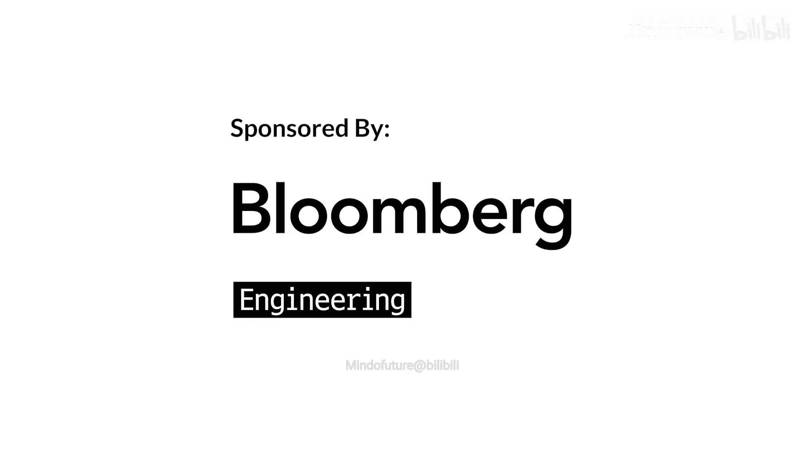
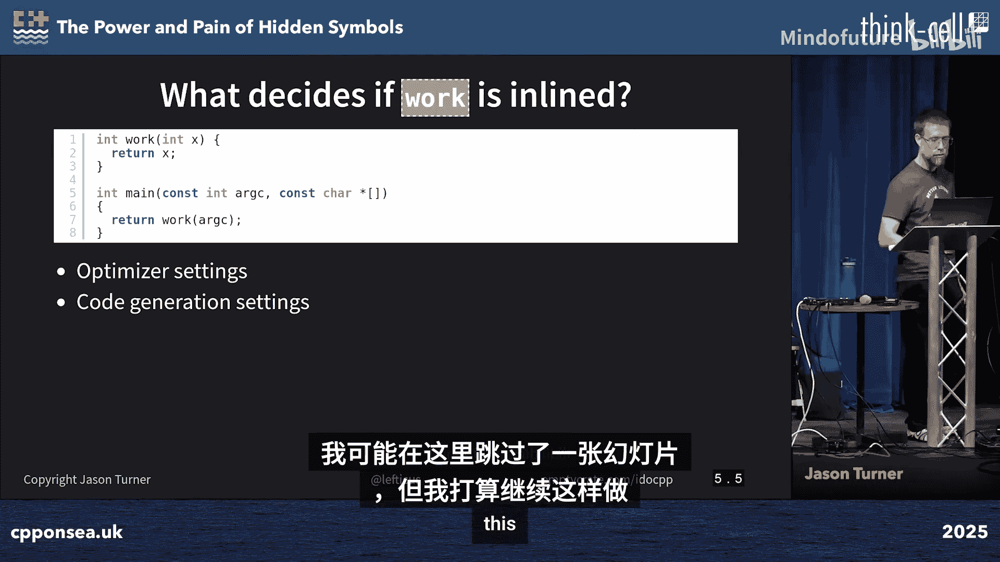
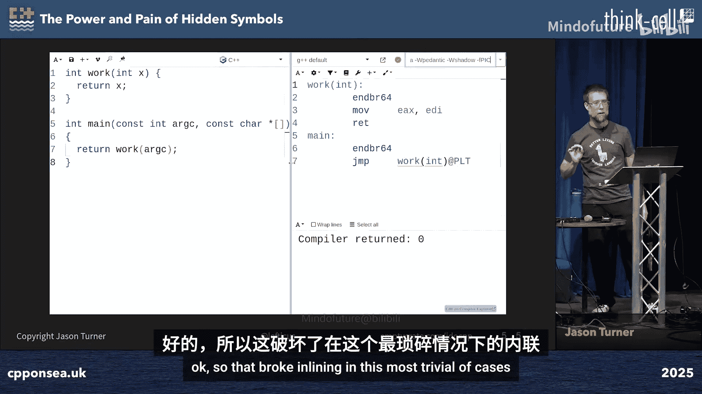
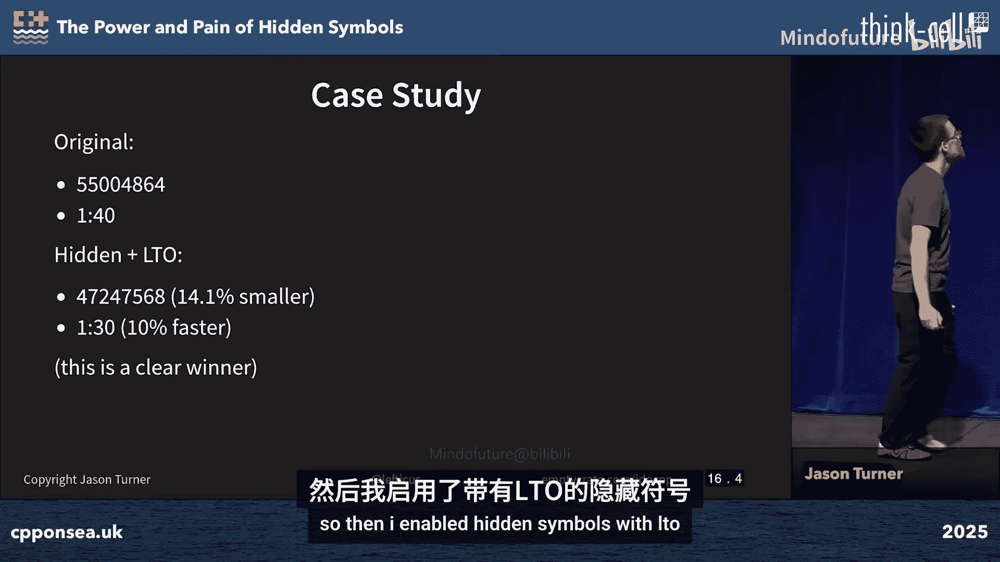
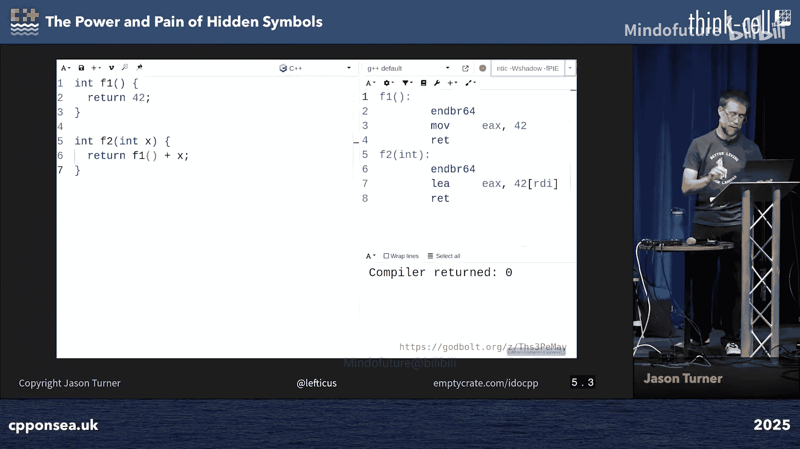
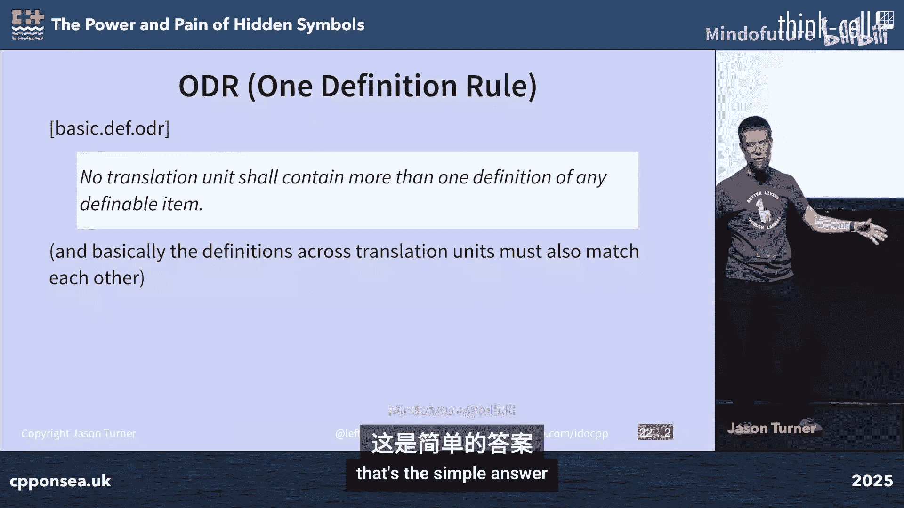
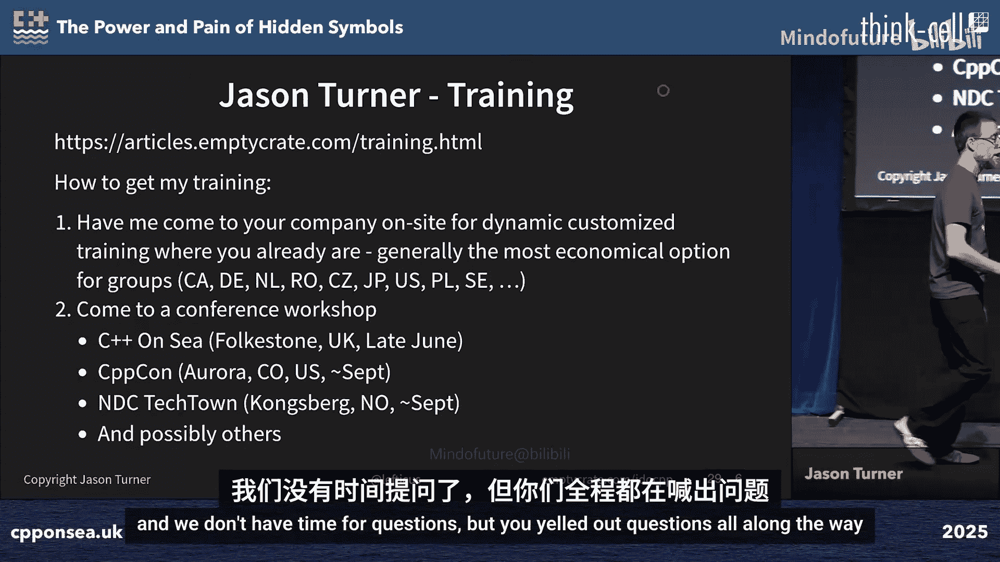

# 【Cpponsea】C++-On-Sea-2025大会-p07-P07_C++_编程中_隐藏_符号_的力量_与_痛苦-杰森_特纳_2025--BV17V4GzjE6p_p7-

I break all of the rules for presentation just so you know。

 you aren't supposed to pace as much as I do and you' you're supposed to have good lighting and everything for YouTube。

 and you're not post the screen。 I'll do a lot of those things Anyhow。There we go。

 This empowering pain of fit in symbols。 And I am Jason Turner。

 If this is not the room you expected to be in， please go ahead and find your way to the correct br。

I have this YouTube channel called SeaB West Week， have you heard of it？No。

Peanut gallery in the front row。I need this slide is perpetually out of date， right。

 because I literally release a video every week。 And I said，oo。

 I should make my slide generation system automatically update that is what I should do。

 If you haven't heard of CB+ weekly， there's a Q R code。 if you want to。😊，If you want to subscribe。

 like and subscribe。I also and the author of some best practices books and some puzzle books and stuff。

 and I've had at least one person at the conference talk to me about my best practices books since we got here。

 I do not have any swag to give away because I'm in the middle of a long trip。

 and I would not have been able to carry that， except I do have stickers。Stickers are not heavy。

 So if anyone wants stickers after the talk， make sure you get some。 I am a developer。

 and still I do oops。 I do speaking and training。 I'm also a developer and an author。

 And if you're curious， those are my Github repositories。So like I said。

 I do training and I travel around and I'm happy to come to your company pretty much wherever you are。

 this is just a random list of like countries and stuff that people have sent me to。

And I also do conference workshops。 Did you know that there are workshops starting tomorrow at this conference？

Are you signed up for one？😀Yeah。Why not， there's still time if you live locally。

 you can sign up for a conference workshop and just spend a couple of extra days in the lovely beachside town of folkkeston。

All right。So my talks， I do say avoid sitting in the back because I like interacting with you。

 please interrupt me and ask questions， I will do my best to repeat the questions for the sake of YouTube。

 and this is approximately my training days look like I try to have a very interactive conversation with my students。

Yes， so workshops。 I'm going to be here at CBS onC。

 I'm also going to be at NDC Techtown in September and CBPcon in September。Think that's right。

I can't remember which order they're in this year。Okay， are you having a good conference？

Are you inspired？Always， always， is there anything that has stood out to you so far at this conference that you're like。

 when I get back to the office， I'm definitely going to do that thing。Is everyone saying reflection？

Is there any other answer other than reflection？What's that compile time measurements from client。

That's， yes。Learn rust。那。I'm not going to repeat that for YouTube。So I was inspired。

 and I just want to this is completely has absolutely nothing to do with my talk whatsoever。

 But I was able to prototype this。 This is something I've been waiting for for。😊。

I'm going to say at least 20 years in my C++ journey。

 so I have a name space with a bunch of functions that I want to expose to my scripting engine。

 and I can now do that on literally one line of code line 10。And it works。

 That's a full complete example that you can play with if you want to grab the QR code and you can play with my scripting engine live and compiler。

 explore and expose other functions to it， and it's an S expression based language and you can actually play with them and see what it does。

I guess that had absolutely nothing to do with my talk whatsoever， but I felt like adding it in。

see people zooming with their cameras attempting to capture the QR code Does compiler Explorer work well on cell phones。

That does not， someone should work on that。But。Yeah。Okay， all right。

 let's get to the point of this talk。 Who uses Viual Studio。Oh， wow。

That's a higher percentage than usual， I think。 and I just I do have this up here， I say C。 eXc。

 not VS code because sometimes people who are newer to C++ development think of VS code as visual Studio。

 and I am talking like actual Windows development with Microsoft compilers。

So that was was that nearly 50% of people？Okay， this is fun。 Keep your hand up use if you VS code。

 if you use visual Studio， but you also do cross platform development。

This might be more relevant than I was I thought it might be。 Okay。

 who uses Gcc or playing exclusively， not with also visual Studio。 Okay， so that is all right。

It was about maybe it might be a third to two thirds mix here。Who makes shared libraries？

Virtually everyone， okay， good， good， good good， do you see me？Again， virtually everyone。 Okay。

 does anyone want to share anything about the type of shadow libraries you create。You don't have to。

 I just thought to throw this out here for audience interaction purposes。Python bindings。

You're waiting for reflection。嗯。And so you're saying you make C++ libraries that are consumed by Python。

 Is that correct， You don't do it the other way around。 Okay， good。

It's really not relevant to this talk， but I have approximately 20 years of experience doing cross language scripting bindings with C++ and other scripting languages。

 and Python was not designed for embedding in C++ and Ruby was really not designed for embedding in C++ and I've done both and I quit that job。

All right， so anything other than like Python libraries， Python libraries is a good example， though。

I'm a game engine， you're writing a game engine， so you have lots of shared libraries。Tons， tons。

I thought you game developer， people like merged them all into one giant blob and compiled it。

Ultimately， okay。Its muched for the process you can make make some libraries while you're building others。

 So you have lots of small shared libraries for the sake of iterative builds。 Basically， Okay。

 then do you like for shipping， actually make one giant library just for the fun of it。

 should Gi I should go to your Github。 Okay， I don't。

I don't have any way to dynamically add a link to that to the slides right now。Anything else， yeah。

Plugins， plug architectures。Fun。I mean， I've also written my own plugin architectures。

 It's things I'm familiar with。 And it's， yeah，' there will be relevant stuff here there。

 anything else。Like trying to not have the light in my eyes， yes。You see me。😊，Sims。

Are you the one that give the lightning talk on that， no， okay。Sims， shims。

 So you inserting layers between other libraries。 Yeah， alright， Okay。

 this will be less relevant to that process。 I think， Okay。

 does anyone actually rely on AI and or API compatibility。😊，Oh， that's a lot of people。

Read you receipt this plus。Yeah， that's really brave。

so this is not directly relevant to the conversation today。

 but I'm curious if you do anything to check or enforce your A compatibility to use tools like AB DF to prove that between two shipping binaries。

 you didn't break the A。You do。Who does， Yes， I ship libraries。

 I care about A and I prove that I care about A。That's one person。

Just so you know there are tools that exist out there， you should talk to this person。All right。

This talk lives at the intersection of what the standard requires and allows and what our linkers and operating systems do。

 basically， that's my understanding here， it's a very good chance that we'll get into some weeds and some stuff that someone will correct me on。

Okay。What does it mean for a function to be in line。

 I'm just making sure I'm not excellentally skipping slides。

What does it mean for a function to be in line？Stic。Ha a static sanction， no， no。

 I mean more from a compiler optimization perspective。は。呃，3我3。Implementation is in place。 Okay。

 so this is a function that was not in line。This is one of these examples that took me。

Shockingly long to generate。Cause I'm putting no in line attribute。 And then I turn on the optimizer。

 and the compilers still alignlining it。 I'm like， how do I get you to stop in liing this thing。

 Anyhow， I eventually did get this。 This is the， the obviously， the sources on top。

 The the compiled assembly is on the bottom。 Do you know that there's a tool that makes it really easy to look at your assembly。

😊，袜子。Thank。Okay， I'm being a little snarky， who is I don't like asking questions in the negative。

 but I'm going to do anyhow， who is not familiar with compiler Explorer or Godbolt。org。No one。Wow。

Mat， you've reached saturation， you can retire， there's nothing left to do。Yeah， just monets it。

 yeah right。This is a function that has been in line。 There's a couple things to talk about here。

 So in this specific example， notice F1 was still emitted here， even though it's not being called。

 So even though I have the full function bodies for F1 and F 2。嗯。Depending on how old you are。

 basically， you might think of like inlinning is something that's gonna oh no。

 bloat my code and make my binary bigger。 but even in this like most trivial case。

 this actually made the binary smaller， even though I still had both implementations。

 both functions implemented here。 So we sometimes think of inlining as increasing our binary size。

 it's not often not always the case that often actually makes the binary smaller。All right。Will work。

Be in line。Should be， maybe， yes， What are my compiler flags？All right， this is a trick question。

 yes， thank you Gu， what decides if work is in line？😀Yeah。The question was。

 is it your compiler flags， I think the room heard that。

 but for the sake of the online audience here？Yes， it's your compiler flags。 But what types of flags。

啊，认识的认识。It's like you cheated。😀。All right， I'm not going to repeat that yet。What did you say。

 optimizationim flags， Yes， optimization is part of it。

 And then there's also like our code generation settings。So I'm。

Probably skipping ahead on the slide here， but I'm going to go ahead and do this。

Work was in line。 My default compiler explorelorer settings are 03， because， of course， right。

 and work is in line。 I see no vestiges of it。 I'm going to。Probably。Acciddentally。

Not get the example I want。 Oh， no， look good。 It did exactly what I hoped it would do。

Now notice I did not change my optimization settings， but now work is no longer in line。

Did you see what I changed？No， in the back， it would be hard to see。 Hopefully。

 the rest of it is easy to see。 But if you're having a hard time seeing， you should。

There's plenty of seats closer up。What I added here on my compiler flags was dash FP。What is pick。

Position independent code， what am I setting myself up here for by compiling for position independent code？

Making a shared library， yes， or a module， same idea。Okay。

 so that broke in lining in this most trivial of cases。

Liiner settings， possibly。 Allright， things here。 All right。 I， I said， yeah， whatever。

 we just did that。 I did jump the ahead。 Okay， so this is semantic interposition。 Who said that。

 I it not， Yeah， okay。If a symbol is public and your code is compiled as a shared object。

 then the symbol will not be in line usually。The symbol will be emitted into the binary。 That's。

 I think， definitely。 but it might get in line depending on how fast and loose your compiler decides to play with these rules。

Then the basic idea。 So that that symbol can be swapped out with some other one with runtime linking。

 You might have a shim or whatever。Sir Collin。So like I said。

 I am happy for someone to correct me on some of the details here。

 I'm mostly focused on the end result for our code。

 but if there's some detail like whatever elf rules or something I'm getting wrong。

 please correct me。😊，Cang sheets。And GCC and Kang both have several flags that affect this。

 So if you turn on dash F no semantic interposition or then then GCC will be willing to inline that call。

 even though technically kind of it shouldn't have。

 And then there's other flags like F visibility in line sit。

 So if you have things that are like implicitly in line。

 then it will hide them so they don't get emitted into the binary。

 there's this is a rabbit hole of all kinds of options with compiler with your compiler。

And this is again， where I'm perfectly willing to happy to have someone correct me here as far as I can tell this is Elf rules。

 not C++ standard rules or C standard rules。And also， you are， I think。

 asking for some ODR violations if you play loose with this no semantic interposition。

 because you're going to get one version of the function in line here and then potentially a different version of the function called from a different call point because。

 you know， depending on how your linker went together。Okay， so I have now made this function in line。

Is this function going to be in line？And notice what decides， what is going to affect this？

Iless words。Not， no， not 100% the same thing。 It's。

 it's the optimization settings are going to affect this。 but this is not。

This is the compiler is happy to inline this， even if it's a public symbol。

 is what I'm trying to say here。If it's static。It is， again。

 just their optimizer settings that are going to affect whether or not this gets in line。 And again。

 if someone has comments， how do。Anonymous namespace。

 this also comes down to our optimizer settings because while we'll look at what each of these things are actually doing in just a second。

Excuse me。 So if you have an inline definition， if you have an inline function and you have multiple modules。

 Those definitions are going to be merged。If I've got a static object that's a data or function。

 each translation unit is going to get its own copy of this thing。And this is just a an like。

If you have static or in line， the compiler is not going to om the definition into your object file unless it needs to like the address of this thing being taken or whatever。

And this is why I say in my best practices that you should mark all of your global contexts per static data as in line because you want those multiple implementations merged。

 otherwise you can get some serious code bloat if you're using contexts per data tables or something。

Does this sound correct？Okay， I'm waiting for someone to correct me。These things。 Okay。

 so are we going to make all of our shared library code inline static or put it in anonymous namespace。

Why not？嗯，We're sharing if I did this to all of the things in my shared library， I mean。

 I logically may as well have a header only library， right。

 I want at least some of these symbols to be exported and。Okay。Is get to data in line， Who。

 I think this one was like guy once like to answer to this。It know。

 is is get data going to be online， what decides here？Yes， no， it's it's optimizer settings here。

 This is an implicitly in line function because it is defined in line in the strong definition。

 If I believe I have that， right， if I explicitly out of line， get data。

Now we're back in the case where it's the optimizer settings and this cogen kind of world。

 like if I turn on F pick here， now this is going to actually emit the symbol for it。

 it's not going to be implicitly。All right。Times， all right， okay。

Static versus inline versus anonymous namespace All right， let's say I have this header file。

 my dot HP， I have do work declared defined inside the header file。

 I include this header file in more than one C++ file and I link them together what do I get。

An error。 Yes， Did someone say this specific error。Multiple definitions。 Okay， ODR violation。

 We'll take on that a little bit more in a minute。 Okay， if I make it static。

 this is like review of the rules we just talked about。 What's going to happen。Multiple copies。

 multiple copies。 each object file is gonna to have its own copy。 You know what。

 I started so much second guessing myself when I was putting these slides together that I actually have tiny little test cases for each of these things。

So that I can prove to myself。I have。This one where they're declared static。 And look， there is。

 in fact， multiple copies of my print function emitmted into the binary。 Okay， good。

 I didn't get that wrong。 Allright， sorry。Now I am going to market inline。

 and I'm going to link these object files together。 What am I going to get？One copy， and again。

 I can prove this to myself。呃。And I can see I've got one copy of this print function in my。

 and my little demo here， both go1 and go2 are calling the same print function。 Yay， okay。嗯。

Copies across the object files emerge， okay， very good。

Now I'm going to put it into anonymous namespace。Now what happens if I include this。

 multiple different files link at the other？Multiple copies。But in like a magic kind of way。

 who uses anonymous namespaces。😊，Wow， wow， way more people than I would have thought， Okay。

 so have you actually looked at the binary just of curiosity？Of course some people have， but yeah。

So this is， by the way， K tidy recently Ih， I think， added this fix， use anonymous namespace。

 finds instances of static functions or variables declared a global scope that could instead be moved into anonymous namespace。

Anonymous namespaces are the quote， superior alternative， according to the C++ standard。

 a static was proposed for deprecation， but later undedeprecateated to keep compatibility with C。

We love having as many use cases of static as possible in the language。

Statatic is an overloaded term at different meanings in different contexts。

 so it can create confusion。Functions or variables in header files， C， whatever。 Okay。

 so this is what it looks for。 Funs or variables and header files that it could make put into anonymous stain spaces。

 King tidy will do this for you。 It's the superior alternative。

 If you've never looked at the disassembly， It does something like this。 It actually calls it。

Anonymous namespace and your linker in your symbol table。And so yeah。

 each binary is going to get its own thing， they're never going to ever merge with each other。

I did have to disable optimizations to actually get this to be emitted into the binary。

 it tries to not emit this thing。Okay， inline namespace。 This is an unrelated concept。

 for the most part。 This allows things like this。 I've got namespace A。

 I've got really poor indentation on this slide is what I have。 I have namespace A。

 and then I have a print function。 and then have an inline namespace B。

 and I have a never overload of that print function。

 These things participate in overload resolution together。 I'm going to on line 11。

 get the version that has an int on line 12。 I'm gonna get the version that has a double。😊，But。Anng。

Let's。Do this compiler Explorr thing again。Notice that the actual symbol name。

For the one that's down in the inline namespace， actually it has the B there。

You use online namespace。Nobody uses in line namespace。 Oh， couple we will do。 Oh， of course。诶。

So a few people use in lineIn， but very few people do。The concept as。

 I understand it is basically to protect your A。 Is that why you use inline namespace。Yes。

 that way using inline namespace。 Okay， so I can declare an inline namespace， version 2。4， whatever。

 have all of my code in it。 And then I change the version of my AI。 I change it to 2。

5 in my inline namespace。 and then someone tries to load my DLL and。😊，From their perspective。

 they're just using Leticus colon colon， whatever。 They're using my library。

 But from the linker's perspective， they're actually using Leticticus colon colon V2，4。

 And then they're going to get a runtime link error at the very least。

 So I did this episode a long time ago using inline namespace to saveor A。

 I've never actually deployed code that uses this。 But there are people here that can testify that it does what it's supposed to do。

Okay， so here's the point of this talk。It only took 30 minutes to get there。

I have my awesome library。 I have some functions for declared in it。 Now， in file1 do CBP。

 I've got the definition of this Iple， right？ So I've got get value Iple。 And then on。

 and further down， I want to call this thing。 So on line 5 in the second block。

 I really want that to be in line。😊，Right， you expect it to be in line。 The declaration。

 the definition is right there。 Anyone who spends time playing with compiler Explorer is going to be like。

 well， yes， of course， that's going to be in line。Unless。We've already covered it。Unless I pick。

 unless I'm building a shared library so。I won it on in lined on line 5 in the second block。

 It would be really neat if it could get in line on line  three， but just looking at this。

 do I expect it to get in line in the bottom block？

I don't because it's in two different object files。 So this is our worldview。

 This is what were going to expect。 Okay， I could make get value Iple in line。

 but then I would need to put it in the header file。嗯。Who does live in a header only world？

It has to be very few of you because you're also making shared libraries and headedon with shared libraries is a little contradictory。

There's a way。Yeah。😊，😀は。That's ways there's all well it's C++， that's what I tell my students。

 I'll often have students ask， so they'll be like， so you're saying that's impossible and C++ and I go。

It's C++。Okay。Right， so or I could make nothing static。

 but each translation unit needed its own copy， it would have to have its own implementation。 Also。

 this is not what I want。 I want this。 I want the best of both worlds here。

 That's what I'm aiming for。 I want some clean way to specify private interfaces versus public interfaces and let the compiler decide what's best。

That's what I want。So going back to this， my awesome library。

 so many of you raised your hands saying that you do Windows development， what is missing？

This is my DLL header file Decal spec DLL export or import， depending on the context。Right。

Who is familiar with some version of this macro？Yes。

 everyone who does window Sha library development really should be or you have some problems with your code。

嗯。When our shared library is being compiled on Windows， we end up doing this define Mylib export。

 something or another。 And then it's going to do this macro replacement。

 and I'll do a decel spec DLL export。 And in the normal case， when I'm consuming the library。

 that's going to become Deal spec DLL import。 And then we often。

 let me remind me again who does shared library cross platformform development。Okay， so line eight。

Why is that case there？GCC and Kang， right， because you're like， I just want it to compile。

 get out of my way。Whats that Oh， yes， and also for static linking。

 if you compile pile on multiple different ways， right？And then that's how we use it。

 And you can do this on your types as well。 Alright， and yeah， I already said those words。

 So we use that to compiler macro when we compile， and we use。The other one when wheeling，right。

 whatever。Okay。So we just have to do what the Windows developers have always done。

And we can get the best of these worlds。 So here's the plan。

 We're going make our symbols hidden by default。We're going to export only the symbols that we actually want to be part of our public interface。

 what a concept。You know， like so right now， if you just compile your shared library on Linux and you're not doing something to hide symbols。

 every function in your program is part of your public API， whether or not you thought it was。

And then we profit from smaller binaries and increased in lining of our code。 Okay。

 so dash F visibility equals hidden。Yes。What。Oh，I thought someone says something that weird。

E visibilityibility hidden to hide make， make the symbols hidden by default and then canoe visibility default。

 there's several different ways to do this。 This is the attribute way to do it。

 And now I actually do something on line 9 of my macro。😊。

Who has the line 9 that actually does something in their cross platform shared library code？

Only one person， the rest of you are going to blow your minds in a minute。All right。So。

Visibility equals hidden plus visibility default。 Nile Douglass， for anyone who knows him。

 he's been around。Nile was the one who actually wrote this patch for GCC is like G C 4。

6 or something like that。 It's been around for a while。 there's articles on how to use it correctly。

 We get the cleaner AI and that we only export what we want to。

 We don't have this implicit dependencies， smaller binary symbols that we don't need to be emitted won't be emitted and better inlining because the compiler says。

 oh well， that thing is a private symbol anyhow， I'm free to inline it。All right， what's the pain？

That's the power。 What's the pain。I don't know， I only have this section of slides because of a YouTube comment I got。

All right， the simply is that I can't use the symbols that have not been exported。

But that's also kind of the point， right？Is this bother you that I can't use the symbols that I didn't explicitly export？

No， could be annoying。Could be annoying。哎。我在。Hram's law， yes。

 I was trying to remember the name of it a moment to ago。 and I could not。 Hiram's law。

 Hiram's law is what anything I could paraphrase it a million different ways。 I guess。

 Anything that programmers can access， They will and it will be part of your interface， right。

 They just do whatever they want to do。 programmegramrs can't trust them。We five some work。

Because I can develop on Le Sac and it will work on Windows。 Yes。

 that's a brilliant way to look at it。 Most people， I feel like come from the perspective of， oh。

 I need to support Windows。 So I have to do it this way here。

 But if you look at it flipped around and say， well， I'm just gonna do this the smarter way on Linux。

 then I get Windows for free without having to update a bunch of stuff。

As anyone had a problem with this and they're like test code because maybe you're writing some test harness and you try to link to your。

 your internally built shared library。 And then you're like， oh。

 but the symbol for the thing that I wanted a unit test， it's not visible now。No， all good。

there are other solutions too if you have this problem。

Make sure that you export the hidden dependencies。So。

 so if I have some sort of custom exception type， like On line two here。

 and then I might throw that exception type from my exported symbol， do work。That's bad。

 don't do that。You'll only find out that something went wrong way too late in the development process。

 I feel like so anything that is anything that's like a return value from a function that's more obvious。

 You're going to know that like a compile time。 But if it's something that's not through a return channel like an exception。

 you need to also explicitly export your custom exception types， just to be aware of that。哎。So yeah。

 we just talked about that。Some people I think will like compile their library twice once shared in one static。

 you've kind of hinted at that。 I've also worked on code that does something kind of like this like it。

 compiles everything into like an internal library and then links it twice。

 which is also a possibility。All right。So how does this interact with modules？嗯。

I'm actually honestly asking， how does this interact with modules， I couldn't find a good answer。

 Does anyone know。it's complicated， thanks。Ys and。We'll see in five years was the comment。re be used。

 They're not。 They're not ready for prototype time yet。

Is the actual consensus in the room is I don't care because I'll never be allowed to use modules in my lifetime。

Pty much。That's sad。It to still already。 It's been in the standard for six years，20。Wers。No， it's。

MyMy completely unsubstantiated opinion is that when we have。

When all the compilers support import STD。That's when we'll actually be able to use modules。

When we are getting close to that。 it's like one and a half of them do right now or something。 Well。

 and MSVC's implementation is actually broken。Well， anyhow。 So， yeah， all right。 Nobody knows。

 and apparently， nobody cares。That's terrible， oh my goodness， okay。

 let's talk about link time optimization versus traditional compilation models。

And this is our traditional compilation model。 I will be honest。

 I asked Chad GT to generate this graph for me。😊，Becauseuse I didn't feel like writing the dot file by hand。

 I'm like， can you make me a dot file real quick and it's like， sure， and I'm like， hey。

 it looks good， that's actually what I would have done。So。We've got pre processing compilation。

 I could have left out the pre processing part compilation。 And then we've got object files。

 These object files are the traditional compilation module modeled。

These object files with the traditional compilation model are executable binary code that has been optimized。

that sound I say， okay， make sure。 allright， and then， and then we link those things together。 Okay。

 so any inlining or anything we're gonna get happens in these dot O's。 It doesn't happen cross。

Cross object file boundaries， translation units。This is the link time optimization model。

 which is also called Ho program optimization and what there's a few。Different terms that are used。

What's that， generation。 Oh， LTC G， I'd rarely use that one。 Yeah， yeah。 So link time con generation。

 Okay， and now this thing is going to be compiled to some sort of intermediate representation。

 That is system dependent， but it is not an executable binary。

 There may have been some optimizations that have occurred up to this point。

 But it's not an optimized， executable。 And then the linker basically takes this。Whole lot of。

 of intermediate representation files that we have merges them into one big thing and then does optimization。

 So it's basically what game developers do when they do。Unity builds， thank you， goodness， gracious。

 I was not going to get that。Who uses Unity builds？Who uses link time optimization？Okay。

 this is going to be fun。I don't know why I asked about unity builds。Okay。

 so LTO allows for cross translation unit in lining。So I might have something like this， and I might。

Wow， that example is wrong。是的。H。So much。Why is it wrong？这个我看起来吗。I have two file1 do CBPs。

 That's the first wrong thing。There's nothing to inline because on the bottom example that's clearly supposed to say file2。

cP， and I'm clearly trying to return， get value here to demonstrate what this would do。still that's。

嗯。What kind of bug do I have here。I have all the bugs。 No， I'm looking for a specific word。

 a copy paste bug， never， ever copy paste code。 It's one of my best practices。 I clearly did it here。

 That's a copy paste bug。 premature optimization。 auto inlining， All right。😊，嗯。All right， so。

Default hidden symbols， export only the things that you want public。

 Export your transitive dependencies， the things that you're not gonna think about。

 your exception types as well。Enable link time optimization。So I have a small case study here。

 double checking my time。 I wait finish really。 We'll see。 So there's this project。

 It's called Energy Plus。 I've mentioned it another talks before。

 It is a large old building energy simulation model that's funded by the US Department of energy。

 It's free。 It's open source。 Anyone can play with this thing if you want to。

 It is actually used for like validating building designs by architecture firms all around the world to make sure that it's gonna have the energy characteristics that they want the building to have。

 So like tested， proven。😊，It' good stable software， but it's also very old。

And at one time it was written in Fortranm， and then it went through automatic translation to C+OS+。

So it， at one point， had 100% global state because old Forran。

 And now it does not have 100% global state anymore。 So for a long time。

 I had been like trying to this as a client。 I had been telling them like， okay， let's。

 let's do things like try L T O because performance matters。 right。

 They're running this thing on big iron supercomputers。

 They want to make sure that they're not wasting as much electricity as possible to make buildings more energy efficient。

 right， So。I'm like， let's try LTO， I try LTO， I get a slightly smaller binary and literally the exact same runtime。

Is this what we expect from link time optimization？It depends。That's not what I expected。

But if I'm going to enable LTO， I'm not going to hope for this result， right？はか。😀。😊，Yes， Im sorry。

 you have your hand raised。Oh， see。 now that's fun。 Cause you just said profile guided optimization。

 I'll say that again for the rest of the room and not at all relevant to this particular talk。

 But I tried profile guided optimization with this binary。😊，And it's spectacular。嗯。

I I ran our performance test suite through it。 And and if you haven't used PGO profile guided optimization。

 you build your binary with profiling enabled， and then you run your representative code。

 And then that generates a bunch of profile data。 and then you recompile the project saying。

 consume the profile data that was already just generated for me。

 And then it optimizes your binary for executing this code。

 And now now the performance test suite ran like 10% faster when I did this。😊，But。

 everything else was slower。It was， it does not work well for physics simulation engines because you have to try all of the entire possible set of configurations of physics models that all of your clients might try。

 and then you lose the benefit。s and I saw this visual studio had better speed up and worse slowerness on the other end because visualual Studio is super aggressive about moving the the dead code or whatever you would call the code that was never called during the profiling to like way down at the bottom of the binary now someone else is running a part of a simulation that calls some other subsystem that I didn't run and now it's like a long jump kind of like cold code cachem like every time they'd go into that function。

 So that didn't help me here。All right。So， then I。Enabled hidden symbols。

All I did was flip that hint symbol。 So for those of you who are in the cross platform world。

 and when we go back to that macro and your line 8 has nothing on it。

 it just says my API with nothing after that。All I did was put。Export right there。 That's all I did。

3% faster binary。 Now， my3% faster， My binary is 6。2% smaller。

They got 15 character change to the source code， right。So then I enabled hidden symbols with LTO。

Yes， ready， so the question was。DidBy changing the default to hidden。

't have to do't I have to do a lot of other changes。 And the answer is no。

 because this is already a cross platform library。So it was already。

 I was already doing the visual studio builds。 Everything else was properly exported like it needed to be。

 So all I had to do was flip， hit on。And then fix that macro and recompile。

 I can actually show you the diff。I have the diff up， just in case anyone asked about this。D see的。

Still export。 So stuff export。 Yeah， so， so GCC， yeah。

 so since all I had to do is fix this macro to say， if someone is calling this A P， you know。

 the API export macro， just actually do something in G C land Since it was already a class platform library。

 Now， remind me again， how many of you are writing cross platform libraries and C plus plus。😊。

If you can。Do the thing where you enable symbols hidden by default and then fix your macro here。

 you will probably get very surprising results。And if you are a GCC， Unix。

 whatever developer who doesn't currently have any of this in place。

 then you have more work to do for sure。 It's going to force you to actually think about your AI。

 not just export everything by default。 But once you've gone through that work。

 I'm going to expect that you will see improvements。 This， these two things together。

With then you saw the diff， it was like 8 lines of code in total，14% smaller binary，10% smaller。

 executable，0。 Like I didn't optimize the code， right。

 I started wondering if this broke Godbolultts second law or whatever， but it's not。It's not。

 That would be 10 10 x faster， right， Does anyone know what I'm talking about。 me just go Yeah。

 one person。 No， It's okay， see if I can quote you。

 if a single optimization makes your code 10 or more times faster than you broke the code。

2 X faster than you broke the code。 This is it's on Matt's website。

 Its and one of the corners of his website that is not compiler Explor。Okay。

 so this code was already， and this is key here。 for the sake of this particular case study。

 This code was already cross platform code。 I got a 10% speed up by effectively doing nothing except correcting my macro。

 Okay， so if you're in this world， you got to investigate this。😊，Key takeaways。

This mostly applies to shared libraries。You start by making visibility hidden to make your simple hidden explicitly export symbols。

 you want visible。 limit the surface of your API， enable LTO with hidden symbols。

 Get that cross translation unit performance boost。😊。

Make sure you properly export all your dependent types and。Let's see make do the hard work for you。

对呀。This applied to F P Ie as well。 I believe it does apply to F P I。e as well。

 but you will have to come up here and give a lecture on the differences between FP and F P。

And then is it F P that's all capital letters or is it the lowercase version？And it like one point。

 they actually had two different meanings， but now they don't。 So I'm not gonna to go down that road。

 that people might be actually re even though they're not sure libraries。 Oh。

 that's a very good point。 Yes， okay， so it's possible。 Yes，'s， well， let's test。嗯。Let's see。

 How do I， I can go back to。嗯。It was an early example， right， I said， what is it？It was this one。

 right？This should work。And we said， if I did F pick。

 then that's not gonna get in line because of all the things that we just talked about。

 And if I did position independent executable， who did get in line。昨天晚上还不睡。😊，嗯嗯。

Now，Now， where were we， Someone distracted me。It's dangerous having people that you've known for a long time in the front row of your talk。

 I apologize。 Okay， let's talk about LTO for a moment。 so I'm gonna review here。

 I did already ask who， who， who， I have these， I had these questions in a specific order。

 So I have to look back and remember who has tried to use LTO， regardless of success。

 hold your hand up nice and high。 Okay， you've tried， okay。

Who keep your hand up if you succeeded with your LTO？Oh， this isn't very good。

 This is hard for me to track。 Let's do it another way。

 Put your hand up if you did not succeed using LTO。That's okay。 All right。So yeah， who has failed。

 Okay， Who knows what ODR is。 I did say there'd be more on that。 Okay。

 for those of you who don't know。 basically， the standard says no translation unit shall contain more than one definition of any definable item。

 But that's oversimplified because it's like this much wording。

Basically， you're not allowed to have multiple definitions of the same thing。

That's the simple answer。

嗯。I was attempting to prove some of the things for the sake of this talk， and I created this code。

Do you see it？靠打扰回啊。Thank you。Yes， so I have a span over a noncon string view and a span over a con view。

 My forward declaration is wrong。It worked。These things are going to have the same layout。It worked。

I compiled multiple object files， I linked them together， and I executed。

 and it did exactly what I wanted it to do。And then I turned on LTO。And I get this。

And I stared in the air for a minute。Pardon me。Oh， I have a one definition rule violation Now those of you who raised your hand saying you failed to deploy LTO。

Probably related。No。Complier crashed。 compileilr crashed。Ran out of memory。

So this't been a while since you tried this。 I don't。

 I feel like we've probably talked about it been a while。 Okay， Does anyone else have like your O D。

 your comp， your code written link with link time optimization because of ODR violations。Oh， well。

 just so you know， on big old projects， you might see weird things。

 I've seen multiple definitions of the same， multiple different definitions of the same enumeration。

And LTO can expose this stuff。 Okay， so utilize LTO to find bugs。 But none of you have bugs。

 So it's fine。All right， for those of you who haven't actually tried to deploy with LTO。

 I do strongly recommend that you put an LTO build on your C because it will find an extra set of bugs。

 or at least it gives you an extra set of security， even if you don't deploy with the LTO build。

All right， what about context spur。It's impossible for me to have a talk without talking about contexts。

 where it's a law。嗯。Okay， so I've got some sort of contexts for global data。

 and then I consume it from two different files， which hopefully， yes， that's all correct。

 What are your thoughts on this。 Good ahead， Ya'all something now。 We're running out of time。😊。

And like， but why right now I have。The duplicate。 So each translation unit， first of all。

 has to recompute that data thing。 And then second of all， they get their own copy of it。 Okay。

 now I made it in line。Do I still have to recompute it twice？Yes， do I have two copies of it still？

那被利给。yes， before linking， I do have two copies of it。 Yes， but Im'm， yes， you're right。

 So I'm saying after， look， it even says after linking。😊，Okay， what if I hide the data。

 This is an idea I've been trying to kind of float around with people for a while now。

 So I hope this example is correct。 I just went back and fixed it right before this。

 I've got my git data。 This is not a context per function， Okay， and then I've got my get data thing。

 And inside here。 It has a context per static auto， blah， blah， blah。 That's in my CB file。

 And then my consumer consumes the thing from Git data。 So I've done the computation exactly once。😊。

And there's only one copy of the data。What's the downside to this？It's no longer concept expert。

 I can't actually do constant expressiony things with it。 say， I don't care。

 So I just want to view this， right， on that runtime。

 I also have this problem with functions no longer having visibility into this data object。

 So even though the thing known to compile time。 what is the function gonna do with it。

So I say functions no longer have visibility into that data object。 not it's been hidden。Or do they。

哎。Another standal， another example here。S。啊。I've created so many small examples。

 I have basically what we were just looking at。All right， so that's the data provider。

 It just has a span。 I that visible。y。Make it a little bit bigger， okay。And now。

 inside my contact expert expert make data thing that's hidden inside the C plus plus file。

 I am creating 255 string views， and I'm assigning data to three of them as far as the compiler in the linker goes and everything。

 I need to have something that can have storage for 255 string views。

 And I've got data in three places。 And this is the order of the data。 Hello world， strings of data。

 giant empty gap。 And then version 2。0。 Okay。😊，So inside of my。Data。Consumer do CBP。

 I am saying print element 100 and print element 1。

I'm doing it out of order intentionally to make a point。

 And this thing doesn't have visibility into that context for data， right。

 multiple translation units。 But I'm going go ahead and compile this with link time optimization。

 And then we're gonna look at the binary real quick。嗯。

I'm just going to go ahead and skip to the spoiler。The string table at the bottom of the binary。

Do you see what it has in it？It has exactly。Two entries。嗯。

And they're not even in the order that they were supposed to be in。

The linker with link time optimization， rearranged the two streams that it knew what cared about。

 put them at the bottom of the binary， or put them in the string table， data table in the binary。

 the read only data， table， the binary， and then when I actually execute the code。

 it knows to index into these two locations。All right。Pretty neat， I think。Okay， good。

 I said few of you are like， what string constant folding， that's what it's doing。

And then because you didn't use one of the strings。 They just got thrown thrown away。 Well more。

 I didn't use one of the strings， but I also didn't even use like， I did use the array。

 but I never like took a point to it。 It knew exactly what I was getting from the array， right。

 So it is a relatively limited use case， but it's possible to get the most of all these best of all these worlds。

 I have three minutes left。 So the final summary。 visibility hidden。

 I know some of you took slides on the previous summary。

 and this is the actual summary I took pictures。 explicitly export the symbols you un visible。

 limitit the surface area of interfaces。 enable able LT O。😊。

Build a compilation firewall around your contexts for data tables。You can do this in such a way。

 For those of you who said， but it's no longer constant expert。

 I have an example that shows you how to do this in both ways。

 You can have like an imp header that you can include for people who actually need the constant expressions。

 And then you can have a public interface that just references that compiled code。

 So for the people who only care about the data for read runtime views of it。

 They don't have to pay the cost of initializing this thing。

 Only the people who need constant expressions have to pay the cost of it。

 So you can get both of this。 functions that need constant expressions。

 go into the constant for data， blah blah。 you can take a picture。

 link internal or staticly tile with your testing framework。 Oh。

 you seem to do the boilerplate stuff for you。 I have two minutes remaining。

 This is the actual this is a standalone example that is shown pretty much how to do this stuff。

 do not copy it blindly。 please。😊，But it shows you the CMake tools that make this crossplatform an easy。

 CMake will generate that header file for you correctly that works crosspltform。

 You can use CMake directives to make your symbols hidden that works correctly across platform。

 and you can use CMake directives to enable link time optimization。

 This demonstrates all of those things and the compilation firewall for your contexts per data if you care about that。

I think we got there。 We have 30 seconds left， and I am going to take those 30 seconds to any everyone who wanted this get up。

Okay， to just plug myself again and say， you should have me to your company for training or come to the workshop that starts tomorrow。

And we don't have time for questions， but you yelled out questions all along the way anyhow。

 so thank you everyone。

