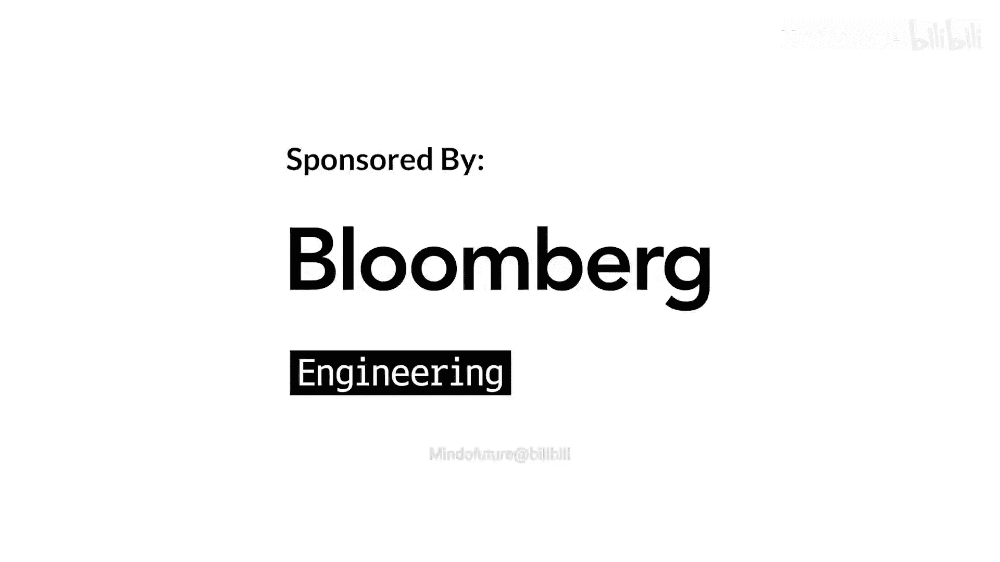
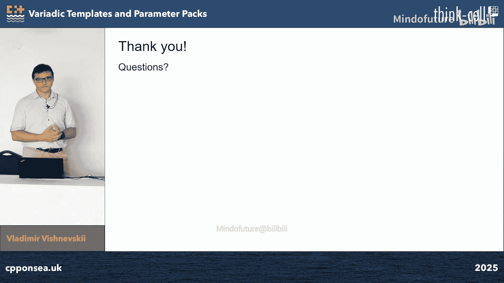

# 【Cpponsea】C++-On-Sea-2025大会-p08-P08_C++_可变参数模板_和_参数包-弗拉基米尔_维什涅夫斯基_2025--BV17V4GzjE6p_p8-

So thank you very much for joining the talk。So my name is Vladimir Vishnisky I would like to offer this topic that is called very Adding plates and parameter packs so when I would like to offer this topic I find it to be important yeah so this is really essential for modern C++ design this is a feature of the language that enables a lot of different standard and third party facilities and at the same time can also be used not only for just complex designs and complex framework wheres it also can be useful for just creating flexible custom facilities。

So and efficient。 This is a C plus plus fundamental stock。 Okay， so we will be。

Exploring some concepts， we will not go deep there。 So we will also look at some。

Applications and I think the best outcome will be if we actually familiarize with those concepts and see how they can be used and also have some direction for further learning after this talk and I'm also trying not to target some specific standard so most of the talk is of course indicated to c plus+ 11 and beyond but I try to use the most kind of generic implementation but I will be highlighting when some specific standard features are used。

あ。Okay， so。Before we start with very templates， I would like to also maybe make a small refresher about templates in general yeah so very。

 very， very short and without that much of the detail so I think everyone so I'm expecting that we are all familiar with this syntax yeah so here we have class structured template on the function template yeah so let's look a bit with more details into the class template。

So I hear I extended a bit example。 So we have here static vector class static vector class template。

 So this is some vector like container that can have pre allocated storage of some。

Compile time specified class size sorry。It has this template has two parameters。

 the one is time template parameter that is here has name T and another one is a nontime template parameter that is capacity。

 so the maximum number of elements that it will be able to store。嗯。

So the way how this will be handled and how we will and how we can use this is depicted on the next slide。

 yes so we to use the template we need to instit it so and how the instantation and then substitution of the parameters by arguments will be handled by the comp is depicted here so。

嗯。When we in， template and provide the arguments for the template parameters。

Those parameters inside the template body will be substituted by provided arguments。

 So it will produce the concrete class。 It will not be template anymore。 And for each of the。

Prameterters， the corresponding argument will be just used instead of the parameter name within the code body this is for like nonvariic templates。

 yes so here we have an integer that will be used instead state instead of t and we will have just a value that is a non-time template that is an argument for non-time template parameter that is 10。

 it will be then used whatever capacity parameter was used inside the body of the template。So。嗯。

This was of course available before C++ 11， and it was possible。

 of course to have more template parameters， multiple template parameters for class template of a function template。

And of course， it's much more about templates that。So there can be also template template parameters。

 There's much more information that is available for templates， and it's much more complex topic。

 But I think it will be sufficient as an in topic。 What I wanted to highlight is that it was possible to have multiple template parameters。

 of course， but it was not possible before C plus plus 11 to have actually arbitrary number of template parameters。

 Yeah， so there were techniques to somehow work around those limitations。

 but generally on the language level， it was' not supported。

 It wasn't possible to have arbitrary number of template parameters and be able to handle this somehow in a generic way。

And this was introduced in C++ 11 in the form of the veric templates and parameter pes。

So the following syntax became available in the language。 Yeah， so here we have。No， the。

Vad templates and corresponding parameter packs。 Yeah。

 so here we have function sources sorry here we have a template parameter packs。

 so those specify the types。😊，And we also have。For function templates。

 we also have a function parameter pack that actually corresponds to the。

Prameterters of the function。 Yes， so those， it will then。Hold the values already。

 not the types of the arguments that be provided when the function will be instantiated。And cold， so。

So a couple of details about the parameter pack。 so parameter pack is a named entity that represents a group of arguments those can be types of values depending if it is a template parameter pack or a function parameter pack and those packs they correspond to those types and values that were used to instantiate a template。

 Yes， so a pack can be empty， it can be zero or more it can have zero more items。

And inside the template body。Packs should be explicitly expanded。

 so we should specify how those packs are used， so it's not that we just place them and they will be substituted in the trivial way as it was in the nonvariictant plate。

 but we need to explicitly specify how they will be expanded and propagated inside our inside the code of the template。

And this can happen within some language。 So standard specified contexts。

Of course there are so in the talk I will try to cover most of them。

 but the comprehensive description is of course available on the CPP reference and of course in the standard and there is so just but I hope that we will at least cover the most use of those contexts and let's now look into those application of the parameter packs how we can use them and also generally do this using examples and yeah hopefully。

We will cover most of those potential usages。So the first example of this is。For the first。

First example demonstrates three expansion contexts that I think that are among the most used。

So here in this example， we are trying to so we are actually implementing some container or some facility that actually wraps a standard tuple and uses it as a backend storage。

So this would be a very addicting plate。😊，Su。And Ts is the template parameter pack。

And to use some topple as a storage， we need to provide。The arguments for a Tple template。

 so to say that we are going to store those items in the storage。

 and this is one of the expansion contexts that is supported for template parameter packs。

It actually can be expected into template argument list。

 So here our storage T will be a topple that stores the types with which we will instantiate our topple wrapa。

Next expansion context is actually a function parameter list。 So we have those。

 So here is the top wrapper constructor。 So we will need to propagate the values with which we with which we will construct our wrapper into our storage we use。

Of our pack and expand it into the constructor parameter list here。And。

This would basically generate for us the set of parameters of the function based on the types with which the report will be instantiated。

And the function parameter pack that is arcs here， we then expand to initialize our backend storage。

 so actually in the member initializer list so we initialize the storage and we just expand the values that will be provided when the constructor will be called into into the initializer of the storage。

Let's have a bit closer look into how this happens， just for this example。

 think will be beneficial to also have this kind of substitutional layout。So。Here。

We institute our tuple wrapport with two types ingerent float， and we provide some values。

And here we see that those types that were used for instantiation。

They are propagated into the body of template as a part of substitution。

 So as a like as we specified during the by the expansion。

So and expansion sur just also probably was already visible from the slide。

 but do the expansion we use the ellipses so on the typically on the right side of the parameter pack。

 but there are exceptions for this we will cover them so here we see that on the right how the code was transformed as a result of the substitution。

This is a trivial， are the trivial examples of expansion。

 there are more complex and let's start covering them。

 so it's not necessary that we expand those parameters as is。😊。

So we can actually apply some operations on them。 and here there is also one of the most probably common examples of。

Applying some operation to the parameter， just basically some using forward in reference with forward。

 Yes， so here we have some factory function that。Would create topple for us。And it has the。

So it used the forwarding references to basically perfect forward in the arguments into the top rep constructor and here we have SDD forward as an expansion pattern。

 so this is an expression。😊，That will be applied to each item within the expanded parameter pack。

And also what is important here， within this expansion。

 we have actually two packs that are expanded simultaneously。

 we have our Ts that is a template parameter pack with the types， and we also have arcs。

 this is the function parameter pack。So basically in this expression。

 the corresponding arguments will be then forwarded according to the corresponding types with the template parameter back。

Another expansion context over actually not looking exactly like expansion。

 but it is an expansion context is size of of perta like this specific size of that accepts the parameter packs。

 so it can be used to get the size of parameter pack。😊。

It's listed as an expansion context and it has usage， that's why let's definitely cover it now。😊。

Let's look at this potential implementation for make area function。

 Yeah so like here make area is a helper function that produces array of some specific types from the provided argument。

 so here internally what is happening is that we need to somehow especially before c plus plus 17 yes so we need to figure out the size of the array on the compile time and here we know that we will that this function will have the parameter pack of that size and this size will define the size of the of the resulting error。

So we're just using size of here。呃。With the passing the parameter pack over it is listed as expansion。

 you see that the syntax is slightly different here。 We really do not expand the pack。

 we don't use ellipses somewhere inside the size of us just。あ。

And here we also have another expansion pattern we use forward。

But also construct the object of a type T。 So this is this pattern became a bit more complex。

 So we have a construction of objects for each for each item within the argument parameter pack。

So we function parametermeter pack， okay。嗯。😊，A bit of the bit more extended examples for those expansions that we already saw。

😊，嗯。We can expand packs into initialize a list。Quite。Use technique。😮，Because we。

If we expand something into some form of the into initializer list or in some container。

 we actually can handle this within the function body in a quite convenient way within the loop。

 for example， here there is a。Based some implementation of a sum function that receives the values and just returns the result of the sum of all of those values。

It is implemented。In a way that we just have the initializer list within which we exp the function parameter pack and then just use the standard loop over these elements and just add them together。

So。We need for initializer list， we need the common type that's a limitedative。

 of course because we initial the initializeizer list should contain items of the surveillance of the same type。

 so here we can use some initial value that is the first argument when the sum function is called as a result type and also as the type within the initializer list。

And this can be con expression since C plus+ 14， so C plus plus 14 significantly relaxed the requirements for con expression。

 so it should not be recursive anymore we can really write write this contrast or conory construct and have this evaluated on the compile tab as a con expression。

Okay， another application for initial expansion in the initializer list， especially before C++ 17。

 was actually to perform some operations on each item of the function parameter pack。

Here this example is a bit more complex， let me inspect it and clarify what is happening here。We exp。

Fun parameter pack here in the initializer that actually int initialize this。

 So it's associated with int。 So it expects ins。In the initial initial initialization。

 but what is happening here， we have some operationition that we need to perform on each item within within the parameter pack on each argument that was provided。

嗯。😊，This operation is then followed by comma curator。

And the comma operator is quite interesting one because it actually evaluates the left or。

 discards it， then evaluates right or and returns the value of the right opera。

And also the type of this operation would be the type of the right opera end。

 so what is happening here is that this output into standard out is just discarded over it performed。

 it is evaluated， it's discarded， and then the0 the value that stands on the right of the comma operator is actually propagated into the initialization of initial list。

So this is a bit of the technique that is。Used to really perform an operation on each item。

 because we cannot just simply look through those items。 And what is important here。

 we do not need some common type for that。 This all of those factors。 So those types。

Of those arguments that are provided here。 So the arguments here。

 they cannot all be off the different types。 We cannot put them into one container because we don't know in general。

 those types。 And here they are handle generically。 So shift operator in SDC out。

 it actually can handle various types。 And if it can handle it。 So this code will work because it's。

 again， just。The arguments， they are just propagated into the operation that can handle them。

 so without knowledge of the types that are used there。That were okay。So。Here。

 also not necessarily in Scher list， also Eric can be used there， so just different facilities。

 but the technique will be the same。Okay。😊，Another。嗯。Let's do that after。 Okay。

 let's do the questions something。 So another technique that and actually another expansion context that I also wanted to mention。

 this is available since C plus plus 20。 This is the expansion in their Lada captureist， so。

We can expand。The parameter pe inside。A lambda capist。

 so that's how we can propagate the those values into lambda。

And then we can use it inside Lambda function。Of course， we can also use the reference。

 we can capture those values by references here。 please consider that， of course。

 capture and by reference， the same consciousness should be applied as we always passing something by reference。

 So here we here not the values passed by reference。

 So our do something a sync function also now receives references so somehow we propagated by references。

 So the lifetime is considered to be managed by the client called here。

And also we can move into the lambda function。 So here it's an interesting， again。

 slightly different syntax for expansions。 we expand arcs into move operation。

 and here the actually the ellipsis it precedes。 So it's like looks more like a definition of another of another parameter pack。

 But the idea here is that that the arcs， it's a new，' it's a new。😊。

It's a name of the capture within the Lambda and it will store the items that were moved from the context whereda was created and what this a is just a name for the capture。

 it can be different so it's not that the same name should be UC or just I see this pattern quite a lot。

 just wanted to clarify that we can rename arcs here so it's just it will be then the local for the inside the Lambda。

The name。Okay， another expansion context that also is quite peculiar is alignment specify so if。

Probably not。 there is no daily usage for that， probably。

 but if we develop something like a variant that's supposed to hold。

That should be able to hold different types， we need to。

Probably inform enforce some alignment that can that alignment that will be defined by the types that the variant can store so here if there's some just alignment line from the potential implementation for this variant and we can use alignment specifier also with pack expansion the interesting thing here is that when as a result of substitution actually it's not that the pack is expanded within the alignment is that that there will be multiple alignment specifier applied to some object because that's how actually language uses this alignment requires this alignment specifier to be used and so that means that the expansion is not always resulting into like coa separated expressions。

 but it's actually really like context specific yes so how this is done and how this will be handled within within the within this specific context。

大きい。Yeah， so here is depicted for in float。 We have two alignment specifyacifier applied。

 and also here we also have an extension of our。Template parameter pack into the initial sorry of our template parameter pack into the initializer list。

😊，With size of operator so this is a normal size off， size off of the type。

 so it's not the parameter pe size of， we just need to figure out what is the maximum what the size of the area should be to hold the maximum size that our variant should be able to store。

😊，Yeah。Then let's past into Okay， another example that I think has quite some usage and also very elegant example of our。

Another contexts that have a lot of usage and I think very elegant example for it from CPP reference actually。

😊，It's surprisinglys not for for thes not for so the example is for actually standard student visit。

Yeah I'm not sure。 so hopefully you saw that before。

 the idea is that that we have the variant and we have the stood visit of function that applies some actually visitor to the variant and you can we can specify the so the the visitor it should be a some callable object that should have overloads for every item that we would like to visit and。

So it would be convenient to use it with Lambda。😊，But we cannot overload Lambdas basically。

 So and this oralload facility just combines those Ladas。 Yeah， so this is and the usage。

 the implementation of his overload is really is very elegant and quite trivial。So。

What is happening here， so when we are calling overload， it's initialized with some types。

Every lambda it produces the unique type here so this is how it is guaranteed by the standard。

We have a deduction guides as a C plus plus 17 deduction guides that specify that items that are used for initialization of these overload facilities overload object as supposed also will be used as the as the so the types of the items that are used for initialization will be also used as the arguments of the overload template itself and in the implementation of overload what is happening。

 those types with which it was constructed are actually used as a basis as basis for this overload so here we have expansion into basis。

So our types that are complete parameters for our overload。

 they are now the basis of the overload object itself and also the operator call operator is also exposed to be available from the object from the basis so is exported from the basis into the overload object itself so and this is how this works so that means that when this will be called within the visit function。

 the corresponding overload corresponding call operator will be called so it just aggregate several lambdas into one object that is actually quite convenient。

😊，And also here in this example， it's not present， but also it is possible call to initialize basiss。

 also expanding the names of the basis in the member initializer list。Okay， so far we saw that to。

Handle the parameter packs。Two primary approaches were available。 yeah， so we had。

We could use recursion。This is primary was C plus plus 11 technique。

 We also could expand our parameter pack into some initializer or into some container depending if we so depending if we。

呃。Try to implement con expression function or not because con expression was quite limited for C++ 11。

So there were some techniques available， but there were no。So they were they all required。

A bit of complexity that's called like this。 And C 17 just introduced special facilities to actually handle the packs and to apply some operations to each element of the pack。

 the so called fold expressions and。😊，Using C++ 17 fold expression。

Our some function that we introduced earlier can be actually implemented in a quite simple way。 Yeah。

 so this is the fold expression here。 this ellipses within operate。 So the fold expressions。

 it's an expansion of the pack in a quite specific way we will cover this here here we have binary left fold。

 So this so left or right defined where the ellipsis actually stands and binary because we also have some form of initial value。

 So this would so this would be expanded and substituted in the following construct。 Yes。

 so we have if we call this function with some parameters。With some arguments。

 it will be substituted in the following construct。 Yes。

 so we will have initial value value to which the first argument will be added。

 And to the result of this argument， the second argument will be added。 So I mean。

 the initial value is actually the first argument of the function co。 Yeah。

 So let's to be more precise。 Yeah。 So when we call it here， this would be one one two will be added。

 And we everywhere here， we have different types as long as as operations are defined for those types and compiler can support this。

 this will be a valid construct。 So we again， we do not need to deal with any types here。

 So we just apply the plus operator to any item within the pack and。This is the binary fault。

 there are several types of faults， so we we have owner faults， we have binary faults。

 On fault doesn't have any values just operates only on the pack items。

The way how this is expanded is depicted here。 So yes， so what is the honorary and right sorry sorry。

 right and left in the right case， we have。First first argument to which yeah。 So here we can。

 we can see that。 Yes， we， in case of redfall。 So we have the the the first argument。

 and then there is an operation with the result of that is evaluated kind of applying the same operation recursively to the rest of the pack and opposite we first。

Apply operation between first two are between two first two elements of the pack and then handle the rest in case of left fault。

 Yeah， so this is how I'm sorry we don't yeah。I I that sorry。

 I thought that there is a pointer there。 It's not there。 apologies， yeah。Okay， better not to move。

We can look at this a bit later。 Yes or that afterwards。 So we can also have。

 we can also use only default here。 So this is the just the this is the。Theres some implementation。

 we don't own a re。😊，It has， from my point of view。

 this's not ideal implementation because the interface for this function is actually not clear if it handles the empty pack。

 And we， as we know， the packs， they actually can be empty。

 So the call can be without any arguments at all。 So from design point of view， yeah。

 it' basically hides the fact if。It looks a bit better if there is a explicit argument for one single value if we require that it should be there。

 because actually the plus a operator and the full expressions with plus a operator。

 they do not support the empty packs。 Yeah， so this will be a compation error。

 And from the from the design point， if you's not clear if it should be actually used like that。

 just wanted to demonstrate this that we can use actually only the re here as well。

So that's how it looks like， yeah， so then just without any initial value。

 there will be a summ for all the items within the pack。For the emptyPs。

 only three operations are actually supported。And they have a default default kind of results if applied for parameter for empty pes。

 so this is the logical and logical or and coop。And logical and logical and sorry logical and applied to empty pack evaluate。

 so true， logical or false and coma evaluates basically to avoid expression if no if no parameters if the pack is empty。

So yeah， if we look at how this would look like in the code， yeah， so if we call our facilities。

 or are true or at least one is true yes so that are just using those or and or logical and or logical or operators for for the pes and call them with empty packs those static expressions will evaluate to true yeah So I mean。

 those static expressions will pass aesthetic static excory will pass。オッケー。So so far， we were。

Using those。Okay。So we were just reviewing。🤢，Only simple expansion context is where basically。

Quites so。Were。We were propagating the packs or handling them in the。

Into other either containers or in the trivial， like arithmetic operations。

 But it's not necessary should be that trivial code。 Yeah， so here is a really simple facility that。

嗯。Performs。operation。嗯。That basically implements the deletion of some set of paths on the file system。

 yeah so some resources on the file system。嗯。Call deleteletto。

 and it just deletes all the paths that provide us arguments when it's called。

Alternative implementation， it would require that we either pass the initialize a list there or if we pass some form of the some temporary container here we can just list them so this is just a convenience and convenience facility。

And to implement it， we can have different approaches。 Yeah。

 so the one is basically to expand this into， again， internally into to initialize a list。

Convert everything to paths so basically visualize paths from everything that is provided。

If it will be possible to convert， then we will not have any compil issues here。

But we also can do this using fold expression and with fold expression。

 we can just apply some function to every item of the function parameter pack。

But we just perform any operation， so we just perform。

 we just call a function with each item within the parameter pack。嗯。

We can have more complex logic that will be performed on each item of the parameter pack。😮。

We can just encapsulate it into Lada or just into function and call it。

The sameme way as we did before。So。嗯。Again， Lada can be generic。

 so that means that we also do not need to figure out what type our arguments have。

What types do they have？Okay。A bit more examples of the complex logic and the fold expressions。

 a bit involving example here， but actually quite interesting， I think， so this is a function。😊，That。

Searches for the item in the function parameter function so in the function that searches for the function argument that satisfies some predicate。

So find first， if。So to find something inside。 So we all again。

 willll use the fold expression within the fold expression。 We will search for this item。

 and then we will assign this item to our result that we will need to have outside of the fold expression here。

 So here we use the common type standard facility。 it will try to， if it is possible。

 it will find the common type that can to which the items within the parameter pack can be converted So we have。

we will have one default initialized it also should be default initializable in this implementation and then inside there will be this complex inside the fold expression。

 there will be a complex complex expression where turnernary operator will be used so we try to apply we apply the predicate。

😊，And then if the result of application of predicative is to true。

For the turnernary operator we will assign。The result to this argument for which it evaluated to true。

And we will again use the comma operator to actually specify the result of overall operation。

To be bulling and true。In case if prediK doesn't evaluate to true。

 it will be just false here and this will be all done in in the full expression with logical or operator。

 so as soon as the item as the predicate will be satisfied， the result will be assigned。

 the true will be returned， there will be no further evaluation of the predicate so it will be shortcuted so the item will be found。

What is interesting， starting from C+ plus 20， we also have even optional that can be used as constant expression so we can even have more reasonable interface here and also avoid a requirement that should be default initializable。

 yeah so we can use optional and return it。😊，In exactly the same way as we did before。

Quite important that we have quite many facilities that are now available in the con expressions and should be neglected。

Okay。H。😔，Okay。Another。Another。The topic。Would be we saw the parameter packs。

 we could actually operate on them， we could transform them。嗯。In some applications。

 it actually would be quite convenient to store them。

And how it can be done using a very simple facility that is called Tless here。So what it is。

 is's actually just a veric template that has no fields， nothing。😊，And how we store the pack。

 we just actually instant this one with the pack and if we just create an areaslia where we where the pack is used here just explicitly we use some set of the of the items some set of the some set of the types this would be our type list and those list of types there internally then will be our pack that we will store。

 So let's look at the example yeah so example， let's assume that we have some。

Schedler that corresponds that can be used to schedule some events。 Yeah。

 so we implement some class scheduler， and it's a very addict plate and it's perized with the event types that it can schedule。

 Yeah， so we can then internally store the events that it can support。

As a type list of the events and we'll call it supported events。So。

We can have then a function like a standalone function that will be using the scheduler to schedule some event and we can make it also very function that will always be parameterized with the types of the events that scheduler can can handle or we can just make the scheduler just a template parameter scheduler T here。

 So because that's how we can actually substitute schedule by some other implementation by Mo。

 And inside what we can do， we can just check if， for example。

 the type that we want to schedule is supported by the scheduler。

 So for this we need to figure out if our。If the type that we want to scale is in the list of the supported events。

For this， we need to have a facility easelisted。And。

We need to implement it and in this implementation。So this isnt list is basically what it does。

 It just extracts the pack from this from the type list。

 so we can look here so it has a so it's it's a veroradic function complete。

And it expects as an argument， type list that is instantd with a template parameter pack。

 So that means when it is called with some type list。D instantation will have access to those types。

Within the type list， and it is forwarded into the function that is in PE。

 it' a more generic function that just can check if the type is in the PE。

 the type T is in the pe yes。So。嗯。Yeah， so when instantd these type list matcheses those types from the type list here。

And how we can implement is an tech。 I also want to use this opportunity to show how handling of the specs actually evolved as a part of different meta programming techniques so。

This isn't pe in C plus plus 11。 if we wanted this to be available in the compile time had to be implemented only in form of recursion。

 Yeah， so here we had to recursively try to match one first item of the pack and then basically propagate the rest of the pack into the recursively into the same function and this how this can be done if we wanted this function to be con expression。

Due to limitation of con expression c plus plus 11。 Yes， so here what is happening。 Yes。

 so we have function template overload that actually takes the type it and the type of the first item and then just match if if they。

 if they match， then it is。It will evaluate to true。

 otherwise it will just recursively call this isn't a type back for the rest of the pack。And。

In C++ 14， that was already possible to implement it much simpler way。So this is same。

 it was used in the previous implementation as well。 This is a type trade。

 so it just relates to true so it has this valued value equal to true if those types are equal Yes。

 and this is also can be seen as a meta function。 So the function that operates with the types instead of values。

 Yeah， so what what possible since the plus plus 14。

 we could just apply this function for all items within the pack。

And just convert that into the actually the list of values and just use the normal loop to find something there。

 So this is already not a recursive implementation or still available in the compile time。

 So it's a con expression。嗯。Here， just a normal loop。

Performs the search for the item that if it evaluated to true yes。In C+ plus 17。

This can be done almost as a one liner。So we just apply using fold expression， we apply。

I same trade to every item within the parameter pack using the or operation。This。

becamecame much simpler now， yes， or this is it。And it can be even shorter if we just use the very button plate。

 so basically can assign some constant to the result of the evaluation of the expression here。Okay。

How's with the time have 15 minutes working。So。One one standard table that I also wanted to mention in the context of those various pack related techniques is actually to tuple。

 This is quite a convenient facility because it's， I mean， it's enabled by this。

 So it the the design of the stple is， of course， based on the very in place。

 but it also can be used to handle various packs because at first。

 it can store the items of the packs。 Yes， so like we can。

Use the topple to be a storage for the items of the types of the pack。 Yes， so for example。

 here we say， okay so as we saw， it's previously now a tuple wrapper example as well。

 we can also get access to all the items within this using apply function。 Yes。

 so the apply function can be called on the topple and then it can be a generic function where we will have a function parameter pack that will correspond to each item of the topple。

So that means that we can handle those items and turn the items in the topple into the parameter pack and handle them generically。

嗯。So this is a C plus plus 20 feature that is a explicit template parameter list。

 so this can be done if we need the types of the items of the of the top or we can use deco type yeah so just whatever I prefer this one。

And also there are some facilities for TO that allow to inspect the types。Of the items。

 so if we have some topple association， we can actually figure out what is the type of the on the compiler and what is the type of the item within the topple。

And also get the size of the tuple， so there are some pictures。Okay。

 now a bit about more recent additions to the standard like C++ 20 overs really since a while。

 but in C++ 20 the so calledled abbreviated form was introduced yeah so it of course works for parameter pes as well。

嗯。Here there is a difference。 Yes。 so in areviated form， we don't need to write template type name。

 We just use the auto and this and this would make this function function template。

Here the a is parameter back。mAlso。Vedict templates can be， of course。

 also used together with plus 20 concepts。So in both forms abbreviated and non abbreviated， so here。

We have some concept that constrains the types that should be in the parameter pack。呃。

Hope that we are all familiar with the concept concept is there basically some compile time requirement for the types of that we that can be applied for the template argument。

To verify if it actually can be used with the template。说。Quite an interesting application for this。

 Let's look at some not supported quality。 Yeah。 so we cannot actually have a typed veryadic function in C plus plus。

 So we cannot say that we， we want a type a function to。

Acept arbitrary number of arguments of some specific type。

 like this is not exist syntax or something like this。嗯。That should be a function template， in fact。

But before C++ 20 to enforce that all the arguments are of the same type。Had to really。

Use a bit more complex techniques yes， so we could use， of course。

 enable if or just use some static as internally， but with C assessment it became much simpler because we can just use concept same as or。

We can say that every。Argument should have a type that is same as int。So this made it much simpler。

 so it's quite a small application for these concepts for the parameter packs。Okay， let's go further。

😊，嗯。Yeah， so we just restrict that a big end using concepts。

And it's even shorter in the shorter form， so like really quite in the abbreviated form looks very nice。

 I think。😊，Okay， now a bit about the。Bright future。So C plus plus 26。Also。

 we introduce some more facilities to handle the parameter packs。

We will have direct indexing in the parameter back。 Yes， so this is quite interesting feature。

 I wouldn't say that it。我 have like个。Will be behalf have。Howll to say this。

Probably not for the daily usage I think， but at the same time there are applications where it can be necessary。

So here the template parameter pack be it actually can be inspected。We can take Els of the type。

And also。Function parameter pack can be expanded so we can take a value of argument。

 These are all compound and constructs。That it is possible。嗯。

Another feature that was added is also ver structured binding。

 This is also like looks very powerful thing and。This is an interesting example。Another the example。

 the feature will enable really some form of introspection。

So the example demonstrates how so we can have just a function template that would use the very structured binding。

 So here the pack items will represent the binded the binded items。And so we， we bind items to the。

Fields or items from any。To。To the to the items of the of the value of some type that will be。

Passed into the function。Print field values， yes。And then， we use the。Ourour。嗯。4in。

Expression to print the items so we can actually print the values of those items。So。In this example。

 we can just create some structure。Pass it into this function and get the items printed。

How this would work， it doesn't matter how many items and what are the fields or。

Everything that can be structured everything that can be used together with structured binding。

Can then be binded to this spec。Basically。我跟 blink乖。呃。Of course， I mean。

 this everything that is demonstrated here for all the types， it works if it compiles， of course。

So what I mean is that when we handle something generically， when we do the substitution。

 if substitution within the and the code that was generated as a result of substitution doesn't compile because some operations are applied to the type with which the template is iniate and not supported。

 this is substitution failure basically and there are there is much more about this。

 but generally if there is no viable implementation， then that will be a compiler error。

 so that's same and it was always like this and remains the same。Okay， so。

Actually don't have any recap for this talk because I think the talk was more like a recap itself and yeah。

 not that much to summarize， I think that we can then switch to questions。Thank you very much。

