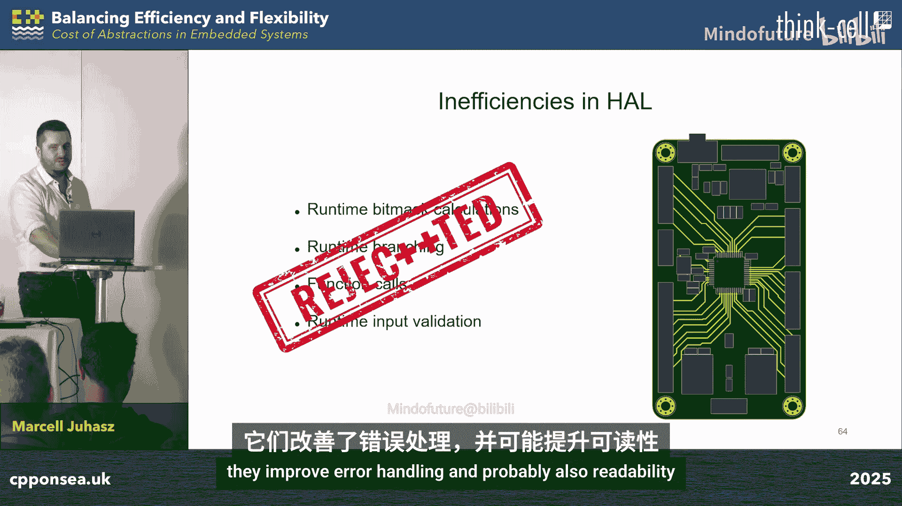
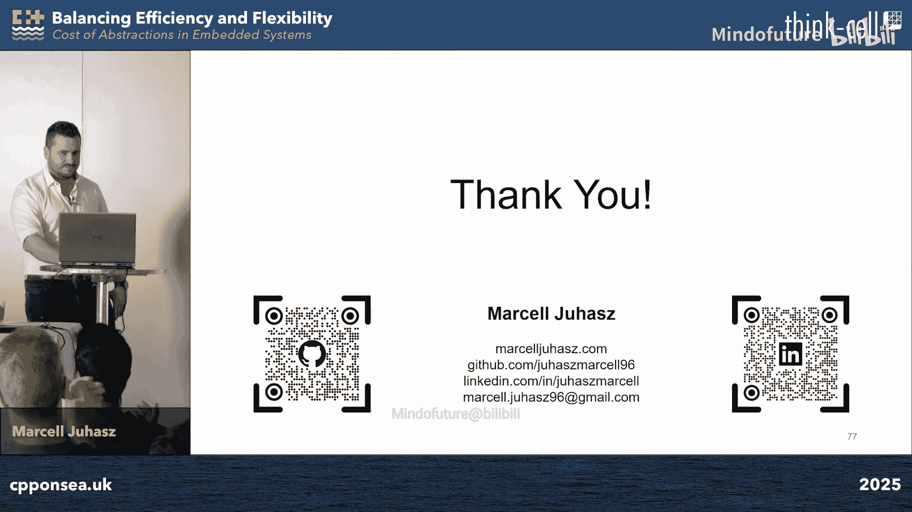

# 【Cpponsea】C++-On-Sea-2025大会-p09-P09_嵌入式系统中_抽象_的_成本-马塞尔_尤哈斯_2025--BV17V4GzjE6p_p9-

Hello everyone。 my name is Marllluas and welcome to my presentation about cost of abstractstructions in embedded systems。

Now let's start with a brief introduction about myself and I have a master's degree in embedded systems from the Vienna University of Technology and I have been working with C++ for over seven years now with the main focus on embedded systems in the last couple of years and my primary interest lies in applying C++ in resource constrained environments and this presentation。

You can find my contact information here。 And if you find this presentation interesting。

 then the whole project that led to it is available on my Gi。 so feel free to check it out。

I work at T engineering as an embedded software developer。

 we are a global innovative service provider we transform the ideas of our clients into products and business models。

 so if you are interested in collaboration or if you need help with any project and feel free to reach out you can find our contact information here as well。

Okay， so what was my motivation for doing this research and for preparing this talk since this is a C++ conference and you or really like C++ you will agree with me when I say that C++ offers a lot of powerful and versatile features there are some features that we as embedded developers could not really live without there are other features that we are not allowed to use and then there are a bunch of other features which are often debated in the community and everybody has their own opinion so there are people that say that C is as efficient as it gets and that C++ comes with inherent runtime overhead caused by the obstructions and some people say the exact opposite so it is sometimes hard to decide which features we can use and which ones we should avoid。

However， one thing is clear， if you are talking about embedded systems。

 then one of the most critical factors is overhead。

 overhead in terms of memory usage and runtime performance。

 as both the available memory and execution times can be limited resources for certain embedded systems applications。

So to clear up the misconceptions， I went ahead and investigated this issue and I gained valuable insights by doing this research and by putting together this presentation。

 and I hope that this presentation will provide you with some valuable knowledge as well。Okay。

 first and foremost， it is important to point out that this topic will be discussed from an embedded systems point of view。

I wanted to go as low level with C plus+ as possible。

 and I wanted to observe the effects of abstractions as close to the hardware as possible。Therefore。

 I will primarily be focusing on the Arthur obstruction layer as this is the layer that sits directly on top of the microcontroller。

And we will be primarily focusing on encapsulation， inheritance， and polymorphism。

But we will also identify inefficiencies in the current hardware abstractstruction layer implementations。

 and we will see methods that allow us to deal with these inefficiencies by leveraging some of C++'s more advanced features。

First， I would like to talk to you a bit about the methodology so the setup。

 the workflow and the metrics of the measurements that I used during my research。

It is probably not a surprise to you that I started out with the source code。

 I implemented some functionality using C using the provided hardware abstractstruction layer。

 and then I started to introduce C plus plus to the code base。 I started to add abstractions and。

When analyzing the effects of abstractions， it is important from my of my point of view to。

To be able to analyze them in isolation。 So the best course of action is to leave as much of the original code base and untouched as possible and to change only the absolutely necessary code sections。

So I took the source code， I cross compiled it for an SDM 32 microcontroller， I optimized four size。

 that it is often a limited resource。In this step， I could also measure the compilation time。

And then after completionil， assessing the binary size is pretty straightforward。Then on one hand。

 I looked at the disassembled binary。 So I wanted to see what actually gets executed on the microcontroller。

 And this way I could gain。Some valuable insights into the runtime performance from an analytical perspective。

And for getting empirical results， I flashed the target。 I executed the firmware on the target。

 and I measured the execution time。I will primarily be focusing on binary size and runtime performance。

 as these are the two resources that are often limited for certain embedded systems applications there are microcontrollers with as low as 16 kilobys of flash memory or maybe even lower and as for runtime performance。

 there might exist certain real time requirements for certain projects。

 but even when those requirements do not applied and still。Probably the。

The shortest possible reaction time is still required。Okay。

 a very important concept that I want to introduce is the base firmware because this will serve as a basis for comparison for both the binary size and the disassembled binary。

 and I simply define the base firmware as the absolute minimal em project consisting of nothing but a main function with an empty infinite loop。

However， embedded engineers probably know the best that the main function is not really the entry point of an application。

The first thing that gets executed is the startup script。 This is often written in assembly。

 and it is responsible for defining the vector table for setting up the stack pointer。

 copying data between between flash and Ram， initializing global and static variables。

Calling static constructs and then eventually calling the main function。

The third thing that is very important for any em system project is the linker script。

 which basically specifies the memory layout of the application。

So as you can see there are quite a lot of things that are happening even before the main function is called and it deals with an empty main function that does's basically nothing。

 we are already around 2 kilobyte for both C and C plus plus。Okay， before we can。

Start building layers of abstractstructions。 we need to identify suitable places where these abstractions can be usefully and meaningfully integrated in the source code。

Therefore， I just want to quickly go through an example implementation of the hardware abstractstruction layer and show you how they are implemented today。

So the hardware obstruction layer provides data structures。

 we as embedded developers we can instantiate and populate these data structures according to the necessary configurations。

 and then we can use these data structures and call the hardware obstruction layer functions and pass these data structures as parameters to these functions。

And these functions take our populated data structure， they do some initial input validation。

 and then they branch off and execute the necessary calculations。嗯。Yes。

 and one of the most important things that the hardware abstractstruction layer does for us is that it hides the complexity of actual register operations。

 So as you can see， hardware abstractstruction layer is full of such register operations。

 and for these operations， the hardware abstractstruction layer calculates the necessary bit masks。

And these bitM calculations are also based on the populated date structures that we have just passed them。

Now that we have an idea of what we are dealing with。

 we can jump right into the main topic of the presentation and start building layers of abstractions。

So， yes。Yes， so the question was whether。A microcontroller contains the source code or。

The program as an binary executable， basically in memory or whether it becomes the hardware itself。

 The answer is it sits in memory。 It is not like an FPGA。 It is a microcontroller。 So when we。

Comped the project， I loaded the firmware into the flash。

 and the microcontroller just starts reading the。And executing the instructions from the memory。Yes。

 so as you have seen， the hardware obstruction layer is full of such register operations。

 And if we look at the register operation like this， we can identify at least two places where。

Absstructions can be meaningfully integrated。 There is this part of the register operation。

 This is the generic part， and there is these register specific parts of the register operations。

So the generic part of the register operation， it handles the manipulation of every bit in the register。

 It is independent of the type of the register。 So it doesn't matter if this register， for example。

 handles the。The voltage on some GPIs， or maybe it handles the configuration of an analog digital converter from the point of view of the generic part of the register operations。

 it reads the value， it modifies it and then it updates the value of the register。

And this is where the register specific part comes in。 it is responsible for calculating the bitmask。

 at this point， it is important whether bit5 of this register sets a voltage of a GPO from low to high when or maybe it initiates another another digital conversion cycle。

At this point。This register specific。Implementation must know the meaning of every bit in the register。

 and it must provide meaningful member functions for interacting with the with the register。

Okay so let's look at the first abstractstruction that I want to introduce this is encapsulation meaning classes we have seen that the generic register part and this register specific parts of these register operations can be usefully encapsulated into classes so represented it as a UML diagram it would look something like this this is just an example。

 so there is this C register class this is the one that is responsible for the generate register operations and then there are these register specific classes that introduce a unique register specific behaviors。

I just want to go through simplified implementation so that we all know what I mean。

 So the C register class， as I've said， this is responsible for the generic register operations and every register of a microcontroll that is mapped into memory。

 This means they have a memory address so that they can be accessed via simple memory access operation from code。

This also means that every register must have an address in memory。

 and this is now stored as a member variable。And as I mentioned before。

This class is responsible for handling the registers in generate query。

 this means setting the whole register， setting only parts of the register based on a bitm。

 and we will get to it later， clearing the register and other operations like that。

As for the other register classes， these are the ones that are responsible for the unique register specific behaviors。

And these are still register。 So at the end of the day。

 they will have to set the actual value in the actual register。

 and it probably already occurred to you that this would be the textbook case for inheritance。

 But just wanted to remind you that I wanted to。Analyze the effects of abstractions in isolation。

 and we start out with the encapsulation， so。We will get to it later。

These classes are responsible for calculating the bitmask that are used for the or in the register operations。

 and these classes also provide some useful and clear interface for interacting with the underlying register。

 So for example， here calling the set mode function with the corresponding and values can be much clearer and more readable。

And then。Just shifting some bits around。Okay， so applying these changes to the code base。

 we already get to more。Readable and clearer implementation。And there are no more。

B must calculations all over the code， and there are no more exposed register operations。

Before I answered the question about the cost of this abstraction。

 I just wanted to mention this nice side effect of incapsating the register operations this way。

Because。You have seen that the hardware obstruction layer is full of these register operations and these register operations。

 they are accessing fixed memory locations， these fixed memory locations are the addresses of the registers in memory。

And you probably all know that desktop applications do not really like it when you're accessing memory that is not yours。

 So generally speaking， these firmware applications cannot be executed on the host machine。But when。

The register operations are encapsated this way and then this also means that all of the memory access operations are centralized in this single class and this allows us to simply replace or in other words to mo the implementation of this common C register class and I've also used this feature by putting together this presentation or by putting together the source code for this presentation。

Because one time the analog digital converter produced some suspicious values。

 and I wanted to find out what went wrong and。You probably know that testing on the target can be quite complex and time consuming。

 and this way I could simply replace the Cre classes implementation with one that did not access an own memory anymore。

 It simply logged to which addresses I was accessing which values I was writing to which addresses I I could compile this code on my host machine for my host machine。

 I could execute it directly and I could see the output and I could find pretty fast which configuration steps I was missing。

 So this is just a useful side effect。But back to the original question， what is the。

Cost of this abstractstruction。 the answer is nothing。

 It comprislies to the same binary as to the original C code。

 And I think that this is quite a good price to pay for all of the benefits that we have just gained like readability。

 maintainability and even testability。This is all nice and good。

 but for me personally it makes more sense for the register classes to have static member functions so that I can call these functions without having to instantiate the objects first from a technical point of view this is possible because the registers don't have internal states anyway and personal preference。

 but for me this code is more readable。So from looking at the implementation。

 it is quite straightforward。 I just made the。The C Reg object static member of the specific Reg classes。

 and I have also made the member function static as well。When I compile this code。

 I noticed a slight increase in binary size and。This increase might not seem much at first sight。

 but if you can remember back to the beginning of the presentation。

 we have discussed that the base firmware's binary size is already around 2 kiloB。

 so the difference in binary size increase is quite significant。And of course。

 I was wondering why this increase happened， so I looked at the disassembled binary。

And what I found that。A routine with these prefis appeared in the binary。 And if you think about it。

 it makes quite a lot of sense because what we have just done。

 we have made the Cre classes static members of the specific register classes This also means that these objects now have static storage duration。

 and static storage duration means that their lifetime must begin before the main function and must end after the main function。

 and subsequently this also means that there must exist some piece of code that is responsible for initializing these objects。

And if we look at the binary， if we look at the application。

 we can see that there is a part that executes before the main function is called。

And this is where the startup script or the startup code is executed。

 This is also where the C runtime initialization happens and this is also where the global aesthetic objects are constructed as part of the C plus+ runtime initialization。

And this is exactly what this function is responsible for。Now。

 I also must add that this would not affect the runtime performance of the application because this code is executed only once before the main function is even called。

 It only increases the start time， and it increased it。Increases the binary size slightly。

 So the question is。Can we get rid of this binary size increase by still keeping the static function cause。

And the answer is， yes。 One option that we have is to make the C register class a templated class and to pass the address of the register as a template parameter now。

From a technical point of view， would this make sense if you think about it。

 because the addresses are not runtime variables。 they they are known at comp time and they do not change at run time。

 So it's definitely at least a choice to consider。Now， when I compile the code again。

 then the binary size returned to the original and the binary contained the same content as the original C code。

Now， the question that maybe you're asking， at least I was asking this question。

 why did this actually help， Because the。The C register objects are still static objects。

 why don't they have to be initialized now before the main function as they did have to be initialized before？

And the answer to that lies in the template。 So if you can remember every register has an addressing memory and in the original implementation。

 what I did is that I added a con member variable for the address。

 but we have to remember that conency plus+ doesn't mean a compile time constant。

 even if it leads to undefined behavior， you can still change the value of a con variable at run time。

But passing it as a template parameter， this now means that this is a compile time parameter。

And now these classes， or the C register class is fully defined at compile time and the compiler can do a lot more optimizations for us。

Okay， so we have looked at encapsulation。 Now， let's see what inheritance brings to the table。

 As I've said before， this。This is the textbook case for inheritance， there is the C register class。

 it is the B class， it handles the generic register operations。

 and all of these other register specific classes these are C registers。

 they need to have access to the generic register operations but they also extend the behavior of these registers by their unique register specific implementations。

The implementation here again is straightforward， it is a simple inheritance。

 I've just made the C register class a base class for every specific register class。Other than that。

 it stays the same。Now what is the price that we pay for this？Abstraction， again， it is nothing。

 The code still o the same as the the original C code。 And I was actually glad to see these results。

 because when we are learning C plus， plus in universities or school schools， maybe as beginners。

 we are often warned about the。😊，The runtime overhead associated with dynamic polymorphism。

 and since dynamic polymorphism requires inheritance。

 the associated overhead guide might get mixed into with pure inheritance as well。

 but as demonstrated here， when you are using inheritance on its own it doesn't introduce any runtime penalties。

Okay， so let's look at polymorphism。 Polymorphism is a larger and more complex topic when it is discussed from a runtime overhead point of view。

Hincapsulation and inheritance could be successfully analyzed at the lowest level possible so at the level of register operations。

 but to meaningfully integrate polymorphism into the code base we need to move a little bit higher than that。

 So let's imagine this very common scenario where we have an em system application in the form of a printed circuit board。

 So somewhere on this PCB there is a microcontroller。

And there are a number of peripherals interface to this microcontroller。 Now， in this scenario。

 our job as embedded developers is to。Implement the interface between the microcontroller and the peripheralphers in form of some hardware modules such as GPIOs a of digital converters or some kind of a communication bus。

🤧Now。One option that we have here is to use the hardware abstractstruction layer directory in our implementation。

And this works， of course。And if you want to port this code between different devices of the same manufacturer。

 this will probably be easy because the interface of the hardware abstractstruction layer is kept consistent across devices exactly for this reason。

 but problems will still to arise when you want to port this code between different devices of different manufacturers。

 because then you have to adjust the implementation of this external peripheral interface for the new hardware。

And this can be quiet time consuming if the peripheral is complex。

Another way that we can achieve the same indirect。Or the same goal is to use some kind of an indirection。

 So as you can see here， the external peripheral interface shown in this basic diagram doesn't interact with the hardware abstractstruction layer anymore。

 So in a sense， we have made it hardware independent。

 And we introduce some indirect to the code base。 This also means that。

It is easier to port this project to a new hardware。

 and it is also probably easier to find existing implementations on Gitthub and probably the first thing that pops into your minds when looking at a diagram like this is dynamic polymorphism。

In dynamic polymorphism we have virtual interfaces and the external peripheral interface interacts with the underlying hardware abstractstruction layer through these virtual interfaces。

 these interfaces are therefore hardware modules such as GPOOS and ADCs。

And if you want to port this project to a new hardware。

 all you have to do is implement realizations for these interfaces， support these hardware modules。

🤧嗯。Yeah， so I think that this is the the level where polymorphism starts to make sense。

 and this is also where I analyze it its effects。So let's look at an example。

 simplified example implementation。 So as I've said before。

 we have interfaces such as this I interface。 This is an interface for a hardware module。

 This is an abstract class， and it provides the necessary virtual functions so that you can interact with the underlying hardware。

The CL class， in this case， is the。External peripheral interface。嗯。

Probably an LED is the simplest device that you can interface the microcontroller。

 but it will be sufficient for demonstration purposes。And as you can see。

This CLED class doesn't use the hardware abstractstruction layer directly in the implementation。

 what it does is that it interacts with the underlying hardware through the eyePN interface。

The sipping class。This is the class that uses the hardware abstraction layer directly in the implementation。

 so this piece of code interact directly with the hardware。

 and this is the piece of code that you have to reimple if you want to port to an another device。

But of course， it can be a lot less work to port this piece of code than to port all of the other implementations。

At this point， knowing your language， knowing your compiler flags and knowing your compiler becomes important as well。

 because as you can see in this diagram， whether runtime time formation is included in the binary。

 it makes quite the difference when it comes to binary size。And。

It is probably always best to read into the documentation of the compiler， but as for GCC。

 it states that if type ID and dynamiccast are not used， then un type I information can be excluded。

So if we look at the implementation without runtime type information that we can see。

From the binary size that it complies nearly to the same binary。

 same binary as did the original C code。 there is a slight increase in binary size。

 This means that there is some difference in the binary。Of course。

 I wanted to see what this difference was， so I went ahead and looked at the disassembled binary。

And all I could find is that the set and the reset functions。

 so these are the implementations of the virtual functions。

 these functions were not in lined in the binary。AndThis was strange to me at end the surprise because when we are talking about dynamic polymorphism。

 we are often talking about the indirectction in the code。

 So we are talking about virtual table and we are talking about virtual function callss。

 But these were nowhere to be found in the binary。 So what happened to this。Promised overhead。

The answer is the virtualualization， so in short what the virtualualralization does is that it is the process when the compiler can decide statically at compile time。

 which functions it should be calling so that it can produce a direct call to that function instead of calling the virtual functions through the interfaces and in my scenario this is exactly what happened as also shown in this code snippet both the CPN and the CLED objects are statically allocated so the compiler could decide at compile time which functions it should be calling。

Now to give you the full picture， I also must add that theralization works to a different degree for different compilers。

 sample compilers can do a deeper analysis of your code and resolve a deeper indirections while other compilers simply cannot。

 so for this reason I also wanted to look at the textbook case of dynamic polymorphism and I wanted to see what the actual overhead of a virtual function call is。

那哎。Modify the source code so that I created a scenario where the virtualization cannot apply。

 I compiled it and I looked at the disassemb binary and I could find the virtual function implementations。

 So if you can remember back， these are the set and the reset function of the seeping class。

These functions are simply residing at some memory location in the binary。 When I looked further。

 I could also find the virtual table。 The virtual table is nothing magical。

 It's simply a block of memory。 It sits somewhere in the binary。

 and it contains the memory addresses of the virtual function implementations for a certain class。

 so。Don't get deceived。 I'm not lying。 These are actually the addresses of those functions。

 Only the least significant bit is set to one。 And this is only for the time instruction set on estimate 32 microcontrollers。

For jump instructions。Let's look at the disasseble binary and see what the overhead of such function callss is。

The first thing that happens is the address of the virtual table is loaded into some register。

 now this is where in the code， if you can remember back。

 this is where we pass the CPN pointer to the CLED class as an interface。

And when we want to call the set function in quote what it does。

 it takes the virtual table and it loads the correct address of the correct function from the virtual table。

 And when we have the。And the address of this function。

 the execution simply jumps to this address effectively calling the function。

The set function doesn't take an input parameter。 so there is no parameter passing in this example。

 this would be the overhead of simply calling a virtual function through the interface。

This overhead doesn't seem much at first sight， but it prevents a lot of compile time optimizations down the line。

So the question is。Can we， do we have any other option to implement a similar indirect potentially without any run time penalties。

And the answer is， yes， Mo C plus plus offers a new solution to deal with this kind of indirection。

 and this solution is guaranteed to be resolved at comp time， so。

We can use concepts instead of the traditional virtual interfaces。

 These are not abstract classes anymore， but they are。

Type constraints are a set of requirements that can be applied on template parameters。

And if we want to port this code， we need to add implementations。

 so classes that satisfy these requirements， we can think of these as the realizations of these interfaces。

This hierarchy is often referred to static polymorphism。Let's look at an implementation。

 So it's the same class hierarchy as before。 We have this i P interface。

 It is not an interface anymore。 It is not an abstract class。 It doesn't have virtual functions。

 but it is。 It is a concept and it is a set of requirements on type constraints that can be applied on template parameters。

I also must add that the con or the requirements here are not as strong as the requirements of an。

 of an abstract class， because here， this I PN concept requires every type that wants to。

Satis the requirements of this concept to have a set function defined。

 This set function must return void， and it must be callable without passing any input parameters。

 So this is the key difference that it doesn't state that the set function cannot take an input parameters。

 it states that it must be callable without passing any。 So if we had a function。

 set function that takes an integer input parameter with a default value of 0 that would satisfy this requirement because that function is callable without passing an input parameter and similarly。

 if there is a function that takes if we require a function to take an。32 Btansine integer。

 for example， and we have a function that takes an 8 Btan signine integer that would also satisfy the constraint because there is。

Implicit conversion between the types。So， the seeping class。

This is the class you can think of it as the implementationer。Realization of the eyeP interface。

But it but it actually is， it is simply a class that satisfies all of the requirements stated by the iping concept。

 so it has the set and the reset functions as the iping concept requires them。And sorry。

 I missed out with this additional static assert。 it's optional。

 but we can also explicitly state on what we want to achieve here。So the CLED class。

 this is the implementation of the external peripheral interface。This is now a templated class。

 This will work for every type that。Satisfiy the requirements stated by the IP PMM concept。

And if you instantiate this class with a type that doesn't satisfy all of the requirements。

 then you will get clear and understandable comp time error message and note these cryptic error messages that we are used to when dealing with templates。

嗯。And maybe it's not that clear here， but in this quote， there is no more runtime indirect。

 all of this relationship is resolved by the compiler at compile time。So what is the。

What is the price that we pay for this abstraction？Again， it is nothing。

 It comparees to the same code as did the original。C， source code。

 And I personally really like this method because I think it has huge implications on how we write portable code for microcontrollers。

Because this allows us to implement hardware independent external peripheral interfaces of drivers with guaranteed zero runtime overhead。

Okay， so we have looked at encapsulation inheritance and polymorphism。Now。

 in the next part of the presentation， I want to look at firmware architecture。

 by it matters and why architectural decisions can affect runtime performance as well。嗯。

It is important to point out that so far so far we have discussed the effects of abstractstructions in the hardware abstractstruction layer。

 but the truth is that the embedded developers don't really modify the hardware abstractstruction layer。

 we usually take it as is and C plus plus is introduced this kind of a wrapper around the hardware abstractstruction layer upon which further software architecture can be built。

 Now， this is a huge topic。 I don't want to go into details with binary analysis and sort codes instead。

 I want to approach it from a different point of view。

 and I want to talk about why architectureural decisions matter。

And we have already seen that the abstractions， so encapsulation inheritance and polymorphism introduce very little to no overhead。

 so。This wouldn't be any different here， either。To better understand what I'm talking about。

 let's imagine this example， we have a microcontroller。

 we have a seven segment display interface to this microcontroller。

 and if we wanted to change the number displayed on the seven segment display。

 what we have to do is we have to change the voltage levels of the pins of the microcontroller。

If we want to be efficient about it， then optimally we want to minimize the number of register operations。

So the most optimal way is to use a single bit bit mask to clear all of the necessary bits in the register and then use another single bit mask to set the bits to the desired values。

This is considered to be one registered operation。 and this is how the hardware abstractstruction layer。

Deals with these operations。But if you are third thinking in terms of abstractstructions， then。

At first sight， at least it makes sense to encapsulate the behavior of a single GPIO into the CP class。

 because this will provide a clear and understandable interface for interacting with a single GPIO。

However， if we go with this architectural decision， then。

We can only modify the value of one pin at a time。 So this means we take the first pin。 We change it。

 So we clear its respective bit in the register and then we set it to the desired value。

 And then we move on。 We may take the next pin again。 we clear its respective bit。

 and we set it to the desired value， and we do this over。

 do this over and over again until the last pin is set now。As you can see。

 we have just achieved the same goal that we did before with the single register operations。

 but instead of a single register operation we have used 8 register operations and if we are talking or if we are thinking in terms of a wrapper around the hardware abstractstruction layer。

 then the cases is even worse because we have just made eight function cause to the hardware abstractstruction layer and this will introduce a huge runtime overhead。

 not to mention that between setting the first pin of the register or first pin of the GPIO and setting the last pin of the GPIO there are invalid values displayed on the seven segment display。

So in this scenario， it would probably be a far better architectural decision to use or to operate on a port level or pin collection level。

 because this will allow us again to set all of the bits at the same time with a single bit mask。

 So we use a single bit mask to clear all of the bits and another single bit mask to set them to the necessary values。

 this is far more efficient。 And but I want to get to with the simplified example is that。

The potential overhead caused by architectural or bad architectural decisions is probably far more significant than the overhead caused by C plus plus abstractstructions。

 So we are probably worried about the wrong thing。In the remaining part of the presentation。

 I want to look at how a traditional hardware abstraction layer is implemented。 I want to。

Identify the inefficiencies in these implementations and I want to show you methods that we can use to deal with these inefficiencies。

At the beginning of the presentation， I've already shown you this source code。

 This is how a current hardware abstraction layer implementation looks like。 As you can see。

 it is full of runtime inefficiencies， so。First of all。

 there are the function clauses that you cannot avoid。

 as I've said we instant sheet and populate these data structures and then we call the hardware abstractstruction layers and past these data structures as parameters then what these functions do is they do some runtime input validation。

 of course this is necessary but this is also runtime overhead then they branch off and execute the necessary calculations so there are comparison and jumping instructions in the binary and they also do runtime bitMask calculations these are the ones that I presented already so they're shifting of the bits for the bit for the register operations。

And the question that I want to pose here is， can we do something about these inefficiencies？

So is C really as efficient as it gets or can we maybe。

Do better with C++ the term0 cost obstruction gets thrown around a lot in C plus plus。

 but the question that I want to analyze here is， can we do better than0 cost abstractstruction so can we achieve negative costs and can we achieve highly optimized firmware。

And for that， you must remember that this presentation about embedded systems and what is an embedded system。

 it is usually a printed circuit board somewhere on this PCB。

 there is a microcontroller and then there are a number of peripherals interface to this microcontroller。

And that are。A number of copper traces running between the microcontroller and the peripherals。Now。

If we look at the project like this。Then you probably also have a feeling that there is something inherently compile time about it。

 So copper traces do not get magically routeouted during runtime。 if they do。

 then you shouldn't worry about thermalware runtime overhead。

So when you're writing firmware for a project like this。

 you probably already know which Ps will be used as GPIs， which funds will be ADDCs。

 which funds will be part of the communication bus。

 you might already know the resolution of the analog digital converter。

 you probably know the frequency of the I square C bus。

 you already probably know the address of the devices on the bus。So。

There are a lot of things that you could and should know about projects like this at compile time。

 And if you consider this inherent compile time nature of embedded systems projects。Then。

 all of these。Inefffficiencies that we have just identified in the current hardware abstractstruction layer implementations。

They are。Unnecessary and if we are thinking in terms or from the point of view of the application。

 then every CPU cycle spent in the hardware abstractstruction layer is just simply a waste of time and energy。

So luckily， C++ offers some very cool and powerful features that allow us to deal with these inefficiencies by still keeping the versatility and flexibility of the hardware abstract layer。

 but at the same time they improve error handling and probably also readability。

Okay， so what I did to。Prove the power of C plus plus is that I implemented these。

Example project on a gridboard。 So I had some analog input。

 These were just simple potentiometer so that I can set them by hand。

 but you can imagine that they could just as well be measuring some kind of a physical value。

 such as temperature or humidity。 As for the output， I hooked up some LEDs on one output。

 there is an LED array。 you can think of this as some kind of a level indicator。

 and on the other output and there is。A single LED。

 This is controlled by by a pool fit modulation signal。

 and you can think of this as a pump control signal or ventilator signal。

 the point that I'm getting at that although this is just an example application on a breadboard。

 you can just as well imagine that this could be a real life device somewhere。

And what the firmware does is that it initializes the peripherals。

 and then it goes into the infinite loop。 It reads the analog inputs。 It sets the output。

 and it measures the。Time of it iteration。So on one hand。

 I implemented this functionality using C using the provided hardware abstractstruction layer。

 and I used these hardware modules for their intended purposes。And then， I started to。

At C plus plus to the code base， I started to replace these different hardware ver modules one after the other。

Now， I didn't replace all of them， but even so the results were taught for themselves。And I。

So replace is not really a good ver here because I didn't remove the original implementations they are still there。

 I just extended the hardware abstractstruction layer with my own implementation。

 and this also helps。 So， for example， if certain aspects of an embedded project are not known at compile them that you then I could just fall back to the original implementation and use the provided hardware abstraction layer。

I also must add that some of these features that I will present you are probably not usable in highly dynamic em systems applications。

 but they are also not unique to em systems。 I think it is more apparent here because of this inherent compile time nature of em applications。

 but。I believe that some of the some of these features can be used in other areas of software development as well。

 So if in your project， you have something that could be evaluated at compile time。

 then I would argue that it should be。Okay， let's look at some of these features。 So， of course。

 the first feature that I used is the C plus plus type system itself。

 It is very powerful and it shouldn't be as underestimated。

 One example that I want to show you is enumerations because as you have seen in the original hardware abstract layer implementations。

 anum values are often used And unlike C enumerations。

 C plus plus anum classes are not plain integers anymore。

 there is no implicit conversion between the anum values and the underlying integral types。

 So this also means。That you have to put in extra effort to introduce some kind of a bug into this type system。

 So it is much less  error prone。Now， two very important and very powerful tools in our arsenal are templates and concepts because templates allow us for compile time parameter passing。

 So if you know， the function of some GPIO or you know certain aspects of an embedded system project at compile time。

 then it does make sense to pass these parameters at compile time so that the compiler can see them。

 and this is where concepts come in really handy because we， as we have discussed。

 concepts are a set of requirements or type constraints that can be applied on template parameters。

 This is also true for。Montime template parameters so we can use concepts to。呃， pushush the。

Guntime parameter validations to compile time。And， of course， if the。

It is true here as well that if some values are outside the range or outside the accepted range。

 then you will get a clear and understandable comp time error message。

The next thing that I used is another newer feature， which is immediate functions。

 These are guaranteed to be executed at comp time。And。

I use these functions extensively for pushing runtime bitmaask calculations to compile time。

 And then these functions are。Use in combination with it templates。

 potentially template parameter packcs and。For the expressions。

 then they also allow you to calculate the beat masks for。嗯。

A collection of pins at the same time and not just a single GPIO and。🤧嗯。

Then are when we are thinking in terms of an embedded systems application， then again。

 if we already know the configuration of the clock or of the ADC。

 then there is no excuse to calculate the bit masks at one time。

 you can simply calculate them at compile time and then the binary or in the binary。

 the code can use the precalculated values。Yes， okay。 so the question was。

 does the C compiler not optimize these shifting operations？ The answer is， yes。

 it does as long as you do it in a clear view。 So for example， if you do it in the main function。

 then of course the C compiler sees it and it will optimize that operation。

 But if you call the same function multiple times with different input parameters then the C compiler which just simply put that function in the code as a function and it will call the function。

 and then all of these calculations happen at run time。 Yeah。

 so the last thing that I want to mention is C plus plus 17 is compile time branching so compile time if statements。

😊，So if， again， the configurations are known at compile time。

 then there is no excuse for doing branching operations at runtime。 So using con X brief statements。

 you can not only save the。The comparisons and the jumping instructions。

 but the code sections that are not active are also not included in the binary。

 so this could also potentially save some memory space as well。

And by actively using these C plus plus features， just to reiterate over them quickly again， we used。

Templateates for compile time parameter passing and concepts for compile time parameter validation。

 we have used。嗯。Immediate functions to plus to to push otherwise runtime bitma calculations to compile time。

 we have used con X if statement。嗯。To do the branching or as much of the branching at compile time as we can and with all of these operations or optimizations applied。

 and this is where I also want to just get back to your question with all of these optimizations applied。

 the compiler will be able to reduce these long and complex hardware abstraction layer functions to just a bunch of register operations that are working with precalculated bitms。

 So it will much more likely also inline these functions and you potentially also also save the overhead of function calls as well。

Now， as I said， I implemented。And this project in C with the original hardware abstraction layer and I also implemented it with my own optimized hardware abstraction layer using C plus plus that I optimized for this inherent comp time nature of embedded project and as you can see the difference is quite significant。

 So I saved around 2 kilobytes of binary size， So this is around 20%。

 And if you can remember back to the beginning of the presentation。

 as I've said that our devices with as as 16 kiloBtes of flash memory maybe even lower。

 So if the application got more complex， then this difference could eventually also decide if it fits into flesh or not。

And the difference is not only significant in binary size。

 but it is also substantial in runtime performance as well here you can see that it also saves around 20% because while the original C implementation could do four iterations。

 the new one can do5， so it's a 20% increase in runtime performance as well。Now。

 was one last thing that I just want to run through very click quickly for the sake of completeness is。

Code blow， because if you are talking about the overhead of C plus plus abstractions。

 then code blow is one thing that often comes up。 And in the previous example。

 I used templates extensively because the premise was that there were some aspects of the project that are known at comp time。

 Now， if this is not the case。 So if， for example， the。

The configuration of the oscillator is not known at compile time， or maybe it can vary at runtime。

 then it is not a good idea to call the templated functions。

 This is where you fall back to the original implementations。

 because if you call the templated functions， then the compiler will produce3D string or。Yeah。

 three distinct function calls for every or one distinct function call for every specialization。

 So in this case， three functions for the three specializations。 And this will， of course。

 increase the binary size and the compilation time as well。Okay。

 so there are a couple of conclusions that I want to throw here or that I learned by putting together this presentation and by doing this project。

One of these is that zero cost abstractions work。 they work even so close to the hardware。

 so at the level of register operations as well。嗯。Yeah， just to go through them quickly。

 we have seen that they introduce very little to no runtime overhead。

And they at the same time improve readability and maintainability of the code base。

 and for me personally， they also make development more fun。

We have also seen that firmware architecture matters。

 the architectural decisions matter even so close to the hardware。

 we often think about software architecture as a way to organize code for readability and maintainability。

 but as shown here， it can also have a huge impact on runtime performance as well。

We have also seen that in certain scenarios where some of the aspects of a project are known at Comp time。

 then we can even go beyond the zero cost abstractstruction concept of C++ and we can achieve a highly optimized firmware application by pushing some of the traditionally runtime operations to compile time。

And finally， I just want to。Add that I think that C++ is very useful for embedded systems applications。

 and it is my personal wish for the future to see more support for C++ in the hardware abstractstruction layer as well as well as in the embedded community and I would encourage everyone to use more C++ for embedded systems。

Thank you for your attention。 I hope you will enjoy this presentation。 And if you have any questions。

 feel free to ask them now or you can also find me later。😊，很对。

