# 【Cpponsea】C++-On-Sea-2025大会-p10-P10_契约_安全_与_驯猫_的_艺术-蒂穆尔_杜姆勒_2025--BV17V4GzjE6p_p10-

So this time， I'm going to start a little bit high level and then kind of work my way down。

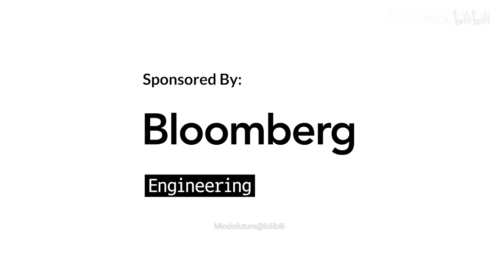

Let's ask ourselves。玩押费险。So maybe because your boss sent here。

 maybe because you want to hang out with your friends。Those are all very valid reasons。

One reason that Phil mentioned yesterday in his opening speech is that maybe we hear because you all want to write better C++。

But in order to figure out how to do that， we need to figure out what does it mean to write better the C++。

 in fact， what is good C++。Well what is a good program？And， you know。

 I think we all have ideas about that。 that's why we're software engineers。

 there's a lot of things that make a good C+ program。

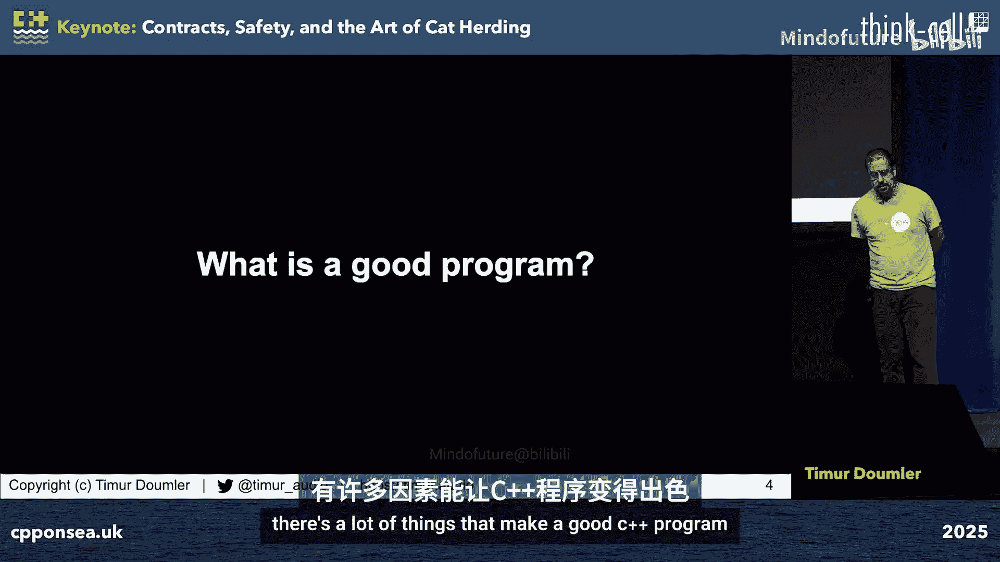

One thing that immediately comes to mind is， you know， a good C++ program is efficient。

 This is probably what at least half of the talks about C++ tend to be about。

 This is like the unique selling point of C++。Performment， that's part of efficiency。

There's usually lots of talks and books being written about。

 lots of other properties that good code and good programs have， like they maintainable， readable。

 extensible， portable， reusable scalable all of these things。

 C+ plus can be good for all of those things。1 that is sometimes overlooked is， of course。

 cost effective。 A good programme isn't really a good program If you don't have the budget to develop it and then ship it。

And then there's two here that have received particularly high attention in the last couple years in the CSS community。

 which are safety and security。So I want to talk about those two。But before I do that。😊。

There's one really important one missing here。😊，Can you somebody tell me which one that is， yes。Yes。

 of course， correct， and that is of course the most important one because if your program isn't correct。

And it doesn't really matter， you know， what else it does。

 but because it doesn do the thing that it's supposed to do。

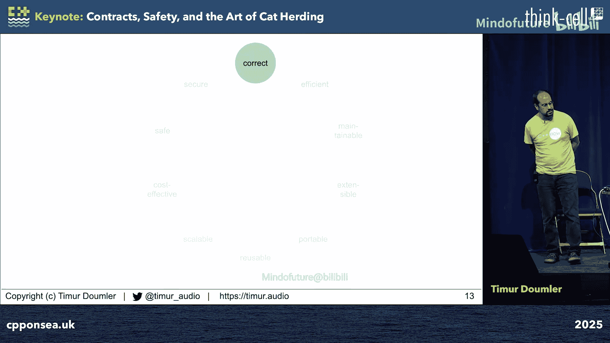

So what is a correct program？That is a question that we need to ask ourselves。

 And so if you look into kind of computer science and literature。

 there's a bunch of definitions there。😊。

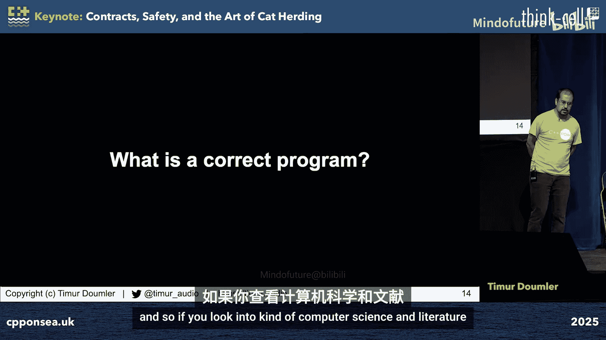

There is this notion of functionally correct， a program or an algorithm or a function set is functionally correct for any input。

😊，The output matches what the specification says the output should be。

That is hopefully something that is very intuitive。But then it gets a little bit more complicated。

 So there is like this distinction between total correctness and partial correctness。

 So total correctness is when an algorithm actually does return an output。

 and then when it does that output is correct So you see where this is going right so you want to prove that property you run into the halting problem that's in general undecidable。

So there is this kind of other notion， which is partially correct。

 So we can't prove that a program returns a value， but if it does， then， you know。

 that is correct and satisfies the specification。 So that is where， you know， you can prove things。

 You can， There's mathematical formalism that you can throw at this。

 The whole logic is one particular framework of thinking that you can apply here。

 So there's lots of tools and approaches that build on that to prove。😊，Parts or correctness。However。

 I'm not going to go into this today。 This kind of mathematical approach is very valuable。

 very interesting， also very complex。 and I personally found that。😊。

It doesn't scale particularly well for real world code and real world problems。

 like real big code bases that actually do stuff in the real world。

 So there are places where you can apply this， but it's not practical， at least for some cases。

 So we need something that's a little bit more empirical， a little bit more practical。So。

And the problem here is that the real world is messy。 right， So when me say for any input。

 the output satisfy specification， what is the specification， Where and how is it specified。

What is the input and output， Is it the parameters I pass into the function， return value。

 Is it what happens when I have sity in out， maybe my program produces sound or talks to the network or does something else。

 Is that also input and output， Is that something else。You know， what about side effects？

Like my program touches memory somewhere。 allocates memory， or maybe not。

 is that part of the input and output。 Now， what about other requirements， I did a talk。

 A lot of talks about you know， real real time and low latency programming。

 So there you have requirements like。You know， this function must return within a millisecond or X amount of time。

 And if it doesn't do that， it's not correct， right。

 So there's lots of requirements here on program correctness。

And some of them are also not doing certain things like， for example， you know， do not touch。

 you know， this piece of memory or， you know， do not launch nasal demons。

 How do you reflect that on the specification。 So it's a bit messy。

So here's a practical definition of for correctness that。

It's kind of useful when you're dealing with all of these things。

So we can say that there is a set of expectations on the behavior of the program。

 and it's all of the stuff that I just mentioned and probably more， those are expectations you have。

😊，Maybe there's an intention that you have when you write a program。

mOr a type or a function or a loop or an algorithm。And so。There is a set of expectations here。

 and some of them are explicit and others are implicit。And so we call this whole set of expectations。

 the contract of that program or that function or that class or whatever。And then。You know。

 that contract has a bunch of parts like we can talk about the essential behavior of programs or functions so for example。

 if a function is supposed to sort arranged， then the fact that it's sorting it is part of the essential behavior。

 maybe if it allocates a buffer while it's doing that。

 it may not be part of the essential behavior because it may not care about that。

 or it may be because you do care about that function not allocating。Any memory while it does that。

 right， so it can be part of the contract or maybe not the computer doesn't know the human does you have an expectation。

😊，Functions have preconditions and post conditionsition， Those are different aspects of the contract。

 right so precondition is。A condition that the function expects to hold when it's called。

And the post condition is a condition that the function guarantees will hold if it's called with a precondition satisfied and it does its thing。

 right？😊，Cllaasses have invaris， loops have variances and invaris， and there's other things。

 And so all of this together is the contract of a particular piece of code and the correct program or functional class is one that satisfies its contract okay。

😊，So that's the definition I'm going to be working with。

And so the flip side of this last bullet point is that。😊，A contact violation。

 a failure to satisfy the contract is always a bug。

 So it's something where your program code is incorrect。

 And the way to mitigate that is to go into your code and fix the bug。All right。

So a contract has many parts， as we just saw， like some of this is implicit。

 There are coding conventions。 There's common sense。 for example。

 often there is a contract that a con member function should be threatsa， right。

 That's not something you typically write down。 But in some code basis on some companies。

 people have that as an expectation as an example。Others are explicit。

 Often people put that into their code comments。 You know， this function， you know。

 returns blah and it's undefined behavior if you don't blah。

Or in a separate document we do this in the C+ standard itself for every function in the standard library。

 we say these are its threecon， these are post conditions。😊。

And then you can also do this in code directly in C plus plus。

 And that's what we call contract assertions， okay。And this is something that before C plus S6。

 we could do this with C assert macros or with user defined assertion macros。 And since C plus S6。

 we have a。Proper C plus plus language feature to express contract assertions。

 So we got three kinds of those in C plus 26， pre post and contract assert。 And so those are。

 that's what contract assertions are。 they are a way to specify know aspects of the contract of the expectations in code now some people。

 when they mean contract assertions。 they just say contract contracts to this contracts through that。

 and what they actually mean is contract assertions。 That's kind of not correct。

 when we say contract， we mean the whole thing。 But to disambiguate that。

 we can say that the whole thing is the so called plain language contract the thing that's formulated in in plain human language。

 and then contract assertions are。This bit here。 and by their nature。

 they can only encode a subset of the plain language contract。

 There's always going to be aspects of that， or in most cases that you cannot express in contact as such。

So to give you a few examples， if you have a kind of vector like class that you're implementing。

 you can now add a precondition assertion to that code， for example。

 if you have your bracket operator， you can add a preconditioned assertion that the index is within bound。

😊，All so that's great。 so if you check that precondition， then that's going to catch a lot of bugs。😊。

嗯。So that is you know written down。Actually， explicitly in the code。嗯。😊。

You don't have to talk about parameters there in your precondition assertion。

 You can also talk about other state。 for example， front， you can。

 you write a precondition that the vector is not empty。 It's。

 it's a bug to call front If the vector is empty。 it typically leads to unde behavior according to the standard。

If for student vector， you can do something else， of course in your own vector。So there's clear。

 clear has a post condition， so you can write that as a post condition assertion that the vector is empty afterwards。

😊，And one thing that you can do with post conditioner search that you cannot do with macros is you can directly refer to the value that the function returns。

 We have a little bit of a syntax there with this colon。 So for example， for empty。

 you can say that it returns true if and only if size is0。

So you can write these post condition as recondition assertions。 And when you write them。

 it doesn't actually necessarily say anything about what's going to happen at runtime。

 You're just expressing your expectation。What happens at runtime is something you can configure。

So with certain macros， you can turn them on or off with C+ S26 contract assertions。

 you have a few more options， we have four con semantics and C S26， ignore。

 observe and force and createen force。😊，So you can choose whether or not you want to check the predicate and if you check it。

 you can choose whether or not if the check fails， you call the contact violation handler。

 which is a function that does something like printing a log message and you can also choose whether or not the program should terminate instead of continuing。

And so these four。Evaluation semanists give you those options and they kind of cover all of the common use cases that you might want to be covered depending on what you're doing exactly。

One more thing is that which semantic has actually used is implementationation defined。

So that's not in sequence S6 directly present in the code。

 it is actually typically being going to be controlled via that compiler flag。And then finally。

 the violation handler， which is the function that's going to be called if you use Ob and force and check fails。

 you can replace that at link time， the way you can replace operator a new operator delete。

 you can specify your own， you just need to specify a function that has this signature and you do your own contact violation having in there and then link that in and that's going to work。

Now， remember that this is only there to express a subset of the plain language contract。 right。

 so this is very， very useful。 But there's a few things we cannot do with this。

 or we cannot do yet with this， or we cannot do with this in principle。So。For example。

 operator bracket also has a post condition。No， and the conducts of the vector are the same as before after you call this。

 right。 And so this is a post condition that you can express in code。

 but it would get very cumbersome。 You probably don't want to do that。

 And you don't want to check that It's often not practical to do。 So you just don't。

Write a contract assertion for it， you just kind of leave it as part of the plain language contract。

Another example is pushback。😊，Who can tell me the contract of pushback？Go size size increment by one。

 something else。Not empty afterwards。 not， not empty afterwards， something else。That wasYes。

 the last item is the back item。 So this is something we can already write。

But the one that size is plus incremented by one afterwards is something we cannot write yet and CSS 26。

Because we need to refer to the size that the vector had before we called the function。

 so we need to have a little bit of an extra syntax here to capture that old size。

 there is a syntax that didn't make it into CSS 26 you're hopefully going to have this in CSS 29。😊。

And then there's a third post condition， actually。Which is elements the the rest of the elements are the same4。

 yes， and there's one more。There are no iterators that are。So there is。

 there is a thing called the strong exception guarantee。 So if this。Pushback。

 doesn't actually return， but it throws an exception。 then the vector is unchanged， right。So。

This is not something we can express right now because Post only talks about what happens when the function returns。

We don't have a syntax to express for what happens when a function exits via an exception。

So this is again something we hope to be able to do in CSS 29。

 we have ideas how to do that or the syntax that could look like， but it didn't make CS 26。😊。

Another one that people are asking for is a class invariance。 you know。

 it would be very nice if you could write this or you know express all the other class invariance in this way again。

 you're hoping to get that in C S 29。😊，We don't have it in CSS 26 yet。😊。

And then there's another type of contract assertion， which is things like。You know。

 if you are dealing with a range， begin an end， you know。

 there's a precondition there that that is actually a valid range。 And you're not passing in。

 you know， dangling pointers or。I point us that point somewhere where there shouldn't be pointing。

So that is very interesting。 That's a common source of bugs。

 but we don't know yet how to express that in C++。 So for this stuff， con asserts are probably not。

The correct tool。So we're gonna talk about that a bit later。 So here's a bit of a summary。

 So what contact assertions are， They are syntax to express the human use expectations on a function's correctness。

 right， So they express a subset of the contract of a function。

So they're optional and runtime checks of those expectations。 so both of those words are really。

 really important that optional， you can turn them off。And it happens at runtime。😊。

And you can mitigate violations。 They're portable， scalable， freely configurable。

 Those are all things that are now much better than they were with macros。

They're not just for run-time checking， so a static analysis tool， for example。

 can consume the pre and post conditions and derive information from them。

 so it will help static analysis as well， and IDE can consume them and then display you a nice bubble know if you call this function and it has a precondition of post condition you get like a nice bubble saying hey。

 there's a precondition here and maybe that's then also coupled with the static analysis tool that can sometimes derive information that maybe you violated that because you passed in something that doesn't fulfill the precondition it can tell statically that that's the case and display you a little squriiggle or whatever so that's going to be very useful for other tools。

 not just for enabling runtime checks。嗯。And they are a superior replacement for assertion macros。

 They have many， many advantages I've given talks or contract specifically but I talked about those things。

 You can put them on declaration so that can go into a header。 That's a big thing。 You know。

 a macro can only go into the body。 So anything that only sees the header cannot see them。

 But if they're a header， everybody can see them。 The compiler can see them。 The human can see them。

 The IDE can see them， etc cetera。 etc。 You can refer to the return value directly in the post condition Again something you cannot do with macros。

 There's lots of other stuff。And one really important property of contact assertions is that they are redundant in a correct program。

So your program is correct and does fulfill its contract。Then contact assertions do nothing useful。

 right They're only there to identify cases where your program is incorrect。

 And that's why it's really important to have this property that you can turn them off。

 because if you're reasonably confident that your program is correct。

 you don't want to pay the runtime cost for those checks。 So you need the ability to disable them。

 that makes them very different from things like， no， if statements where。

If this happens you do this， otherwise you do that and that's just an unconditional thing。

 right so that's very， very different here。嗯。And that leads me to what contact asserts are not。

 Contact Ass are not a tool to prove correctness， because in general。

 you cannot do that because the A， they cannot express the entire contract and B。Typically。

 that's not something you can prove unless in specific cases。

Conductcers are also not a tool to express something that isn't part of the plain language contract。

 so they're strictly there to express correctness expectations。In particular。

 it means a corollary from this is that conduct asserts are not a tool for error handling because there's a difference between an error and a bug。

 An error is something where something unexpected happened。 You want to handle that。

 A bug is something where the only way to handle that is to fix your code right So so those are know categorically different things。

 if you know， you have a program where an error could occur。

 like invalid input or something unexpected happens。 You want to handle that unconditionally。

You don't want that to be handle， be handled by something that you can turn off。 right。

 You don't want that。And also an error that you handle doesn't mean that your program is buggy。

 right？So， so we need to distinguish bugs and errors， and we need to distinguish error handling from。

 you know， finding bugs and contact assertions are definitely the latter and not the former。

And one more thing。Contact assertions are not a tool to provide language level guarantees right so they only do something if you add them to your code and they don't change the behavior of existing code。

So if you're looking for things like， you know， my operators per bracket will never have underlying behavior。

😊，You know， that feature can't do that because A， you have to actually put the conduct assertion there and B。

You can't rely on it actually being checked because it's really。

 really essential that people can turn it off。 So if you want guarantees。

 chronic are not the tool for that。We're going to talk about that later as well。😊。

Contduct assertions are aiming squarely at this correctness bubble here。

 So theyre theyre a way to not prove correctness， but improve the correctness of your program and identify cases where the program is not correct。

 And while you can never prove that your program is correct。

 your program is going to be more correct with every contract assertion that you add to your code So with every contract add to your code。

 you're gonna incrementally find more and more bugs， making your program more and more correct。

 So that is a property that you can only approach asymptically。

 you can never actually say that my program is correct。 unless， you know， in very specific cases。

 which is the whole proving， I expect that you're not talking about here。

So we talked about correctness。😊，Let's talk about safety and security。

 So those things receive quite a lot of attention。In the last few years。And let's start with safety。

 That is a word that you hear a lot。 Sa plus plus， save code。 you wanna make something safer。

Or something is not safe。So。On the CS committee， we have a big desire and a big push to make C++ more safe。

 That is a great thing。 A lot of people are working on that。However。

 progress in this has not been as quick and as effective as。You know， I would have liked。

 maybe or some people would have liked。 And I think one of the reasons is that。It turns out。

 and we lost a lot of time actually on the committee， because of this。

 different people mean very different things when they say safe。And I heard， you know。

 people in the CS community or otherwise in the CS community I mean at least four different things。

When they stay safe。Right， so， and the problem is that one person says， you know。

 this should be safe and they mean one thing。 And another person says， well， but this isn't safe。

 and they mean something else。 And the two people don't realize that they mean different things。

 And so that means there's a lot of miscommunication that makes the whole process very inefficient。

So one definition of safe， which for example， Dave Abrahams mentioned in his CPS now a keynote a couple years ago is that a safe operation is one that cannot cause undefined behavior and by that he means the kind of unbounded undefined behavior that we have in C++ the compiler can do anything。

 you don't know what's going to happen。And I see language has only safe operations。😊。

And so this is the definition that you know， I think。People mean most of the time when they say。

 you know， C is not safe or a feature is not safe。 They mean it has U B or it doesn't have you be。

 And a lot of the discourse is focused around that。

And whenever we talk about memory safety and type safety and its relationship safety and all of these other safeties。

 typically it happens in this context of those are types of UB that we want to avoid。

so that's one definition of safe。That's actually very， very， very different from what most people。😊。

Outside of C plus bubble actually mean when they say safe， right， So the。

 the definition of safe that most people out there use is that something is safe if it doesn't cause harm to people equipment or the environment when something goes wrong。

 right， That is what we normally mean when we say safe。😊，Right。

And so there is yet another definition which is kind of rooted more in safety critical code。😊，Whi is。

 so we have on the committee actually a study group for safety and when that study group was founded。

 they released the paper like a mission statement with lots of people's names on it。😊。

And in that paper， they defined what safety is for that study group on the S Sa Committee。

 and that definition read like thisSafe is an emergent property of systems。

 measures statistically and regulated by policy， a prerogative for decide site of something as safe is usually reserved by governmental organizations。

😊，so that is yet another definition of safety， which is the one that is。You know。

 very similar to you know what is used when you look up you know safety， critical code。

 kind of regulations， IO standards about safety， this is kind of where this is going。

And then there's a fourth one。😊，So Chandler touched kind of on this in his definition a couple years ago at C+S now when he said safety is characterized by environments or limits on program behavior in the face of bugs。

But really， I think Sean Parin explained it very clearly。

 I think two years ago when he was giving a keyn on this stage and this at this conference。

 So Sean Par said that the safety of a program is a set of safety properties that hold given valid input。

And a safety property is one which states that something will not happen。 for example， his example。

 was a self driving car will not go off the road right that is a safety property。😊。

And the safety of a programming language is a set of safety properties guaranteed for any expressible program。

😊，So that was from parents definition。 So that goes into。Something that's called Lamard。

Lard properties。 So Lamard actually developed a framework in the 70s。

 which was built on whole logic where he says that a program is correct。

 if it satisfies liveiness properties and safety properties and liveliness properties are there's a guarantee that something will happen and safety properties are。

 there's a guarantee that something won't happen。 and the combination of that gives you correct。

So that is， again， a different take on it， which is kind of taking place in a kind of more mathematical framework。

 you can then prove these properties in certain cases。So。You know。

 all of those things are interesting and valuable in a certain context。

 but the problem is that we keep talking past each other。

 so my suggestion is that we actually say what we mean so all of those concepts actually have names。

 right？😊，So the first one， we can call it functional safety。 This is， you know。

 what people in the safety field usually call this。 The second one is usually called system safety。

 The third one， you know， I have personally called it language safety in the past。

 I actually don't think it's a good term now because it kind of interferes with the fourth one a little bit。

 which also talks about languages。 So I think I'm just gonna call this absence of U B。

Because that's what it is。 That's what we're talking about。 Is there you be or not。

 Can they be U B or not， So let's just say what we mean。 And finally。

 the fourth one is kind of lamppot's framework。 So we should call it lamppot safety or something like this。

And when we just say safe unqualified， I think we should always put it in quotes。

Or maybe just not use it at all。 Let's just not use the word save and qualified because this is just。

Prone to misunderstandings and talking past each other。

 And a lot of time has been lost in these miscommunications。

And one more distinction that we need to make is that the right most two also distinguish between a program that has that property。

Or a programming language that has that property。 right， So there's a difference between。

 does a program have you be and does a language let you express programs and have you be， right。

 So we need to distinguish that as well。So let's call things。

By their names and I think that's going to improve the discourse about safety quite a lot。

So let's talk about how。These things kind of interfere with each other。

 like the one example of where kind of these four things。They kind of overlap。

 but they don't coincide。 So， for example， there is this kind of。

tenension between functional safety on the one hand and absence of undefined behavior on the other side。

 This is a particularly common source of people talking about each other。

 So absence of undefined behavior， I think we all agree is a good thing right because if you have underfined behavior that is always a bug so your program is always not correct。

 so it always doesn't satisfy the most important property to satisfy so。UB is bad， after。

 you be is a good thing。However， absence of EB is actually not a necessary condition。

 functional safety， and we know this because people have been writing safety critical code and C++ for decades。

😊，There are things like regulations and certifications。

 There's testing and code reviews and all of these other practices。 right。

 There is tooling around this。 So people have been doing this for decades。

 You can write safe code and C++。 We know this because people have been doing。And on the other side。

 absence of UB is also not a sufficient condition for functional safety because there's lots of safety relevant bugs that actually have nothing to do with UB and nothing to do with the programming language at all。

 For example， let's imagine you want to build a rocket that flies from here to over there。😊。

And then somewhere in the algorithm that calculates， you know， where the rocket is flying， you know。

 you keep adding floating point numbers to each other， right， a million times。

 And then you fail to account for the fact that floating point works in a certain way。

 And if you add a floating point number to another floating point number a million times。

 you're gonna have accumulating floating point errors。

Which you need to correct for and if you don't do that。

 your rocket probably is going to fly somewhere entirely different。😊。

So we got this mass probe that crashed because people use the wrong units， things like that。 right。

 So there are all safety critical bugs that have absolutely nothing to do with U B or with your choice of programming language。

 They have something to do with business logic， right， So this is somewhere where testing helps。

 where contact assertions can help where getting rid of all the U B in language is not gonna do anything for that。

 right。And then let's talk about security because that is kind of related to that。 And luckily here。

 we don't really have much of a disagreement。 I think we all agree on what security means。

So when safety is more about something that can go go wrong accidentally。

 then security is all about malicious attackers， right how well is your program protected against malicious attackers and what are the limits on what a malicious attackers can do and what guarantees do you get？

So。Here it's a little bit different。 Absence of undefined behavior may actually be a necessary condition for security。

 And I mean here， the kind of unbounded UB that we have in C plus plus， because if you can have U be。

 then somewhere you will have U be and then somewhere somebody can exploit that。

And get remote code execution or something else， we have lots of examples。About this in the wild。

 there are lots of CVEs that are exploitations of UB。So At if you may be necessary for security。

 it's certainly not sufficient， right， so many security vulnerabilities again have nothing to do with UB。

😊，And there is this commonly cited number that 70% of CVEs and CNC++ are caused by memory safety bugs。

You know， which may be true， but it doesn't mean that if we somehow magically make people' memory safe。

 then we're gonna get 70% less attacks and hope Sa I wrote a blog post about this。

 which was very good， in my opinion about this。 So malicious attackers， they're like a gas， right。

 they fill all the available volume。 So if you， if you kind of get rid of 70% of the vulnerabilities。

 then they're going to focus on something else， right So。You know。

 I'm not saying I not want to downplay the importance of， you know， addressing unde behavior。

 I just want to。Talk about the fact that it's not going to magically solve all our problems。

 And there's been maybe a little bit of a focus on undefined behavior under the。

The the impression that， you know it somehow magically solves a lot of problems and it improves a lot of things。

 but it doesn't magically get rid of them， especially when we talk about safety and security。

So we talked about what is a good program。So we realized that safety is actually four different things。

At least so we need to talk about， you know， which one do we actually mean？

There's one more thing I want to point out， which is the correctness one up there。

 So the way we define correctness。A program that has a safety bug。Is certainly not correct。

 A program has underlyingfined behavior is certainly not correct。

 A program that let a malicious attacker do something bad is certainly not correct。 So actually。

 this diagram。Should be more like this。Right。If program is correct。 then by definition。

 it's also safe and secure under all of these different definitions of safety， right。So。

And conduct assertions。Target this big bubble there。 They help you make your program more correctly。

 And This is the connection between contracts and safety that people have been arguing about so much。

 This is kind of how how it fits together。 Now， of course。

Contact assertions and other things can help you find bugs and make your program more correct。

 but as I said already multiple times， you can never know that your program is correct。

So then you still do need to make sure that you know when your program is not correct， you know。

 there is a limit on what can go wrong。When that happens， right？

So we do need to tame the nasal demons of undefined behavior。

Because that will help a lot with those things。 But， you know。

 it's not something that we should do instead of contract assertions or that somehow is two different ways of doing the same thing。

 It's more like the this was cheese model， right， So all of these things are different slices of cheese and And hopefully the holes don't align but are in different places。

 So when you have a problem， you know， if one slice of cheese doesn't hit it， the other one will。

 So this is how I see kind of。The effort we went through to get contact assessment in the language versus the efforts to reduce the amount of unfined behavior in C++。

 those are both important， but they're complementary right， they help each other。So。

Let's talk about UB because now that we have contact assessment in the language。

 that's kind of the next thing that I'm personally focusing on。

 I want to reduce the number of amount of UB in the language。So。Something that people commonly say。

 and I read this regularly on the internet。

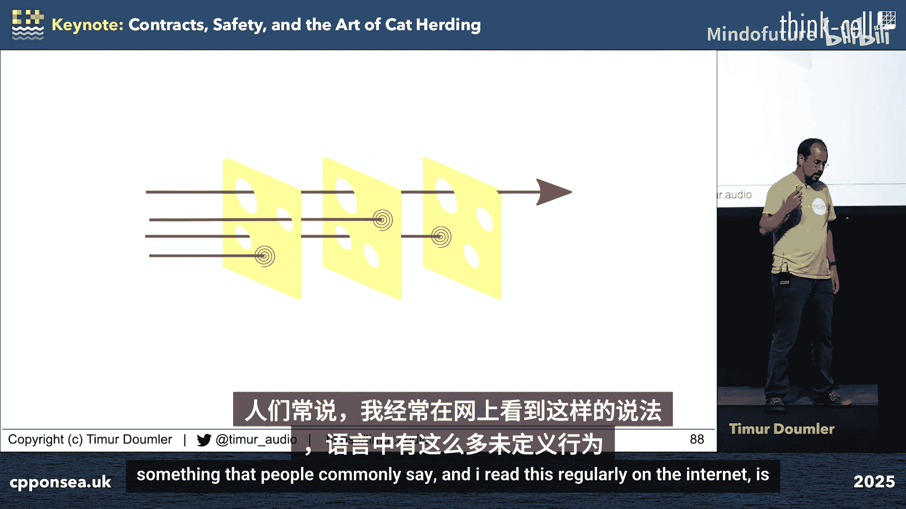

I well， so we have all of this UB in the language。Why don't we just all make it all informed？

How is that not the solution？this is more interesting actually than it seems。

Why can't we just do that？The answer is， of course。Yeah。Well， UB is a runtime property， right。

 so you cannot actually prove。

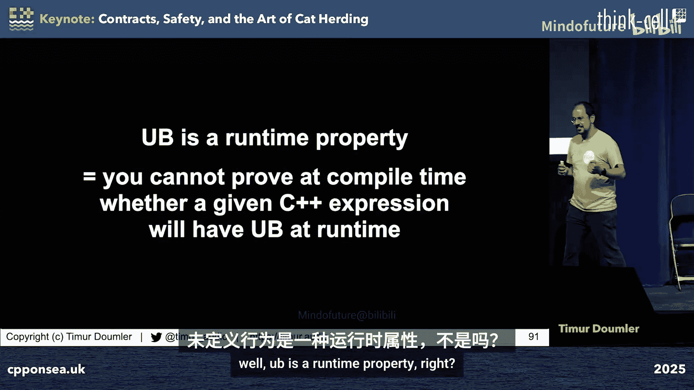

At compile time in most cases， whether an expression will have UB or not when you actually run it。

Because that depends on runtime data that you don't know with compile。

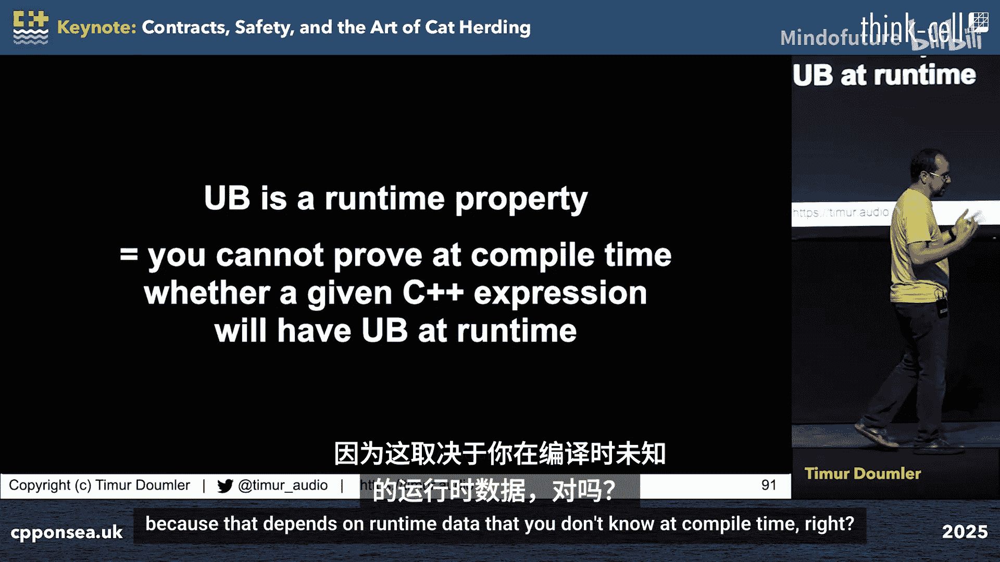

喂。So all you can do is。😊，You can say， well， I don't know if it's going to have you B or not。

 but if it could， then I'm going to make this whole feature formed。

 and then you're going to break a lot of existing code。So that is kind of the fundamental problem。

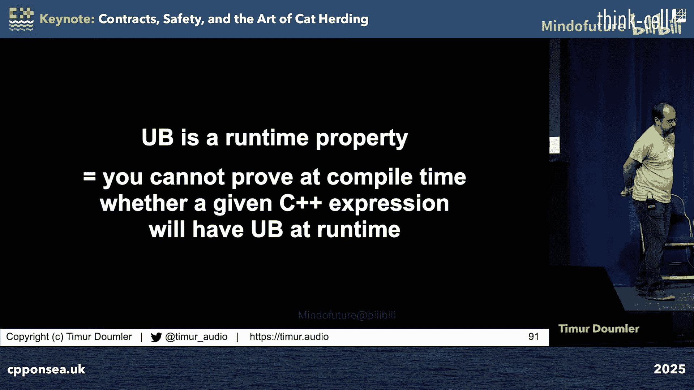

So memory safety is particularly difficult in that sense。

 and you know this has been studied for a long time and there's a certain amount of known approaches to memory safety。

 right， there's runtime approaches and compile time approaches right So runtime approaches kind of we know that from Java in similar languages。

 there's garbage collection， which gets rid of the user after free problem theres reference counting like Swif6 does this。

 I think for example， where everything is just by default reference counted。

 which also gets rid of that problem it doesn't go rid of all the problems and it also has particular tradeoffs comes of performance and and other things that we don't want in C++ right。

So then the other approach that we do using in CPA as sanitizers that inject a lot of instrumentation to track this information at。

At runtime， like what the memory points to， what type is the object that where that memory points to。

 et cetera， ettera， et cetera。And those things are effective。

 they don't catch all the errors in particular when it comes to threat safety。😊，The coverage is。

 not very complete。And also， you know， those things have a massive runtime overhead in terms of size and also in terms of just runtime right so probably in most cases we don't want to run those things in production。

So they don't give us a guarantee， they help us find bugs。

 but they don't give us a language level guarantee。If you want language level guarantee。Then。

 you know the the only compile time approach that we know of to my best knowledge is to somehow enforce what we call the law of exclusivity。

 And John talked about this in his talk yesterday， where if you have a mutable reference to an object。

 you need to make sure at compile time and design your language that way that there can be no other reference to that same object at the same time。

 You need to ensure that this never happens。So you end up with something very similar to the Ro Bor checker。

 there's other models that are subsets of that， like Hlo's mutable value semantics or functional languages where you can just not mute at anything at all。

So we could do that， right， but then。😊，None of the existing CS code could compile， right。

 you would have to rewrite everything。And that is to a first approximation。

 the only way to get rid of UB， those things， right， that's not really much。Else we can do。

 So making S memory safe isn't really a thing we can do unless we want it to become an entirely different language。

That is just the reality， right。But also the flip side is that we actually need unsafe code for some things。

 right， you know， Ru has unsafe rust and and you need to implement certain things and unsafe rust。

 for example， if you enforce a law of exclusivity，You can't implement a W linked list。

 that's just not possible。You can't， you know， call certain and see functions like cisco that you just need to call in order for your program to to do its thing。

 So this works in rust because in rust， we have this kind of big set with code that we and I very much resisted temptation to say safe。

 not safe here because in rust， those things mean something but in C++ as we saw， you know。

 it can have different meanings。 So I resisted that temptation。 I wrote code with no U。

 which is like rust by default。 And then you have these islands of unsafe rust code that may have U。

 but they're small enough that you can， you know look at them reason about them。 And， you know。

 if you get it wrong， you know where the problem is。

So this is a great world to live in unfortunately in see+ bus。Our starting point is this， right。

 so this is where we are starting。So how do we get from here to here？Well。

It's not really something we can practically do， right think。

Some people maybe fall into this trap of doing something like like this where， you know， they say。

 well， we should do what Rus does。

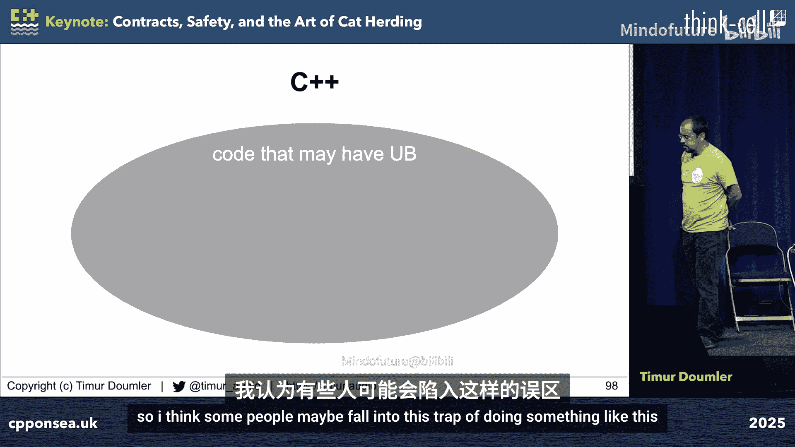

But。😊，I don't think that makes sense if you need language guaranteed memory safety。

 then you know use rust because that exists， that's what it's for。😊。

And you cannot achieve that in C++， but if you want to support your legacy C+ code。

 then you will need to continue to write C++ and this is something that we will keep doing for decades because the world runs on C++ that code is not going anywhere。

So we need to deal with this， but not by saying it needs to be like rust。

But by doing kind of the salami tactic， right， we kind of can't eat the whole salami in one go。

 and maybe we can never eat the whole salami， but we can do it one slice at a time， let's。You know。

 remove a little bit of you be here， Remove a little bit of you be there and asymptically reach a better place。

 And I think this is what we need to focus on。In the super sauce community。

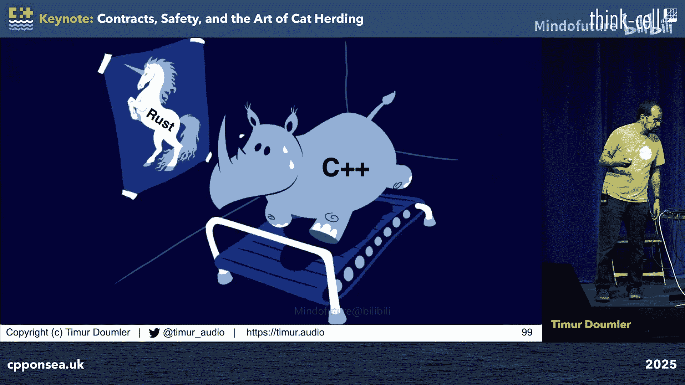

And so there's things that users can do and they have been doing for years。

 there's things tooling vendors can do。And then there's things the C+ bus committee can do。

 which is systematically address U be in the standard。

 And this is something I want to focus on because as a member of the committee。

 I do have some impact there so I can。Together with other people。You know。

 make make this happen right to do something to really move the needle there， we can't you know。

 get rid of all the UB for everybody， but we can make the situation a lot better。

And so we have actually been doing this on the committee for a while。

 so we have systematically reduced the amount of UB and CS 20 we introduced in lifetime types right。

 so now if you cast a pointer to a buffer，😊，To， to an object that you haven't actually constructed。

 it's no longer U be under certain conditions。 in C O 23， we fix the range based for loop thing。

Wwhich caused a lot of bugs and UB and26， as Herb said yesterday we were producing kind of welldefined behavior for some forms of ananaersized weeds。

 Those are all good things， but those are kind of case case by case things right so what we really need to move the needle a bit more significantly is a systematic and holistic approach。

And this is kind of we just started doing this， but。

It is something that I feel we really need to take seriously and tackle and focus on。

So earlier this year and at the committee meeting in Hagenberg in February， we kind of agreed on。😊。

Pursuing this white Pa， how are we going to systematically address UB in the language？

So this is kind of a bucket where you want to put different things and there is one paper P3100 or2。

 which I've been working on for a while now， together with my colleague Joshua Byne。😊。

To do a systematic treatment of poor language and behavior and C+ plus and this thing that the committee voted for lists as possible towards its erroneous behavior。

 profiles and contracts as things you might want to work on。

 So here we're focusing on erroneous behavior and contracts。

 profiles is something that other people are focusing on。 So those are， again， complementary things。

And so the goal of this paper is to introduce a standardized framework for runtime， right。

 remember compile time and runtime， they' are complementary。

 runtime detection and mitigation of undefined behavior across the entire C spot。

And this is kind of a piece of work that I want to spend a little bit of time talking about。😊。

How are you doing on time？ Okay， good。I'mAbout halfway from my slides， about halfway from my time。

 so I think be good。😊，So what's in this paper？We did a lot of work。

 we actually went into the standard， gr for every occurrence of the word undefined。

And looked at each one of them very， very closely。😊。

We enumerated all cases of explicit core language underfined behavior and C plus pass。

 So we didn't look at library U B。 Like， that's another topic。 We have library hardening for that。

 And C 26。 That's another tool that I'm not gonna be talking about。

 But you look at all the core language underfined behavior that's explicitly called out。

Enumerated at all。 It's all in a big appendix of this paper。 that's like 20 pages。

 which is just a big list。We gave them all unique identifiers so we can refer to them and we group them as 12 categories。

😊，And then we classified each one of those cases， according to a bunch of criteria。

Is this one relevant for security？😊，Is this locally checkable or maybe it needs global instrumentation to check right。

 like some things that the sanitizers are doing， how expensive is it to check it at time and at run time？

And independently whether we want to check it or not。

 I there anything we can do to replace the undefined behavior with well definedfined behavior。

 So if that thing goes wrong， can we then say instead of the behavior is undefined this other thing happens instead。

 right So we identified all cases where you can define the behavior like this。

 So we already have one until that' 26， which is the erroneous values when something is uninitialized。

 That's wrong but well defined So we identified。Basically。

 all the other cases of you being in the languagepher you can do something like this。

And we classified them according to possible mitigation strategies like compile time detection one time checks。

Defining a well defined fullback behavior， et cetera， et cetera。

 And then we have a proposal with wording for， you know， how to add these things to the standard。

 So that's a huge chunk of work。 We reviewed that in multiple subgroups of the committee over the last year。

 And then finally， last week at the committee meeting on Sofia。

 It was in the evolution language evolution study group。 They really like this。 and they wanna。

Go ahead with this approach， so this is hopefully going to go into this bike paper。

So we identified 90 cases of explicit language you be understand。打正の。They fall into 12 categories。😊。

So those are the 12。Type and lifetime is one category because we found that although you know type safety like something you're accessing memory through reference of the wrong type and lifetime safety。

 there is an object within its lifetime there are different things a lot of you be fold onto a spectrum like some of them are clearly about type safety。

 others are clearly about lifetime safety， but many of them are kind of like。

This point to what this reference points to an object of the right type and that object is within its lifetime。

 so you kind of can't like separate them。Arithmetic is all of the stuff like overflow conversion to a different type where the target type cannot represent the value。

 all of that stuff threading as race conditions， sequencing as things like I+ plus plus plus+ I。😊。

Assumption is， yeah， assume false double square bracket， right。

 that's undefined behavior control for things like flowing off the end of a function or flowing off the end of a quarantine replacement functions。

 That's interesting。 that's things like you defined an operator delete and that operator delete throws。

 things like that。 that's undefined behavior， actually。Cteines are things like， you know， you， you。

Kind of tried to resume a qua that has never been suspended or things like that。

 templates is interesting。 Infin template recursion， apparently is unfined behavior。

And there's a bunch of preprocess of things that are under behavior。

 we actually fixed that last week， so I need to drop that slide。

So the cases of UB kind of fall into these categories， not very evenly。

 its actually the majority is in a type and lifetime category。While thread， for example。

 just has one case， which is the definition of a data race。

Those three categories are the ones that are commonly associated with security vulnerabilities。

 doesn't mean that the other ones are not important right things like signed into overflow or race conditions。

 they cause crashes， they cause bugs， they cause damage that you can name there's millions of dollars but they're not causing security vulnerabilities as much right so it means that we need to fix all of them or address all of them if we can but there's kind of a difference in what is the kind of threat model here that that were talking about。

Then we looked at。Which ones are locally diagnosable at one time。

 so it means like for which could the compiler insert an assertion to check whether know the UB occurs and so then you know maybe terminate the program so it doesn't actually occur。

 turns out for the majority of UB that's not possible。For what 20% that is possible。 For about 8%。

 it's possible sometimes like you know array indexing into a C array or a raw array。

 sometimes the bound is known statically。 And then， you know the compiler can check it locally。

 Sometimes the bond is not known statically。 then you can't do that。

 And there's a bunch of these like 9%，1% 2% where runtime mitigation isn't the right thing to do。

 I'm gonna talk about that later briefly。So yeah， for the vast majority of type and lifetime you。

 you cannot diagnose it locally， the arithmetic ones you can， because there's a value there。

 you can inspect the compiler can inspect that the compiler knows the boot representation。

So it can do something about that locally。There's a cost of diagnosis that falls into a spectrum。

 I'm not gonna talk about that here too much。 There's a paper you can go and read the simplest one is no it's an error if you get here that's like the simplest assertion that you can write which basically has no overhead on the happy path something like flowing off the end of a function you know a compiler could insert something there then there's a null check like an null pointer check integer comparison that would be a bound check and then it gets progressively more complicated and expensive。

There's U B for you're trying to placement you an object into memory that isn't properly aligned。

 Then you can， you know， insert a check， whether the memory is properly aligned。

 That's probably modular or something bit more expensive。 So there's a spectrum here。

 There's also the question， how often you would have to insert that check。

For not locally diagnosable UB， the cost is dominated by the kind of extra instrumentation that's not available within the CS extract machine that you would have to insert。

If you want to catch all the type and lifetime you be in the language。

 you would have to track all of these things somehow。喂。

So that is probably an order of magnitude runtime overhead if you want to do that。

 which is one answer to the question， why can't we just do that？喂。Then， you know。

 for other categories， for threads， you would have to track all potentially concurrent access to memory that's probably not feasible。

 but something like threadt can do it partially in some cases， that's useful， that's good， right？😊。

And then well definedfin forwardback behavior。 so I'm not calling this erroneous behavior it's conceptually the same thing。

 This is something that happens and we know it's incorrect， but it's not UB。

I'm not using the term erroneous behavior because that is very specified in a very。

 very specific way today in the C+S26 draft。😊，And I don't want to say that I mean this exact specification because that actually has problems。

 so if you want to integrate this into this bigger framework， we need to tweak it a little bit。😊。

So we need to generalize up a little bit。And so if you want to replace UB by well definedfined kind of fullback behavior。

 this is wrong， but it's still well defined， then that cannot depend on you know whether we know that the error in fact occurred。

 needs to be something where the compiler could just unconditionally insert search you an instruction that does the wrong but well definedfin thing regardless of whether the UB actually should occur because you don't know that that compile time typically right so it turns out。

🤢，For 14% of cases of UB in the language， you can actually do this。For the majority。

 you unfortunately cannot， if you dere an nu pointer， there's nothing you can do。After this。

 to keep going， that is well defined， the only thing you can do if you diagnose that is to terminate the program。

That's pretty much your only option。So 17 cases of UB for which2 defined forward behavior is definable。

😊，Most of them， like all of the arithmetic stuff is kind of written and errone value。

 there's a few other things you know we can do with the other ones。😊，嗯。😊，For example。

 if you want to have race conditions that are not UB， Java has a model for this。

 right all primitive memory exercisees are implicly atomic。

This is obviously going to have a lot of runtime overhead so we don't want to just do this unconditionally。

 right？So。We can notionally define it， but it needs to be something where you can opt out of that。

 right。You can't just say this is the behavior for everybody all the time because that's going to be an unacceptable runtime overhead for many people。

So there's a few other interesting cases， in for template recursion。

 we can just make that all formed。Prepocesor UB shouldn't be UB， it should be IFNDR。

 and we actually made that change last week， that's this paper P2843。

 which you have approved for C+ S26， I believe。There's a case that is not actually introducing any new ob。

 It talking about U that's defined elsewhere。 so we can just fix that in the wording。

 Then there's another one where we can just say it terminates unconditionally because nothing else makes sense。

 The remaining 79 cases is runtime to be where we cannot do anything about it at compile time。

 And so for those things， we can do two things we can insert a runtime check and we can where possible and we can define the behavior that happens afterwards if the check fails。

If possible， of course， termination is always an option。 I'm not counting this。

 I'm counting other behavior that happens If you didn't even do the check。 right。

 that's not undefined anymore。 So those two are kind of the runtime things we can do。

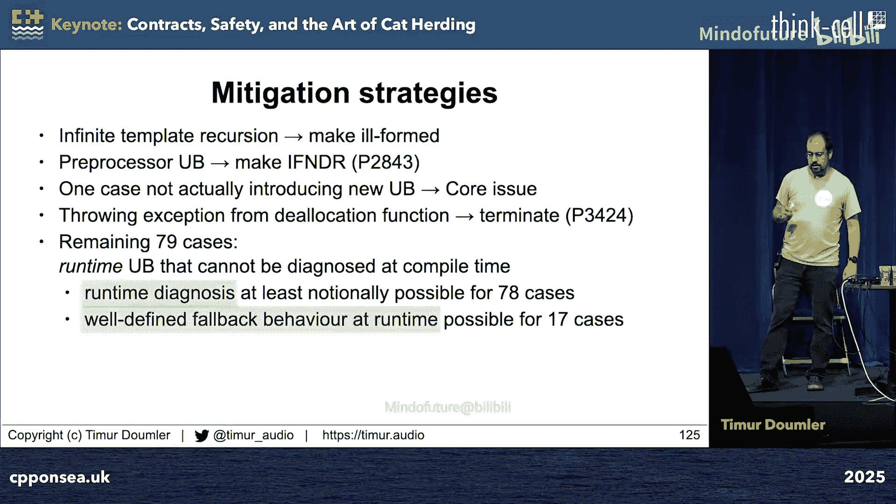

And so this is what the actual proposal in the paper focuses on。

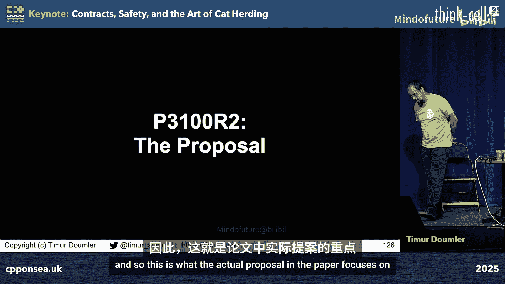

So consists of three parts。One is systematically introduce runtime checks whenever we can define them。

Part two is systematically replaced TB with well defined behavior and part three。

 because that often has run time overhead， provide an opt out。😊，The first one basically is。

Based on contracts， so we already saw this， right， so you can write a preconditioned assertion like this。

We call this and so this is you know just a refresher。

 this is evaluated with all these four possible semantics。

 if it' checked we can call a violation handler， we can terminate the program or not depending on how you configure things and we can install your own contact violation。

😊，So we now say that these things that you add yourself in you write pre b。

 we call them explicit contact assertions， so that's kind of what's NCS 26。😊。

And now our strategy is that we allow the compiler to inject implicit ones。

So whenever it's possible to detect a case of UB by inserting a runtime check implicitly。

We just say that that check is there。Right， and then。It's a contract assertion。

 So in every other way， it behaves like a contract assertion。 so it can be ignored。

 so the compiler doesn't actually have to insert the check。 It can just do what it does today。

 But notionally that like the contract assertion is there。 so it can be enforced， ignored， observe。

 quick can enforce。 So basically， we propose to add this transformation to the entire standard whenever it says if X is not true。

 the behavior is U B， we say， you know Op a has an implicit precon assertion that know X is true。

So we basically just apply this wedding transformation to the entire site。

And so that inserts an implicit contact assertion， which behaves in every way。

 like an explicit contract assertion。 So if you turn them on。😊，You get contract correlation。

 handle a call， etc cetera， et cetera， except that they are implicitly generated by the compiler。

 right。So we do not require an implementation to provide all possible checks because that's just not possible。

 right， we cannot expect that every compiler is going to be a super sanitizer that catches all the UB and we cannot expect anybody to actually use that。

But ignore is always a valid choice， that we define that these checks are there and then the compiler can choose for which ones it wants to offer a checked semantic like enforce force where the program terminates。

 right。😊，And because the choice of semantics implementation defined find that means that the implementation actually has to document。

Which semanttic has chosen and when and how what the mechanism is to do that。

So that allows us to bring all of the things that are already doing this today kind of into the scope of the C last standard。

So compilers are flags where they insert checks， sanitizers inserts even more checks。😊。

And so then we can reason about those things with words that are defined in the CA standard。

 it's no longer just UB and you know you can do whatever。

 but there's a portable standard framework you know how this should happen。

 it enables things like every sanitizer calls into the same callback API instead of every sanitizer having their own and that callback API is the standard contract violation handler API。

It allows things like codifying names and categories for every single piece of U B in the language。

 And then， you know， if your contact relation handler is hit。You can query， you know。

 was this a bounce problem， Was this an arithmetic problem and do something else， you know。

 in each case， you have standard types and names in the language to， to。

 to program with these things。And that enables seamless integration with a contract label that I'm going to talk about in a minute。

 profiles， which is another syntactic thing that you can do， etc cetera， ettera， etc cetera。

 so that's part one。😊，Part two is systematically replace UB by well defined fallback behavior。

And so actually， the transformation that we're posing is this one。 so if the forward behavior exists。

 then we say， you know， Op A has a precondition assertion that X is true。And if you violate that。

 you get that fullback behavior， you no longer get UB okay。

 But then if the fallback behavior doesn't exist， then you go into the no branch and then you know。

 continuing execution is still undefined behavior because there's no reasonable behavior that a program can have if you continue past a null pointer check。

 but you can instruct your compiler to insert checks for null pointer and then evaluate it with the enforce semantic or the quickend semantic。

 which means that whenever that check fails， you just terminate。That's something you can always do。

And the third part is providing an opt out because you cannot just impose this well defined form of behavior on everybody unconditionally。

 right？And so the way this works is by introducing a fifth evaluation semantic。

 So we said we have these four。 We actually have 5。 The fifth one is called SU。

Do not check the predicate， but assume it is true， and if the predicate is not true。

 the behavior is undefined， that allows the compiler to optimize on the assumption。

That your contact assertion is true。 And a lot of people wanted to have this feature in the standard for explicit contact assertions。

 A lot of people said， no， over minded body， we cannot have this。 That is not safe。

 So we ended up not having it for explicit contact assertions。

And we're not proposing that we add that for explicit contact assertions。

 so the compiler cannot assume that you are preconditioned that the one you wrote。😊。

Is is always true and optimize based on that because that means you could inject additional UB into your code。

 right， that's not something that you want to allow。 but for implicit contact assertions。

 assume is already the default， right， So every implementation is already assuming that U B never happens and optimizing based on that assumption or not depending on your optimization flags。

 but it's allowed to do that already。 So assume is already the default for all of the implicit contact assertions that the framework would add。

So the only thing we're doing here is to say， you know。

 and there is an option to preserve the status quo so you don't run into unacceptable performance degradation。

 but you can enable checks if you so desire and if you compiler sanitizer。

 or whatever you're running。offffpha的。So quick example。😊，For， for the no branch here。

 out of bound array access。 right， so here we have an array。 we read the index forms that C N。

 so we cannot reason that compile time， whether it's out of bound or not。

 and then we index into the array。And so basically what implicit contact assertion means is that we treat the bounce kind of D how do you call this。

 the operator the square bracket， the implicit one for built in a array。

 we treated as if it was a built in function。😊，You know that the compiler generates for you that does this。

 and then you say， well， this implicit compiler generated function now has a preconditioned assertion that checks for the bounce。

 right？😊，And so that can be ignored。 Stay this code today。 It can be enforced。

 It can be quick enforced。 The compiler can say， I can't do that。

 I only offer the ignore semantic or it can say I only offer it if the bound is known as。

 at compile time and things like that， right， So， so these options， these four semantics。

 They map exactly to things that we already have today， right。😊。

So compilers and sanitizers already have ways to do these checks。

 we just don't have a standard language to talk about them， but this proposal will we do。

And so the other branch where we have fullback behavior。

 the good example for this is signed integer overflow。So here， if we add two integers。

 we pretend that that happens with a built in operator plus that the compiler generates for you。

 And then you pretend that that has this precondition。

 which is checking exactly for does this addition overflow and the compiler can either insert those checks or or not or do something else。

 right， and you can choose。So here， assume is the status quo。 I is something like GCC。

 the F wrap V flag， which just wraps around。 So it says that it doesn't check it。

But the behavior is well defined， right and then enforces something like UB sand。You know。

 calls a callback， which by default， prints a bunch of stuff and then terminates and then quicken as Gcc's F track v flag。

 which just immediately terminates， right， That's the， the safest thing。

So this is what we propose in P3100。 This is the transformation we propose to apply to the entire standard。

 Now there is a little piece that's missing here， which is there is another P3400。

 which kind of builds on top of that， which gives you labels and there it gets really。

 really powerful。

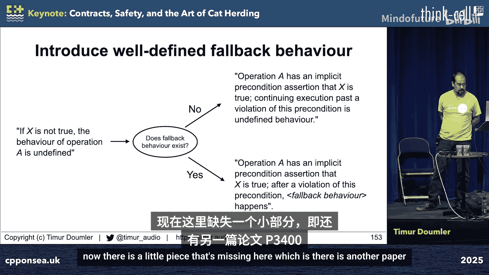

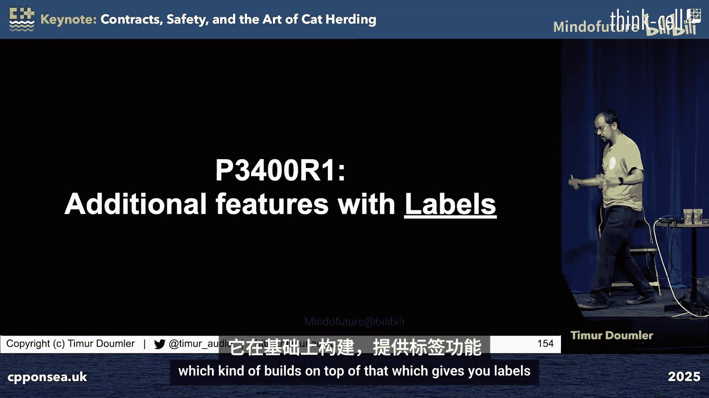

So。Labels are things that you can kind of， again， this is not in C S 26。

 You're prosing this for C S 29。 Las are things like here where you can add like a little annotation to your precondition assertion or post condition assertion that。

Constraints the behavior or lets you do certain things。

And so we just say that implicit conduct assertions also have implicit labels like this and a label can define a standard name。

 So this identifier。 so you can you know what you be happened。

 we can have labels that organize them instead categories like bounce and you can add your own。

 for example， you know， the implicit checks can we bounce checks。

 And then you can say I'm implementing my vector and my operator square bracket。

 It's also in a categorying your bound， right， And so then if you hit your violation handle and you ask。

 is it a bounce error， you will， you will catch all of these all of these cases。嗯。

The other thing you can do is install semantic control， so we can say in code。

 you know I want this to always be ignored， always be enforced or never enforced only observed or other things like that。

And there will be some syntax like we don't know yet exactly what it would look like。

 but it could look something like this where you say in this file， in this program， in this class。

 in this function， in this scope here，😊，You know。あ。

Turn on all the implicit contact assertions that have to do with athmetic UB。

And make them always enforced， which means that， you know。

 the compiler has to implement insert the check。 and when the check fails。

 it has to terminate the program。 And it can't do that。Then you're gonna get a compiler error， right。

 if if the compiler doesn't support these checks yet。But， you know， compilers already do。

 So I don't think that's going to be a problem。 So what you can do with this model is。You know。

 we cannot get to the nice rust world， but we can get from this world you know， to this world。

 and then we can。Grow these bubbles over time both in size and in like what you be is covered and no longer you be。

 and I think this is kind of the trajectory that we're on。

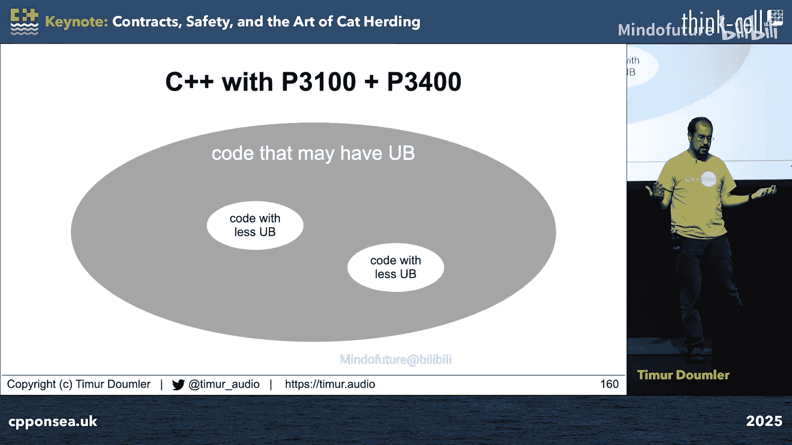

So。This is a particular piece of work that we did。 How does it fit into the bigger picture。

 This is something we spent a lot of time discussing last week at the committee meeting。

 We have all of these things， contact assertions and standard library Hardening。

 which builds on top of that， which is now as US 26。 your earliest behavior， which ist the 26。

 We have liberal checking stuff that Sean Baxter is doing。

 which seems to be just happening completely outside of the standard committee。

 You have a lot of people who wrote a lot of papers about profiles。

 different people have different ideas what profiles are。

 There's a lot of other safety and security related papers here。 How does it all fit。

And so remember， this is the， the， the big picture here， right， And so now we're talking about just。

There bubble here。But it's a really， really， really important bubble。And so how do we get there。

 how do we make that bubble bigger？And so here's kind of the roadm。

There's legacy code you can't touch， and we need to do something with that。

 And there is new code that we're writing today or code that we can actually edit。

 We can do something with。 We can we can update And so we identify different strategies。

 how to mitigate you be depending on which half of the slide you're on。

 Are you dealing with code but you can make code changes or are you dealing with code where the actual code cannot be changed at all because you don't own。

 you can't touch it or whatever reason。So depending on where you are there different strategies。

 right， So for new code， you can do language subsetting。

 You can say certain things that may or may not have you be it does not allowed anymore。 Like。

 for example， this allowss you start cut。 Thislow you interpret costs。 you know。

 you have to do something else instead or explicitly opt into the unsafe features。

Another thing you can do is annotations right so I said that a lot of stuff like you know whether pointers are valid。

 whether references are valid， all of his memory safety stuff is not locally checkable。😊。

You can make it locally checkable by addingnotations that kind of make this information about you know what a pointer points to travel across kind of boundaries。

 And so， for example， Kang has this experimental attribute counted by where you can put that on a pointer and you can say this pointer points to an array of size n。

And if you put in that annotation， that information will travel to other translation units and other parts of your program。

 and then the compiler will be able to insert a bounce checks there。

 even if you have a to pointer kind of decay and it's just a pointer pointing somewhere。😊。

Obviously that allows you to actually add the annotations so that means new code or code。

 but you can add these things。 Another thing you can do is just replace unsafe features by new features like borrow checking。

 or for example， instead of having just integer addition which can overflow。

 we can have things like stood add saturate or instead of just casting an in to a smaller in and then if it doesn't fit its UB。

 we can have saturate cost where it has defined behavior。😊。

So those are things we can do with new code。 If we can't touch the code， you know。

 we can't do those things， but we can do other things。

 right we can just redefine the behavior unconditioning。 We can say in certain cases。

 those cases actually rare。 And I think we've actually done most of them already。

 So I don't think we're gonna find many more of those。

 but there's maybe a few left and we can just say that U be is's just this other thing instead。

 we did that。 for example， most recently for the range based for loop kind of lifetime extension of temporaryaries thing。

Then we can do errous behavior， which means you know it's not always this behavior which is now just well defined and correct。

 it is still incorrect to do this， but it is well defined。

 this is what we did for initialized reads and then finally we can say we insert runtime checks and we now have a fully fleshed out framework for how to do this which the committee already the evolution working group already voted to pursue。

😊，So this is kind of our menu of tools， and this is how we want to address UB。😊，In the language。

 So those two is what P3100 is proposing to do。 this is our paper， the one that I just talked about。

Language subsetting， this is another paper by Peter Bindles。

 which is talking about you know what does that mean how you define language subsetting， you know。

 blah， blah， blah， like all of the details of how you would actually specify that and then identify these sets depending on you know what compilers can actually do。

 etc cetera， etc cea et。And now there's one thing missing here。

 which a lot of people have been talking about， which is profiles。

lots of papers have been written in recent months， especially about。

Profiles and a framework to the profiles and let's add profile this profile and that profile and it again seems like but the safety thing that different people mean different things when they say profile and they have different ideas of what profiles should or shouldn't do and we had a lot of disagreement about that on the committee。

😊，Recently。😊，Partially because profiles are not quite as fleshed out yet as some of these other ideas。

 So there's still work to be done。 And so some people say that profiles。Are you know。

 should be doing these two things， right， run time checks and language subsetting。

 So that puts them in conflict with P 3100， which is kind of trying to do the same thing。

 So that kind of， we don't want to have two different ways of doing the same thing。

 Maybe with different syntax。 That's， that's not good。 So some other people said， well， no。

 profiles shouldn't be doing any of the stuff that P 3100 does。

 Pros should be just the syntax for language subset。And so， you know。

 there was a lot of disagreement about that。But actually last week。

 and we actually did come to an agreement。So observe that the middle two ones are things that need to be configurable one time checks can be turned off on and you really need that to deploy them and the same language subsetting is something that we need to be able to opt out of。

So you can actually compile code that uses those features that you might have sub out because they're no longer considered it safe。

And so really profiles。😊，The role of profiles is to be named configuration presets for things below。

 right， So ideally， a profile name just expands to a bunch of。You know， statements about， you know。

 evaluate you know， these one time checks with this semantic and like apply these these language subsets。

And that's what they are。And this is something that we discussed for a long time and agreed with。

Some of the authors of the profile's paper present， and we had good discussions about that。

 And so that's great。So， you know， next time somebody asks you。

 so what is the committee doing about all of this U be in the language as's a big problem and they don't know what to do and there's no plan and there's no strategy。

 no， no， no， no。This is our plan。 We have a plan。 This is our plan to address UB across the entire language。

And this is what we're gonna be doing for the next few years。好。

So that concludes the technical part of my talk。Now I do have a little bit of time left。So。

We can talk about cats。😊，So one other thing that I notice a lot of people in the room myself included tend to do is when we talk about these things。

 we tend to pretend that the technical issues， which is everything I've just talked about over the last hour。

That's the main problem， that's what we need to focus on。

 just need to solve the technical issues and then re good。Turns out that's not the case at all。

That's part of it， but a lot of the time a much， much bigger problem。Is the people stuff。

 how do you actually agree on something， how do you communicate， how do you make a decision。

 How do you organize the work？And in the couple years that I've been very intensely focused on contracts specifically and some of these other things。

Ive recognized if this is the real problem， this is the thing that actually holds us back。So， so。

 you know， to use this cat metaphor， for example， you have these cats and the cat in the middle wears a hard hat and the cat and cat in the middle is really convinced that。

Everybody should wear a hot hat because that's the way we do stuff， right， the other cats。

 they don't really agree。 they don't want to wear hot hats， but then the other cats。

 maybe they have other ideas what to do。 And then the bottom cat doesn't really care about any of that and just wants to go for a swim and the other cats don't get that because they're afraid of the water。

AndSo how do you make these cats agree on what to do。

 whether to wear a hat hat hat and whether to ban swimming and what else to do？

And it turns out that is very， very， very hard。And so the reason that standardizing contracts took 21 years from the first proposal to it being approved is that。

So just to give you an example of， you know， how this goes。

 this is kind of a summarized kind of dialogue that。You know。

 happened kind of in a similar way between different members of the committee when you were talking about just one particular aspect of whether to add this。

 this little feature X to contract assertions。And so， you know， one person says， well。

 X is unacceptable。 That's just wrong。 And the other person says， no， it's great。

 We we actually tried it out。 You can do Y and Z with， with X。 So So X is great。 And also。

 it's safer。😊，And then Alices says， but it's still wrong。 And also。

 I don't agree with the definition of Sa。 So that's the other problem we already discussed。

 And then Bob says， but you've tried it。 and we saw it works in our code base。 And Alices says。

 but your code base isn't representative。 like other people have different code bases that have different properties。

And also， it's just not good language design and Bob says， it doesn't matter whether it is。

 good language design， it matters that it works。😊，And Alice says， but it's too complicated。

 I don't know how to teach this。 And Bob says， but teachability is not about simplicity。

 It's about how easy it is to use contracts， but X doesn't make it easy to use contracts。 Yes。

 it does。 And so it goes on and on and on and on。And then， you know。

 here's a bunch of examples where design access completely falls apart。 I don't agree。

 All of these examples they're already broken before you even add contact assertions。

But x doesn't work if my code is constant and' cons correct。

 So if I just can't put cont here because like somebody just didn't put cons there。

 then it doesn't work。Then make your code cons correct， but I can't as legacy code。

 I can't add the cons there。 I can't touch this code。 Okay， well。

 then if you can't add the cons here， add the cons cards there。

 but I can't concast this band by my coding guidelines， people shouldn't be using it。

Then change your coding guidelines should everyone else know miss out and feature X because you have stupid coding guidelines。

Like really， I， I don't really think that， you know。

 the all the benefits that your claim X has out the way， all the problems you would introduce。

 And Bob says， well， I disagree。 it goes on。Look， here's another thing X breaks static analysis。

 no it doesn't， yes it does， I'm an expert in static analysis， no it doesn't。

 I'm an expert in static analysis too。😊，So this is the reason that standardizing contracts took 21 years。

So。Basically， I needed to figure out how to deal with this。 And it turned out to be hard。

 But I learned a few things。 and I want to share them， because maybe it's。

Maybe useful for a few people who。They have similar problems。So I kind of figured out the heart way。

 but let's give you a little bit of context。WG 21 AKA， CP+ Committee。😊，Now。

 if you have a bunch of subgroups， each proposal has to go through all of them and be approved by everyone。

😊，The composition of the people in these groups is unfortunately very far away from being democratically representative。

Mostly， it consists of racing as C class experts， which。😊，T to have been there for a while。

 or at least some of them tend to have very strong opinions， a very particular communication style。

Some are sent by tech companies who have very vested interests to do X or not do X and others。

 they don't really care， they're busy with other stuff。

 they don't really listen to whatever is going on， but they still vote on stuff， right？

And then most people don't actually read the papers。That is unfortunately one reality。So。

 and the other thing is that decisions are made by consensus， which means that， you know。

 a big majority of people in the room needs to agree on this is the thing you want to do。

And if there's no consensus， nothing happens and we know this from other things like why we still have daylight saving time in Europe because the European Parliament already agreed。

 I think in 2019 that we want to get rid of that， but now the countries can't agree on whether we want to keep summertime or wintertime。

If' no consensus， nothing happens。So how do you make stuff happen？

And this is kind of the really hard problem that I needed to figure out how to move past。

And so the number one thing is this。I learned thus the hard way。You need to have patience。

And so I call this the art of cat herding。😊，And there are some general rules that I just。You know。

 maybe you're gonna read this in every book on this topic。

 but I kind of have to had to figure it out the heart way。

 But these are some rules that I figured out you should never violate， right。

 You should always be respectful and professional， never assume bad in bed and hand and always have a transparent process and apply it fairly when you deal with everybody。

You have to be prepared to explain the same things over and over and over and over again because people don't read papers。

😊，And if someone disagrees with the group。Make them articulate like what they want instead。 Oh。

 you don't like X。 You know， what do you want us to do instead。Like， can you explain that。

 Can you write it down and if they say， okay， I can write it down。Then they're committed。 You know。

 then a week later， you can tell them， did you write it down already， Did you write it down already。

 you know， politely but。And then if multiple people in the group have a disagreement。

 and everybody is kind of watching and。They don't know who's right。You know， tell those people， okay。

 you and you have this disagreement about this thing。

 go off and figure it out and then come back when you agree。And then they say， yes。 and then。

 you know， again， a week later， you can say， have you done that yet， Can。

 Can I help you set up a meeting， Can I maybe moderate the meeting if， if otherwise， you know。

 you can't figure it out and you， facilitate， facilitate that process。

So I found that to be very helpful。😊，发了完。And then there's a few rules about the technical discourse。

So one thing that I found is really， really important is I think hopefully it's evident from this little dialogue I showed earlier is that。

😊，I found that it's really helpful to always focus on facts。

 data and things that you can objectively verify from right and avoid things that are biased or contain your value judgment。

 So， for example。If somebody says A is better than B， that's not helpful， you know。

It will make them reframe it as X prioritizes A instead of B， Y prioritizes B， instead of a。

Is a or B more important to prioritize， right， That doesn't contain a value judgment。

 It doesn't say something is bad or better or worse。 It just says， do you want to prioritize A or B。

 And why， like， can you justify that， that decision。

And don't be afraid to challenge other people when they fail to do this， right。

 So if somebody says X is just wrong。Don't be afraid to say this。Right。

 learn to distinguish facts from opinions。😊，You know， we had， for example。

 people simultaneously claiming that contacts are too large and claiming that contacts are not large enough。

 so both of those statements can't be you simultaneously so challenge that right if somebody says this feature is too large and complex ask you know which part can we remove you know without compromising adoption of the feature？

😊，If somebody says they're not large enough， they're missing feature x。Okay。

 but maybe we can add feature x incrementally in the next release。

 maybe we don't have to agree on this now。Learn to distinguish facts from non facts。

 people have said， as I heard most recently， actually somewhere on certain social media platform that I don't want to name。

Contracts are not baked yet。I think it's the most well considered and well researched feature we have ever standardized。

You can disagree on that。That's your opinion， but there's some facts， right？This is a hard one。

 learn to recognize logical fallacies。 Here's a few examples。

Somebody says the purpose of contracts is to do X， for example。

 remove undefined behavior from the language。😊，And then contexts are not actually doing X。

So contacts are bad。 Of course， the fallacy is that context were never designed to do X。

 There's another thing that's designed to do X， which is complementary。😊。

Another fallacy is contracts suffer from problem Y。

 therefore we should not standardize contracts until we solve problem Y。😊，This is again， a fallacy。

 if problem Y actually has nothing to do with contracts。

 I have an example for this people are saying， you know， we need to figure out the AB story。😊，Yes。

 that is a big problem。If you have a translation unit with checks off and another translation unit with checks on。

And you compile them together and link them together。😊。

You need to think about ODR and you need to think about you know what's the ABI is there a way to make the ABI understand what's going on。

 can I reason about whether the checks are going to be you know on or off and in the resulting program。

But it turns out this problem actually has nothing do with contract。

 this problem is a consequence of how linkers work today， how the AI works today。😊。

So any design that has anything like a runtime check that you can turn on or off。

 however you design it is always going to run into this problem。it turns out that。

You know there's three things you want to solve this problem， you want back compatibility。😊。

You want deterministic behavior， you want a reason about whether the checks are on or off。😊。

And you want no runtime overhead and it turns out you can just only get two out of these three。

That's just a fundamental property of how C++ works。

There's nothing we can do to design a way around it。

 You just have to choose which two out of these three you want。 And then depending on that。

 you know your compiler is going to。You know， do this AI or that A or apply this or that strategy。

 hass nothing to do with the design of the feature。

Another example is this design is wrong because it doesn't follow the principles of May design by contract now Bt Meyer invented design by contract in the 80s and implemented a programming language called IiffL which was based around that and at the time it was a big achievement right big step towards all lot of stuff。

😊，But that was in the 80s， and today。We know， for example that。

This model is not applicable to C++ because C++ is a very different programming model from iPhoneiffel。

 and we also know that actually this model is both incomplete and incorrect。😊，We know that today。

 we didn't know that 40 years ago。I'm going to write a blog post about that deep topic that's going to be its own talk。

So and if they disagree， at the end of there's a disagreement between， you know。

 do you want to do A or B？😊，And you have to argue。You know，4 a or 4 B， you already lost。

 That never works。 If youre， you're at the stage， you have to convince somebody that they're wrong and you're right。

It doesn't work in my experience， that's just how human psychology works。

So don't try to do that instead。Help people see the correct solution for themselves。

This is how you convince people。And the other thing that I learned that's really interesting about this is that one very good way of doing this is to visualize it because people work very well with visual input。

😊，And so I actually figured out a way to do this kind of an algorithm。

 When last year we had a big design disagreement， I just applied this algorithm again and again and again。

 and it helped us go past the big disagreements。 and I'm going to keep applying it in the future。😊。

And hopefully it's going to be successful and hopefully it's going to be helpful for other people too。

 so in the last five minutes I want to quickly talk you through how it works。😊。

So I didn't invent this from scratch it's all based on a framework actually designed by John Lakekos。

 who's here in the room。😊，So there's a paper about this piece 2003004。😊。

callled Princ design for W G21， which was an attempt at kind of proposing an algorithm for how to make decisions for the committee。

😊，Turns out it doesn't quite work。 It's a great idea and you can apply it for all kinds of things。

 like for example， me and my wife used to this algorithm to decide whether we're going to go on summer vacation this year。

 It worked brilliant。😊，But on the committee， it didn't quite work because it's quite complex and it has lots of moving parts。

 lots of places where you have to like。😊，Do very fine grain things。

 And the committee as a whole doesn't have the time， doesnn't have the patience for that。

 So I had to like simplify it a lot。And so the result is this much simplified version of this。

 which I actually and also somehow modified in a few places that I found to be actually effective when you're dealing with a group of people like this。

😊，So here's my myth。First， state the problem， for example。

 this is one design decision that we had to make should pre imposeposed be allowed on functions that are defaulted on their first declaration。

 yes or no。That so state the problem， this is what you're trying to figure out。

Then list the requirements， right？We don't want runtime overhead when you put pre and post on those things。

 and we don't actually check things。 We don't want to silent。

 silently like omit or allow omitting checks that the user said they want to be checked。 You know。

 we don't want to change whether the function is trivial or not because that allows you to branch on whether。

 you know， you enabled or add a contract assertion。 That's a bad thing。 etc cetera， et cetera。

 So just list them all。Anybody has like anybody who's a stakeholder and just gets to list their requirements。

Now。This is a difference in my version and John Lagos's version do not rank them into more or less important。

So if you can do that great。😊，But typically， when you're dealing with people have very different opinions。

 they will never agree on which requirements are more or less important because they have very。

 very different priorities。 They come from different industries， different companies。

 different use cases。 They will not agree on those things。

 Youre going to lose a lot of time trying to make them agrees not going to go anywhere。

 So all requirements are created equal。And there are some forbidden words， good， bad， important。

 crucial， fundamental， fundamental principle， anything like this that contains a value judgment or a bias can't use that。

 You have to objectively state the requirement and they need to be objectively verifiable。

 So you need to be able to objectively verify whether a solution actually satisfies it。😊。

So you can't include things that you cannot measure like complexity or teachability。

 unless you actually can measure it somehow， you have data on this， but typically you don't。😊。

You don't include things that you don't have data on somebody claims this is a common use case。

 Do you have data。 Yes， great， if not。You're not going to include it。

And don't include parameterss that are impossible to satisfy， like for example。

 we want why deployment in the field of a feature that we haven't even standardized yet。

 that's probably not going to happen。😊，So you do you list the requirements。

 then you list all the proposed solutions， right， so that requires you to understand them all and write them all out。

And then you make an evolution graph， like which solutions can be evolved from other more conservative solutions。

 So for example， solution A is a very conservative approach， makes everything formed。

 but you can evolve it into B or C， but you cannot evolve B into C。

 you have to choose between B or C。And now you construct a table。

Where every solution is a column and every requirement is a role。

 and then in each cell you put whether the solution satisfies the requirement。😊。

And in the original method， you know， there's a very fine grain。

 you can put lots of numbers in there in my version， there's only three possible values。 yes， no。😊。

Maybe partially under certain conditions。And you make that green， red and yellow。

 So it's very obvious， very nicely visualized。And so it looks like this。And so here you see。

 C is obviously the right solution， and everybody agrees。

Or maybe C has a little trade off here and then you can discuss， you know。

 are we okay with this trade off？😊，Or maybe it's like this。

 And then you can only satisfy requirement 3 or4， but not both。

 And then you need to actually talk about whether which requirement is more important。

 But you're going to only talk about this one thing。Right， everything else you already agreed on。

 this is the only decision you need to make， that is the only thing you need to get people on the same page that makes everything a lot more effective。

😊，So you discuss conflict environment requirements， you agree on the right trade off。

 And if you can great， if not， you fall back to the next conservative thing the in the graph。

And that's it。

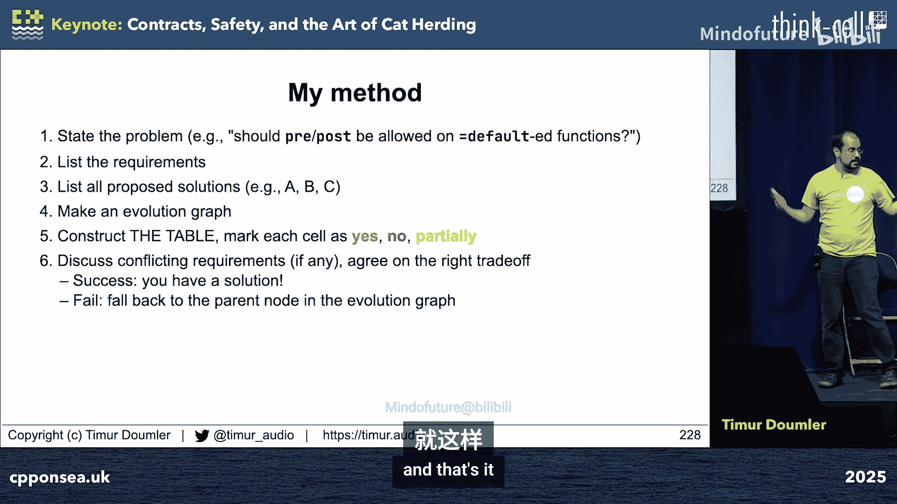

So I have an example， can I just have one more minute to show the example Phil？I guess yes。 Okay。

 So the example is， how should Qua Asar interact with no accept。

 And if you write something like no accept X comma， contact As X， should that be true or false？

 And we had bitter disagreements about this。So。😊。

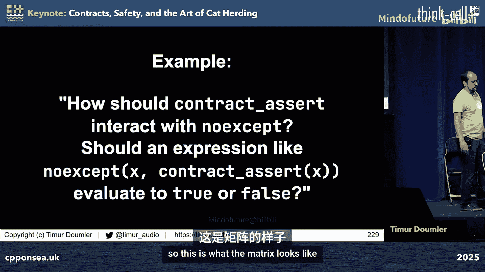

This is what the matrix looks like。So we got five different solutions， four different requirements。

 we got like a few things where， this has like an annoying trade off， this has an annoying trade off。

What should we do。 And here's a case where we really。

 we really have to like choose one requirement that we like we can only satisfy three out of four things。

 like which three do we want to satisfy。But something interesting happens sometimes when you do this because it's so nicely visualized。

 You know， people can easily work with this。 So when we were looking at this。

 Lisa Lipincott who joined the teleconference we were discussing this。

 He just looked at this and she said， oh， wait， hang on him me。 You overlooked the solution。😊。

There's a solution I can think of that satisfies all four of those things。😊，You know。

 and that's a solution that we have in T S 26。 Now， just make it not a state， not an expression。

 but a statement。So。😊，This is the algorithm， I've seen it work。

 I applied it successfully on a group of very， very stubborn and opinioned engineers and we managed to agree on stuff。

😊，And so maybe this is going to be useful for somebody else as well。

 I am planning to apply this more as we add more stuff to contracts like we still need to agree on what how we and post and virtual functions should work。

 this is going to be a big thing for C plus29 and lots of other things and hopefully also you know for other features in other areas and maybe even outside of the committee。

😊。

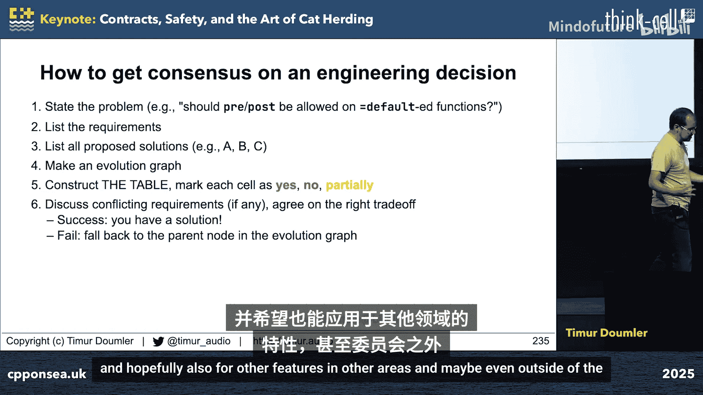

Right， so that is contract safety and the art of cat hurting， thank you very much。

