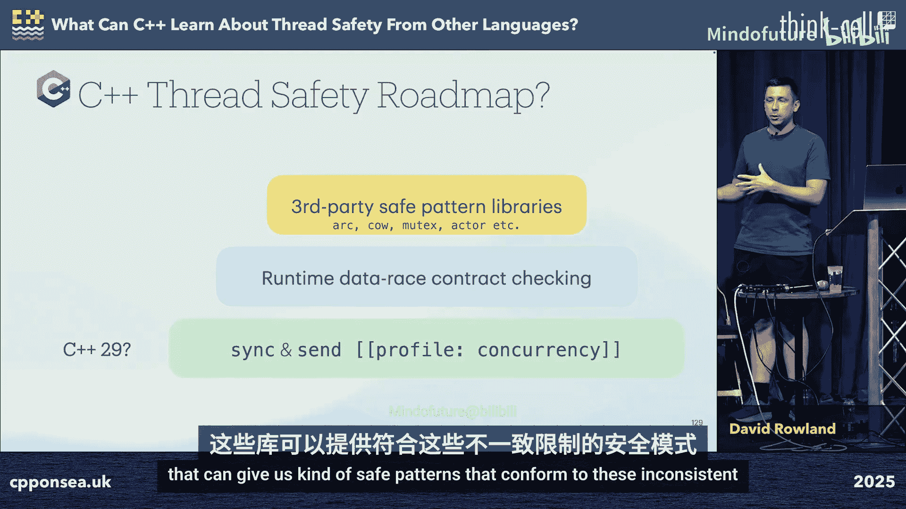

# 【Cpponsea】C++-On-Sea-2025大会-p11-P11_C++_能从_其他语言_中学到_哪些_线程安全_知识-戴维_罗兰_2025--BV17V4GzjE6p_p11-

So I'm Dave Roland。 I'm the CTO of the audio squadron Group。 We are a pro audio company。

 and we have two main halves to our company。 We've got our Pri sound brand that make digital audio interfaces and large channel count converters for big studios。

 And then on our software side， we make a whole bunch of virtual instruments for creating weird and wonderful sounds and a multitrack recording workstation called waveform and the back end of that is actually an open source project that deals with all the data model。

 the realtime elements， the device handling and we also license that to other companies to put their own UI and UX on front of when I'm not programming。

 I like to do building work。 I find it an interesting challenge that's actually quite similar to programming in youre solving engineering problems。

 It's a lot more physical gets me away from the computer I get to listen to podcast and music and you get something quite cool at the end of it。

 So this is my garden office that I code in almost every day now。

When I finished that， I moved to the front of the house to learn some new skills， block work。

 pitchroofing， rendering， built a porch， and that turned out pretty great as well。

So back to programming now， if you want to talk to me at the conference about building work construction。

 you know， something that's not programming， feel free。

This is not an introductory talk to safety if you want that I highly recommend him was from a few years ago。

 this is really my journey from the starting of thinking about safety to the ideas around thread safety and it kind of started when I saw this article by a group of chromium developers a few years ago who due to the rising popularity of Russ looked to see what it might take to add a borrow checker to C++ and their conclusion was the language does not lend itself to this thus memory safety and C++ would need to be achieved through runtime checks。

Now I don't know if Seanun Baxter， the C developer， actually read this。

 but he effectively said hold my beer。 Now he went away and added to his circle language。

 which is a C++ compiler with a whole bunch of extensions for seeing how C++ might be evolved announced he has taken rust's rigorous safety model and applied it on top of C++ and announced it in a webinar where he kind of went through how this applies and what it might look like and the last third of this deals with thread safety and I watched this and I thought this looks similar to today's C+ what would happen if we tried to apply those ideas to today's C++ Now if you're not familiar with rust safety model。

 I actually really recommend watching this talk because it introduceds it but with C++ syntax so might be more approachable。

But this talk is really thread safety。 Will it C+ plus because after looking at that。

 I also looked at some other languages。If we're going to talk about thread safety。

 we probably need a definition， so we can state that a program is is threadsafe if it is free from data races。

 technically you need to add in deadlocks and races for external resources。

 but if we focus on data races first， we'll see the others kind of fall out a bit more easily。

And then a data race is when two threads access the same memory location when at least one of them is a right。

 and therefore it follows that a threadsafe programming language makes it impossible to express data races。

 so that's kind of the gold standard which is where you can't even compile a data rating into your program。

So why am I interested in thread safety？ Well， it's quite difficult to find numbers on this。

 The best I could find was Google's CB report from last year。

 and you can see that this is dominated by temporal spatial。

 which is lifetime and bound safety thread safety only accounts for 5。6% here。 So this seems small。

 but I think this is going to grow Firstly as what's sometimes termed low hanging fruit like bounds checking and things like that is going to be introduced has been introduced to C plus plus already that 5。

6% is going to become a much bigger part of a smaller pie hopefully。

Machines are also gaining more cause all the time， and we're actually adding stuff to the language that makes multithreading code easier and more ubiquitous。

 so stood execution and as we'll see， lifetime or temporal safety is inextricably linked to thread safety so。

Improving one area might give us improvements in another。And also。

Bugs are difficult to spot and debug in thread safety that's because the problems typically arise long after a data race has occurred。

 so I hypothese that even if only 5。6% of bugs are thread related。

 the time spent fixing them is likely to be much higher and also this 5。

6% is only in like one data point in Google's research I'm not massively familiar with their code base but I know they use multiple languages。

 Protobfs or perhaps there's some inherent isolation there protecting them。

And in some industries that are inherently real time， like audio， for example。

 where you have a bunch of threads that are continuously spinning。

 there's probably just statistically more chances of data races occurring。Now。

 almost all languages that I looked at avoid data races by avoiding sharing state in some way。

 So on the left of this diagram， we have Haskell， which deals with the problem by just simply not allowing you to share state。

 You have a mutable pure value semantic。 So everything's a pure function。 you pass a value。

 get back a new value。 I'm not going to talk about that because others have look for any talk with manadic in the title and you'll probably see how to apply those ideas to C plus plus on the other side。

 we have Erang and Eliixa， which deal with message pass in。

 So you're not explicitly allowed to share state unless you use the kind of provided utilities to pass messages across thread boundaries and I'm not going to talk about that because Anthonyy Williams has given a fairly good talk on that before。

So I'm really going to focus on this middle area， particularly rust slash circle and Sw and these。

Avoid sharing state by introducing the law of exclusivity。

 which in some instances means we can effectively local reason locally that there are no data races but。

You still allowed threading on a kind of program level。

So we're really going to look at these set of languages and two。

Or main elements we're going to look at the low levels syn consent concepts and then how ideas are built on top of this like actors。

So sync and send are protocols or traits that are checked at compile time。

 a sync object can be safely shared between threads and a send object can be safely transferred between threads。

 and it also follows that a sync object is sendable。Under certain term circumstances stance。

 as we'll see。 And this is present in the Swt program in language with the Sable protocol。

 And this introduces the notion of isolation boundaries between potential threat execution context。

 So objects can only pass these isolation boundaries if they conform to the atendable protocol。

 and sendable can be inferred in some cases， like， as we'll see with pure value types。

Syinable objects are really just a special case of sendable objects。

 there's no syncable keyword but if you had， for example a locking resource that had an object and a muttex unlock lock the muttex before it accessed the object。

 you would just say that conforms to at sendable and then it would pass the compile time checks。

And you see these checks in place in something like the thread constructor。

 So this is going to continue execution on a new thread and you pass it a block。

 which is a bit like a C plus plus Lada， but it has to conform to the atendable protocol。

So think and send in rust is a marker trait， which I guess is a bit similar to a C++ type trait。

 but they're different， and this can be inferred in some cases as well。

 so if the type has pure value semantics， if you have a borrowrow which is similar in spirit to a check cont reference in C++ but you can't share a mutable borrow because that means one thread could write to it and you'd have a data race and is the same story in circle because it follows the same model except for the terminology slightly different and the Bris syntax in Swift is the hat and Sean also follows cont for applying cons。

 it's not mutable by default。Now， Sean introduced these ideas in consent with this threading example that you can see on the right here。

 and what it does is basically have a string and then launches a whole bunch of threads that effectively。

Participate in a thread pool and then try and append to the string and print it out so a read and a write operation on that string。

And。I saw this and I thought well this looks like C++ type traits。

 so maybe could we just implement them using C C++ type traits and I sort of worked through some of these ideas in something I called the Safe Concurency Library you can come a look at it there it's not production code or anything yeah but I was going to call it the safefe threading library but STO as a taken term apparently。

嗯。And I built this up from first principles and wrote a slide about it， or a whole bunch of slides。

 but this took about an hour to talk about， so I'm going to skip to the end and hopefully you can kind of just see the examples。

So the general idea here is that we are creating safe wrappers around existing C plus plus constructs。

 So we start with a J thread， which is a joinable thread。

 And then we're constraining the arguments that we pass to that thread。

 So we're using this send concept here and saying all the arguments have to be sent and also the invocable that we're gonna to start the thread with has to be send。

嗯。We can then build up this send concept by saying it's the value of is send type tray。

 And that type tray has two parts， really， The first is that we are checking that the type is not an L value reference or a pointer。

And we're making sure it doesn't look like a Lada， so that's a custom type trait that says does it have an overridden call operator？

And then we're saying we are allowing。Move constructable types。

 so that's effectively saying we can construct a new object from an R value reference of an existing object because that's C++'s best idea of lifetime transference。

唯一。Then check to see if it's a function pointer， but then disallow member function pointers because member function pointers need an object pointer and then you're kind of back to square one。

And this is best illustrated with a bunch of static asserts。 So you can see the。Pure value types。

 ins and our value references past this check that anything that looks like a point or reference or kind of。

Is disallowed。And this basically just follows a flow chart where you just ask for various properties。

 so we can see that if it's move constructible or it's a nonmember function pointer then it's send。

 Now， rust is allowed to do an additional check on the front of that flow chart， really。

 it's allowed to say is it a mutable borrow because that means that another thread might be referenced。

 so that's not allowed that if it's a borrow， I provably cont reference。

 So no other threads can mutate that object， then that would be allowed。So just in summary。

 we're disallowing L value references， object pointers and Las because they may be referenced outside of the thread boundary。

 they can alias to other objects or other addresses。

And we're only allowing our values and non member function pointers because that's our best notion of ensuring data can't be shared。

And。If we look at sync now， sync is defined as a concept as well。

 which is a fold over that is sync trait because we need to work on very addict number of arguments and initially we're just going to say no types conform to sync。

 but there is one type which is st atomic of a T does conform to sync because atomic of a T is free from data races。

And with a static asserts again， we can check that anything that isn't an atomic effectively fails those checks So what types of stink。

 Well we've looked at theomic but that's for trivial types only there is a proposal for a synchronized value which wraps a type with a stood muttex and then automatically locks the muttex during access which has the benefit that that works with any type that proposal has kind of stalled for a good number of years。

 I'm not sure why it hasn't made it through but it is quite useful so I've taken the implementation from the proposal and it basically just looked like this。

 So you have a muttex and a type， you construct it by forward in on the arguments to the internal object and then when you want to use it。

 you call this apply function and pass it a lambda which is gonna lock the mutex and execute body of the lambda。

And because we generate， sorry， because this is a。A free from data races。

 we could say this conforms to sync as well。Now， in theory。

 we'd want to have our additional sync check at the bottom here。 We'd want to say。

 if the type is sink， then it's also send。 But remember。

A sink type is really only useful if if you have a reference to it on either side of the thread。

 So we've already said we can't allow references or pointers。 What we want to do is kind of say。

 is there another reference like thing in the language。 And actually， we have shared pointer。

 So we can say a shared pointer of a T where T conforms to the sync concept。

 We're gonna make that send。So in summary， we can a shared pointer to a st atomic of a type is send and a shared pointer to a synchronized value of a type is send。

 However， a shared pointer to just an in because an in is not free from data races is not send and a shared pointer to a string is also not send。

So。Picking up from Sean's example， I。Rewrote the code in C plus plus and then try to use this safe thread construct that I showed with the S and send checks。

 and it basically forces you to change。The way you structure and the types that you use。

 So you have to create a shared pointer to a synchronized value to a string。

 and then you have to create a copy of those to pass on to the third constructor because we need an R value reference。

 and then we need a global function。Pointer， this entry point that we're going to pass to our safe thread。

 And then， of course， the arguments to that entry point need to be a shared pointer to a synchronized value to a string。

 But we can call this apply function and。Now we have a reference that internal string and we can append and print it out。

 knowing that no other threads are going to do so concurrently。However。

 we get a whole bunch of problems that are immediately visible with this。

 So imagine it's not a string we're passing in here。

 but a node object and a node contains some member pointers so。

It's not possible with type traits to do a recursive check on all the members。

 so this would pass our send checks， but those pointers could alias elsewhere and cause data races。

The other thing is that although I've constructed the thread pole like this。

 I often see thread pulls created like this where you pass a Lada with a this pointer and then you just call a member function。

 But if we allow Lambdas。 I callable objects。 then this is just a raw pointer。

 there could be a data race on that。 And we don't know what member functions doing。

 there could be data race is internal to that。There's another problem where because we get a pure reference to this internal string。

 we can take the address of that and then just throw it outside of the scope， store it globally。

 and then get a data race somewhere else。It's also possible。

 although we have safe pointers like Uni pointer， we can get the appointed to the internal object out of that。

 store it。Safely move on ownership to the thread。 So that's what we would expect to do。 But then the。

The call in stack frame can just call a function on that。 and then we have a data。

So we've got a whole bunch of problems that this highlights， so how far have we got in C++ well。

 we're a bit safer， but I wouldn't say we're safe。Because we've used an unenforceable。

 safe thread class。😊，Anybody in your cobase conceal used the threads， the J threads and so on。

 We've used a non-standard synchronized value。 I said it's not being standardized。

 so we have to kind of write it ourselves， and then there's no way to enforce that that gets used and because it's not standard。

 we had to kind of opt into the syn consent trait and I haven't shown it。

 but we've done a lot of fighting with the compiler mainly through template instantiation and concept checks。

 and I have a feeling this is similar to what rust developers call fighting the Borrowcheer where you're basically trying to prove to the compiler that you conform all of its checks。

And we've also added a lot of overhead to our code。

 We've got atomic reference counting everywhere and we've got muttex lock in every time we want to access that string。

 So how far we got， well we've got a solution that isn't bulletproof。

 I've just shown all the problems。 It's not beginner friendly because all those template errors that are quite messy and it's not default。

 There's no way to enforce this and is's certainly not part of the language yeah。But as I said。

 it's a useful exercise to go through and if we compare what we've ended up with in C++ versus Sha circleircle example。

 we can see there are actually similarities， at least we're starting to think about thread safety now。

You can see the。There needs to be a copy of the day。Trenend。And。

We have to do this apply function to safely access the internal string。

 but in circle you take a lock guard which is kind of like a scope block and then you take a borrow to ensure that you can actually access that object。

Now， I took Sean's example and said well， this stems from rust safety model。

 so it should be implementable in rust。 And I gave it to Claude and I said。

 can you give me a rust version of this And it said sure， I can do that and then I said。

 well this doesn't look like idiomatic rust because Ru has borrows right？

 So can you give me a version that does that And it said， yeah。

 and told me all the changes it made in order to do that And this was about a year ago and I thought that was pretty cool。

And it also told me why it's better。 it said it's more efficient because we don't have atomic reference counting anymore。

 it's cleaner code because of the way it's structured and we still get compile time guarantees about data lifetime and it still maintains thread safety by using that Mu text and it's this。

To using borrowrows that I think is problematic in C plus plus because without a way to properly express lifetimes in terms of these borrowors relocations and drops。

 we just can't get the same level of safety and performance。 And it's that and performance。

 That's key。 I think we can do a lot to get high levels of safety， though。

But let's go back to the code to see if we can try and improve upon some of those problems。

 So remember， we've got nested pointers， this pointers， global and local league pointers。Now。

 C plus plus reflection has just been voted into the standard。

 and this gives us the ability to actually recur through checking properties of types。

 So remember this example that passed our our send restraints before。

 this would now be rejected because we can recurse through all the members and see if they conform to send And in the same way a Lada is just an object of a type so we can just check the type that that generates and because it's a type it has members。

 one of those will be the this pointer， one of those will be that node shared pointer and we know they don't conform to send either so this would be rejected。

And we can rewrite our type trait in a lot more kind of linear ordinary C plus plus looking code。

 Now， we can see we get this meta info object to the top。

 We strip out C references consvol references。And then we basically go through the flow chart。

 So we check that it's a nonmem function pointer， and then we check for L value references。

 If it's an arithmetic type， it has pure value semantics， So we allow those。 and then we can ask。

 is it a class type And if it is， then recurse through all the data members of that type and check that they conform form to the cent as well。

So this allows us to do those recursive checks。 And we have to change our is send V。

Forulation to do a reflection over the type now， and we could create the concept just using that。

 but if we want to add in our sync check like we had before。

 we can just create a conval function is send that's going to do the reflection and then the sink。

So now we can write a whole bunch of tests that。Stronger restrictions。

 So this node example that we had is going to be rejected。

 anything that is a lambda that only has kind of pure value captures will conform。

 But if it has a reference inside it that won't And slightly more complicated example。

 if you have a type the captures of this pointer or a shared pointer to a non sync type。

 those are all going to fail as well。So we've kind of fixed a whole bunch of problems here the nested and this pointers。

Let's look at leaked pointers now。In C++ because we get a reference to that string。

 we can just take the address of it and throw it outside and if we look at rust。

The borrowrow here forces us to not be able to do that because you can't create multiple mutable bs。

 So the borrow checker kind of stops us leaking that object out。

 So we kind of want to mimic that somehow。And I think we can do this if we start removing pointers from the way we use objects。

 Now， the next section relies a whole bunch on reflection proposals。 And when I wrote this talk。

 I was hoping that code injection with token sequences would make it in。

 but that got pushed to C plus plus 29。But luckily。

 a whole bunch of other reflection papers did make it in so you can do more with todays and as we saw in Herb's keynote。

 you could actually do a lot of what I'm talking about which are kind of metaclass generation I've just used meta classes as a nice syntax but you could write this without meta classes。

So the general idea here is that instead of passing a string around。

 we're going to create a slightly more complex object called a person that has a first and a last name。

 And what we want to do is say we just by applying a meta class to this。

 we want to make it free from data races。 So want this to be synchronized。

 And the idea here is that this is going to create an internal copy of that class or rather a wrapper around it and then store that internal person in a synchronized value and then using reflection is going to effectively duplicate the API and inside construct those apply lambdas that we pass on it and just forward calls onto that internal object。

 So now we know when we get that RP that's going to be the Mutex is safely going be locked。

And we can also return variables from that as well。

The other thing is that because we're doing generation here。

 we can actually generate this sync trait because we know this is free from data races because that's what the meta class does so we can say a person is sync。

Now I'm not going to go through what the reflection code looks like。

 I would look at Herb's talk from CPPCon last year。

 goes into it a bit more detail or Deie Vanander Board's from CPP Con as well。

They look at the syntax for reflection in more detail。

 I' mainly looking at the high level details here。So synchronized value is a kind of a fairly verboose way to do this kind of lock in。

 What we're really saying is we just want to lock access to this object with a muttex so we could create a simple matter class that just creates a muttex as a member object and then forwards on calls to that internally wrapped person and also generates the same as syncncry。

Or we could start to customize this and say maybe this object is a mostly read object happens a lot in databases。

 for example， we could create a shared muttex and then in our cons functions。

 create a shared lock and our noncon functions a unique lock。

 So let's have a look at what this does to our example。

 So we don't need this synchronized value to a string anymore。 We' swap the string out for a person。

 but we don't need that synchronized value wrapper anymore。

 we can just have a shared pointed to a person。 and that vastly simplifies our code。

 We've got just the two member accesses and we know those are going to be free from databases。

Let's look at the next set of problems， the leaked pointers。

If we've got a pointer to the internal object， what we really want to do is say。

 let's not make it possible to have a pointer to that object。

This is also possible a shared pointer because that has a get function that you can get a pointer out of。

嗯。What we're gonna try and do is wrap the fact that we have a shared pointer。

 which gives a shared ownership semantics inside a kind of lightweight value wrap。

 And this is effectively automatic reference counting。 So if we create this arc meta class。

 we're going do the same wrapping that we did before。

 But we're going to store the object in a shared pointer now。 and just forward on calls to it。

 So now we effectively have a lightweight value wrapper around this shared pointer。

 And this kind of thing is actually quite a common pattern。

 We use it a lot in our code base for UI and data model stuff。And now kind of somewhat wordly。

 we can say that。This object is now send because we effectively have a reference type to it if the internal person is sync。

Now， if this looks familiar to you， perhaps because you're familiar with Swift。

 it should do because it's a fairly similar semantics to a swift class。

 that's just a reference type that has automatic reference counting。

 So we're kind of mimicking that pattern。Now we could also combine these meta classes so we could just apply the muttex and then the automatic reference counting metaclass in turn。

 and that will greatly simplify code， so now we could just have a person and we're just taking a person and we just call functions knowing that we don't have lifetime or data races anymore and we also get to just use operator Dart instead of the arrow now。

Now automatic reference counting has some problems because it is possible to construct  cyclic references and these can cause memory leaks that's because references in Swift are strong and to break a cycle you need a weak reference these are observing references that are nailed when the last strong references destroyed and they must be checked before dereferencecing so you can see here we create a weak reference to something and then we have to use the question mark operator to say only do this next statement or call this next function if we have a valid object。

So we can actually construct this quite easily if we're doing meta class generation because Sha pointer has a weak pointer counterpart。

 which gives us this observing reference so we can just create an internal weak ref class that holds a weak pointer that we construct from the shared pointer and then we have this get function that's going to return us an optional to a person。

 So we're either going to get a person that is now participating in ownership of that internal object or an nu optional because the last strong reference has been destroyed。

And we use it in basically the same way we do with Swift。

 So you create a weak reference to an existing person。

 and then you just have to try and get a valid person out of it。

You can also use the mon extensions to start optional if you want to do it that way。

Now there's another type in Swift called Strs。These have value semantics instead of reference semantics。

 so where two swift variables of a class type share an underlying object。

 two swiftstructs have distinct objects。And these are sendable implicitly if all members are sendable。

 so things like scalar POD arithmetic types and self contained objects if they're kind of defined by Swift to be sendable。

 also conform to this。These can be implemented efficiently with copy on right。 Now。

 Swift probably does some more tricks under the hood to get away with copy on right when it can。

 but we can try and mimic this behavior。 So imagine we had。Astruct that was our person。 Now。

 in C plus plus， this is just gonna create a copy every time we create a new instance of it。

 But imagine it wasn't just two strings。 It was something that was expensive to copy。

 we might want to optimize that and give it copy on right semantics。

 So we could try and do that with the copy on right meta class。

Now what this is going to do is very similar to the automatic reference count iss going to first restrict this to only objects that are copyconstructible and is still going to share the object in a shared pointer but in noncons functions sorry in con functions is just going to forward on calls because we know they're free from data races but in noncons functions we're first going to call this copy of shared function and what that does is checks the use count and if there are any other shared references to this。

 we're just going to create our own copy of it and kind of detach it from the rest and then it's safe to write to。

And we can also again generate the type trait to say this is send if the internal person is send。

So just to dig into some of the details here。Each person has its own shared pointer instance。

 so that's that person underscore。And that's never shared。 You can't data raise on that。

And as soon as a non con function is called a unique copy is made， but that's。

That means the internal person is shared， but that's okay because you're only ever going to read that before you write to it。

And you have your own copy。But a lot of people look at this line and say， well。

 you're checking the use count and then creating a copy which is going to increment the use count。

 isn't there a data race there？And no， as long as you don't have any other pointers or references to a person。

So send kind of enforces this when it's past to a thread because you have to construct a new object from an R value reference。

 we can do some C plus plus tricks like delete operator a new to try and avoid it being created on the he like any unique or a shared pointer and we can delete operator a ampersand to try and avoid the address of this thing being taken。

 but there's no way to stop a reference to it being taken and。

If you have a person in another type and。That doesn't have a deleted address operator。

 you could take the address of it or create it on the heap。

 and then you effectively have a pointer to the internal person because it's just the base address plus an offset。

I'm sort of trying to think about a way that we could avoid this。

Possibly a type trait that is like non addressable。

 but then you would need to kind of recursively and virally check this。

 And there's actually language in the standard that says any annotations that require viral checking are essentially not permissible。

 So perhaps there's some other ways we can avoid this。Now。

 sometimes you do want a reference like thing。 and because Swift doesn't have raw pointers in Sa Swift。

 at least。There's no way to mutate values within a function。

 but it does have a facility called in out parameters to allow kind of pointer like semantics but safely。

And you see this here where we have a point that we want to move by X and Y。

 if we give that parameter an in out modifier， that's now going to act like a reference and modify the object that's passed into it。

 This has lots of use cases， we can return multiple types without having to construct a twople。

 we can implement swap， we can modify properties like in this example。

 and if it's a class so it has reference amount it we can actually reassign that reference a bit like a factory。

So we could cheat with this， imagine we have a copy on right vector implementation that effectively just wraps vector。

That's gonna do the same transformation as we had before。 But what we really want to do is say。

 I want to push 42 into the vector。 And if we have some calling code that looks like this。

 What we're gonna find is that push is gonna create a detached， unique copy。

 And then in the pair stack frame。 that vector isn't gonna contain that 42。 So what we， you know。

 ideally want is a pointer to that vector。 And then we can， push。Push back into it。

But how do we get a pointer with something that we've deleted the address of operator Well。

 you can take the stood address of of it。 and that will actually give us a pointer to the object。

 But what we've done here is subtly expose that data。

 that potential data that I mentioned earlier because now somewhere in there a thread could be created that try to create a copy and that could happen whilst that pushback is actually being called。

 So what again， it's quite subtle， but what actually happens here is inside copying if shared。

 which gets called in this pushback function。 It's going to check the use count。 it says no it's one。

 I'm the only owner of this object。 So I'm just going not make a copy and carry on using it。

 But then the copy tries to get created。 that's going to increment the shared count。

 and now there are two alias in references to that internal shared object。So。

We can do something a bit safer and generate an in out class that effectively has the same API as the call in class and we can do that through reflection。

 but we're going to take a pointer to the argument that this is constructed with and then at the same time create our own safe version to you so a detached version that we can write to and we're going construct that with a pointer to the original and to give it like less room for abuse。

 we're going to give it a name function called make in out and then that this is the only place where we're kind of abusing the safety。

And now we need to modify our parameter to say we want the in out version of this and we don't have a data race now because there's this internal vector that's being created and it's going to create a copy as soon as it constructs that thread。

And we just have to call make in out in order to pass that and the 42 is going to be visible in the parent stack frame。

Now there's one kind of， oh， sorry， the last thing we need to do is actually copy that internal vector back to the parameter that we had。

 and that's kind of similar to saying that vector is equal to the internal vector that was in that function。

There's one final step we can do here， which is rather than deleting the address operator。

 we can actually make it return and in out。Version of the object。

 And then we can just use Ampersand here just the same as Swt。

 That might be a step too far for some of you， but I think it quite nicely you know。

 shows semantically what we're trying to do， but in a safe way。

I want to give a quick mention to Hlo here。And Hilo's thread safety， like all of them。

 comes from an avoiding shared state， and it does it through the law of exclusivity。

But objects are still mutable within a function。Which means it's actually similar to Swift。

 but with only str type。 So it doesn't have that kind of reference counting automatic reference。

Type and。It's implemented efficiently， possibly with copypy onr。

 but their entire compiler is designed to sort of make this invisible and as efficient as possible。

So let's do a quick review。 We've got this cent trait that introduces an isolation boundary between threads。

 and objects can only be copied or moved between them。

A sync trait tells the compiler that an object is data raise free and is implicitly send。

 and these traits need to be checked recursively for all members。 C plus plus 23 can't do this。

 but C plus plus 26 with reflection can。We've also seen how lifetime safety is inherently intertwined with thread safety。

 This is solved in other languages with borrow checking， reference。

 counting or mutable value semantics。 And I think we need to encapsulate pointers in value types to ensure they're not exposed to abuse And C plus plus 26 Ref and generation and the things that are coming in 29 can make this simple。

Now there are some limitations。 It's not the most efficient because we've got a mutex that wrappeds the entire class。

 that person had a first and a last name， though could probably independently locked。

And also what happens if we have inheritance here if we've got a meta class like Arc or copy andWrite or Muex。

 what happens if they're inherited if we've got virtual functions and they don't have those copy of shared injections or the locks。

 then that breaks the safety Maybe derive classes could inherit the meta class that might work。

 maybe it only works on non-virtual classes or maybe it's disabled by adding final to the generated class so you can't derive from it This is early days for this kind of thing reflection is only kind of just being added。

 I think we're going to need implementation experience to kind of see what patterns emerge。

Now there are some concerns as well because this bakes data safety and lifetime management into the type This might not be suitable for every use case because you have to pay that performance cost for single threaded use cases We also know it's not the most efficient because borrowche effectively is because that's just a raw pointer effectively however。

 this does have great success in other languages like Swift it's a good language with a lot of safety I know people are going say this isn't C++ it contradicts that don't pay for what you don't use paradigm but I actually think it doesn't because I'm not saying you have to use these copy onrite and Mutex meta classess and things I'm just saying give us enough language support so we can write safe layers on top of it and then lowlevel checks to ensure that we conform into thread safety principles。

So we talked about S consent quite a lot。 we're now going to jump to a much higher level actors and Swift has a third type。

 apart from class instruct， it has this actor type and what that does is effectively serializes or member data member accesses onto queue or worker thread。

And do you spell it？With the actor keyword， and it's a reference type like class。按。

Because this now runs on a dispatch queue， you have to await the。The function call。

 So it basically turns it into a co routine。 And I thought， well， actually。

 we can model this actor principle in C plus plus with reflection。

 So we could have an actor met class。 And what's what that's going do is similar to how we did re synchronize value wrap the person and then。

Schedule it on as sender。 So we have stood execution now。 we can create。

 We can create a Lada that forwards on that function call。Onto the internal person。

 And if we schedule it。With a scheduler that is just a single thread。

 So a static thread pool with a single thread， we know anything that gets scheduled onto that scheduler is going to be serialized。

 and therefore， there's no concurrent access。We could naively do a sync wait and just block until that send completes and then unwrap the value that's returned from it。

 but we'll see how we can prove upon that next and we can also take arguments by capturing them into the Lambda。

Now this isn't the cleanest example， but hopefully the thread IDs at the bottom show that even though we've got a main thread and a purple worker thread。

 all of the internal object accesses are done on this third thread pa thread。

 so because they're all the same thread there's no data races。

And we can actually kind of go one step better here。 We can improve upon this， because we now have。

Stood task and task is a wrapper around a co routine， and senders are implicitly awaitable。

 So we could package this sender into the task using co return co weight the sender。

 And then we have to co the result of that in order to get the string out。

We can actually spell this a bit more simply and if we show the other member functions， we can。😊。

Kind of hide the bit that is the same and then just show the Lada that we're generating。

 just reflects over the function signature。And this actually looks very similar to the swiftif example。

 So we have a person in both sides that is an actor。 And actually。

 the calling code looks very similar as well。 We have to wait。

 and then we have to co wait because of C plus plus。Now。

 there are some problems with this that you might spot。Firstly。

 imagine we have an argument that's a pointer like thing like a string view。 if that。

If the object that owns that viewed gets destroyed whilst the thread is executing that function call。

 then we're going to have a use after free， so perhaps there's ways we can avoid this。

 we could do a static assert to check that the arguments are send or maybe we could reflect on the Lambda that's created like we did before to say that that conforms to send or maybe rather than just having like stoodExec then we have a safe version that has send checks like the safe thread class we did earlier。

There's also kind of other directions where we can take this actor idea。

 so if we have a single thread pull， this is probably not going to scale very well because we're serializing all accesses of any actor onto this single thread。

But we can use annotations for reflection to actually create different thread pulls。

 maybe we could create a version that has a low priority tag and then create a low priority thread and maybe we can create different types of actors like a main actor that uses a run loop which has to get dispatched by your main thread and then you can have worker threads that safely interact with that main actor because it's going to push everything to be dispatched by the main thread。

There's also some overhead here if we have to queuee every operation onto that scheduler。

 so maybe we can do some optimizations here to say if this function is already being executed on the scheduler thread so we can get the ID of that thread。

 then let's just package this into a co-routine in return， let's not schedule it。

So those are awesome some ideas that I think we can do in the future。

But I do kind of agree with that chrommium paper earlier that said。嗯。

We're probably going to need to do a lot of safety checks at runtime。

Now there is an existing strategy for catching thread issues。Which is TSN。

 however its only available in clang and GCC as far as I'm aware there's no visual studio support at the moment it also requires separate running。

 right， it's not just part of your normal application。

 it's a tool that you have to enable and it's also mutually exclusive with other useful tools like ASAN and U BSN。

And because of the kind of runtime performance that you have to pay as we'll see in a sec。

 this is often just run in C I find or if you're actively looking for a data race And that means that it's likely to only catch data races in your test coverage fuzzing can help with this。

 but again that might be difficult in cumbersome to set up depending on your codebase。

 I mentioned it's extremely heavy weight， typically you get between a5 to 15 times slower execution5 to 10 times increased memory usage two to three times increased binary size and an increase in compilation time。

 So for these reasons I don't think it's used as much as it should do。

 and it's probably not the best or the only tool we should have for detecting data races。Now。

There's this kind of area。Where there are potential for data races and that's essentially when you have a read and a write at the same time。

 however， there is this kind of safe section， if you're only reading from some memory。

 then you don't have a data and I thought， well rather than acting on memory like TSand does。

 is there any kind of slightly higher level area that we could check for data races and I thought well。

 if we're designing types， we're writing a lot of functions and the functions access data members。

 maybe we can check those areas to see if there's concurrent access？

So if we're going to do some checking for concurrent access， we need to check state object。

 that's going to check the number of readers and if there are any writers and then we can write a write started function that's going to increment the number of readers and then check to see if there are any writing threads if there are。

 we know there's a data race so we can terminate or a bot or whatever is the best behavior and if we're entering a write。

 then we want to check that we are the first writer。

 so we're going to do an exchange on that is writing state and if we get to be the first writer。

 then we're going to check the number of readers because there if there's any existing readers。

 we know there's a data race as well。And of course， we have to reverse that in the end functions。

We can wrapple that up into a nice RAI class。 That is a scope check。

 and then we could write a meta class。 we've written some already。

 Why not one more that says I just want to check this for data races。

 So what I'm saying here is I haven't made this class thread safe check if anybody uses it in a concurrent way。

 So if they call。Non cons functions concurrently with a cons function， basically。

And we can do the same wrapping trick as we have done before and then insert this check state member and then insert a read check in our cons functions and a write check in our non cons functions。

Now， what we're doing here is really checking the contract of our type。

 so because we haven't explicitly said that it's free from data races。

 we want to make sure it's not abused and standard library actually has wording that specifies the threadafe contracts that the standard library containers adhereed to。

And I'm not going to read all of this out， but it essentially says all con memberm functions can be called concurrently by different threads on the same container。

Now， adding that comps checker would be an A break because it changes the layout of the type。

 So that's probably not going to happen。 but Herb at the beginning of this year introduced a blog post that had this idea of extrinsic storage。

 Now he used this It's essentially a weight freeee map to an object and an address。

 and he used it for check in union usage， but I thought maybe this could be used to to store our check state。

And we could now create this data race registry that wraps that and we're just going to try and get one of these check state objects for a pointer。

And then in theory。😊，Any kind of standard library implementation could insert one of these checks in their functions to check that that contract isn't being abused。

Now， because it's contract checking and we have contract asserts in C plus plus now。

 this could be re rewritten to be a contract assert， so。We're essentially saying now。

 rather than just terminating call the contract violation handler。

 and then you can decide what to do with it。 You can ignore it， you can log it， whatever。

And maybe we can kind of go one step further， we can say， well。

 actually what we're saying is there's a precondition on using cons functions that there are no concurrent writers。

Now， I'm aware this is extremely limited。 It only works on function， entry exit， not memory。

 if you have。Objects that return references or pointers。 those obviously aren't going be checked。

 So any really works on type that don't expose their raw memory。

 and I haven't shown member function delegation， but it's possible to call member functions just by keeping track of the calling in thread I。

 essentially cheaper than you might expect。 But I do think this could be used to check container contracts。

 And if you have a multithreaded environment， probably fairly low somewhere is going be a container or standard library container。

 And if you get data races on that container or it's being used out of contracts。

 that probably shows that you've got a poor threading model or at least thread safety model much higher up。

 So I think just having some place you can check this inside your normal work development。

 perhaps even production code if you can afford the performance cost。

But if you really want to dig into the details， I still think we're going to have to use TC for now。

So what does the kind of current set of standard proposals say about this？ Well。

 I think the committee has basically voted that profiles is the desired direction。

 And the only thing I could really find about concurrency or thread safety in terms of profiles was this section by Bna's longstanding initial profiles paper。

And if we look at some of the statements， it says look into the possibility of staticly detecting aliases in more than one thread to mutable data。

 Now， as I showed early on， I don't think this is going to work because。

It's kind of impossible to trace pointer or reference。Lage， right where they come from。

 it's possible to create a con reference from non cons reference。

 So you can't guarantee even with static analysis， I think it's been shown that you can't really guarantee that there are no non cons references or pointers to a const object or to a noncons reference。

The next thing it says is prefer to pass some key pointers to cons， and for the same reasons。

 I don't think this is going to work either because at some point there might be a noncon object or reference or alias being used。

However， it does say statically detect if a pointer is passed to another thread and actually。

 I think this is sound， right， This is the star of the notion of isolation boundaries。

So what I think is C++ needs a way to identify these isolation boundaries。

 it needs a way to say execution is going to continue on a different thread， i。e。

 ascend concept and this would introduce strong aliasin and lifetime requirements because we have to kind of work around its checks and this just isn't compatible with existing pointers or references Now I think reflection can help us to write in the styles of other languages that have better thread safety because we can safely encapsulate away those pointers。

But I think if you really want pure C plus plus performance and the kind of don't pay for what you don't use。

 we'd really need something like borrowche in and read John Bax's proposal for that。

So what do I think the roadmap might look like or maybe in C+ plus 29。

 we could get something that's a bit like S consent。 Maybe you turn it on with a concurrency profile。

 and then maybe you can only use constructors to threads to studyInc that have these checks enabled on them。

Maybe the standard library vendors could introduce some lightweight data raise check in so we can check those contracts。

And then I think once we have a facility to check those properties in， in the language。

 we'll start to see a whole bunch of。Libraries emerging that can give us kind of safe patterns that conform to these incon restrictions。

And that's kind of for future， C plus plus。So hopefully you've enjoyed what I've discussed。

 you can find the slides later on on my presentations on GitHub。 There's a Q R code to it。

 And I think we've got about five minutes for questions。

