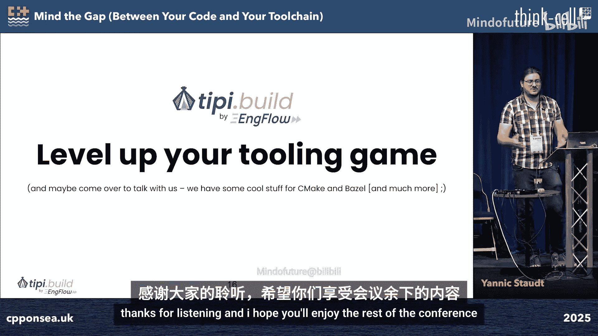

# 【Cpponsea】C++-On-Sea-2025大会-p13-P13_注意_差距_(你的代码_和_你的工具链之间)-扬尼克_施陶特_2025--BV17V4GzjE6p_p13-

So my name's Janiank， and I work at TP Bill by Angelular。

 where we do all sorts of wonderful things with build systems and tooling to make your life better。

 And as you can probably guess， this talk is going to be about tools。

 and it's really a collection of three things that I want to talk about。

The first one would be linkers and overweight debug symbols because that's somewhat of a recurring theme for us。

The second one's built caching。 and finally， a few tools I think everyone should know about。

I hope some of you will get some of the references。 I， I did my best to make them super obvious。

So let's get started with Dbu symbol and the debu symbols guide to the galaxy so。

The gate to galaxy defines debu symbols as those。Cerious little creatures that live inside your binary。

 Qui keeping track of what instruction did， what to whom and perhaps sometimes also why they did it。

And the guide defines them as mostly harmless until， of course。

 you try to link a binary the size of a small moon。Less jokingly。

 when your binary is already already sizable， just because you're runninging a multimillion line code of lines of code project。

 dropping an optimization level or just adding thebug symbol to your build might just nudge you over that magical limit of about 2 gig that the linker is using by default。

And so now you， you can， you can go ahead and tweak that by using the MC model switch and just put it to medium or large and add a couple of other options that will ease your life to getting the bug symbols work well when they get really huge。

But this is just really hiding away some problem because basically the linker is already screaming a few things I didn't sign up for this。

And because really， address mapping within the binary shouldn't be the reason whether you're having some optimizations which on or off or being in control of whether you're having actual de back symbols or not。

There's something quite simple we can do。 We， we can have a debug fishing in。So it。

 it's really telling the compiler to spit out all the debuux symbols in a completely separate file。

And just add references to that file into your actual binary。

And it gives you basically one DWO file per object file that to compile outputs。

And the binary itself now will get within about 10% to 15% of what it would be without any Ebu symbol。

 So that gives you a lot of room to breathe for everything else that you actually want to have in your binary。

And we have had this for a decade now， basically with GCC 4。8 and clang 3。83。9， it it's a thing。

 And it doesn't require any post processingcessing steps。

 It doesn't require any sort of additional setup in U I to get going。

 and it's super useful for for when you ship your software because you basically can give your customer the exact binary that you will be able to use during debugging because it contains the references to that to that debugging information that doesn't require to shift the whole set of debug symbols。

And。Basically， there is a couple of other tools like you see on the。

 on the corner where you can tack all the D DW O files into a single pack。

 And that's may that makes it quite easy for archival， for the future usage at some point in time。

And。The rest of it， the， the debugging experience is pretty much pristine versus what you already know。

 You just have to point it at that debugging information。And in the words of the guide to the galaxy。

Oops。The bugfishion is your towel。 The answer to why is my linker screaming is really rarely 42。

 And it's probably just too many symbols。 Use the bugfishion and don't panic。

Now we have the galaxy thing behind us。 and I want to want to go back from adventures in faraway galaxies at the other side of the universe。

 back to England。For the great British Ba of Boff， actually。

And this week's technical challenge is getting your cash right。 And let's face it。

 Caching is quite tricky in a multitude of a way in general。

 And when we're talking about caching in the context of builds。

 it's not really making our task easier with because there's many small details to consider to make the cash both。

Reliable and effective。The basic problem is really figuring out when you can reuse one cached artifact。

 especially when you have more than a single setup involved。

 So your computer is slightly different than your coworkers That makes it really hard to reuse cache artifacts between those。

And you need to balance this with actually also getting still enough of cash hits because otherwise。

 you're having all the trouble without the reward。So， instead of going into。Nty gritty theory。

 I just wanted to give you a brief overview in a kind of a speed run of what we did to solve those problems。

 So you， you get an idea of one way to do it。The first step we we do is to cut out all sources of variants that we can in in the build and the first step of it is that we create a clean。

 reproducible starting point for your build by mirroring your sources into a deterministic invariant location。

 So this ensures that the sources basically are at the exact same location for the build on everyone's computer。

And this gives us a couple of benefits。 It eases restoring the cache because you don't need to rew write symbols and paths and stuff。

And it also keeps everything always in the right place so that the rest of the tool chain like your debugger and source code analysis works just as is because it the。

 the things that do not move between computers。The mirroring process basically yields a key which is based on the contents of the sources that have been mirrored。

 and that key is used later on to access the cache。

We do a bit of slink magic on top of the whole thing so that you actually don't see that whole orchestrated dance of copying files。

 So your experience as end user basically remains the same。 if you still reap the benefits。

We do kind of the same process for what we call an environment description。

 So that's basically a combination of a CMake tool plane。

 our tooling is based on CMake and a description or a specification of the specific execution environment that you want to run your building in。

And getting your environment under control is really。

 really key here because in the simple So in the simplest case。

 what I just named the execution environment specification is a Docker file， basically。

 that contains all the instructions to construct your。Computer for the build。

And it should contain everything like tools， compilers and whatever else you need。And。Now。

 if we're looking at what I just described， we， we start to have all the pieces in in a good spot for having a reproducible and envi build。

 So we have our sources in a known location which doesn't change between computers。

 We have our scmic to file which also lives in in a known location and a controlled location and we have a con container with all the tools。

With that brand set， groundwork set we can start to talk about the actual caching and in our products we combine a couple of those caches with multiple caches that have slightly different goals and modes of operation。

So on the one hand， we have something we call the L1 cache and that one basically stores entire built trees and install trees of your projects and dependencies。

And we make them accessible in a version track wave。 Basically。

 we map your version control history to states of the cache。

So that we can pick the right one for your next incremental build or to make your life easier when you're switching branches or a lot。

 So you basically get to build from the closest possible base to what you did previously or one of your cos。

The L2 cache， on the other hand， is something that operates at a much finer level of granularity。

 It basically cachees the outputs of the build process by look， by。

 by looking the at all the inputs that are given。 so that's。All your header files， other objects。

 everything that that goes into creating that one output。Is used as a key to。

 to make the the artifacts accessible。 And the real magic happens because we can actually combine these two technologies。

And。Because the system also gives very strong guarantees about where the build。

 the single translation unit is actually executed。It's。

 it becomes possible to share caches between multiple very different execution environments。

 would be it's you running your build on your local computer。

In the Docker container or running the same build in a cloud resource which runs the same image or 1000 cloud computers with tens of thousands of core。

That and you can share the cache contents between all these contexts very easily。

 and it's very transparent to you as a user。嗯So。To finish this up。

 I promised just a couple of tools that perhaps not everyone is using。 And I want to slide to。

 to start the next slide with a question who here has profiled they are bill recently。I that's。

About the number I expected。 So congrats to those who did。 I I， I would highly recommend you。

 you you you try this。 And really， that whole category of tools is there to help you pinpoint the part of your build that is。

 that is unbelievably slow。 and you have no real idea what it is。

And the great news here is for everyone using Kang， you have the best tooling in the world。

 You get timing information on a per function。😊，In a translation unit level。 And it's really easy to。

 to like nail down that that one template insensiation that gives you headaches。

GCC support for the same switch， which is F time trace， is less advanced。I'm。

'm very hopeful they all。Iron out， whatever is missing。 And。

 and if I think it will get much better over time。On a bit higher level of abstraction。

 you can get some of the same information out of ninja build logs。

 And there is tools like ninja tracing that can give you a lot of the information very easily。

And even our dear MVC users are not left outs， Microsoft chipps VC Perf。

 which while being a bit cumbersome to use， is very， very good in terms of the results it yields。

And my recommendation is like， just do it。 It's， it's incredibly easy to， to get that information。

 and it's incredibly useful。 And you'll， you'll know much more about what the compiler is actually doing in your bill。

😊，And if it helps you figure out where whether yourre CPUU or I O bound or whatever is。

's it's a gold mine of information。And the other thing is it will soon be available on our inphoneb tax form dashboard as well。

 So basically， if you do use remote execution or Cmic A， it， it will be just a click away。嗯。

The second one is， yeah， Loy， Google Ch or the the guy at Google starting this shows a brilliant thing。

It's a size profiler for binary。 So it's really parses your alphalf cough files and tells you which sections and which symbols consume how much space。

And it has one really awesome feature， which is it does deelta analysis。

 So you can basically throw two versions of the same binary at。

 and it will tell you what sections changed and。I， I think you everyone should just throw that at the at detail of their RI pipeline and have it always compare to the latest release that you actually did。

You may need to do this on a debug symbol strip release version， whatever。 But it。

 it's super useful to catch hash embeds gone wrong very early or things that like。And it's。

 it's quite wonderful when you're really asking yourself。Where。That biscuit has gone。So my call。

 really， to all of you is level up your tooling game。 It's a great investment in your time。

 in your happiness at the end of the day as well。And if I got you interested in what we do the build caching and build actual acceleration tech。

 please come over， talk to us。 There's Antonio here。 There is da here。

 Flor is seat sitting back back there。 We can certainly help you with some of the heavy lifting and perhaps set you up for a free trial。

Thanks for listening。 and I hope you enjoy the rest of the conference。

