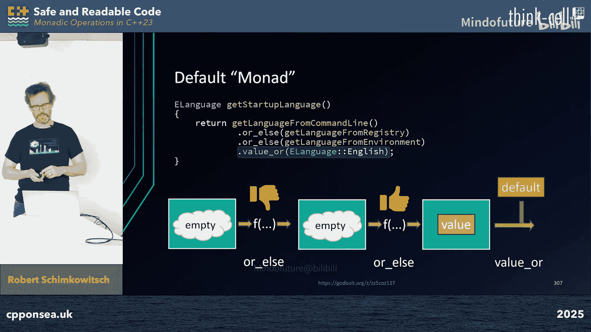

# 【Cpponsea】C++-On-Sea-2025大会-p15-P15_安全_可读的_代码-C++23_中的_单子操作-罗伯特_希姆科维奇_2025--BV17V4GzjE6p_p15-

Hi， everybody。

My name is Robert Chinkoch。 I welcome control center systems for hydroelectric power plants with 25 years of experience。

15 with s plus acute， mostly in the desktop and U space。😊，Lately。

 I do refine requirements to a little architecture。

 codesign and generally try to make our junior team members more productive。

 I love working with people， which is why I also cofounded the S Business students group Vienna。😊。

If you ever come there， please join us at one of our island。

 no matter whether you want to watch a talk。Or give a talk or just have a drink with us。

Over the time， I have solved similar problems more than once。

And this has given me an appreciation of how my own coding style changed over time。

So when I look at all the code now， my instinct is to ask， how would I write this today？

So imagine you are me， and you have just stumbled over this piece of all the code。Now。

 I'm not looking for it in depth analysis here。 Just give me your gut feeling。

 Who likes this kind of code。I see no hands and who does not like this kind of coat。

I see quite a few hands。I don't like it， and I'll tell you why。

It mixes the core logic of the function with error handling。

 making it really hard to see at a glance what the function does。In addition。

 we have this funny return type， which is actually just as successful。

 It tells us whether the function succeeded。😊，The real return values is hidden at the end of the parameter chain。

 We're not going to mix those two， are we。Use exceptions， and you could have something like this。

Except you have to throw somewhere up the Col stack。 You have to catch somewhere down the coal。

 And if you forget to catch， you crash。And also， should we use exceptions for the main errors。

 There's some discussion around that。 So maybe you can or you don't want to use exceptions。

 at least for this piece of code。So what else could we do？We lack classes， right。

 So why not make the Arab flag a class member。 not every function can read and write there。

Looks promising， right， But we have just moved the checks around。 We have not really solved anything。

 And congratulations， we have created our own little dependency help。

 Everything now depends on that single error of flag。😊，And this is called shared mutable state。

 and it's poisoned to local reasoning and threat safety。

So let's take one step back and look at the return type issue first。

We can combine the success flag with the actual output。Into an optional of the return value pack。

That way there't want big of T anymore。If the option is empty， that implies failure。

 and if it holds a value， we can use it。And then we throw away all our if statements and let split optional do work for us。

This way， the sequence is clear and plain to see。And optional does they are handling for us。

 We cannot forget about it。 This is a mon operation in action。

I've set myself three goals for this talk。The first goal is that after the talk。

 you understand what fs and monnats do， not what they are。

 I'm focusing on practical usability rather than theory。

The second is that you are able to write code using the magnetic operations in the standard library without much trouble。

 and that includes knowing how to pass cos and avoid some of the tracks there are。

And I also want to give you athletes and references that should you choose to do so you can dig further into the topic。

Yeah， the code that you see on the slides is slide record。There is a GitHub repository。

 the link is already on the Discord and I will post it at the end of the presentation on the slide。

 you find everything there， code， slides， further references， benchmarks， whatever you want。

And I would much prefer to take questions at the end of the session。 So maybe note the slide number。

 because I have quite a few bit of material to get through。

 and I want to give you a complete picture。And maybe I'll answer the question for recently isolateator anyway。

And did I mention of kids。I was able to get rid of the dinosaurs。

 but there might be some unicorn still hiding in these slides。Okay。

 I promised Mont now I talk about factors。 What's this。Now， find there's a kind of foundation of mod。

They don't have all the properties for Mont， but every mon is a factor。So now say， yeah。

 I know what the factors it's this thing with the call operator。 and you are not wrong。

Thus this term is used。 So fine， but this is not。The fun that we're looking for。

So what are we looking for， Let's tell a little story。 Once upon a time。

 there was a little sequence of code， and it consisted only of two functions。

 one to calculate the area of a circle based on the radius。

 and the second one to format an area nicely into a string。😊，They were combined。

 so you could pass the radioius and get a nicely formed string of the circles area。

And everything was good。But then a developer came and she wanted。

 as she brought a vector of ra and wanted a vector of strings。 Natural。 No problem The said。

 we will just make a loop。And inside the loop， we were do much like before。

But then one of the fact said， this does not feel right。

I'm sitting here together with code that knows nothing about aerial raius。

It has nothing to do with me。I feel we have violated a single responsibility principle。

 And when I ask to see what he sees in the future， he said， code duplication。

How much better would it be if somebody could transform us pool function so we can handle vectors like maybe we create a new function。

That takes the old function as an argument。Now， the new function would accept the vector of whatever parameter type the old function accepted。

And would return the vector of whatever parameter type the old function returned。So。For format error。

 which accepts the double and returns a string， the new function would accept a vector of double and return a vector of string。

Then we can combine those two new functions that they can natively handle vectors。

The vector aspect is implemented only once， and separated out nicely。This is one way to。Apply sctua。

But there is a different way that's sometimes more useful in practice。

 Let's think about a factor as a container。Oruto magic box。Put in the vector of building materials。

Send in a worker， just a single worker with a plan。And take out a bag of houses。

This factor is a class that holds the value we want to transform in the next step as a class member。

And it has a member function called transform， typically。

That accepts a function which takes a single argument and can transform it。

And now the wrapper applies to the whole vector。Yeah。We， we pass in the function。

 We apply to all items。 We return a new factor with the new values。

 and we can repeat the process in equity as long as we want。Again， the vector part is。

EImplemented separately， once， nicely separated。Both factors both solve our problem。

Let's take a step back again and look what really goes on。We start with the radios。

 We can calculate the area， and we can format the area。 We get a string， awesome。😊，Now。

 on the vector side of string thingss we can construct a vector。From a single or multiple radii。

 we could do the same for area and string， but that's not what we're interested in right now。

We want to start with the vector of radiI， and we have this function。

 which can transform the single item。And now we use find the magic。

To apply this function to all items。So we get a vector of areas。

And then we can do the same to go from areas to strengths。

The nice thing about is we are not bound by vector。 Our functions stay the same。

 and we can apply the same using a different factor。With optional， instead of vector。For example。

 could be other things as well。So we have separated two things really nicely。Now。

 let's add a little theory。 There are two rules that factors have to follow。

And the first rule is the rule of composition。Because we could compose our two separate functions into one function。

And we could apply that。And on our factor。 And it should give us a vector strings。

And it must be the exact same vector strings as if we had applied it stage by stage in the pipeline。

The second rule is the rule of identity。 identitydentity needs to be preserved。 What does that mean。

This time， we use a different function， the identity。

Which accepts an argument and returns it unchanged。Sounds a little silly。 they haven't used it。

But please stay along。So we can apply this function。

And it needs to come to the exact same result as the initial input。

This is important because it means the fact that cannot use any other state。

 internal or external to influence the result。It can only use the function that you passed it。

 So you have this guarantee。So in summary， find does provide you a mapping， for example。

 from single values to containers or to optional or do other things。

And this mapping needs to preserve composition and identity。

We've seen that factors can be implemented in different ways。 They don't have to be objects。

 They don't have to hold values。Some of the， those that we will see hold up values。 Some don't。

Both are factors。Now， I've used vector as an example to show the benefits of using a vector。

 but of course， you don't always want to use vector。

 You might want to use a different container or any range。

And you also don't want to write the fun to yourself。 You don't have to guess the ranges views。

When we look back at the deex example at the classic implementation， we can get pretty much the same。

 So same result， same output。 that's for sure， using this piece of code。So， let's decompose that。

St ranges fu gives us a function called transform， which takes。Two arguments。

The first one is the input values。That I start from。

 And the second one is callable a function that I want to apply to all the items in that range。

The output is a new range， which I immediately can use as input to the next transform。Now。

 this inner autoer transform notation is pretty awkward and gets downright confusing。

If you get longer pipeline。 So the pipe operator to the rescue。This way。

 you get a clean and nice notation。And I guess we are， most of us are used to it somewhere。

 ba or shell， whatever。And I think it expresses the intent more nicely。 So how does that work。

 We start with our input。We in it basically， of course。

 not literally injects the input as a hidden first parameter into the transform。And then。

 the transform。Creates a new range， and this becomes the equal for the next stage of the pipeline。

But there are two questions here。What do we actually return from that function。

And what type is the output。Because the type output is not a container。 It does not hold values。

 Think of it not as cake， but as a recipe to get cake。You know how what to do。

You just need ingredients。 And that's the second part。Views typically don't own the data they use。

 Some do， but assume for now that they don't own the data。 So you have to worry about lifetimes。

Another thing about views is they are lazy。So they will only start evaluating once you start drawing data out of them。

 Constructing a view。Not very much。 Almost nothing。So what type is the output now。

 something like this。And it varies by compiler。 So Al is pretty much shown waste a way to make use of that。

 and that has implications。It means that you cannot really separate declaration from definition into different files。

I mean， yeah， corner cases， but you should not。Still。

 it's not a template function because the return type is actually well known。

 We are just too lazy to target。And when we start using such a function for multiple translation units。

 we will run into trouble。 So what do you need to do。Mark such functions in line。 Don't overuse them。

 Keep the scope where you use them within your visibility。

 So you also have a view on the lifetime of the underlying data。

The alternative is to return a container。 and C plus plus 23 gives us a nice facility for that that ranges  too。

 which converts a range to a container for our choice。😊，Can be standard library。

 can be thought party library as long as the interface is that' required exists。

And this way we get a nice， clean API， we can separate declaration from definition again。However。

 we lose the laziness because the values have to be computed at that point。

And we will probably allocate memory。So， in summary。Views are more like a recipe， not like the cake。

 If somebody steals to ingredients that's undefined behavior。And you don't get kicked。

They typically do not own the data。So be careful about that also is the way to use them and they evaluate laly。

And the outs， of course， they are plusless。Depending on your compiler， build settings and so on。

 this may crush， output garbage or maybe even work。Let's walk through it quickly。

We have a simplestruct。Ca C entry， it has two integers and one string。

And we have a function called get nearest entry， which accepts an integer and returns the C entry by value。

And the implementation does't really matter here。Now， what I want， I have a vector of inte。

 and I want to create a view of the entries。Based on that vector。But finally。

 I just want to print out the。Sting member。 So I grabbed the string member in a second friend form。

Nower played it somehow。 So where's the buck。And maybe you can even see it。Okay， so what's going on？

 The first transformation uses getting nearest the entry which returns to see entry by value。

Second transformation gets M text， which gives you a reference to M text。

 But to C entries a temporary， we are sitting there with a dangling reference。😊。

It's a bit like a function like this。 You input an per argument by value and you put a pass out a reference to one of its members。

That's equivalent， but it's maybe harder to see in the pipeline， so always you sanitize us。

Passic Cols is important， as you might have noticed。Because both factors and mons need to work。

And when I started using this coding style， I sometimes had difficulty finding the right ways to pass my functions。

And sometimes just threw off my hands in this parent went back to classic clothing。

I'd like to spare you a lot of that trouble and show you some convenient ways to pass your functions。

And an easy one is the free function。As long as there are no overloads。

 you can just pass it then that's great。We will come to overloads later。

Sttic functions of classes were pretty much the same name。 Wait。

 you just need a class name for qualification。Then there's inland Lambdas。 you code what you need。

 where you need it， which is great if the code is very simple and short。

 And if you don't intend to reuse it elsewhere。One use case of inland Las is if you have overloads for free factions or something like that。

Graraping it in a Lada helps the compiler pick the correct overload。

One of the typical issues you have， you have a function with multiple parameters。

 and the fact of Monarch will only provide one one of them。 well。

 you can pass the rest via the Lada capitalist。Similarly。

 if you want to call a member function of an object instance， for example。

 the function that passes you the object instance， you can have a Lada that will call the desired member function on it。

There are other ways。But there's not enough time to cover all of them。Alternatively。

 if the factor gives you a value and you want to apply to a member function for a known object instance。

 you can do that as well。And if you want to give a Lada name for documentation purposes。

 or want to reuse it in multiple places， that's how you can do that。

And there are also functional objects which work like pretty much like Lambdas。

 give you a little more flexibility。And they are objects with the colloporator。

Sometimes it's nice to be able to inject behavior from the outside to give you the user of your function the ability to pass in a function that will be called at stage three of your pipeline。

 for example。And you can use set function for that。 It wrecks any callable。

And the template arguments are the return type and the parameter types。And that way。

 you can allow your user to customize your。Your algorithm。You can， of course。

 also do it with template parameters。And if you want to check if what you get past is really a function of the correct signature or a call of the correct signature。

 you can do that using a invocable concept。Now， typically。

 you have templates will typically have better runtime characteristics。

 but add some complexities to your code。 It's a tradeoff you have to decide。To summarize。

Longdas are a very flexible way， and they give you lots of ways to pass cos。A Swisss army knife。

 I would say。And at function to inject behavior， you have a good basic set to get started。

Now that we heard about factors， we can talk about monos。As I mentioned。

 Monnas have all the properties of factors plus something more。

 but let's start again with an example on how the monna solves the problem。

Let's say we have a tree leg structure， and it consists of nodes。

 and a node has a function called get to children。 And it's not important how that exactly works。

Important is。We can have multiple children， So I return an vector of notes。Now。

 when I want to call get children again， that doesn't work because it's not equipped to handle the vector inputs。

Let's see if factors can help us with that。 So we start again with our vector of node as input。

And then we transform it。 and we get a vector of vector of nodes。 Okay。

 the next transform is not going to be happy about it。So what do we do。

We invoke Monad magic and drawing the vectors or flatten them。 So we make from a vector vector。

 we just make one vector。😊，This alley wraps one level of nesting。

And that's the property of a monarch。Then we can continue and do the transform again。

And do the join again。So in summary， and for our practical purposes here。Dearest would shoot me。

 I know。A mont is a factor with the ability to unwrapap a level of nesting。

I know this is very hand wavy， but I want to focus on the practical side， things。

You typically cannot unwrupt the last level of nesting。Monets are factors。

 so the rules of composition and idities still apply。

And you will find that the functions for transform and join are often combined。

It functions that differ by name， depending on which implementation you use。

We will see a couple of examples。But let's now leave theory behind and look at examples。

 It has been said that a compiler is a tool that takes files of the input and returns diagnostics as output。

Let's forget that it might also produce some usable object files and focus on the diagnostics， right。

So in classic coding， I would have a function that prints a single diagnostic。

Then I would have a function compile， which takes a file and gives me， of course。

 a vector diagnostic side。 Don't expect just one。And then we can compile multiple files and I say。

 okay， I have a project， whatever that means， which consists of multiple files。

 and I can get all the files in a project。And this would be a classic way to implement it in loop style。

 So we loop the projects。 We get all the files in one project。 we loop those files。

We get the diagnostics of a single file。 we loop those diagnostics， and we print them。

Who is code such as this。Okay。Yeah， third of the room， maybe。Okay。

 how would we do that in a more way using sts used。So we start here with our projects。😮。

And then we transform them into files。Now we have a vector vector files。 we joined that。

Giving us just a vector files。Now we can compile。Again， we get the vector of vector of diagnostics。

 So we join again， giving us just a vector of diagnostics and then。

We can look the diagnostics and print them。They are both versions， side by side。What do you think。

 Which one makes the intentions of the author clearer。Now， do they behave differently， in effect。

 note they call the same functions in the same order with the same arguments。

There might be perform implications， but I'll come to that towards the end。O。

 I'd like to sidestep a little and talk about using planks and loanouts and specifically ranges fu safely。

And for me， if pure functions are key to that， Who knows what the pure function is。睇。😊。

Maybe a force of the room。Okay， for the others， I'll explain in a couple of minutes。

 But let's look a look， look at an example first。Here we started at the bottom。

With a vector of numbers。And what we want is to get a view of those numbers multiplied by  two。

And so we use a function that returns such a view。And the function is above。

Ct multiplied view takess an input range。And the multiplier returns a new view which contains what I want。

And inside the function， I have a help a lambda， which I will use for a single item to multiply a single item。

And the multiply gets passed by the Lada capture。Then I return， if you。有人在转哉。

And down in my calling code， I can print。 So what do we have We have two，4 and six time students。

 of course，4，8 and 1 twelve。No， wait， okay。That doesn't look right。 So what's going on here？So first。

 we pass the multipler value。 Okay， I guess that's fine。Then we captured it by reference。 Oh。

 that looks a bit fishy， but it should actually still work。The view's lazy。

 so it will call the Lada after we have already left function scope。

And we are sitting with a dangling reference to the multiplier。

This was an example for state rangers use。 But in general， when you use factors and mons。

 you need to be aware that they controlled when you get caught。

How often you get called and in what context you get called。

So how can you avoid bad usage of your functions。And I see， mainly two choices。

You can study the fine print of the fact thermomona of your choice and see what guarantees it gives you。

Or you can make your functions more robust than making them pureer。

And I'd like to explore that option。Now， what is a pure function。 It has two properties。 First。

 it will give you the same result for the same input。 Always， no questions asked。

And it has no side effects。Let's look what that means in detail。

 So let's say we have a function that has some input and an output。If you had infinite memory。

 could you replace it by lookup table。And if the answer is yes。

 then you're good on the first request。The second one is what does no side effect means。

 side effects mean it means you're not writing to memory outside your own functions stack。

You're not triggering other side effects， such as external IO。That's what no side effects mean。

Q functions have a lot of advantages。 They are easy to reason about。

 You only need to inspect that function to understand what it does and how it works。

It's easy to write unit tests for them。You can look at the function isolation。

 You can use the lookup table approach。Pie of the lookout table to check if the function really returns what they expect。

And if it's really pure， it in how it spready。Tree functions are useful in combination with tankls and monnas but they are also very useful on their own。

For example， I have a big function that interleaves complex logic with side effects。

Thisis function would typically be really hard to test。

What I like to do is I separate it out into a theologic part that has as much of the complexity as possible。

And into much simpler side effect execution part。And then I may add wrapper so that for the outside user。

 it looks like one function， but now I can test them separately and testing the P function is easier。

 I can use the lookup table approach， but even testing the execute function is typically easier because I can trigger the side effects I want to test specifically in a much simpler fashion。

Now， let's have a little quiz。 I'll list some functions from a standard library。

 And you tell me whether they are pure or not。Let's start with st maxs of integer with no custom comparison。

 Who thinks this is pure。Lots of fans who thinks this is not pure。This is this is pure。 Yes。

 that fill the function used to fill containers or ranges。 Who thinks this is pure。

A few hs who thinks this is not pure。A few more hands。 Yeah， it writes two outside memory。

 so it's not pure。Its that Chrono system clock now， Who thinks this is pure？One， two hands。

 Who thinks this is not pure？A lot more hands。 Yeah， how would you write the lookup table for that。

Then。St Sus with double。Calculating the sins， who thinks this is pure。Who thinks this is not pure？

Yeah， depending on your implementation， because it actually says that it looks it uses global rounding modes。

 so it's using outside state。Then stood ups， absolute of integer。Calculating the absolute value。

 Who thinks this is pure。Most who thinks this is not pure。Well。

 this is tricky because what do we do with ink Min。It's undefined behavior。 Can we say this is pure？

For me， this is a grey area。Then last， start any off checking if a credit card holds true for any item in the range。

 Who thinks this is pure。Who thinks this is not pure。Well， this one's interesting because， of course。

 we depend on the predicate。 If the predicates has side effect， so do we。

But I would argue that even with a pure predicate， we're reading memory that's outside of our function scope。

So that might change while we execute the function。 Can we guarantee a lookup table。It's again。

 it's not a black and white issue。 in many cases。 There's a lot of gray areas here。So。😊。

While P functions help us write safer code。There are different degrees of purity。

And they take a very pragmatic approach to that。 I try to make the functions as pure as is reasonable in the place where I want to use them。

This typically improve safety。At the reasonable cost。So back to our initial problem。

 we could say that the Lada is not pure because it captures outside state using this Lada capture with reference。

 and we can improve that by capturing by value。 Is it really clear now。I actually don't care。

 It solves our problem。So。In the example so far， our functions did not have to handle errors or communicate failure in any way。

 And that was， of course， to keep the example simple。Erero handling orbitted。Now， in production code。

 things look quite different。 We have to handle failure and errors。

 And if you don't want to use exceptions， at least in some parts of your code。For whatever reasons。

 you need other options。 So here， I contrast。A classic version returning pool to indicate success with stood optional。

And the example is this。I have a database or a storage structure doesn't matter in detail。

 and it contains very different kinds of data， trends， images， tables。

And looking up closely at the table， we can identify columns by key or in there。

 and we can do the same with rows， which gives us access to a cell。Now we can ask。

 is there a number in that cell？ And if there is， we can check if it's negative。

So here is what we want。We want to find out if a value inside a table cell is negative。

 what could possibly go wrong。While the key into the database could be invalid。

 it might not be a table。Row or column could be out of pounds。 The value might not be a number。

And then we have one operation which does not fail， at least not for the type that I used here。

So how would you do that in a classic fashion， We， I start with a function called get elementement。

 I pass in a database handle and a key， and I receive。My reference is last parameter than my element。

And a bull return flick telling me if the functions succeeded or not。

I've seen this a lot in old code， and I hate it。They don't compos。But yeah， that's what we have。

 get table similar。It should extract the table from the element。 If it's a table， again。

 the return value is if it succeeded。And the same for the cell， here we need a location。

 or it's an additional。Pro me。And get numeric cell value。

 which should return as an int if it is a numeric type。Does anybody have a flashback here？

We've seen this quote before， so what happens？We create a C element on the stack and thus get element nicely to fill it for us。

And then we check。 and if it fails， we exit ourselves indicating failure。

Then we do the same with the table， create on the stack， ask， get table to fill it。

 early exagon failure。And with the cell。Enter the numeric value。And then finally。

 we can check if it's negative and return with success。Who has code similar to this。Well雪。

So how would you do that in a more declarative me way？We changed the interfaces。

So the functions no longer return blue， but instead combine the output type into an optional。Now。

 if a function fails， we return an empty optional， and this indicates failure。And if it succeeds。

 we return the value wrapped in an optional。And we do the same for get table。

 get cell and get numeric cell value。 And for the sake of completeness。

 I also added the function that checks if value is negative， of course， not strictly necessary。

 But the interesting part is here， I do not return an optional of bull because this function cannot fail by itself。

😊，And that's important because you will see in a few slides。So now we started chain with get element。

And as mentioned， gett element now returns an optional of C element。

So what we can do now is we can call the function end then on optional。

And it will execute our function conditionally。 That is。

 it will execute only if the option holds a value。So we pass in the next transformation function I it will be called or not called depending if the option holds a value。

Since we are working with values that maybe their is called the Ma Monarch。

So let's assume that get element get table where， O， so we have a table。

That optional contains a valid table。Now，qui time。We haven't seen any join here right who as still called this Simonmona。

 Is there some underwrapping going on。 And let me just remind you of what the function interfaces are。

Does someone have。And idea， yeah。no。Yeah， quite。As we can see here。

 the output of the first function an optional。Of C element。

 But the next function only accepts an element。 We have done the unwrapping like a good one should。

Now， how would we it does basically the join and transform in one step。Now。

 how what would you do if we only wanted to join。 So， for example。

 we have an option of option of int and we want to unwrap it。 How could we do that。

 And there's no join function optional。By any name。Does anybody have。A suggestion。

And that' give you a hint。Yeah， okay， Ive， I think I've almost uncovered it because you can short circuit the transform part by using the identity。

 It will still go the unwrapping first。And then it will do nothing with the result because it just passes through。

And maybe I would not use the in production code， but it's pretty nice to illustrate the guarantees。

Okay， back to our code， we passed the table。And here， we need a second。Second argument。

 because Gel needs a location。 So we wrap it in a Lada， pass it by Lambda capture。

And assume it was a bad location。 So our optional is now empty。Because of that。

 the next call to N1 will bypass our next function。The option will still be an optional of in。

 but it will't be just as empty as the input was。Now， is negative does not return an optional。

 It just returns a bull。 So here we use transform much like in ranges views instead of N 10。

Use an and then if the function returns an option and use transform if it does not。

So what can you do with optional basic operations， you can check if it holds a value and if it does。

 you can access the value if you try that without checking， you get an exception。

And you can simplify by moving it into the if moving the assignment into the if statement。

 then you check directly。Or if you don't care whether it held the value or not。

 you just want to fall back to default。 You can use value or。Now， comparison。

 who likes the golden and top more。Don't too many hands。 Who likes the code in bottomtimore。

Some undecided， but the majority， clearly。 So how about lots。

 how about loving or something like that， I mean， okay， this it won't misbehave。

 but we might want to lock failure。There's a function called a sibling to end then。

 It's called or else， and it will only call the function。

If the option is empty and since empty is our indication of failure， we can catch failure that way。

And why is it a template function， Because it needs to return an option off the correct type and it cannot know what that type should be。

 So I tell it via。Template parameter。Now， there's a problem here because if， for example。

 get cell failed。I can catch the fact that something failed， but I don't know where it failed。

 I don't know what failed。 I have theory error context。 This is not good。Enter， stood expected。

And new type in C plus plus 73， which is very similar little optional。 Instead of optional。

 we return stood expected。And it has a second template agreement。 The first one is the value。

 just like with optional。And the second one is error information。Now， if a function fails。

 it doesn't return empty anymore。 It returns unexpected。

 which is a custom error type that you can choose。And for example。

 my C error type it accepts a message in the constructor。

 and it could also capture the call stack in the constructor using the stackies library。

 You will find it in my references if you are interested。If it's okay。

 we just return the value as before react and expect it now。The chain of operations is identical。

And then works the same way。 So it calls the function if expected holds the value type。

If something goes wrong， we switch to the error type。

And from there on end then will bypass any functions and the error state is preserved。At the end。

 we can capture the aerostate in or else。And yeah。Do something with it。So what can we do。

 We get it past atrometer into our log function。So if get cell fails。

 it captures some error information that gets passed down to my log function and I can do some useful logging。

The function also returns unexpected。 so I can choose what I want to do。

 Do I just pass through the expected， unchanged， Do I in， errorer context。

 Or maybe I just fall back to a value value。 That's an option。

 I just wouldn't do that in a function called lock。 That might be surprising。

Useage is very similar to optional。 You check for the value。 You can access the value。

 Now you can alternatively access the error。And expected always holds either value or error。Again。

 you can move the assignment into the if statement if you want to check right away。And again。

 you can use value or if you want to fall back to a default value。Erero or exists as well。

 for special use cases。Now， if you have a fragmented code base or maybe use libraries that return expected。

 you might get different error typess。And expected allows you to transform these erroreroo typess。

 So let's say I have an expected with C error， and I need my error so I can pass it on to my next function。

What do is you write the conversion function that accepts C error and returns my error。

And then you call transform error on that using that function。If the expected it contains an error。

 it will be converted if it does not only the type changes， but no values change。Now。

 we've seen how you can use optional and expected to check if every function in the pipeline succeeds。

But sometimes we want the exact opposite。 We want to call one function after the other until the first one succeeds。

 And then we want to run with the result。And that's easy to do with optional。

Here I want to start an application， and I want to decide what UI language I want to use。

 and I have given the user some options to choose that。看嘛子来。Registry or a similar system。

Environment variable。 And I have a fall like in case nothing was chosen。

And here's the pipeline using S optional This in this pipeline。

 the first function that returns the value wins。So let's assume that get language from command line failed。

We are have an empty optional。Because of that， or else we'll call the next function。

And let's say get language from registry succeeded。 So we now hold the value。And because of that。

 the next function gets bypased， our optional stays the same。Hy。

Being left with an empty option at this point， our value or would have kicked in and provided the default value。

Now， some of you might have noticed that I put Monard in quotes in this section。

Does anybody have an idea why that could be。Yes， please by。I any to。I'm not flattening， yes。Yeah。

I would I would go one step deeper and look first at the factor side。

Because our function dimension is that we are able to transform option of A to option of B to option of C。

 We can transform the types and the values。The monard dimension is that we can unread， like you said。

 So option of option of a to just option of a。 And as we have seen。

 the optional typically it does not。 It does not give us the separate function for that。

 It goes diagonally across this table with n10。And what does this have to do with or else？Nothing。

Because we are stuck at the value type of the first function， and nothing changes there。

 We are not moving across the table at all。 This is not a monarch。

I would maybe call it in magnetic style operation。But it's useful。 So I included it in the talk。

One of the first things you will encounter。When one of the third things you will encounter are compiler errors。

That you're maybe not used to。That's typically the first obstacle。 And you spend。

After you know of it， you spend a little more time on compiler errors。

 but you spend less time on runtime errors， which I think is a good trade off。Still。

 I don't love fixing compiler errors。 So I wrote myself a little cheat sheet。

And I would like to share that with you。So let's say we have this pipeline and it does not compile。

 and what do I get I get something like this。Good threaded wall of next。 M MVC。

 But the other compilers are not that much better in this regard， however。Look at the beginning。

 Look at the end there。 Usually， you find the initially useful information。 For example。

 in the beginning， I find。That I cannot find a matching coll operator or something。

 And then at the end， that some temporary argument could not be deduced。And in the beginning。

 that's similar to what Kang G he will tell you。So how do we fix that。I go through my checklist。

 and the first step is that I want to know in which stage of my pipeline does the error actually happen。

And if you cannot determine that easily， start splitting up the pipeline until you can really pinpoint where the error happens。

Now that you know in which stage the error happens， check if are you using a no noted function。

 Maybe， if so rapid in the Lada。 And this， by the way， is the error that we have seen。

Then does the function accept the correct type。And for example， for Lambdas。

 it's sometimes really useful to replace auto with the concrete types。 if that's possible。

 that you want to use， helps the compiler help you。And the same goes for the return card。

 If you can't explicitly spell out the return type。

 the compiler will love you and you will love it back。For st ranges few specifically。

 you might sometimes discount the number of joins you need。 So you expect a vector of thing。

 but you get thin or vice versa。And sometimes you are tempted to use views。Const。

Maybe even in generic functions don't they sometimes it will work and sometimes it will break with weird compiler errors that you cannot decipher。

Just don't usefuse by cont。 If it's a generic function。

 that typical way to use a forward weddinging reference。

If you know it's cheap to copy because it doesn't ownate me， you can use it by value。

I cannot really go deep into this topic， unfortunately， it's a talk on its own。Yes， and finally。

 for optionally expected suit， you could mix up the antenna and the transform。

And then it returns thing， but it should return option of thing or vice versa。So in my experience。

 these are the typical initial compiler errors that you get。

 And now you know how to fix them quickly。So we have seen the monic operations of the standard Library。

But let's leave this comfortable path and ride our own。

And there's something very similar to optional in the standard。To。

 to option in language that's a point can be now， can be valid。Let's write the point themon that。And。

I want to。Reuse the example from optional。 So the goal is to get the information where that table cell value is negative。

And when we look at the functions from the pipelineyth in the classic version。

 we change them to return time。You might notice it looks very similar to optional。Of course。

 we have to change our implementations as well。And it looks something like this to fit on a slide。

Not a fan of the style， but it fits。 We check in each statement。

 We check it the point that valid before we go further。And the whole function returns a value。

 So its I return an option because point to pool doesn't make sense to me。

This is how it would look with the custom point them on out。 So here is the sequence。

The first function returns a pointta and gets wrapped into a mon rea called CPTR。Like optional。

It has the function， and then I decided to use the same name， which follows the same logic。

If the point is valid， it callss the function。 If the point is invalid， it bypasses it。

So the next function also returns a pointer value onal pointer and the same for the cell。

And for the numeric value of the cell。 And now it gets interesting because I don't have implemented any transform in my interface。

 Why does this work， Because actually， we have transitioned seamlessly from my point the mono to standard optional mode。

Because get numeric value， the integer is also optional of int。

And then we can do a transform on that。And get our results。 So how is it implemented。

 It's a template class。And it should only handle pointer。

 So I restrict the template to only handle pointer types。Using C plus plus 20 concepts。

Now some boiler plate， I have a default constructor that creates a null pointer object。

 and I have a custom constructor where I can directly pass my an existing pointer。

And then I have some helper functions that mimic point like behavior。 That's just the basic set。

 I could add more than that。But the fun is in the mon function， and then。

So we want to pass a callable a function or a function object or whatever。Into it。At the return tab。

 we have to deduce it because it depends on what the function returns。In the implementation。

 we start with the template arguments。TP TR is the point of that that we currently hold in our class。

 So it's a class template argument。 And T call is the function template argument that。

Callable that we want to execute if our point is valid。Inside， I prepared two helper types。

 The first T ref is the reference that the matching reference type to the pointer type。

And T red is the return type of the function。Which gets a reference now， another pointer。

 So the function itself doesn't need to check the pointer if it's not。Then we have two branches。

The first branch for cos with which return point does。So we check our own point， though。

If it's valid， we invoke the Colable。So we forward to callable end our dereence point out。

And then we wrap the return pointer into CP3R so that the next stage of the pipeline can immediately call enter again。

If the point is invalid， I return a nowpointed version of， of my rep。Of the correct type。

And then I have a second branch， which handles return types that are not pointas。 And for now。

 I only accept the optionalional。And this is the。Check I used to see if it's really a stood option to anything。

 I don't care what's inside the option that I just want to have to wrap up。Now。

 I invoke again if the pointer is valid and this time I return without wrapping because it's an optional。

 it has the montic interface。Or I return an empty option of the correct type。

Here I highlighted these differences wrap pointers into CPDR and leave non pointers as they are。And。

 of course。I could consider other cases， but for now I just edit a static exc so if somebody passes me a funny looking callable。

 I will give them a reasonable compile error。AndThis is， again， how to use them。 So， of course。

 there's lots we could add。 We could add transform。

 We could add support for functions that already return C PTRs， whatever。

I still hope I could illustrate the basic idea of creating a mon rappper。

Because I think it's not really magic to write something like that。 I mean， of course。

 it's template code。 So you might look to sign up for Walter's workshop。But it's not that much code。

 even。Okay， magnetic operations are mutual on their own， but you can do more。 you can combine them。

In this section， I want to show you two more things。Two moremons。 very briefly。

 I will just go over them conceptually this late talk。And then how you can combine them。Again。

 we have a pipeline and the task is really slow， like really slow。

 We certainly don't want to block on that。So what's an old cognitive？We can use a contiation mod。

Here we create a future which is available almost instantaneously。And the actual computation is。

Move to the thread and happens inside the future。Now。

 once the value inside the first future is ready， a continuation can be triggered that starts computing the second future。

And again， more of magic is in play because the functions I use。Don't need to know about the future。

 They are just the functions that transform the values。And the unraling is done for them。

The only requirement is to function need to be thread save。

 since my functions are pure and'm good on that。And there is going to be a continuation known as the simple as S 26。

 but not existing right now in production use case。

 So I wanted to show something that we can use if you want to。

AndC is the most stable library that I know of that contains a continuation munut， so I use that。

ItYou can use it from C++ 70。So what do we do， We start the pattern by calling Cu concurrent run。

And here we need to pass first， the function that should be our initial computation。

 to our initial computation and the initial value。We continue with them， similar to the end then。

 So we attach the next function。 It should be computed as soon as the first future is ready。

And we get the final future as our return time。And we can do many things with it。 We can query it。

 We can cancel it。Here I just wait on blocking until it's done。

But what if I wanted to do tracing and maybe I have multiple of these pipelines running in parallel。

 and I don't want to mix them， but I also don't want to use a global mo text for that。

 How could I do that。Well， let's look at the second mont， the writer mont。

 It makes tracing part of the coal chain。 How does that work。

Here we have we construct the writer object， which is a wrapper around our value。And again。

 of course， it's a template so it can contain any type of value。When we when we call our function。

 we can now pass a second。Argument。Containing trace information。 And as you see。

 the value is transformed， but the trace information is also collected in the wrapper。

And the same goes for the next。Next stage of the pipeline。And when we are done。

 we can both get the result from the writer and get the information and loop over it， look at it。

 whatever we want。Now， this is maybe of limited use。

 It's much more useful if the functions themselves return detailed trace information by returning basically a pair of result and trace information。

Because this way， you can trace input parameters， intermediates， outputs， whatever you like。

And the pipeline does not need to take the trace information anymore。You can mix。

 in my implementation， you can mix both styles， as you like。Yeah。

 and then I'd like to combine that with a contiation mono。 I， I need a little clue now。

The first part of glue is a simple function that creates right object， made right up。

NothingNothing special about it。And we accept an initial value。

So it constructs and returns the C right object around that initial value。

Then now needs an interface that understands the C writer wrapper。

 and my functions don't know about zerowriter。 So I have added a wrapper called Ed writer API。

Which will turn it into a function that can handle the C writer。

And we do the same for the last stage。 And the result is a sea right of string。

 the string being our result。And again， I can look over the trace information， do something with it。

So on the one hand， you have the connuation model， which allows you to easily offload tasks into threads。

On the other side， you have to write the monoarch， which allows lock free tracing。

And when you combine them， you get lot free per pipelineylon tracing concurrentency。Of course。

 you can also use the writer mon in other monarchs with expected optional range of views If you want to know exactly what's happening inside your pipeline。

Okay， now I come to the extensive part of the talk because it took me a while to get the numbers。

 and I have less than five minutes to present them。

 which means I cannot explain my approach in detail。 You will have to trust me。Okay， no， of course。

 you can't trust me。 We are talking about benchmarks。 and there are so manyvari to consider。You。

 if you really care about performance， you have to test yourself。 your use place on your hardware。

 but still， I have some useful findings I'd like to share。So my remember that range of fields。

 Let's see if how they hold up against roll loops。And my test scenario was this。

 I start with a small range，50 items。Within three generations。

 I blow it up to an intermediate range of a quarter million items approximately。

 And then I calculated down and con accumulate it into one single result。Sings threadd。

 everything normal is writing involved。And now I have different options to do that。

 I can do the basic thing and do nested loops that directly work on the initial input and directly give me the final output。

I can use views to。Create a view on this intermediate large vector。

 and then compute it down to one single result。I can do the same in a classic fashion by creating a vector that holds the intermediate values。

Or I can use a view to create this intermediate vector。Now， the integrated is the baseline。

And when I use the range of fuel it's about 2 to 13 times lower。

 I should note there's no extra work going on that would hide these effects。

But it's still faster than a classic loop with vector。 Qui a lot faster。 However， if you know。

 if you know the size approximately in advance， you can pre allocatecate。

 and then it's about equally fast the ranges views directly。

 combiningbining views with vector is as expected， slowest。38 times lower sounds bad。

How bad is it really。Well。😊，On my not super fast computer with with these quarter billion items per item。

In the worst option， I spend a bit more than 6 nanoseconds per item。

 which I think is probably too much for a data center or something where you crunch numbers。

What might be reasonable for an U I application that has to wait for user input anyway。

 So depends on your use case， I would say， but why should we not always choose the fastest option。

Because separation of concerns， the fastest option is handcrafted and does this job and this job only。

All the other options gives you some way to separate them out into different building blocks that you might be able to reuse again。

It's a trade of you have to choose。Now， how about the error In my example。

 I have five gates and the value has to pass through these five gates and each gate can either accept or reject。

The value。And they are implemented different ways， so we have a classic pool flag。

 we have optional expected and exceptions。Now， to make it a little more real world。

 as simulateimd a little work before entering the first gate by making a lookup in a 10000 item unordered map。

And I also use different rejection rates。 Now， because in the old happy path。

 all of these are approximately equal， approximately。If I add some set or all set path， then。Bull。

 the classic pool is the clear winner， and optional expected falls behind a bit。

Exceptions are really bad， but this might be Windows special。Okay， to summarize， if you want fast。

 then you go for classic manual implementation， implement your special problem in the special ways that's best。

 However， you can get much nicer code for a reasonable price。

If you are not in the hot part of your application。

Which means you need to know what your hot path is。And if you understand that。

 you can decide what's the trade off worth， is it worth it？To make the specific optimization。

So we're coming to the end， what does this mean， Where does this leave us。

What does it mean to you in practice。I have three takeaways。

 but how strongly they apply to it depends on your experience， what you code。

 how you code with whom you code， for whom you code。You have to pick and choose for yourself。

The first takeaway is that monic operations， but generally factors and monoarchs。

 are useful concepts to know about。We have seen how factorss help us lift up common repetitive code。

 separating the what I do from where I apply it。So I can write a piece of code once and then apply to different things like single items。

 optional inspectors， and so on。Moarchs gave us the power。

 gave us additional power when we want to build pipelines that we cannot build with find alone because they give us the ability to do unwrapping。

I hope I have given you a taste on how useful this might be for you， but it's just a start。

 If you look at some of the references behind behind the link I'll share in a moment。

 you will find out how much more you can do with them。So second takeaway。

 I would argue that pure functions are good for your code health。

They make it safer and easier to test。And this applies beyond functions and monos。

So even if you decide after this talk。Fnk and more that are not really for me。

 Maybe take this one too hard。And finally， the montic operations in Tla+ 23。😊。

A are immediately useful in some common concrete use cases。

 And you don't need deep understanding of the theory behind factors and mons to make use of them。

Srite them out， See if the fit your use case。 Just a word of caution。

 don't report existing tested and validated pipelines。Keep them as they are。

 But if you want to write something new， try out if maybe their monic or way is better a better fit for you。

Let's re up what those pipelines were。The range is you， Monarch。

If you have a pipeline where each input produces and outputs。Opts， maybe mo not。

 if you want to build a pipeline where some or all of the functions might fail。Alternatively。

 that expected， if you want to provide useful error information in case of failure。

And optional default Monarch。 If you want to correct the first usable result from a list of functions。

These will help you write safe and readable code。 The Moic operations in C+  plus 23。😊。

