# 【Cpponsea】C++-On-Sea-2025大会-p16-P16_C++_库_未来_的_10_个_基本_特性-马特乌什_普什_2025--BV17V4GzjE6p_p16-

Good morning， everyone。 My name is Mattos Pche， and I am an addict。😊。

I'm addicted to genetic libraries development and I' doing this for many many years of my life already。

 You may recognize me from physical Uni library that I'm writing and talking about for many。

 many years right now。😊，But this talk is not about units。 It's about how we can。

 we can improve our libraries for our users， how we can improve the experience that they have with our。

With our tools that we provide。When I was submitting this talk。

 I actually want to talk about 10 features， but it turned out that from the time that I submitted the talk and I attended a few committee meetings in the meantime and had somewhat fourth。

 actually we are going to talk about 18 of those today。😊，As you know， C plus plus evolution。

 iss like， well， it's not intentional， but it looks like a Tiktok approach in in， in。

 in hardware a bit， right， C plus 11。Was the corner of Model C plus+ introduced most semantics。

 concepts， lambda expressions， variable templates。Right。

 we got memory models and threads for multi trading。 We got run for Kon Library。

 That's awesome for the time。😊，It was a groundbreaking change in the language to improve what we have。

Then 1417 were not that influential， but C plus past 20 again， was huge， was adding concepts， Rers。

 kotes。We have class and TP， so non tighted the parameters that improve the I interfaces a lot。

 We have concept all the thing by Json Turner， right。

 mostly the it was started with the the keynote Ocon。Constivo， really useful for compile time stuff。

 especially for reflection right now。Spaceship format count Sma for a large barrier。

 plenty of extensions to our multi tradinging cord。 and yeah， we got modules， right？Yeah。

We have them for five years right now。And can' use them too much。23， again was minor addition。

 but C plus 26 is going to be awesome again。😊，We get reflections。

 which will change the world that we know。And plus plus， we have contracts。

We have stood execution to handle synchron's algorithm。We have even more concepts。

 We did all the things before， but now we have even more。呃。We have real capability。

 R C U's head pointers， CD lineage， plenty of of new features that improve how we can write our libraries。

But there are still some features that are missing that would allow us to write or provide even bit better experience to our users。

 And I'm going to talk about those features。I will describe problems that we as labor developers have。

And which， of course， are then exposed to our users。I will talk how we can improve in interfaces。

 how it can enable Comp time called debugging。😊，How we can have better compile error messages。

 Because everyone complains about those， right。How we can improve safety。

 I will talk briefly about some tax utility that we could improve and how we can better distribute our and consume our libraries。

Of course， this list is subjective from my point of view， as a library developer doing units。

 some other people could select other features， but they still think it will be interesting for you。

😊，I will present how those problems can be addressed with future simpleus language and library features。

I will talk about features that were recently accepted for simple plus 26。

 Nearly none of those features I'm going to talk about were actually accepted when I was submitting this stock right now。

 we shifted like。2 meetings already。 we had some two meetings done。 So some changed。

 I'm going to talk about those those we have C plus 26 adaptationnotation in the。

 in this subject next to the paper paper number。Other papers are still。

In the pipeline and did not get to Sp past 26。In this case。

 we will see just paper number and one or two papers are abandoned。

And it would be nice actuallyly for someone to resurrect them and work on them if you care about。

 it will be nice to actually pick up and continue work。

I'm not going to discuss big features like reflection contracts， because， well。

 I have from 90 minutes and I want to talk about other things as well。

 Each of those subjects can be easily discussed for 90 minutes。Right。

 and there are plenty of cook talks already online， so I'm not going to。

 to talk too Marshall about them。But I will provide concrete examples how all of those features can be used to actually improve our libraries。

In case you are not familiar。 This is how you can find a paper number。

 I will be providing you a paper number so you can always get more information about specific change about specific specific proposal。

You can get the paper number by just tapping WD21 dot link in the。In the browser。

 and in case of a paper you just put P in the beginning。

 you can put the P with a revision or without the revision。

 Then you go to the last version of the paper。 It's really useful to find the papers if you want to find ones。

If you want to actually， you find out what is the data on the paper。

You can go to the Gith issue with this syntax and you will find out exactly if it's being processed。

 what was devoting results or what is the status of it in the pipeline。 for example。

 in which room is being discussed right now。身份证人有什么？

You can also get the latest working draft for specific C version。😊，And also。

 if you forget about all of this， you have also user info with just WG20 ton。😊，For 0 WD21 dot link。

You will have all of this information there or even more if you want to look for it。

 So that is how you can check the papers I'm talking about today。So first。

 let's talk about improving interfaces。All right， how do you like this interface？

I see some people smiling on in the audience。 And yeah， this is what we are having fun of， right。

 This is C code。 This is， bad this is not type safe。 We love C+ because it is type types of language。

😊，And then immediately， we type that。Or that。And that let C+ 20 can be written this way。Or that way。

Right。How it's better。 Well， you can say this one face at compile time with nice error message。

 right， You can just to scroll and scroll and scroll。And， and the first one will。Fil at run time。

But from the documentation point of view， from the interface point of view。

 provided to our customers。This is the same， we say we work with everything。Right right。

I strongly believe thats that's the problem。Alco train temperature parameters are theoid star of C plus plus。

 And I'm trying to improve here， although。Some people。

 even on that meeting and the committee agreed with me about and they disagree with me about this a bit。

I was asked if I want to die for typing a template and I typed them instantly instead of a concept。

Well， with he about。I think that this is。This is rock。You' are typing a quantity taking auto。

 quantity taking type name or a function， having some parameters。😊。

It's hard actuallyity to reason about。What you should have to provide here。

 there are non non non nontri interfaces nontri error messages。

And you crash often the library in the。In the implementation part of it。

 and you never know if it's your issue because the code crashed。

 but in the internal of an external code， or is it actually an issue in the external library and you should submit a bug because you were able to crash their error code。

Right， typicallyp， we assume that we are the ones that the error and won try to fix it hard。

 But sometimes there's an error library。Right， so what should they pass for R and rep， What。

 What if rep and rep2 cannot be divided here in this operator。

All of this not exposed in the interfaces。 What is returned from this function， Well auto， right。

 I see7 developers using auto actually in return types。 Please don't。

That's a really bad idea and bad approach。 I know that we want to try to be lazy。

 but thenic autoto is being too lazy interfaces。Right， consider all of the algorithms is of the auto。

You're going to sees。 come find out， too。What comp what the library does for specific algorithm。

 And you see auto a a type。Would you be happy， Probably not。

We expect types to be visible in those interfaces， but we tend to write auto by ourselves。

但是 not整过的一的。I say that in case a library is using concepts， because if not then well。

 it doesn't use it， But if it is used contexts and I can manage to crush the compilation of this library。

 This is a back library right it wait away。Because if you uses concepts。

 you should not be able to get in with a type that doesn't actually work。

 It should be filtered on the boundaries of the interfaces。So if you're able to crush the code。

 that two those concepts， it's there。Issue， and they have and they have to fix it。

It's not your fault。And by the way。Can you spot the bug here。

The subtle diagram bug that many librariess have。And we typically don't see it。

The problems are those two arguments of the fact that look really innocent here。Right。

This is our type quantity。 And this is another type。For different quantity。

It turns out that in the language， you have different ruless of how those parameters are being initialized from arguments。

We call this one， a non dependent。Prameter of the function。

 because it doesn't depend on any template parameters in this case。So for this parameter。

 you will have chi conversions， promotion， standard conversions， usually defined conversions。

 All of this will be considered for this argument。When you' are providing the argument for this parameter of the function。

The other one is called dependent。 It depends on R 2 and rep 2， which is being denuced here。

And as we've heard yesterday on the talk about the pattern matching。

We learned that there is much less features that are considered for such an argument passed to such a parameter。

We just may do some adjustments。 We can consider alternatives， for example， base classes。😊。

And that's it we are not doing any additional conversions。

This means that interface is written this way。Are not the most efficient ones。Because for example。

 we had type decoal type A plus B and decal type B plus a。This will not be the same。

 One of those may， for example， not compile because we will not convert。Right。

 consider that I passing and I2 two objects that are convertible to quantity。

 but not quantity by themselves。Left arguments will convert to quantity。 second one will not。

You can fix it with concepts。You can fit it and fix it with concepts。

 You can provide concepts everywhere。 So you don't have type names。 You don't have auto。

 Everyone knows that custom refer。 It gonna be some representation of specific specific type。And。

I handled the previous case here， by providing Q。Similar to the previous case here， which was。

 which was non dependent right now as a dependent name。That does cluster into a concept。

I said this has to be direct to our quantity or same as quantity。

 depending how you want to model the new interfaces。 But in this case。

 you havesymmetric interface because those are。Both depend that names right now。

 and we have the same rules for conversion。Of course， you can even improve that as well。

 but this is not the interface training。 so I not talk more about this。

But this already helped a lot to provide symmetric symmetric and interfaces with this concept。

And also， you say that you should be able to invoke。The division on those two quantities。So。

 the representations are。Convertible， I'm sorry， di divisible。

 And there is also a return type specified， not only auto sign。

 but I'm returning some kind of a quantity from it。

So I always try to challenge every naked type name and auto in my code to improve stuff。All right。

Itt both the paper is dependent now， so this is fine。But this is about concepts。 Cons are C plus 20。

 So nothing new。But concepts is only a part of the people of the of the picture here。

 part of the interface。 conceptcepts specify the compile time requirements of what we can pass to those functions。

There's also a runtime part。Right。That's what we can do today。At the best。

If you're providing already preconditions with macros。

 you're already in the better part of the of the community。😊，But still doing this suck， right。

 The implementationation detail is not visible in the documentation。

 not visible in interfaces in the declarations of the of the functions。And those are macros， right？

We had con contract for a moment before plus 20 was standardized。 But that we decided to remove them。

 And finally， after。6 years， right。Wei。Will have contract。Right。

 this is the same thing written the same the same check， but written in a different way。 Right。

 This is checked on your Dbug。 This is checked。 however you want to spell for your build。

You may specify that you want to totally ignore this fact and have to undefined behaviors in you C。

 if you care about performance， but you may have bins when you actually check everything and。

Verify if everything works fine， contract。Will be great。 But already， it's plus 26。

And they will improve the way how we talked about interfaces。 Finally。

 we can talk about compile time and runtime restrictions to our， our interfaces。

 which is so huge for everyone， for users， for developers。And for many other stuff。

 because also performance maybe be faster。 Comprs may do some assumptions based on this。

 This is a lay the the ground for many， many。Interesting optimizations in the future。说。

I'm really excited about this being able to finally provide all of the information in information about the interface。

😊，In its declaration， without any documentation， it's really nice。Another interesting feature。

 the really important one that was under C+ 20 was class types as non type table parameters。

5 years ago， at this conference， I was saying that。Probably is one of the most。

Soific improvements in the temperment programming during the last decade。

If a template parameter behaves like a value， it probably should be an an NTP。😊，At this point。

 I even didn't realize how much。They will impact my library。I had some ideas that they are great。

 but I didn't know actually you were actually。 I will end up five years later。

So those are the current interfaces I have。😊，In my， in my line of the code。

 you can specify information about the， for example， dimension quantities spec unit。

Provide some prefixes。And then， you can avoid。The type this way。

 quantity of speed in kilometer per hour。This is mind blowing comparing to had what you could do before it+ 20。

Right， if you know to the ratio interfaces， student ratio multiplies to the ratio divides and so on。

This is so much better。And all of those are actually entityTP。

 Every single parameter parameter you see on the slide is N TTP。

It was not the case when I was showing this previous slide with my talk five years ago。 Right now。

 every single parameter is N T TP。 You can pass strings。

 You can provide all of the automatictics here and pass N TTP to your classes。That's really。

 really nice。So。En3 PC plus20 are defined as。Have been of structural types， or auto or seat that。

And social type is defined to be a scholar type with constant destruction。

 Alva reference or lit class。 So the one can that can be used in context functions where all base classes and non static data members are public and not mutable。

Such all types。This thing， this one thing the public here bothers me a lot。It was a trade off。

 I know advice will not get the plus 20。 I know， but still is inconvenient， really， really。

A neat problem。I will show you why in a moment。This is similar stuff。

 I'm providing thermodynamic computer and the dimension for it， the quantity type。

 I provide some origin。Specify that Kelvin uses this origin。Absolute0， right。And specify data。

Calling this。A point， Ab absolute0 plus delta is actually the ice point for cus scale。And。

Notice that I can put that point。Let I calculate it here。To attempt again。

Cimate this ice point and then specify the di you need to be based on this ice point。

And they can write 21 degrees Celsius。What does it mean。It means that the。Quantity is specific here。

Is embedded into quantity point。Which is embedded in the point declaration here。

 which is embedded in the U declaration here。Which means that those higher level obstructions。

Are put again in the union's definition。Which means though has to be also structural types。

Which means。They have a public member。And you can access it。In my library， if you really。

 really want to。I struggle a lot to provide safety to my users。

 safety for proper interfaces that make sure that all of the values are handled properly that' Calism correctly。

 and they have access to a public member。Because I have to。

 otherwise it will not be possible to put them in the point definition。That sucks。

 And actual users start to use it。I for plenty of time。

 I like grabing Gitthub looking for the user of my library to find out how users actually use my library。

To maybe improve， to provide some feedback。 And they found out this PR in some labor saying。

 we had our number， but we， I removed the number from the factor this to a longer function in then。😊。

Version 2。 so they started to use numerical value member inside。So I said， well。

 you should don do it。They should not be used directly because they in details。 And I said。

 maybe I should。Some call obfuscate the name to discourage people from using that。

And they got the from answer that， well， I don't know if e ob would be effective because well the comments。

Maybe well be better because， well， they pop up in my I D when it cr out。So we always see them。Right。

 Is show those public members。Wai， which that。And you said that library， of course， we can say， well。

 we can name them with two underscores。 while the scores should not be used by users and they are on their own when they are using because they know they shouldn't。

 But as library developers that I'm not in library， I cannot use to underscore。

So the only thing I can do。I can make really nice and long name so people don't want to use it。

And that's what they did。And they plan to change it every major feature。😊。

So people don't depend on it。不态。This sucks。So auto of sequence classes that want them to be able as entitiesTP have to sacrifice encapsulation。

Right， also， there are plenty of types that could be useful in compact context。

 like optional variant two plus pun vector。But we canfuse them because they have private members。

Even if my conti type has public member。 So it's compatible entity piece。

 if I will put some for rep here。Like， for example， uncertainty type provided by the user。

And uncertaintyty has private members。 Indeed yet it may continue will not be possible anymore to be used in an NP context because it uses other type that is not NTP friendly。

So it still affects me。Also， we wanted to have basic fixed drink or fixed drink basically plus 26。

 I wrote this paper， and it was postponed until possibly next cycleo C plus 29。

 because we hoped to fix the language and we didn't for plus 26。So we didn't get it in this release。

Because we were waiting for some changes that didn't happen in the language as of now。

We hope that we'll be able to provide in place drink instead of fixed string。

 which would be much more useful。In case the language changes。

 but we need this to work as a structural type。 So N TTP friendly type。

The proposal that was rejected for now a rejected postpone， let's say it's not rejected but。We said。

 as always， do more work。呃。Was by Bar Resvin real nice proposal that wants to extend support for class types to non parameters。

The idea is that you have to provide two functions to meta representation and from meta representation。

 that basic use reflection。To。Convert them in NP context properly。

You have to convert them both ways to make sure that the can basically be used efficiently。

 But in most cases， the default provided by the compile would be enough。

Those two lines will basically save all of the issues I'm talking about right now。

This proposal still。In the pipeline， hopefully it will progress。

And this is what you will have to add to your classes in order for them to to work fine with entity T P context。

 if they have private members。 In most cases， I said this should be default。 In some cases。

 you will have to specify exactly which members should be treated in so in in which way if you want to。

Basically， implement them because this is like a serialization of your type。Really nice proposal。

 I really cheat for it。 Hope that it will。Be accepted for the next standard。All right。So。

Probably some of you already had this issue。Do you know what may be the issue with this code。

I have some concept constraining Q here， and I have a forwarding reference。Of this queue。

Any ideas on what may go wrong here。忘了你。Look you want to drive for it。Look。

The comment for is that do I really want to write for a。 Yes。

 I want the F for because I want to pass quantity as efficiently as I can。

But when funny inference has this strange property or the property that actually will be able to propagate everything。

In a perfect way， right。So it will， if you pass reference， you will get reference。 if you pass code。

 you will pass cost。 and then this Q will have those cost and the difference in the type。

 which will not much typically a concept you want to compare。的差异。It said， come on。

Problem that if you are， if you're having for references。

 that those types will include references con volatile if needed。 So typically。

 you have to write remote CBF。On this， to verify the concept。That's a common on pitfall， and。

Sooner or later， you will find it out that you have to write things like that。

Another thing that bothers means that， for example， if I have。Some， for example，1 all algorithm。

For example， in corotes or sunverse， I want to pass away tables。😊。

I expect that R is arranged arranged range。Afvoid temples and。

I have to provide range of value T on the range Sping this in a table in separate line。

 I cannot do this in one line because I dont have access to R and it values in the one line。

So I have to write another line in my temp in in， in， in my interfaces。Right， so for many。Use cases。

 You can adjust one write one line with this shortnotation。You have to provide additional。

Requires closes to costtrain it even more。So basically。

 those things do not compose properly other cases here。I use street as floating point。

 This is from Chrono。 this pattern from Chrono is being used there already to say that I'm extending my is floating point ti rate。

To my custom types is because you are not allowed to specialize a floating point for a for a custom type。

Basically， most of the type trades from the type trade heater can only be specialized for custom types。

 So this is how we are cheating by providing another type trade you can。

 you can specify for my float。And then。😊，I have some。Predicate called Ol。

I say take and predicate and apply with fold expression。😊，This predicate to my typess。

This doesn't play nice。Right， this is type name。 So it needs a type。 This is boo。

 So it's a value for template。If you predicate， but it cannot be used here。😊。

In order to make it work， you have to actually create another preddiiccate being a type with full constant。

😊，Call it undercur T。 And then you can pass undercur T here， which is a boilerplate。

 which is doing more， which increases compile times， which makes also people。

Confused why you have two of them。But this how you do it today。This also order to compile， right？

So the three proposal that actually was accepted topa 26 already。

That allows you to create concepts and variable template parameters。So instead of writing this。😊。

I can create Dase2 concept。That will take。A concept template as a parameter。

 which was impossible before。And now my two lines can be written as decay to quantity。Ato refer。

Shorter nicer interface saying what is it about all？Or I have this one or format my O tables。

 Instead writing this， I can write。Range of where I have take another concept template。

And they say it has to be range， and the range values should satisfy this prediccate task。By user。

And I can write one all range of away tables， away tables。I like this， much more than this one。Right。

Those a really nice， small， additional language that make the language more generic and more consistent。

Because why type templates were only privileged in the language。

 Why not variable templates that are in the language for more than 10 years right now。

 concepts are for five years， also not allowed。Now， it's truly generic in this case。Actually。

 I talked about this four years ago already and provided a different paper about this。

 than what was taken over by some really nice guys from the core group。From the language group。

 Corinine Goshper， And they continued to work in order to make it work。 And now it's in the language。

 which is great。😊，送。😡，For example， I can write all of。Right， with some preddiiccate being type。

 And I needed this one before。So now I can write auto， not only concept， but also auto。

 which will take a value。😊，And I can just pass my variable template directly without providing additional X abstraction that will just make things slower to compile and provide additional things。

And now there is a question。Because I have to order。T you for name。And that would。

Which one is better。Why do I have to choose。Can they have both。It turns out that in the language。

 we have free。Temped parameter kinds。We have typess。We have non types。 So values mostly。

And templates saw the generators。Those three are provided in the language for。A long time already。

So if I want to actually write all of。Algorith， for all of the cases。

 I have to write all of them here。This is the one that takes types。This is the one that takes the。

 the predicator that that that that is four types pre that is rhetorica values and concepts。

And I usually it with types。I may have also。I predicate that takes。

Types values predict four times values in gra， the type value and concept， but takes taking a value。

And you think that's。 that's， but already， it may be worse。Because you may have predicts do the same。

 but， but which takes。Value， but expects a type。 So you want to do dec type on each of the。

Arguments passed right， So I pass a value， I take the type of the value and then pass it to a predicate to verify。

What I'm returning， right， in case of types， I always do column column value in order to come to compare them。

 Otherwise for for a variable， like goo， I just。Compare them for concept。 Of course。

 concept is a predicated by itself。 So I just compare them。And do some logic。And。I'm so proud of me。

 I just wrote I handled all of the cases。Right，9 different。

Versionions of the same algorithm with different names。And then the user comes and says。

 I want this to work。I'm passing Q integral， which is a concept。

 and I want this type and the value and type and the value to work。As of today。

 it is impossible to specify a pack of different kinds。

You can say I get the ideat have a pack of types or have a pack of values or have a pack of。😊。

10 please。You cannot say I have a pack of mixed kinds。

I's it impossible to implement this either unless you will be writing each specific for each。

The parameter by yourself。 So pre simple plus plus 11 error without variety templates。So。This is me。

So for five years， I'm talking already about investable parameters and provided also the first paper about it to get the roof of Gosper。

And again， it was taken by the language group later on because I'm working on the unit。

 I'm not the language guy。 So again， Corinine and Gahper are working hard on this。

 but it is still not the part of C plus plus 26。 Hopefully it to be part of C plus 29。

 We want to introduce a universal temper parameter。 Inic this is the parameter。

 but I don't care what is the kind of it。This is just a parameter template。Some may say。

 I have three generic olive。That takes a predicate that returns anything that basically either a value or a concept or a or a type。

And it takes anything。As an argument for the predicate， and I also pass anything as argument。😊。

To pass to this predicate。And they can do this。For this person here， to write this Ol。

And uses check here as implantation detail。 So what check does check just passes the predcate arguments to implantation。

 And in case I'm， I need a type in a prediiccate， but I get a value。I just dec type。

This value to get type。And if have another helper check input here being used。

And tech input does called it the predicative argument。And in case， the argument is。

So the predict what was a type。Then I'm returning value from it。And with this， I am done with this。

 I have truly generic all of finally done for all of the possible inputs。

I may have all of sc double float long double， Right。

 So the class template and type right from the standard library taking types。

I can make a variable template that you've seen before。Taking types。I may have contact taking types。

 I may have contact taking。And testingastic。The values， not negativeative。

I may have contest taking anything， type value， type value。

I we have concepts taking values because those are values to library。

 second meter meter per second are values， as you know already。😊。

But they are compared against their type if they are a kind of unit。

And similar for here for quantities。It takes anything because it's a value。

 This one is a type and can say this is a quantity。That's really powerful。

Being able to write this Ol。In one unified interface for all of these use cases。

It's a really benefit for many。And the Fs。It was impossible before， as they approved to do the。

 to this right。 Already the previous slide was really clatuttered with plenty of different options。

 and it didn't cover all of the possible scenarios。

Another very useful typewriter you can implement of that， we can write finally specialization of。😊。

Sa this is specialization off。 So probably it should be a type name， but you can choose otherwise。

 but it takes any parameters。And then provide specization saying that this should be， in this case。

 it's true if it's can be specialized here。And you may have a concept called specificization of。

 And then I can write specization of vector or R。 And I I don't care that R I also takes the size。

 which is a no type， right， It's a value value， for example，5 or 32。

It just works because it takes universal parameters。

 and I do care if there are types non types or generators。然后瑞出。

Type rate that we can get install the library when you have this feature would be direct specialization。

 which is really similar。 I will not go through the plant。 exactly。 You can find it in my slides。

But was exactly the same。 You may say that something is direct for specialization。And。

It just works for any class template you pass here。Really powerful stuff。Also。

 in my talks like five years ago， at this conference。

 I was showing this interface for different units， maybe not not visible。Here。

 but basically I was showing that I need class based of different names from different scenarios。

If I headed this Uni September permeter， I could provide the same。

Class template name for each scenarios， because I can specialize it saying it takes any parameters and then provides specificizations for each of these scenario。

So it's similar to function of all loading。 consider a function of all loading and。

C style functions having the the different time for different use case。

You can do the same with class templates right now and specializations having this parameter。

 the same exactly name of the class template handling different scenarios rather than the previous variation when you had class templates for each scenario separately。

So you have here name that used derived unit， name scale derived unit， cohert derived unit。

 name cohert derived unit that use the derived unit。Perffiect you have2 need。

Who will actually grasp button and don't know how to use it properly。 right。

 here you just have a direct unit need， and you just provide proper parameters， and it works。

So I really feel that this feature that is still missing the language。It was considered for。

 for installation interface this phase， but still more work is， is required by the。

 by the language group。Or ex or or requested， maybe not required but by the requested。

 because actually， we have working implementation of this in the compiler already。

I think as a corner building true generator interfaces， as they prove you in some cases here。

So come me back to variable template。Vibible templates are preferred in many modern libraries over the class templates because they are less to type and faster to compile。

So this three floating point that you've seen before I better this way。 just as a reminder， right。

 I have three floatinging point。I'm using here。D。嗯。Type straight for it。

And I can provide specificizations for my own type。However， for some cases。There's no good default。

For the default case。I may say， for example。Unicode subsequent number for 0。 Is that up to line。

 is that。But what should be default for the value between 0 and 10。Right right。

 in order to have specialization， I need to have a primary definition first。😊，In class templates。

 you may say just semi column and don't provide the definition。😊，In case of whatever templates。

 you always have to end up with something。There's no good。Think to put here。That's under issue。

There's a paper that actually abandoned。 I don't think it's no one works。

 I think that no one works on it right now。 I would love someone to actually work on this one。

That's allowing you to try delete in this place。😊，Saying this by itself， doesn't have sense。

All these specific have sense。It was again。Allow us to provide better， faster to compile。

Customation point。Other cr。I may have con points for latitude and longitude。

 Those use bundleed types， right， because the。Latitude isbounded on 90。

 and the longitude is bounded on 180。So you can。Go from the around the world and basically do。

Number one。Rp。And when you're having la laitude， if you are far from。Those two different locations。

 Then you cannot just calculate straight line between those right。

 Cal straight lines for the middle of the earth doesn't have sense。

If you going to travel from New York to Tokyo， right？You have to do it with this fair approximation。

 So that's how we do it。And you we are using here sins， cos and so on in order to make it work。

I music， as I disagree here。

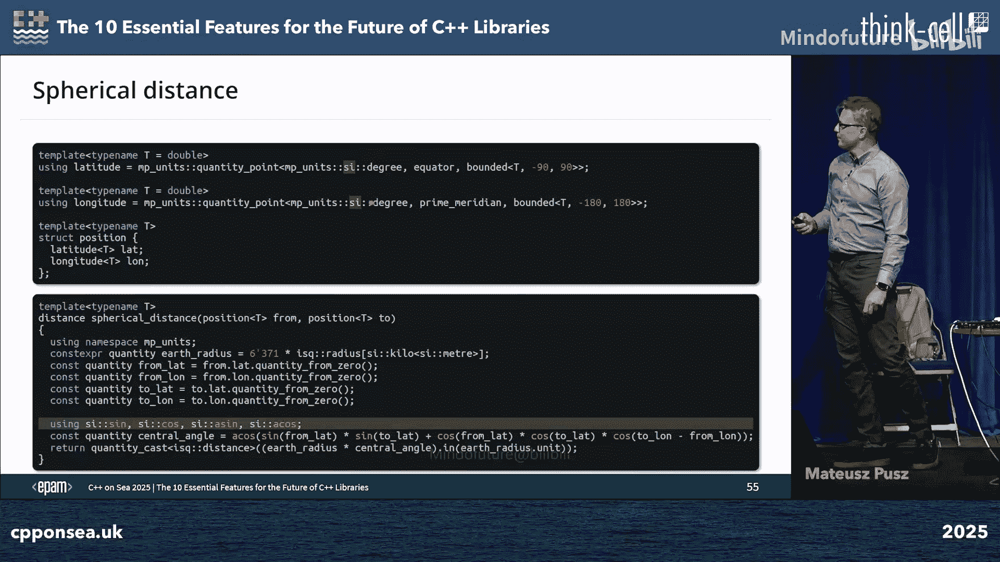

And then actually have to explicitly include sins， casinos and other functions from the S A space in order to make this work。

Which is confusing， because if I have a I in this class template。I should depend on idea。The fire。

It turns out。That。Someone， I don't know exactly who， but many。

 many years ago said explicitly that in case of the argument dependent name lookup。

 we just use in class 1 passage。

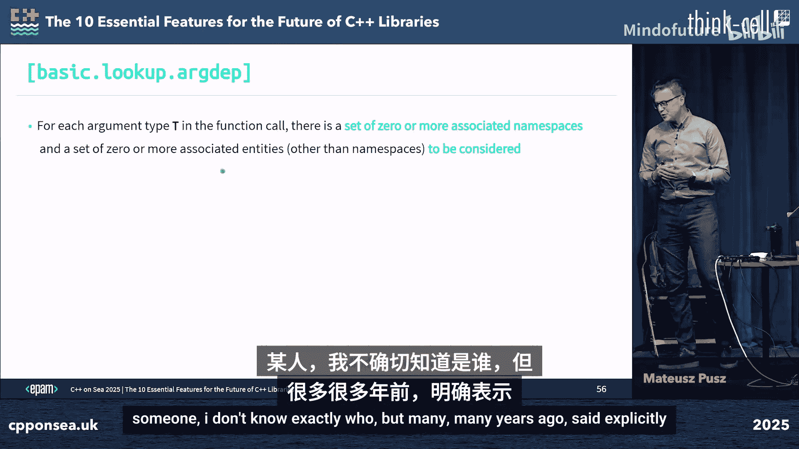

And we look for the types of the template arguments。For temper temper。 And there's explicit note。

 non type templateate arguments do not contribute to the set of associated nice spaces。

So someone X PCCT decided not to use entityT P namespaces to use in ideal。This is why in this code。

 when I use S I in my class template， I will not find。Since when I'm doing unquified look up to。

 basically find this function。 I have to use using the declaration。

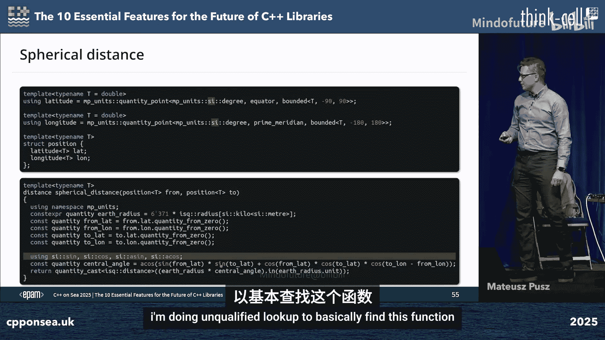

Which suck again。So。Also， like a few years ago， I asked the question why we can't have nice things。

We have either to write to allow these interfaces with that we agreed this they are really nice。

 but they don't use AL。Or you have to use dec type。😊，Of this expression。

 in order to find the yet to work， which sucks from the user point of view。

To spread those all the time。Constant wrapper that was standard by Space plus 26 also has this issue。

They solved it by the fact that they provide first the value。

And then they have permitted that user should test specify。

 but the compiler or library add it by itself by just doing deco type of the value provided here by the user。

With this， we have a value and it's type in a type， which makes。AD work。

I could do the same in my quantity。But you don't want to see。In my quantity type in an error message。

 for example， meter per second twice。Onces for a value and one for a type in the error message。

 because we want to be terrorist。 We want to be nice to read。

 We don't want to repeat information just to make AL， A DL work。And even then。

 they say that it will break without any parameters and also that the support is still imperfect because in some cases like this one。

 it will not work at all。So it's just how to make some things work。There is a nice paper。

That was proposed for C plus 26， but again。Committee asks for more work。

Where you can specify explicitly which spaces are associated with your class template。😊。

So this may say I'm associating many spaces additionally， with。The types of of this non typemeter。

And this will solve my issue with sin， because。As signed degree will begin an assign namespace here。

 I will take dec type。 I will say that this space is associated So to be looked in A DL while this argument is being searched for。

😊，二首。ADL is the source of many and unqualified hookup in general， is a source of。

Our compile time issues we have。 We typically blame 10 plates for compile times。

 but that's not the case。 Tpically over solution， a name lookup is the hard thing。都 do。

And this was really u visible in the under receivers。They use plenty of hacks in order to fix it。

 But with this proposal， it's much easier。 You just say。I am not。Using ADL。

For any of the parameters of the centerer。And as you know about sentence evils。

They basically nest and nest and nest and nest。 entire program can be a sender。

So all of the na spaces used in the program can be in this type。So standard library， namespace。

 boost Q T。And possibly your production nice space as well。

So if its entire program describes this kind of button send。

 then all of the possible types use the entire project are in this type。

 which means that all of the possible name spaces are being looked with AL all the time if it's not done right。

Which will affect your compile times and possibly provide also some ambiguity。

In case you have colors of names。That's why this feature is so useful。

 being able to write that would be really nice to improve comp times and remove all those ambiguities。

 because typically， you don't want to customize based on this。 Its just how I L is being。😊。

Done by itself。You don't have to obtain for ADL。 It's always there。Or another example。

 you have a map。You may want to say that I want to customize R map based on the type T provided。

 but what does it study you about？Aocator that's in the standard name space。

 So don't want do in the SD for overloads customizations from my R map。

 That's because there is stood aocator。So I say only this first parameter。Will specify。

The customizationian。But not the other one。So， this is nice。

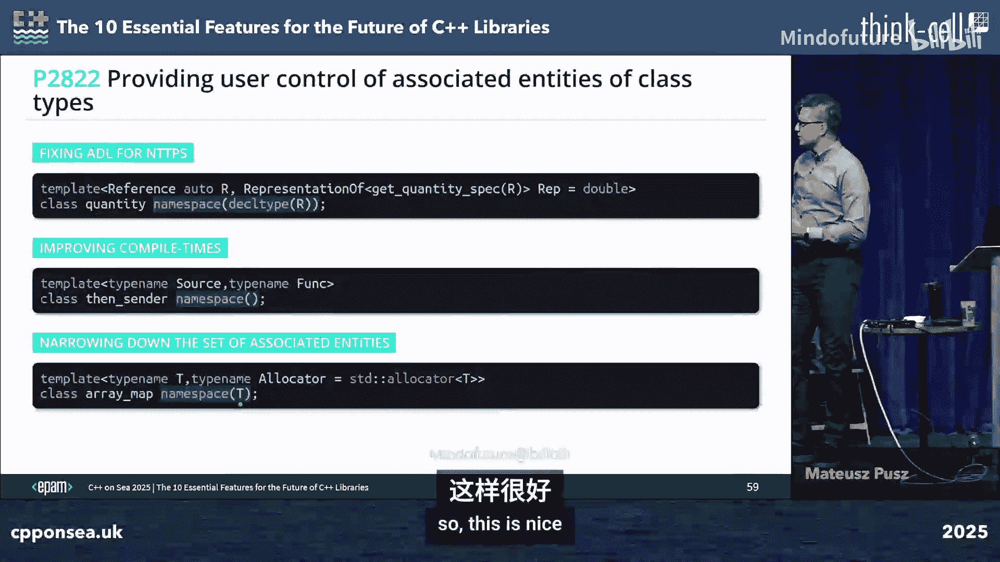

Other intduous case。And in my library， for example。

 when I type kilogram times meter and meter times kilogram， I want to end up with the same type。

 Otherwise， it would be really hard to reason about and actually you provide the logic for the。

For the library。Right， so if I do't that type on both of them， I should have the same type。

So I have to order them right， This is the type actually I' am generating directing it of kilogram meter。

I decide that kilograms should be before meter in a type and then being inconsistent and always do this the same。

 the same way。To do this。8 app predicate， a predicate and some。Ty is sort。Helper， right。

 in just her s， I will not show in because it's well。The paper programming stuff。

 how you do presentation of sorting， what you provide the predicate predicate that takes two types and provides the type as an answer。

And then。😊，I am a implement function called type name。

That returnsomy string view for specific type T。And I can say that I have type nameless。

 which is a full constant of type name and type name。Compared with less。

And then I can check typeist sort of  typeist B， A C。With my type nameless。

 should Ra me the same type as type list ABC。Because it sorts all of the elements。

So such starique is useful in many cases in mal for sure。But how to implement this type in function。

Today you can only do that。There is no standard way of doing this properly。This is a hack， right。

 to make it work。But it works for my my library on major compilers。

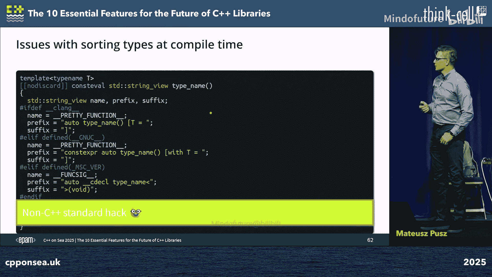

从 the system8一开始。However， I noticed that when I add an nosena space and I add some unit there。

And they implement this。Then0 for point， I will get the right unit of anonymousmous cows on clk。

 I will have direct unit of anonymousmous space chaos as a meter。Because they actually tend to。

Compare them differently。So， it's not that。Sunderless。Right， so the。I cannot provide， like。

Por table interfaces for such。You need defined in an anonymous。And it already bothers me a bit。

On last meeting two days ago or free right now， three days ago。We accepted this feature。

 We have standardized concepts type order the in in the language right now。

And you can just pass type order。To may predicate， and this will just always compare properly in a portable way between。

 between types。It's useful for me， but not done for me。For example， you may have types sets。

And types it of A， B and B， A A。Should be the same because you' don nott care there is a repeat of I。

 You may be doing this explicitly or implic through Aliass。Right， if there're the same time twice。

 you have to， you want to。Maursure those two together， so there's only one entry。And the same order。

 So all of them lose the same。It's useful for the。For some logic of libraries。

 but also for compile times。Because this and this have exactly the same behavior。

 But this would be two different Sp instants of the same class template which basically is more to work。

 more work for the compiler。Other possibilities where you have policy by design。Again。

 you specifyify some type Q1。And I can imagine that in the same project。

 people will spell it a few times， and they will use the same policies， but in different order。

Which will yield to different specializations， which will， again。Take more time to come。

 to basically to。To compile and possibly will complicate the logic。 like， for example。

 Comp operator will have to account for arguments being possible in different orders。

Even domin the same。Or a variant。Right， variance is just a union。

 I should not care what is the order of parameters specified。 and the variant is really。

 really slow to compile。So if you have a of variety of in and double and double of in。

 the same variant， you have two large instantciations of of plenty of templates。

 just to make it work。All of those features can be right now written in a my not my。

 better way using this。Really small addition， as it could， could be seen by some people。Right。

We all care about compile times。 You may say features like this are not useful， but。

For liberal developers， they are really important to provide a better experience for you。

 So you will have better compile times and less instantsations and in your binaries。😊，完了吗。

Recommendations， when I provide workshops to customers， I always say。

 always use constructor in sizeizer list to inu class。 This is a good default。

 It is like the rule of thumb， right to inize classes。 Well。

 it's even better to put it as a memory in size list if possible， don't write the constructor at all。

 But if you have to write the constructor or use in size list。😊，But then， for example。

 I have to write measurement in my class template。And as long as the concept value here。

I am not able to initialize the uncertainty， because uncertainty should be the A B。

 S of the error provided here。There's no way for me。Well。

 maybe without using Lada in the initial list to say。

 I have to first do using directive here and then。Or using declaration for A， B， S。

And then only do it with unqualified lookup to look for customization points that are potentially。

Than for a specific value type。So I have to use it in the body of my constructor rather than in each other list。

 Also， when I implement this A， B， S。Function in my library。I have to say that。 I require。Of course。

 I have do use using here， right， This is using declaration then properly here。And unqu lookup。

 And they want this to require that this code below compiles。 And they have to use both options。

 either Im using unqualified lookup。Or poly look up in S SDD。Having to constrain it this way。Sxagon。

I don't want to be forced to write those two。There's no proposal on this， but if you occur。

 it would be nice to come with proposal。To introduce configuration point objects for mathematical functions。

The custom point objects， like we have already swapped and many other point objects in the language。

 You could also have custom point objects for A B， S or some other numerical functions。

That you could specialize for your own custom types like my int， my float， short float， and so on。

 right。There will be more and more custom numerical types in the industry。 Also for safety。

 You will have safe in teachers， safe for equipment numbers to prevent overflows and so on。

 because we have pressure from the community to improve safety of our libraries。

 We will not be able to fix the fundamental types in the language。 so we can provide safe wrappers。

 So more and more types will need such consumption points。 So being able to。😊。

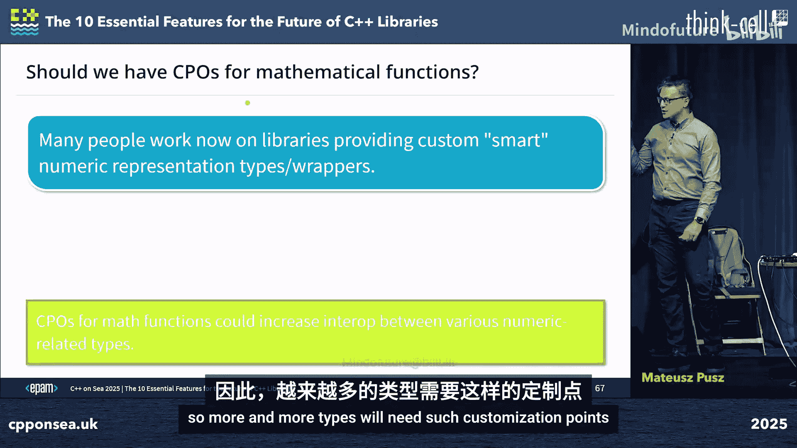

Use point like this one。 for example， Ma A B， S。Would be really useful。Right now， as I said。

 there's no proposal on this。 So if you care， it would be nice actually to。

 to come up with such a proposal。 I also care， but I'm doing other stuff。

 So I will not do too many things at once。 Maybe when I demo my units。

 I will try to approach other things。But。If you carry。

 it would be nice actually why you to propose maybe such transformation point object。

In order to provide better。We can fill and custom for many different projects， right。

 And then you can have more power， not on the。Do ADN lookup， but you can for example。

 check for member function and non member function。😊，And then in the end， for SDD。

In case it works withity。Right。And， of course， you can check also written values here also so。

More power。To ensure that A BS isn't broken， because AB S returning void probably doesn't have sense。

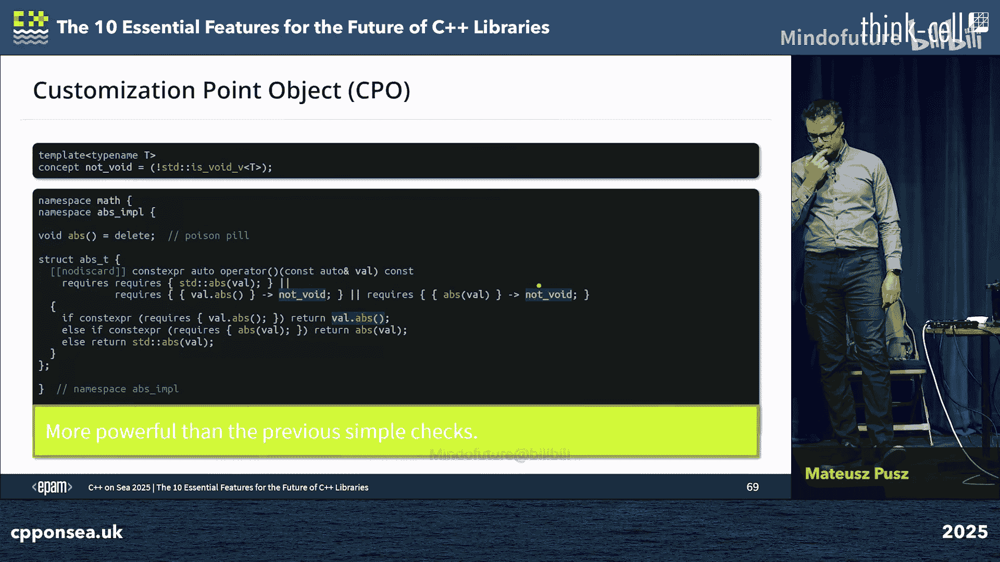

Right， so this I had this before right now， I could write this this way。

 Just I require my Ma AB S and Ma Ma AB S to work here。

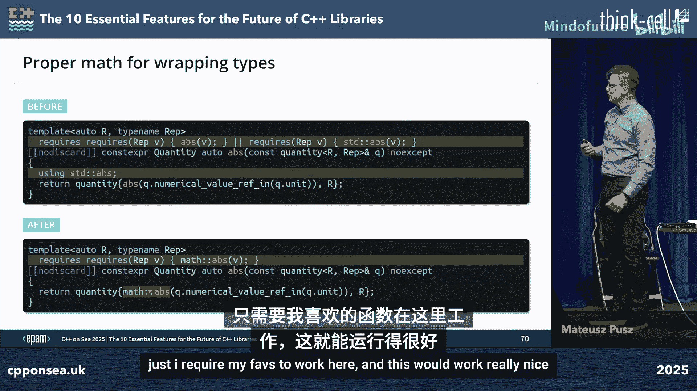

And this should work work really nice。All right。Let's move on。Another compile time called debugging。

How we can debu at compile time， How we debu run time。 There is one really， really。

Popular way of debugging， printing stuff， right？lotss of people print stuff。 Of course。

 weve produce debuggers。 We should use undo project projects for debugging， right。Yes。

 but at Comp time it's hard， there is no comp time debugger。 so we can only use this。

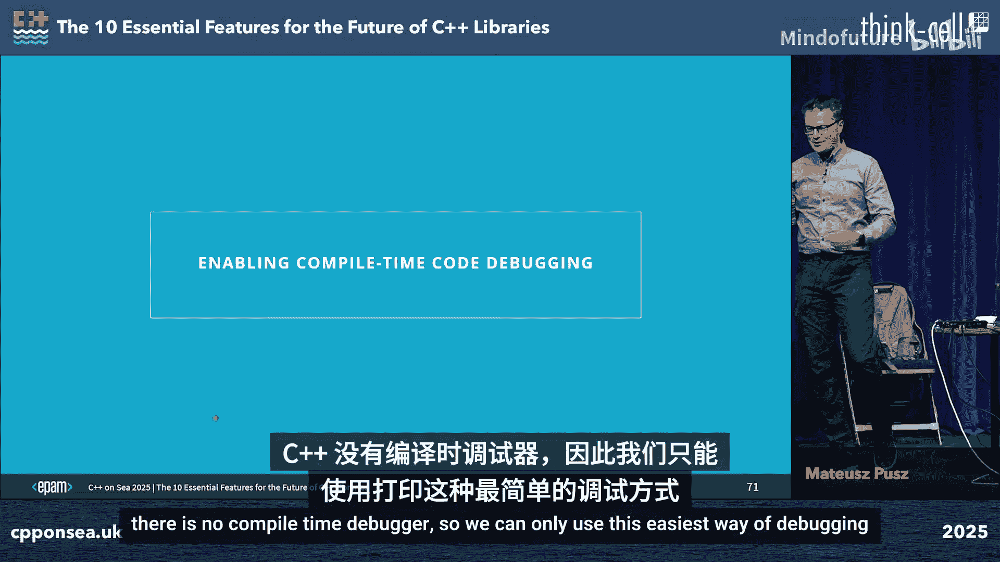

Easiest way of thebu with printing。Traal code debing of concepts is hard because if it happens at copyright time。

 you cannot break point in debuggger。My library， 90% is cost evil。

The bag cost evil is impossible because there is no binary。

Those functions do not exist in the binary。You can， when the you launch the buggger。

 there's no function anymore。This is tricky。And the logic may be non trivial。

Trying to find out why something doesn't compile。Maybe scary。收。this footballs out。

Still not part of the language。You could be able to provide prints that are visible at compile time for specific branch and knowledge。

Branch was triggered in specific logic。Which already will be a huge improvement for compile times。

 Even there is a possibility to specify tag that you can sell it at compile time in the command line。

 for example， that will enable and dis specific specific messages。How do you like this interface？

Soo format allows you to write this and this is valid。😊，Right， there is a buck。Do you see a back。

There is one color missing。But that's okay。 It cannot be triggered at the compound time issue。

 because in some。Internationalization。So if you want to internationalize your code。

 it may turn out that some parameters will not be useful。

 or you have to provide more parameters for a separate speak languages。

And that's why you may have more arguments than actually why you are being accused。

In the format here。And depending what kind of developer you are， you may be either scared。Surprised。

You say， oh， that's fine。Or yeah， this is for， for geeks， right。

And I see each kind of subs in the audience right now。However。

 most users probably would like to diagnose their issues。

So you can provide things like that in the code of a format。Consext warning， not print as prefer。

 but warning。Provide attack for it。With a message。And then at compile time。

 you could enable them with。minus w。AndW no。And you can have those errors， warnings。

From the library code。Being detected。But you杜。We just really nice right to be able to add something to the organic list in the compiler。

😊，And of course， there's also a version for errors。You may say this is context error。

 This is heart error。You can， of course， have option to possibly override it as well， but。

With this proposal， you can provide prints， warnings and errors。On the different levels。

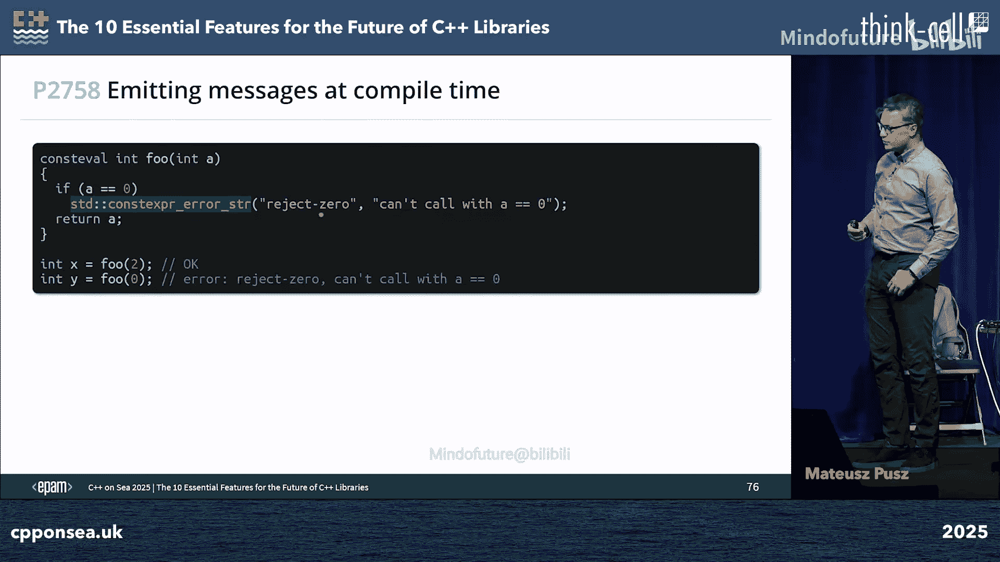

Wch just nice。So this leads us to better compile1 aroma massage。

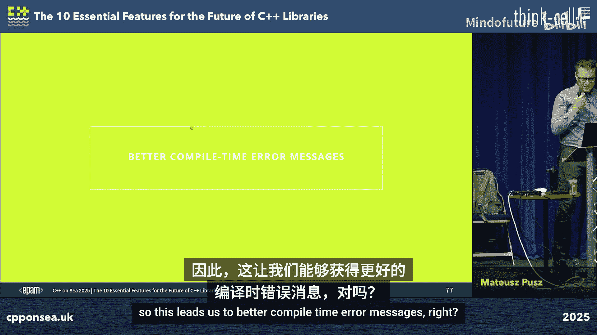

Right。Hoing that copulation error messages from generic Cpl libraries are short。

 easy to read and understand， hands up。I don't see any hands up in the audience。

And if youre fool a number of people。Thank you for coming here。

This is what they showed me like where when was it，2019， who， six years ago。This is the first line。

 actually not all line fit on my slide from booth when you they have an error in in in units。F。

 first line didn't fit on the slide， and there were plenty of lines。All right。

 that's what we deal in。genic labor often。But it doesn't have to be the case。

 we can do better already。Right， if you use concepts， if you think about error messages。

 this is how you can write a quantity with concepts。

 There are some reference quantities per unit inside your representation。

 And then you have function in and plenty the other functions。And if you specify that。

 in function requires us。For the unit to be a specific。Quantity type。 So， for example。

 new unit should be the same as new units should be a unit of length， for example。

And the conversion should be value preserving or the scaling should be value preserving。😊，能。

You just find the code here。And what it can bring you， if I will say。

I have a unit and a basic a quantity type， which is totally study nonsense here。😊。

I will get this entire error message。 This is it。I say that no matching function for call to in。

And they have three candidate， candidate that has two rep。 This one doesn't specify rep。 So it's out。

I have topic parameter that doesn't take any argument in。 So this is us out。

 And I have third candidate。With constraints， not satisfied。Right， so we have free overloads。

And they are， and only one of them is possibly analyse the rest are out right away。

 because this and this is not correct。 So if youre looking into this constraint。We see that unit of。

The basically that the here， the the unit of time is not the no， no。

 not the one that being used here for the qua spec because we are using quo spec of length here。

And you can see this here that。Is basically checked in this case。Right， sorry， not to this case。

 I'm wrong。 I didn't see correctly。 Yeah， So Im saying that IQ time is not a unit because it's not derived from the unit interface because it's not the unit。

 as it's a quantity type。Allright， I was talking about the next slide， sorry。So。

You have a nice error message， short one with possibly one additional ver line here that is not useful。

 because if you say that the right from。Doesn't have sense。

 That's I is a base of probability doesn't have sense as well。

 But this is implementation detail of how it's being implemented。

You can get rid of the spreadation details if you want as well。 And you compare them representatives。

 But this is SD。 right from economic didnt get rid of this additional line。 But you could。

 with some interaction direction， you could use。Variable template。

 or you could use a function and then just hide it as an implementation detail inside。

 and the compile will not。But basically exp。So if you have。Quantity meters and you pass seconds。

 So this is the case I was trying to describe before。You have even shorter error message。

 You have those this first overload and the last overload removed as well as before。

 And this second overload says that。Unit of a to force， because the quantity spec of seconds。

It's not kind of length。Right， seconds is not length。 So this is the entire error message。

And this it。Of course， I love this clk output。We have an internal competition in our team who will find an error message with the most braces included。

I submitted that this is a box for cl still not fixed。

 Hopefully they will fix it at some point because instead of this， they should just print length。

Because the type of thestruct length is length。Well， instance of strength length， right。

 This is creating instance of strength length just to take the type of it。

 even though they have it here and then create an instance of instance of is of instance。

So this should be just1 instance。I will say this quick。Also。

 this could be a bit improved because you have application information here。

 because this is what the code does。 And this is how the compiler sees it。 when this spec of seconds。

 actually is not that useful here。 Actually， if it was evaluated in this case and left in this case。

 like that， the message will be even more useful。😊，Rightright。

 saying kind of time is not convert to kind of land。

But still notice that even with the original message。

It's not that hard to read and understand this entire message。 I'm not hiding kind。 Well。

 I'm hiding the prefixs of the path before error a note because I don't want you to actually see。

 how is my code structure on this。 that this doesn't have sense in this presentation to show it。

 So I just。Stre the， the prefis of every。Of every line here with the path to define。But otherwise。

 it's entire message exactly like it's printed in the compiler。

Gerronic error message can be really nice if developers care about it。 In many cases， in some， you。

 it's impossible， but in many cases， you can optimize and improve。What it's like。Ft guys。

I have meters， and I want to express this in kilometers。Again， first and。

 and third one goes away because it's not the case here。

 And the middle one says causes not satisfied because there is not the value probability conversion。

From units to kilometer。For this position type。Because it says that true floating point for it about the false because it's not。

 not， not a floating point and。Meter to kilometer is not an integral conversion factor。

Because it's dividing by 1000。Again， this is entire error message。

All the presentation details of how it's being。And verified is in integral conversion factor in this function。

Because providing all of those things and things why and how I check this will not make you。

Have more information from the command line。 But message the。

 the error message compile error message compile error message because。

It will just be presentation details。 You don't have to see them。 This message is enough。

 And if you optimize for that， you can provide really nice。I't suggest two users。Right。

 so we complain， but actually， most of the virus can be better already。

 But let's see how we can improve it even more。And， of course。

It assumes you're using a good compiler。I was using clk 20 all the time。 The C CC。

This is not that nice anymore。Do you see much much more variables， right？

 It says there are three candidates。 Can 1 candidate fails because of constant un satisfiedatisfied candidate 2。

Fair is because of the， of these arguments， one provided。

 and there is also candidate free where capital grid deduction substitution failed。

This is a lot of information， and a lot of。Characters be to be right。 I prefer cl or address。Also。

 let's look into this middle 1。 I will just dom it。

You can imagine that temporary argument substitution failed， Coed untatisfied。

 And then you say that because this thing doesn't work。 but you don't know exactly why。

Because it says if yout want to know why， you have to extend the error message even more。

With an option。Right， so probably the most important information actually is missing here。 Often。

 you have to use actually why this F concept diagon depth。With more to see longer error message。

So it's not that helpful。 Gr is much better in this case。Alright。

 so let's be how we can improve instead of having con constraints on the interfaces。

 I may say I'm having some。More generic checks I need to say if it's unique。

 if it's not unit then well， it。Obviously wrong。But I additional check， aesthetic assert。

In my function here， function template。Right， so I move those checks from the interface to the presentationation。

 and imp dust right now， interface says， I take a unit and a unit。

 and I'm doing checks inside with some nice aroma。😊，So with this， this entire message， saying， well。

 not entire I have some dots here。 I will show you why later on。

 But this is the my error message that I see in the in the top of the of the compil comp error。

 saying a session failed， not very preserving in the first line， which is nice。😊，All right。

 and then I have information why。It's fake。Actually， there is a proposal。That was accepted5 plus 26。

That you can provide your honor。Static acid massage， known as compile time。We still don't have。

ITD formats to work at compile time。 That I why music FMT here。

 This is a trick to make FMT to work at compile time。 I have concepts format FMT format 2。

 and then I can pass the format spec and unit symbol here to concept format and then pass it to static As as your generated message。

😊，Which makes my error message even nicer。 Sta access field。

 Sc from meters to kilometer is not value preserving。It going buy time。Uusic FMT。Really nice。

And there's a proposal for concept to format， but still not。In C plus 26。 So cause I's super not。

 I will just be able to write two format instead of F T to do the same。With reflection。

That this is about。Actually why you should market as 126 in this slide， but it is 26。😊。

I can use this， this place string of to get nice。Strerink for the type。Here， here and here。

 and then error message will be scaling from meters to kilometers it's not valid preserving for interrepresentation type。

😊，Even better， right， we improve。不。Let's come back to those。

2 errors generated because it's only one of the errors。 And there are three do。

The second one says there's no much constructor for inci of quantity。And 129 line more in clk。

 which just starts。Internet。What happens。I have the study assets。

 and then have this quantity of auto retone type。Compilly rich， really， really。

Trice hard to deduce this re type。Even if there are study ca inside。So it caused this constructor。

 anyway。Besides says prejudice assert。And， of course， if the input is wrong。

 this cost after will fail。And this is why we have those aroma centers。

Trying from the construct inization， the entire idea of having constraints on this function was to not pass incorrect input to the quantity institution here。

😊，And who does it。Even the Sa clusters are here。Other。

Problem that I see with study As is that plenty of people write code like this one。声音。

Let's try to convert this kilometer discontinu quantity to kilometers。And they write it this way。

 if in。As successful， call in。 Otherwise， don't convert。All right。

 so they depend on my checks to verify if can do this operation safely without truncation。😊，If。

 if it's possible， then they convert。 if the happens， they say， oh， I shouldn't do it。

 Then I will stay with the original unit。That's a value use case。But to static assert。

 instead of this compellinging fine and just decay decay to Q。It all does be hard error。

When you try to do this in here。You have static assert saying it's wrong。

 And the call would not compile。 Al will not be selected。This is a problem with static a。

 static a are not good for generic programming。Static assets are good to you need test your comp program。

 static assets are good to possibly verify some invariance of your class。For example。

 is Chili copy A， it's a good check below a class if you intend to use sm copy on it。😊。

But not to verify constraints。

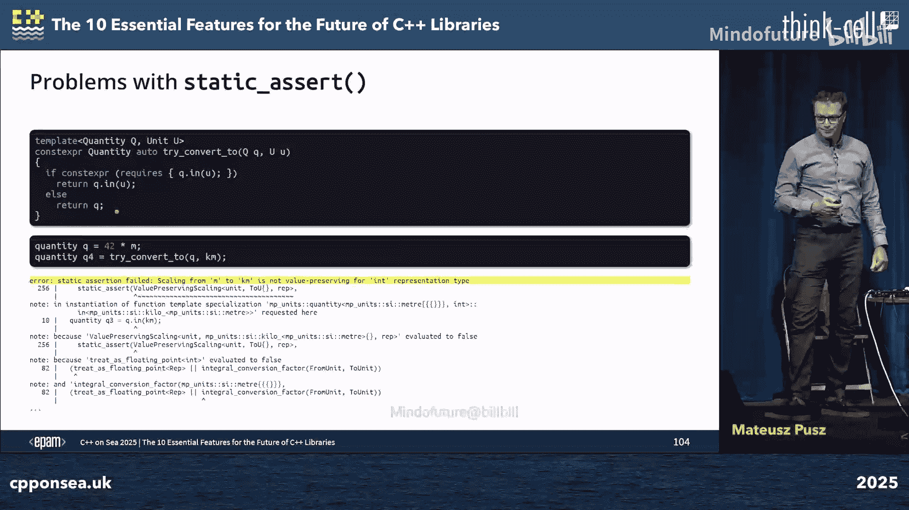

And they've solve this problem already many times。 This is one of the issues I've seen， for example。

In one of the user types I use for my quantity type。I actually submitted an issue to the。

 to the authorss。 Do not use static acid to prevent template staation errors。

It turned out that what they were doing， they had custom template。

And instead instead of the class template for linearar algebrabra。

 they were checking with static assert。If the。The machineality of this array or matrix has sense。

And the I was triggering for me。When I was doing some totally unrelateded， unrelateded code。

What I'm doing here in my code in this line。I just check if I can use a wider type and check it。

 if I can multiply and divide type， then a music to add this wider type。 otherwise， a music in marks。

And when it for this V。 So basically T T being Q somewhere or or du here。When I。

Use this linearnyard Libbra type。This film generated something that had invalid。Theality。

 So the static asset fired and my code didn't comp you with this project at all。

Instead of just decaying to the in。

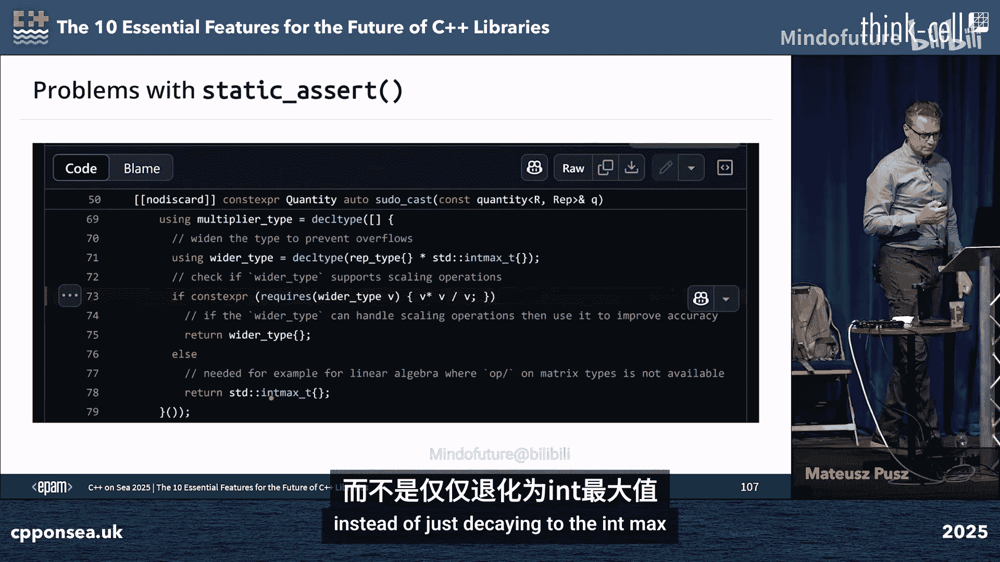

Also。If you are using proper constraints， rather thantic hazard。

 you can do negative unit tests for your things， because I don't know how many of you actually are using concepts already hands up。

More than half of the room， How many of you do you need tests for negative scenarios。Much less hands。

 right。This is also a part that you test if your constraints are actually provided properly。

Not just constraining for fun。RightAnd this how you can do it。

I say I should not be able to instant my quantity class template with this and this and this and this because I constrain for this and this should fail。

If I do static As in my class， I will not be able to test it because I will have heart errors with in every single case in this union test。

As a usinging proper con。This just fail to be， to be ined and。

My comp test says this cannot be compiled properly with this as an in。Rightright。

 and they have proper negative tests for， for concepts。

So introduction of requires expression made it so easy for everyone to start playing with those compile term logic。

 You don't have to use V T in a belief anymore， which was quite tricky。

 and Sa concept works against it。 So it's， I'm not recommending doing that。In such cases。All right。

 so is that I said there's a rock。Approach my bests try this concept spiral stuff。

And there's also a proposal to extend the codesex error to actually have not the string as an input。

 but actually FMT like interface， but only when actually cos straightforward format is accepted。

Then you'll be able to just write the format format specification here and parameters and it will just use FMT under the hood。

Which is nice。But again。It will not spinner。Prepared。So let's try to throw。The same thing。

When they trying to throw it。I have the same issue。 I am trying to instant the re type。

Based on this thing， and the basic incorrect input。

So I have still a long error message saying I can call a structure。

 So it's not a good idea in this case。So let's try otherwise。

 instead of having fs in the body of the function， that's put fros to the contraint of the function。

So what I'm doing here， I created some custom exception。😊，D。

And they created a helper called Unsatisfied。That takes a format as compile time string。

And it passes arguments to it from the from the function arguments。

And this actually is basically this this expression type。

And I can invite my value preserving scalingal as saying it should be some scan scaling。

 It should be treated as floating point， internal conversion factor factor。😊。

Or so it will be triggered only when the beginning is false。 when， when this is false， only that。

 this one will be triggered because there is a on the cost range evaluation。Unsatisfied。

With this format message and those arguments， we just throw an  error。

 It would be throwing an error only if this is already false。Right。

And they can write this while presenting excluding here as a contrainum。😊。

And then I have nice error message。I have inspiration the substution into constant expression in a non constant expression here while checking satisfaction of the concept。

And I get the information that。I'm trying to throw， which is not a constant expression。

It's a bit better， but still not really nice。In April 26， we got a new proposal that was accepted。

That we allow fing an exception， So it is a proper constant expression when it iss being fn。

And those are the motivation examples from the， from the proposal。

 saying think that I think we have a con function that takes some string view input。

 If you input this empty， I can throw an ex exception。Otherwise， I will do Concat。

 which may also throw an exception insight。😊，You a bus empty。Well， before I had always。

The error message at this point， saying， I cannot just throw in a compact time context。

 So if I pass empty parameters here， I got into this branch。 this branch tries to throw。

 and I have Comp error saying。 You should not throw because not， it's not con context friendly。

After this proposal， this is or this is fine。So， but in this case。

You will have an error message in this place at Col site。

 saying that there was an unhandled exception in your Comp term logic。

So rather than from the complaining about the fite。

 you have information about the exception leaving the compile time context。In this case。

 it will work fine if you do try and catch。For this。But do you find as well。So this is improvement。

 but still not Spner friendly。I contacted Kana Chiikawa because K proposed those things because Kna Ke lot about concepts。

And in three hours， she was able to provide me a compiler that had a fix for that。😊。

And then provided a paper called spinable concept expressions。That was discussed on the last meeting。

 but again， more work was re was was requested from the， from the language group。With this？

This is my entire error message。嗯对。Not for C plus 26， unfortunate。I'm really upset about this。

 I'm even even eager to submit a national body comment for a bit。S。Because I think that right now。

 cost exceptions are fundamentally broken if， if they are not able。The question was from Jason。

 I didn't hear it。 it wasnt accepted， sorry， I should repeat the question。So we have to。

No magic member function took call for in。 And this was the first load， last of load as B as always。

 that was failing and the middle over load， saying that content are not satisfied because value preserving evaluated to force because this throws an exception。

 and we have scaling from meters to cles value preserving for interposition type。😊。

This is already really nice。 And this works on this compiler from compileil from from the from the from Hanashi coverva。

 And also with my library on top using FMT， you can try it out to comply with it and see how their messages looks like。

 It's really nice。😊，I would re factor this a bit because Hannah provided some shortcuts here。

 because she actually removed the logic why actually this unsatisfied branch was selected。 And also。

 this exception message should bubble up a bit。😊，To the top。

 my actually preferred approach would be to put it here。 So I have information。

 I have no function to in because this upload load fails because there is no rep specified。

 This one fails because there is not enough argument。And this one phase。

 because concepts are not satisfied with exception。

 scaling frommeterter to kilometer on value preserving for interpresentation type。And then。

 you have errors。Information why this exception was thrown。Which would be awesome。

To analyze for the users。Right， being able to specify custom error message。For each other load。

would save a lot of time in the bugging。All those issues。Trying to fix those。Right。I would。

this is where I hope we'll be in the next C+ plus language version。

So we can do a lot for to improve compartment research。Of course。

 Hanna also provided a paper that allows us to actually use standard exception types rather than customer exception types at comp time。

 so you can just be heard from logic error and have this work nice。😊。

So this is my story of Erov compile times。 If you care about them already。

 you can make probably them much better than they are already the right right now in use in the software you use。

It's possible to improve。 I just proved you how I how it boost compares to my library right now。

 right， If you have a proper mindset and you test how search X y look like， you can do better。

 But with those features， you'd be able to go one。😊，Level higher。

We've told those compared time error messages。Alright， let's talk briefly about safety。

 because we are。neearly out of time， but but still not many features to discuss。 So you are good。

For a long time， also say that we should prevent location of data。 right。

 we have some approximation stating the thoughtping point is value values preserving and every conversion from in to float is always true。

 even though it's not it's a lie。But this is the best we can do as of today。Right。

 this write the template plate。 I say that we should use 13 floating point type rate that I mentioned you before to verify if I'm converting from ins to float or float to in or between two floats。

 basically consider to what with what crronal duration does。And this's funny my concern。

Closing the burger during his keynote at using St C plus plus in Madrid。

 he also provided during his slides information that he would like to actually constrain this operator。

Of the same as U double。To prevent any kind of conversion。

 because conversions are course wrong or provide。Customomization that only non na conversions are needed。

 but you have to write this thing by yourself because there's nothing in the standard。Also。

 seem accepted 4 C plus 26 provides in the specification that T is very pro。

 even though there is no standard way to checking that。So basically every compile event。

 will have to implement this anyway for Sp 26， but not expose it as a public interface。😊。

That's a proposal。For a tight rate called it's convertible without narrowing。

This will be already an improvement。However， this code will not work in my case。

 So I think it's not a good use case for me because as long as I would be able to have a computer error when the convert flows to in。

Because this will trigger。Then into double。Probably should work if it doesn't work。

 people will complain that it's just to come to cause training。

 Language specifies that in teachersger to floatingtic points is a truncating convention。

 even though in most cases， it's not。On most platforms。That's why there is another。

Proposal 2509 that detects value preserving conversions。

 This is called is value preserving convertible。

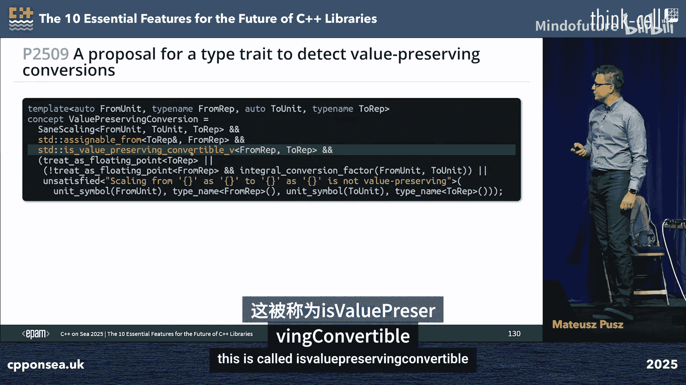

Well， actually， it checks on the specification for each platform。 if it's value preserving or not。

 And in most cases， double can represent all of the ins， maybe not in 6040s， but ins for sure。

Alright，65000 is not the hard for double to represent。

So this should work on all of the platforms in this case。We don't have it yet。 Hopefully。

 it to be accepted as well for plus 29， and well be able to benefit from those conversions。

And have checks。In library， however， this might not be portable because it checks for specific platform。

 implementationation on specific types， rather than having the language rules for all of the。

 all of the types here。Take you to please。

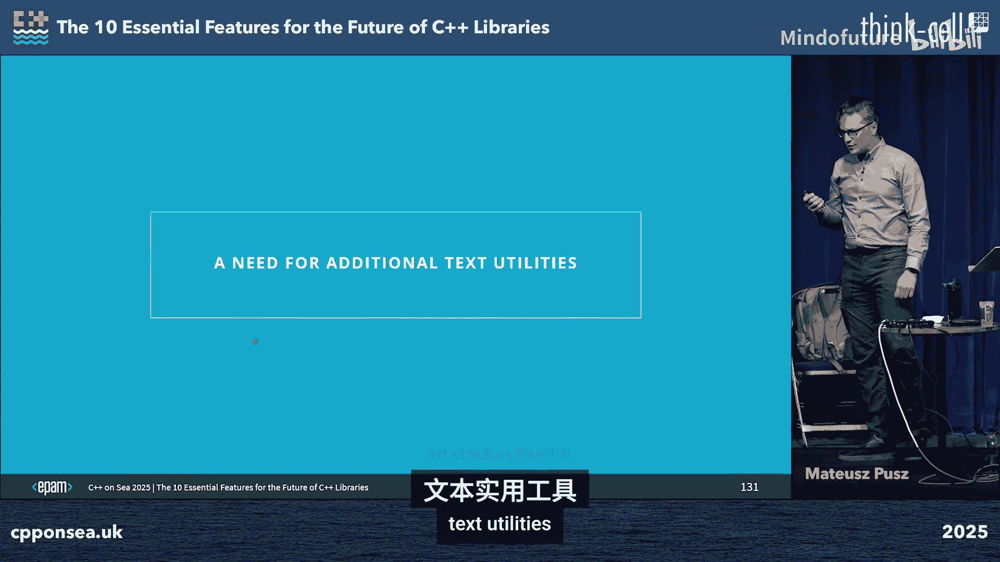

This is modern C plus plus， sorry， this is simple legacy C plus plus program， right， We have C out。

 We have seen C out。This is modern than a C plus program。Right。二 not。

We already have possibility to express text output， but text input still sucks。There's mis proposal。

From Elias。Called text parsing。 And it's right now， he has a nice open source library called Scanlib。

Similarly to FM Tlip。So that's exactly the opposite。Right with this。

 you'll be able to to by the basically parts of the input。😊。

And then print with exceptions or no exceptions interfaces。 So everyone will be happy。

 and you can use it nicely。😊，Another things that are picture again， fine， alright。

Another feature is basic， don't you think that's embarrassing that in 2025 we can't handle Uniicode or do any internationalization in the language？

😊，There is still not enough work on this one， if you cover。

 if you work in domains that require to use Unicode interciization， please help。

We really need those things to provide better experience to to our to our users， as well。All right。

This is a big work， but all of the modern languages already have it。 We don't。

 So it will be nice to have some work on this。Finally， we want to distribute our projects properly。

Who likes writing Siic conflict files and installation scripts？I see one hand。

 two hands in the audience。That's a lot。Right， you have to write those con conflict scripts by yourself。

 And doing this right is actually not easy。 And then provide the installation scripts for the project that people typically don't provide because it's just too complex。

people typically want to get things， but don't think how to propagate stuff to others in their resume scripts。

Or at please dont not test it， even if there hear something probably it's not working properly。

There's a贝本。Called common description format for C++ libraries and parks。

It introduces a new format called CP。安全。Instead of doing this and this。

 you will have to write in CMake on the installed package info and the CMake will generate all of the package info from the script by themselves and will provide you the JO file with all of the description description。

😊，Of your packet in a adjacent file。Also， if you know可。I love Conan。 Conan is great。 Use Conan。

 but I had， I had to write Packer info。😊，Backard for Tp。

 it duplicates what you really have in imageMake。Every single change。

 every single flag and branch has to be exposed in in packet info because it is being used to generate stuff from the。

Con on specification。If you are on Siic domain only。

 then package if3 is not needed because you may just use original Cic files from the project as Cmic they written correctly。

 but in case you want to use this package in different build systems。

 so the content has to generate scripts for them， then package info is needed。

And this is really pramatic in my first example project to write this and have it consistent with C make filess。

After CP。You would just say。Just pack a info， just read this read it from the CP file and you will know exactly what to expose to users。

😡，And this actually will be the default when pass C will be the。Establish practice on the。

 in the industry。So right now， when you install libraries。

 you just install the include files in my case。 and then you in install all of those C based scripts。

 So Simic file version and target。After that， you will install the CP file。

I see let file will look graphic like this in a adjacent format。😊，So to summarize。

C++ is probably the best programming language to implement generic libraries。There's no better。

It is awesome。We have zero subions， Thanks to templates with that don't affect run type performance that don't require us to use additional and more usage。

Controized and concepts improve interfaces。 contractss will improve safety。And you different as well。

Reflection will change the world of C plus plus。 We have so many new libraries with soon no many new use cases。

That we can even imagine right now。 People are really creative。But we need some help still。

 some libraries are missing。 Still， some pictures are missing。

 Some some moreoc is needed in order to provide better experience to our users。

If you're an expect an expert or just carry about specific domain， like， for example。

 Ma or or inter internationalization or Uniicode， please come and help us because， well。Every helpus。

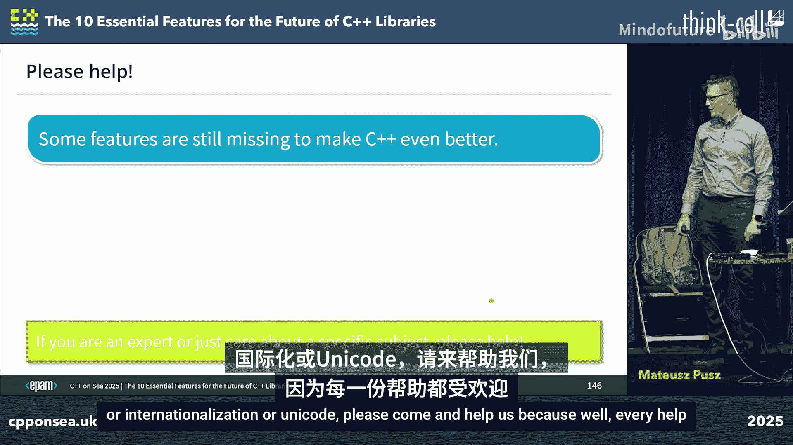

Welcome。😊，Thank you。 That's it。 Are any questions。

