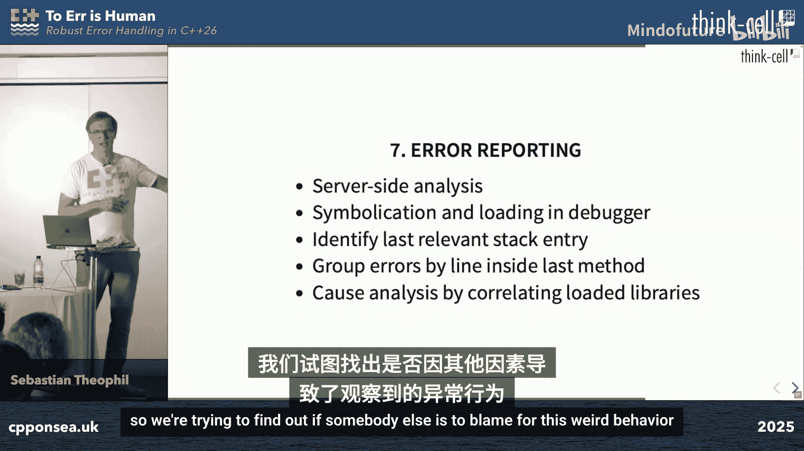

# 【Cpponsea】C++-On-Sea-2025大会-p17-P17_人非圣贤_孰能无过-C++26_中_健壮的_错误处理-塞巴斯蒂安_泰奥菲尔_2025--BV17V4GzjE6p_p17-

Welcome everybody， thanks for coming to my talk。嗯。😊。

So I will be talking a little bit about the tools we have and see plus plus for catching and handling errors。

 And in the second part of my talk， I will also talk about how we use them or how we we use them at things else specifically。

 but maybe also how you should use them in practice。First， few words about me。

 I've been programming C plus plus since 2003 professionally。

 I have been with thingstel all this time。 You might know ask because we sponsor a lot of those conferences。

 We are a very small team。 We have over a million customers， and that's continuously growing。

 and our product runs in a very hostile desktop environment。So from the beginning。

 small team desktop environment， having a stable software and getting there efficiently were key to our success。

 So what I'm talking about today， we have been doing essentially for 20 years。

 And I think that worked pretty well。So error reporting， that's a super wide field。Before I start。

 I have to define the scope a little bit what I'm talking about exactly， so。

handling in hardcore mode， that's if you're building this。Lifes are at stake。

 And in the case of that airplane， quite a lot of them， actually。I was just。

Googling this out of curiosity。 So if nothing else， you will learn this today。

 this plane has three primary control computers。 Each one of those can control the entire planes。

 They have even more backups， and these computers are in separate locations in the plane in case the engine disintegrates and hits one of them。

And what I didn't know is that they even used diversified hardware and software on each of those machines。

 so in case you encounter a CPU bug on one of them。

 the other computer won't be affected by the same bug。 So that's pretty interesting。

 They will survive RAfalls， engine explosions， whatever。But this is not what I'm talking about。

 This is what we typically call engineering for reliability。Eror handling is a bit less than that。

It's far simpler， we deal with programr error， we deal with unforeseen system configurations。

 unforeseen user behavior。We will assume your memory works。

We will assume your computer does not explode。So we are running in easy mode。We can always do this。

And for。Like out of Nicety this time， I did not show the Microsoft word error message that has the same wording。

 I found another one that says the same thing。So like I said。

 the environment might behave unexpectedly。 We have unforeseen usage。 We have program error and。

We need to have good error handling tools because bad error handling breeds more bucks。

And we have still a very large design space。 We can。

 sink a lot of work into writing perfectarrow handling。 But at the end of the day。

 we're not actually paid for writing nicearrow handling。

 We are paid for delivering customer value for solving the user's problems。😊。

And the goal in all of this is we have to focus on the things that matter to get very quickly to a product that is stable and we need to get there fast。

Good error handling is， therefore key。To achieve that call。So in this talk。

 I will first talk about the ways we have in C++ to handle errors from the oldest Ctyle return codes to student expected contracts and library hardening。

And in the last part of my talk， I will focus more on the best practices。

 what do we handle and how do we do this？So。The oldest style of error handling we have。

This beauty of apos function。Opens a file， of course， you probably know that。Returns an integer。

 we're not in type Sa land。 This is a file handle。Or -1 in case this faileds。

 And then it sets my beloved error handling variable  Er no to indicate some error。

And there's a wide variety of errors。If you look at the main page。From the expected。

 the file you're trying to open does not exist。You probably in almost all circumstances need to handle this。

To the weird and unpleasant， you were interrupted， I guess you have to try the open again。Open。

 you can try again for clothes。 I think I read some sort。 I'm clear， actually。

 if you can try this again， if this will work， you don't know really。

So this is already weird down to this e， the address of path is outside the address space of my process。

How can that happen and what am I about supposed to do about this， right？

 So this is at the very least programme error。 And even though I'm not so sure if that can be。

 can be a programme。Well yeah， of course。Okay， so some of these we have to handle。

 some of these we probably don't want to handle， but one to。As heard that they don't exist。

In Windowsland， of course， it looks the same way， we just have more arguments。Again。

 we have a return value that can also be an error code。

 and then we have some global state that contains a little bit more information about the error。

 but GetLs error also just returns in integer。So there's not much information about what went wrong。

And this gets even worse here in the standard library here we have string to long the string parsing function。

 The first argument is， of course， appointed to the beginning of the string。

 The second argument is an in out argument to the end of the string or the end of the parsseed range and then the base。

 So this returns the correct long in the success case if the conversion failed。

 it returns zero as if that were in legal long but it also sets the end pointer to wherever it stop parsing。

There's the overflow case where it returns， I think， integer max or min or whatever。

 but it also returns sets an  error， the ano variable。

And they are just a lot of things that we have to check to make sure this did what we wanted。

 and we didn't miss some of those error cases。 So that's not very convenient。Unfortunately。

 we need tools to handle this elegantly in practice because operating systems will forever and ever。

 I guess use these C style functions for maximum compatibility。

 so this style of error handling is never going to die。So C plus+ invented something better。

 Of course， we invented exceptions， Excepts today have kind of a bad reputation。

People say they are a glorified go to state。 People say they are difficult to reason about because they mixed error handling and control flow。

They are horribly slow， that's probably just true。Some people ban them in their coat base。

They very definitely require that you write exception safe code if you want to handle exceptions。

And the last part is really crucial because that is actually in practice pretty hard。

 especially if you have a legacy code base， making it exception safe is pretty hard。

 And I was looking at the Google C plus plus style guide because I remember that they explicitly forbid using exceptions and code and the last part is actually the reason why。

 So they say and I quote our advice against using exceptions is not predicated on philosophical or moral grounds。

 but on practical ones。 and they just have so much code that they want to use that would be too hard to make exception safe。

 So they say things would probably be different if we had to do it all over again from scratch。

But well， they can't。So， despite all these。Problems or perceived problems with exceptions。

 They can be the right tool for the job。 So here I have。

Very simple little cold snippet where we do some HP request that we parse the Json that comes back and want to lock something to a file。

And every single line here can potentially fail。The HDP request can fail。

Psing the J can fail if the Jason is suddenly in an unexpected format and writing to a file can。

 of course always fail。And these things may fail， think about the parcel， for example。

 they might fail very deep in some stack trace。So the unwinding of the exception here is actually a feature that makes the life of the library developer for the Jason paring easier。

And that would argue makes my life easier as well。And the nice thing about exceptions as opposed to return codes。

 of course， is that the type can encode some information about the error。

 and we can use that here in catch statements and of course。

 they are classes so they can contain more media information about what went wrong and where。

And the most important feature in the nicest feature is that here the clean code is completely。

 the happy path is completely clean of any control flow。

 which makes it very easy to reason about that。So I would think in cases like these and in local contexts。

 exceptions are actually the right tool for the job if you only catch them somewhere， right？

Most in the best case， in， in a location that you can reason about。

 and not somewhere else in your program very very far away。But like here in a local scope。

 I think it's a very elegant and easy to use system。But， of course， everything else is still true。

 They are slow on the error path。 So I don't know， game engine won't use them。Exceptions are serial。

 that means you can always only have a single exception in progress of being thrown。

 and your code must be exception safe。呃。There was a very good talk。 by Pete Maloon。

 He held this a couple of times out。 I don't have Wiifi。 otherwise he would get。I do have wifi。

 but it still doesn't work。 otherwise you would get the preview of YouTube。

 but the title is still there。嗯。Exceptionly about the misuse of exceptions where he has a lot of practical use cases that he encountered in his legacy codeb at Bloomberg that used exceptions where he would say this was not a good idea。

 So he cleans that up in his talk。 It's a very good talk about how not to use exceptions。

So that only the cases remain where it's a good idea to user exceptions。So。😊，And this brings us。

To the next point， isn't there a way to combine like the simplicity of return values with the semantic richness of exceptions？

And this is exactly what St expected is， and what Andre Alexandra School in 2012。

 I think proposed maybe for the first time4 C++。嗯。😊，Where he essentially invents stood expected。

 exactly with that argument， we want to have something that is just a return code。

 So it's very simple。But it's not just an integer is as rich as exceptions。 So his idea is。

 and I quote， make we just， we can make exceptions the error code to combine the two。

And then we could have multiple errors implied at the same time， we can store them。

 we can throw them later， we can transport them across threads， we can collect them， group them。

 transform them， etc， so that would also be more flexible than actual exceptions。

So how do we use still expected that's C plus plus 23 already。

Here I use everybody's favorite error handling example that's parsing an integer。

We have a parse in function that takes the string returns， not just an integer。

 but it now returns and expected， either the integer in the success case or a parse error。

 here the parse error is just an enum of two values。And here。

I am not so interested in implementing parsing an integer。

 I'm more interested today in how we would use such a function to。

 to show you how to use still expected。St expected has a very simple interface you would use for standard imperative programming。

 so here I'm parsing this integer。And I'm using it in a longer function that not only par the integer。

 but it also wants to convert it into a double by dividing one by that integer。

So I'm parsing the inte show， I'm getting an expected back。

 this expected is convertible into a bull if it is in the success case。

I can access the value in that expected， here we multiply it。And now we check it， if it's zero。

 I can't divide 1 by zero， so I'm returning it unexpected。😊。

With the error message and this did unexpected can automatically be converted into the expected of double and string that I'm actually wanting to return here。

In the success case， I can create and use it expected with the double value I want。And else。

 I can also get the error out of the expected and then transform those two genome values into strengths。

So this is what you can do with state expected， but this is not the most elegant interface they support。

 Le the optional state expected has a montic functional interface that I would rather recommend。

Here we have， again， parse integer in the beginning。

 and then there is a sequence of transformations on top of that still expected。

That I will go into detail， so transforming， transform error。

 and then there would also be or else are all function on is did expected that transformed this expected value。

He had transformed。Transform the factor I'm passing will only be called in the success case。

 so if the expected actually contains the integer， then I can transform the integer value。

There's the corresponding transform error that is only called in the error case， obviously。

 so I can transform this enum error to the string as I did before。And then。Its a bit more powerful。

 It's also called only in the success case， but it can return in usestead expected。

 So here I transformed it into a state expected of double and string。So this is， in my point of view。

 and I think in a lot of other people's point of view。

 the more elegant way to program because it doesn't contain explicit flow control statements。

 each transformation we do here is a function you can reason about independently and you have this elegant flow of data and you can you can reason about each of those transformations without getting lost in a deep stack of if then else statements。

 and then suddenly somewhere you forgot a case very deep down that stack。

So I think it makes it actually harder to make mistakes。So that was stood expected。

 and I think stood expected will。Or should be the new default way how we do error handling or at first error reporting。

 let's say in C++。If you care about the reason why something failed。

 so student expected transports out the reason， right， why something might have failed。

There are a lot of cases in practice where you know something might fail。

 but you don't care actually why。 in that case， you can just use a state optional， obviously。

Otherwise still expect， I think is the right tool for the job。So that any questions so far。

 any questions about？Not thisす。Okay， otherwise， I'm taking questions later。

So this leads us to contracts。The contract paper is a pretty long paper。

 it's a very thorough proposal， very readable。Goes a lot goes over a lot of the details and the rational behind the proposal。

 but conceptually contracts are very simple。 Timor himself explains this in he says five minutes in his blog post。

And as you've heard already， they have just been voted into C++ 26。

 so here at CPP onC we we're very short。EO conference to C plus plus conference pipeline。

 so to speak。The turnaround time has been getting very short。Contracts are more flexible， standard。

 a certain mechanism for the future。 They are not so much for checking environment behavior。

They're more for checking your own invariance in the code and of course pre and post conditions。

 which are the nicest contracts feature， and very importantly。

 their behavior is customizable at build time， which makes them such an improvement over the old assert。

 which would also always terminate in de buck world right hand， not be enabled in release bills。

So this is how they look in a very simple example。😊，We have preconditions。Preconditions， of course。

 can access not only member variables， but also your function arguments。

 those function arguments would be captured implicitly as constants so you don't accidentally change them。

Post conditions can have this variable declaration here in the beginning R， in my case。

 an R would be bound to the return value of the function so you can check what the return value is in relation to the input arguments。

 for example。If post conditions refer to functional arguments。

 then those function arguments must be explicitly declared const again。

 to save you from making the easy mistake that you have changed your function arguments in the meantime and now your post condition is sha something。

 something weird。And then we have contract asserts as a replacement for seastyle asserts。

Preconditions will be evaluated after the function arguments have been initialized， of course。

 because they can access them。 But before the function body runs， that's just intuitively。

 it makes just intuitive sense。 And the same， the post condition will be evaluated after the return value has been initialized。

 again， makes sense because you can access it。 And after the distraction of local variables。

 And this is important if you have local local。Objects in the local scope that might manipulate something in the de and this distractor will have run。

 and you are actually in the state。As if the function would return right now。

Also makes intuitive sense。Contracts contract assertions support exceptions in the sense that。

Throwing an unhandd exception always leads to contract violation also makes sense。

 and they are supported in constant expert contexts。

 so contracts constant expert functions can have contracts and they will just give compiler errors。

All very sensible definitions。Contract semantics are configurable at build time， as I've said。

 so you can change at build time what all the contract violations that happen will actually do。

You can decide that you ignore them all。This is just the old assert release behavior around？

You can say there's observed semantics， observed means the contract violation handler will be called。

 and we we'll see in the next slide what you can do then。

And force means the contract violation handle will be called and afterwards the application will terminate。

And quick and force just means terminate very， very quickly。

And John Lakes made it very clear what those semantics are for， so quick and is。

 let's say you're a medical device you are the。Airbus A380 flight controller computer if something goes wrong。

 you shut off immediately。And fourth is what John Lego said Bloomberg does right。

 so you want to know that your transaction handler fails and you want to lock this somewhere and then you stop handling those except those transactions。

Obser is what games and desktop applications like we would do。 So you want to report the error。

 you want to know about it， but you keep on trucking for as long as you can so you don't annoy the user unnecessarily。

 especially with asserts with contract assertions。 there are code that can just be wrong。

 So you might have made a mistake writing the assertion。 your program is perfectly fine。

So in this case， just hope for the best and keep on working。So the contract violation handler。😊。

This is customizable as well， so you can just define your own one and this will be called in case a contract is violated and here's just very simple example code and the nice thing is that you can use that as a generic way to hook into contracts of external libraries。

 for example， and can call your own error handling mechanism instead， for example。Okay， so contracts。

May have side effects。Lologging is a side effect。Sending HP request to your back end would be a side effect。

 but they're not allowed to have destructive side effects that change the correctness of of your program。

And they should also be independent of each other， so it is theoretically possible but。

Not per se allowed that you have， that you have preconditions， for example。

 where that are order dependent where you have to have one precondition run after the other。 This is。

By not how this is designed and should work。 I think there's I think John Lake has made it also very clear that what he would like is that these are all complete and independent and can run in each order。

 It would be guaranteed that preconditions are actually run。

 So take care that they're all independent and don't depend。 Yeah， independent。

 They don't depend on each other。 That's， that's what this means。There are also zero overhead。

 so if you choose the ignore semantics， then they should have no impact on the program behavior。

And so this is， I think the best feature of contracts is that if you currently use libraries like let's say boost。

 then all these libraries come with their own asserts and in the best case。

 they have some customization point that allows you to hook their assertion handler and then。

Like divertted to your own era handling mechanism， and I think it's already a great service if if contracts make that unnecessary and give us a standard mechanism to do this for every library that we might use。

And so this brings me to the last purely C++ part， library hardening。

Library hardening is also new on C++ 26， and library hardening means or a hardened library implementation is an implementation that enforces the pre and post conditions that we currently define in the standard。

 but usually did not check at runtime。Microsoft did。

 so Microsoft had deak iterators for a long time that were very useful in practice and very powerful。

And they will switch this now to the library hardening standard。 and as at least in the latest paper。

 the library hardening proposal。Is based on contracts。 So if let's say you have the SDL。

 you access data in a vector， but that vector is not empty or doesn't have as many elements as you want to access。

This triggers now a contract violation， and it will thus call your contract violation handler。

 if you have one defined。 So that's all very， very nice coming together very。

 very nicely and will catch a lot of bugs。 like I know that the bug iterators and Microsoft have called a lot of bugs。

 Yeah， we have different one。😊，No， this is a property of the STL library。 sorry。

 should I repeat the question， you weren't fast enough。

Do we have different versions of the standardened or not hardened？No。

 because the standard always had this precondition。It was just。Just in words。

 it wasn't strictly checked。So technically， I think， the reason was， technically was。

 I think undefined behavior。 So nobody changes anything about the standards。

 It was undefined behavior。 What happens if you access a vector element doesn't exist。

So it is still wrong。 It will just call the contract violation handler in a hardened implementation。

But your program。If you have observed semantics， your program behavior afterwards is still undefined。

 you will probably still impress。But before that， you will get an error report。

And so this is the property of the。STL implementation。And you can switch this on and off。And。

In practice here are the links。In practice， for example， for Kang。

 I know that there are different levels of hardening that you can enable and disable because some of them will have a performance impact。

So you can enable in debug builds， you can enable hardening features that have a performance impact that you do not want to have in release builds。

And so it's， it's a property of the same S T L。 You can switch this on and off。

 It's just more error reports that you're getting。 Can you compile parts of your parts of your code with hardening enabled and parts with the disabled。

 And I think you can。 I think there's the talk by Louis Dna about how they implemented it with Li C plus plus。

 And I think that's a feature that that they are AI compatible。

 What's the default behavior for what's the default behavior for contract violations I'm not sure I think is that defined。

 I'm not sure if that's defined。Or I don't know。 I don't know what the state is。 Maybe， maybe this。

 I don't know。 I forgot。 Can you， can you， can you turn it off without recompilulation。

 Is that your question， Its like easy like let's see。So shared object yeah。

 I don that's a good question， how does that work if you have it as a shared library and the parts that are shared library。

嗯。Question those details。 I would， you would expect that that that they did this， right， somehow。

True， true， I always forget about this。Because so much is header only。呃。Yes，没有。

And so here is the link for the Microsoft Pro they are in the process of transforming their de back iterators to the actual library hardening standard and they're making good。

 good progress， I think。Okay。So that's very nice。 I was very happy to see that on， on Mac。

 library hardening is automatically enabled a thing for a few releases of X code already。😊。

So I've been already using this without my knowledge。Okay。

 we have so many options for handling reporting errors， and we have so little time。

So what do we now actually have to handle and， and how do we do this， Because repeating myself。

 we're not paid for handling errors and。The goal was not great error handling。

 but getting too a stable product fast。 So bad error handling leads to errors。

So what we are looking for is how to find bucks online fast。

Doest anyone know know the TV show I'm referring to all right。 So what was a German TV show。

 How do sell drugs online fastest。 So's on Netflixfl。 It's not bad。So what and how to handle。

Er handling must be easy。 Otherwise， we won't do it。 error handling must be tested。

 Other otherwise won't work。 and error handling must be focused where it matters。 Otherwise。

 we waste our time。So what we do is， first of all， we check everything。

Every single API call we do will be checked。 So here two very simple ones。

 getting the computer name or equivalent， getting the host name get host name would return would set the error variable and return something that is not zero in error case API error similar returns not zero or zero I don't remember and you can ask get last error for the error message。

So， we have。Macros for every single variant of error codes that the operating system functions can return。

And we use them on every API call。And we make this very easy， as you can see。

And we have wrappers for everything else， for H results， GI arrows， Mac kernelarrows on Mac OS。

 whatever you can think of。We also assert aggressively and also assert stay in release builds。

So we assert all the invariance， preconditions， post conditions we think of。

We also use no accept by default， so we make everything no accept where we think there should be no exception。

This is something I know that people at， I think Pete Maloon told me at Bloomberg。

 they would never do this because then something crashes and you didn't want to crash。 You can。

 You wanted to keep making money。 but in our case。Unhandled exceptions that fall out of your program。

 they will cause termination anyway。 So we might as well terminate right away。

 And we also set the terminate handle and to be notified of when we found an unexpected exception somewhere。

So now we do all this。 We get a lot of information about what fails。 and by default。

We don't do anything。So by default， we assume everything works。

And the goal here is to keep the set of code passs very small。

 to keep the set of program states small， to to make it easy to think and reason about our program。

And this has one big exception， of course， we assume everything works unless we know it won't。

 so here is how it looks in practice if you want to open a file on Pos systems you do the open call。

Non negative values are the success case。If you do get an interrupt。

 you have to readtry and if you get any of those below。You know end， no file。

 I no the file doesn't exist。 E access E perm something about permissions。 There's no space。

 You can't create the file。You know these will happen because these always happen on some machine somewhere。

So we have these very capable macros that say， okay， this is a success case。 this is a retry case。

 This is the ignore case where I know this can happen， but anything else I assume cannot happen。

 and I don't even handle it。Same here， Windows example。

 removing a directory can have all these kinds of problems because it's ra。

 This director might already be gone。 This is easy to reproduce。 You know， this can happen。 So we。

 of course， already handle those cases。So now checks will fail。 Eventually， you will find out。

Where this assumption was wrong， what does fail。So the first priority is。

We want to collect as much information as possible。 So something went wrong。

 We could not reproduce this before in house。 So now we want to find out what happened and why。So。

 in。Our clients， we would send an error report。With a memory dump to our back end。

In our server application。Which is actually only our own backend application。

 We would hold a threat and notify the administrator so he can live debug the server。And。

The second priority is to carry on somehow。So。😊，Semantically， after a critical error。

 the behavior is now undefined， so we will disable any further error reports。

 We don't care about those anymore。 Anything can happen。But we don't terminate， as I've said before。

 because after asserts， because they are code and can be wrong。

 And we want to make sure that developers write a lot of asserts。

And if developers are afraid that the assert will cause an error message pop up on the client's machine and a million customers call。

He won't write asserts， so asserts by default are silent。They don't do anything。

 at least not nothing perceivable for the user。So this is a bit is close to the observed semantics for the new contract proposal。

Now we get all these other reports。And now， the second part is we want to focus on what really matters。

 So we have this back end， where all these error reports come in。

 we have an application where we can look at it。Where we can filter by build version by operating system。

 my error message， but whatever。Now we get those nice little entries。

For each location in our code where errors occur。And we can look at those where failure happens most frequently。

 because these are the ones we should look into， probably。

 And you see these nice little graphs where you can see where when over time the problem occurred。

Or in which versions and you see here highlighted user message。

 this is actually a two way communication street。 So when an error happens on the client machine。

 the client calls our backend， the backend analyzes the problem and then calls back to the client。

Wist。For example， this error message， so I can put something in here like。

 please contact support and send us info full about the reproduction we would like to get into this and then they get this nice little message that says。

 please write a message to support。Or I can write in a version number where that bug is fixed。

 and then they will get a reply that contains download link for the version that has this bug fixed。

 and our software will actually download this update silently。

 It will install it silently and will even reload silently。 and the back will be gone forever。

In the best case， without the user ever noticing。So that's pretty nice。

AndNow we have more information which customers have this。When this happened， etctera。

 So now we know a lot about problems， especially about problems that maybe depend on specific user configurations。

 People have the craziest tools on their desktop machines。 They have security tools， E RM systems。

 whatever。 So that's why I said desktop environments are very hostile environment because there's just a lot of interaction with other tools that you don't control。

So now we try to reproduce the error at home。And we add handling only for problems that we can reproduce。

 Of course， Maybe we can only reproduce it in a virtual machine that replicates the user configuration。

 That is fine。But we can find out how the problem happens。

And that means we have error handlingling that remains testable。

We can also find out if we still need it。And of course。

 it turns out it's maybe not so unexpected that very few of this error handling code handles the vast majority of the errors that actually occur in practice。

So by focusing， we can focus on writing high qualityarrow handling link code and that in the best case means we can actually implement workarounds so we don't show message boxes unless we can avoid it and if we can avoid it。

 but we try to find a workaround。Detect problems。Find little solutions that maybe。

Maybe reduce the user experience a little bit， but that's still better than showing annoying error messages。

And we do one other thing that I think the contract proposal has already thought about and that they will propose in the future version。

 of course， our errors have different categories， so different categories of severity。

And they have different behavior。So we have critical errors。😊，Nll pointer access， for example。

 API calls that return an unexpected error or failing asserts。And。

These things don't have error handlers because they are all program errors。

 We expect them not to happen。 And if they happen， we have to fix it。

 It's not worth it writing great handling code for that。

And the program afterwards is in an invalid state。So as I've said， we send error reports。

 we dis reports， and we only show user messages if false alarm， unlikely， for example。

 that means we show error messages if API calls return something unexpected。

And then we alert the user， so maybe he calls us a bit faster and contact support。

 but we don't do that for Cs， as I've said。And one category below that， something where I would call。

 this is a bit untested behavior。Let's say here we have code that gets a range of UGF8 values and it gets once a code point。

 UGF 32 code point out of that。And that can fail because it's an invalid UGF8 range。

There's not much error handling code。 if that fails。

 we'll just return the replacement character and go on。But I w to know when that happens。

 Which user is giving me this， Where is that coming from。

 I that an attempt at attacking something or Ill just， I just want to find out the context。

So here we don't have much error handling that we need to test， could theoretically happen。

 but we don't know why， so we just send an error report。So we get notified。

 we don't disable reports afterwards because it's de facto handled behavior。

 but we will throttle future reports， maybe this is a problem that occurs very frequently and sending our reports takes time so we'll just throttle future reports。

One hour category below still is something that you can call bad user experience。

 Maybe it's a third party bug that we encounter currently we encounter frequently that we know of that we have reproduced。

 We handle correctly， and we've test this， but it somehow degrades the user experience。

And that means the user may complain and he may complain to us。

So we always lock if this error occurs， but we don't report it back to our backend because we know about it already。

 We don't show error messages。 We just lock it in a log file。So that when the user calls。

 we can look in the lock files and say， yeah， you've encountered this problem and we can pass on the blame a little bit。

 or we can explain the problem。And one level still below， we have what's maybe called the broken。

 a broken environment。 So you have a weird configuration。 For example， on Windows。

 you can configure the space character as decimal separator。And。😊。

This is possible not all programs deal well with handle this well。 again， we found this。

 we reproduce it， we support it， it works， but it still behaves weird。

It could be that the user doesn't know he did this。So we lock this only in debug belts。

 but there's a special runtime flag we can switch on if a support engineer， for example。

 has contacted the user and then they do a remote session and then the support engineer can switch on this flag and then the user will get these error messages and the support engineer sees I。

 you have this weird configuration that might explain why you are complaining maybe we can fix your weird configuration first。

Okay， so these are the Arab categories the most important ones。

And now the error reporting that we do on the back end is something that is very similar to Google Crpad。

 which is Google's open source solutions。But it's a bit different because we send our reports for anything。

 not just for crashes， but also for failing service。We all do out of process handling of errors。

 that is important if you encounter an error and you want to do something。

 you need to launch another process that does this because your process that encountered an error is in an undefined state。

Maybe it can't do an HP request anymore， maybe it's out of memory， whatever。

 so we launch another process。The error handling process suspends the process that encountered the error。

And then creates a mini dump。 that's essentially a small damp file that only contains the stack memory。

That is very simple on Windows， there's a function we need dump right down or so。On Macs。

 it wasn't so simple， we have published a little bit of code that does this essentially creates an LDB compatible dump file that only contains the range of stack memory。

And then if customers agree to this， we upload the dump to our backend。

And there they were automatically analyzed。😡，So you're， you're able。Oh sorry。

 so you're able to launch another process and have that process give a stackt dump of another yeah。

Yeah， without the security issue。The security issue doesn't exist because the process launched the other process and can launch it under the same security descriptor or on Macwi even in the sandbox environment。

 they share the sandbox， but then the original process can send the privileges to the other process。

 so it's possible because they launch each other。Theyre run in the same context。But yeah。

 it's a valid question because on Mac OS， that's not so trivial in all the sandboxing stuff。

And now we do something on the server that I think at least the Google Crt doesn't do。

 at least they still had a document online how they want to do it。

So all these mini dumpms we send are automatically opened by debugger。They're symbolicated。

 they loaded， the stack is loaded， and then we identify the last relevant stack entry。

That might not be the top of the stack。 It might be the top of stack is inside some error handling。

 So we have like code that that that finds the last relevant stack entry were actually interested in。

And then we。Know what function， what function the error occurred in。

 and we try to calculate what line inside that function the error occurred in。

 because that is relatively stable information。So by default。

 stack typically stack info typically gives you the line inside a file where the problem was。

 but that's not very stable， you know you copy code here and there and suddenly the absolute line in the file changes。

 but having the line inside of function is a bit more stable information。

So that's what we group error by because we don't care what error occurred。

 we just not't want to know which line in our code has the problem。And then last but not least。

 we even do some statistical analysis of do we have other libraries loaded that might correlate with the bug that we are seeing here。

 so we are trying to find out if somebody else is to blame for this weird behavior we see。

And。This is how we end up here。 and this is how we do。 this is how we do err。Thank you very much。

