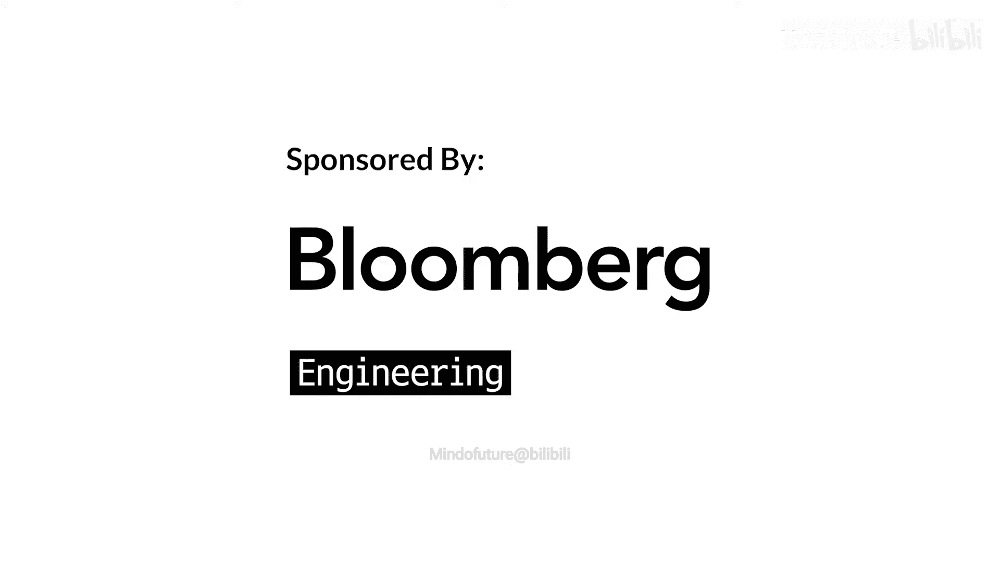
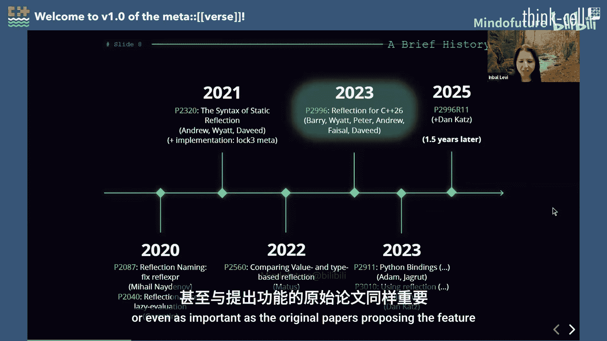
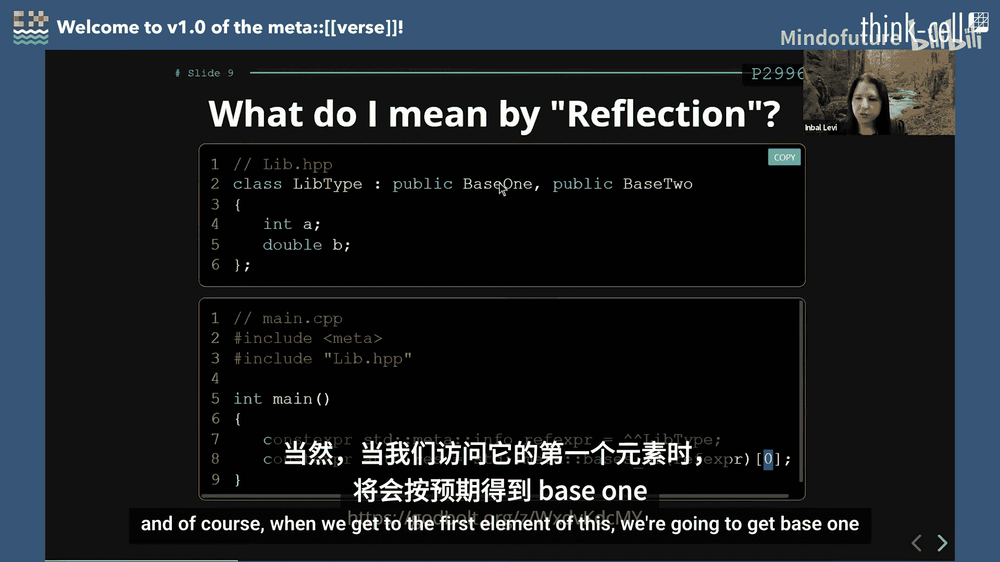
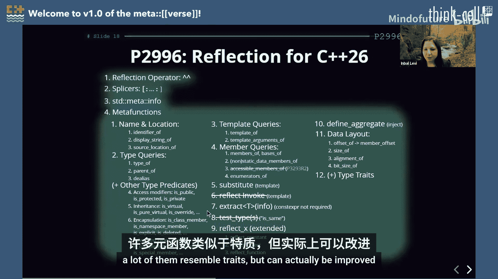
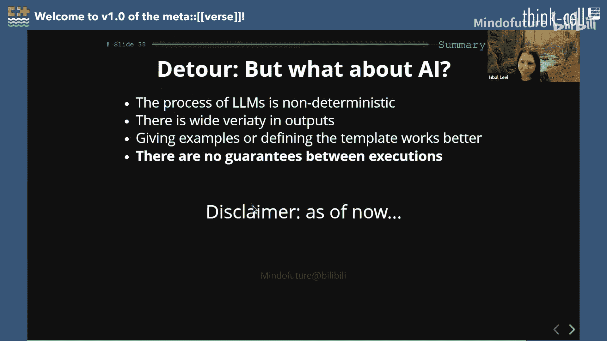
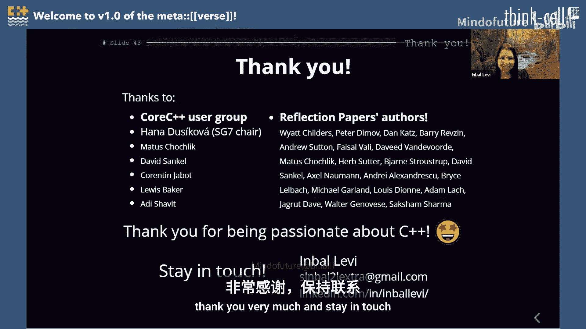

# 【Cpponsea】C++-On-Sea-2025大会-p18-P18_欢迎来到_meta----verse--__的_v1.0-因巴尔_莱维_2025--BV17V4GzjE6p_p18-

Hello everyone， I'm very excited to have you here today with me and welcome to version 1。

0 of the Meowverse So I wish I could be there in person。

 but I'm still happy to join you virtually so for those of you who doesn't know me my name is in Balevi and I have the slides for the presentation here you can scan the QR code or go into the link described and I would really love if you could look at the slides live because theres some code snippets and code examples sorry。

😊，On the slide， it would be great to have you experiment with them。So again。

 nice to meet you if we haven't met before， my name is in Balevi。

 I'm a C+ software engineer and always internal engineer in Microsoft。

 I'm also an ISO CBP Foundation and Bo Foundation Board member。

 member of the ISO CBP committee as Israeli National Bo Cha and Library evolution work of Cha。

 so if you're not familiar with the term library evolution。

 library evolution is the group within the standard that is in charge of the design of the standard library。

 C+ Standard Library。😊，So to explain to you a bit about this process of ISO。

 basically the flow of a proposal to IO of a new feature is as follows， so we have here in green。

 dark green are active study groups。Light winds are dormant ones and the study groups are basically the first stage for a proposal to land。

 of course you could get let's say I have a new feature reflection。

 you could get an early feedback from people， but basically this is the first let's say official discussion。

And the groups are split into topics and for example， for reflection， it landed into SG7。

 so SDZ7's full name is actually compiled time， but here it says reflection close enough definitely this group have been dedicated its time to reflection lately so。

😊，So our proposal lands in SG7 that gives initial feedback on the paper and the next stage is for the proposal to go to core evolution。

 it's called language or core or and library evolution。

 so in the case of reflection as it have quite significant number of student meta functions inside of the student namespace。

 we got of course the proposal going through our room as well as evolutions。😊，So as I mentioned。

 I'm library revolution chair that means that this design group is the one I'm。

Mostly attending next to next stage of proposal is as you can imagine go to library groups and reason is that at the end of the day the IO standard of C+ plus is a document and the way to put features into this document is not by implementation but by specification so we have the proposals and those are phrased in wording what we call standard is and those wordings are basically the way that you。

Push something into to's document so after a feature design have been finalized we can get to the wording groups library wording or core wording course again the language and by the next step the proposal is being voted in plenary so reflection proposal helping news I'm sure you already heard that probably in Hers keynote but reflection proposal have been voted this Saturday into the S++ 26 draft this is not a final of course until the last minute things can change but that makes that it's very very very likely that we get and by the way it was voted with very very large majority so it's very likely that we're going to get a reflection in simple++26 so it's pretty exciting。

Yes， so as I mentioned， we have reflection voted into plenary。😊。

So what do I mean when I say reflection， reflection is basically the ability of a software to expose its internal structure and when I talk about reflection in C++ I talk about static reflection。

 so the compiler exposed structure at compile time。😊。

So you might be familiar with reflection from other programming languages like Python， for example。

 it's a different aspect of reflection because in Python， the interpreter can basically。

By reading the syntax can inject the information extract information from the program and present this for usability but here when when I talk about C++ reflection it's something that the compiler is actually doing so let's say I have C++ program and it have reflection syntax the compiler goes over the reflection syntax and translate that into a regular C++ program so now we have regular C++ program and this is being compiled by the compiler and in the final binary there's no traces of the fact that this information this instructions have came originally from reflection so is turns into regular C++ code and then later instructions so it address of course concerns like security or safety etc unlike。

In runtimeThat we can observe in other languages， by the way， Ru， of course。

 also have a reflection and I'll address this a bit towards the end of the presentation。😊，So yeah。

 when we talk about reflection in C++， we talk about static reflection。

 the compiler expose the information and compile it。😊。

So this talk have two parts first part is intro to reflection we're going to go over a brief history of what we have had in reflection so far。

 we're going to look at the latest proposal that's the one that actually been voted into the standard on Saturday P2996 and at that point I also want to emphasize thank you for the authors that've been working on this proposal。

 I think it's really amazing that we managed to get this and I think it's a really great tool and I hope by the end of the talk you are going to be convinced as I am of the power of how powerful this tool is。

So yes， after the proposal we're going to look at some usage examples and as I mentioned as Library evolution Cha I have my focus and interest is on reflection based libraries and how are theyre going to look like and I'm sure we're going to get quite significant amount of them in the future。

😊，Examples also in this talk are from P2996， P3096 and EDG's implementation。

 so I also want to point out Dun Cats for implementing reflection in KLk which is available in Goddbalald and white Chil also implemented this for EDG even before actually。

 and thank you very much to both of them for basically enabling us to already use this feature despite it only been voted on Saturday already have some experiment of course but still implementations on Gotbalald so this allows you even to experiment with this during this talk during this fairry talk。

Second part of our talk is going to talk about the impact of reflection on code basiss。

 So we have I would talk about reflection as customization point and explain this term as well。

 We'll look at what the meaning of reflection in pipeline and how it's going to change our。

CI and talk about what next in this from。So let's start with the Greek history in 2006。

 first place I found for mentioning reflection was by Mattuchuch Kjik in the scope of the standard of course。

 and Matusush had a mirror reflection library that he wrote now what？

What you might be familiar with in terms of template meta programming and type traits is what this library is。

Sorry， so we tried to reflect on our code using templatement programming In 2012。

 we had a paper from Mike Spartis， Mike Sparts， by the way。

 have been part of the committee for a very long time。And have a very interesting perspective。

 so he wrote a paper trying to enumerate the use cases for compile time reflection and he mentioned things like serialilization。

 delegation， getters and setters and customization point he didn't call it customization point exactly。

 but that was the intent， and will maybe talk briefly later during the presentation on whether we covered all the use cases here。

 but I'll give you a supporter that is not all the use cases here is covered。😊。

W a proposal that we have today so between 2014 and 16。

 Mattusush was trying to standardize his library and got multiple versions of the proposal paper and again this is a library focus on type traits and meta programmingm and in 2015 we had boost Hannah by Louis Dion which implemented this library that also tries to reflect on the code again using template meta programming and at that point it became clear that template meta programming is not a great tool to do reflection on programs because it very heavy on the compiler to be able to extract the data from so we basically abandoned or left the idea of using template meta programming for this and wentla toward the idea of using a specialized syntax。

😊，So we had a new index for reflection， discussed multiple papers， thank you to Matthuush， Ael。

 David， Sanel， Andrew Herb， David Van deevo， Louis Dion。

 of those people were contributing quite significantly to exploration of this design space and we had something called meta objects emerging around that time。

 I will get to that soon。😊，But meantime， try to think about。

What reflection is trying to do is basically represent your program and try to think of how would you write a program to represent a program and we'll get to that later。

So。In 2018 you can see there was another paper that tries to set the direction or the usability of the feature by B strive tro and you can already understand it was a lot of interest there was also publication of the reflection TS TS is a technical specification by David Snkel again a document that basically set the ground for very syntaxes not far from what we have today in some in some meaning in 2018 we had also discussion on value-based versus typebased reflection and I want to go back to what I mentioned about meta objects so if I want to represent something in the world in a program natural thing to do is to represent by inheritance so let's say I have a function I can create a best class class sorry called function or。

Represents a function， and I can inherit from it to represent a static function or a member function or something along those lines。

😊，But it turned out that representing our program in that way is going to be again heavy for the compiler because there's a lot of different types that can create burden for the implementation and implementers basically have。

Ask or push toward having what is called a value based reflection。

 So the idea is that instead of us having this hierarchy of types， we're going to have a single type。

 which is what we know today as the stood meta info object type from the reflection proposal。

 and this would be representing all the different entities in our program functions， types。

 variables， etc。Even values， context pair values， of course， and in 2019。

 speaking of context pair we also had more discussion on context expert and context pair generally have been extended abilities of context pair been extended toward the latest standards of C++ and I think it's awesome C++ 20 have already enabled a lot of context pair abilities or extended farther more context pair abilities from comparing to previous revisions and I always say that C plus plus 20 is revision is a revision that is that is very helpful for embedded and other。

😊，Restricted environments。 And one of the reasons is that we can do more things at compile time。

 but we even extended farther and you can of course， search for Hannahs Hannah de Suovva。

 which by the way， I don't know if I mentioned before is the chair of S7。

 the group is in charge of reflection。 and she already extended a lot of our standard library to be supportive of a evaluation in Con expert。

 So that's pretty awesome。 But again， going back to K Exp and just in the。😊，context of reflection。

 we also know that context by itself is not enough to basically express all the syntax that we want to express in reflection and that's why we have a specialized syntax。

😊，So as always for proposals and features， we had some discussion on naming and on syntax itself and that was throughout the years and we had in 2022 again。

 discussion of value versus type where relened on value strictly because some newer discussions on reflection as you can see this have been worked for while。

 and in 2023 we had the proposal that was voted in Saturday。

 P2 996 reflection for C+26 so again I want to thank to the authors Perry Resvin wire Charles Pro Dimo under Saern Faisal sorry don't remember in this name and David Van Dudde and also I want to mention here Dan Katz。

 which is implementer for Klang and also been contributing a lot to this proposal he became author in a later。

tage of the proposal， not in the initial stage， you can also see his name here on other papers and because of due to those people's great work and also providing the implementation and again Wyat also did this for EDG。

 we actually have the feature。😊，So yeah， we're now one and a half years later。

 even a bit more and the proposal revision that was actually voted on Saturday was R 13， I think。

 but here you can also see Dunkaz have joined his authorth at some point and。

Thank you very much for all those people for their hard work and I also want to point out that after the proposal in 2023 it came out。

 there were different papers trying to look at the syntax as proposed and basically evaluated for different use cases for common use cases for reflection。

 for example， Python bindings or JavaScript bindings and I really thankful for Adam Jagggut authors of those proposals as well。

For doing this evaluation which is very helpful when we try to when we propose a feature to the standard we really try it's important to make sure that sorry that its usability is is fitting for all the use cases so purpose like that evaluating the use the usability are also very important almost as or even as important as the original papers proposing the feature so thank you very much for all those people so what do I mean by reflection。

So I've talked about high level of reflection and I wanted to show you a bit of example that you'll have the syntax in mind and understand how it looks like。

 so we have a class here leap type and it inherits from base one and base two here you have members of course。

😊，And here in Maine I'm trying to evaluate this code is basically trying to do the most basic thing that you can do。

 of course so it's a simplified one， but you have reflection you take the lib type and you lift it into reflection realm so when I say lift you can think about those two domains as two separate aspects or like a mirror world we have the reflection realm and we have the S++ program realm and we try to move between those two in our in the syntax so we lift in Lib type into reflection realm and we initialized this expression that captures the lib type and it's actually an expression of type st metain it's a st meta object as I mentioned to represent entities in our program。

And now we can call the function metabas of to extract back from this reflection expression and what we're going to get as the return of basis of is a vector of stood meta info for objects that contains base1 and base2 which are the basiss according to the order of declaration and of course when we get to the first element of this we're going to get base one as expected。

Cool， so。Reflection proposal have different parts and I wanted to highlight those parts for you so that you can have better understanding what we have there。

 so we already talked about the lift operator and next thing we have is splicers。😊。

We also have the student meta info object that I mentioned and' we'll look into that with more details and of course we have a bunch of meta functions so the functions。

 the meta functions are if you can look at those some of those names they some of them resemble things like type traits but we had a lot of discussion on whether we want to add those in the reflection namespace as well or some of those that might be duplications or peer duplication。

 but those are actually able to be supported by compiler intrinsics we also some traits are also supported by compiler intrinsics。

 but these could potentially provide a better performance and also fit to the other contexts per aspects of this proposal so you have here bunch of functions also because this is an updated talk and it gave this before but I wanted to update to the latest state there's some of those that were removed due to。

😊，Complexity or other issues that were discovered。 but there's no nothing prohibit from。

As extending this purpose in the future。 So it's already quite extensive toolbox。

 but we can always add on top of that later。And yeah， and I think it's pretty awesome。Okay。

 let's go over the details so we have the reflection operator liftft and it used to look like this with a single operator but today it's a double operator if you want to use the nickname you can also use the niim Uniipro this nickname was created by JF Boston which is the chair of evolution group I mentioned evolution is the group that is in charge of the language and we are in charge of the standard library so yeah only don't forget to give credit if you use this nickname。

😊，But of course you can also use the more formal name which is the lift operator。

 so we have here an int type and it's been lifted into the reflection realm and we initialize this expression but even here and again we are shifting from the C program world into the reflection world but here we're already going to get an error and if I could take your hands I would probably probably someone would have spot that but I already said that in the beginning in the intro of the talk keep in mind that what we're doing here is reflection aesthetic reflection at compile time so the compiler have to be able to to hold this information and evaluate it。

So naturally。In this case we gonna to get an error which is that the meta must be cont expert。

 so here we actually cannot execute this line instead what we want to do is decorate the reflection expression with con expert and now we're golden so yeah we've lifted it into the reflection realm we capture this with a reflection expression into the type of course and now we can move to the second part which is extracting from this reflection expression back into C++ realm back into our regular C++ program。

So notice I can talk a few words about this later， but basically we have here the splicer operator。

 those two on both sides of the reflection expression and we extract the expression back into the s pho realm here。

So just a few words on type name type name is what we use to disinect abiguate names。

 so if for example， I had potential for ambiguity， let's say if they had namespace also and I want to emphasize the compile release as a type。

 then I can use that to disambiguate and you can read more about this in the proposal itself。

But yeah， so as I said， we lift into the reflection realm with holding an expression for it。

 and then we go back into Spa realm by extracting this expression。

And we can use that in a CF program。So let's do a little readddles here。

What is this reflection expression？So we talked about we take int and we leave this and we already said before。

 reflection expression is basically a stood meta info object that contains information on this int type so this is not an int but its a reflection of the int held in a meta info object。

😊，And what is this type name again， or even if you ignore the type name。

 what is this p of the expression？So again， we said this takes us back to the S classroom。

 so now it's being ex to an int， so this is actually been this is actually an int here and I what I do online line two is I declare a int a equal 42 so of course this is a small example two lines。

 but keep in mind that even if I。Been if， if reflection expression is something that I got from externally or from from a different piece of the code。

 And now I can create an instance of this type here without knowing exactly what it is， Of course。

 I have to know for initializing， but generally speaking。

This is a very powerful tool because I can keep an expression that represents something and then I can extract it back into the program and create instances of this thing in my program。

😊，So we talked about reflection operator and about splicers， let's talk a bit about student info。😊。

So here I have a piece of text and again， if I could take your hands for those of you who've studied compilers course or been。

😊，Advanced users of Kang compiler might recognize this as abstractt syntax tree of Kang AST and this is indeed the way the compiler is looking at program so SDT is let's say I have a C++ program and I have the front end of the compiler it parses the program it's basically creating this model of the program with hierarchy that represents my program the text that been parsed and now this AST is being sent to the backend of the compiler and the backend is basically lowering this AST into binary into bits and bytes according to the platform of course in Kang's case it's LLVM so according to the target platform where lowering this model of the program to the bits。

So to binary code。😊，So here we can see on the right the int main and I have int I equals0 declared so you can already see in this up to syntax 3 function declaration variable declaration I which is the name and int which is the type and even the fact that in this L value etc。

 sorry that I but basically this is very similar to what you'd expect to have for reflection held inmetain and that's not a coincidence。

😊，So student4 represents type and type aSes functions。

 variable static data members structured binding nonst data members enumerators objects。

 etctera expressions a constant expressions and values with structural types permitted result of constant evaluation so this is important I'll get back to that in a second template namespaces and namespace aSes so here I have an example again。

And note those lines， we used to allow constant expressions。

 but it turned out that constant expression just allowing constant expression is quite complex。

 there's a lot of edge cases and usil that this and we had to narrow this definition to only objects that is permitted result of the evaluation so of course again as I mentioned we can extend things in the future。

 but this is where we landed now and。😊，This boils down to the fact that let's say I would erase this context per here。

Then I have an int a equals 42 but then I cannot evaluate this value to reflection realm so again remember before that I was talking about the constant per the reflection expression represents the object have to be constant per now I'm also talking about the value here because in the previous example I talked about the in type。

 but here talking about the a variable， so the value of the variable the variable itself have to be constant per。

And then we can lift this into reflection realm and that would work。So again。

 keep that in mind when you think about reflection。

 and I think the key aspect that you need to take from this is whether the compiler is able to look at this thing at compiles time。

😊，So we talked about student metain， I also wanted to highlight some more unexpected or unexpectedintuitive aspects of how metain works。

 so I have here a class R and this is declaration and I have here rest which is so I lift R into reflection realm and I capture this in this rest one expression student metain of course。

 and then I can give this rest to the stood meta function is complete type。

 so for those of you who are not familiar with the term in S plus plus we can define and we can declare and you can define so in line4 this class is only declared but not define so the question of is this complete type is will result with the answer no false this is not a complete type because the compiler at that point in line7 does not know how to instantiate this type。

😊，Then we continue and give the definition of the class。

 So we now have a class hour with a member and we know it's now a complete type。

 we know how it's defined and。😊，We take rest2 and we lift R and we have this expression to evaluate so of course in line 15 the evaluation is going to be true。

 so we have false and we have true and now my question to you is what happens when I try to evaluate rest1 that I took here on line 6 and try to evaluate this in basically and line 17。

So there could be two possible answers here so we said we have false and we have true and then the question is what going to be the third expression and it can either be true or false so I guess I could take your hands again as I'm not there unfortunately I can't but previously I tried this a lot of people said false。

 but honestly what's going to happen here in line 24 is that we're going to get true。😊。

So it might be a bit surprising， but again the reason that this happens is because despite the fact we're taking rest1 here in something that looks like a value。

 looks like a snapshot of a sub meta info in fact reflection the way we got this in 26。

 the way the feature is in 26 is that sorry this is not a stateless reflection but a stateful so。😊。

This， despite looking like a value。Is actually more like a reference to the ASD and once the state of this object of class R is updated。

 rest1 is now represent in the updated state of this class so again when I say or important to me to emphasize when I say reference the states it's not necessarily how the compile is forced to implement that when we talk in the standard on features。

 we only talk about specification and semantics we don't talk about the implementation。

 but at least when you have the mental model you now would understand or be more accommodated to how this reflection works so yeah falls true and true。

Alright， so we went over the lift and the splicers and the state meta info for object now we're going to briefly talk about the meta functions so as I mentioned already there's quite a lot of them a lot of them resemble traits but can actually be improved and。

😊。

And let's look at this short example， so I have here again the context where auto variable declared and I can execute a name of on this of lifted the reflection expression that represented。

 but in C++ name is ambiguous because we could have fully qualified name etc。

 so we've decided to know modified the name of this name of function into identifier of so now we have something that is less ambiguous and we also leave the design space for later to come with things that are more context based names but thenifier of the lifted a would return a as expected。

 so this line would print a。😊，And all of the meta functions except info or apart from a small。

 just a few that reflect value that takes type T。Value object or function that takes type T。

 but generally speaking except the info meta info for object。

 as I said the result of lifting things into the reflection realm and return either swing view or a stood meta info object a different one or a vector of stood meta infofo object or a boolean size T T which is the type itself for example。

 for extract extract can take a stood meta infofo object so the reflection representation of something and return the T the type itself and source location member offset those arestructs that we created especially for offset of。

For beats and bites， etc。So let's look at two interesting functions in reflections I think I find very interesting and also again emphasize the way reflection works so we have substitute and substitute is the equivalent in the reflection realm for instance and in a template so we have here example we have reflection expression that captures the result of substitute of course it's from student meta info it's a shorter version for a slides。

😊，And I give it the reflection of。A template and then I give the put as second operator a list of template parameterss that the reflection of template parameterss that can be used in this template so in this case array can get an int and3 of course the value reflect value this have to be reflect value of three because three itself as we said is you need to lift this into reflection real so you need to put here student metain and that's exactly what reflect value is doing and now I can instantiate the student array with int and 3 and get my array which is basically the expected type。

😊，After I splic it， of course， put it back into the simple+ password wall。

But if you look at the second example and imagine here that's even reflect value ignored three by itself。

 let's say I take a different structure of some template templated plus declared here and I again pass int and reflect value of three。

 let's say， and let's say the S cannot accept those parameters as the template parameterss then。😊。

In this case， we're going to get a failure when we try to extract the reflection expression back into C plus+ real。

 but。It's important to note here that we're not going to get the failure when we try to substitute。

 we're going to get sorry， when we evaluate this expression of substitute with saving into reflection expression。

 but we're going to get the fe when we try to instantiate because's that's like a delayed instantiation right it's here we only capture the information and here we actually。

Actually execute according to execute the functionality。

Another interesting function that I already mentioned and showed briefly talked about when we talked about summe objects and meta functionss is extract。

 so extract， is doing something very interesting as well， it's trying to it's basically taking type。

 it's a templated function， it takes a type， and it's trying to extract from the stood metain object that it takes the the value that can be fit in into this type。

😊，So here we have a reflect value of three， so we already said reflect value is being used to provide a student meta for object that represent three and three fitting for int so that would basically work and we can extract this expression。

 but when we try to do the same thing with something that doesn't fit the type。

 for example here reflect value of the string3。😊，Or char pointer depends on which world you're used to。

 this would fail right and it will fail in the extraction because now we can evaluate。All right。

 so we talked about interesting functions and I want to give a bit more focus on the type traits so you're going to get in reflection so type traits in general belongs to two type to two realms we have type3 that query the type basically returns true or false of Boolean and we have things that modify the type like remove CVR in C plus+ standard La in general right not just not in reflection even。

😊，So2996 have focused basically on the first act mostly。😊，In this in this revision。

 but I really think it's interesting to think about which functionality can we get as part of the standard library for the reflection traits that are doing things are more complicated like。

Modifying or giving us different results。And I think that I expect that in the upcoming years。

 we're going to get more and more of those。😊，Okay。So now we talked about reflection。

 we basically covered all its different aspects and I want to talk about a bit of a different paper。

 3096 by Adam and Jaggart as I mentioned in the beginning of the talk and this paper is trying to talk about another kind of age cases or unexpected result of reflection。

😊，Let's think about function declaration in C plus plus。

 So we have function declarations and they can basically and when I declare a function。

 I can basically use whatever names of parameterss I want or variable， sorry and。

And I can do this differently in different declarations。

 so here I have a function that prints the parameter names of of a function that it takes it's a meta function or a reflection function that prints the parameter names and I give whatever specific。

😊，The specific location in the array and then let's say I declare I declare function funk within first and last pro namess and now I call my print function here and print the pro namess so here of course we expect to get first and last。

😊，After the first declaration。Then I declare this again and that actually a valid C++ code。

 where I can define the function， sorry again。😊，And when I define this， I defined。😊。

The function with different parameter names， so now I have what used to be first and last is now N and LN for example。

 and when I call my print funk parameter after the definition I can get a different result so on the first one I'm going to get first and less and on the second I'm going to get n and LN so this may appear I mean it make sense。

 but also if you think about the usability use cases of reflection。

 you think about things like logging or trying to basically in capture the structure of the code and if we get different names because of the different decor names in the and definition we maybe have inconsistent。

😊，Also， you might think of different how do how different results that can be for those evaluations right？

 So yeah， the paper P 3096 have explored this design space and all the options that we have for addressing this so we can do different things we can basically in in the case that I've shown。

 we can compile and make no guarantees so maybe different。

 if you use different compilers and you run reflection you'll get different result。

 maybe one compiler we take the names from the declaration and one compiler we take the names from the definition。

So we might get inconsistent output， we can enforce consistent naming。

 so basically we say we the code that introduced different names for the decor definition would not compile unless the names。

 yeah unless the names are the same， but if you think about this。

 it's very interesting in philosophically wise because，😊，In Cuswas language。

 we do not have this kind of enforcement， we allow different names in declaration and definition。

 that's actually something that is used in different code bases。

 sometimes either because we want to give context in the definition or in the declaration and use different names in different context。

😊，We basically add additional requirement for those code bases to be able to compile with reflection。

And。Third thing we can do is marked by Archerd， so basically we signify these names， I mean。

 let's say， for example， for this declaration， those names are what we want to see like canonical names。

So yeah this is basically what we've been exploring or what the authors have been exploring in the paper or function parameter names and we ended up with the enforcement of consistent naming or in another way it's if you don't have consistent naming your program would be yield form and I think that's actually a reasonable compromise because on the one hand I mean you avoidingconsist and maybe might mean that your logger would not work without consistency naming。

 but on the other hand you get the consistency in terms of like if you execute on different files etc。

 on the other hand think about your codeb that you already have and you now introduce a logger library that relies on reflection and this logger can use on some parts of your codeb some projects let's。

in a company， but on some other project it will not work。

 it will simply not compile because the inconsistent naming exists and again this is not something that we've limited in the C++ world in the functionality world。

😊，So I don't have enough time to go over this example of reflection logger so I'll encourage you to look at this later。

 I do want to talk briefly about customization points so customization points are a mechanism on which a user can basically provide their own implementation to library so libraries generic libraries can do things in certain ways and sometimes the user have additional information on how things need to be done for their types。

 for example， swap is a very common use case on which you can specialize the way your type is swapping。

😊，So there's different ways to do customization points one is。

 for example virtual functions or template instantiations or a functionality detected by idea like swap as I mentioned and if you want to learn more about it feel free I gave talks about this topic same talk and multiple places about this topic and this is actually based on a very good paper from Barry Resvin that tried to explore this and I would encourage you to go and watch those to learn more about customization points but one of the options that were in the paper and。

😊，O for customssimization one was reflection because reflection with reflection。

 you can basically break apart the code from the library and rebuild this， for example。

 in the way that fits the user or inject things into the logic so yeah reflection was brought up as an option。

 but personally I think that it's it's a heavy tool for this kind of usability because we as library writers。

 we don't want our users to have to break our code into parts in order to basically opt in to their type or give us the additional piece of information of the type。

😊，of their own type， so I consider this feasible tool but still I think too much of a heavy you know hammer for what we're trying to do and therefore my view for the standard libraries that I think we need more abilities to do customization points and this paper was or this discussion was a few basically before reflection was published it was trying to aim to the what we think that's going to be the reflection now that we have it。

 I can say the list for my part， I think that reflection is too much of a heavy tool and we still want to explore other customization point mechanisms for the standard library。

😊，So yeah， again， I don't have enough time to go over this example。😊。

But just think about the ability to customize into your type and this is just an example from one of the original reflection papers that basically breaks library type into basically by iterating over the data members of this type and rebuilding this rebuilding let's say user type based on the structure of the library type so we could basically break apart。

The all kind of structures and build your own structures based on them with injected functionality。

But again， this is an example that in my mind shows that this is a heavy tool。

 we not necessarily want to give our users this functionality。Of course， when I say users。

 it can be other libraries as well， right it doesn't have to be like the end users。And again。

 this is from the paper from Andrew Saturn。So。Few more points that I wanted to make on how reflection can be used so I already mentioned the function parameter names and you need to think about what happens when we have different names there's other interesting aspect of reflection which is that we can actually reflect on the private members so we are used to having access modifiers basically signify the limits between different codes or logic so if I have a library code or if I just write my own class for someone else to use I can have my private members and I can in a sense I draw the line between the implementation details and the API interface。

 the public interface but the fact that that reflection allows us to access。

Prvaate members is actually kind of breaking the line between the public interface and the internals and that's actually very important。

 for example， for the standard Library that that is the reason we've explicitly specified that reflecting on parts of the standard library are are not stable so basically we're preserving ourselves the right to modify the implementation details in utilities that are in the standard library between versions or even within the same version like if we deliver some so。

😊，As you probably know in STs， we try not to break API or ABs。

 but we can actually change the implementation detail of structures and when you if and by the way its not it's not it's basically discouraged to reflect on standard library types but generally speaking even if you would have done this。

 you need to know that there's no guarantees because of this because of the aspect of reflection of breaking the boundary and one more thing I think we need to think about is what happened when we get new code let's say I have a code that fits into the requirements of this logger that dimension before we consist names but then we get new code that someone goes into my code base and modified this because it just are not aware and now we are basically not compiling with this logger library so all of those things are things that we need to think about。

😊，And to summarize those aspects， we have a pipeline of reflection when we give used to or at least the normal pipeline without reflection is we have a log library and we compile this into this object and then we can link this with our application code with the main。

 for example， in the linker。😊，And get the main program。

And we can use version and macros in compile time to basically choose between implementations。

And all of those things are things that we're familiar with， but in reflection realm。

 we can have this logger library and if it's written in reflection。

 and we link this not link including because we have to have that available compile time to our application code。

 but now the point on which we're going to get the failure is on the compiler and not on the linker as we may have been used to。

😊，And that also is important in aspects of。All kinds of systems that replace dynamic libraries and things like that。

 these are different ways of constructing our code that we need to take under consideration and that's actually an interesting aspect of reflection that we need to think about backward compatibility。

😊，So I have just a few minutes and I want to briefly talk about AI so as I mentioned I'm in Microsoft and I'm sure you all heard of CheGPT and Microsoft are really really keen and excited about AI and I was wondering whether AI can actually replace the need for the reflection feature because what we're trying to do here is things like parsers and kind of cogeneration and AI can actually generate code and technically I could give it my source code and ask to generate parser so I did try to do this experiment and I gave this type and I've asked to generate civilizer for my type etca。

 etc as you can imagine。😊，And there were multiple things that I found when I tried to do this and again。

 all of those things are talking only about AI as it is today and of course this world is updating really quickly and by the way。

 I'm also part of a team in Microsoft trying to work on extending developers tools and giving developers more tools of using AI etc ce and filling that into the developer workflow。

 but for example the first experiment gave me different return types from the serialize and comparing to the input type of the diserite。

 which if I would have this code by myself I would probably look for consistency。

 let's say go with the vector。😊，Second aspect of this was that the。

Functions themselves to read from the serialized and diss serialalize basically the implementation detail we're using MeM copy which is only is okay if I have structural types。

 but let's say I replace or I add member to my original type and I need to call construct factors so this is not working and the third thing third issue was that basically we have here decized function and if you're looking we basically return my type but from the buffer but if you're looking at the code and this implementation。

😊，We always get my type back， the only question is if the paring failed is whether we get the members initialized or not。

 so of course， here also we need to basically know to do the error handling in this type and this logic is faulty。

😊，So to summarize my points are by the way I tried also to do this second time with a first project to see if there's consistency and as you probably already know as some of you I'm sure have already worked at AI there's no consistency between those to experiment so the second attempt I can get a completely different issues or bugs in the code etc。

 So to summarize I think that AI can definitely be considered for those things。

 but the point of AI being nondeterministic and in a sense by design providing different results or different solutions is one of the reasons we might still want to keep cogeneration and features like reflection that are deterministic that are always giving us the same result semio bugs of course expected results for what types of tracks that we gave and I think that is。

Powerful part of of features like reflection or other code generation features like Jinja。

 some of you may have heard of， which is basically a Python framework that you can give like a template of a code of a file。

 for example， and generate different。Versions of this file extracting those those templates。

 so not in s plasma term， but templates in terms of patterns。

 so my view is that we still need those deterministic frameworks we still need this feature。

But who knows you know everything changes so fast so maybe in a few months AI is going be powerful enough to give us consistent result and let's see second thing I wanted to mention is RE so RE does have a toolkit for reflection it have macros and it have the S library that basically injecting tokens into ASD where they looked at ASD before but we can use this to inject things which basically means modifying RSD of the program and creating new parts of it。

 but I think that in my opinion， injecting into ASD and you've already seen the complexity of that is forcing the users to know more about the basically the underlying implementation and this is something that we probably。

😊，As a community should discourage when you start mixing logic of the implementation and into the logic what you're trying to achieve of your application code that might create that's not a good you know it's not a good way to write language so in my opinion our reflection is still more powerful and cleaner and actually people from rest I guess I agree with me because there's some blog posts exploring what S++ is doing for reflection and trying to compare to that or trying to look at this and as a first result as far as I could find at least there was an improvement suggested to the S library by cleaning up some the need for users to address edge cases and things like that and making this more usable but still this is still a library that modifies the ASD so it still need。

Use still need to understand those concepts in order to use it。Okay。

 so to summarize what should we expect from reflection libraries。

 I think we can going to already expect some very interesting use cases， parsing， etc。😊。

But we need to keep in mind that there's no compatibility between standard versions and no guarantees for existing code so reflection can be modified and of course don't reflect on the standard library possible outcomes is that your program is going to be ill formed or you can maybe get UB and other things so。

😊，We really had a very interesting discussion on how do you reflect quote errors from reflection。

 and actually Hannah de Soovva， which I already mentioned as S7 chair。 and by the way。

 also evolution culture。 She came out with compile time exceptions。

 So we can now have context per exceptions。 Those are this is really awesome。

 those are basically can't be thrown so during the compile time during compiler execution。

 it can throw exceptions so you can get the errors and from the compiler。

 but those cannot leak into the run time。 So those are only limited to the compile time。

 but these are pretty awesome because they give us better indications by the way。

 it's not only for reflection。's just a tool for better warning and better indications。

 sorry bear error handling error reporting。😊，And maybe in the future。

 we might want to consider warnings as well。😊，So thank you very much for listening。

 I would love to hear from you which reflection libraries you think is going to go into the Standard Library。

😊，And maybe you'll come up with very good use cases now that we have this feature and I would also encourage you to go and look into those talks and papers。

 by the way， Daisy Holman， she's a worker21 member as well and she gave a very interesting talk about AI and how it works so if you want to dive deeper into that it was in ACCU 2025 the slider here and so I just want to emphasize again the time that it took to get to this feature but I think it's a great feature and I'm very happy that we finally got this after all those years and thank you to Co VP user group to Hannah De Suova as I already mentioned her great contribution。

 Matttuush David Sannkel that I've talked with get additional parts of this and Corentan and Lewis and Na for reviewing early versions of this talk and of course to all reflection paper authors and thank you for listening and for being passionate about C++。

Please feel free to reach out to me， thank you very much and stay in touch。😊。

