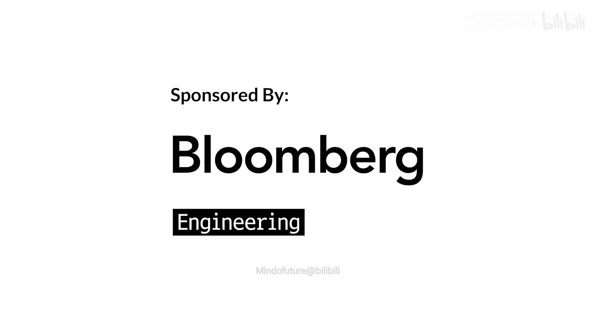
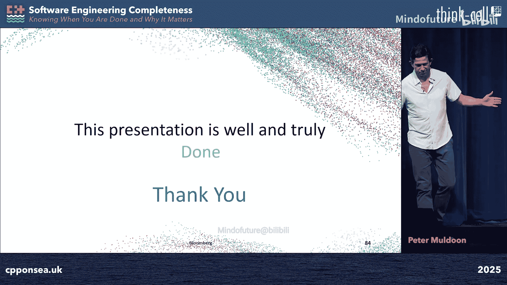

# 【Cpponsea】C++-On-Sea-2025大会-p19-P19_软件工程_完整性-知道_何时_完成_以及_为何_重要-彼得_马尔多_2025--BV17V4GzjE6p_p19-

Welcome to my talk， softwareftware Engineering Completeness Pyramid。

Knowing when you are done and why that matters， okay？So。This is the Bloomberg slide。

 I have to put it up there。 So who am I， You know， what am I doing up here on stage front to this very illustrious group。

 right？ Well， I started using C plus plus very， very long time ago。 It sort of， I think。

 not long after it escaped battle labs and universities。 So I've been using it a long time。

 And in my professional career。 I've been doing a lot of system analysis and architecture。

I did spend 21 years as a consultant moving around through a lot of companies。

 That meant I've seen a broad reach of what's done in code and what's bad and what's good。

And for the last decade， I've been in Bloomberg， and these days I appliedly my trade in what's called the Bloomberg ticker plantt。

 so where you see all those tickers come across the screen。

We're the area to tick all that exchange information from all around the world。

 masses and masses of information and send out these ticks， okay care。

So here we are at the conference。 What am I doing here。

 Well I like to give engineering talks right called practical based。

 I was the best in the real world， which is where most of my coding happens。

 And I like you to either take something away or have a change of perspective。

 Youre thinking changes because of something like this。 Allright。😊。

So the genesis of this talk is I was going to the Bloomberg offices in London and one of the managers there said。

 I want you to give a talk to my guys。 And I said， well， what do you want to talk about。

 Here's the list of talks I've done a conference。 I don't care about any of those。

 I want you to talk because I am frustrated that developers believe that it's just about the code。

 And don't keep an any handle on the real cost of software ownership。And at that time。

 I was running a very large project called Linux migration。

 I was moving our whole architectural cluster over to Linux。

 And I was finding a lot of problems similar to that where I was asking people。

 are we done with this yet， and I was getting yes， and it was not anywhere near done right。

 And we'll go into that a little a little later， So here's the question that you get asked a lot。

 especially if you're earlier in your career， are we done yet， Your manager asked。

What he's really asking is， are you done yet， right， is the work we have have you got it done？

And I would say the answer is probably not， right， from my experience。

 we have a really poor definition of what done is。 So why is that， What's the problem？

So the first thing I do is I go to the dictionary and say， well。

 what does the English language mean by done。And it says to bring something to a required state or completion。

Fairly。Fairly good， but what does it mean in engineering terms？

And I look around and for literature and stuff。 And there's very little about what done means for engineering。

I do find it wrote down in the Scrum guide。And it says something like the formal description of the state of the increment that meets the quality measures。

 your quality standards。 I mean， if I ask some developer， what's the definition of done。

 this is not what I hear， right， This is almost gobblelygook to them。

 or even though it is a formal definition。So why bother？ I mean， why would we need to say。

 or doesn't everybody know what done means。 Allright， when someone says。

 when is this going to be done， it's going to be done three weeks from that。

I can walk away I'm full of confidence it's going to get done。No， I'm not， because the problem is。

 we need to establish a definition of done， right， that creates some shared understanding within my group。

 Let's say on the local level， within my group for the nearest teams I work with。

 We have a shared understanding and unified language for what we mean by done。And because of that。

 new people coming into the group or people that are interacting with the group don't have to act try and access some tribal knowledge that's buried out there。

 sort of in the subconscious of all the people。 It's right there to be looked at。

 and we have the proper expectation set。On a larger scale。 So if you go up to chain。

 on a larger scale across a company or an organization having a shared definition of done that's agreed to。

 right， gives a shared responsibility。Right and helps us do what we call alignment of the company。

 right， if I'm told。Hey， we're releasing this thing and when I say， well， December 10th。

 we're releasing this big new feature on the terminal。And the publicity group is into overdrive。

 And it's， you know， December 20 or December 8。 And they're like， okay， two days we already。

 I'm like， well， no， when I said done， I man， I just merged it in my code base。

 It hasn't actually had any production testing。 It hasn't get on through beta testing。

 We have this friction in the organization。 So that's why we need done at the higher level as well。

So I'm going to give you example。 right。 So the goal of your project is to develop 10 new product features and deploy them to the users。

 but you haven't deployed any of them yet。Right。What I was gonna say。

 what is your completion percentage， right，val said， well， we got five of them coded up and in， in。

 in our code base， we're 50% done。You're not。 You're 0% done， right， We， we know how to do math。

 You got zero features。 or zero amount of that work is visible in production。 So you've nothing done。

 Now， at this time， this is where， like I say， managers， developers say， look。

 we coded and tested five of them。So we're 50% there。

It's like you're not because my definition of done means the customer sees these things。

 right that it's out there giving us value。And the better question would be。

 when do we expect something specific， right， some new trading done and some new ticker type being delivered to be deployed and active everywhere in production。

 instead of just saying done because done is something that people can funge in their head。

So that we have a shared understanding between us。 I'm going to go through some basic terminology I'm going to be using in this talk。

 right， What is the business value of software engineering。Right， not the technical。

 not all our whizardy， you know， templates and reflection。

 What is the business value that we deliver。As software engineers。You can shout it out， right。

 it's an actual question， it's not rhetorical。Uable features， kind of， yeah。啊。I can't hear then。

Competitive advantages， John。A的。Customer satisfaction。 Yeah， I mean。

 what we're really looking to do is get people to pay money to give us money， right。

 to do our pretty nice salaries， Right， So， but what we're trying to do is deliver desired outcomes in incremental steps。

😊，Right， now， why incremental steps， What's with this baby step stuff putting in things a bit at a time。

 Why don't we just big bang changes in。Right， I'm redoing the whole of the communication layer。

 And it's all coming in at 12 months time。 Get ready for it。😊，Because we found it that's well。

 I don't know if you guys have found， I was here in the early days when a lot of that was done。

 we found it really bad right it tends to take your system down， you blow up a lot of stuff。

 There's a long you can have long recoveries from trying to put your data back together。

 all this kind of things so。We do it。 So we have shorter time horizons。

 And because weve shorter time horizons， we have less uncertainty。

 And if I say this is being delivered next month。 And here's what I mean。

 There's more confidence than I'm delivering something a year from that。Alright。

 it's also lower risk inherently， right， I'm doing less change theres less risk。

And we get better feedback from customers。 So I'm doing incremental steps。 And they say， hold on。

 We're actually looking to have this way。 You can start adjusting in mid， in midstep， right。

And because we're starting to deliver something in a lot of little chunks。

 you need to know the delivery of these steps right now。

 even though we're delivering it in incremental steps， likely for the business。

 there's a deliverable when a whole bunch of steps goes in。

 So they only see it when a lot of steps going in。 But when you have all these incremental steps。

 you can plot the time， a lot more accurately。So the business value of software engineering。

 When is it materialized， We have this idea of materializing variables in C plus plus。

 When is the value actualized， You do a nifty new feature， When is that actually。Materializes value。

YeahRight。Not when you get paid， You'd probably get paid you know。

 that might drive your company to the ground。 You'll probably get paid anyhow。喂咧我睇问诶你今。

When the company gets paid， yes， but it's going to get paid for something。Look。

 so it gets actualized when it's available when your customers have access to it。

 right when you fix a bug， they no longer have to deal with or have to do workarounds。

 So when it's available， when it's usable， In other words， it。

 it actually does what it says it's going to do。 If it's a service it's up when it needs to be up。

 Allright， and reliable。 In other words， it doesn't work 5% of the time，10% of the time。

 it's got to work all the time。 If it's a service， it's got to be up all the time or there is defined periods of downtime that your customers know。

😊，So that is when it's materialized。 That is， I'm going to say a very immediate view of the value。

 This is what a customer sees， which is very important。

 But there is more value that we put into software。 And that's to do with future looking， right。

 So if our code is configurable。 And its I can add new configuration and have it do new or more stuff。

😊，That's value。If it's flexible， in other words， I can make it do new stuff。

 and it doesn't take a total rewrite of the code base。That's good。 We can fix issues quickly。

 We can locate and fix them quickly。 and haven't tested。That's also good。

And we can evolve quickly with the market， as the market's changing。

 our software is not so serpentine that getting any little change in。

 we break stuff all over the place， and we don't quite know why。So。

 and this is the interactive portion。 And right this where you get all your street cred。

 What types of improvement。Do we as engineers， deliver to production。Sed。You've seen my talk。

 you can't talk about stuff。I speed。😀Yeah。No。Alright， yeah， new features。 I mean。

 I'm in a room engineers。 It always makes me a little nervous when I ask this kind of question。

 a room for engineers just stay quiet。 What else do we deliver to production。😊，嗯。Yeah， bug fixes。

 right， cool， What else？We actually deliver feature flag changes。

 but we'll get to performance a little late。 We deliver configuration， new configuration。

 We're gonna take in new clients， and we have new configuration for them。

 We're gonna have new servers up and running， right， We also should be having tech debt reduction。

 right， Refactoring depreciation of code that's not been used anymore。

 That's something else we should be delivering to production。😊，And then we have the actual hardware。

 the ecosystem that the stuff lives in， right， Like I say。

 I gave approximately two years of my life to getting new machine architecture， right。

 Linux architecture wasn't easy。 And that let us go to the latest GCC compiler at the time。

 So we're now on， I think 20， and we're looking to move to 23。😊，Right。

 so these are the types of improvement we deliver to production。

 But what other types of change do we deliver to production。Bugs， yes。

 we deliver broken functionality of production。 What else。Missing functionality， right。

 We didn't make the deadline， right， or it doesn't work。We deliver performance issues。

 some of the performance issues， right， I had this happen。

In the case where I was looking at a piece of code to make a change。 and I noticed in the hot loop。

 there is a sea out。Alright， And what happens is I showed the guy who made the change。

 And he was like， oh， that shouldn't be there。 And then we went to look at one of these dashboards and turned out the 3000% uptick in the timing to do this type。

 particular type of transaction， right， So performance issues。 Security issues。 It's a big thing now。

 right， We have a few talks talking about security。System unreliability。

 And as the aggregate amount of change is coming in is's just making our system more brittle。

 We're getting more falling over， more service interruptions， more downtime。So production changes。

Right， what do we， What do we need to know， What is it， What is。

 What do we have to have for a commitment to deliver change。What do you need to know。

 I have a change， you， I have a change。What do you need to know？All right， you。

I'm going to say you have to know what you're delivering first。Right， and I think this is something。

 you know， maybe a little conversation we're bad at。 We tend to get the mirrors hint of what we want。

 And then we just run off down the road。 right， We goof。Down the road， right。

 and then we find out we're going over a cliff。Right， so we should have something to keep us。

 I gonna on track。 And something we have for that is called acceptance criteria。

 So what are acceptance criteria， right。These conditions。

 we have to meet that the software change will be accepted by the user or the proxy。

 You can be a business analyst， someone from the。You know， the business side。

 But it's something that we have to meet。 And these things should possess certain qualities。

 I see accepting criteria that are， yeah， we're going to deliver something kind of whatever。Right。

 it's like you can make that acceptance criteriatier stick because there's no specifics in it。

So it should have some clarity。 They should be straightforward， easy to understand。

 They should have They shouldn't have a load of prose or telling a story behind it。

 It should be very like， this is what we want very concisely。And we should have a way of testing it。

 How do we know we have it done correctly。 What is the success to get this done and also should be observable。

 again something we miss a lot。 We say， we've done something absolutely fabulous in the code base。

 You're not going to believe it missed a business person。 And he goes， well， what is。

 what am I getting。 I can't tell you cause it's way in T me programming。

 yet just wouldn't understand。 And he's like， I'm just clicking the buttons。 Nothing looks different。

 So you have to give him some sort of observability。😊。

And that's something you should be looking for to show， to show the impact of your change。

And very important acceptance criteria are about what the change will do。

 the business does not tell you how to do it。 or really anyone else should be telling you how to do it unless you're just trying to help you out。

 right， It's about the what not the how。 That's， that's the engineering departments。

Mand aid is to figure that stuff out。So when you write acceptance criteria。

 it's written by you or the product owner。Usually share it with the team so you can get some group think。

 You get like a better idea。People know some of the history of the software。

 we can make sure it's all coppathtic。Here's the piece we miss。Right。

 we like to be what I call a self licking lollipopop。 In other words， yeah， we wrote it。

 and we all think it's great because we wrote it。 Let's just plow ahead and do it。 No。

 you got to go to your customer or whatever's the proxy of your customer say。

 here's what we're going to do。 What do you think。😊，And it should be in language。 They understand。

 Not again， here's a piece of code I'm going to write， right， shouldn't be in code in terms。

when I've done it， I've using the given when then I'm not going to go into this a lot。

 but this is just where you say， here's my scenario I was doing this migration。

 and I was having trouble where the reference machine because an A B testing reference machine had something wrong with it was getting a bunch of noise in my results and I just said。

 listen。Given I have comparison testing going on when the reference machine has a bunch of things saying it's out of whack。

 go get something from a backup list and redo until it works。I right， very specific。

 very And this was a quarterly goal。 One of the quarterly goals I had when I was run a few teams for the L migration。

So to know what we are， and let's talk about requirements in scope， what is project scope。Yes， John。

喂会装。Not bad。 Not bad， right， It's John said it's what we're going to deliver on where we draw the line。

 which I assume is what we're not going to deliver， right。

 So Pri slope refers to all the list of features and deliverables we are going to commit to on this project。

They can also specify items that are out of scope， right。

 that this is what we're definitely not touching， even though this sounds like we're doing it。

 this here says we're not doing it。What is the what is the debt？Of projects。

What is think that kills projects？嗯。😮，I can't quite make out what you're saying。My speak later。Yeah。

 yeah， true。Not quite where I'm looking for anyone else。Scope creep。 Yeah， yeah， yeah。

 Spe creep is the one thing that are is going to kill your project。 You haven't properly said。

 here's what I'm going to do。 You've left it all vague。 or you' said。

 here's what I'm going through as someone comes in， you know， what you're doing that。

 Can you put in this new nifty piece of functionality。And you should be like， sure。

 what's my timeline， My timeline is going to go out X month。 Are you okay with this。

 We can maybe rearrange how stuff is delivered as deliverables。Right， but if you don't， you。

 you tryingt just absorb everything。 I know as engineers were like， say， yeah， yeah。

 well I'll get that done。 No problem， right， because at the beginning of a project。

 time seems almost infinite。Right and when you get to the actual mid to the last third。

 it seems like there's none of it around anymore。And requirements should。

 should say what it's doing in bounded terms。 any general language。 I'm going to do equity trading。

 It is almost meaningless。 There's a whole bunch of trades you I know you're not going to because I' complicated it。

 So I'm going to do these simple type of trades。For this list of products， for instance。Again。

 alright。 So now I know exactly what I'm committing。 Let's say I've got all this down。

 I know what I'm committing。Can I just walk away and say， six months from now。

 come back and see how you're doing or maybe a month from now， because we're doing the increments。

 What else do we need to know。Kind of give the game away。 right。

 You need to know the time scales involved， right， It's not just enough knowing what's going to be done。

 You have to know when it's going to be accomplished。All right， so when will the change， buck fix。

 whatever be done？All right， so few answers I used to get was。When， you know， it'll， you know。

 when we get around to it， whatever it's not really a timing issue， it's a priority issue。

 they just don't think it's worth doing。I'm sure if， you know， the department had come down and said。

 well when will this be done，' like， oh， well， I think it' will be done in two days。

 But let me get back to。 I have to look into it。 right， So it's just priority problems。

I actually got this said to me soon， like in Ooewa。I don't care。

 Let me plan my project time I was based on that。 Everybody's saying soon。 we were a little while。

 a bit more of a while。 You can't run a successful project that way， right， unless you're lucky。

couple of weeks or a month were getting or taken down the uncertainty each time。Right。

 but would I ask for。Is it date。I was running， like I said， this large project when people say， oh。

 we'll have this in in two weeks。 I was like， I don't understand what two weeks is。 What。

 what's my date。And， you know， I got accused of using aggressive language by asking for a date right。

 instead of like not giving them a date to saying， you give me a date。

And I will hold you to that day。All right， so an actual date is what you should be getting。

 not these vague terms， right？But most engineers have misplaced optimism。

 We talked to a bunch of engineers， I don't know， down here in the cafeteria。 How is your job。

No idea the problems， the burden。 It's awful。 And then when business or management says， hey。

 when can we get this change in or this thing done。

 It's the most happy path estimation you can possibly give。

 It's like everything going absolutely swimmingly。😊，I can get this done like really well。

 It's like a best case scenario。 It's almost like that code is right on my I D E right now。

 And I will make that fix。 And if done just means I saved that code in my own private view。

 and it works。 I'm done。😊，Right， that's where's the customer and all of this， right。

 Where is the deployment and all of this， Where is this stuff getting out the door， It's not。

 So it would a bad definition of done。 And the thing that's often forgotten is。

 and I got tripped up this once or twice。 It's like， how long you take this change， Two days。

All right， so Tuesday release cycle is on a Thursday so。It's going to get in， so。

I do all my testing again， and I'm doing my end end testing in production。 The bugs still there。

 And I go to them， Why use is the bug still here， You fix it and work。 And they're like。Well， no。

 we didn't start on the bug yet。 We said it was two days。

 We didn't say we're going to work in it now。's that's two sprints down the road or something like this。

 right， stuff Do you think people would mention to you when you're asking when a problem would be fixed。

 but。You know，It's not done all the time。And there's this thing called domains of a problems。

 a simple problem， very straightforward。 just fixing calculation that one right solution。

 And you have。Or is it complicated， which means that there's multiple right solutions。

 So you have to pick the rightest one。 There's usually more moving parts， maybe more groups involved。

 Then you have complex problems and complex problems is I don't know what the right answer。

 Not even sure there is one I think there is。 And I've got to go and find a whole bunch of unknowns and narrow them down to figure out。

 So that's your domain type。 So based on the size and the scale of your problem is how much that certainty is going to be in there。

So good time estimates， right？What do these do for you， They create trust。

 what people call political capital， which are customers， right， or other teams and managers， right。

 where you're like， you're very good at delivering product。 You're very good at doing it on time。

 You ask them for a favor。 I need to push things around。 They're disposed to help you right。

 And the trust that what you're doing is the right thing。How do we give better estimates。

What is the one thing？Jason， that we would do for better estimates。Can anyone help them out？But like。

He says， yes， I' worked in a team， he's an independent contractor， okay。

 Anyone else wants how do you give better time estimates？E，54， Nope，No， cast John。

You need to make sure itd be realisticistic by predicting the next part it based on previous。Yes。

 but that's one step after what I'm going to say。嗯。No， it's not given it to chance E VT or cloud。 No。

 right， It's a break changes down at the smaller pieces， smaller pieces。 phased approach to change。

 We talked about this， right， If there's one thing you do， you break things down。

And I've told the story before where I had someone， and I said， listen。

 how much to get this fixed done。 How long。I said three or four weeks。 And I said。

 break that down into the pieces。 And he broke it down into the pieces for me。 And I said， now。

 can you put the time scales on these things。And it added up to five weeks。

RightBecause once you bring it into smaller increments， better certainty， better confidence interval。

 if you like。Yes， Jason。Quion about that， because there's like Scott。Where think you后 one。

So's talking about the Scotty principle， which is the enterprise where you say it's going to take me twice a time。

 whatever you think just double the estimation， yeah。那题。If you're a horrible engineer。

 that is the way to go。Yes。I know you're not。so we're going to talk about this a little further on。

 so I won't dwell in it here， but there is a place for that but not in that way。Right， so there's。

 there's a better way of doing。 right， The other way we already talked about is having specific requirements。

 right， so that we know what we're delivering。 It's not something fuzzy and we're guessing。

Newing is to embrace empirical reality。You know， I tell the story of when I was on a team and we had sprints and we had amounts points of work。

 If you're familiar， we， we say this is the points we're gonna deliver each， each sprint。

And it came up to 24 points。 I was on the team  three months，24 points。 And yet， every single sprint。

 we only delivered 14 to 15 points。And I said to them， why are we doing？You know。

 why don't we just have everything we have right now in the sprint。

 because that's the empirical reality。And the kind of why， you know。

 engineers don't like to be kinda caught out like that。

 They eventually come back and said there's a work we're aspiring to do。 right。

 So even it's a real lofty goal to shoot for。 Well， it sucks for anyone using you as a group。

 right to start try and figure out what's going on with getting work done。

It embrace empirical reality。 And this is what you're all talking about， a contingency fund。

 which I think we should have a contingency fund， other endeavors， other engineering。 Someone comes。

 if you ever watched these house improvement shows。 They'll say this thing's going take I don't know。

100 grand。 And I need a 10 grand contingency fund。 for stuff。 I don't know that's going to show up。

 And I think it's okay as engineers to say this thing is going to take。10 days， two weeks。

But I'm going to say 11， because I'm going to put an extra day contingency fund， not。

100% contingency fund， right， If someone came to me was doing my kitchen。

 it's going to take 15 grand feet to do your kitchen。

 And I want you to give me another 15 grand for stuff I might run across。I'd say he's an idiot。

 I would get someone else to do it， right， That's the scale has to be down to 1015%。Okay。

 and the other very important thing that we miss is that and we don't communicate is as we're going through a project and as we're making a way and getting stuff done in these increments。

 the uncertainty goes down。 So the very beginning of a project， I have all these forecasts。

 when I'm halfway through the project， the uncertainty cone has gone down。

So I need to give that information back to the stakeholders。 So in other words， I'm halfway through。

I really should be two thirds the way through， I'll work it out on my G chart and I'll talk to the stakeholders。

 we are going to be a month late。 you thought you were getting this in June。

 you're getting it in July， and here's the why of it。Allright。

 so that we can actually deliver a proper solution。So how are we done？Right。

 this is what this talk is all。 It's not's just terminology。

 We're never going actually talk about stuff。 right So forwar， there is a school of thought， right。

 I think it lives more in the management layer。 I hope no one's a manager here。

 It's never commit to anything concrete， Be slippery， Be vague。 You can't be held to account right。

 It makes it very difficult to work with All right right and it's not that being vague or being imprecise。

 gets you something done well。 It's not like it's doing anything other than saying。

 I believe this thing will fail。 and this is me covering my ass while I do it。Alright。

 so if you're here， this is not this talk。 you need to go to a different talk for this。

 This is not a bit。 This is about delivering better outcomes in your software。 Alright。

 so let's begin。So anyone here。know， anyone I've talked to has heard of Maslow's Pyramid of human needs。

All right， which says that civilization。Has to start with layers before we move up。

 So the very bottom layer is food and shelter and warmth and stuff。

 and then you get into the next layer。 and until that's done。

 you don't get into communities where you have little you know wooden fences around。

 you've better security， you've got help and then you go all the way up in various stages where you get to the very top where you're writing Shakespearean sonnets。

 self-actization， being all you can potentially be。Yes。niceice。 Okay， So I said， you know what。

 There is an analog to that in software engineering。We also have a。

Certain amount of layers that we have to build upon。 And you， if you're missing the one above it。

 you have to go and do the one below it first。So let's talk about development， is development done？

Right， have the changes you have agreed to because we now have scope changes and everything else have been verified and applied。

What do I mean， have them met the acceptance criteria？Right either fully or partially。

 sometimes if you slip。You say， well， I can't deliver it fully。

 but the partial piece I've done right now is value and will make the customers happy。

 Let's ship that while we're waiting on the rest。Has it passed all the tests driven by the validation system。

 right， because we have。 I'm going to say we have a vague idea of what the dependencies are when we make a change。

 but we certainly don't on a complex system， know them all。

 So we should have all these unit tests and integration tests。Checking all parts of our system。

 not just the piece we've changed to make sure this system still runs as well as it did before the change。

 And then the piece that's missing is adding tests for new change。

 Who here writes changes and doesn't put。Unit or integration test。Okay， only one guy。 All right。

 I' wrote software to pull that data out of the software repository Git repos。

 It's way bigger than that， right， It's over 50% putting stuff in with no tests on it。

other thing is the acceptance criteria and the testing and stuff。

 that just means you're getting the correct answer。Right， you're doing the feature properly。

 It does not mean you're doing it any kind of sane way。 right。

 You would do something completely bizarre under the covers。 It's completely inefficient， bttle。

 That's what your code review is there for。 And that's why you need engineers that are able to。

Proper analysis of your code so that they can push， push this。 not sorry。

 stop this stuff getting production when you're doing stuff that's really very weird and very inefficient。

Right， as it merged into a package for production release。 Some people say， yeah， you know what。

 it's done Here it is working in my， my， my clone。 Yeah， well。

 is it in a package for production release because it's not going anywhere till it's merged and put into the package。

So it's ready for deployment。All right。So at this stage， people say we're code complete。

 I maintain that's a bit of a fiction because if there's a problem or a bug there。

 it's coming back to you and you're doing more coding， right， So it's your kind of these 0。1 of code。

Alright， Who uses this as a。Measure of doneness when they're giving some feature or bug to fix。

Not bad。 Not bad。 It's not great。 It's a really bad definition。

 but I'm glad you have some definition。Alright， you need something the shared understanding again。

What about deployment。 All right， It's sitting in your repo， big who。 All right， no one sees it。

 No one knows it's there。 No even knows if it works properly。 right。

 So the change is deployed everywhere。 And I mean， everywhere。

 not in one machine in production that if， you know， you turn the right knobs you can get to it。

 right， What is the pace of deployment through production stages。 We have six stages。

RightSo it takes six weeks to go out And until it hits that last stage in production to me。

 it's not fully deployed。Right， and why， why do we use stages in production anyway。

 Why don't we just say hit every stage in production with the change。I'll tell you， right， Usually。

 our most important clients are on the very last stage。 and I won't say our least important。

 but our less business contribution value people are in the early ones。

 and they get to hit their software first。 So we see the changes if they're， if they're a problem。

 right， So what's the pace of deployment。RightAnd when is it deployed， like I say， everywhere， And I。

 I'm always saying that to people， when's your change done， And by that。

 I mean deployed everywhere in production。Right， and what is the staggered dependencies is if I've got another group that's feeding into like。

 there's two groups， I've got to track both groups and see how they're doing as far as interleaving with each other。

And something that plagues me is code freezes。 It's a general election。 We're a holiday。

 Anything where everyone's out and enjoying themselves， we can't be pushing production changes in。

 right， We want to keep the code stable。Who uses this as a。Definition of done。

If no hand goes up from here forward， I'm worried。I don't know。 Yeah I think you're just trying to。

Make me feel better。 Some people have just put， I think it's a pity hand up。 All right， so。

Feature flags， people don't know what a feature flag is。Anyone here know what a feature flag is？Wow。

 but half don't， even you， John， All right， So what if what is a feature flag， right。

 It's just a software development tool to allow us to enable or disable changes at runtime。

 So I don't have to do a rollback of the software if there's a problem with the new change。😊，Alright。

 why would I do something like that。 Like， I like I said， these are just if statements in the code。

 If the flag is on， do this thing in the new way， I do it in the old way。

 And if the new way is causing problems， flick the switch。

 software doesn't really even have to be rebooted。 And now we're doing it the old way。 I'm good。

And the reason we do that is we can disable a single change or one or two changes and not affect changes that are actually working。

 When I check code in， there might be 10 other changes， some of them critical fixes。

 and I don't want to say well， my little change made me roll the whole code base back。Alright。

 so feature flags。 Oh， by the way， when I say untested code， I don't mean。

We've never tested the code I just means it's never run in production。Yes。Okay， John says， yeah。

 we have a strange name from Bloomberg。Yeah， and bloom we call it a B rake。 I think other the places。

 I think it's， I think feature flag is more descriptive。Yeah嗯。Right， that。Very good question。

 So Jason says， what does the feature flag do to your test suite。

 So I know what it does in our test suite is you do a parameterized Google mark。

With that flag on and that flag off。Right。And then when you get rid of that particular thing。

 because you say the new way is working， you can just delete the whole other branch。All right。

So deployed code that's not utilized in production。 I'm feature flag。 Stop this， right。

 People deploy the code and then turn the switch on a little later， right， So again。

 I've been bitten by this。 Why is your fix not working， You said it's in the production。 Oh， yeah。

 we haven't flipped We haven't flipped the switch on this yet。Right。

 so you' got to track this as well， similar to deployment， right， is it enabled everywhere。

 the pace of it， When is enablement complete。 And when you say， when is enablement complete。

 What are you looking for。嗯。嗯，是。Yeah， but when is it complete is everywhere。

 But what am I looking for when。What's the when got to be。When a date。 Yes， a date。

 we talked about it a couple of weeks from now， you know， whenever we'll get to it。 now。

 give me a date， right， so I can go in and say that this is where it's actually enabled in production。

😊，And the other thing is， when is that feature flag being removed Because it puts dead branches in your coat。

 but we'll deal with that sometime later， All right。So this is our software engineering pyramid。

 I'm going to fill in the bottom layer of this pyramid。

You have to do all these things and if you can do these things。Our company can do these things。

 Congratulations。 You can get a code change all the way from your requirements into production。

 right， You have achieved what I call cold survival。😊，The very basically， right， And congratulations。

 You are now a competent coder。 If this is what you do in your day today。😊，You're a coder， right， Co。

 right。 But I'm going to say， that's not enough。Same way， like。

 I don't wantan to eat raw rabbit in a cave。 I wantanna be in a house and stuff。

 There's another layer in the software pyramid。 right， So I have a rationale for that， right。

 Why is that survival not enough。Well， any system where engineering is just invested in feature development and bug fixing。

 that codeb will over time devolve into something that's complex， brittle， we call it legacy。

 hard to work with。Alright， we must strike a balance between rapid feature development and a sustainable code base。

Right， and efforts are needed to stabilize the entropy that's going to come in with a code， right。

 as stuff is added on year after year， entropy builds up in your code base。🤧All right。

So let's talk about code health basics。What is software decommissioning？That's a question。Anyway。

 John is answering all my questions。Yeah， it's a strategic process of retiring， outdated software。

 right， and any related infrastructure that it sits upon， right， And that gives us better maintain。

 maintainability and efficiency。 You should only have code that's actually used in your code base。

 You shouldn't have lumps of it big pieces of it lying around that never get called because no one does that anymore。

 Alright， And there's two categories of this。 Alright， at least the way I see it。😊。

There's code that is structurally you can't call it， it's never able to be accessed。

 someone put some new way in of doing it。Push the code to go down this particular path。

 and just left this thing sitting here。 And it sits in the code base year after year。

 And people will come in， oh， let's refactor this code base or something。 It's like， no。

 it should have been taken out。 It's noise in your code。 Alright。

 The other type is a lot more trickier。 Its we don't believe this code will ever be accessed anymore because of user input。

We used to do and Bloomberg， we used to do these kind of trades that've been replaced with doing this。

We have a tick type coming from one of the exchanges， they've updated with a new type。

 This is now obsolete。Alright， that's a little trickier。

 You have to kind of monitor the usage over time and say， I think it's never showing up again。

 So it's a little more of a。And， and right， whatever length of time makes it comfortable。

 I then feature flag removal。 Like I say， if you say， here's a new way of doing thing。

 I flip the flag and I leave it there forever。RightI've got a dead branch of my code that just makes things longer to compile harder to figure out。

 because when you're down in all the functionality of the other one being called， you。

 you don't know that there's a feature flag up on top。 I had that happen to me。

I was refactoring this big piece of code。 And someone said。

 you know there's a pitw or a Be rag or a feature flag right up there that this is not actually used。

 I think it's 2016 or 2018， It was turned off。 Alright， So not a good position。

So decommissioning is it done， right， was there any decommissioning needed？

If you're doing something new to replace something that's there。

 have you planned to remove the older functionality。 And by that， I mean， here's the Jra。

 And there's another Jra item and some timed alarm area， which goes off three months later。

 saying it's time to do this into a sprint。 And it should be pretty qua， straightforward。

 It becomes less straightforward。 If this is something that's left there for years and someone comes along and doesn't quite know what this code is doing and has to kind of reverse engineering。

😊，Al right， is there any feature flag removal right， needs to be done。

Have we eliminated the dead branch in the code。So that's one aspect of code health。 right。

 This is not to do with delivering features。 This is keeping your code base maintainable so people can add features in but you know。

 easier， less friction。More code health basics。 What is software refactoring？Al right。

 it's disciplined process of changing a system software。

 We do it to make things improve the internal structure， to make it run cleaner。

 more what I'm gonna to say， more easy to scrutinize how it's running， Sometimes you get efficiency。

 I think that's a byproduct， lots of times efficiency can really。

 if you're going after like if you're in a high frequency trading。

 you're kind of sacrifice that because you know， speed is everything。But other than that。

 you want to improve the internal structure。So why is refactoring needed？RightWhy。

 why are we not just putting in。You know， eternal solutions。Yes。是。Yeah。

 code ages and gets more customer gets more complicated， right。

 We add new business lines in and are like variations of the old one。

 but someone's copied the code instead of making it just a one function。

 it's 99% the same and just one thing different。Alright。

 but it's usually to do with tactical versus strategic implementation of a change。

 meaning I've got to get something in quick for some reason。I don't have time to do the proper。 the。

 the full on， let's say， proper solution。 Now this comes from time challenges， I'm going to say。

 is something that。It's imposed kind of from without。

 or you didn't properly estimate what was going on。

 You didn't see that would be refactoring going on。 So you didn't have a time budget for it。

Or you didn't have adequate time to research what you were doing。

 So these are all things that you kind of should have taken the time to analyze the problem up front。

 but you did。And the other thing is， when you don't have time challenges。

This stuff gets into your code base because you have poor code reviews。 You have no standards。

 You have no floor of what you should be expecting for code solutions。 You're just like， yeah。

 you know， I， I， my friend and me， we just approve each other's code。Right。

 that's the usual way a lot of bad stuff gets in because I shake your hand， you shake mine， you know。

 and we draw a check。Right， and I will tell you in my experience， which is。You know，3 something。

 whatever years。 if you don't refactor your code over time， it's heading for a rewrite。

That craft that。Dead code， that serpentine way of doing things。

 that duplication will all over time make it a rewrite where you have to go in and say。

 I can't make the like， now， usually someone moves out。Someone who moved in， taking over the。

 I can't work with this code， we need a rewrite。And management goes， we hate rewrites。

And the reason they hate them is they can usually fail because they don't have proper requirements。

 We don't have proper scope。 We don't all the stuff I talked about earlier。

So is your refactoring done？Why would I need refactoring， right， I've got recurring。

 duplicated patterns in the code。 We used to do one thing。 Now we're doing many things。

 and we're doing them all just slightly differently。 You should be refactoring that functionality。

We got low readability or maintain the build code。 We look at the code and no one can figure out what it's doing。

Got lots of cold smells， raw pointers been passed in and out。Overly complicated logic。 you know。

 I seen when there was a for loop， which was going up 16000 iterations。

 It was kind of if it's less than some max number， which is 16000。Just keep going。

 And then when we get past 16000， actually do something。Right， that's a terrible solution， right。

 especially with views and ranges。 you can just say， make this into a view， drop it up to this index。

 and now just do a four arrange4 over that， right， That's， again， knowing， we'll talk about that。

 knowing what's in the language。Paraigm changes。 We're doing business in a completely different way。

Alright， so we used to do one way there's been some big shift or we're doing some big move。

 So things change。 And we have thing called technical depreciation。 It's not tech debt。

 technical depreciation， because code ages， no matter how well code is written It starts to show its age。

Right due to advancements in the language， advancements in engineering。

 new third party packages coming along。All right， I mean， I see code written from 15。

 20 years ago where they have kind of an optional。You can't say to them what are these clowns doing。

 We have an optional since C+ was 17。 Yeah， this was written in 2002。

RightSo stuff like this is just going to make your code age。 You' got to go in and bring it up today。

So what is tech debt， And this is a question for you guys， because we talk about it a lot。这样。Okay。

 so anyone who's in the YouTube land， John saying it's like a mortgage broker， right。

 So getting debt and stuff like this。 Yeah， I mean， I'm， I'm saying what technical debt is。

Is the cost of reworking， fixing code in the future due to some limited solution you applied some quick hack you applied now。

 And it's not just that in the future， you have to undo the hack and do that。 do it correctly， right。

 Every other solution in your code has to work around with that hack。Right， making possibly more。

Reworking need to be done in the future because everything that's working around the hack also has to be engineered。

 And that's why you want to set the payment terms up front， right， I'm more simple。 I don't like big。

 long definitions。 I just say it's unnecessary complexity in code。

If you bring me something that's got a whole bunch of complexity in it template。

I don't know all this kind of stuff in。 And I go， this is just a regular class with a couple of functions on it。

Thank， why are we doing this， This is you're injecting tech debt into my code base。

So these are the things that make tech debt happen。

 right where we have deadlines that are composed from without。

 So we have to do things quickly or firefighting something in production。

 So these are maybe stuff from without that's making us put tech debt in a code， right。

 The other things where we have cleverness， you know， premature optimization of code。

 a lack of a good culture， lack of standards， poor code。 They' are things we do to ourselves。

We can't blame anything about anyone else for that， that stuff we do to ourselves。

And then the other one is more time， right， organic growth。 In other words。

 no one could see where the software was going。 So it's become a little disorganized as we， you know。

 put one independent solution of another instead of having a strategic direction of where we should be going。

 right in poor documentation。And this all happens over span of time。

 You don't wake up on Monday morning。 Well you shutt't。 like I went to， you know， I left here Friday。

 things look great。 Monday， there's a ton of technical debt in the code， right。

 It gets put in in small increments， right， It's， it's insidious。 worms its way into your code base。

 That's why you have to have people who are looking out for this， right。

 You're aware of the code health。 not just into the rapid feature development。😊。

Let's talk about tech debt。Theres a guy in Naptton， and he had this quote， and I thought it was。

 It was gold。 There was nothing so permanent。 And I say。

 in software engineering as a temporary decision。Let's， for now， do this。Well， O。

 we'll do that for now。 But when are we going to revisit that decision， I don't know。

 sometime in the future。Right， you're not coming back to it。 I know you're not。

And there's categories of technical debt。 Who here thinks。All technical debt is bad。lot。

Who here think all technical debt。Is good。😊，Okay， well， there was two categories of tax debt。

 there's intentional。Just one second。 There's intentional tech debt。

 And that's where I'm trading quality for speed。I have a strategic reason for getting to market quickly I'm willing to go to a less full on solution so I get to market on time。

 I'm having regulation dumped on me。 I can get it in on time， right。

 but it's paired with an item on the backlog to mitigate and go back and fix what was done in a hurry。

And you set those terms now and you set them。The next item on my sprint is going to be this。Alright。

 not， well， you know， we'll do it in a couple of months time because。

 you know what's never getting done。 The other type of debt， This is。

 I'm going to say good technical debt is taken only。 And you have a plan to get rid of it。

The other one is what I call unintentional tech day。 right， There's no strategy。

 We're not gaining anything by this。 it's not like we have deadlines or stuff we're pushing through it。

 It's just doing a sloppy job。Right，It's just having someone review your code and go， yeah。

 it's fine。 tons of dead raw pointers， right， all this thing going through。

And there's no plan to mitigate。And that means your Kos over time again starts。Deteriorating。

And the same guy said in my team。A project isn't done unless you go back and adjust adjust whatever shortcuts you took as technical debt。

And everybody agrees。 I assume it's in his team that this is how we define done。

So they don't say the quick win， you just got this thing working。 It doesn't matter how it worked。

 That's fine。 It's like it's working and we didn't introduce T data into the code。Who uses this as a？

A way of getting things done。嗯。Two people raising their hand。Okay， this is a great definition。

 I think this is something that'll be teaching in schools。

 done means not just that you've made it work。 It's made you made it work and you've fixed any problems or shortcuts you took because of external。

😊，Presures on you。All right， so how do we track tech debt？RightBecause you know。

 you say kind of in there， but it's okay。You make a list， pretty simple list。

 what's the size of this tact at to fix？Small， medium large。 What's the severity， high medium low。

 just a ballpared figure and how it's impacting you。You got to be intentional。

 You got to add to the list when suboptimal solutions are used。

 I tell the story of where I was the end of a quarter and I was talking to a team because I seen a code review and I said。

 this is done in a very odd way。It should be done this way。 And they were like， well， yes。

 And three people， me and two others agreed。 This was the strangest way of doing something。

 And I was like， but we've all agreed as a group。 We'll put it in because it's the end of quarter。

And I swear in the next quarter， we're gonna fix it。 That was like。9 months ago， it's not fixed。

 I keep an eye on it。 right， It's not fixed。 So added to a list。

 And why did not want to get on the list because the thought they're saying we're doing some sub optimalmal work。

 We're putting in bad solutions， and no one wanted to admit to。Youre putting it in。

 but you're putting it in for a reason。 And here's you on doinging the badness of it。Alright。

 the other thing you gotta keep it visible。 I used to， when I was on teams。

 advocate for tech debt sprints once a quarter。 You got6 sprints in a quarter。

 Make one of them tech debt。Fixing， refactoring。All the stuff to make the cold best healthy because it will creep in if you don't do it。

And lots of people say， management leadership， they won't let us do this。And you're right。

 if you just go， look， I want to take six months to do some refactoring。

 I want to take my team offline almost and do it。 go， you're not doing that。

 We got stuff to be doing。 But if you can highlight what risks are happening。

 This is the reason you're having rollbacks in the software。

 This is the reason you're having outages。 This is why you're tying to market for simple fixes。

 is this long。😊，Right， the fix of bug fixes is really tortuuous。 And it takes us this long to do it。

 You parade them in front of management。 They then come around to your way of thinking because you can show them the cost and have it back by data。

 not just like， I think it's doing something。 You know。

 analyze the data that's there and show them bar charts and pie charts and say。

 here's what's happening。And this is the why of it。I know you have maintenance load。

 other the stuff we're doing that's not to do with putting features to keeping the cold base healthy。

 kind of treading water。How' am I for time。F red。ACool。You have a question。嗯。No。

 I'm an hour and a half cha。嗯。对。哎。I was gonna say something smart， but I won't on my camera。

 Allright， so's your tech that done， right， What is。

Have you got tech debt prevention measures in place， Like I say。

 you properly plan out your time when we talk about breaking at the steps， having design reviews。

 So people don't say， this is what we're doing。 They run off and come back two weeks later and say。

 here it is a fully implemented solution。 You go。Oh。

 that is probably the worst solution I've ever seen。

 Let's backtrack down about a week and a half work work， right， So what's the design options we have。

 Get more group think into it。Code review guidelines， right。

 This is something I'm doing in my own place because I find that the code quality of what's going in is hugely variable。

 So give it just a two or three page document。On code review guidelines。

Here's the things to look out for。 And actually works well with AI Now。

 you can just feed these guidelines into the AI and say， review that code for me。All right。

 and then come back and say， look， here's the stuff even the AI can spot。

 So you should be able to do it as well。 Why am I seeing it。All right。

 Now you're smacking of laziness's not lack of knowledge。 coding standards， a little more tricky。

 These are usually big tomes。 You say well we have coding standards。 Yes。

 but who sits down and reads。You know。5，000 pages of coding standards。

 usually just pop into one piece or other when you have a little confusion。And like I said。

 tracking it， track it and champion the demise of it。 right。 And last is training。

 Do we train people to do code reviews。 We train people of design reviews。 Now， we just said， look。

 you've been around long enough。 You're automatically a code review。championion。Right， why。

 because you've sat on that seat for five years， that's why。

And you really know the code base very well。 And you can find out problems normally because you'ret want to put them in。

I know where all the bodies are and no one else can figure it out。Right， that's again。

 take that in your code base。So let's talk about testing。All right， so testing。

we're doing a lot better these days on testing。 We're not doing that well。

 So we have the three testing pillars， right， unit testing。

 meaning I'm testing just one little piece of the code。 I can write happy unhappy happy path testing。

 It's really simple to work with。 If I've got good dependency injection close to the developer。

 I get my feedback in 20 seconds when I do a compile and test。😊，Integration testing。

A little more tricky， I bring my whole task up' got。

I've got fake dependency tasks around it feeding it defined data。

 So I can see if it's working all as one piece correctly。 So there's a problem in there。

 It's a little harder to find because Ive got to figure where or what change in this vast code base caused this bad behavior。

And last is end to end testing right， It's actually you' you're putting it into stage one or something in production and you're running fake data through it synthetic data。

 So you， if you're doing trades， it's with it's with synthetic brokers and buyers。

 it's a synthetic exchange in our， in our case where we're sending in。Ticks from an exchange。

 Alright， So these things have to be done。 The， you know， some people say， well， look， and。

 end testing is all you need。And it kind of is。 I mean。

 that's where you're seeing that everything works。 However。

 it's like having I dont if you ever see the Alis movie where they're like。

 the aliens are at 30 feet away。 They're 20 feet away。 The 10 feet away。 It's like。

 they should be through the door。 Where are they。😊，Right， they're actually upstairs， right。

 So in other words， end to end says there's something wrong It's really usually very hard to figure out what's the cause of that。

 You want to try and push your problem solving down into unit where it can be done， if possible。

 some stuff can be done there。 integrationration， if you can do it there and end to end should be like the last thing you're really relying on。

And why do we do all this testing stuff anyway， right when you can just say， look， I know I'm right。

 launch it into production， let the chips fall where they may。

 because that's how you maintain quality in your code base。

 through testing make sure that the customer sees what we expect them to see。So is your testing done。

 Are we leveraging the experience of what we're finding out with production outages。

Problems in production errors that have happened。 Are we creating tests based on production problems we are seeing？

And that was， I find coverage is a tricky thing， I think it's。More or less forgivable。

 I didn't see this confluence of events。 and I took our system down。And you say。

 here's the fix and you put it in。 And then it goes down two months later for the same reason。

 and you go。Well， yeah， I did some one off test on a machine。

 It's not something that happens every day a week。 And someone inadvertently unid your。Right。

 on on data put new conditions in the broker。 So are we creating new tasks based on production。

 becauseuse if as， if the same problem shows up in the same way in production a second time。

I want to know why。And I want to go to not the guy who did the fix。

 I want to go to the guys who reviewed the fix and find out why they let it truth。

The way have adequate of test coverage， are we identifying corner cases， right。

 the things that give us trouble， not just a happy path。 Are we testing unhappy path。

 What happens when we get screwy input， making sure it doesn't take us down。

 We don't go beyond the end of arrays and stuff like this。Right。

And then the other thing is we want automation of these testing。 So， yeah。

 with the unit and integration tests， you can kind of say it's part of the C I。

 But the end to end testing should be kind of going on as health testing and production anyway。Right。

 so that alarms go off when something is going， you can see。

Something going through the stage in production and the red light going on each time it goes to a new stage。

 something's wrong there， stop the deployment。So my original rationale was。

 why is survival Not enough， Why are we not squatting in caves， doing computer programming， right。

 It's because we have to invest in something other than just features and bug fixes。 right。

 And that's that reversing the entropy by doing stuff with code health。

 So now I'm going to say the second layer of this pyramid。Is this。To do a code health。

 keeping your code sustainable。 it doesn't just work today。

 It's going to work in the future and we're be's flexible enough to absorb change。Alright。

 so if you've done this layer， are you concerned with this layer of what goes on in your code this。

Great， we have a sustainable code base。 It mean， it's not going to just fall over one day that no one can manage it。

Congratulations， you're now an engineer。 I don't know， You're not a coder anymore。

 If you think of these things， give yourself a pat in the back。 You're an engineer。 All right， now。😊。

Your， your sphere of awareness is going to get bigger as you kind of absorb more concepts， right。

 So what's the next layer of this pyramid。And what I found when I looked at it。

 there's kind of a really different change of emphasis when we hit the next layer of software engineering。

 the next level of awareness。So there's a change of emphasis。We go from are we done？

To are we prepared？Are we prepared for something that's coming？And that again。

 the mean are you prepared， right， Is your team prepared。And the answer is， again， probably not。

 because we don't have proper definitions of what we're talking about。 Alright。

 We're trying to do engineering on the fly as supposed to do it in a structured way。O。

So let's talk about the next level that's going to start concerning things like system reliability。

And resiliency。Everyone talks about reliability。 I think resiliency is starting to get some traction。

Like， what is system reliability？Shouted her。 Come on。 You guys over here on the left。

What's reliability of a system？You guys are not on the business side， right。

 You guys actually run your， your， your engineers， coders。Yeah。

 the system keeps running with the answer。 Yeah， and actually performs this intended function with no failures or downtime。

That is perfect reliability。RightHowever， we don't get the perfect reliability。

 That's where resiliency comes in。Resiliency just means that your system will degrade gracefully。

 It won't hit some cliff， core， go out of service， stop doing what it's supposed to doing。

 You get a degradation in service of functionality， but you're still doing some of the job， right。

 People can still work。So why do we care about？Resiliency， reliability。 I mean， what has so。

 you know， the server went down for an hour。Why do we care。Yes。Right， so you said trust。

 It's like it almost。 And by the way， I did not prime the audience here， right， Use trust， exactly。

People trust what you're putting out there。What you're talking about John is business continuity。

 people that rely on your software don't have the business stop for when you have unreliable software。

And if you're in big enough companies， you know， Google or Bloomberg， I mean。

 if Bloomberg stopped sending out， I'm gonna say ticks on the， on the。Right， on。

 on the monitor for I don' know 10 minutes， We just stopped putting out ticks for 10 minutes。

 You know， that's under the 9 o'clock news that night。Bloomberg， tragedy， blah， blah， blah， right。

 So this is why we care about having resiliency and reliability。 So how do we get there。

 How healthy is your system。马哈哈这个是。😊，Right， are changes impacting your system's aggregate health。

 So in other words， look， there's all changes coming in from different teams。

How is the overall system doing is it。Up all the time。The very， very occasional outage。

 And it's due to some really strange conference events。

 Do we have a couple of guys hired just to bring the system up every time it falls over because it does it a lot。

 right， What is the impact of all these changes going into your system。😊。

Can you catch these problems before your clients notice？I mean， how can you do this。

 How could you gaze into the future。And see what your clients are going to have problems with。嗯。

Testing will do it。 Yeah， but it's not going to be enough。Right。

 you have to have system health monitoring。 You have to observability into your system。

We call operational metrics。 You can see how your code is performing up to when it fails。 right。

 So we have the the lets， which is latency， how much time it taken to service as something Truput。

 right， as as the load goes up， How is the， How is your trueput affected， Sauration。

 What's your cues， your memory， your CPU， Are they saturating And， you know， over time。

 you might see this thing starting to go up。 So you can see problems before the show up。😊。

Like what's the rate of fails in the system， and I don't mean failure like。I said to the user。

 I use the ATM analogy， he wants 50 bucks and 20 in his count， and I say， error， that's not an hour。

That's doing exactly a desired outcome。 An our would be giving him the 50 bucks， right。

So this is the kind of thing you want to do to be able to get to observe your system。

 how it's working in production and be able to predict what's going on。

So when we use system health monitoring， what do we get out of it？Well。

 we should have automatic alarms。Right， we don't need eyes on glass。

 It was telling you that the hot loop in the code。 right。

 it shouldn't need a random developer spotting this and going back to the metrics and say， wow， look。

 if you go onto the screen and laugh， you can see this big spike since this went in。

It should have been some alert， some automated alarm set off that people come and look at it， right。

 So it avoids iment outages。But if you monitor trends over a span of time。Right， over， you know。

6 months，12 months。 we can see the load getting up。

 We can see where maybe our circle of buffers are gonna start saturating。 We。

 we're getting too much latency as far as getting stuff through our system。

 We can see that over time and plan for it。We do capacity planning。

I don't think its production support。 All right。 So any new technology or features， I mean。

 new to you or a company are being introduced。 Is this supported by current apps。

You're the first team that grabs some rust and puts it into production。

And your op team know nothing about it， know nothing how to do anything with it。Is that supported。

 No， you got to think about that， right， How are you going to support it。

 If you use your developers to support it， it's really hard on them。 They tend to leave your team。

All right， because it don't be called at odd hours in the morning。Have we got distributed3 ash。

 What I mean is when there's problems， is it widely known or most people in an area can figure it out。

You know， I've had in groups where some guy has wrote infrastructure and no one else can follow it。

 And we have a problem with it。 And I kid you not。 The guy was on a beach in Mexico for a week。

 And I wasn't part of that team at the time。 but I was looking at what was going on with somerye amusement。

 And they spent two days and said， we can't figure out what's going on。

 You have to wait for him to come back。Right， so don't don't be waiting on the guy in the beach to come back。

 right， You should have it。Spread across your team。

Should proper logging and observability we talked about and should be doing run books right as you have。

 problems show up。Here's the description of the problem。 Here's what you should look for。

 And here's how to fix it or who to send it to。So the people who are doing this thing can get on the problem and narrow it down straight away。

Improvement planning。Right identifying areas of risk。

 there's parts of the system that just don't work right。We have to go after。

It's usually a more broad scale functional change， means we have multiple stages， iterations。

 it's a complicated problem， multiple teams involved。

 and we've got to think about the risks to production because。This is probably a sensitive part。

 which is why people haven't updated it because they're afraid to。

 Probably not a lot of testing associated with。 So there's a lot of talent has to go into risk。

And what are we going to do with predict timelines， What are the timelines for something like this。

 It usually should be better a year or less mid mid level。 it's something that's just like a month。

 It's not really improvement planning you're doing。 It's just some local reengineer。 Alright。

 And it's nontrivi releases。 So you expect to have fixes to your change to come in。

And has many external dependencies， and like I said。

 I was running a project with 25 teams and keeping them all in lockstep。

 coordination and making sure the communication is happening takes a lot of time。Alright。

 it's frustrating， but it's worth itca you actually get to deliver a product。Architectural design。

 Allright， what I call local re engineering， I'm changing the comms out。

 I'm going change how we track state in the machine。 I'm going change something。

Pretty broad that's right across our whole system。This is something I think that we normally associate with staff engineer。

 right the broad architectural changes， individualss are working on pieces。

 This guy is looking at the whole system。What is the vision lots of times is because this thing's gotten so old。

 It doesn't have the capability， doesn't have the performance。

But changing it is a probable nightmare。 If it's not done correct。Alright。

 you get half changes where some of the system is going through this now and then it stops and now youve got a system with two ways of doing things and no way of pushing forward with the other one。

 right， so you've got to have proper vision vision for managing this kind of stuff。Right。

 and we look at where we target the system for most benefit， right， Engineers telling ago。

 we need to wipe the whole thing out。 rewrite the system from scratch。That's the way it's done。

 right， It's really a bad solution。 right， If you've been in a few rewrites。

 especially the ones that don't go so well， you don't know why。Right。

 you have a really simple idea of how reality works。 You there's stuff in the code that says。

 do this one way。 And for completely arbitrary reason that a business guy gave you or in exchange。

 you would do it another way。 If that doesn't feed into my clean set of classes， yeah。Allright。

 And I did a redesign talk， which goes into that in depth。And also， when you're redoing stuff。

 don't be thinking again of redoing everything。 right， Can I use the same database。

 Can I use the same， change one thing。Go after one thing and go after it Well。

 as opposed to go after。 I need every new technology in the place。 I'm going to use， I don't know。

Some non SQl database。Right Cassandra。Okay， fine。 And I'm going use Kafka now instead of some I M Q。

 And I'm going to do something else。 And I'm going from03 to C plus 20。 right。

 That's just going to be a mess。 Try and see where you need to target your system。😊，Promost benefit。

And now we're starting to move， like I said， up this permit。

 We're going to start looking at bigger issues。 What is the strategic vision instead of just lurching from one improvement to the next。

 right， How can we have a strategic vision of where we want to go。Right， the long term。

And they are really beyond the technical details。 right。

 So it's a layerable of architectural planning。 It's where that business is going to go and how we're going to get there。

 What we've seen in our predictions。What we need to take care of， right。

 We're going to be dealing with shifts and how business is done。Technology shifts。

 We're gonna move to the cloud。 We're pulling in AI。 stuff like this large scale changes。

 How are we going to do that in a coordinated way across our whole organization。Essentially。

 we're gonna do some future proofing。And with these kind of decisions。

 usually waiting a lot of trade offs。 There's no one right answer， no one right way to do it。

 You're saying if we do it this way， here's the pros， here's the cons。 the other way。

 here's the pros， here's the cons。 we have to get some consensus between business。

 stakeholders and engineering。So how do you know you're in a strategic？Planning session。I say。

 it's on the actual name of the meeting。 It may be。It may be。

 may said this is a really strategic meeting。But you have many people involved。

 usually higher powered people。 That's how， you know， you're in something that's strategic。Usually。

 the more people that are involved and the more powerful the people involved。

 the more strategic this is。The time spans are multiy。Even five years I've gone out to a decade。

All right， so we've long time horizon， the longer it's probably the more strategic。

And we have longer term outcomes， and because it's a longer term outcome。

 it's usually difficult to change。Which one of those？没啊。Okay， it's longer term outcomes， right。

 It's not easy to change。 We've just decided to move everything to the cloud。2 and a half years in。

 we're like， this is really a hassle。 I we're not getting the benefits。

 It's very hard to walk that decision back。Which is why these things think a lot more analysis and a lot more people getting into it。

So， again， I had the rationale why is just having a sustainable code base with features in it。

 not enough。Right， well， you have to go to the next level， right。

 because that's just maintaining the current code。 I' being able put changes in。

 But the code lives on machines， lives in hardware， compilers， right， the business。

 all that stuff we're talking about。Right so we need efforts to plan for the future。

 We have to plan for the manual toil being reduced。Right if you just let that。

 that will get away if you， get away from you。 You most of your engineers are just trying to keep the fires from banking up。

Capacity planning， observability， all of this stuff is what you're。

 you're concerned now with the aggregate health of everything。Not just your code。Again。

 that awareness is going up。So further drivers are required when we're going into the long term。

So now I'm going to fill in the penultimate layer of this pyramid。Right。

 this is when you're looking more forward。 You're trying to think not where the cold base is。

 where we're going and how we're gonna attack challenges in the future。

So now you have a reliable system。 This is the next layer you system。

 Yous got good system reliability。 Change going into your system。

 All these changes don't break your system very often。

So congratulations if you're doing this kind of effort。You're a competent system engineer now。

Alright， you've just gone from being an engineer to a systems engineer。Yes。Yeah。

 and you're competent。 That's the other thing you're not just in a systems engineer。

 you're competent， right？More rationale。 I don't think that's enough。 All right， I'm not。

 I'm not doing my Shakespearean sonnets in software engineering yet。Right， why is this not enough。

 I have a reliable system。 I can get code changes in relatively quickly。I'm flexible。

 What else is there to worry about。That's a question。 Why would you worry about it。嗯。嗯。Yeah， I mean。

 that's like world peace and no hunger。 That's， you know， working the world of， in real terms。嗯。

Visibility， I think if get a certain amount of there。I think that was the last level。

 werere relevant， John。给你几。Chances marketing adoption。 Okay， look。

 engineering must align with the business。 If engineers pumping out a whole bunch of stuff。

 the business doesn't need a want。Are missing what the business is actually asking for。

 Then we have an issue。 right， We have to communicate。You know。

 I mean business is a dirty words a lot of engineers。

 These guys don't understand that beauty of my latest range view。 it's a thing of wonder。 right。

 It's like， they just wantan to say， look， I need to do trades of this type。

 There's a new type of split trade going on。 There's new type of regulation coming in。

So engineering has to understand and align with the business。Right， there essentially。

 who's writing our checks。Right， so it it's a good thing to please them。 But also。

 business must understand the constraints that engineering is operating under。

 They can't just be whistling Dixie。 I want this。 I want that。

 I want the other and not realize that engineering has finite capacity。Some changes。

 what is the ROi in these changes， what do we get？Alright， various ways of doing it。 So engineer。

 the engineering has to have business understand this。

 And this is why it's a two way street of information。So to though。

 we have things called roadmap meetings。What is a roadmap meeting？

It's not just a general meeting by the water coolerer， hey， few people are going to come along。

 We're gonna just shoot the breeze and this stuff， right。What is the roadmap meeting。

It's a formal meeting。 has to be formal， meaning stuff is wrote down。Right， so now everyone going。

 yeah， I think a year ago， we agreed to this， but I'm not quite sure， right。

 It's a formal meeting where we discuss current progress and future direction of some large part of a project。

 some some like company wide project， some company wide initiative。Bloomberg， for me。

 was Linux migration was one of these big initiatives we had to take a crack at， right？

And we want to make sure everyone is striving collaboratively in the one direction。

 We all share the objectives We not。 I have one idea。 Here's another and the boat incompatible。Right。

 so we need to get involvement of stakeholders。 So a roadmap meeting has to have a certain composition of people that's in there。

Al right， we need the product owner。In that case， from migration， it was me。

 So that's where like chips would fall if it didn't happen correctly。 you create the roadmap。

And what are strategic goals， what are we trying to get done and why are we trying to do it？

We also want the business analyst proxy to represent the user so that to make sure we are。

Doing proper engagement。 And as if the user is not under impression。 we're doing one thing。

 and we're under impression。 we should be doing something else， right。

 So the user engagement business goals are brought into this meeting。

You have development representatives from major each major area。 for me。

 it's the the the heads of each of the sections right。

 whoever runs the manager of the database section， the the market distribution section， right。

 the business logic section。But they're all there。 And they're there to say， like， luck。

 here's problems we are going to have with doing this。

 Or here's risky stuff We have experience with this in the past。 and it hasn't gone well。Right。

And you need an executive stakeholder。 Department had someone who can make a decision。

 Everyone else accepts it and it sticks。He'll listen to people and say， I'm coming down on this。

Right， so you need approval for your decision making。 and then we need a product manager。

 delivery specialist or some sometimes called agilist。 but I think that's a limited form。

 These are the guys when I feed them all this date of the times and what needs to be done to produce Gt charts for me。

 and they say in July 2027 is where this thing lands。Right， and when I go six months from now。

 here's the new data that's being gathered。You've just moved that to September。

We're telling people a year in advance。 So it's not that big a surprise， right。

 They might not like it。 They certainly won't like it when I come along and say。You know。

 in whatever I was saying， June， yeah， you're not actually getting it till December。

 And we told we're getting it tomorrow。 No， bad news early is not as bad as bad news right up late。😔。

So what did these meetings address， How did they run， How do you run a roadmap meeting， And again。

 this is because the communication of facilitating。 you review the current landscape。

 Where are we right now。What's gone on since we had the last meeting。Is there any roadblocks？😊，Right。

 and this is a great time to have， a table or a chart saying， here's the current blockers。

 This is a blocker on the D that has to make a change。

 This is a blocker on the distribution of that information。 And you just go， Mr。 head of database。

 Can you tell us， what's the story on that。😊，Explain it how long。 And that means it gets done。

Very visible。 There's high powered people there。 They don't go， yeah。

 we're not too interested in doing it。Theyll say， oh， where we're looking at that right now。Alright。

 so that's what you do there。 You're setting strategic direction。 What does that mean。

 It means where we're going and how we're getting there。 We get the consensus bias。

 And no one feels like， and consensus mean， absolutely everybody agrees。

 It means that everyone has acquiesced to the group。Decision。I'm really unhappy about it。

 but everyone else said we're going that way， so I accept it。And then prioritization。

 and resource allocation， in other words， and what old are things getting done？And who。😊，Right。

 with date its attached， obviously。Right， and the action planning that goes with that。

Right so in other words， that the end of that meeting should be actions。

 Here's a summary of what went done， and here's the actions that are agreed with the clear success criteria。

 not just we're going to do X。 here's what has to happen， and here's the dates that attachedta。Okay。

 and we look at the long term timelines。 We see in that big long gant chart， where are we now。

 as far as where we're delivering， Is it acceptable。

 Do we need to do some kind of flocking on something to get something done quicker。

 because this is something we can't move around。Future planning。Again。

 we're up at the high levels now in the airy spaces， are we prepared for software stability？

And adding all this stuff。 Are we going to keep our software stable。 Security vulnerabilities， right。

 Herbs thing this morning。 Are we doing that C plus 26 magic that makes things safer。😊。

What is it going to take to get there and get the easy stuff soon？What of its scalability。

 Every system that's in a successful business has scalability issues。All right， I know for us。

And early， the early part of this year， the volume of what went on as far as volume of data went up。

 went up by 3。Three times，300%。And our system handled it。Huge win for us， right， But it's like。

 that's only because we've done a bunch of capacity planning， not when stuff broke when we seen this。

 this ramp。 And this actually wasn't a ramp。 It was kind of a。Right， and then so are your。

 what are you ready for， Youre ready for new technical opportunities， right。

 new ways of doing things that are going to be more efficient。 What about business opportunities。

Regulations， we're getting regulations dumped on。 staying competitive。

 Some small starter doesn't have 30 years of legacy code dragging them。Can you keep up。

 Can you evolve quick enough？So again， my rationale engineer has to align with business。

 We have to have that two way communication。Right， because engineer and business need to collaborate。

 compromise and effectively communicate。So the final piece of this pyramid。

Is business needs and engineering goals being an alignment now。I asked the question。

 So you've been a coder， an engineer or systems engineer。

 What are you know when you're doing business into engineer alignment that you achieved that。What。

 shout it out。C TO， no， I don't think they actually do that， but they。Tell people to do it。23。

Architect， no。Yeah， that's a fairly fungy term as a distinguished engineer， Pri。

 but it means different things to different companies。 Alright， look。

 engineer and business live have been achieved。Congratulations， your visionary。

 You have brought software， heaven down onto earth。 You have a really maintainable code base。

 You're aligned with business。 This understands what you're trying to do。

 There's collaboration there。 you'm able to take large strides when you're going forward。

 not mincing steps， taking one step and two steps back。 Okay， so here is the complete per of it。

 as I see it。😊，Alright， and again， how does this relate to。What you do。Alright。

 so let me recap and going see what level are you operating on and what level are you aspiring to operate on。

Right， so I'm going gonna do these backwards because it's the permit。

 Are you primarily focused with feature implementation and bug fixes。Right iss that your。

 is that what you're doing？ And okay， we need， we need people to do that。 And maybe your content。

 But you might want to gaze up and see， well， maybe what's。

 what sort of code health practices could I be bringing into what I'm doing or advising people and doing code reviews。

Alright， so you're one layer above that。 You've got more awareness of code health。

 You're not just slapping in changes and hoping they work， right， You're making sure sustainable。

 You're not craping out the code base by putting in substandard or really weird solutions。

Are you looking at your systems aggregate helped？RightBecause at the end of the day。

 that's what the customer sees， the aggregate health and how the features are implemented。

And like I say， when you get to the higher levels and future direction market of competitiveness。

 where's the business going， Right， So this thing here。

 I think operates from bottom to top what I'm gonna say。Roughly time and experience or maturity。

 So in the beginning， you're more feature orientated。 you get up your more。

 How is my code base and you move up， right， Now， the thing about this is when I look at our interview process。

 it focuses only on the bottom。Right give me a elite code solution to this。Right。

 doesnt an any map to any of the higher solutions we have here， right。

 And there's gonna be a talk the closing keynote on that piece of。The puzzle。 All right。 So。

 and to recap。Software engineering， when are you done？

I hope I've given you an idea that doneness is variable， and youd be way more specific。Right。

 what are you gonna be specific on， What is the scope。Right， milestones， deliverables。

 acceptance criteria， Fo on work that's going to need to be done。The time， right。

 I know what I'm doing。 What's the time， deliverable dates， milestone dates。

 breaking things down into a bunch of little things。Intentional tech debt that you take on， right。

 Remediation is done。To communicate clearly to the stakeholders。 This is what we're doing。

Is this what you want done？regular means of progress， making the thing as almost that visibility。

 keeps you visible， keeps that interaction going。So again。

 when are you done while you're done when your change is running smoothly and engaged everywhere in production。

 that's my minimum， minimum version of done。 And I never said done anymore because people don't believe that's what it is。

 I say， when is everything going to be in production working everywhere。

Is it well supported by the team， Nobody but the team that needs a guy in Mexico will come off the beach。

 right。Is your tech debt decreasing are not increasing？Have you got structured， maintainable code。

 right， that can make happy developers。 And once you' have happy developers。

 you retain your engineers。 When you retain your engineers， Leer is very happy about that。

 It's a real hassle when people leave a group， especially if it's a lot of experience just walking out that door。

😊，And ultimately， your users and clients are happy。They're happy is reliable。

 They're getting what you promise on time， properly featured。 And when they are happy。

 the business is happy。 when the business is happy， you get good reviews and lots of money。right。

 So youre po to meet future challenges。😊，So。That's quite a journey， right， That's quite a lot。

 a lot of stuff we've covered， right， But I don't even one final word to say on this， right。

 This presentation is well and truly done。Thank you， everybody。

