# 【Cpponsea】C++-On-Sea-2025大会-p21-P21_强化学习_导论-从_纸袋_中_玩蛇-弗朗西斯_布翁特姆波--BV17V4GzjE6p_p21-

Hi， welcome to the straight after lunch session when well feel a bit sleepy。

 so it's all too much effort so what we can do is delegate all the hard work to our machines。😊。

For example。Gedddy， its play snake for us， that seemed like a nice after lunch activity。

What I'm going to do is I'm going to give you a overview of reinforcement learning。

That actually covers a huge number of different algorithms which you could regard as machine learning or AI。

🤢，But I'm just going to show you a tiny little bit because that's simpler to code up and doesn't involve as much explanation。

😊，I'm going to start simply， I'm going to move in one dimension， so I'm going to be able to go left。

All right。 And that's it。And the aim's going to be to try and make the little blob move to one side of a line。

 challenging stuff。And we look at some ways to do this and gradually introduce the idea of the little blob learning how to do this itself。

Based on a reward。 And thus's thenb of reinforcement learning。

 And there are those who say that's how humans start learning things but。

If you get a reward for something， you might get a bit of a dopamine hit and feel good and that helps you remember all that went better when I did it this way last time。

So that's the executive summary of the talk and if you want to go now or'll just have a little snooze where you are。

 that's fine if you're still listening， that's lovely。

Once we've got the hang of going left and right， we're going to move up to another dimension。

So we can only be able to go up and down as well so we can move in two dimensional space。

And at that point。We're much closer。😡，To learning how to play snake。

 where's a few little extra bits we need to get there。

I'm going to demo the code C plus plus you don't have to use C plus plus。

 I think a lots of people regard， say at the moment。

 anyone who's doing AI is probably using Python in order to implement some of the algorithms。

 but we all know that。Pyon often under the hood， ends up being C plus plus。

 because that makes it quicker， which is fine。And actually。

 there's a surprising number of little bits。 If you try and implement a wellknow algorithm。

 where you go， oh。I'm not quite sure the best way to do this in C++ and there's a couple of slides I've got that each time I look at them I go that code's horrible。

 so if you can see better ways of implementing this， please let me know we're all learning together。

So I edit A Overload magazine。 If anyone writes up a blog about this conference。

 share it with me and I publish it in the magazine。I've been a programmer since last century。

 mostly C plus plus some Python and C sharp。 And we might't mention Pearl or V B or some of the other things。

 I've written a couple of books。 One of them， the first one。

The right hand side ones I published about 2019。 And that's got loads of examples of how to implement some machine learning and AI。

Algorithms in real simple context， most of which involve escaping from a paper bag hence。

 the continuing theme now because I've got stuck in a bits of a rut。 but it kind of works。

And then the my learn C plus plus， by example。 But it was trying to help you catch up with some of the more recent standards。

 Now， of course， I was writing it when 23 was happening。 So there was only little glimmers at that。

 And C plus plus keeps moving。And I've started writing an introduction C plus plus for O'reilly。

 That's really hard。 So respect to anyone here who's been doing a beginner level talks。

 It's so difficult explaining things from the beginning。I I'm jump in the middle here。

 We will just go left and right first， which is quite simple。 I'll see how it goes。

And in various places I'll share the slides later， feel free to get in touch。

So reinforcement learning， like I said， it's a part of AI， a type of machine learning。Right。

 I talked about a b moving left or right。 and we'll see that happening in the moment so you can cast it in words of having an agent。

That does something。It might have it might be moving around or exploring。

An unchanging or static environment。So you could do that to solve a maze or some of a problem where things don't change。

Or you can have a dynamic environment。 I don't know， for example。

 if you're playing the game of snake， then when you eat an apple it's gone。

 and then it turns up somewhere else。 So the same sort of algorithm can deal with both types of environments。

And you could see how you could use this for something more real。

 You can use this kind of approach in situations involving real space， like robots exploring。

Trying to find people buried under rubble or remote bomb disposal。Things。

 and it's that reinforcement learning that will teach them。

Lots of people when they say AI at the moment， me Jen， AI， right。

 So L L Ms and using AI to generate things for you。 That's just one。Part of AI。

 So I'm here to remind you there's loads more to AI than just that。

If anyone used LLMs and knows something about the architecture？🤢，A couple of babies。

 So you see in there the idea of reinforcement learning from human feedback in the middle of the whole architecture。

 which is an opportunity for you to。Take what the Gen AI is coming out with and tweak it and train it more towards what you want it to do。

 And it's based on the same principles。 I'm going to show you a real simple way of doing this today。

 I think。The L LM type stuff and various other things do tend to use neural networks。

 which involves a bit more maths。 It's not that hard if you've done some right。

18 year old level maths at school， but it's not time for that today we're keeping it nice and simple。

You'll still get the hang of the basic algorithm on。So we're going to have a simple game。

And while the game's not over， one of our agents。😡。

Is going to pick an action which initially can just be left。 All right。

 And then we're gonna jump to another right dimension， Go left， right， up and down。

And it performs the action， sees what happens。 That's it。Pretty simple。So we'll start off with。

One agent。I think all of myler just can have one agent。

 but you could have more than one agent operating in space and then you'd be able to solve some other types of problems。

And that's the green square starting in the middle。And the act， the action is， like I said。

 left All right。If it falls off the left hand edge， I'm going to give it a score of minus one。🤢。

If it falls off of the right hand edge， we'll be going to give you a score of plus one。😊。

At the moment， it's not going to learn anything。😊，But phase  one of the talk is we to get it to go right in the end。

3。We'll have to start learning in the end。 Boy'll just start randomly and see what score it gets。

 that's simple。So my， my first attempt， I want a random number that's over a plus one。Or -1。

And this is the first piece of cake that I found mildly annoying。 It's a bit squidched off and small。

 but。The game runs， whilst the position is。Above -1， which is the left hand edge。

And below the length of the line， so below the right hand edge， so in theory I could vary it。

 you know， I've made it a context and put it in the function， whatever。🤢。

So we play the game and we pick an action。Now， I just want to pick the number， -1 or plus1。

 because I want it to actually move the way I've set this up。

 If you used to random numbers in C plus plus。Few sight nods。 the way I've set this up。

 we can get -1 naught or plus1。 So I'm doing what's technically called rejection sampling。

 So while the action is 0， that's not a valid move。

I'll just keep trying until I get a -1 or plus one which will force it to go left。 All right。

 there are other ways you can use the random numbers in C plus plus。

 you can do a random choice to pick one specific thing。 But then you have to say。

 I want to pick one thing rather than 2，3 or4 things and provide a container to pull all the results in。

 So this seemed like less code for a slide。 like said， open to the discussion afterwards。

 But basically， whilst it's still。On the line， the game happens。And keeps running。

 And then I draw it， just drawing it each time to see what's happening。

I just did this old console at this point。 And I don't know if you've tried doing this before。

 but you can send in some escape sequence to make it clear the screen。

 which does tend to work on most operating systems。 I've made it work on Linux and Windows。

 and I understand it works on a Mac quite nicely， as well。That's a bit of a aoususe。😮。

He made it nice and simple。 So this is just randomly picking an action。 So I've got my agent。

 which is the cross in the middle。Its randomly doing stuff nearly went out。

It's not learning anything， but we've got the rules if， we're going left all right and game over。

School plus one。I havenn't learned anything yet， though。

So I's just done a random walk and you would expect it to。🤢，W 50% of the time。

 I could run some stats and is approximately that。We're here to teach the machine to do the workforce。

 machine to do some learning。So， now。Some of you might argue for me this isn't much learning。

 but starts simple。 Now it's going to go plus one or minus1。And I'm going to encode a model in my AI。

Or let it do something random。😊，So it's the same as before。

 except no is going to build up an environment。 and it's going to keep track and of how many schools it got based on the model that I'm going to provide。

 So I'm telling the machine some information at this point。

And we're going towards a point where I tell a machine almost no information。 it figures it hinted。

 But there's some problem solving ideas where you do have some upfront information about what's going to work。

For example， in this case。😊，Going right might be a good idea， so I could encode a model that says。

 oh， if she wants to take the best action。Just go right。Cheing。Yeah。啊。And again， are abusing。

 it feels like far too much code to put on the side。What we're doing is。We're providing this epsilon。

 which is a probability in the reinforcement learning literature。 So when I set that to noughaught。1。

 I'm saying。1 he or 10% cent of the time。Just do something random。

Which you can see from the action that it's picking， it might do something random。One time out of 10。

And the other nine times out of 10， itll picked the best action。

And I told you what the best action was going to be。So I've encoded my model。

 That did fit on the slide nicely。 And then I looked at it and thought， yeah。

 we've got loads of inks going on。 So， don't do that。

 And you should probably introduce the strong type。 Don't worry。

 I'll make the code neater and more intelligent later on。So now one time out of 10。

 it's going to do something random。Nine times out of 10 it's going to use that。

Information I've provided to the agent。So you would expect yeah well。There's only five steps。

 So if he's only got a one in10 chance of doing something random that might be left or right。

 it's almost certainly going to be much quicker than the last De。Which is good， course。

Got more to do。Now， in theory， could lose with her run it for about 100 to say， Ay， I got bored。

 I don't worry。 I didn't then put it on street or just let it spew to a file and have a coffee。

That's， that really does seem like cheating。 But actually。

 if you step back and you do look at how some AI models work。Or even some algorithms and things。

 if you start with some base cases like just one dimension instead of 3 or4 and provide a simple model。

 always take step to the right。Or left on it。 It depends which way you really want to do things。

 You can see how you can provide some information to a model。 This is really simple， but。You can。

Set up like robot vacuum clean and go， actually， if you feel yourself leaning forwards。

 then go back again， because it might be about to fall off a cliff is what our robot vacuum cleaner because as it means it's from them stairs。

 But it hovers and goes well back up。 See you can provide some heuristics that way。

 might always go right。 wasnn't a proper heuristic。Oh maybe worse。Right， so that was cheating。

 but we've got a little agent off the end of a line。 so we're moving towards escaping paper bags。

So now this time， instead of me having a fixed model up front。We can just let the agent move。

And it can build up a table。😡，And go， when I went left， this happened。 When I went right。

 that happened。So we've got a position which is the index n one， two， three， or four of the line。

And the action of go left or go right。So I've got a pair as the key to look up。

And then it gets a reward。Again， minus-1 if it goes off the left。

 plus one if it goes off the right and0 for all the other cases。And that way you can build up。

 like I said， the lookup table。Of a look up， containers are available in C plus plus。

 but then you need to understand how hashhes work and my head hurts。 It's after lunch。

So the same as before。😮，We're going to have a look up table。😊，Now。

And we're gonna reset our environment at the beginning of the loop and play the game。 do an action。

Take a step。 And this time， we're going to record the results in our lookup table。

 And I'm not going to tell it to always go。 right。 It's going to use the lookup table to go。

 well I was in this state before。Which one look better。And again， like this one first example。

 it will just do that epsilon per cent of the time。 If you。

 most of AI and machine learning algorithms， you let it do something random every now and again to keep it exploring。

Otherwise， it just keep doing the same thing over and over and won't learn。So now the best action。

 it looks up。left。It looks up right to see。What reward it would get if it were to go left from this state or if it were to go right from this state。

 And he goes， now， is one better or the other better。And if they're both the same， equivocal。定。

We just returns zero and then it drops back to making a random choice if there isn't a clear winner there。

a small little change。 now our reward function。 We need that to add to the look up。 So now I say。

 well， yet， if you've gone too far to the left， we get -1。Or 0， if there's nothing in it or plus one。

 if you escape off the end now， because I， I said about using strong types， possibly being better。

 My line length it makes perfect sense for that to be un unscied， right。

 not going to have a negative line length。 But now I'm comparing integers。And unsigned integers。

 And somebody should do an entire talk or that at some point。

 I'm sure people have done bits about this before。You know。

 you can use the standard comp less if you get yourself in that situation。

 How many times have you ended up writing code and see a warning that says you're comparing a signed and unsigned value。

Pay attention to your warnings。 And C+ plus does provide you a way to deal with this properly。응튼。

Think through the kind of message you might get in。

 I think from a little line of just five we're probably okay。

 but you should pay attention to warmings。How do we learn well we just say？😮。

The state we were in and whether we went left or right， which like I said。

 should probably not be an int， we'll make it better in a moment。🤢。

And then we know what the reward is。 and we just add it to the quality map。 So after each action。

 we've got more evidence about what may or may not be good。

And that will reinforce the positive and negative rewards and nudge the behaviour in a direction。

 We've still got that absolute random thing to keep it exploring。

There isn't much to explore on a line that's just five long。

 you we make it 10 long or and well make it 2D in a moment。So。😔，I this。

 this is not entirely clear what it's doing， but it is zinging backwards and forwards。

 And if it escapes， it escapes。 So I think this was one of this is an early run before it's been trained very much。

 If you run it several times， he eventually gets the hang of it。You can see it wave running around。

We ever think about what the reward table is going to look like。🤢，回妹。

Re that we can help it do a bit better。🤢，So。Es。Better than random， just about。

It's obviously not as good as our fixed model， but we can do better for reasons。🤢。

If you think about the quality table。It's only once it steps off either end of the line。

Do he get something other than zero？Most of the time， the squares in the middle。

Wherever it goes left or right。The reward is 0。 So it is quite happy to fff around in the middle game。

 This is safe。This is safe。This is safe。It's all fine。only if it actually gets to the edges。

 then it gets something other than zero。Gon， I want to teach my machine how to play snake if it's。

Not learning anything and it's only extreme dangerous situations and that's probably not going to work。

🤢，Want a way to say。😔，Go right to it and this isn't going to work and this is。

Just on the right hand side， is someone trying to ask a question or you。So at this point。

 introduce a massive book， which Im really sad I haven't finished reading because it's got loads in there。

But that means I've got a lazy more to read I get a moment。 It's a really good book。

 And it's a standard textbook on this kind of thing。嗯。

One type of reinforcement learning that I'm going to show you today is going to build on what we've just done that lookup table。

 it's called a quality table。🤢，So this is called Q learning because all AI and May things。

 we're too lazy to say hold words or' put letters in just make it as short as possible。

 So I'm going to show you Q learning。 There are other things you can do like you can back things instead of a look up table you could use a neural network or something more complicated by I like the simple things to just get a flavour of what happens。

I David talked a while ago about how to move in space。 This was probably。Shortly after lockdown。

 I couldn't remember this。 So I thought and remind myself how to make agents move in space。

 And I imposed an advance a like field， which gave them an imperative to move in one direction or another。

In the case of the reinforcement learning， I'm now going to get the agent to figure out the field itself just by exploring the stuff and seeing what reward it gets。

 Like I said at the moment， the very left hand and the right hand edges get the reward。

 We want those to kind of percolate through into neighbouring states。

 maybe just a little fraction of each to just encourage them。And discourage them as appropriate。

 rather than in advance saying go right or go up。So there are lots and lots of words behind all of this。

 but the own basically。🤢，The trick with。The cu learning stuff。

Is to look at one current state and the next state as well。🤢，So you can go。

 if I'm here and I worse to ago left， what would be the best I could achieve next time。

 So having that one step ahead allows you to send all the numbers back as well and let them kind of bleed over the edges。

 It's called a temporal difference method。 because you have the world in one state at time tea。

And the world in the next state at time T plus1。 But that allows you to go。

 I know it looks shorter there。But actually， if I go around corner then I win a gold coin or something。

 you just go， you know， actually dis aveend this rather than the immediate best action。

It just means we're going to send an extra parameter or two into the learning function of where we were。

Where we've ended up。To mention that。我对我安位。Okay， in the right way。All of this pulls on。🤢。

Something called the Belllman equation。😊，Which you don't really need to know。

 but this does make it one part of AI and machine learning where you can actually prove some things like maths and probabilities about whether you'll find the optimum solution to certain types of problems。

There are of coursesome。Caaraats some assumptions about what kind of model you've got。

 But unlike some AI stuff， that just。Kind of stochastic guessing。

 you can be more precise about how close you've got to optimal solutions for certain types of problems。

 which is why that book I showed you is really quite big。

And the Q learning guess described as off policy。 So it's got the learning table。

But he doesn't always use that directly。 It's still one absolutepsalon things。

 It's still doing the random exploring。And then it updates the lookup table and sometimes uses that。

It's a wall of words in there。But we can simplify it down too。Don't worry about all that。

 we still got the epsilom， we saw that earlier on， I keep the randomness happening。

And then there's an alpha parameter。And。烦。Go back。You can see， so the quality in state T。🤢。

Looks at what it was before and then add a little bit of the reward it got next time。

Followed by gamma of the best maximum it can do。 So if it were to go left。

He's given a choice of left and right goes， well， if I go left， then the next time。

I might get the left or right reward， and that pulls a little bit of that some step that's two steps。

 two hops away into the current state。So there's alpha controlling how much it gets updated by。

Which can。 if you keep that smaller， it means it will tend to forget some things that happened a while ago。

 which allows you to switch between static and dynamic environments。

 which I won't show the details of that。 It's just a number。

And most of the numbers in these algorithms tend to be between naught and one。

And then inside that bit， we've got this gamma， which is just how much of the two hops away do I pull over？

🤢，And you often have to twidddle with those and see what works。🤢。

And if you drop that right down to zero， then it just does the next step。

 it just does the reward it got from that state。🤢，So you can control whether it brings in this extreme fo。

There's a lot of words in this basically， we now got two extra numbers to use。On top of the epsilon。

 And we look at the last state we were in。And the action we did in the next state。That's it。

 And that's gonna to deal with those all the zeros in the middle。This then led to more muy code。🤢，So。

 you know， I set my alpha。So that's how much it remembers as it goes to 10% cent。

 And the gamma are actually pulling in quite a lot of the neighbouring states。

So I wanted to go from my lookup table and find things that are in the next state。Right。

And then I want to find the potential best I can get in the next state。🤢。

And add that to the current states。 If I'm in the current state， and I go right。

Then I'm going to include some of the next state I can get from the next reward I can get from right in the current one。

 so this one gets some of what it could get from the next one。

Which is going to encourage moving right and let those numbers per place over。For example。

 if I drop out the numbers after another run of 100 on those。

 you can see that I haven't got all zeros。In the middle， I was still discouraging it from。

Going left when it's on the left hand edge。But for the second parameter being one。

 which is encouraging it to go right， It's always more likely to go right。 And it's just busy scor。

 Or if I were to go right， then I can go right and get an even bigger reward next time。

 So's kind of percolated back。Sa。We were dealing with loads of zeroes in the middle。😊。

We knew the fix model was really good。 We knew that a pure random would be 50，50。

 but now the number of steps it's taken overall has gone down because I haven't got all the zeros。

 So it's always more likely to go， right。When it's looking at the best move。

 still got the epsil there so still what1 in 10 might do something random。🤢，And demo and yeah。

 much quicker background， once it had been trained， it's much more likely to go right。

So it keeps restarting in the middle， and still doing some random at exploring。Was figuring out was。

Lightning machine has learnt that it's supposed to be going right。

Just with some multiplying and adding up， really。However。

 when' nearly half now in I'm supposed to be doing snake't even in two dimensions yet。

 So let's do that。Now， I really need to deal with my insol in the placeca it was like， w。

 because they're following two dimensions of 11 x and Y and a step and the reward and。

Then let's actually have some proper types for a position or action。😊，没。Make the rewards doubles now。

 And in fact， because as soon as we introduced things like gamma being  nough 。

9 and stuff in the last one。 I had to actually switch the look up table from it to doubles then。

It's exactly the same algorithm， really。I've just changed the actions it can use。

And the reward function。But the updating the queue learning tables exactly the same。 That doesn't。

The the queue table itself has got a different key in it。 but it's kind of buying the bar。

The essence of the algorithm is the same。 We've got a position now。And a proper action。

And look up table using positions and actions and doubles。 and more code that。

 if somebody wants to discuss with me， how to make my code easy， that would be cool。

We're still doing the same thing， though。 We're finding。The quality。That we could get well。

 the reward from the current state and the action， and then we look at the next state and see what the best possible reward is out of those。

 which just involves pulling things out of a map。And then we multipplied by Al and gamma as required。

Yes， and they pick best actions like， a。🤢，If if up down。🤢。

Left right are all equivocal as to which one you do， I want to make each one equally likely。

 so have a one in four chance。So I can use。A disc distribution to white individual numbers you used to the discrete distribution。

It's just a way of waiting your random numbers， say。Some like。

 I should do a talk on random numbers in C plus Plus， I did that a few years ago。

 but now there's some new ways of doing things。 But that one's been there for a while。

 So instead of up down， left right being equally likely， you might want to make up。

Much more likely And give it a waiting。 And the discreet distribution lets you do that。

But I've got this edge case where they might all be equally likely。

 and the discre distribution region blows up at you at run time。 If all the numbers are 0。

 So had to deal with that。In less words， it's either going to do something random or pick the best action。

 just like we've had previously。Two dimensional again。

 the code was really similar to just the state and the position and the lookup had changed a bit。🤢。

And it's about。😮，So he gets a reward if it goes out to the bag and if it crashes into the edges。Now。

 it's looking a bit more like snake。 We might just about manage this。

And I could show you the stats from the Q table again。Starting to get out。 hang now。

 we've got two dimensions。 But you can see if it's on the top row。It gets more if it goes up。

 so it's learnedt that it's gettinging rewarded if it goes up。Now， we're going to do snake in end。

But that's far too hot。 You all know the snake game。 We should have said that at the beginning。

 So you're supposed to move a snake around， E an apple。 If you eat an apple， you get one longer。Well。

 that was far too hard initially。 So I thought， all right。

 I'd just have an obstacle as if it can avoid the obstacle。But that's Mike。

Eating an apple is just the opposite。 so I might be to change a plus to a minus and it might just work。

 And I've got about two weeks left before the Acu conference。 it'll be fine。

Oh but we can go nice and calm now because it did work。So now my grid。

 I've got plus sign for my agent。With the edges of the bag and there might be an o for an obstacle。

So now it's going to end if it crashes into the obstacle or hits the edges of the bag or goes out。🤢。

Now crash， we still up。 Oh， escape。And so on。And it eventually learns to avoid the obstacle you saw it crash into it to begin with。

Like， I went， I won't do that again。 Again， we still got that epsilon so theoretically could。

But the more experience it's got， the more it's learned to avoid the O。🤢。

Which has got to be like encouraging it towards the o， right， surely。

And I can drop the stats out and see how it's doing。Now， like， so that's like at that point。

 I'm going crossside。 was a 2D grid before so I can fill it in again， say。

The obstacle is where the red is。 And at that point， the games over， so it doesn't update。

Further for the step beyond that。And you can see how we've gradually got some numbers for some of the states。

In there。And at that point， I'm starting to think， yeah， that's a very tiny snake game。

 I want a much bigger snake game。 And if I recall the exact position， my state table is gonna get。

Quite big。And。The obstacle stayed in one place。The snaken eats the apple。

 and then it appears somewhere else。So。Need to do something slightly different。

 tinkering with the gamma parameter made makes a bit of a difference there。Well。

 let's just start it playing so at this time we can eat the oat。

 which is an apple now instead of an obstacle。🤢，And it a grow。

I can't remember whether I'd let it grow straight away we' just get there one at a time。

We can still use the same queue table。They were not there yet。

We're just going to change from obstacle to Apple。Are we might need to respown the apple sometimes。

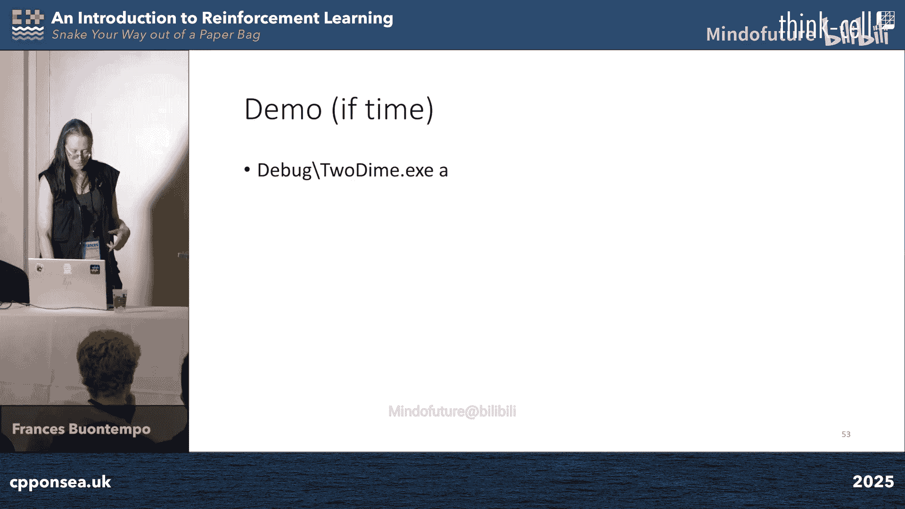

Oh，And I've got a typo in my instructions to myself， but that's fine。🤢，What did I say。おな。

Thatt make sense。うか。And it's gone off the top of thing that's。T again。

I said resize my windows properly and it's crashed。嗯，咁哦。Takes a few goes， go， no， go on， no。

Some of the previous stat I've showed you was a run of about 100 or so so。

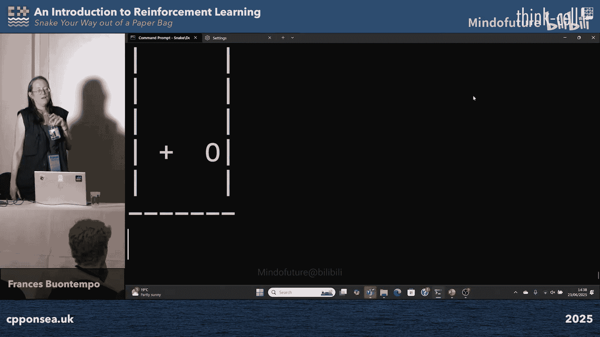

So the question was， isn't it just like spitting out， just learning the random number generator。

 Well， there's the epsilon that's giving it some of the randomness。

 but it did know that there was a hazy shadow Apple apple in this position just now。

 So it's being influenced slightly。

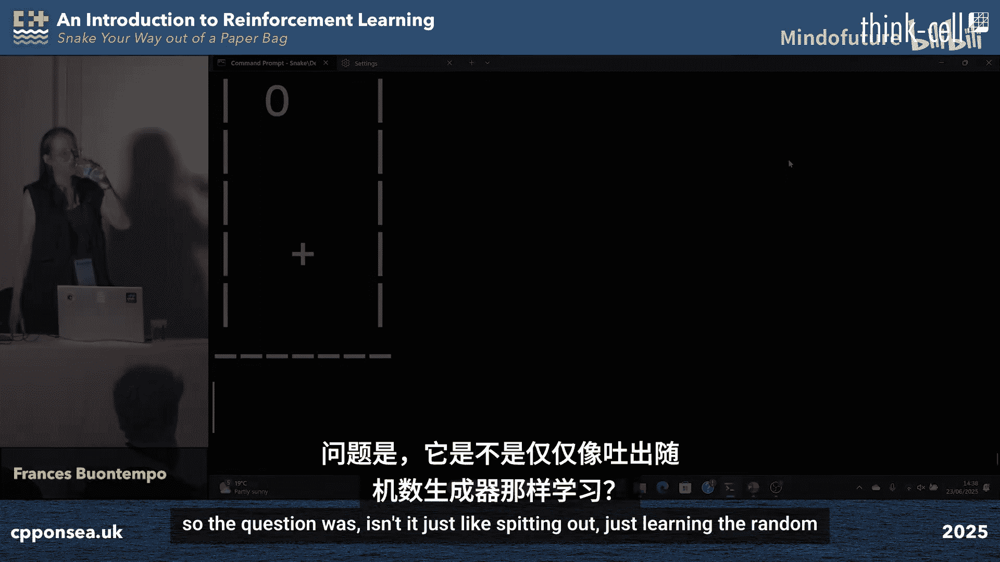

But then we can go met as the apple's position is also coming from random number generators。

 And what does learning even mean or is anything even random， I mean。Anyway， let's leave that to it。

 in fact let's not let's progress with the slides。

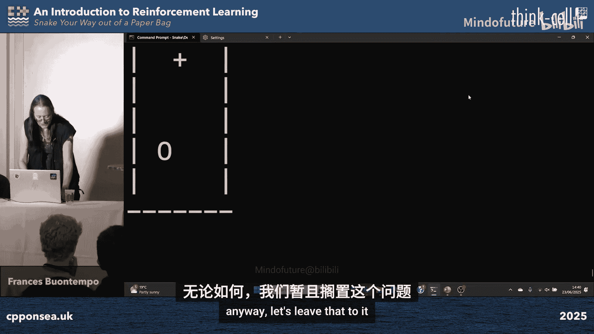

Yeah， so if we've only got the position and whether we go left or right。8。

It hasn't got everything it needs to know。 So we need to encode。

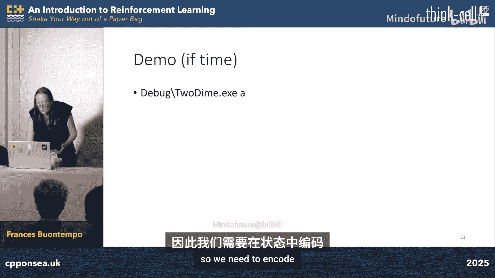

More。In that state。Right， so done the demo。 And so there was lots of discussions there。

 I'm really sorry。 I didn't repeat all the questions。

 So if I've just got the position and I'd just go left right up down。

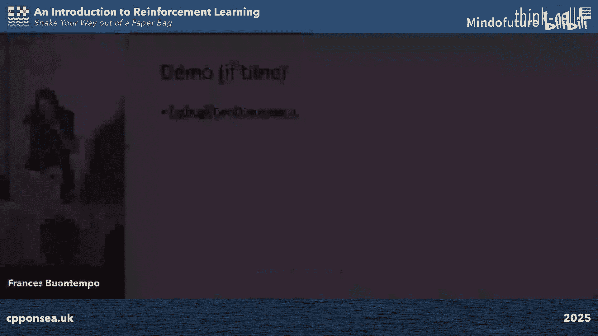

It's just going to do random stuff。If。I now tell it。

 and I had forgotten say that the demo I just did at that point I've increased what's in the state。

The position。Can include。The character that's up down left or right， It could be blank。

 It could be an edge of a bag。It could be a snake shape， not that we've got there yet。

 or it could be the apple shape。So。If I just do the position。Up down left right。

 as as we've discussed， it can't see where the apple is。 It doesn't know where the。

It can guess where the bagages are to a point。 It doesn't know the bagages is's just a little agent。

 He's an A O。 He doesn't know anything。It's a map。And a behaviour based on a act。

And if I make it into a bigger snake game， that's T's not gonna to fit on the screen。

 And we can't tell what the apple was。So how did it tell where the apple was？So what we can do。

Is I can introduce more than just the position。 I could have a state。

 I could say what character on a place in the screen。So the agents's in one position。

 I could tell you the character is up down left， right。And at this point。

 I resorted to what felt like cheating gave a bit of the game away。

 I gave it a plus or-1 or 0 for horizontal and vertical distance to the food。

So I have leaked some of the information about what's going on here。 You could do it out that bit。

But for reasons， it will take a very long time to get there if you start doing the stats on。这是。

Possible states you've got。You're in trouble。 So， yes， at this point。

 we've moved on from the position doesn't tell us where the apple was let alone， the agent。

So now I'm giving it clues as the horizontal and vertical displacement to the apple。

 And it can see the immediate surrounding characters up down， left and right。

And I'm providing the spaceship operator so I can put this in the standard map as that fits on the slide better than talking about hashs。

 So that's why we're not doing an ordered map。So now I've got more than just the position。It。

 it can now see agent only is learning。 It can see up there on left right。

 And it's got a sense of which direction the food is， which does feel like cheating。

So now we can play snake。Now， I'm going to stop encouraging it to get out of the paper bag because I couldn't quite work out how to combine that。

 Well， we can see that it got out the bag， so。Again， that's open to discussion。So it can move。

 it can check whether it's eating the apple， it can spawn。And。A nice way of implementing snake。

 And it's one of the few uses of deck that I've seen that I've found compelling。Used to deck。😡。

Like a vector， but it's in pages。🤢，And the snake。Wants to， if he's going to move forward。

Once the new head popped the tail。Unless it eats an apple， in which case， new head eats the apple。

 tail stays where it is， which allows you to grow the snake。Really efficiently。

I like thanks to several friends I've got who are games programmers。

 So snake is just a deck of positions。 and then that makes it really easy to make it one longer when it eats the apple。

😊，啊。And now I can slap the environment around this。

 It's very similar to the two dimensional one dimensional things we saw before。

 But we're using a different Q table。 It can now see。Things up down left and right。

 And it has an innate sense of the displacement of the food。So I told it。

And I'm leaking the whole game so that I can draw it as well。🤢。

theres still the same steps as we've seen before it plays the game and finds out if it gets point or not。

 Obviously now it's going to lose a point if it crashes into itself。

And guess a point each summer eats the apple。I could go better than that。 I could go T for Game wave。

 plus tea for eating the apple。And I could also say-1 if it moves away from the food or plus1。

 if it moves near the food。Now， see too many stats to look at。

There was something in there that was useful， I't know what it was。Yeah。

 we can see where the apple is now， so you can see the zeros in the middle column was last time we didn't have a clue where the apple was which。

On you算系啦 oh my。

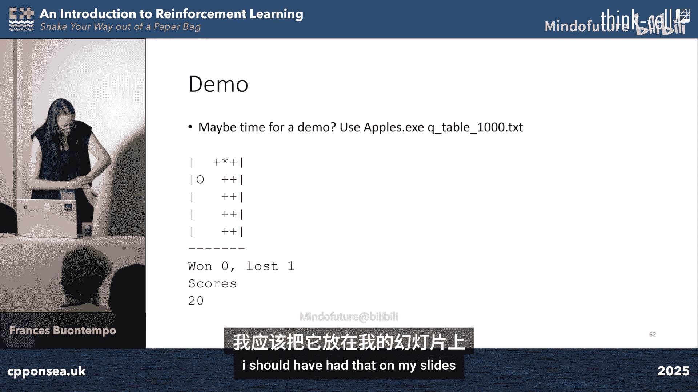

Sldes， I wonder if this work。No， if I something normal folder。So。

If I drop the Q table out at the end of each。Sal， I can then pick it back up again。

 It can just continue as it was。And in the process of developing this， I also got while。

 I didn't spoil the apple somewhere。 There wasn't a snake。 I would try again。thought his's hung。

And I thought， I actually know， it's just pulleded up the entire grade to say that。

It's done really well sometimes， but you can see it's。Doing something。

I suspect it's not going to eat the apple this time that act crashed into itself it' was so desperate to get to the food。

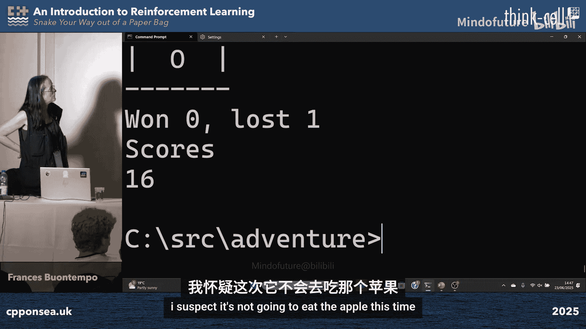

Well， now I could leave it trading on a much larger grid That's just those characters from the consoles。

 I don't even need to write out to the consoleul。Then I can point it an actual snake game。😊。

And as long as the snake game can translate the character of like oh。

 that's the colour of the edge of the screen。 or that's the colour of the snake body。

 or that's colour of the apple that the characters are used。We can play snake。

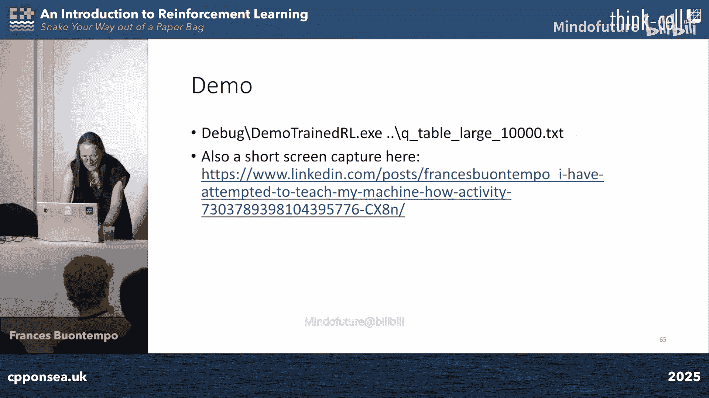

And we actually can if I get the right thing。哦。No， I' not was it。

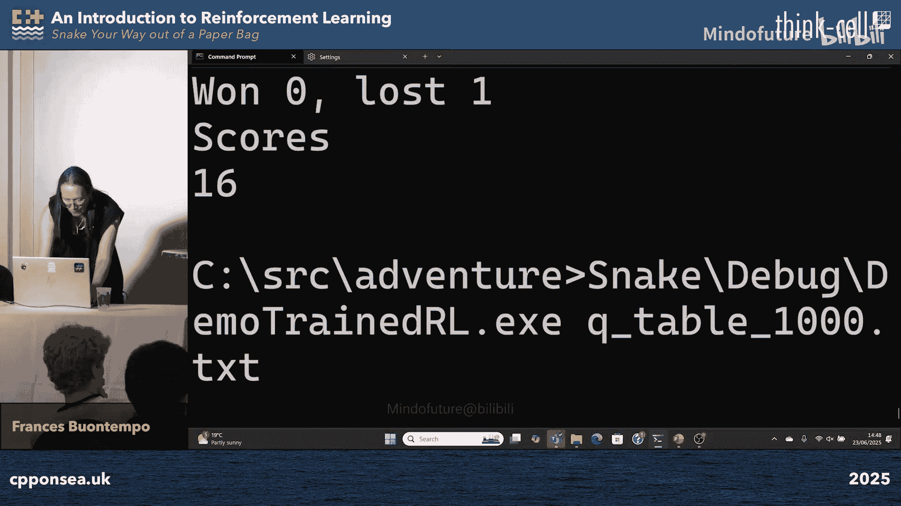

Oh naughty thing， so it does sometimes I haven't got to the bus why it's doing that。😮。

And once it does it， it does it not。🤢。

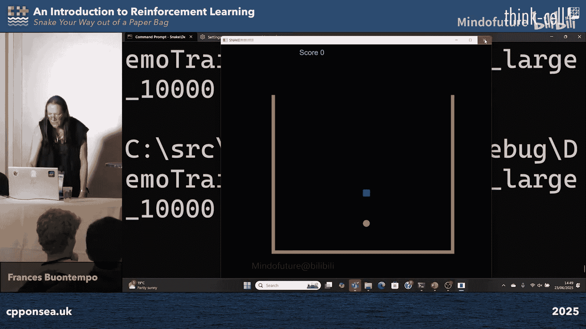

She's very hot。Its those who came in first， he didn't do that。🤢，I3 old。

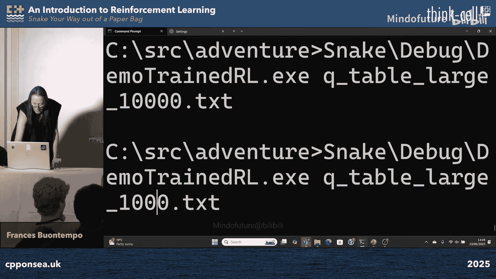

Don't know why it's doing that。I' going to do it again。Oh， let's going out and down this time。

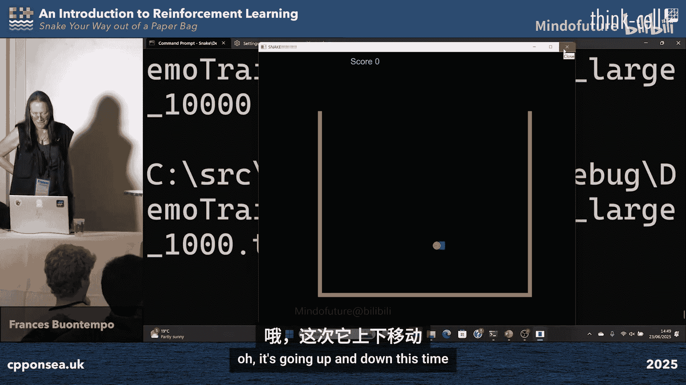

My goodness。

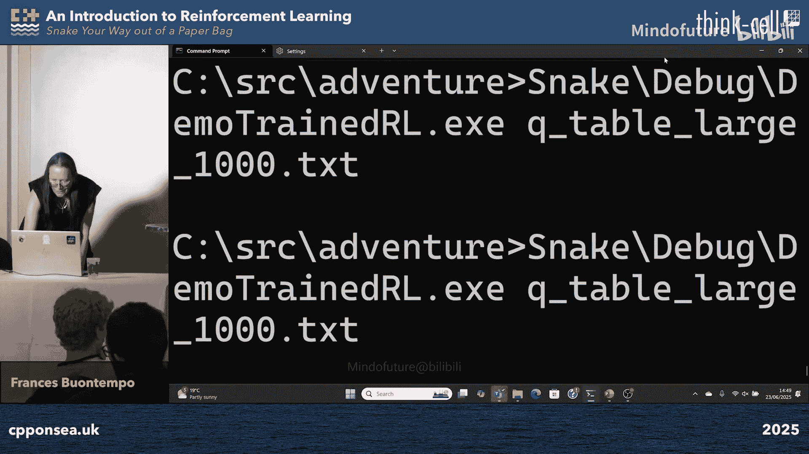

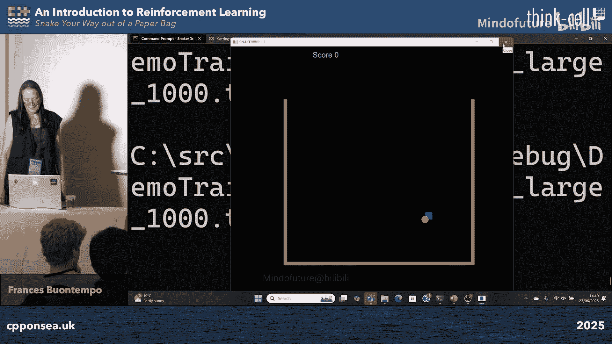

Oh。Oh， just I。

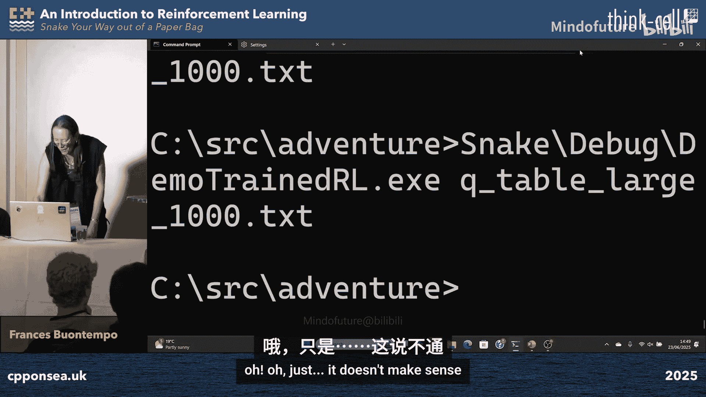

Doesn't make sense。Did your thes still there。 It's trying to dig it again。

 So what I've done is in order to resize it。 Of course， I've made the lines too long and。

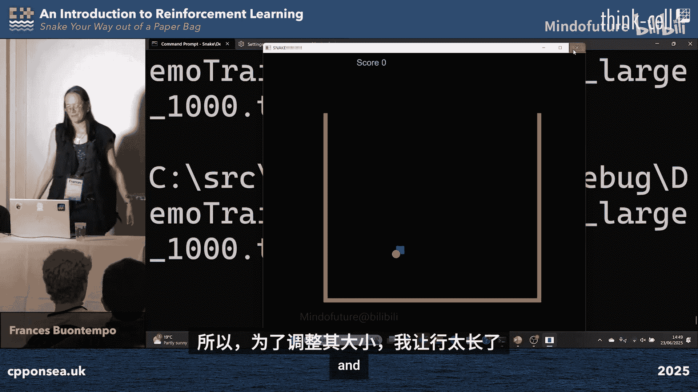

It's actually not sitting on things properly。🤢，Was I doing something different before？🤢。

Anyone turned up。Goodness， me。

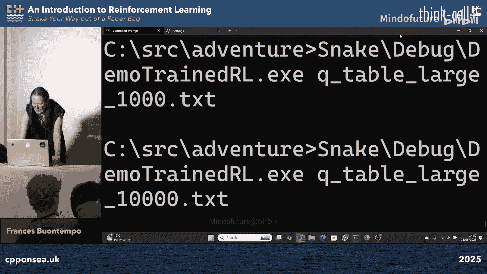

That's better。TheIt does seem to do that sometimes。 And I haven't got to the bottom of this year。

 Just go backwards and forwards late。And he gets stuck in it for a little while and gets over it。🤢。

而是。Yeah， I haven't got a clue what's going on there。 And if anyone can think what I might be doing。

 I'd be really interesting。 I guess we get to a point where left and right。Are equally tempting。

It was up and down， looked terrible， but it is an appointment。

 But it always tells to me that it's still really short。

 So I ought to be able to drop out some numbers and want a more unit test but find out what's happening。

 Watch this space。So now it knows where the apple is。I haven't told where the apple is。

 can only see whether it what's immediately up down left and right by I have cheated。

 I have given it the horizontal and vertical displacement to the apple。

So that was the Charles State struck I showed you just now。 No， absolutely。

 I am cheating at that point。嗯。Various larger outfits funded by some of the large companies have got together the open AI gym。

And there are various other learning environments where you can download emulators for specific games。

And set up some reinforcement learning， some of it on Q table based stuff。

 but then you can choose what goes in the tables。And the better ones。

ButDon't do that silly wrigggling thing。 I just demonstrated to you that。

 I don't know why's happening。The better ones they won't use a Q table。

 because if you think about the state that's going on there， there's a lot。

It tell me right this story， isn't it。There's a lot going on there， but what a lot of these AI。

Libraries will give you。😡，Is。It will take the last five frames。😡。

And build a convolution neural network over that， which is just a way of saying what's tending to be near to what and allows it computer vision。

It can't really see in the same way。 Min can't really see what's around each pixel。 but it。

 it looks at the last five frames。And then it's got a sense of where its tail is and what to avoid。

 and it sends them through a neural network rather than just putting them in a map。

That's less embarrassing than the first one， though， that's not bad。 unless that's just with a map。

I't you seen some。Tretty naff looking code to pull out a number on what to do。🤢。

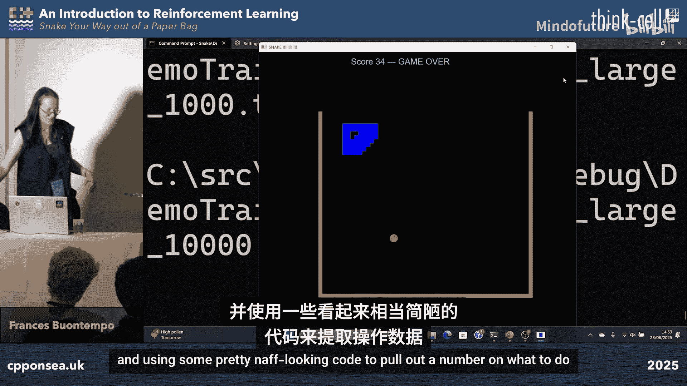

Casir。I think I've got a couple of slides left and then I might kick that off again。😊，Yeah， in fact。

 that is probably nearly it。 So the reinforcement to learn is just one type of AI。 I look。

 we haven't gone through like。Deep neural networks， convolutional neural networks。

 large language models or anything like that just。🤢，Built off a table。Remembering what happened。

 what reward you got last time you tried this。I've had to intervene with the state， and give it。Well。

 I think it's completely fair seeing what characters are around the head。 That's。

 I have told you nothing about snake。And the thing about the machine learning。Gammes。

Now the arcade learning games is the people who came out with。Deep Q learning， they call it。

 It's like Q learning， but it's using a deep neural network instead， is the same code。

And then played snake and asteroids and space invaders and all kinds of different game。

 And that feels more like proper machine learning。 We've set one thing up that solves lots and lots of problems。

Go play around with it。 And actually， for me personally， like looking back at the code and going。

 I need to make my random number code better。Was。Useful， the slides have got some other resources in。

 but the open AI gym and the arcade learning environment are amazing。😊，And it's a you of。😊。

This kind of thing。 But that based on the deep queue learning。

 rather than just the queue learning I'， watching it learn to play p Man getting itin completely wrong to begin with and then getting better。

 It was cool。I been me。I'm going to kick off another snake demo。Take away from this。Practice coding。

 Look at your code。Do you right need to code them me and come and help me out。 And also。

 when someone talks about。AI or machine learning or something you think you don't know anything about。

 Often there is an easy way into it。 And if two dimensions is too hard， what hang it。

 So in one dimension。 if you're finding something difficult。

Solve a different problem for one simpler problem solve instead。

 And that might just get your head in gear。You might actually be able to understand this if you put your mind to it。

 and my snake might embarrass me again， is going to， isn't he。

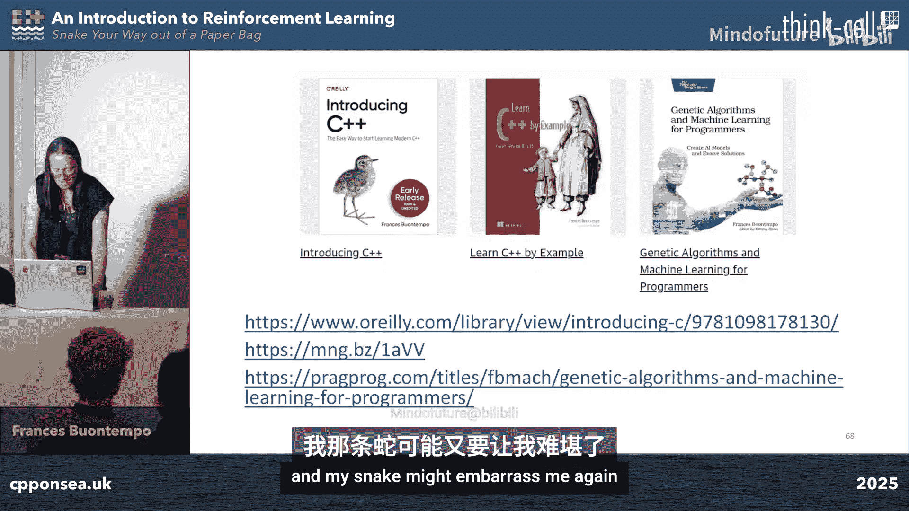

I no idea what it does that random zinc like。

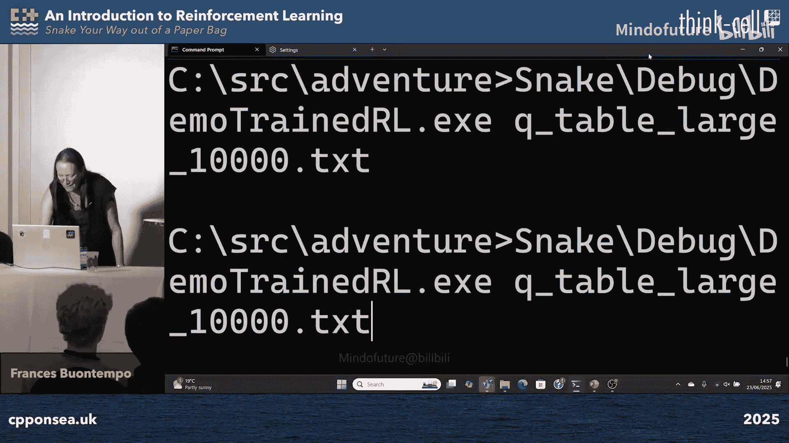

So we've got a few minutes left。 I'll leave up playing。If there's a question。And if there's not。

 we can just chill on much snake you can chat to me after。

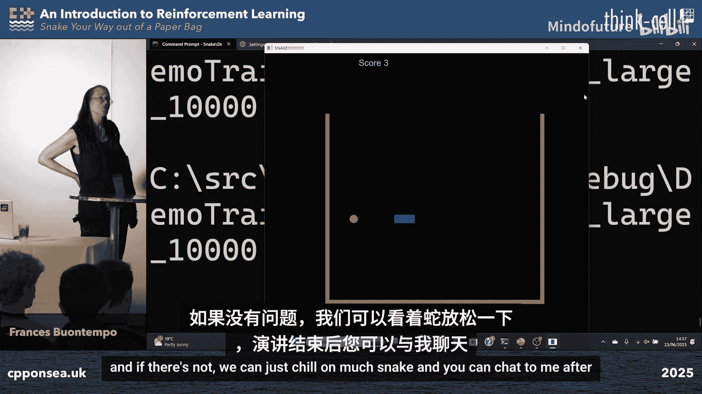

