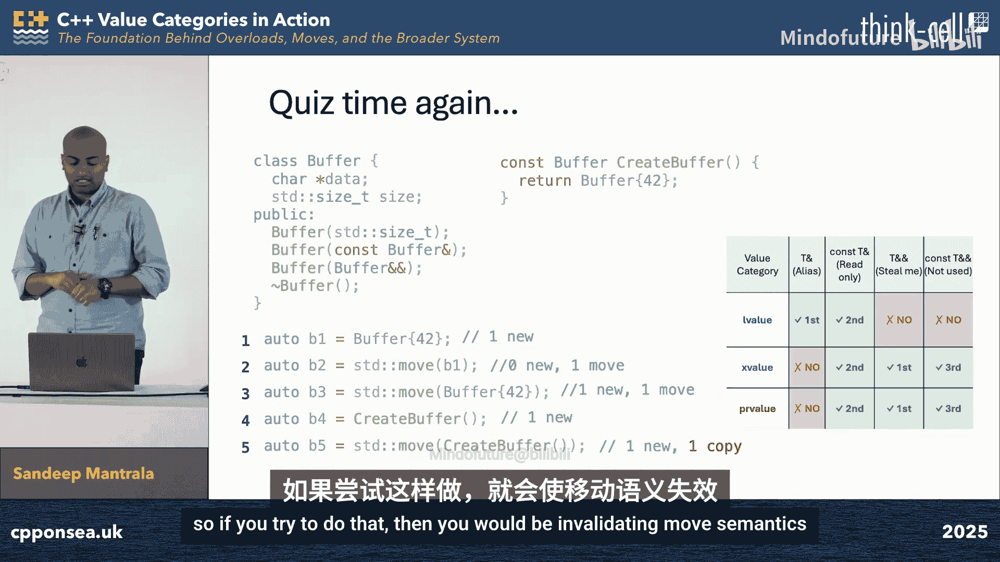
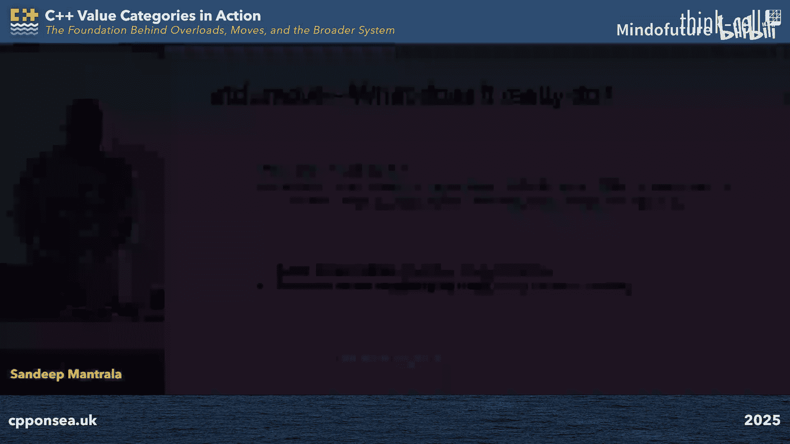
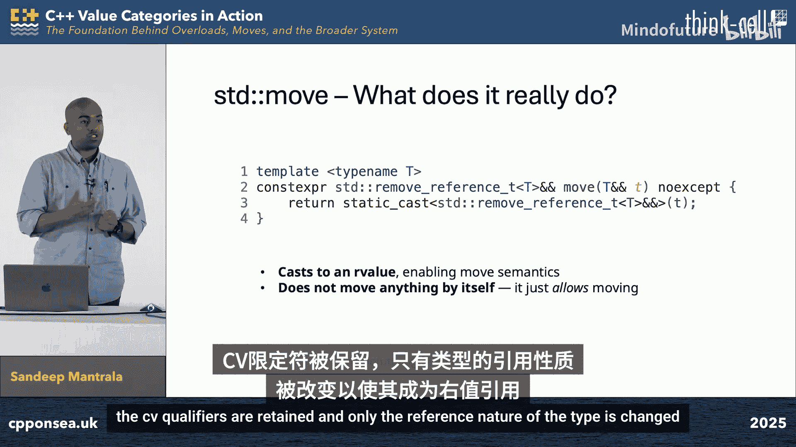
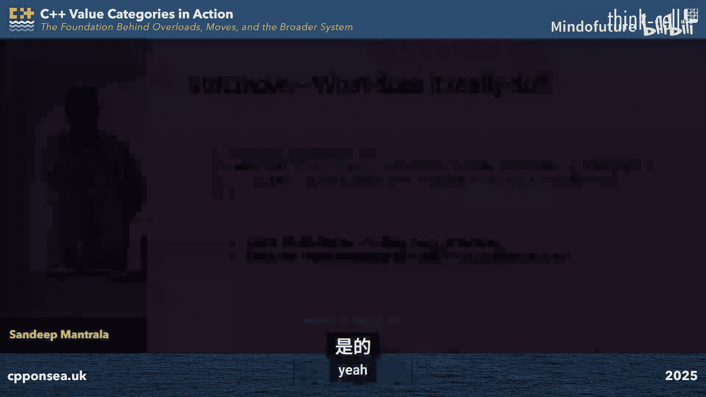

# 【Cpponsea】C++-On-Sea-2025大会-p22-P22_理解_C++_值类别-左值_右值_x值_std__move_std__forward_最佳实践--BV17V4GzjE6p_p22-

Hi everyone。 My name is Sandy。 I work as a software developer at LSCG and。😊，哈。Yeah。

 so today is going to be my first talk at a Cus+ conference。

 so please forgive me if I make some mistakes。So。Today's talk is about C++ value categories in action。

The the reason why I pick this stock is because value categories almost seem like。We understand them。

 but when we try to look at the certain rules that are behind all the different value categories。

We tend to understand them， but we mostly misunderstand them。

 so I hope it gets clear by the end of this talk today。Okay， little bit introduction about me。 I'm I。

 I'm from India， but I live in Japan for the last 12 years。 and I'm married， I have two children。

 And when I when when they love me to go out and play with myself。

 I try to play some cricket and like to go for some runs。So coming up today's talk。

 firstly we will discuss of course water value categories。

 then we will talk in depth about various kinds of references we have in C+ plus 11 and how we can like if there are multiple overloads available for all these references how the。

😊，overload resolution happens What is a priority over there and shortly after that we will also talk about move semantics and u differencess and in the end we will look into the best practices around these concepts which will hopefully give you all ideas to。

What you can immediately improve in your code。啊。Okay， so。

little quiz time here first so we have a class which has a vector of resources here and we have two overloads add resource and add resource one which is taking a constanttel value reference and the other which is taking an our value reference here so nothing fancy is just the standard code。

So here， in this case， which overload is called。😊，Yeah， first one， no surprises there， yeah。

It's copying the resource， so next we have here。B， B which is our value reference and then when we call add resource B。

 which overload gets picked。1， yes。Everybody won。Okay。

 I guess you all pretty well understand values semantics already。 Okay， so yeah。

 one is called here in this case。 well， for， for those of you who thought it too， is also possible。B。

 the type of B is。An R value reference， but when you refer to be anywhere outside of that statement。

The value category of B is L value。This is confusing in the beginning。 But once you know it。

 you know it， itll not be confusing at all。 So， yeah， so in this case， number one is called。So here。

To one gets called，1 or two。2， yeah， because it's， it's a temporary。啊。呃，有。

This should be discussed here。Okay， so why why should we learn about value categories， I mean。

 for those of you in this room， you have no other option but to learn for the next1 hour because you're here other than that I personally feel like once you understand value category it can definitely form a very good base for you to dive into more concepts like move semantics co or forwarding references or any other piece of like if you look at the standard library code for example you would see references all over the place and if you don't fundamentally understand what is a value category itll be difficult to understand more c plus code that's my opinion of it。

 yeah apart from that when you try to write something and compiler throws an error at you saying that and L value reference cannot bind an R value you should exactly know what that is really about。

 So understanding the compiler errors efficiently。Will effectively will definitely help you in understanding where you're wrong。

 and also， it definitely helps you write semantally correct and performance code。So yeah。

 I hope we all want to learn about value categories。 So what， what is really about。

 What are value categories really about Any guesses like。😊。

What is the really about Are they about like the objects types。What is it really about。

Okay let's check first water they're not really about。 Theyre not about objects or variables。

 They are not about the types。 Theyre not directly about lifetimes as well。 Yes。

 lifetimes have a kind of role to play in what a value category is。

 but a value category is not really directly about about lifetimes So what is the really about。

They are word expressions， expressions and expressions。So yeah。

 when when we are learning a new language， I don't think we spend a lot of time in reading a chapter called expressions。

 right like neither did I， So when I learned that they really about expressions and I went on and looked to what what earlier are expressions。

😊，So the standard says an expression is a sequence of operators and their operations that specify a computation。

😊，And that it produces a result and can also have a side effect like for example stood see out and when you print value it。

 the side effect is that you see something on the screen okay。😊，So in short。

 any piece of code that computes to something and has some side effects you can say that it is an expression。

😊，And value categories are really about expressions。 Okay。

 they do not apply to other parts of the code。 So in your entire code base you could say that value categories apply to almost 60 to 70% of the code because all of those are expressions and rest are not expressions So here for example。

 on the left you can see what are expressions like5 plus3 this evaluate straight of course so this is an expression and stitching high a function call not the function declaration itself。

 but when you call a function that is considered as an expression。

 So what is this really mean though So when you when you compile your program and when you compile goes and reads your code it it it classifies each and every line of the code into different constructs。

 So when it does that when it looks at this particular part of the code it basically says that okay this is an expression and how it keeps track of expressions is what something will just look ahead。

So yeah， on the right， you see some statements which are not expression。Yeah。

 and value categories apply only for expressions enough of expressions。 Let's keep moving forward。

 So， but again， expressions。 Okay， so expressions， they have two independent properties， so。

Like I said， Ka， whenever it look whenever it finds an expression。

 it keeps track of two independent properties。The first is a type。And the second is a value category。

Okay， so。Yeah what is the type I think we all know what is the type it tells you what kind of value it is whether what is the type of this value in or constant inter inter etc it tells so the type obviously it is very clear as to what what it means so apart from that there is one more property for each of these expressions which is called value category so value category is a direct property of an expression。

So so5 plus3 when you look at that expression over there it has two independent properties a type and a value category。

 so what is a type for5 plus3 it returns an end so the type is an in but what is a value category over there so the value it is a temporary so it is classified as our value so we will we will come to that but a compiler keeps track of both these things。

 that's what we need to really understand about。Okay。

 so before we dive into the value categories and then understand what are the different types of value categories we have that just look at prior to c plus plus 2011 as to what kind of value categories we had and you know in order to understand them just let's just look at how a vector used to work before c plus plus 11。

I think we all know how a vector works basically initially it is it has some capacity and then when you keep on adding elements to it it gets it gets expanded the end point it keep on moving towards the end and once it reaches this point。

呃。When you try to insert more elements to it。It needs to reallocate memory， right， We all。

 we all know this。 Yeah， So after this reallocation， what happens here。😊。

We copy over all the elements from the previously held positions to the new positions， right？

So I said copy， but in modern C++ a move is also possible。

 but we are talking about c++ prior to c++ 11 so at that time。😊，It was only copy。

So what is the problem with this？Immediately after the immediately after the copy。

 the copied elements are now destroyed， right so。呃。Theoretically。

 it is it was possible for us to be able to reuse those elements even in in the newly allocated vector。

 we we didn't have to completely destroy those elements and then deep copy over them。

 it was not needed。I think we all know this already。

 but I'm talking about this because I want all of us to keep this point in mind when we are discussing the further concepts。

😊，So this is this is a problem we wanted to solve in C+ plus 11。So here， so again。

 before C plus plus 11， we had two value categories， L values and r values。😊。

So L values are basically anything that have identity and which are long lived。

 so the value categories are very deep into the c+ plus genes like we got this L values in our values from C。

😊，And our values are nothing but temporaries like literals like 42 strip string hello。

 all these are considered as our values and to work with these value value categories。

 we had only one reference type。Which is T F。We call it as L value reference。😊。

So what about this L value reference？It binds to L values。

 that's why it's called an L value reference。So you can see the example in text equals to 42。

 and you can declare a L value reference variable and just directly bind to x。Right。

 so can we also bind to our values using this TF？You could bind to our values only by using a con st right so what is the problem with this we are unable to bind to our values and why is that important。

IfIf you just go back here。just imagine。 So the， the initially allocated vector is going to get destroyed。

 So if we want to reuse the elements from that vector。

 what was stopping us to what was stopping us prior to c plus plus 11。I think， number one。

It's's start。We did not have we did not have a way to express that these elements are going to expire。

Okay， so we just had L values in our values when we said L values in it we mean that these are objects with identity which we want to keep using forward and when we said our values what we really meant was that these are temporaries and going to get destroyed short soon but we did not have a way that。

we did not have a way to express that we are done using these objects and these are ready to expire and somebody can take them。

So yeah， these are the some some problems are are value binding problems。 So we had stood string。

 So it just copies the values。 So we have con L value difference here。It binds to our values。

 but you are not able to。Mutate them in the sense， like if you want to steal the resources from these R values。

 you are not able to do do it。And then if you try to do something like this stood string ref。

 which is an L value reference， it would not bind to R values。 So prior to c plus plus 11， this was。

Bottleneck， which was preventing us from binding to temporaries or binding to expiring values and letting us steal the resources from there。

So the two category system。😊，Was limiting us in order to achieve things like move operations。Yeah。

 we just discussed。 So there are two problems here。

 first is that we are not able to mark objects as expired and second is that。AndThere was no。

Way for us to bind exclusively to our values。有。So let's first talk about the first problem here。

So like I said， we did not have a way to。Express that okay。

 this particular object is going to expire。 So it is up for stealing the resources right so members from the standard code committee。

 they all satAT in the room。 they wanted to solve this problem And then when they jotted it down on the board as to what kind of values how many different value categories possible and they're needed they came up with the diagram like this where we had a value B value E value D value E value F value G value。

 so many values here right Of course， this is not going fly。

 So they SAT down and when they looked at what are the two properties of these。😊。

Different value categories that we need to focus on。 Then they came up with this diagram。

 So its it clearly tells us that we have。Two properties。

 I and M I stands for identity and M stands for movable nature of it。So。But。

All the different types of value categories when they examined we just need to really communicate in terms of two parameters。

 whether the value itself the result of the expression can be。Moved or not。And secondly。

 whether the result of this expression has an identity beyond this expression。Yeah。

 so identity and movable nature。So what is identity like I just explained。

 does the expression refer to an object with persistent identity beyond the line in which you are using this expression？

The movable nature of it， whether we can safely move resources from this expression。

 is it safe to steal the resources from it or not？Yeah。

 so we have two properties either you can have the identity or you cannot have the identity。

 either you can move it or you cannot move it so。4our combinations are possible。

But we have five value categories。So how is that。So yeah， I just listed down the possibilities here。

 whether when you write an expression， the result， how。

 how do you want to communicate about about the nature， how does the result behave。

Whether it is identifiable or not identifiable。Whether it is movable or not movable。Yeah。

So here I and M， it means that the result of the expression is identifiable。But not movable。

 So capital M by that， I mean that it is a negative。 So it is not movable and such。

Such categories are L values and they have always been the case because L values are like the variables like x which you are not done using them so they have a persistent identity even beyond the expression you can refer to them using ampress and x for example but they are not movable because we are not done using the resource by ourselveslf so these kind of values we want them to remain as L values。

So next we have a PR value， what is a PR value here？So they do not have in the expression。

 the result of the expression， it is not persistent in the memory beyond this expression。

So you cannot take the address of it。So they do not they are not identifiable。

 So that's why it's a capitali but the resources can be stolen。

 So you if if you want to steal the resources and not do a deep copy from a temporary。

 it should be possible to do so。They are definitely movable So these kind of values we we are calling them as PR values。

 So PR values prior to c plus plus 11 what we call as r values。

 we are just calling them as PR values now okay so p stands for pure pure r values and by the way in L value when we say an L value most commonly we think that L stands for left hand side of the expression so it left hand side values。

 but L stands for locator values which mean to say that they are loable in the memory they are persistent in the memory they are loable。

 you can locate them whenever you want。So this new category which is x value is what was introduced in c plus plus 11 this is solving the problem number one from the two problems we discussed where you want to express that an object is expiring so it is up up for grabs so if somebody wants to steal the resources from this you can do it right so。

What is this value， its I andM， both identifiable and modifiable values。

And there are also non identifiable and non movable values， which make no sense。

 And we we can just ignore them。 like there is， there is no particular value category for it。Yeah。

 so we discussed that we discussed three value categories， L values and x values and PR values。

 I hope these three value categories are a bit clear。D ever were before。

But but a generalization was also required because whenever we wanted to in the standard。

 whenever we want to talk about how the the properties of identifiable expressions。

 we didn't have to always specify L value and x value。

 So we came up with the generalization stating that these are called GL values。And the same for。

X values and PR values together， we calling them as our values。呃， yeah。Any questions so far？O。呃。

Yeah so we have five value categories， three of which are primary value categories L value x value and PR value and two are generalizations GL value and r value so like like I said we borrowed the concept of value categories from C right so it is really very deep into the genes of c plus plus like from the time when we started doing c plus plus 98 we had l values in r values so when we were defining all these new kinds of value categories。

 it was really important to retain the meaning of what an L value and what our value really meant。

So that definition is still valid so historically so what is an L value which is loable in the memory and which is persistent beyond the expression but whose values you cannot steal right so that is still the case。

And what is an R value R value is a temporary， which is soon going to expire right。

 So there are so in this， there are two divisions， one are temporaries which were never materialized into objects。

 So that's where they are going to expire。 And second is。The kind of objects which have memory。

 but they are also going to expire soon。 So this is a new category which we want to be considered as our values itself so。

Even even though we have x values NP PRR values， the fundamental notion of what an R value is it still holds for both of them so。

That is that is why the naming is like this。 Okay， So yeah， X stands for expiring values here。

There are two other popular representations of value categories on the left。

We have a Venn diagram which very clearly shows that L value x value and PR value are three different primary value categories just take a moment here to look at the examples and see why why they would be considered as L value or x value or PR value in in x equals to 42 the whole line itself it's a statement it's not an expression。

 but only the x part here is an l value。Yeah， when you referring to a star pointer here。Yeah。

 it's an L value because it has an address。And you will continue to use it so you cannot steal the resources from it。

 right samee goes for area of0 when you deef an array and。O member。

 all these are having a persistent memory。And therefore。They are identifiable but not movable。

 that's why they are considered as L values。Yeah， next we have x value stood move X。

 This is mainly what an x value is in most of the cases is just stood move X。

 We will talk in depth about what St move does and water move semantics and all in the coming slides。

 but if the concept of L value， X value PR value is not very clear。

 I hope in the future slides you you might get lost。 So any questions here。能OK， yeah。

Yeah PR values are temporaries 42 it's a literal that's why its it's treated as a temporary。

 we have true we have widget function call x y all these are temporaries so I have three three dedicated slides to talk about each of these values one more time before I dive into move semantics and universal forwarding differences。

😊，Yeah， these are the two different representations that are very commonly used to talk about these value categories。

Yeah， so let's look at some examples， which some of which are straightforward。

 some of which you might be pleasantly or unpleasantly surprised a little。 Yeah。

 this one in text equals to 42 x is an L value。 So a equals to B。

 So L value is just not about the objects or types or variables。

 We just talked about it in the beginning right？ So a equals to B is also an expression。

 And even this has a value category， right。So why is it an l value because a equals to B it returns a okay so which has a persistent location in the memory beyond the expression So that this is the reason why you are able to do a equals to B equals to 10 and the 10 would be assigned to both b and a because b equals to 10 would return B。

😊，And that B， you can assign it to a and the result is a itself， okay？😊，So yeah。

 understanding value categories again， will try to explain some things that we already know and some things we don't。

😊，Plus plus a it's a pre increment operator。 So it is an L value because at the end of it it returns a after the value is incremented。

 if you notice post increment is not here。 So post increment is not an L value we'll just see that in the next slide Yeah referencing a point I think everybody believes that it is an L value same is the case with accessing error element。

 and a string not string string lital is also an L value。

 So this might be little surprising but it is an L value because they have a persistent storage and you can access the address of hello as well it is for pure string litals It is not for stitch string It's a pure string lital so。

一。So more examples here， if you have a function4， you can catch the address of this function with Amin。

 And that's why the function pointers are L values。嗯。Yeah， and。

if you are returning by a reference like in in that case， the written values are all cell values。

Okay， and just just in case L values have identity， they refer to a persistent memory location。

 you can take the address with Amerson and it's persistent beyond the expression and they cannot be moved from。

Next， we have PR values。 again， let's just look at what these are。

 You cannot take its address because they are temporaries， but you can move from them right。

 and most almost all temporaries are classified as PR values。

 literals and compute results also are classified as PR values。 So 42 true null pointer。

 all these are literals。 hence these are PR values。

So any function called whose written type is non reference。For example here， get some a a comma B。

 It results plain int。 So all the written values are classified as PR values when they do not do not return a reference。

 So any non reference written type is considered a PR value。

Same thing when you are doing a substr of like a string。

 then w what the resultant object is a PR value。Like we just discussed， a++。So。

 a plus plus in plus plus a is an L value， but a plus plus is a PR value。

 why is it so because it increments and returns a temporary with old value of a so it does not return a here。

😊，So it increments and results it returns at temporary with the old value of a so that is why a plus plus is a PR value while plus plus a is an L value like again yeah we are having this three slides for each of these values and we are talking this is an L value this is an R value it we are doing that because when you use this expression in a particular context。

When you say it is an x value， it has a meaning to it。

 So the color of this the the receiver of this it he will basically try to steal the resources or not based on the value category of it。

 So that is why it is important to know like different possibilities of what this can be。

 like if you are using a plus less。 you should know that it is an L value it is a PR value and that it cannot bind to an L value reference。

 So these are the things we should know that's why we are just looking at various examples here。Yeah。

 few more examples。 a plus B computation and ampress and A Ampress A is also you cannot do like ampress and ampress A in C plus+。

 So we have。Apernic classified as PR values。 This pointer is also a PR value。

 and the lambda objects are also PR values。 So， so the a lambda is nothing but a closure type object。

 which is a temporary closure type object。 So unless you bind to it， it remains a temporary。

 So these are also considered a classified as PR values。Next， we have x values。

 X values are expiring values。啊。 they have identity and also can be moved from like how we discussed before。

 So stood string S equals to hello。 So S itself， S itself is an L value Yeah。

 But when you do stood move S。 So the stood move S altogether， it's， it's a x value。 Okay。

 S itself is a L value， but stood move S altogether is an x value。Yeah。

 so when you try to access a member function of an x value， the written object is also x value。

So here is an example for that。嗯。So yeah we said there are two problems before c plus plus 11 one is that we are not able to express that particular object is expiring so that we have solved by introducing x value so when we say okay the value category of this expression is an x value it is very easy for us to communicate to the compiler that is it is going to expire right so but how do you how do you catch those values and do something with them。

Right， the c plus plus type system like we discussed before。

 it only had T f and cont f Tf wouldn't bind to any kind of temporaries for example。

 and cons f would bind to it， but it doesn't allow you to modify those values okay so。C plus plus 11。

Introduced T f f I would say like this is the hero of C plus plus 11 for me at least so this introduction of t ref F。

 which is called as an r value reference is very important because it exclusively binds only to r values so when we say r values we have two two value categories inside the R values which are x values and PR values both of them are going to expire soon and you can steal the resources from them。

So having a R value reference like t f f， which can bind only to these two value categories helps you do something with the expiring values like stealing the resources。

 etc。Examples of T f F， first of all， the syntax is the type and empress empress and variable name。

 for example， it binds to。R values we we spoke about it。 Yeah。

 it provision provisions stealing of resources。 So because of this R value reference introduction。

 it is now able to implement moves panix and perfect forwarding。 We。

 we'll look into those little later。 So on the right， we have examples of using an R value reference。

 So int ref R1 equals to 42。 So what is 42。What is 42， It's literal So it a。😊，PR value。

 So since it is a PR value in order to bind to it， we have to use a。😊，R value reference。

 So in R R1 is R value reference to the lital 42 okay。

So a little bit about this in in r1 equals to 42 the inre is the type of it okay so this needs to be very clear in the heads that intra is the type the value category of r1 itself is again L value。

😊，If you use r1 beyond this line anywhere in the code。

 r1 is still an L value because it is a named variable okay but the type of it is r value reference。

😊，Yeah， we I'll keep mentioning the same point again and again because it takes a little bit time to register if you already don't know if you don't know that already。

Yeah， again， in line number 7， you can see that create a it's a it's a function that's just written a by value。

 So any anything that is being written by value is considered as a PR value。

 So we are again catching that using an R value reference here at line number 7。

 So this is one example use case。 So prior to c plus plus 11。

 what would happen at line number 7 create a would give you。an object。

 but that needs to be copied into R R。 So we we we will be having two I mean。

 you could not write anything like line number 7 in before c plus plus 11。

 but if you just had a R R equals to create a， then you would have two copies of a。

Which we don't need anymore more now。呃。Yeah， so I I hope everyone understood what is an our value reference。

 our value reference is to bind exclusively to our values。

So here we are we have L value reference con value reference same as in c plus03 but we have two more new additions which are t f which is an r value reference and we have con t f con f is almost useless because it doesn't make sense semantically because when you say t f its an r value reference it means that I want to steal the resources but the object is conched so you cannot steal the resources so it is of no use to us but semantically it is possible so it is there in this slide。

😊，So here are the binding rules and when I say first and second that's the priority if for example。

 an L value can bind to both an L value reference and a con value reference so but the priority is1 and2 so x value and PR value the rules are same for both so you could just think them of together like r values so they would bind to t f first if it's available otherwise it would bind to con tf so binding to contf is nothing but the same behavior as to before c plus plus 11 right so temperaturearies if they are binding to cont it means the objects are not modifiable so you just have to make a copy but if if there is a move constructor available and if you are able to bind to t f which is an r value reference it means that these are exclusively marked as r values and you are safe to steal the resources from it so it is possible to steal。

😊，呀。呃。Yeah， that brings us to move semantics。 So now we have two additional tools in simple plus 11 that we did not have in 0。

3，1 is x values and the other is t t f F。😊，Right。Okay。

So what is the idea it is to reuse the internals of the temporary or the mood from objects。

 So just remember the vector example that we discussed where the elements were going to get destroyed and if we want to reuse the internals of those vector and do something about it it is now possible because we can bind to them we first of all we can mark them as x values and secondly we can bind to them exclusively using our value reference and then safely steal from it。

 So doing such a thing is possible and yeah well just look at an example。

Yeah and so move semantics is something is the driving idea behind making changes from just two value categories into five value categories and introducing our value references。

 so achieving move semantics is the main reason for it。So。Yeah。

 so so st Mo marks an object has expiring value， so you have an L value。😊。

So you were using it until now now you say that okay。

 this is I'm done with it now I want to transfer the ownership or I'm done with the resources。

 so I want to make give these resources to somebody else who wants it。 So how do you express that。

You say should move on that object， right。走。Stood Mo， what does it really do？

It doesn't move anything。 I think so there are so many talks， especially on move semantics。

 explaining the same thing that Str move doesn't do anything。

 It is just cast to an R value reference right But with everything we spoke so far when you look at the implementation。

 I hope it hits everyone differently。 in the sense。

 like you exactly understand what is happening here。 So here we have an R value reference to T。

So actually。It's exactly not our value reference to。

 we'll just talk about it in the next slide because T in the context of a template it's it's called a universal reference。

 but that's just one extra thing that we are going to look at but yeah for now you can just look at the implementation we just what we do is we are casting it to an R value reference however are we doing it。

First we are removing any kind of references that T might have so remember when we say we are casting it in the R value reference we are talking about types。

 we are not talking about value categories right so what is the type of T here it is it can be either L value or r value in both the cases we are removing any references to it and then just casting it to refer so that means that we are removing whatever the references that these values have and then we are type casting it to and r value reference that that's exactly what student move is doing here。

ok。呃。So everything we discussed so far， let's see what all it boils down to here is an example of a move constructor which is using TFF okay。

啊。Yo。So here， you could see that。Because it it's a T fF it binds only to expiring values or temporaries。

 both of which are movable in nature， so what do we do here on line 13 you can see that you are initializing your internal data member with just updating the pointer with the other。

And you are marking the pointer of other with null pointer meaning that you you are stealing the resources so we keep talking about stealing the resources and this what it means is exactly this。

 you just take the resource you don't do a deep copy of all the contents of this pointer you just take the pointer and assign it to yourself。

And invalidate the pointers at the other object。Right。So。Yeah。

 we solve the problem there were two problems so we introduced TFF and introduction of x values together。

 we are now able to have a way wherein we can implement something like this where we have a move constructor。

😊，And bind exclusively to our values so that we don't have to do the deep copies for example。

 you can see on line number nine here prior to c plus plus 11 what used to happen we just had con L value reference for which the are PR values or r values would bind to and there was no other way than to。

Do a deep copy because we cannot modify the mood from the other object。

I hope this is clear to every one of us。啊。So quiz time again。So we have five different scenarios。

 the first one。How many objects are constructed here。我 do呃。

stop on the right side and then model of the party of。你你好算。And so here。

just one object one object is created because we have so in C plus plus 17。

 we have guaranteed copy e， for example。 So here the temporaries So buffer 42 is a temporary。

 but there is no need to copy it over。 it's a PR r value。

 So B it is directly constructed at the call side。 So B one is directly constructed and we have only one object that is created。

 So number two。Yeah，0， no new members， no， no new objects are created。

 We just have one move operation。 So yeah，0 and  one。And at line number 3。Yeah。

 one is created and one move。Because we have stood move over there。 right？ So what is。

 what is the difference between one and 3。 So here。We have a PR value。

 but we are doing a strict move on that。 So because of which move constructed is also invoked。

number4。We have create buffer。 The definition of create buffer is on the right。

 So we are written a con。😊，What would happen in line number 4。Yeah， just one。

 cons wouldn't do any anything crazy here。5 is interesting。 What would happen here。So create buffer。

 we are retain temporary， but it's a con temporary and then we are trying to do a to move on that so what would happen in this case。

No， it would。 it would run。Yeah， so okay， with everything we have learned so far。

 just let's try to approach this and understand what is happening here because so we are getting temporary。

 temporary is a PR value。 and the type of it is。A coned temporary， right， so coned temporary。

 and then you are doing a student move on that。 So it is a coned R value reference。Right。

 we have constant our value reference here。Because move type type casts it to a con our value reference but sorry it type casts it to our value reference。

 but there is also con here， so its a con our value reference。

 but if you look at our move constructor。helello。So， so here， because it is an R value difference。

 there are two candidates， right we have。😊，Con cell value reference and。

And R value reference Tf f and cons tf， but because it is consched Tff is not a candidate anymore and we would bind only to cons tf it means。

We have one new and one copy， so this is not ideal。

 so generally as a good quoing practice we should not be returning cons to temporaries so if you try to do that then you would be invalidating move semantics。

Yeah， yeah， so the question was， if should move changes the con nature of the expression of the object。

 but it does not。 the CV qualifiers are retained and only the reference nature of the type is changed to make it our value reference。

more questions。 Yeah， so the question was， if you implement stood move in a similar way。

 would it work or not， Yes， it would work。 It is library function， which is available。

 But if you want to write your own move， you can most definitely write。

More questions。 So how how does written value optimization work with value categories。

 Is that your question。Yeah， so so written value optimization itself is a big topic。

 We have RVO and RVO and different variations of it。

 but to put it simply C plus plus 17 mandates that all PR values should be directly constructed at the call side and any kind of copy or move should be alled thats that's the rule from c plus 17 copy lesion standards。

 so if you have a PR value and if you are using an assignment operator instead of doing a copy or move instead it directly constructs the object at the source so that's that's how the copy is completely alled。

😊，Yeah because it's a temporary it's going to expire。

 we don't need to first create it and then copy or move it instead we can just directly do it at the source so that's the optimization which is RVO in the simple 17 copy that's that's what we refer to it as。

Okay， I just have9 minutes。 so I want to finish my slides in the end。

 I'm happy to take more questions。😊，Okay， so T fF when t is template parameter。😊，So。呃。

We just talked in length about what is TF that TF is an R value reference。

 but TFF is not always an R value reference right except when it is a deduced type it is an R value reference but in the deduced context it is called a universal reference or a forwarding reference。

😊，Okay so for here we have two examples in the first the T is dead used right the template code itself does not have any type to it when you try to instantiate this template by using some concrete types in then the T is de used on the run so this is a special case because in library we want to be able to write generic code which works for all kind of value categories we created this one exception okay。

😊，So yeah here it is called universal difference and the rules are slightly different from what the rules are for our value references。

 so just keep that in mind we' will talk about the rules and what is special about this okay。😊，是。

We need to understand a little bit about reference collapsing here。

 what what is reference collapsing。😊，So we have this function F。

 which is t ref F x and where t is a reduced type。 So what is t T is a type。 So in c plus plus 11。

 we have plane types， which is like inflow or objects。 and we have two reference types。

 which is like in or string ref or you can also have r value references right So the T can be any of all these things。

 but there is also ref F after T。😊，Okay， so if you're passing R value reference to this template function。

What will happen because the type of T R value reference is T f F， it is going to be t f F。

 and then there are there is R F。 So T f F F F， right， So this is。

 this is when the reference collapsing rules come into the picture。 So the standard says that。Yeah。

 yeah I mean， I think the table is self exponentialplanatory here。

 So if L value reference and L value reference are together it it results in an L value reference。

 it collapses into an L value reference if it's L value and R value reference。

 the result is an L value reference the first two are not directly related to this example of universal references because only a templated function with t Ref is considered as a universal reference Okay so in this case。

 what happens。😊，So L value difference， when you collapse it with an R value reference。

 you would get an L value reference。And R value difference and R value difference together when collided。

 it results in a。😊，R value difference。 So yeah， yeah， it takes more words to explain。

 but the picture is worth 1 thousand words they say。 So you you can just get it from there。

 So you have in x equals to 10 f of x and should move x。 So in this case， when you say f of x。

 what would happen just an example here。 when you say f of x， what would happen。 So x is。L value。

 right？ Yeah， So when you are passing an L value。 So the T template parameter T is de deduced as L value reference and then。

When it when， when it， when it collapses with ref Ref， what it happens。

 what it turns out to an L value reference， right so the。

Universal references can also bind to an L value reference and retain the same nature of it。Okay。

 in the second example， F of should move of x。 What happens Str move of x produces an x value。

 X value has a t ref ref， And when you call it with the template T ref。

 you have is like intra from here and it collapses with T ref。

 which is like which results in an r value reference。 So this template code。

 because of this reference collapsing rules， which are applicable only when t is a reduced use type。

 can bind to both L values and r values。😊，This is this is good。

 but this is also dangerous right because it can if you are not careful enough。

 you could bind to both L values and our values and do move and we don't want to do that， right？😊，そう。

From if the explanation was not very clear， here is one example we have we have like43 who x and4 to move x。

 So in the first case t is deuced as int and t f F becomes in in the second example。

 when do4 of x x is an l value So t is deuced as in and t f F becomes。Inrife。

 because of the collapsing rules we just discussed。Okay， and we have the third value。

 I explained all these three in in just the previous slide。 So I'll just skip this one。Yeah。

 so we discussed that。😊，A universal reference can bind to both L values and R values。

 I hope it is clear that it can bind to both L values and r values so because it can bind to both L values and R values。

 what you are going to do with the argument is really important if you just do something like col and just use the name by itself。

 what is ARG here， what is the value category of ARG。What is the value category of AG。L value， right。

 because we are just referring to it by name。 So it is an L value。

 So we don't we so originally what we passed is an R value。

 but because we are just referring it by name， it becomes an L value。We don't want to do that。

 so this kind of code is bad， So instead what we should do is use straightforward forward so straightforward forward。

Stoot forward， it preserves the value category of the Pas in orupant and strictly it should be used in the cases where t is a deduced type so that you can forward the arguments along by preserving the value category of the Pasin objects。

So okay so we looked at this example in the beginning。

 we had a pool class with two different functions， one for constant value reference and our value reference so。

😊，If you want to write a generic code for it， how can we write that？😊。

So here we can just declare that declare the argument as a template。😊，Argument。

Function template arguments t， Mpress， Mpress and R， so what is the value category of r here？

It's it's， it's， it's a universal reference。 It's what is a type， sorry。

 I meant to ask what is the type of it， It is a universal difference， right。

 So it can bind to both L values and R values。 So you can just do straightforward forward here。

In this way， the both the functions on the left， you can just have one function that could bind to both and also perfectly forward the arguments。

So， stood forward and universal differences should be used together， but if it is plain types。

 you should always use stood move or copy。So this should be very clear。So I。

 I think I just have a few minutes here left。 So let's just look at different best practices surrounding the value categories so。

呃 here。When you are returning temporaries try to avoid using stood move just just written them by value because like we just discussed in C plus plus 17 copy lesion make sure that the values are directly constructed the colors storage so something like on the right where you are trying to do stood move written is not very great so there are two possibilities right like when you are trying to copy the values into something you can bind to the L values using strict string s or you can bind using con strict string and press S so。

Dectly copying in the argument and then moving is better than than the second one。

 because when you have a PR value here， for example， the argument。

 what would happen in the second case。Yeah， yeah。 So extra copy happens， right。 First。

 the PR value is created。 And then when you copy a new copy is made。

 So there are two instances of this object。 But in the left。

 you you there is one object creation and then move happens。

 So it is efficient when you have PR values in the argument。

So only u straightforward if t is a de use type， if not。

 things can go really wrong because in this example we have an L value reference s and if you try to do straightforward on this。

😊，WhatWhat happens here。It is。😔，It is because straightforward forward if you look at the implementation of it it tries to cast cast it between an r value reference why does it do so because it is relying on the reference collapsing rules so if if it was a template parameter then L value reference and an r value reference when collapse together it would result in L value reference so it would retain the value category but here in this case because it is not a template parameter and if you try to do straightforward forward it would act in the same way as to move so an L value if you do a forward on L value it is really dangerous。

Yeah， and I think even this is covered in so many talks before move operators and move constructors both。

 you should mark them as no except if not then street vector implementation， for example。

 it would try to it checks whether the move constructor gives you a strong exception safety or not。

 if not， then it will fall back to the copy the copy versions of it。So it is important to mark。

 move constructor and copy assignment operators with no accept。Yeah。

 it is it is directly related to the previous slide as well。

 So vectors also internally implement something called should move if no except。

 So they check whether the move constructor has strong exception guarantees or not and only then it uses move otherwise it uses copy。

Yeah， this brings us to the last slide we discussed about value categories we tried to understand them。

 I hope it is clear so you can optimize your things you can optimize your code using move semantics and wherever the T is。

Dead used type please make sure to use straightforward and we also discussed best practices and common pitfalls so try to avoid them in your code and yeah I hope everyone here we understood something new from this session and thank you so much for attending。

