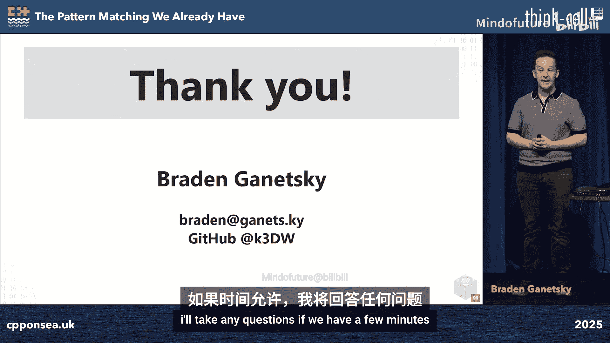

# 【Cpponsea】C++-On-Sea-2025大会-p23-P23_我们已经拥有_的_模式匹配-布雷登_加内茨基_2025--BV17V4GzjE6p_p23-

Hi， everyone。 My name is Braddon Gnetky， and today I'll be talking about the pattern matching that we already have。

😊，So there are some pattern matching proposals that have been going through the standardization process。

 Theres Herb Sutters P239，2。 I'm not sure of the status on this one currently。

 And there's Michael Parks P2，6，8，8。 Again， I'm not 100% sure of the status for this one currently。

 This is a follow up to a previous paper。 But I will show what these sort of things。

 what these papers allow us to do in C plus plus if they were to be accepted into the standard。

 So here's an example from Michael Park's paper。 Here's a shape with a virtual destructor。

 circle inherits from shape with a radius and then rectangle inherits from shape with a width and a height。

 And let's say for example， I wanted to calculate the area of either a circle or a rectangle。

 but polymorphically using shape。Well， with their respective papers， you can do something like this。

 This is herbs paper。 You can use the keyword inspect here。

 It has a similar syntax to a switch statement， but it's an expression instead of a statement。

 And then you can deconstruct the shape as though it's a circle or as a rectangle。

 and you can calculate the area accordingly。Similarly with Michael Park's paper。

 you can use the match keyword， which instead of being a prefix operator this time it's an infi operator。

 but again， you match the shape against a few different cases and you end up getting this polymorphism just like this so you can deconstruct as a circle。

 deconstruct as a rectangle and get the proper area for what you want。

But these aren't in the standard。 And they're not in C plus plus 26。 That was finalized two days ago。

 As Herb mentioned earlier today， These are not in C plus plus 26。 Will they be in 29。

 Does anyone know， I don't。 I don't have a crystal ball。

 And I really don't know what's going to happen。 But what I do know is that we don't really have pattern matching in the language until we get these proposals。

Right。Well， I'm here to say that it might not be might not be exactly the case。

 So take this function right here。 This is a function called fo。 It takes in a bull。

 and returns a bull。Here's a function template also called foo that takes in a floating point and returns nothing。

 And then here is a function called foo， taking a unique pointer and returning either what's stored inside that unique pointer or 0 now。

😊，These are just example functions。 But what happens if I call fo of some Lada turned into a function pointer or what happens if I call ph of 123。

 or what happens if I call ph of ABC in quotes。Now， I don't necessarily want to give away the answer。

 Okay， I do。 It's fo of bull for all three of them。

 But my point is this is doing pattern matching here。

 There are three different patterns that can be matched by the arguments that you're passing into fo。

 And based on them， you end up with a different overload being called。

 This is pattern matching in C plus plus。 Or what about something like this。

 This is a struct called is same。 You may have seen something like this before。

 it's a  struck template called is same。 It takes two parameters。

 and it sets the value equal to false。 It's a static constant per value。

 It is constant for the entire type。 But now you can do a partial specialization。

 where you have the same type twice。 And now the value is true。

 You've defined it in two separate places。 The only way you've linked them together is with the name。

 And then here you can static assert that is same of int comma int is true。

 and you can static assert that not is same of int comma int star is true。😊，How does this happen？

We'll get into that。 But my argument is， this is pattern matching。 So， okay， today。

 I'm gonna to be talking about function overload resolution， template specializations。

 template argument deduction and class template argument deduction。

 These are the forms of pattern matching that we already have in the language。

 And I just want to take some time and appreciate their mechanisms。😊。

So the goal of this talk is basically to understand the mechanism of these facilities。

 to do some analog reasoning about your code， I think that kind of thing is very important。 And。

 you know， to give some insight into the logical reasoning of how C plus plus basically works。

 So in this talk， I will just be scratching the surface。

 Each one of these topics is a very wide topic that each could be their own talk and maybe in the future they will。

 But for now， I'm just going to be scratching the surface on all these。

 I'm leaving out the edge cases and the minute details。 Just glossing over them。😊。

And I will have just in a couple places， some newly invented syntax for demonstration purposes。

 But I will clearly show when those are。 So don't worry about that。 And also， please。

 questions at any time。 I would be happy to answer。😊。

And just a little bit about me before we get started。 This is a slide I really like having。

 I am Canadian。 I have a mechanical engineering degree。 I like twisty puzzle。

 So if anyone here like rububik's cubebes and that kind of thing talk to me later。

 I've been working in C plus plus professionally for about four years。

 I've been on the C plus+ Standard Committee since 2023。

 I run the Winnipeg C plus plus developers user group in Winnipeg， Canada。

 So if anyone here or if anyone watching online later on is ever in or around Winnipeg。

 please contact me and hopefully you'll be around for one of my meetups。 So without further ado。

 let's get started with function overload resolution。

 So function overload resolution is something that has been in the C plus plus standards since the beginning in the C plus plus 98 standard。

😊，It's a defining feature of C plus plus， compared to C。

And this is the only example of nont pattern matching that I'll be talking about today。 Now。

 I will have some templates here， but the templates aren't necessarily required for there to be pattern matching。

 All the other things are based around templates exclusively。

So look at what it looks like to do some overloading in C versus some overloading in C plus plus。

 right， like in C plus plus， you can write these two functions。 They're both called the knit。

 They take different lists of parameters。 And that's fine。 That's normal code。

 we write that kind of code every single day。 If I wanted to emulate this particular example of function overloading in C。

 Look， what's the least， least effort way I would have to do that。😊，Like， you know。

 I I adapted this from a Reddit post。 And what I have to say to this is。

 look what they need to mimic a fraction of our power。

 C plus plus is really powerful in the way that you can do this sort of overloading。 And in see。

 like， you can get it kind of close for certain specific cases like this one。

 but you make it any more complicated， and you might not be able to。😊，So function overloading。

 I will give some examples of function overloading。

 And then I will talk about how overload resolution works。

 So the examples are going to be interactive。 I want you to take a look at these two declarations here。

 F of lowercase int and then F of uppercase int。 And I want some hands up。

 If these two are redelars of the same function， hands up。😊，Can I see some hands。

What about are these two separate overloads， some hands。I see none is this ill formed code。Any hands。

😊，Okay， yeah， so everyone is correct here。 It's a re declarationlar。

 So these are two separate declarations for exactly the same function。

 I'm just declaring it two times。 when I'm creating an alias On line 2。

 I'm using capital int equals int lowercase。 And that just means that using capital int is exactly the same thing as using a lowercase int。

 they refer to the same type。 And so therefore， these are two declarations for the same function。

 What about here， I have an enum that uses int as an underlying type。

 And so now I have two declarations。 One is F of int and one is F of E。

 Hand up for re declarationlaration。😊，I see nobody hands up for two separate overloads。

It's a lot of people。 what about hands up for ill formed code， compile error？Okay。

 so most people got this right。 This is overloading。 So these are two separate overloads。

 You can create a function that takes a type in and you can take a function that takes a type E。

 And even though they had the same bit representation。

 they are two separate functions because these are two separate types in the C plus plus type system。

What about this example， This is from the C plus plus 98 standard。

 I will say I had the pleasure of reading some certain sections of the C plus plus 98 standard。

 The document that I read in particular came out six months before I was born。

 So that was quite nice。 So these are two declarations。 F of int and F of constant。

 Are they two declarations for the same function。 Re declarationlar hands up。😊，Okay。

 what about two separate overloads， Hand up。 I see a couple。 And is this ill formed， Any hands。Okay。

 these are two separate re declarationlars。 or sorry。

 these are two separate declarations for the same function。In C plus+ functions。

We drop the top level cont qualifier。 So here we have F of int， and then we have F of constantt。

 But F of constantt is just F of int。 So in the function， in the function signatures。

 we drop the top level con qualifier。😊，So my follow up question to that is。

 what about F of int star and F of constant int star。

 Are these two separate Are these two declarations， re declarationlars of the same function hands up。

I don't think I see anybody。 Are they two separate overloads， hands up。It's almost everybody。

 And what about ill formed any hands。Okay， so yeah， everyone's correct on this。

 These are two separate overloads。But I just said， we dropped const。 Well， no。

 we dropped the top level const。 This is not a top level const。 The first one is a pointer to int。

 The second one is a pointer to const int。 They are both non cons pointers。

 even though they point to different types。 So these are two separate overloads。

 What about this example。 from the C plus plus 98 standard again。

 Are these three separate declarations redeeclaring the same function hands up。You see a few。

 are they three separate overloads， hands up。See a couple。 And then is this ill formed code hands up。

Okay， the room is a little bit more split on this one。

 These are three declarations of the same function。

 So similarly to how we drop the top level con qualifier。

 we also drop the top level array qualifier and turn that into a pointer。

 So the actual signature here is F of cha star。 Even though two of them look like F of cha array。

 either unbounded or bounded。 This is actually just three separate ways of saying F of cha star。

 And that's the same reason we can write the main function to have our R V with char star star。

 We can have cha char star array。 Different people write it in different ways。 This is why。😊。

Here's an example that is not interactive because it's a little bit more complicated。

 Is that a question。 Yes， what's the question， Right， So， so the question was。

 if I'm understanding correctly， the question was that these are two separate types， correct。

 as in char array is a separate type from char star。 And yes。

 those are two separate types in the C plus type system。

 But when you're referring to function parameters， the array type actually decays to a pointer type。

 And so even though there are separate types in and of themselves。

 these function declarations are exactly the same。 And this is an example given in the C plus plus 98 standard。

 If you like reading old documents， then be my guess and you can check that out as well。

 you can see the same thing。 Yeah， and it's in the section over dot load。

 all the standard sections are indexed by what we call stable names。 So that's the stable name。😊。

I think this example is still in the standard today， but don't quote me on that。

Here's an example that is not interactive。 Sorry。 So there's a Dec there's a function here。

 This is three declarations for the same function。 So the first time we declare it， we have two ints。

 We have int I and int J。 The second time we declare it。 Well， we also have int I and int J。

 but we give J a default value。And then the third time we give I a default value。 But it's the same。

 it's the same overload， same function。 So we can only have one body that corresponds to all three of these。

 And we can only add in the default value once per parameter。

 So we're adding it in the second parameter in line 3 and adding it to the first parameter in line 4。

 and that's completely valid。 Now we have a separate overload of F that takes no parameter or sorry。

 takes no arguments。 has no parameter。 And then when we try to call F of one comma 2。 Well。

 it's very clear that this is gonna to call the two parameter overload。

 because we're passing in two arguments。 So two corresponds to two， that should be pretty clear。

 This one may be a little bit less clear。 this has one argument。

 but the one argument still corresponds to the two parameter overload because this will end up calling F of one comma 99。

 J has a default value。But now， this third case is a little bit more complicated。 See。

 is it supposed to call the F with two parameters where they're both defaulted。

 or is this F of no parameters because we're passing in no parameters。 And really。

 the answer is it's ambiguous。 It's an error。 This will not compile。 And again。

 this is also in the C plus plus 98 standard。 Yes question back to an interactive example。

 If I have a struct X。 I have static void F。 And then I have void F。

 one of them is a static function， One of them is a non static function。

 Are these re declarationlars hands up。Okay， are they overloads hands up？

I see a couple is this ill formed hands up。Okay， most hands were up for ill formed。 You' right。

 It's I formed。 So this code is ill formed because you can only have one function declaration inside of a struct that has the same signature。

 If one of them is static。So what about this case where neither of them are static。

 We have Vo G and then voidy G const。 are these re declarationlars hands up。

Are they two separate overloads， Hanza？Most people， and is is ill formed， hands up。Okay， great。

 So yeah， these are two separate overloads。 I'm sure most people in the room have written code like this。

 If you want to write two member functions where one of them operates on a constant object and the other one operates on a non constant object。

 This is exactly how you do it。 This is a very common thing in C plus plus。

 I'm sure everyone seen this。 But how' has everyone seen this。😊。

Can you write void G and then void G Ref qualifier？Redlaration， hands up。

Two separate overloads hands up。Most people and ill formed hands up。Okay， it's ill formed。

 I got most of you。 So it's actually ill formed。 And from my reading of the standard。

 the reason this is。Is because the declaration On line 3 subsumes the declaration On line 4。

 So the declaration On line 3 can be for L values or for our values。

 The declaration on line 4 is only for L values， so they conflict with each other inside of astruct。

 You cannot declare the identical same function more than once。 And so this is ill formed。Okay。

 last one，8 functions。 Are these red declarationlars of the same function。 Yeah。

 I think we all know these are overloads。 And has has anyone written something like this。Yeah。

 a few people have written something like this。 What about have you duplicated all this and done with no accept。

No， okay， okay。 Ca， yeah， I mean， these， this is the ocapplication of member functions。

 You could add another twice as many， if you do know， except。O。

So I want to get into the general mechanism of function overload resolution。 So first。

 we grab from the context of overload resolution。 we grab all of the possible candidate functions。

 I'll go over what those contexts mean。 Once we grab all the possible candidate functions。

 we need to grab the list of viable candidate functions。 And then from the viable list。

 we find the best candidate function。 So the different contexts are function calls。

 So like when you are actually calling the name of function， as I've been showing so far。😊。

Object operator perez， little bit different from function calls， often looks the same。

 Opera overloading。 So like a plus B， for example， constructors。

And conversion functions are actually three contexts。 In the standard。

 I collapsed it down to one for simplicity。So these are the distinct contexts。

 We basically need to grab together all of the functions that may possibly even fit the situation where we're trying to call it。

 After we've done that， we need to grab the list of viable candidate functions。

 So we've already grab all of the candidate functions from the context。 And now it's all the same。

 regardless of what context you're in。 We grab the list of arguments。

 and then we have to compare the list of arguments against the list of parameters。

 So we remove the candidates that have the wrong number of parameters。

 And then we remove the candidates that have unsatisfied constraints。

 and then we remove candidates with incompatible arguments。

 And I'll go over an example of what this looks like。 Here I have eight separate overloads。

 I promise these are all separate overloads。 a few of them look a little special On line 3。

 this one is special because it has a default It has a default value in the second parameter。

 This one on line 5 special because it has an ellipsis parameter， A C verytic。

 and then on line 8 through On lines 8 through 10。 This is a function template where the size of T must be equal to 3。

 Otherwise， this does not exist。😊，But why doesn't it exist， Well， we'll get into that。

 So I'm trying to call fo of null pointer。 And here are the eight possible overloads。

 Let's go over getting rid of them step by step。 So first， what we do。We remove all of the。

Function declarations that have the wrong number of parameters。

 So that would be the first one and fourth one。 So even though the third one has two parameters。

 one of thems defaulted。 And so it can actually be called with one argument。

 So that still counts as having the correct number。

 So we remove all the functions that don't that are not able to be called with one argument。

 And then we remove all the functions that have unsatisfied constraints。

 So that would be the last one。 And then finally， we remove all the functions where null pointer cannot convert to the first parameter。

 So null pointer cannot convert to double and null pointer can also not convert to int。

 And so we remove those。 But null pointer can convert to ellipsis and null pointer can convert to bull and null pointer can convert to unique pointer。

 And so we're left with these three。 This is now the viable list。 So from the viable list。

 We need to find the best candidate function。😊，So we find the implicit conversion sequence。

 Basically， what's the sequence to get from null pointer into whatever thing we need to do for each parameter argument pair。

From there， we rank these viable candidates based on the conversions。

 I won't go too much into these details。 That's for another talk。

 And then we'll find out which function declaration is the one that we actually called。

 So for the ellipsis parameter， This is what's called an ellipsis conversion sequence。

 So this is a null putter t to C veryatic。 It's called ellipsis conversion sequence。

 If we are converting null putter t to bull。 This is a standard conversion sequence。

 And if we're converting null putter t to unique pointer。

 this is a null puter t to unique puter user defined conversion sequence。 Now。

 within each of these types of conversion sequences， Yes， there is a ranking。

 And if there were multiple arguments and parameters， then yes。

 you would have to rank those as well based on partial ordering。

 I'm not getting into that in this talk。 But what I will show is that these three different types are ranked。

 So standard conversion sequences come first and then user defined conversion sequences followed by ellipsis conversion sequences。

 And so while we choose the one that has a standard conversion sequence。 And that would be of。😊。

And that's the basics of function overload resolution。Let's get into template specializations。

They have also been in the standard since the beginning in the C plus plus 98 standard。

 They facilitate the type traits in C plus plus 11。 Now。

 I'm sure there were some type traits that you could have written in C plus plus 98。

 I'll show one in a second。 But the type traits that were introduced in C plus+ 11。

 all based on template specializations。And I like this paragraph this。

 this this section number in the C plus plus 98 standard。

14 do5 dot4 dot1 matching of class template partial specializations。 I saw this heading。

 and I was like， I'm doing the right talk perfect。 I got it right。 because you know。

 I'm worried that I come up here and I say， look， this is all pattern matching。 And people say， no。

 it's not。😊，Yes， it is。 Okay， So one could imagine some syntax。 This syntax does not exist。

 You could imagine it exists。 I'm basing this on Michael Park's paper。

 So you have some types T and U demonstration purposes only。 you have some types T and U。

 you have the match keyword。 If they are the same if they are both T then it's true， otherwise false。

 We can't write this。 But we can write something similar。 Look， we can write astruct like this。

 This is astruct template。 It's called is same。 it takes in two template parameters T and U。

 and it has a basically a static contexts per value， which is equal to false。

 This is how we used to do it， before I was born used to do it like this where you would have an enum with a value。

 and these are how you used to do type traits。 And then if you wanted to write the true case。

 Well you would write a partial specialization with is same of T comma T。

 That's the matching criteria， at least that's what I'm calling it。 And so if it matches on that。

 then it's true。 And otherwise it falls back to the primary template up there。 Here's。😊。

Another example。 Oh， no， here's not another example。 Here's me highlighting is same of T comma T。

 This is the matching criteria。 So that's what the compiler is looking for when you pass in the template arguments。

 So here I'll show another one。 in C plus plus 11。 This is how you might do is same。

 This this is a valid implementation。 This isn't how the implementations actually do it in real life。

 But this is a valid implementation。 You create is saying you write a static context where bull value is equal to false。

 And then in the partial specialization， you said it equal to true。 It's exactly the same as before。

 but I've updated the syntax to the modern day。😊，And again。

 I highlighted this part and promptly forgot。 Here's another example。 This is remove const。

 So in the default fallback case， we're using type is equal to T。 That's just the fallback。

 But then we want to match on something。 We want to match on const T。

 because we want to remove that const。 And the only way to remove it is to match it。

 And so we match on cont T。 We strip off the const。 and we say type is just T。😊。

So I would argue that template specializations are the backbone of the type traits。And here， again。

 we have this matching criteria of constant。Okay， so in broad strokes， we have the primary template。

 We have partial specializations， and we have explicit specializations。😊，Tgue twister。

 say that five times fast。 The primary template looks something like this。

 We have the template head that has the template keyword。

 and then the list of template parameters followed bystruct or class。

 I'm not talking about function templates here， but you can imagine function templates as well。

 But here I have struck just the name of the struct。 and then an open brace and then the definition。

 So that's a normal template。 Most templates here right kind of look like this。

 But then you have partial specializations where you have the template head with the template keyword and then the parameters。

😊，But now you need to take these parameters and turn them into arguments to sort of plug back in to the name that you already gave the primary。

 And then you have the definition。 You have the body of the class further down。

 And so this is saying that the match criteria is stood pair of T comma U。

And so this will get checked before we check the primary。

Then we could also have an explicit specialization。So this also has a template keyword。

 But now the parameter list is empty。 And so when we actually define thestruct， well。

 this one has this one has only concrete arguments into my trait。 And so this is a concrete class。

 This is not a template anymore。 This is just a concrete class。 But again， we have the body。

 And so this is an explicit specialization。 Now， I will say something about explicit specializations in a minute。

 You need to be careful about where you put them。 I may spoil what I'm gonna say。

 Does anyone know what I'm talking about， You need to be careful where you put them。

 I see some head the I。 Okay， so I'll just show one more example of all these things on the same page。

 I have my other trait here as the primary。 here I have an explicit specialization for in star。

 And here I have an partial specialization for T star。 Now， if you notice something。

 All three of these definitions。 They are not related to each other。😊，The primary has an alias。

The explicit specialization has a member function。 and the partial specialization。 Well。

 that has a static contexts per rule。 None of them are related。

 and they don't have to be T specializations are only related in their name。

 And so they give you a way to sort of customized some behavior in your code at compile time。

 but a user is supposed to be able to use a template as if it is just the primary。

re not a user is not supposed to know about the partial and explicit specializations。

 So typically code like this looks very bad。 I just， I'm just showing it for demonstration purposes。

 Now， about explicit specializations。 There's a clause in the standard。 is a paragraph。

 It is very long。 So each of these triple dots is actually as long as everything I've shown on the screen。

 each one。😊，But it says the placement of explicit of explicit specialization declarations for a bunch of things and the placement of the partial specializations。

 they can affect whether a program is well formed， according to the relative positioning of the explicit specialization or in other words。

 when writing a specialization be careful about its location or to make it compile will be such a trial as to kindle itself emmolation。

 This is a limemerrick。 It is in the standard， it is intentional。 And if anyone ever says to you。

 hey， what is the limemerrick， you can say， oh， I know the limemerrick。

 It's tempt dot expo dot spec s 8。😊，There it is。 So this is actually in the standard in the C plus plus 98 standard。

 I don't exactly。 Does anyone in the audience know who who wrote this line。Could it be chronic。

 Maybe， I don't know， anyway。It's， it's it's great。 It's poetry。 Li。

 So I'm gonna talk about how to match against specializations。

 We start by using the explicit specialization。 if that's available。 As I said before。

 the explicit specialization is a concrete class。 So if it exists。

 then we know where the definition is。 If we've already seen it。 If it's further below。

 then we haven't seen it， then you get into complications。 and that's what the lime is about。😊。

But if there are no explicit specializations， then we have to use template argument deduction。

 which I will talk about after this to match the partial specializations。Now。

 if there are no matching partial specializations， we use the primary。

 If there is one matching partial specialization， we use it， those should be obvious。

 But if there are multiple matching partial specializations， then we choose the best。

What does that mean， I'll get into an example。So here we have a struct called a。

 and it takes two template parameters。 And then I have a partial specialization where I'm matching on T 1 star comma T2。

 And then I have another partial specialization matching on T 1 comma T2 star。 And so my question is。

 if I have a of int comma int。😊，Is this matching the primary online one hands up。It's most people。

 I it matching the partial specialization online， too， hands up。

What about the partial specialization on line 3， hands up。Okay， yeah。 so it's line 1。

 This is matching the primary template because， I mean， neither of these types are pointers。

 So how is it gonna match anything with a pointer。What about this one， A of int star comma int。

 Is this one the primary hands up。Okay， is it two？Botts of hands。 Is it three hands。OK。Yeah。

 this is true。 Most people here got it。And look， it， it follows the same form。 I mean。

 you take a look at this。 And I will talk about template argument deduction。 I promise I will。

 It's very fun。 But you just see the form it matches， right， We have instar comma int。

 We have T 1 star comma T 2。 You can match those things up in your head。 It's quite simple。

 And you see that that is actually the one that it matches。 What about instar star star comma int。

 Is this one hands up。😊，What about two hands up？And what about three hands up。Yeah， so this is two。

 right， And the reason being， well， in star star star， that's a pointer。

 So it still matches the one on2。Right， we have T1 star， and in this case。

 T1 just gets matched as int star star。But that's fine。 That's still a pointer type。

 It's a pointer to pointer to pointer， but it's still a pointer。What about this one。

 Incoma instar 1 hands up。Okay， two hands up。Or three， hands up。Nice。

 you guys are getting the hang of this。 Great， Okay， Yeah， it's3。 makes sense because again。

 it matches the same form。 You can visually see， right， These are， these are low， these are。

 you know， what low balls， Fastballs。 No， not fastballs。 I don't know。 baseball。 Okay。

 what about instar comma in star。 Is it one hands up。😊，Is it too， hands up。Or is it three hands up。

I didn't say that many hands。 Why might that be。Cause it's ill formed。 Yeah。

 it's a secret fourth thing。 It is ill formed。 So this doesn't work。 Why doesn't this work。

 The problem is that it actually does match both two and 3。

 but the compiler cannot rank one of them better than the other。 And so because of that。

 it's ambiguous。 And because it's ambiguous， it's an error。

So I'm going to talk about matching against partial specializations。 The way you do this。

 it's really， really interesting。 I was surprised to find this out。

 You rewrite the class templates as if they were function templates。😊。

You pretend that these function templates exist。 You use overload resolution and template argument deduction。

 I swear I'll get there。 And then ultimately， we use the specialization that corresponds to the function that we resolved to。

 And I'll show how that looks。 So again， we have the primary and the two partials。😊。

We rewrite them like this。 This is my imaginary function。 This is some syntax I'm making up。

It's a double underscore。 You cannot actually write this in your own code。 Please don't try。

 This is for demonstration purposes。 So we have the template head of this number two imaginary function right here。

 corresponding to the template head of the partial specialization online 2。

 And then this imaginary function takes in that a with T 1 star comma T 2。

 And then we do a similar thing for number 3。😊，O。And now I'll move these up a little bit。

 And let's see what happens if we try calling imaginary function with a of intstar comma int。 Well。

 now this is actually where the template argument deduction comes in， which again。

 I will talk about in just a second。 So template argument deduction is basically you are just matching the template arguments against the template parameters in your function。

 And so this one's simple enough that you can kind of do it visually， you can kind of see that。 Yeah。

 okay， int matches up with T 1 and int matches up with T2。 as long as you're looking at number two。

 And this calls2。 It fails for three。😊，This one。😊，This one fails for two， and it works for three。

But now， calling a of int star comma int star， this one actually succeeds for both 2 and 3， right。

 It could be 2。 It could be 3。But you end up with two possibilities。

 and this is ambiguous in the function overload resolution。And so that's why it's an error。

 What if we want to disambiguate。 We can do that。 We can add another partial specialization that is sort of。

 you know， more specialized than the two that are ambiguous， That looks like this。

 We can have a of T 1 star comma T 2 star。 And now， if we define this。

 now there's nothing that's ambiguous anymore。 because if we have both types that are a pointer。 Yes。

 it'll match 2。 Yes， it'll match 3。 but it'll match 4 more Then it matches 2 and 3 based on the ranking that I'm not getting into in this talk。

 It goes really into the weeds。 So again， we have two and3， But now we also have4。😊。

And so this one is another overload of imaginary function。 And so now that we have that。

 we can try calling， we can try calling imaginary function with a of instar comma in star。

 It could be 2。 It could be 3， right， But the tiebreaker。😊，The tiebreaker is four。

And so that's surface level how we do template specializations。

 But I want to really get into the fun stuff of template argument deduction。😊。

And I'm not being facetious。 This is actually really fun。 T argument deduction is basically this。

 I'm sure everyone's written a function like this before。 And if you haven't， you should sometime。

 this is a function template that takes in a stood vector of T。😊。

So you can pass in a st vector of int into this function fo。

And it ends up calling fo with T equal to nt。But why don't you need to just call it with foo？Int。

 you know， explicitly， why don't you have to pass in in explicitly as a template argument。Well。

 that's what template argument deduction is。 So template argument deduction has been in the standard since the beginning。

 and we can deduce the template arguments of our function templates。

 And that's what we're doing in the example here。 But we are able to specify arguments explicitly。

 And that's why the code that I just showed is valid。 You can do it explicitly。

 But it's better to do it implic with deduction。 You know。

 C plus plus is a lot more ergonomic that way。😊，And there are some new semantics in C plus plus 11 with forwarding。

 And I'll get into that。 The way I'll do this section。

 I'll talk about the general mechanism of template argument deduction。

 Then I'll talk about the nonduced context。 You'll see what that means。

 Then I'll talk about the rules of forwarding and sort of how it tripped me up enough to write this talk in the first place。

So the general mechanism is basically for each function parameter and function argument pair。

 you match them up。 You ignore the top level constant and volatile qualifiers， just the top level。

You process the parameters and the arguments's special forms。

 I'll show what that means on the next slide， And then you match the template parameters to the corresponding template arguments。

 And we'll do some interactive examples here。😊，So the special forms。

 this is a section in the standard that I'm simplifying here， but it looks almost exactly like this。

 So a special form can either be an optionally con volatileat qualified T for some T。

 It could be a pointer to T。 It could be an L value reference to T。

 It could be an R value reference to T。 It could be an array of T with an optional bounds。

 It could be a function returning T taking some number of parameters with an optional。

 no accept specifier。 It could be a member pointer。

 It could be a template template that has some stuff in it。

 or it could be a template template with nothing in it。

 And these are effectively the special forms that we have to match against。

 It's slightly different in the standard。 I'm just simplifying it for digestibility。😊。

So these will be some semi interactive examples， or at least step by step。 Here。

 I have a function template called foo。 And F takes in a pointer to T。

 And now I'm using it by passing in the address of a stood vector of int。So。

Does anyone want to just shout out what tea gets deduced to in this case， Sil it。Vctor and， Yeah。

 exactly。 Now， my question here was not what does it get deduced to。

 Because it may be pretty clear that， yeah， this gets deduced to vector event。My question is。

 why and how do we go step by step， You know， taking my understanding of the standard potentially flawed and seeing step by step how this works。

So we have our parameter that is T star。 We have our argument that is stood vector of int star。

And they get matched up。And then we match them against the special form。

 The special form is pointer to T。 And because they both match the same form， we can continue。

 We can remove the pointer。 And now we know that T is stood vector of int。😊，And that's the process。

I understand it's not that much different to just eyeballing it。

 but I promise this is a lot more rigorous。 What about this example， Now。

 we have foo of stood vector of T star。And then again， I pass in the pointer to st vector of int。

 And so let's go step by step through it again。We have a parameter of stood vector of T star。

 We have an argument of stood vector of int star。 Well， they both match the form pointer to T。

And because of that， we can strip off the pointer。And we end up with st vector of T gets matched up to st vector of int。

 We can keep going。They both match the form template template of some type where this T T template template。

This is known to be stood vector on both sides。 Excus me。 And so we can just drop that。

 And so we can say T is in。 We just go down the line。 There's only one one template parameter。

1 template argument。 We go down the line recursively。 We have T isn int。对。Let's do another one。

This one is another function template。 It takes Vk of T star。 This time， Vec is not stood vector。

 It's some template template parameter that could really be anything。So how do we do this one， Well。

 again， we're gonna pass in a st vector of int star。So our parameter is a vector of T star。

 Our argument is a stood vector of int star。 Sam thing as before。 we match the form T star。

 And then vector of T is obviously stood vector of int。😊，Now， at this point。

 we match the same form template template of some type。And so the template template has to match。

 And each of the types have to match。 So let's match them up。 Let's say that Vec is the vector。

 Let's say that T is int。 That works。 And that's template argument deion。 So look at that。

 We have done template argument deduction on a template template parameter by hand。

 Does anyone think they would ever do that in their life。😊，You've done it now。Okay。

 here's another example， two parameters。 This one has a st vector of T and a st pair of T comma U。

 where T and U are both template parameters。Now， this time。

 I am passing in a st vector of int and a stood pair of int comma float。

 So now I have the parameter st vector of T that gets matched up to the argument St vector of int。

And we've done this before。 We know that we match this form， and we know that T isn't。

 This is something we've already done。 It's getting old at this point。

 What we have not done yet is using st pair。So let's say stood pair of U。

 The parameter gets matched up to the argument。 stood pair of int comma float。

We match the form template template of two different types where this template template is known to be stood pair。

 We can drop it。Therefore， T is int and U is float。

So T gets deduced to int in the first parameter argument pair。

 and T gets deduced to int in the second parameter argument pair。

Do they always have to be deduced to the same thing？Yes， so let me show this next example。

 same setup。 But now this time， I'm using a vector of int， but a pair of double and float。

So now we go through the steps again。 We have a parameter stood vector of T and an argument stood vector of int。

 We match the form template template of some type where this template template is known to be a stood vector。

 Therefore， T is int。被告单。But what about stood pair。 So the parameter is a stood pair。

 The argument is stood pair of double and float。 We match the form template template of two different types where the template template is known to be a stood pair。

Therefore， T is double and U is float。So in the first parameter argument pair， T is deduced to int。

 in the second parameter argument pair， T is deduced to double。 Does this code compile。No。

 this code does not compile。 This is a template deduction failure or a template argument deduction failure。

 Now， if I had more overloads of foo， the compiler could try other overloads。

 That's getting into Spney。 But that's not part of this talk。 If we only had one overload here， then。

 yes， this will fail。 This template argument deduction。

 The entire thing fails and the code fails to compile。This doesn't work。

I want to give a simpler example of this kind of thing that may not work。 You may have seen this。

 This is in the standard。 We have a max function， and this max function takes a T and then another T。

 So if we try calling max of one comma 2， Well， the one gets matched up to the the。Type of A。

 And then two gets smashed up to the type of B。 So that's int with T and then int with T。

 So we end up with int。 That's great。 Same with 1。0 and 2。0。 We end up with double。

 And that's also fine。😊，If we try to use one comma 2。0。

 this is a template argument deduction failure。Because in the first parameter argument pair。

 T gets deduced to int。 in the second parameter argument pair， T getsed， deduced to double。

 So this is a failure。Can we make this work， Can we write a function where this works。We can。Well。

 not here。 but we can。 The way that we have to do this is by using a non deuced context。

 So now you see here， the second parameter， I didn't use T。

 I used this really long thing called type name stood type identity of T， colon， colon type。Now。

 type identity is something that you could have written in C plus plus 98。

 It is in the C plus plus 20 standard library。 If you're not using C plus plus 20。

 it is a one liner depending on how much stuff you like to cram onto a line。 I write it。

 I write it in four lines。 So very， very simple。 But what this does is it creates what's called a non deduced context。

 meaningan that there is no deduction happening for B， there is only deduction happening for a。

 So if we call max of 1 comma 2， we get the same thing as before， if we call max of 1。0 comma 2。0。

 we get the same thing as before。 But max of 1 comma 2。0， no longer fails， This now works。

 if calls max of int。 Why is it int。Because for the first parameter argument pair T gets deduced to int。

 for the second one， it's non deduced。 So it's int。Perfect。

The most common cases of nonduced context are the nested name specifier of a qualified type name。

 What that means is everything to the left of the right most double colon。

 That is nondduced in I think all cases。 a decal type expression is nonduced and if the parameter is not a stood initializer list。

 but the argument is a brace and knit list， then that's also nonduced。

 I'll show an example of all three of these。 So first。

 here's the nonduced context of a nested name specifier。 I have a struck template that takes a T。

 And then I have a function template that takes a type name S of T colon colon type。 Now。

 we look at this code。 and we know that's int。 we know that's int for all cases。😊。

But the problem is it doesn't。 It doesn't actually work because we have a parameter that is a type name。

 SF T colon colon type。 That is a qualified name。We need to look at the nested name specifier。

 which is type name S of T or just S of T， because we don't need type name that doesn't particularly matter。

 This is a nonduced context。 As I said， it's everything to the left of the final double colon。

 That's nonduced context。 And therefore， we cannot deduce T。 And this is an error。

But now what happens if we have the samestruct template， But now in the function template， Well。

 we have that nonduced context on the left side。 But the right side， we take a T。So in this case。

 now， if we try calling fo of 1，23 comma 4，56， Now this will probably work。

 because the first parameter argument pair， we go through the same steps and we cannot deduce T。

 However， the second parameter argument pair。 The parameter is T。 The argument is in。 It's deduced。

 We're all good。 All of the template arguments have been deduced。 There are no conflicts。

 We have succeeded with template argument deduction。 Great， Therefore， T isn't。This case， again。

 I have a struck template。 and in this case， I have a decoal type expression。 So let's go through it。

I try creating an S of double。 I try passing it into fo。 It doesn't work。

 The parameter is a decoal type， S of T。It doesn't really matter what it is。

 It's a decal type expression。 It's a nonduced context。 We cannot deduce tea。

 There's no other place to deduce it。 Template argument deduction fails。

 And then the final case I'm showing is， let's say you write something like this Back to the original function I was showing。

F ated vector of tea。We try to call fo of one comma 2 comma 3 in a brace in it list。

 This is an error。 Has anyone tried writing this before， because I have。

 And I've been really upset about this， but it is in the standard that if the parameter。

 if the parameter is not a stood initializer list。But the argument is a braced and knit list Then we cannot deduce tea。

And that's just how it goes。 Finally， I'll talk about forwarding in this section。

 This is a special mention in the deduction rules。 It says an R value reference to a C V unqualified template parameter。

😊，T ref Ref， that's all that means。But it must be a template parameter of the function itself。

 So it can't be a template parameter of anything in closing。 It has to be of that function itself。

Kind of like this。 This is the example given in the standard。

 It actually says T Ref highs in reference。 So I had to show this again， you know。

 people on the Standard committee， Pretty funny。😊，Not self arandizing。 Okay。

 so here I create an int equals 0。 And then I try to call F with that int。

 This ends up calling F where the template argument is deduced to the int ref。

 And then the function parameter is an int ref as well。Just是个。And then in this case， I call F of 0。

 where this deduces the template parameter。 Sorry， template argument to be int。

 and then the function parameter to be an int ref ref。 Now， I look at the L value example。

That doesn't match， right， Like you look at that。 And you see the function parameter is a T ref ref。

 And yet， the function parameter after the type has been deduced is int Ref。 That's an R。

 It's an L value reference。But the function tablet is an R value reference。 How do we square that。

Let's talk about reference collapsing。 If you have a T ref ref， that's a T ref。 right。

 If you take a reference to a reference to T， it's a reference to T。

 And this may be a table people have seen before。 If you take an R value reference to an L value reference to T。

 you get an L value reference to T。 If you take an L value reference to an R value reference to T。

 you get an L value reference to T andm saying this quickly because it's more words than it is symbols。

 And if you have an R value reference to an R value reference to T。

 then you have an R value reference to T， great。You can't actually write this code。 Like。

 you can't write all of these refs in order。 That doesn't work。

 But the way you can write it is like this。 You have an in ref。

 and then you have a reference to that。 that could happen。 And if that happens， well。

 your R 2 is now an in ref。Similarly， if you have an int ref。

 and then you have an R value reference to that。You end up with an int ref as well。

 an L value reference to int。Similarly， if you start with an R value reference to int and then you take an L value reference to that。

 you end up getting。An L value reference to int。And finally。

 if you start with an R value reference to int and then you take an R value reference to that。

 you end up with an R value reference to int。 This kind of stuff is possible。

 And so here's how I sort of look at this in terms of template argument deduction。

 Here is my template。 Here's my function template。 And then I create an int called I。

 And then I have this fo that I am passing I into。 So the parameter is T ref ref。

 The argument is int ref。 Now， we match the form T ref ref。😊，But inf doesn't match that form。

 I hear you all screaming。It does。 Remember， int ref is actually just int ref， Ref ref。

 So because of reference collapsing rules， or at least this is how I rationalize it。

 because of reference collapsing rules， int ref as actually int ref ref ref so we can match this form。

And then we can strip off the R value reference when we get T is into ref。

Is there anyone else on the Sanders Committee in the audience gonna tell me I'm wrong about this。

Cause that would be embarrassing。 Okay， great。Okay。

 so we end up getting the template argument deduced to int ref。

 And then the function parameter is also in ref， even though it's T ref， ref， because， again。

 this is int ref ref ref。Sound like a dog at this point here， we're calling fo of 0。

 So the parameter is T ref ref。 The argument is int ref ref。 This one's a little bit simpler。

 We match the form T ref ref。 We end up with T as int。

And this is the function that we end up getting。 So that's actually simpler。

 And it's funny because I went into this talk thinking this was the complicated case。 And it is not。

 The L value case is the complicated case。 And this was， in fact。

 the impetus of me writing this talk in the first place。 I thought，😊，I have a really。

 really bad misconception about this。 I've spoken with other people that have a misconception about this。

Maybe this would be worth talking about。 And then I expanded the talk from there。 And from here。

 I'll talk about class template argument deduction。 This will be the final section。

Class template argument deduction。It's been in the standard since C plus plus 17。

 So a lot more recent than the other things。We often call it C Ted。

 Are there any other pronunciations of this that I should know of。

 Does anyone call it something else。Cool， seatt。It's the same as template argument deduction。

 but for classes， shocking。And the wording in the standard says resolving a placeholder for a deduced class type。

What is a deduced class type？Well， in this case， I have stood pair P。

 I'm initializing it with one comma 2。0。Stip pair is not a type。That is a class template。

 That is not a class。 It is a placeholder。So we actually deduce what it actually ends up being。

 And so it is deduced as stood pair of int comma double。Remember， stood pair is not a type。Similarly。

 here we have a function。 This function returns a vector of int。 And now I want to create a vector。

 V is equal to calling this function。Stid vector is not a type， it's a placeholder。

This is a class template。 So we need to deduce what this type is。Excuse me。

 We deduce this as stood vector of int。How does this work？Basically。

 I'll talk about the general mechanism， and then I'll talk about deduction guides。

 The general mechanism is that we create a theoretical set of function templates called the guides。

 not to be confused with the deduction guides， just the guides。 there is one for each constructor。

 and there is one for each deduction guide。 There are a few others。

 but I won't get into the details of that here。 and then we do overload resolution and template argument deduction。

 So similarly to template specializations。 It's actually defined in terms of overload resolution and template argument deduction。

 Anything that has to do with class templates。 We actually just defer to the function template stuff。

 because that's a lot more complicated and full featured。 So just defer to that。😊。

And the winning functions return type is the one that we ultimately choose。

So here I'll give an example。 I have a struct called my struct。 It takes two template parameters。

 I have a concrete constructor。 This is a stood vector of T comma U， or sorry。

 not a a non template constructor。And then here I have a constructor template。 This takes A T。

 and then it takes a pair of U comma V， where V is a template parameter of this constructor。Now。

 this is my guide。 This is my imaginary function。 I'm we using the same syntax I used before of the imaginary functions。

 These do not exist。 Don't write this code。 But you can imagine this code。

So I have this imaginary function here。 This one corresponds to the first constructor。

 the non template constructor。So it has the same template head as the struck template itself。

And the return type of this imaginary function。Is my struct of T comma U the thing that we would get if this deduction is chosen。

And the arguments that it takes are the same as the constructor。 And then we write another guide。

 This imaginary guide。 again， doesn't exist。 Don't actually write this。 But this guide。

 this has a template head that is actually the union of the two template heads being thestruct template and the constructor template。

 You have to unify those together。 And then it takes， again。

 the same arguments that the constructor takes。 And it returns the types that you would expect it to return。

And these are the guides。 And so now when I try calling my struct of Vec comma 1。0。

 remember my struct， not a type， but it gets deduced as my structive in comma double。 why。

 because it matches the first guide， and then we do template argument deduction。

And because it succeeds there and it does not succeed in the second one， well。

 then we choose the return type of that function as the type that it is deduced。

And then we have to make sure there's a correct constructor that's available。 but that's later。Now。

 what happens if I try calling my struct of 123 comma some stood pair。Now。

 it'll actually find the second guide。 This will be mystructive incoma char。

But it works just the same。What about if I did something like this， What if I have a st vector of in。

 then I have a st pair of char comma double。 If I try creating a my struct with this v and this pair。

Which one does it choose and why？ Well， it chooses the first one。It chooses the first one。

And it chooses the first one because it's not a template。 It's not a constructor template。

 It's just a nontd constructor， so it prefers that one。 but we can change up how this works。

 Remember， vector actually has a second template parameter。 so we can pass that in。

 let's say we want this construct to actually make use of the allocator。

 And so now the first constructor becomes a template。

 And we have to modify the deduction guide to do the same thing that that constructor template would do。

 So now that we've done that， if we again， try creating this mystruct with a vector and a pair。

 This is now ambiguous。😊，How do we sort out this ambiguity， There's a mechanism for that as well。

 The mechanism for that is deduction guides。 It's more specificity with how C tad actually behaves。

 So you have to define them after the class template。

 and they basically add more of these imaginary guides into the calculation。

 They must align with the available constructors。 And I'll show an example of that。😊。

This is the same struct。 I have just squished up for more screen space。

 And now I have created this new thing right here。 This is a deduction guide。

 This deduction guide doesn't correspond to anything in the struct template。

 This just corresponds to something that I want to see。

 So I want to see if we take a vector and a pair。 I would like to disambiguate。

 And I would like to make it as if we are calling the first constructor。

 I want it to spit out a type that will end up matching against the first constructor。

 or that will give the correct arguments for the first constructor。 And so to do that。

 I have to return a mystruct of T comma stood pair of U comma V。😊。

So here is the guide from before the imaginary guide。 Here's another imaginary guide from before。

 And here's the new imaginary guide corresponding to the deduction guide。And so， now。

When I try calling mystruct with a vector and a pair， now it deduces successfully。

 and then it will end up calling the first constructor because that's the constructor that's available after we have undergone class template argument deduction。

What happens if I write my deduction guide incorrectly， because I could do that。

 I could just return mystructive T comma U notice before it said t comma Sp pair of U comma V。

 And that allows the first constructor to be called。 If I do it like this。

 none of the constructors can be called。 And so now this fourth de this third deduction guide or this third。

 sorry guide。 now， this will look a little bit different， the return type is different。

 And so if I try calling my constructive V comma P。 there's no matches。

 And there's no matches because even though class template argument deduction succeeds。

 there is no constructor available once it succeeds。 And so we fail。O。So in conclusion。

 there is pattern matching in C plus plus， Despite the ongoing papers in the Io standard。

 which I am very excited about， we already have pattern matching。

 We have function overload resolution。 We have template specializations。

 We have template argument deduction， and we have class template argument deduction to name a few。

 If there are others， therere not in this talk。😊，I read the standard， so you don't have to。

 You can look at over dot match。 if you want to see about function overload resolution。

 You can look at these sections if you want to know about more about template specializations。

 you can look at temp dot deduct。 if you want to know about template argument deduction。

 or you can look at these sections if you want to know about class template argument deduction。

And as always， CPP reference is an amazing resource。I see people taking pictures。

 I will let you do that okay。And the takeaways from this talk， we already have pattern matching。

 The general rules can be quite elegant。 And that's what I've shown in this talk。

 The edge cases can get gnarly。 And that's what I did not show in this talk。 So maybe a future time。

😊，I think analog reasoning about your code is like a muscle。

 And I think you should get curious and exercise that muscle。

 And I think we should all appreciate how far C plus plus has come。And so。Thank you all so much。

 I'll take any questions if we have a few minutes， thanks。😊。

