# 【Cpponsea】C++-On-Sea-2025大会-p24-P24_在_C++_中_构建_健壮的_进程间_队列-乔迪_哈金斯_2025--BV17V4GzjE6p_p24-

So today we're going to talk about how to deal with cooperating processes in C++ programs but before I do that。

 I know a number of you guys that over the course of the years have asked me about my wife and how she's doing and so she's still fighting。

 she's got some bad days， mostly good， we visit the Winship Canster Center every three months and they said boring is good。

And she looked at me when they said that。When。But when they don't have to change her treatments。

 it's a， it's a great day。 And so we'll be going there in a couple of weeks。

 But you guys actually get a chance to， you guys get a chance this week to meet her because she came over with me。

 My wife， Suus， is right here in the front。😊，嗯。And， and so I'm going to deliver a preemptive strike。

Basically， because some of the things we're gonna talk about today are mistakes that people have made or mistakes that I have made or mistakes that you have made。

 But we're all we're all humans。 and there's two really。

 really two things I've learned that every single human is really， really good at。

 And a first one is making mistakes。 Every single one of us， no matter who we are。 we were really。

 really good at making mistakes。 So we shouldn't be surprised when they happen。 But sometimes we are。

 And sometimes we think we're really smart。 So we were leaving our house to come here from the US。

 we live in South Carolina and we get to the airport。

 I I really try to plan things out get to the airport more than three hours ahead of time。

 make sure I've got room in case there's an accident or a mistake。

We get onto the shuttle bus that carries us from the parking lot to the airport。

 we're getting ready to get off， I go to get the bags， I pull them off， we take a few steps。

 I turn around and go oh， I left my book bag on the bus on the shuttle bus。

 but there's nothing really important in my book bag right I mean， it's only like my my work laptop。

My personal laptop。呃。Some emergency cash。My wallet with my driver's licensing credit cards and both of our passports so so I immediately I see the bus I'm like I got to catch that bus so I start chasing after it。

 but it's going down the road that way toward the parking lot which is over there well I've got a degree in math。

And I played American football， basketball and baseball like 50 years ago。

 And so I do the computation like， I can hit that hypotenous and I can cut that bus off。

And so I start running。 and I'm just gonna to tell you that you didn't want you want to see me running。

 This been a long time。 I'm running。 I'm run。 I I tell Su， stay here。 I'll be right back。I run。

And I get up there， and I' was， I'm cooking。 I'm puffing and puffing。And I look and see the bus。

 it gets to the corner， I'm like， I'm going to be it， I'm going to be it， and it goes straight。ち个。

It then't cut over。 one I can do。 So I run over to the other parking lot and I'm looking around and there's another shuttle bus。

 I'm like， oh， I bet they have radios。So I could go to that shuttle bus and I could get it to radio the other one and I run over to it and as I get up to it。

 it takes off and by now I'm spent man， I don't even know where the other。

 I don't even know how to get to other parking lot。

And then it dawns on me like I should have realized that first， and I know every single one of you。

 you're already thinking。Dude， they're shuttle buses， it's got to come back in a few minutes。

So I called my wife on the phone and I said， hey， yeah， when the shuttle bus comes back around。

 whichever one comes， just have them call the other guy， So before I could come back， she called。

 she gets the shuttle bus comes， they call the other guy。

 he brings my thing back and the whole time way back I'm thinking， what an idiot I am。

And I get back and and she didn't say it， but she looks at me like。

 what an idiot you are but but it made me think that sometimes when we' when we're programming。

 when we're doing things。 like trying to write code or trying to port code to something in processes which the standard doesn't help us with。

 a lot of times will'll try and figure something out and we'll get working on it。

 and it's hard for us to abandon that attempt。 It's hard for us to just stop and say， wait a minute。

 yes， it's important， yes， emergency， but I can probably figure this out if I just settle down and think about this for a little bit。

 And if I had just stop instead of just reacting with my solution and stopped and thought。

 I imagine I would have thought hey， the things's got to come around soon， at least another one。

 I can all the stuff， but I spent tons and tons of energy almost kill myself and made everybody at the airport laugh。

But I think we do this with programming sometimes， especially with things that we're not familiar with。

 This was a stressful situation。 I didn't play for it。

And when we're dealing with cross processed things， it's interesting。

 we're going to talk specifically today about message cues。嗯。

And this is my contact information if you want to mock me about my leaving my book bag。不。😡。

What are inter processcess cues？I have a definition for them。It's basically a first in， first out。

 either some kind of variant or some type of variable the messages because I can support multiple message types。

And'm actually labeling these now too。So and there's one or more separate processes involved。

 so you think about threads， if you've got a queue between two threads。

 you can share the whole queue， all you have to do is worry about synchronization because you've got a shared memory space。

But in processes， you don't have this。 So how are we going to deal with this across processes。

 And we want low latency。 I was talking with someone the other day about mess and they're like， oh。

 yeah， we could do this or that。But you don't get low latency，t they're not fast， you get。

 you have to pay for convenience of other things。And to me， it what I call resumable。

 There's many things that you could think of here。 But basically。

 if a producer or a consumer process dies， if you're in in one program and everything lives in one process and the producer dies。

 well， like the whole thing died。But if you have a producer dies or a consumer that dies。

 you want to be able to resume where that one left off because if I've got a prosecutor that's producing and a prosecutor that's consuming。

 the consumer dies， well， the consumer wants to be able to come up and pick up where it left off or the producer wants some other process。

I mean， you know， like maybe a backup process in case one of them fails。

 you want to be able to have some way of recovering。 So that's I'm talking about about being re。

Recoverable MCcast cues。 We'll talk about MCcast cues at the end。

 But MCcast cues are think of it as multicast like network multicast， where you send one packet。

 and it spans out to multiple people at the same time。

 Tradition multi consumerer cues are like work cues where you take something and a producer is putting things into a queue and you have 10 workers and one comes and grabs the first one available。

 And then when the next one comes， if nothing's there， it does nothing。 Mcast cues。

 all consumers see every message okay。And so we want these to be recoverable so for example。

 as we'll see later， a lot of these cues exist in the wild in production。

 most of them rely on being able to the producer doesn't want to ever block because if you've got multiple consumers and you've got 50 consumers and one of thems really slow。

 you don't want that one blocking your system and so what' will happen is it just keeps blocking and it's up to the reader to recognize that it got lapped and then do something most of the time that is just exit and fail。

But we want to be able to survive this。And I call this the Myers API。

 which basically means we want it to be easy to use correctly and difficult to use in correctly。

 which。Sounds。Good， and it sounds like we already have that。

 but I'll challenge you to think about what do you really want in a queue。

And it should be should be pollable right， I should be able to pull it and say do I have a message。

 do I have a message， typically in processes， what happens is，😡。

Single threaded processes that are sharing data over sharedhared memory cues is really， really fast。

 it's really efficient， it's really good， it allows you to separate concerns。

 it allows you to separate processes， and if one of them happens to puke。

 it doesn't affect all the rest because they're separate processes。

 but you want to be able to typically what these things do is you've got these cues and you're just in a hot spin loop。

 running over your cues， pulling things off of them and running them so they need to be poleable。

So if you look at St Q to get an idea just of the issues that we face with cues。

 it has just push and pop。 It has a constructor or two or 14。 And I mean， there's reasons for it。

 but。Past 14 constructors。Um， as a deor and some assignment operators and a peak at the first and at the last。

 because the queue， you push into the back and pull off of the front。But you can peek at the back。

And then we've got to we can query the capacity， whether it's empty or what its size is。

 And then there are several more ways to push things onto the cube。And then， of course。

 we have to have swap and the relational operators so that we can compare cues。

 whether they're less than or equal to one another。And then we've got some other stuff。

 but we're still not done yet because it's a class template。 And anytime you have a class template。

 you're gonna to have types that have。You're going to have they have requirements on what the types are。

 We're not going to talk about these because it's pages of requirements for this basically because it's one of the template parameters is a container。

😡，So the type has to basically be whatever that container supports。

But a lot of work went into making it an adapter， so maybe we could just make a thread safe vector or a thread safe deck and use the stood queue on top of it。

 turns out that's not the best idea in the world。So what we're going to do is we're going to look at what I call the Dwgar queuee。

😡，Because it was written by Casper Daugard， it's widely used。

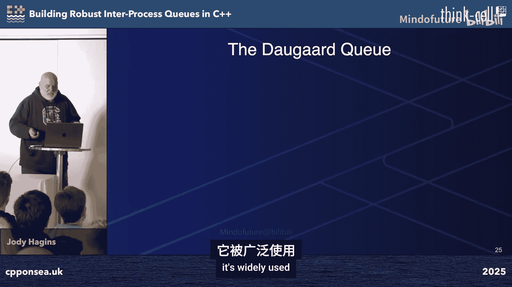

It's intended to be used across threads。 Okay， so it was designed with this model in mind that I want a fast。

 single producer and a fast single consumer that are running in separate threads。

 And I want to do that。 I， I want to do that well。So。By the way， as we go through， ask questions。

 if you have any questions about stuff， some of these things I'm going to go through pretty quickly。

 Yes， why blocking because what we want is we don't want to waste CPU cycles who want to basically be able to say。

 hey， notify me when something's there and then let me go read it。😡。

So in typical scenarios like this where you want these fast cues in communication。

 you're blowing latency。 It's because you're not processing 20 messages a second。

 You're processing hundreds of thousands or a million messages。

 I mean you're processing tons of messages。 And so you just want to basically be able to read as quickly as possible。

 And so if there's nothing there， I'm just going keep going around until the message hits as soon as I see the message there。

 I want to process immediately for as low latency as possible a lot of times what will happen is you' have you'll just be pinned to a particular CPU and that's all that CPU is doing is pulling these message queuees so that it can respond to the message as quickly as possible。

😡，Ask any questions as we go by so that so that I can get them off and get them to you。

 Some things may be confusing。Or not。So this queuee is widely used。

It's described in Casper's blog post， So he's got a blog where it basically the blog has three articles。

 which are these three and it's got one for that explains how it works。

 It's got one that does some performance testing and talks about the performance results and it's got another one that basically talks about So this cu is blocking。

 but it's busy blocking。 So if you want to write or read。

 it basically does a spin until it until it gets a message right it doesn't do it doesn't allow you to poll and do whatever you want。

 you just say， hey， I want to read and it just goes off and spins until until something's there to be read。

And the other one says basically how to do nothing more efficiently。

 It's a thing that article talks about how to integrate smaphos into his design。

So I know that this queue or derivations of it are used in multiple systems in production。

 but pay attention to the copyright notice。😡，So I actually sent an email to Casper and asked him about it and he basically said。

 yeah， consider an MIT license， when I get time， I'll update it。

 but the reason it says for edative purposes is because I'm not really happy with the API。

 I'm just trying to talk about the concept of the low level things about how do you write one of these types of cues。

And the first thing to notice is that it's not even a queue。 It's called Green buffer。

And the next thing is it's a single producer， single consumer's cu。

 and it has one producer at a time and one consumer at a time。

 And the reason we're going to spend a little bit of time looking at this because ideally what we would like to do is just take this cu and put it in shared memory and use it because it's written and it's been debuggged and I'd rather use it that way。

We see that there's some shared state here。This shared state is basically there's a writer。

 the writer has a view of this shared state and the reader has a view of the shared state and all they are is the position。

 the position where the writer wants to start writing and the position where the reader wants to start reading。

 And so they each have their own their own thing there。 And if we notice here。

 I think did I pop it up there。😡，No， but if you look here at the very top。

 it's aligned on a cache line okay so each one of these。

 the writer state and the reader state are separated separate on their own cache so that you're not going to be thrashing the cache between the two of them。

 it's a this is a this if you see this， that's a clue just to say， oh。

 this person at least wants to be cognizant of some performance and where my data is on the cache。😡。

And so then we have the local state， so the shared state is what is going to be shared between the reader and the writer right you've got some threads's going be reading。

 something that going to be writing and in order for them to synchronize there has to be something that they share now notice there's no mu textes。

 there's no locks， this atomic these two atomic variables are going to be how the lock is going to be implemented。

😡，But then there's also some local state because the reader needs to have some state about what's going on with it。

 the writer needs to have some state again， it's their cash line here the cache line is for a slightly different reason。

This cache line is so that you don't get false sharing because if they weren't separated by cache lines。

 if you look down here at the bottom， you'll see you've got the writer and the reader together。

 if they're not separated by cache lines， then they're going to be smashed together and so what's going to happen is that the data for the writer and the data for the reader are going to be in within the same cache line and that's not going to be good for anybody。

Okay。But then we see that we've got a constructor that just sets everything to zeros。

And we have a buffer pointer。 This is the pointer to piece of the piece of memory。

 And one of the reasons we're looking at this cue is because there's not a lot of memory management to worry about I had had the rig torp went in here here too。

 But when my time got cut， I kind of rip that stuff out。 But it has its own memory allocator。

 So people think oh， it's got its own allocator。 I can use that in shared but no。

 you can't use that in shared memory either。 for different reasons。But it's got a buffer pointer。

 So I'm just going， if you just point that buffer at some other piece of memory and shared memory。

 then there's your buffer。But note that when we default construct it， it's no pointer。

 what does that immediately tell you？It tells you that you can't use it for anything good。

 right just by constructing it， it can't be used for anything。

 There has to be some other step in order to initialize what these pointers are。

 There has to be some multiphase initialization that goes beyond just the constructor。

Then we have the pause in the end。 This is basically consider。

 So one of the things you have to do when you deal with these ring buffers is you've got a fixed amount of memory。

 Let's say 100，100。Bte or  100。UClls， right？So let's call it128 because this one requires me to be powers of two。

 So I've got 128。But I。At one particular time， when I start， the writer can write until 128。

 but after the writer writes into the first part， it window of what it can write and is smaller until the reader comes along and reads pieces and so the pause in the end is basically the window that I for the writer。

 it's the window I can write into and for the reader， it's the window I can read from。😡，Okay。

 and this gets updated dynamically， it's not a， oh。

 consider some big number and then just trunnccate it and use that value。

It's kind of trying to be a little bit smart as to how it's doing this window。

 So it doesn't ever have to do all of that all the time。

 It only really has to look at the current position。 And then if it doesn't have any space。

 then it'll go and do the expensive thing every now and then。

But pause and end is the window that it has to either read or write。Base and size。

 This is how it keeps track of that rolling window。 I've got 128 bys。 Well， once I've written 128。

 I need to write some more。Well， there's two traditional ways of doing this。

 one is you just loop back to the beginning and allocate your window again。Okay。

 it requires some a little bit more overhead。 There's another one that that call the magic buffer。

 which is basically。All you do is you take this physical address in memory， you map it。

 and then you map it again， you map that exact same memory again。

 but at the very next address spaces。So then when you go over the buffer。

 youre automatically the operating system， everything has already set up for you that you're going automatically map back to the beginning set of memory。

 It's just going it'll do that for you。And。That most of the time gives you a performance win。

 depending upon how complicated your computations are， not always。 So as always， if you make。

 if you do something for pure performance， make sure you measure it。

 But that's what this base size are。 It adjust as it goes by。

 So it knows where the base is Once I've gone 128， the base is gonna adjust 128。

 So the next time we do a computation and figure out where we are。 We can use our pause and add it。

 And this works in shared memory。 it works in regular。 And it's it's just how this how done。😡。

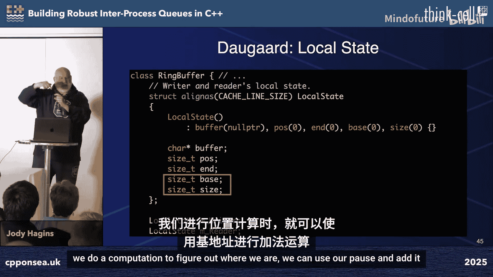

So let's look here real quick at how a write works。This is a variable length buffer， okay。

 this cu does not， it doesn't say， oh， you have to have a queue of Ts。

 If you remember the ring buffer was just a ring buffer， no template on it。And so it takes very。

 it's a variable link， takes variable link messages。 You can write anything you want in it。

It's great in some ways。So we write， how do we write？We call this preparepa right。

 which is all it does it says， go get me a space to write into that's big enough for the thing I'm writing into it。

Okay， that blocks somewhere deep inside， prepare right if it needs 100 bytes and it only has 20。

 it's going to wait until it's got 100 bytes。And then this is how it's doing it copying。

It's doing a placement new。Of whatever type you've told it。 Now， Jodi。

 you said that the ring buffer wasn't tempplized。 The ring buffer is not。 This member function is。

 This is a， this a function template。 So whatever you give it。

 it's going to basically take that and put it in there。 So let's， let's see。 we're in， can I。

 what about， can I put an int in here。What say we could I call right on an int。

 would that be a reasonable thing to do？That'd be a reason me to do。

 What about call right on a stood string。 Would that be a reasonable thing to do。No。Maybe。

Because they are in the same they， they're in the same process。 right。

 And remember this thing did a new Now it it does a placement new。 So the string。

 if it's a small string， then there's going be no extra memory allocation。 if there is。

 if it is a bigger string， then it's going to do another memory allocation to actually allocate memory for it off of the heat。

 which is probably not what you want in something that's designed to be fast， but。

It would work in this case for this cue， but it's because they're in the same address space。

 So this is another， this is one of those things to watch out for when you take something that you use within a single process and you want to use it across processes some of the things that it allows you to do within a process。

😡，You， you can do it， but you're going now you're going to bomb。

 so now let's say this cu is being shared between two processes。

 You have a writer that writes a stood string in here， so it writes the string。

 does the memory allocation， and now the consumer is in a separate process。😡，Without。

 if you're just in another thread， you share the same address space。 So it's no big deal。

 But if you're in in another process， you read the string out。

 It has a pointer that has the value of the producer's address base， which is not going to be yours。

And you're hopefully going to crash。That's the best thing that's going to happen is that you're going to crash。

So I just bring this up。 you have to be in a different frame of mind。

 Don't chase the bus across the hypotenuse， right， stop and think when you're doing when you're dealing when we're dealing with these things。

😡，This one basically just writes another， another integral value。 So it's the same。

 And this one is right array。 And what does right array do， It prepares for it， It says， hey。

 I'm want to write an array of things。 I need to figure out how much size I need for the whole entire array。

 And then I do a loop。 and I do a placement new for each one of them。Okay。

 so it allows me to just kind of write an array。And then we've got this finish right。

And what it does， it does the commit， all of these other rights。

 they're just ways of writing some number of bites into this buffer。

It's all just been done locally with that local state right all this stuff so far is only touch that local state whenever we do the finish right。

 now we're going to punch our local version of where we are into that shared state and now after this finish right。

 the reader now can read those bytes up until you call finish right the reader can't read them okay？

😡。

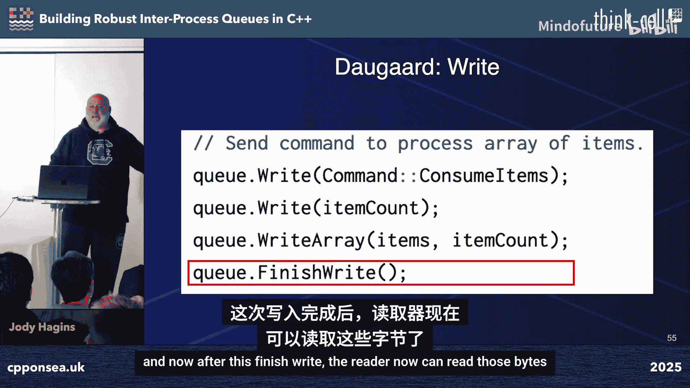

So here's what Pre rate looks like。We basically call a line because you want the memory to be aligned according to its appropriate type。

 So we're going to get a position based on the alignment of the memory。

 We're going to get our end based on the position plus the size。

 If our end goes past where we where our full window ends。

 we know that we're gonna to overrun our our buffer。

 So I say we only got 20 bytes left and we trying to write 50。The end。

 the end is where we propose to end。 It's bigger than what we have。

 So now I have to call get buffer space to write。Which is going to block it's going to go get buffer space。

 but as soon as it returns， we now have a new end。And we return the pointer to the place where we can write。

Okay， so let's look here。Get buffer for space to write to。 The first thing it does。

 it checks to see whether it needs to fix up its own inposition or not， right。

 because the impposition， remember， those the the， the the end and the pause are the window。

 It can actually write to。 So those indices don't need to be truncated or don't need to be and or or moded。

And so it says， oh， we're going to go by， I'm going to put my position at zero。

 and the end is going to be how many many bytes I need。

And then we're basically going go into this loop。 This is the loop where it's basically waiting。

 The writer is waiting for the reader to have read enough bytes so that I can write。

 But this loop only happens if I don't have enough bytes to write。And then this is。

 this is just basically saying I'm gonna load the， this is the share。 This is that atomic variable。

 where's the， where's the reader at， Okay， Because I had my initial cache that said。

 I've got everything。 And I know because I told the reader you got nothing， I've got everything。

 But then as I'm writing， I'm updating my stuff。 only when I don't have enough bytes。

 that's the only time I ever have to go look at the data that I'm sharing with the other thread。Okay。

 so， and then when。I have something there。 The amount I've got available is all the stuff it's read。

 not each one that it's read， right， If it's read 1002 B messages， then when I go through here。

 I just get 200 B。 I don't have to figure each one out。

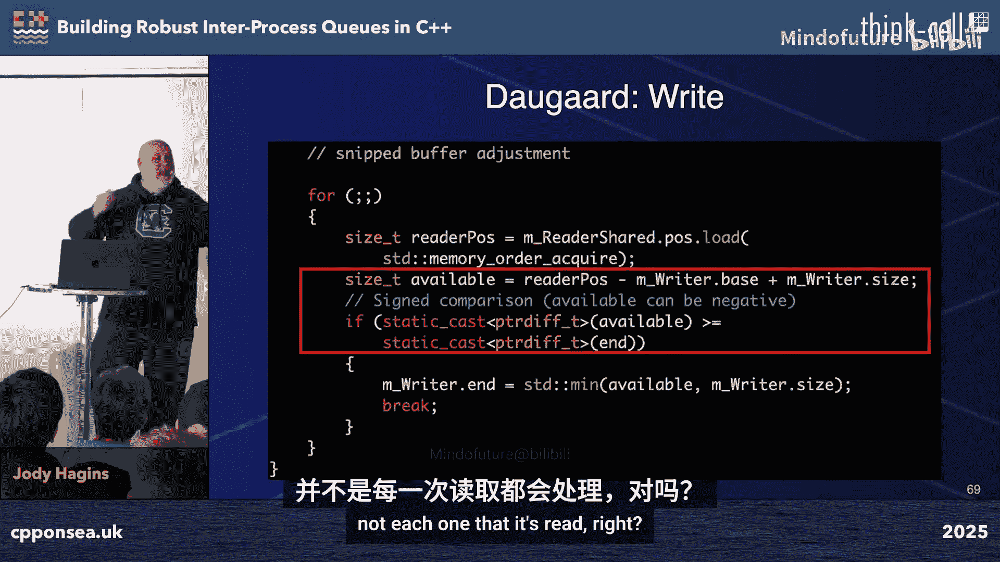

And then I basically just return。 I update my the end of my point the the end of my position to。

 to where it needs to go to。 Okay， so now I've， I've， I've waited until I have enough memory。

 I've got my memory。 I fill it up。And that's what finish right looks like。 Okay。

 so that should be that shouldn't be too difficult， but if you have any questions。

 please ask because it's possible that I didn't explain it right。Okay。So when we look at the read。

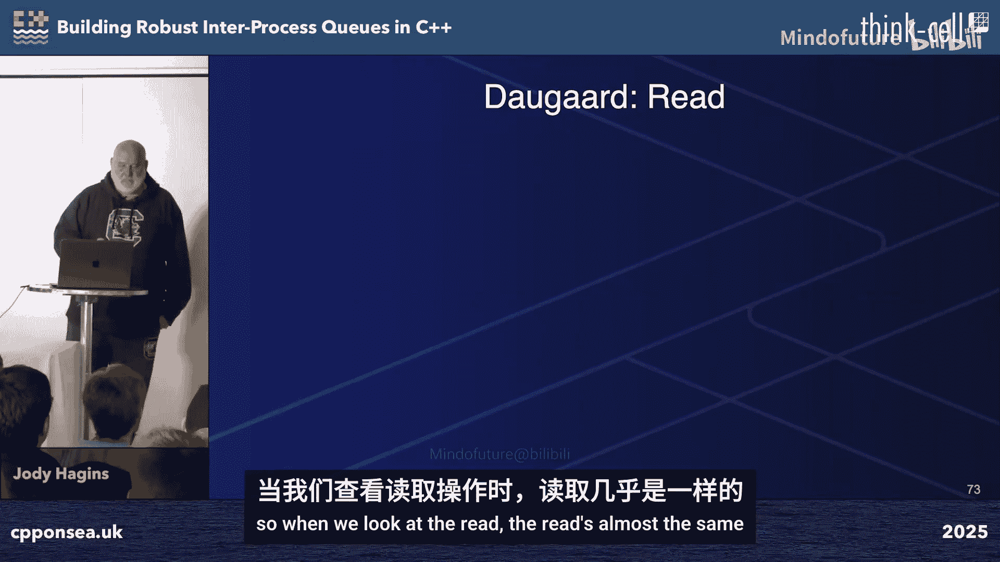

The read's almost the same， but one of the things we note here。

 and this goes to the API kind of thing。We can see that the first thing we're going to do is do a Q read command。

 Well， how do we know we need to do a Q reads of a command type。Well。

 the protocol has to be implicit or it has to be explicitly programmed if the writer writes an int followed by you know a foo followed by a bar。

 then you have to read an int followed by a foo followed by a bar because that's the only thing it knows now you could write in like a variant or something。

 but then it's doing the same thing It's looking to say， oh。

 what is this tag oh I know what this part's gonna be。😡。

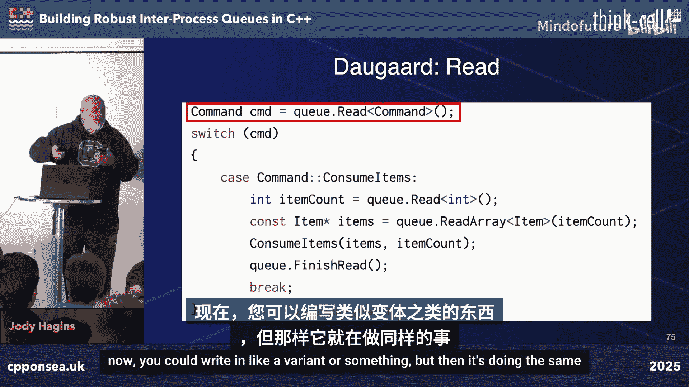

But you can see that the read is pretty much the same thing that we prepare for the things we need to read。

 and then we just test what's there to this pointer because it should be that type。

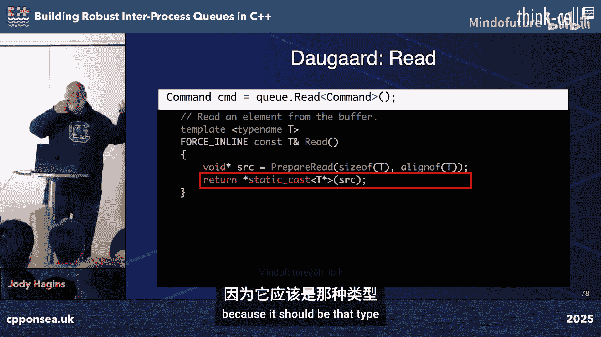

Same thing here。Same thing here we do the read array except we don't have to do a loopt because it's already in there。

 constructed as an array， note that when the array was put in there。

 it was not an array because there's a difference between calling new on an array and basically just calling placement new on a bunch of pointers in a buffer。

 okay？嗯。All right。And then here we finish， we call finish read。 This finishes the read。

 This now updates the shared data so that the writer， let's say the reader is slow。

 It's reading something and it reads something and now it goes off and does some big。

 long computation。The writer is gonna to be waiting until it finishes reading enough bytes so that it can reclaim that space。

 So what happens typically in these cues is that make you do profiling。

 you make enough memory so that you don't block in normal circumstances。

 you only really block in an extenuating circumstances and then you have to do some recovery but normally normally you do it so that you don't really have to block。

One of the things you should probably add to your cu is statistics so that you can always know how many times it blocked。

 how long did it block for， what was it waiting on if you have if you have the room for your statistics。

 you can put timestamps in it so that then you know if if I ever blocked。

 when did I block why for how long because ideally if you're doing these types of things for low latency。

 you don't ever want to block the blocking is the backup in case in case it's that day where where where the market is 10 times what it has been in the previous four years right that days gonna to happen and when it does。

 your systems are going crash probably but you can get you can probably prevent it by knowing ahead of time and figuring out what you wanted to do Yes so the question is when you're reading this data in here。

It's gonna to go it's only valid until you call finish read。

 and that's true because once you call finish read， you're telling the you're telling the writer。

 I'm done with these bitetes if you want to ride into them， go ahead。Yes。

Does Fread actually call the destructors for those things， And that's a very good question。

 And we will see， I think we will see F read。呃。We will not see F Read， but I will tell you that。

It does not。And don on的。So there's， but but the thing is， is that what happens is。So like I say。

 this， not I'm not a Ca for captureer did a great job here。 he told me that API。

 I'm not happy to the API， right？But what happens is that this gets into something that C plus+ 20 brought along that people tried to emulate for a long time。

 and that's concepts， making sure so theres there's nothing on here that tries to guarantee what types of things you should or shouldn't put in there。

 If you don't want things that aren't going to be put in there。

 then you shouldn't do anything with them or you should enforce that you can only put these types of things in there right。

 and you should use concepts for doing that kind of stuff， yes。Yes。😊，So far。

 everything's in the same process， yes。The goal is to show us what it's doing so that we can determine。

 well， can we do this across processes， Yes， and I will get， hopefully I'll get there shortly。

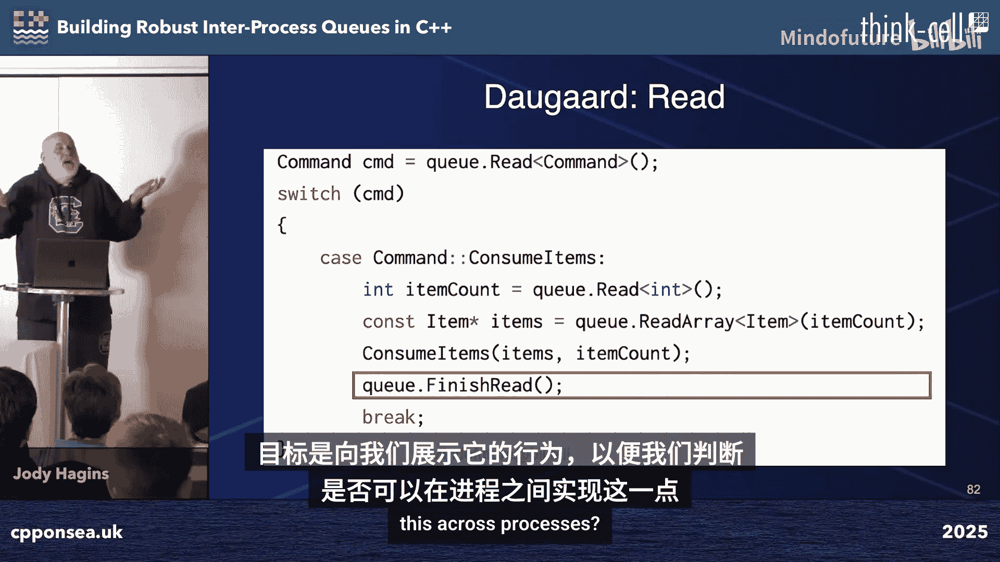

So you remember the local state constructor set the buffer to null pointer。

 and I said there must be another way to initialize it。 Otherwise， every time we use it。

 it's going to be accessing a nu pointer， which I mean， I think， I mean。

 even the Rus guys don't want to do that， right？嗯。

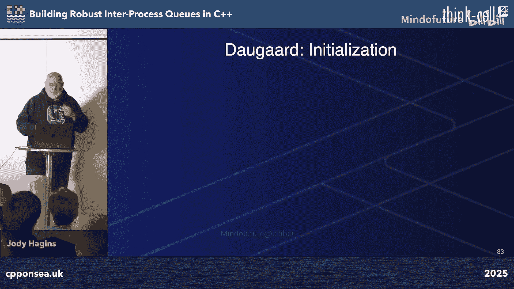

So and and here it is， here's initialize。 you must initialize first。

 and then we've got the Stephen Duhurst。 you guys remember a talk he did where he had there's like this big warning。

 do not do this， you know。I mean， the buffer must be required， have the required alignment。

 and the size must be a power of two。And again。Casper explicitly said。

This is just for educational purposes。 This is not for me。 But if you want to try and use this。

 you need to address some of these things， right， But what we do is we initialize the buffer and we set up the pointers。

 And you can see that we're setting them all up。There's nothing else in this API。

 There's no management of buffers。 There's no copy。

 There's not even there's no constructors in this class， nothing at all。

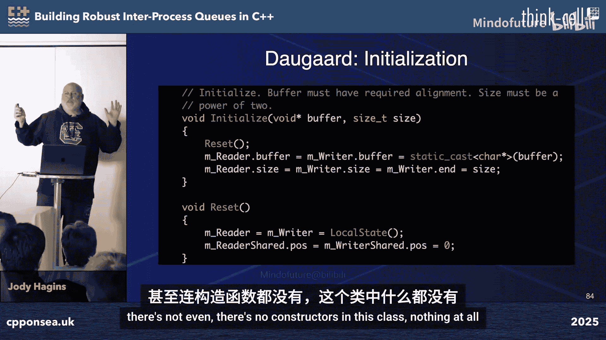

So what does this Dwgar Q do， It does give us a PIO。

 and it does support multiple message types because it has this variable length buffer。 Well。

 what about between unrelated processes？What if we use shared memory。

 what if we put this in shared memory and we put a thing in that right that takes a template and we made it a concept that said you only put in certain things or we updated it so that it would check and call destructors right what？

周。😡，What else could we just put this in shared memory？Yes。

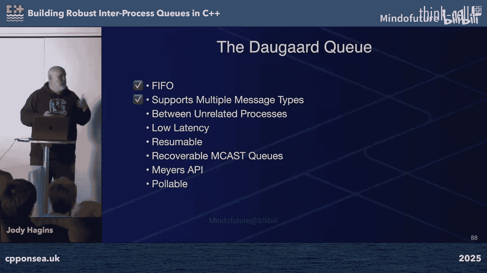

Yes， that internal I noticed we had an internal pointer is will that cross process boundaries and that's a good question。

 And so what happens is when if you want to take this to a process。

 you're going to need the way I called it was reattach reader and reattach writer。

 So each remember the local in the local state， each one has a buffer pointer。

And that buffer pointer can get assigned。But it can be reassigned so that because because when you get to a process。

 you have to have a queue and I have to have a reader， I have to have a writer。

 The reader and writer are gonna to be different places。 The memory is going to be the same。

 but it's gonna have a different pointer value。 And so when you bring up your reader and writer。

 you're gonna have to reattach those pointers because they're gonna to be invalid。

 this gets into something later when I start talking about the Apis that we want to have。

 And when we try and break these things up into into more usable concepts because theres， I mean。

 there's there's enough。 if you took this and try to put in shared memory， I will tell you。😡。

The compiler will let you put one of these in shared memory。

 and you can manually update those buffer pointers and you can probably get something that you think works。

😡，嗯。But。There's a problem。Here's the local state class again。

There's an undefined behavior issue here。Anyone that I've not。

Told the answer to anybody see what the undefined behavior issue is with putting this。

 putting an instance of ring buffer in shared memory。

 and the undefined behavior issue is on the screen。Maybe as zombie be in the other process。Okay。

 the buffer might be a zombie that's true or the process might have even gone to ahead。

 but what we're going to do is in the process every single time when we want to have create a new consumer or a new producer。

 we're going to set that buffer to the actual pointer in our process space like yes。Yes。

讲边 to be a doctor。They don't have to be atomic because the local state is only updated by。

 so the local state of the consumer is only going to be updated by that consumer and the local state of the producer is only going to be updated by the producer。

😡，So that's why there's a difference between the local and then the shared。Yes。ve been structure。第s。

Oh， you should have stopped I it the constructor， Yes， it's the constructor。

 but it's not because of that。 It is the constructor， though。And we can't and we can't do it。

We're going to dive into this issue much later， but I'm just going to tell you。

 it does have to do with the constructor， look at and think on it。

 Why is that constructor a bad guy with putting this into shared memory。

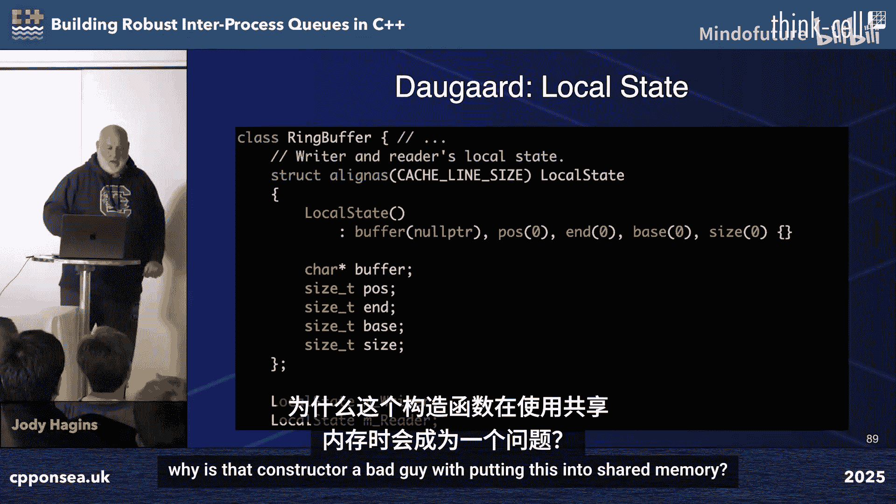

Does it have low la， yeah， we can keep the same implementation if we wanted to put it in shared memory。

Is it reumable Well， we can't really do that by our definition because it doesn't support those operations anyway the same way with being a recoverablecast。

 it doesn't support those operations though you can extend this queuee I've extended this Q and the rig Tor。

2 support multicast and in its current form， Myyers's API know remember Casper said he even he didn't think the API was was usable in his current form。

 there's lots of problems with it but it's great for experimenting with and it's great for building something on you can build a production system with just very small changes to this I mean it's really what he did is nice。

😡，So this API， while interesting is difficult it's very errorprone。

 you have to remember to do these things and then you have to remember to call finish read or call finish write you know there you have to be。

 you have to be concerned about what stuff you can put in it and there's nothing that tells you what the what you can put in it or not and the compiler will let you put almost anything in it and most of it will kind of work。

😡，For some definition of work， I mean， if you don't care about leaking memory and you may not。

 you may be， you may be writing， You may be writing code that controls a cruise missile。 I mean。

 who cares how much memory it it has when it blows up。嗯。Yeah。And it's not blocking。

 it's not poleable。And so now， before we move on， we'll take time for a moment from our sponsor。Um。

 because this is the greatest single C+ plus slide in history。呃， and。It is， I mean。

 you just sit there and admire it。If you're not familiar with this。

 then you need to go watch Howard Han's talk， I think from 2014， is that when it was from？Um。

And look， this is， yeah。Right。So this is why you can't use that thing in shared memory。

All right and this one's not an embarssing thing， I just really want to know who knows what implicit lifetime means？

Okay， about 5，6 people， maybe， right， Okay， that's that's actually more than I thought unless a bunch of standards people were going to be in here。

 So this is why this doesn't work。And the reason is because maybe you guys have seen examples of this kind of undefined behavior that has been undefined in C plus plus for a long time。

 like forever。Until it became defined， undefined。 So it might not make much sense because we mallic an int。

Surely we can use it as an int， right， I malled an int。 I， I cast it to an int pointer。

 and now I assign 42 into it。And I don't know of a compiler or platform that this doesn't work on。

There might be one， but this is undefined behavior。

Maybe this might help you understand a little bit more why and the reason that I used to stoodstring in my earlier example。

Obviously， this would be wrong to do。No constructor gets called。No new。

 just a mallic and trying to assign this thing into a stood string。There's no lifetime there。

 And it's not because the computer has a problem or the compiler has a problem。 It's because the。

Abstract machine in C++ has no way of knowing that a lifetime actually exists there。

 no lifetime ever got started for the int or for the string。And so there's this rule。

I don't know how well you can read that。But basically， this came along in C++ 20， they said。

 there's some number of operations。That will implicitly create objects。

So that first thing will be valid。That will no longer be undefined because there's some set of operations。

That will make。Certain things have an implicit lifetime， Malik is one of those special operations。

But there's a restriction。Objects of implicit lifetime types so this magicit I'll implicitly make you start your lifetime is only for types that are implicit lifetime types Okay。

 well that sounds kind of redundant， but let's go look and see if no such set of objects would give the program defined behavior the behavior the program is undefined。

Don't say that fast twice。Yeah。And here's the example from the standard。 right。

 It's this same malic thing， right， I can now Malic and I can access the elements。

 and this is this is defined behavior now because Malik has been blessed to start objects implicitly。

 but there's that caveat。 The object has to be an implicit lifetime object。😡。

You can see where I'm going because if you're going to do memory between processes。

You're probably going to be using Mmap or some variation thereof。

 I have no idea what what that is on Windows， but you're probably you're going to be doing some form of like Mm。

 where you're going to be mapping a set memory。😡，Each platform can have platform defined functions that are those special magic functions that allow things to implicitly come into life。

嗯。You wouldn't be stupid to think that Map should be one of those on your platform。嗯。嗯嗯。

And these are the implicit lifetime types。Scacalar types， implicit lifetime class types。

 There's another we have to go look up。 But scalar types and whatever this implicit lifetime cl types。

 array types and CB qualified versions of these types are collectively called implicit lifetime types。

 So there's our implicit lifetime type Scalrs。 Oh， that's why that Malik of int works。

Implicit lifetime class types， well， if we look at our local state。

 our local state is a class type and the ring buffer itself is a class type。

 so in order for those to belicit have implicit lifetime。

 they need to be implicit lifetime class types。So what is an implicit lifetime class？

A class is an implicit lifetime class if it is an aggregate。

Or if it has at least one trivial eligible constructor and a trivial non deleted destructor。

So it's an aggregate。Or it has at least one trivial eligible constructor。Now， what does that mean？

At least one trivial eligible constructor。So。It has to be able to be a trivial constructor first。

 Well， what kind of constructors can be trivial。You can have a default default constructor。

 copy constructor， mo constructor。 Those are the only things that can be trivial。

But can't I as a user define one to be trivial， well， no you can't， because by you defining it。

 it is no longer trivial。I would， wish there was something like this。

I wish there was something like this where I could define just a constructor with some tag type。

 I'd even settle it for it being some standard library tag type or something and then just saying equals default because that would enable me to have a trivial constructor。

But。If we remember our class， it had a constructor， what did that constructor do。

 it just set stuff to zero， and then all that stuff got reset anyway。

But because it had that constructor， it was user defined and it is not trivial。

 So it is undefined behavior to use that inside of shared memory。 Yes， okay， so the question is。

 if you have a class and you don't define your constructor。

 But instead you assign initial values to each of the members。

 I that trivial since you didn't define the constructor。

 It is not trivial because you've defined an initialization for anything in there。

 So once you say a member variable equals something no longer trivial。

s because now what happens is the compiler builds a user defineded constructor。

 but the compiler builds it， but it's still a user defined constructor。

The only thing you can do is you can declare their deor equals default。

If it's a default move or copy， and then those will be trivial。

 So that's the only way you can declare them other than that， the compiler has to build them。Okay。😊。

And it has to have a trivial non deleted deor。😡。

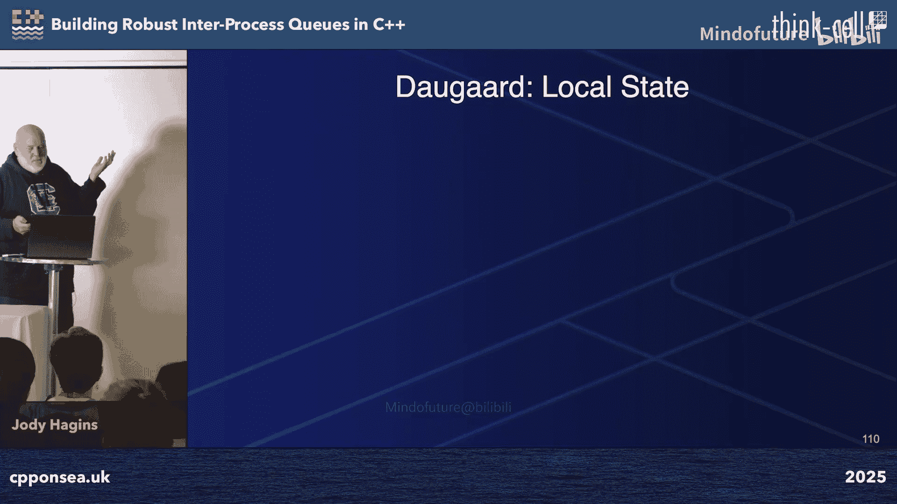

So if we recall our class here。We have a constructor。There a couple of other issues。

 I don't have time to go through it， but let's just say we could do this and get rid of it。

We could do that。There's there's other things we could do， but I wanted to make that point， okay。

 I know you'll go， oh， but what about couldn't you do Yeah， but this is kind of the point。

And this is the point from the previous slide that I showed about Hennnenet stuff。Guys， let's。

 let's understand what the special member functions do。 Okay， the， the copy constructors。

 the default constructs， the move constructs， the assignment operators， the de。

 Let's understand what those semantics are because a lot of times just by adding something。

 you have broken something。If you just said， if you said whatever this is。Pillday local state。

And then open curlys or whatever。 that's a user defined destructor。And it's now no longer trivial。

 And so these things just won't work anymore。 I saw a hand。Yes。😊，Yes， yes。

 and that's why I said there， Oh， he， he asked， isn't there。 isnn't there。

 wasn't there a different way that it could have been implicit lifetime。 And yes。

 but I specifically wanted to just talk about the constructor， Yes， because it's constructor。

 move constructor， copy constructor。 And if you look at these。

 there will be an implicit copy constructor， right。

 But I just wanted to show that we can get rid of it and not and not worry about it all。

 But the constructor causes the problem。 But as you'll see， as you know， that's not the end。Okay。

 because we've got this shared state， this is that whole thing was the primer that was like how to add and subtract because right now I'm going to give you the I'm going to give you the geometry quest。

This has no constructors， so it should be okay。And all it contains is a s statomic。

And on my platforms， it's locked free。And there's this note。In the standard。

 the only time that the standard talks about processes and the note says。😡，That the implementation。

 this is of Lock free atomics， should not depend on any per process state。

 This restriction enables communication by memory that is mapped into a process more than once and by memory that is shared between two processes。

 That really sounds a lot like what we're trying to do。

This is the only place in the standard that it even mentions that you can like write C++ programs and expect some interaction with another program。

So we should be able to use the atomic。不。This is not implicit lifetime type。 Why， why is。

 why is this not， and why is this not implicit lifetime or why does it violate the implicit lifetime rules。

 Because in order to， so remember it said an aggregate is an implicit lifetime。

But that doesn't apply to its sub members， right， The aggregate itself is an implicit lifetime。

 But in order for everything to be seen as an implicit lifetime in shared memory。

 everything has to be implicit lifetime。And this doesn't qualify， anybody know why？I'm sorry。

Because it is because of the statomic， why？日表そ権です。But statomic was used to be non trivial， I mean。

 it used to be trivial。Still the time， it used to be trivial。那对就新发一个I。不那。嗯。Okay， yes， but it still。

 it still was trivial on up until up until C close to 20， it was trivial。Because you had。

 there was an a knit function that you could call， right， So when you created these， you could in a。

 you could it's called a knit a knit， atomic a knit or something like that。So this is what happened。

The default constructor was default。It was trivial？From the time it came around in Cphis 11。

 up with those seaphiluss 20。And in sequence is 20， the default constructor now default initializes。

Furthermore。See that copy constructor that's deleted down there？

The trick that we had earlier where just by deleting the default constructor， we go oh。

 well now we at least have one， well you don't have any here because stood atomic。

 it't it doesn't even have those ones that could be trivial。 They don't exist at all。

 The only one it has that could qualify is the default constructor and as a C plus S 20。

 every stood atomic has it has a user defineded function。

 So all the code that is on the Internet that is using stood atomic in shared memory is now technically undefined behavior。

😡，I， I asked， I asked the author who put this in if this was considered and he was really busy。 was。

 He was working on a book and some other stuff。 and and but。

It's I think what happened is it passed through without this consideration。But it was a safety issue。

 which like really gets people's attention， right？And who am Who am I to say anything about it。

 Because I thought I could outrun a bus by running across the hypotenuse。So。

 but this is the way it is。 as of， as of F plus plus 20， st atomic is not an implicit lifetime type。

 You go， oh， well， but you know what， we now have this cool thing called start lifetime as。

 Can we just call start lifetime as on it。 Well， you can call start lifetime as on it， but。😊。

Calling start lifetime as on something that's not an implicit type is undefined behavior。So yeah。

 what are you going to do？是。Really。没有。All right。That can be。嗯，O。So here's the big problem here。

So what are we going to do？We could use atomic ref。You could basically。

 instead of putting an atomic in your shared memory。

 you could put a size T in there and use atomic ref。嗯。You can write your own atomic。

And do that because at least now you've got something that is an atomic rather than just some integer there。

 because if you use atomic ref on it and somebody else doesn't use atomic graph on it。

 that's on defined behavior too。And that wass an undefined behavior that you're probably going to see。

嗯。So what do we do， Here's here's an option。It's ugly and people probably won't like it。

But it is an option that does not break stood atomic。Okay。

 if we had some type of implicit lifetime raper。And then this thing that let us know whether it was one。

 and then we did something like this。Where are we？Said that the the trivial default constructor requires is implicit lifetime wrapper。

 This is ugly because， but now I can at least say atomic， implicit implicit lifetime rapper event。

 And I get an atomic of an end that has an implicit in it， right。And this wouldn't break anything。

But it's really ugly， but'm I'm。It's frustrating that you can't， technically， you can't use statomic。

 Now， is it going to break。Maybe， maybe not， I mean。Yes。😊，Oh， why do you need。

 Why do you need an atomic at all producer single consumer， because they're sharing those。

 those two values。 And one of them could be updating the position。 One of them could be updating。

justNo， no， no。ButNo， no， no。 but what happens is if somebody is writing one while another is reading one。

 that's a data race。 that's undefined behavior in C++。Yes， there's also the data in Excel like its。

Yes， there's also there's also the data in the queue itself， yes。So。嗯。

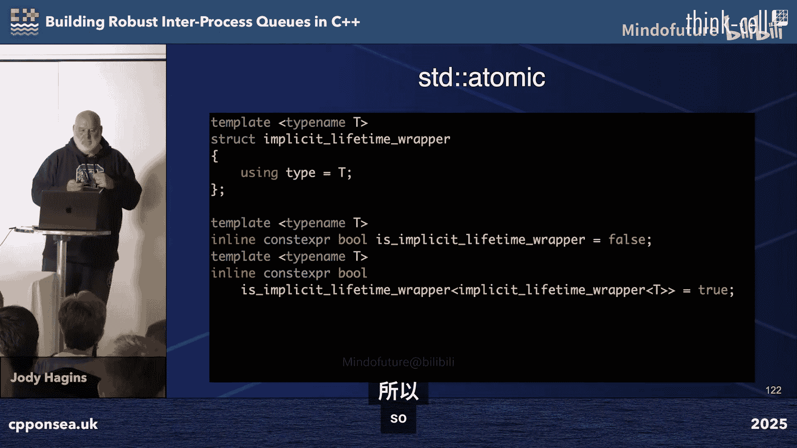

We could do something like this as' possible， implicit lifetime is a big hazard。

We have this issue with cash lines。 I originally， I thought I had 75 minutes。

 but I I don't think I'd do anymore。 I thought I had 90 at first， and then I got 75 And then now， so。

 all right， I'm gonna try and bump through。 I'm， I'm gonna skip through some stuff because I want to get to one thing that's important here。

 But I think this implicit lifetime thing。 Even if that's all we talked about。

 I think it would be worth it because。Most people don't even know about it and we're making mistakes even we're making mistakes in how to deal with these things because they're not on our radar I think I can just run the hypotenuse right I mean it's so here's another cache line thing which is kind of awesome because you need to know what your cache line is but ifre if you're on Mac this used to not exist in Mac。

 it was just not defined at all hardware constructive interface right So this thing right here。

 the CL hardware interface。😡，Size， I think wasn't there。But now it exists。 But unfortunately。

 on Apple， if you've got one of the Macs like an M2 that has a 128 Bte cash line， those。

 those constants per constants in the standard library return 64。 They lie to you。

 They tell you your cache is actually smaller than the。 Fortunatelyly， for me and my code。

 I actually had some tests that were testing this。 And so。As soon as I upgraded to the new compiler。

 it's like， oh， there's something broken in my code and it took me a while to figure out that。It was。

嗯。So the next thing is to tackle the API easy questions。 So here's separation of concerns。

 I recommend this book。 A lot of people are kind of design patterns， design pattern。

 Klaus did a great job with this。 And the first two chapters are gold。 Soaw a question， yes。😊，嗯。

One of the big things that he talks about here is the separation of concerns。

 and we need to separate our concerns。 So if you're going to build a cu in shared memory。

 I'm just going to say if you're not doing it this way， you're wrong。

 Okay and I've only ever seen one implementation that does this aside from mine。

 So there's two of us that are right。

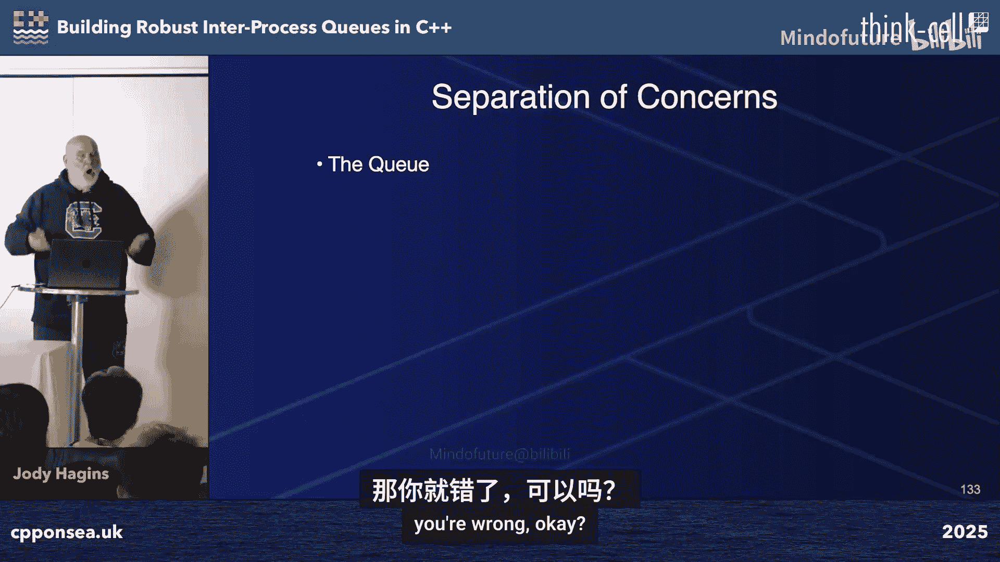

See， I'm standing on my high horse。 I'm standing up here。

So what you need to do is you need to separate your concerns。

 if you're going to do this across processes， you need to have a queue。

 It only job is to do construction， deal with the metadata and the buffer and the and synchronization。

 What type of synchronization。 does the queue need to do。 Well， if you've got a single producer。

 then you should guarantee that there's only one producer。

 You shouldn't be able to start up a program that wants to be a producer， And it just says， hey。

 I want to be a producer and it starts producing。 If it's a single producer。

 It should have to get a lock。😡，In order to be the single producer。

 And so the queue should should handle that， the producer must have an existing queue to use。

 I want to create a producer。 I have to have a queue because it's going to have to go and open it and lock it and request to be the producer。

And the Highlander rule， right？There can be only one。And so if there's only supposed to be one。

 there should only ever be able to be one in the whole entire system and that queue should enforce it。

So the producer has to have an existing queue。And what you want to do is separate the producer and the consumer because I only really want to have one。

 I have to have one。This is， in my opinion， not optional。The cube manages all of these things。

It manages them usually with an advisory lock and most operating systems have such a beast。

 abstract it with something like this， it's just an advisory file lock because a file lock sounds reasonable because you're probably doing an MM of some sort。

 even if you're on Mac， create a memory a memory disk and do it that way instead of through their shared memory APIs which are atrocious。

And then you want to have some characteristics so that you know， like a signature。

 What is this thing， there should be a UuI because you're gonna have different processes connecting to different things。

 They may get pointed to the wrong thing。 You should verify with the signature and you should verify with the UuIs to make sure that you're connected to the right things。

 There's the capacity to meize the alignment。 Basically all these things that you need this should all be as part of the metadata of the queue。

 the queue isn't just those data structures plus this is this is gonna have a safe API。

 And if you separate concerns， you're gonna to need to lock。

 you're gonna need to have a process lock because if let's say I'm the producer。 and I crash。Yeah。

Right。And Matt yells at me and says， your program crash， I'm like， well。

 there's another one running as a backup。But it can't get the lock because that thing died holding the lock and it crashed。

 so no deor got run。So the lock is still sitting there locked。What are you going to do， Well。

 Linux has this thing called a robust mut。 and you can use that， but。Like Mac S doesn't have one。

 So what I did here is， and I encourage you to do something like this unless you're just always going to be on Linux。

 You're always going be on Linux。 Use the robust， the robust P thread Mu text。

And so what we do basically is we just try to get the lock。And it calls this implementation piece。

 basically these are locks and unlocks。And this is the crux of it。

And what we're going to do is we have a， we have a process ID。

 which the process ID is a global process I on the machine。

 it's the PI and the time to as much granularity as you can get of when that process started。

And so it's going to be a unique ID throughout whole the process's life。

And so we're going to use that as our lock。 We're going to try and set it to null we're going exchange。

 We're going to do this in the atomic exchange。 If I can set， if I can put my process Id into it。

 then I got the lock， and I go away。If I didn't， then。I have to check to see if it was myself。

 Go create the lock。 Do an。 And this right here。 Basically。

 that code says that it tried to get the idea of the the thing that of the lock， right。

 The lock has an idea in it。 It says， hey， go get information about that process。

 If the process is dead or gone， it can't get it。 And so it says that process is dead。 It pulls。

Right here， it basically says， I'm taking the lock from your dead grubby hands。And it takes the lock。

 and then it goes through and tries to do an exchange to set the lock again， right。

 So that's kind of this robust lock where if somebody dies holding it。

 somebody else can come along and recapture it， but it't only allow one。So there's the process ID。

 there's another problem you have to。Oh wow， I went back in time， awesome。So。

So there's another thing you have to do with the process ID。Notice this current。

 This current is a static function， Sta member function。 What's my current process Id。

 Because computing these things are expensive。 You have to actually look up something in a process table。

 You have to go and figure out what time it started。 It's different for Linux and Mac。

 I'm sure you can probably do this on Windows， but they're not super cheap。

 But every time you want to call one of these locks or unlock。

 You have to get what's my current process I。 So we cache it。😡。

So we only compute it once and we cache it by， we have a process ID and we just returned the process ID for gettP。

 what's the process I for my own process？😡，And we return that。

But there's something that happens in here。I'm sorry。What if you thought。

 how could you ask such a question？What if you fork？So， so， so what this does this。

 this P thread at fork。You know what， did my wife pay you to ask that question？嗯。

So this P thread at fort is basically when the fork happens。

The OS is going to make sure that you get these functions called prepare to prepare for the fork。

 the parent that gets called in the parent saying the fork's happening and the child that gets called in the child saying the fork's happening。

And so what we do is we just assign the I back。 Now， this might be a little confusing to oops。

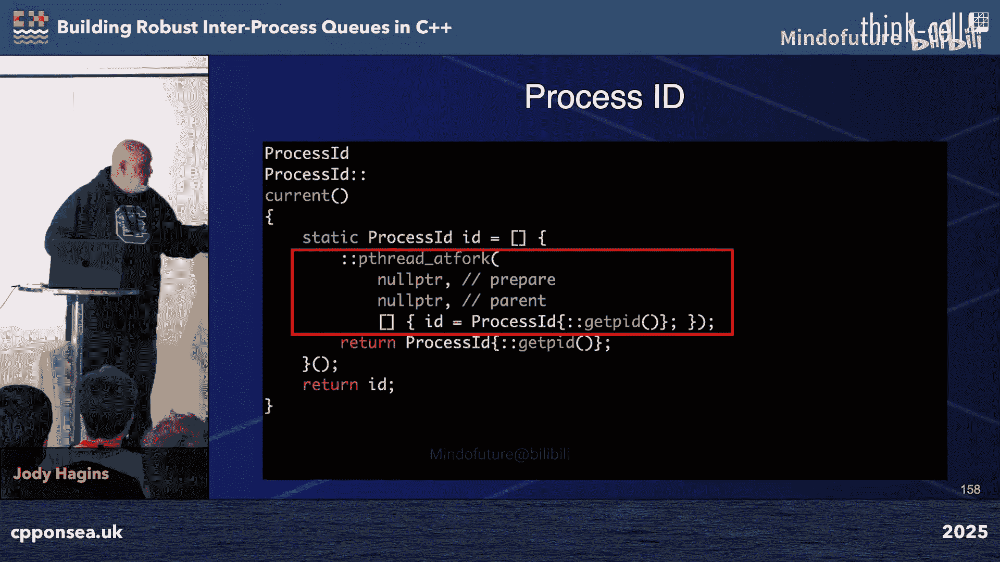

Sorry about that。Because we're assigning the ID， but because it's static。

 we've got the address of it， there's no capture， and we just reassign the ID to the process idea of what we've gotten after the fork。

O。Yes， oh， could I， could you use thread local and。

You don't want to use thread local because there's， it's a process Id。

 There's only one for the whole process。 You're always going to get the exact same process Id no matter what thread you're in。

It's a process， it's a process widelock。

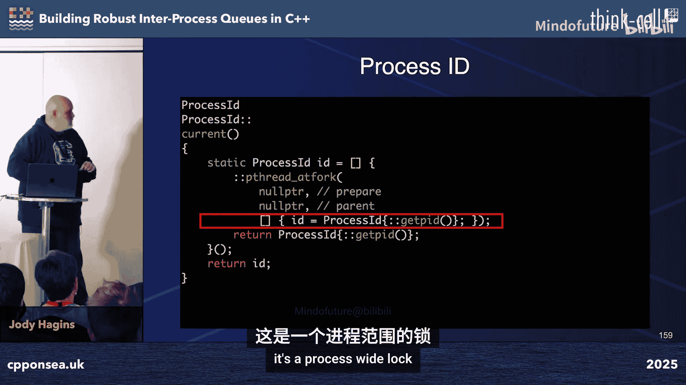

Okay， so I got， I got a little bit of time Mca Qs。MC cues are usually a single producer。

 multiple consumer， are used these are the primary cues used across processes。

They basically I can write one message， I can write one to think of it like a data feed， right。

 a data feed for some stock exchange or something I can write I can write one message out and every process on the box can immediately get it。

😡，Okay。Single producer， multiple consumers。Every consumer gets every single message。

 this is called an MCcast queue or a broadcast queue。The producer never blocks。The producer， Jes。

 keeps writing。If you're too slow， if you're a too slow consumer and you eventually miss messages。

Sucks to be you。Right， I mean， don't be slow。Or make the cu bigger。Really， I mean， there are。

Almost every single MCQ used in production， at least in the financial industry does this。I mean。

 you know， don't， don't get slow， make a big， huge buffer。

 This is where you need to keep statistics all the time so that you know exactly if I've ever gotten closer。

 if anything ever happened。And most really fast ones have some kind of undefined behavior。

I love sea clock cues。 They're a little beefy， but they're really fine grain。

 David I'm not gonna go into them because people's eyes started glossing over just going through the single thread。

 going through the Dwgar queuee David Gross has two talks。

 he talks about a sea clock in this talk and in this talk he talks about another almost the same thing is just implemented differently without a sea clock。

 And this one's also a variable link buffer implementation。

 The previous one's a fixed link buffer implementation using a Sea clock and this one's not。

 So those two talks give you most what you would need to know about how these types of cues work。

 And he even says that it's like yeah， drop them if they're not there。嗯嗯。But even here。

 if we separate our concerns， we can almost automatically see an easier solution。

 if we just separate our concerns， because we no longer have a cu that is supposed to be doing everything。

We have a queue that just represents the queue itself。

 the buffer and whatever metadata and synchronization primitives it needs to have that everybody needs to share。

That's its only job is to create， create the queue and manage access。

 giving it out to producers and giving it out to consumers。And so。

There should be a lock for becoming a producer and if enabled to lock to become a special consumer。

 remember you've got these multiple consumers where you can make one of them be special。Right。

And especially if you've got them in separate classes。

 you've got the producer and you've got a consumer， and then you've got a special consumer。

 or you can probably think of better names。But you can use typical matter programming or concepts。

If your queue has a special consumer， then the right blocks on that special consumer。

 but only on that special consumer。Otherwise， the rights's never blocked。

And then what you can do is your regular multi consumer will pull for messages that are arrived。

 it can be loud。But it needs to detect mis messages and it usually crashes。

 but it could do a recovery， especially if you have this special。The special consumer。

 because that special consumer will never miss anything because the special consumer and the producer are blocking on one another。

 And usually what you do in this kind of situation is that guy will just be。

 that guy will be very fast。 All he's doing is taking things and shoving them。

 maybe shoving them to some persistent store doing something with it so that then if I'm a slow consumer and I miss messages。

 I can contact that guy and say， hey， I miss these things， sendend them back to me。

 if I really need them。 Okay， so I've got some recovery。

 The other thing is that now you've got everything archived。

 and it's really good to have archive logs of everything that you do。 and then。

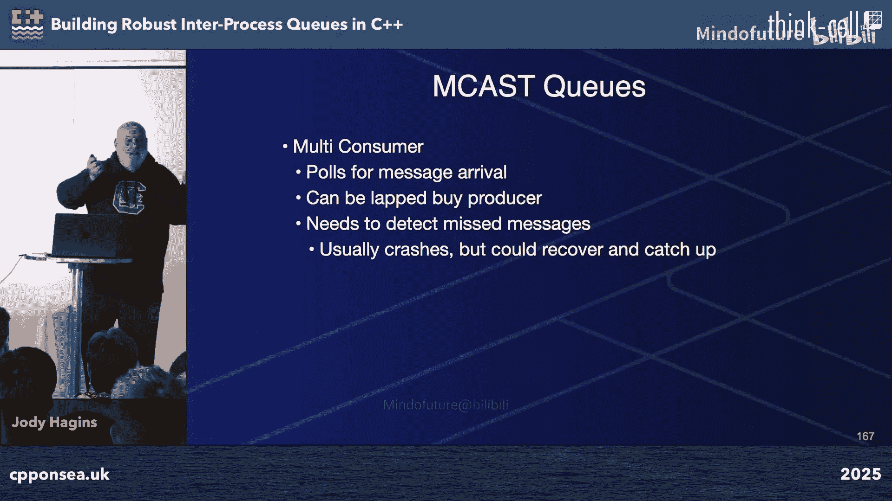

The special consumer reads。The reads block on the producer。

 It needs to be ultra lightweight weight and fast， because。The producer is blocking on you。

And you probably should do measuring and collecting statistics if you do this in both the producer and the consumer to make sure that you understand when and if you ever do block。

 But this gets around that situation where， I mean， I know， so I built a built in exchange。

 And it used this other thing。 And we had big， old huge cues。 And it's like， on some really。

 really big days。 It's like this sphiter squeezes。 It's like， what's going on here you know it's。

But if you have this other special cue。There's I'm unable to measure a performance difference unless the special consumer blocks。

So for me in the MCSQ， is how this is how I would do it， but it's configurable right。

 templates to C++ you've got concepts， you basically configured your Q。

 your queue knows when it's constructed， whether it's got this special consumer or not。

 and so if you want it with it， you give it if you don't。

 then you don't and so these are kind of the big problems that we have in some ways to avoid them when going across processes。

😡，Anybody got got we got a little bit of time for other questions if anybody has them。

