# 【Cpponsea】C++-On-Sea-2025大会-p25-P25_命名空间_101-桑多尔_达戈_2025--BV17V4GzjE6p_p25-

We are going to talk about namespaces in the next。70， 75 minutes。

Just before lunch so before I get into the details about the agenda like that。

 let me quickly introduce myself my name is Chandor Dko。

 I worked for Spotify for the last couple of years in my in my free time I enjoyed writing I've write a lot about C++ but not only about C++。

😊，It's a fun fact that I started to learn and write about about wine as well。

 mostly French wine for the Hungarian magazine， but the next article will be about surprisingly an English wine。

 some ginger wine that I received a few months ago from my wife。And by the way。

 special thanks to her that she's taking care， all the family wives， I'm being here with you。So。Why。

Why about namespaces why do I talk about namespaces today well they are a great tool for cleaner code organization。

 it's important to learn about them and I think that especially in the beginning many developers miss out on the benefits of using namespaces of using namespaces well in fact because I think。

All developers will we do use namespaces， at least stood the standard namespace。

 and I want to share some practical tips that I think it would have been good for me in the in the beginning。

 but some of them I just learned later on。So a little bit about the agenda。

 there will be four sections， but the first two will be quite short。 First。

 there will be an intro to namespaces about what they are， why we should use them。

 and then we'll see the evolution of namespaces over the last。Almost 30 years。

 or it depends how you count it even more than 30 years。Den。We will have two longer sections。

 one about namespace mechanics and scope ruless， and probably the longest one is about best practices for using namespaces。

In various various different ways， I that fine for you。Yeah， feel free to you know。

 interrupt at any moment with questions if you have already remarks。

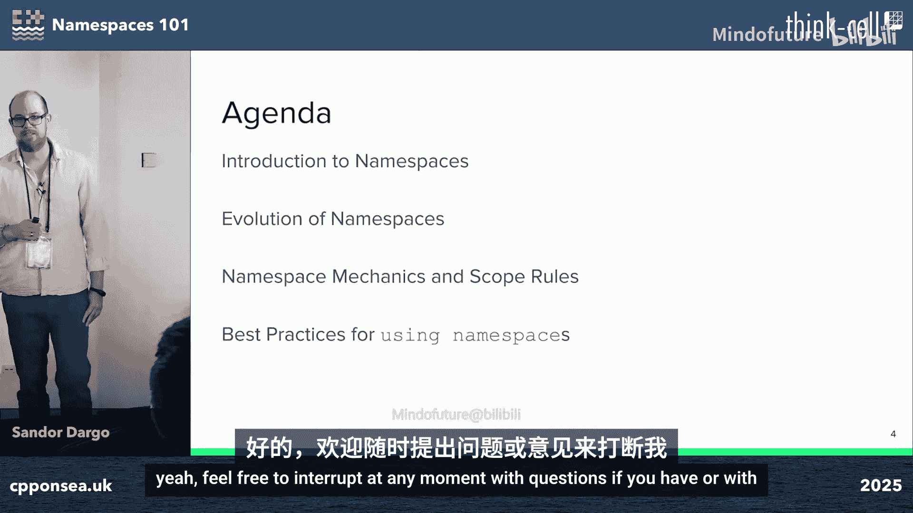

So let's start with an introduction to namespaces。

First question is， what are namespaces。What's the namespace？How would you define it。Yes。

 it kind of encapsulates code within to a namespace I have to call a certain landscape space in order to access certain classes or method。

你别啥。Yeah it's it's， it's right。 You can。 you can group different symbols altogether under specified name。

 and we can also call it under specified scope。 So basically。

 we can introduce new scopes with with namespaces。 many would call them logical scopes。 and well。To。

 to cover the technicalities， you declare a new name space with a keyword name space and then comes the name and they can be nested。

So you can have various layers of namespaces and once you' close。

 why it doesn't mean that you cannot extend it later。

 you can open up a name space any time and you can add mores。

 add more symbols later later on as you wish。And the way you access。

A namespace is through the column column， the namespace resolution operator。 that's。

 that's interesting。 something I missed。In the beginning。

 while I started to learn about C++ and I started to use C++ is the proper naming of things like different operators。

 for example， recently， I heard someone saying， and I'm interested if you。

If you recognize what I'm talking about， the less than less operator。不 you。Or beach shift or。Yes。

 yes， yes。And。This is something I clearly missed in the beginning。

 that's why I found it important even to write without a scope resolution operator for the colon column so why do we want to use namespaces For one thing we want to use namespaces for better code organization because it lets us organizing code into logical units and in many cases they look like。

With like code folders， and often people。Actually use them in parallel with code folders。 So on。

In in your repository， you will create folders for different services， different parts。

 different modules of your code base， and often you will see you will use the same。

Holder names for namespaces， not necessarily， but that's often how for how it's done。Well。

 it improves the majority of your code。 It also improves readability。 If namespaces are used well。

 we'll see some of the best best practices。 the main reason to use namespaces still is reducing the risk of redefin errors and naming conflicts and other mysterious bugs some。

We will also explore together， and it helps us as scaling projects better they become more manageable。

 In fact， using namespaces is essential for larger code bases for code bases that use external code。

 which are well， quite a few code bases use that and to avoid clashes。

 but this is quite vague so far。 I think so let's go with some。Some more precise examples。

 so we want to avoid name collisions between different libraries。

We want to keep large projects APIs manageable。And we want to create clear boundaries。

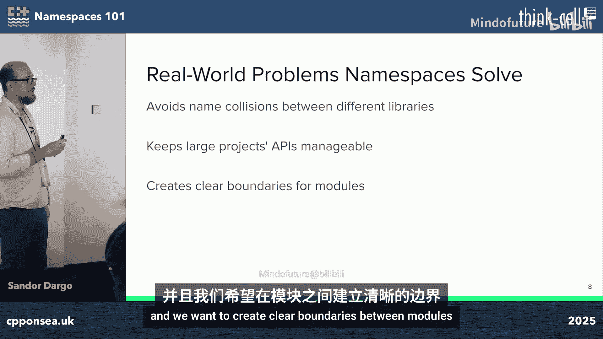

Between modules。And now let's jump over to namespace evolution。Do you know when。

Do you think that namespaces were part of the original C++ language？Created in the 80s。

I see people nodding I see people saying no， no， they were not part of it。

 Namespaces were introduced in the 90s。 so officially they became part of the language with with the C+ plus 98 standard。

 but I think it was proposed。 well， I found different but somewhere around 9395。

 and it was quickly adopted to the standard， but the standard itself was accepted a bit later。

 that's why it's called C+ plus 98， but the different compilers implemented namespaces quite quickly。

 but they had most of the key features。

From the start。 And you will see that。Not so many things were added over the last 20 something years。

 which is not bad。嗯 응。So they already provided name collision prevention， their main reason。

 of course you could create logical groupings for your code。

 it gave us scope control and already from the beginning we had the standard namespace。

Uing directive and declaration we will see what the differences are between the using directive and declaration。

 so here is bit of example code you will see most of it already。

 so we start by creating a namespace called Li maybe I shouldnt use the highlighting。

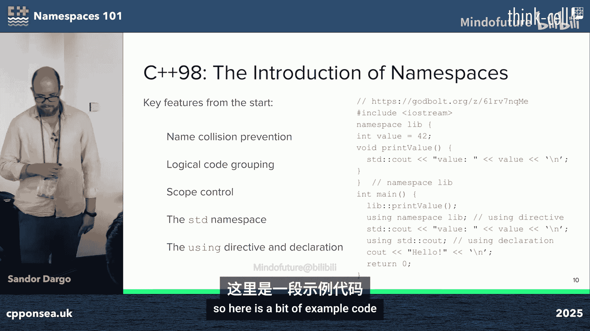

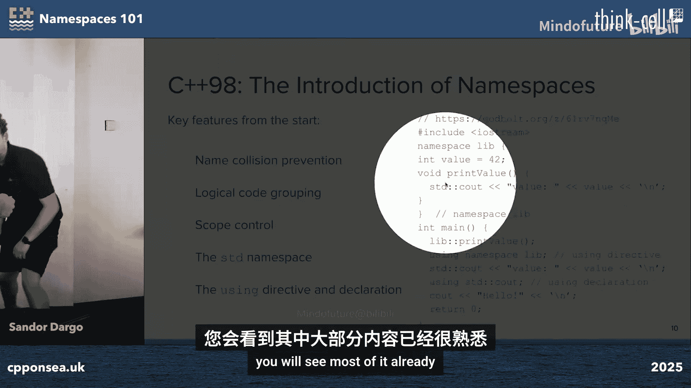

There。We define variable within the namespace slip， and we have a function in it called print value。

 which prints the value as this variable。 The way to use it in our main function is。

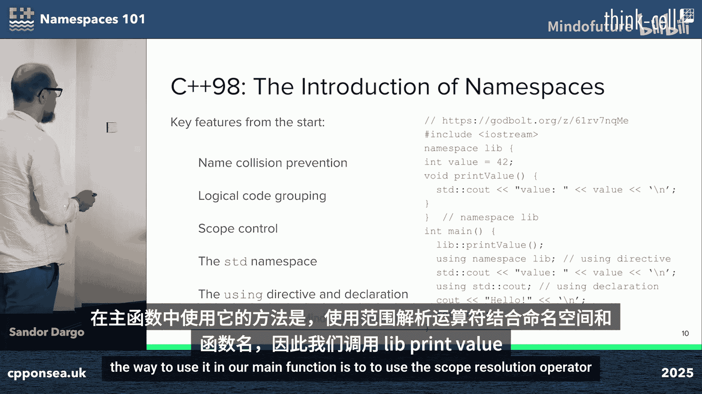

Oops to。

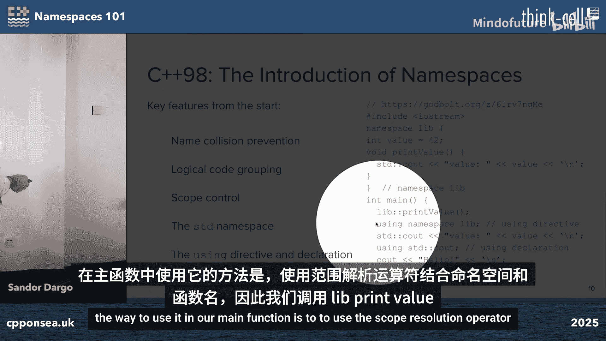

To use the scope resolution operator with the name space and the function name。

 So we call lip print value。 But then we can use a using directive。

 We'll cover the deeper later to introduce the。To introduce the all the symbols of the lip name space。

 something that you should barely use if ever， but we'll talk more about that later。

And then you see that we can print where you directly。We can also use using declaration。

 you see it with using standard C out， which only introduces the C out symbol into the to the current scope。

 and then we don't have to qualify C out with STD column column。

 so we already have all this since C++ 98。But it went through some some evolution。

 So C plus plus 11 gave us in line namespaces。 I there anyone here who is using in line namespaces frequently。

No， yeah。 That's not a coincidence。 It's not really。😊，It's not really recommended to use it a lot。

 but it's good for certain things， but what are in line name spaces first？😊。

So if you take an inline namespace， you'll see that it's a bit acted like if it was the enclosing scope。

 it's treated， symbols in an inline namespace are treated as if they were part in the part of the parent scope。

So here， this example we can see that we have namespace my library。

 oh I want to highlight that in a bit longer examples like this one。

 I mean longer as it comes to a slide， you will have a Godd link and you will get the slides later on and you can play with with the examples。

 so in this my library namespace is there are two nest namespaces we one and V too and both of them define a function called print message。

😊。

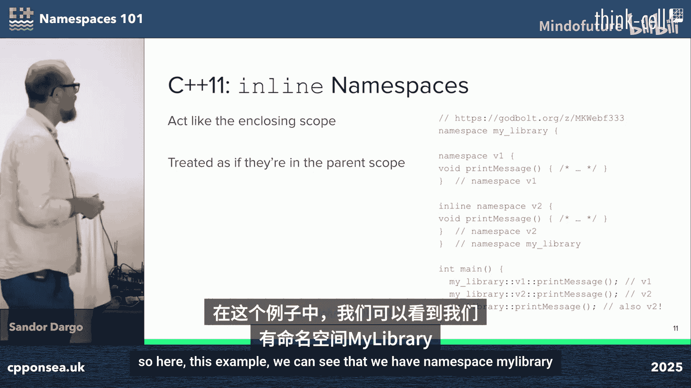

But。😊，Name nameespace V2 is in line。 So what does it mean If we go to main， you see that well。

 we can call my library we1 print message and it will print。 Well， it will print whatever。

 because we didn't define it， but。It's calls。Print message in V1 namespace。Obviously。

 V2 print message calls print message in V2， but we can also just say my library print message。

 it will also call V2 because namespace V2 is an inline namespace so。

A symbol in such an inline namespace is handled as if it was。Already part of the parent name case。

 parent namespace， in this case， my library。It makes versioning easier。

Because you see the inline version can be directly used。

 and this means that if you are managing an API where you maintain different versions。

Of the functionality， you can mark the latest or not necessarily the latest。

 but the main version that you want to support is in line。

 And when you think it's time for others to use time for everyone to use another version。

 you just make that one in line。 That's something you can do。 and that's basically the only thing。

Inline namespaces are recommended for if they are recommended for because even on that people， well。

 not everyone agrees， I would say。And yeah， this is ideal for the latest version。

 so this was c plus plus 11。C++ 17 grow as nested namespace openings。

 so what does it mean B for C++ 17 if you wanted to create nested namespaces。

Then you had to do something like this， you open a namespace， namespace outer。

 then you open another namespace called inner， and then you can， for example。

 forward declare a class there。This is， well， this is fine， but。You know， it's a bit where both。

 So since C plus plus 17， you can do something much nicer。

 you say you name space outer column column inner， and there you can declare your。Your symbols。C。

 plus plus 20 itd on this， and it brought us nest bit in line namespaces。

 something I've never seen being used， but you can。 well。

 you can open nested in line namespace is much easier。 So instead of this， you get this。

 which to be fair to me。😊，Seems a bit strange because。

You have that space between in line and namespace inner， of course it needs to be there。

 but it just makes it a bit a bit strange， but you can do this as well since C+ plus 20。

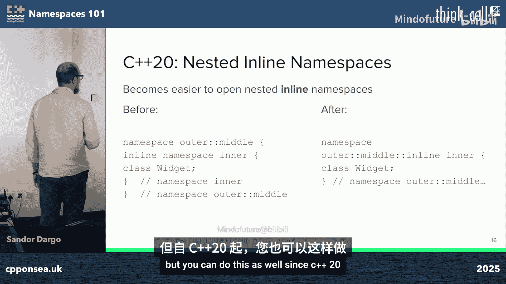

So。😊，Let's move on and let's talk about name based mechanics and scope ruless。

So first we are going to talk about name lookup rules， well see how name lookups can happen。

We are going to talk about qualified unqualified name lookups and the ADL as well。

 argument dependent lookups。What is qualified name lookup。Well， when you see something like this。

A column column B， column column X。 that's their X is a qualified name。 And for that。

 a qualified name lookup will happen。 We'll see details that there is a bit more to that。

 Maybe I lie a little bit here， but。嗯。We'll see。 So the lookup starts with what's on the left of the scope resolution operator on the left of X。

 we have A B。And the search。Is confined to the specified scope。

 and I'll give you many examples for this。And unlike for unqualified name lookup。

 it will not jump to an outer scope or to any other scope automatically。

Well see how using directives are considered when we get to today the examples。

So here's the first one for qualified name lookup here。😊，We have this piece of code。

So what happens here？In main， we want to print A， B， X。

So we ask for this and the first the lookup happens in A B。

 So we see that we have this nested namespace A B and there。

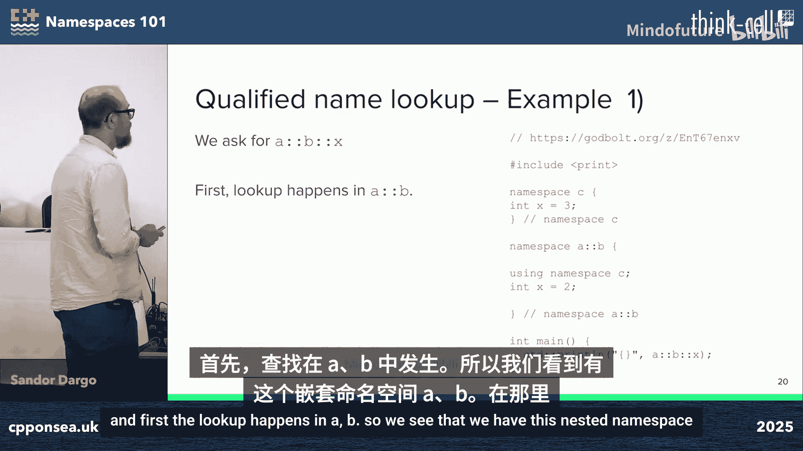

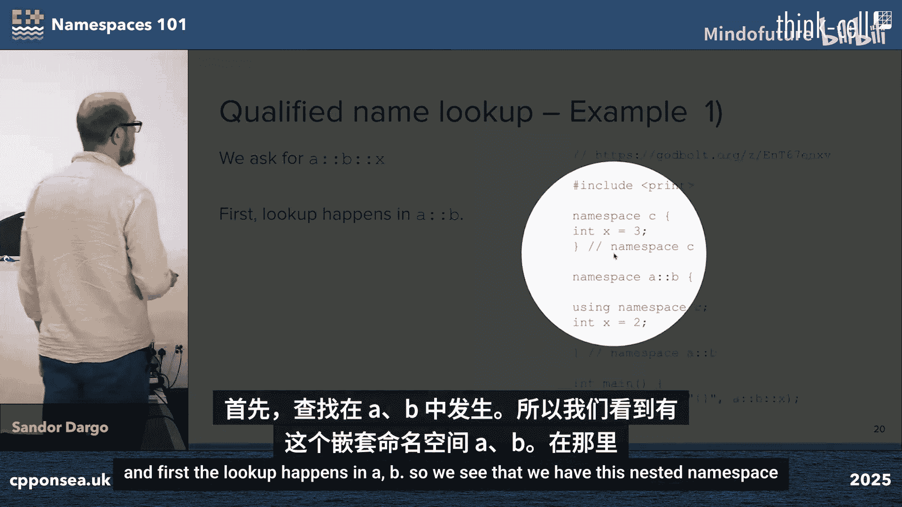

X is found， in fact， x x is found in two different ways because we declared x right there with a value 2。

But there is also using namespace save， which introduces x， but it has a less priority。

 so what is getting printed。Is two。In some cases， though， well。嗯， if。We didn't have。That X。

Deccllared there with value  too。That's， that's the difference here that we still ask for A B X。 But。

 but now we have that line commented out that's the only difference then。

The compiler will still find x because。We had this line using namespace C。 And as you can see there。

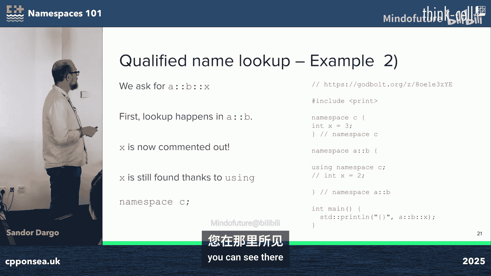

Pan not intended。Namespace C also declares a variable X。

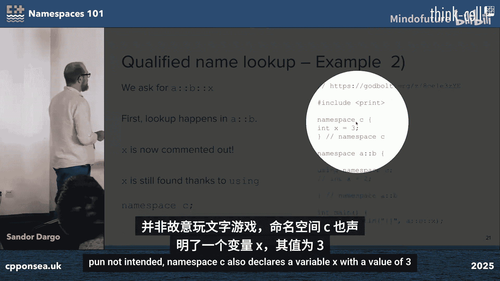

We do a u of three。 So in this case， that's。That's found and we print three as a result。

I have a third example when nothing is getting printed because as I mentioned for qualified name lookups we won't end up in in any other scope in outer scopes automatically and in this case we still have or A B nest namespace and we are using we are looking we are asking for the value of W。

 but we have no W declared within namespace B。We have a W though in namespace A。Just one level upper。

But it's not considered。So。What happens here is a compilation error because ABW is not found with this qualified name lookup。

Now let's move to unqualified name lookups。In this case。They are looking for symbols， not appearing。

On the right hand side。Of the school resolution operator。So in this example， we have。X。

Equals two outside of a function。Well in the function， we also have x with value 3。

 So here you can see the the difference between unqualified and qualifiedified name。 Lookup。

 So first， we say in y equals x。 and there x is not qualified。

 There is no school resolution operator there。 So it will find the local。Version of x3。

You see that when we declare Z， we use column column X and here column column without anything on the left hand side。

Means that we are looking for the global namespace。 Well， here I， you know， it's it's not。

A full piece of code that you can just， just compile。 But imagine we have no name space created。

 declared anywhere。 So it's。It goes to a global name space。 It's qualified like that。

 and it will find the version it will find the version of x with where you too。

So here are a couple of。Rules， priorities for unqualified name lookup and in the order of importance。

 So the lookup can go outward to find a declaration from a local scope。

For local scopes from the innermost。To， to external scopes。 So in this case。

 you see that after declaring why we。We open。Is scope。And we want to assign the value of x to y。

 but x is not found within this scope， so it goes one out and it finds it on a functional level。

 so very good it finds value3 for。For x。It can go。It can go higher up in the hierarchy。

 it can go to a class orstruct level scope， so in this case in or member function fun。

 when we want to use the value X and that's not declared locally in fun first we go tostruct level class level and refine the member。

Variable x which is3， so。We are fine with that， unqualified name lookup succeeds。

It can go on a namespace level from again， innermost to the external。Scope， So here in namespace， A。

 B。In function F， we want to return n。So you remember that in the qualified version。

 when we were looking for A B W and W was declared in。In a。

We didn't find anything because with qualified name lookup。

 we don't just jump to an external scope here we do n is not found in F sorry n is not found in B either。

 but then N is found in namespace A and we return that。It can go even higher。

 it can reach the global scope。 So let's say we have or namespaces， but it doesn't find an anywhere。

 but it finds an。 it finds an outside of any user declared namespace in the global scope。 Well。

 it's still。Still succeeds。Well， with the same priority。In the global scope， it will consider。

Variables， symbols introduced with via using directives as well。It's a bit longer exempr here。😊。

If you look at the main at the bottom of the slide。

 you see that we are looking for ABG and we are printing ABG and ABH， we are calling these functions。

And in Ji。Wei。Have using directive using namespace C。

 So we introduce all the symbols of of the C namespace and we return that and in namespace C。

 we indeed have a z， so we print7。For H。We return x。

 let's omit for the time being what's commented out there and do we have x， yes， yes。

 we have x in the global namespace， which is two， so we print2。

 but we have their commented line using namespace C。

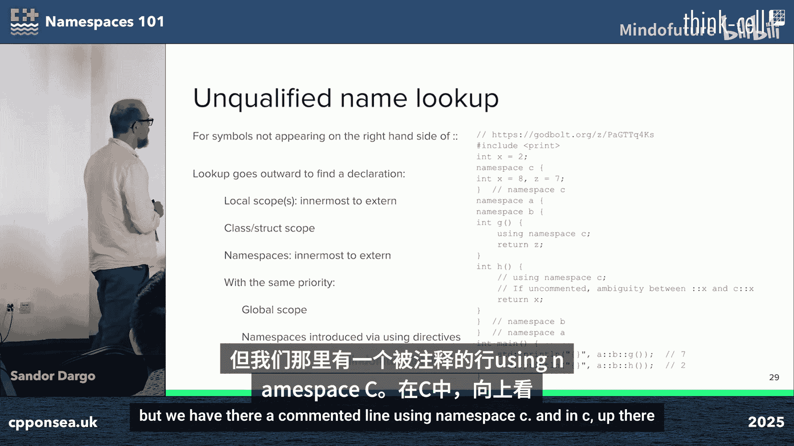

And in C。Up there。

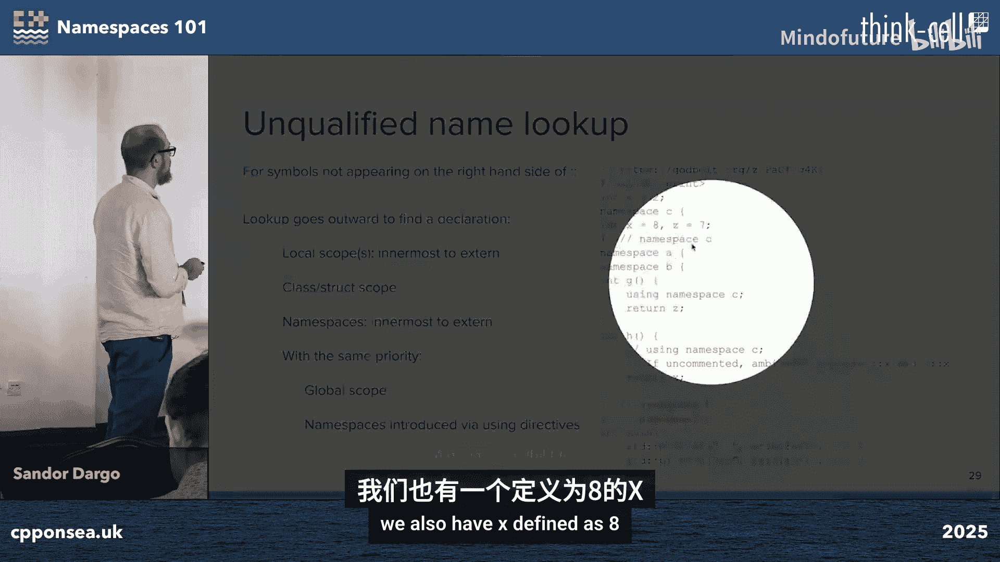

We also have X。They find as eight。So if we uncommon this line。For example。

 well no more compile because there will be an ambiguity between the global X and the x defined in C。

 they they are considered with say， with the same priority and the compiler finds。More of them。

Two of them。 so it cannot decide what to print。 So it says， okay。It cannot be compiled。If。Well。

 this was a using directive there is also using declaration that we saw that it introduces only one specific symbol from a given name space。

 it has the same priority as。Its local scopes。We'll have example for that later on。

So here I say that qualified and unqualified name lookups often go hand in hand。

 and that's why I said in the beginning when we started to talk about qualified name lookups that with A。

 B， X。I lied of bit so。If I want to be more precise， it's not A， B X。

 It's A column column B column column X。 So why does it matter that I I。

Said all the scope resolution operators。It's because I didn't start with the scope resolution operator。

Meaning that。There is a difference。 if you look at fo。

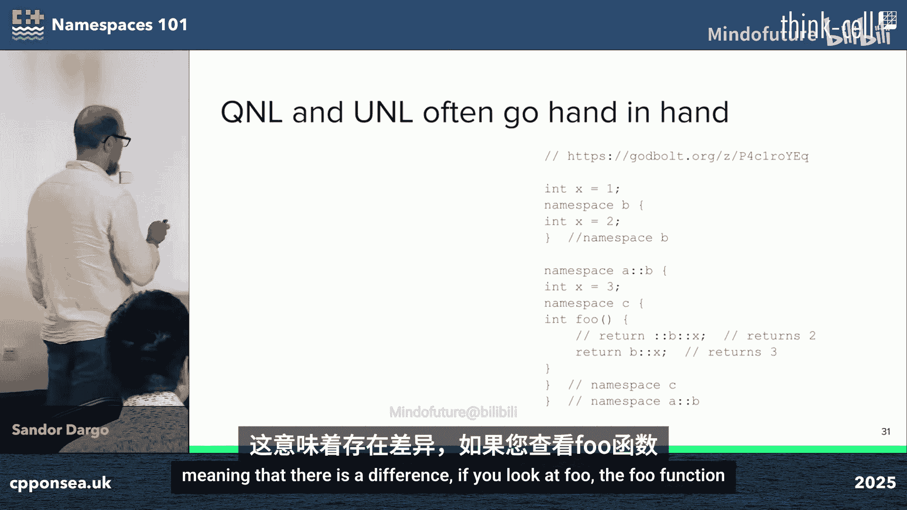

Fu function。 There's a difference between column column B， column column X and B， column column X。

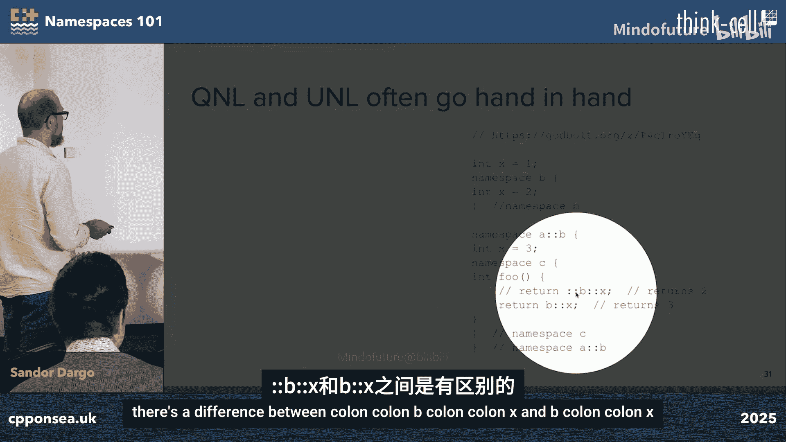

They would return different results。So actually， if you look at B X。

 it triggers both qualified and unqualified name lookups because well。B。

If you consider this whole expression B is unqualified。So we have to do an unqualified lookup for。

Namespace B there。 Then we do a qualifying lookup for x within。The x， and that's why the difference。

In。Re we are used here because。Because from Y Fu。When we try to find X， we go。Outer and outer levels。

 right。So。We are looking for B。And will not find。The namespace P。

 where namespace B is opened within the global namespace。

 but we will find a namespace B that is declared。Nested within。Namespace a。Because we don't。

Start from external。Until we find。A symbol。 but we start from from the local scope。

 and we try to to find。Here be。Am I clear with that？Okay。So with that。

 we jump to the third type of lookups， which is argument dependent lookup。

It's sort of an extension of unqualified name lookup。 and it only works for for function calls。

So it doesn't work with class names， for example， we will see， and it makes functions just work。

It brings into scope the function arguments， namespaces。 now this might sound a bit。Ugly， we will。

We'll see an example for this just in a moment。So why is this useful。

 why do we want to learn about argument dependent， look up why do we need it because it's helpful for operator overloading or generic code。

 but how so here's an example we check on the time。诶。

Here we have a namespace math where we have twostructs vector and the bar， the bar takes a vector。

We have two functions here， we have the normalized functions taking a vector。

 and we have equals equals operator taking two vectors。It doesn't matter about what they do so。Then。

 we close。The mass name space， and we have a function called F。Where we declare。

A and B from with the type mass vector， and then we call normalize。

Normalize is within the namespace math。Yet。😊，We don't qualify， normalize。With this name space。

 we don't call it like math column， column normalize。 And then we pass the vector。

 you don't have to because。Because the namespaces of。Will function arguments。

Are now within scope thanks to argument dependent lookup。So。Function parameter is math we。

 So math is in the scope。Again。It's very useful for， for example， for this operator equal equal。

 we can compare a with B without having to do any。Any ugly code there。

Here it's even more useful than with the normalized function， right？But。You cannot。

You cannot just declare。You know， variable with the class bar expecting that you can declare it without the namespace qualification。

 you have to fully qualify it because it it doesn't apply for。For class names。Yes。

 so what if we have a normalized function in the global scope。Which takes an integer， an integer。

 So if I'm right， then still。The same normalized function will be called because even though you have but the compiler will find it as well but。

If you take A and B， they are math W， they are not integers。

 so you cannot call the normalized function with an integer。

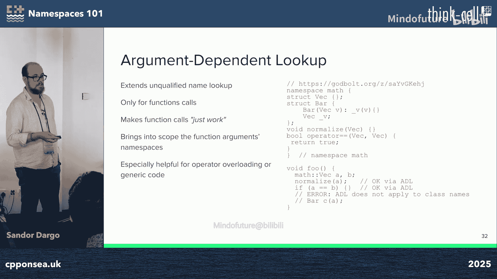

You cannot call this normalized function in math within integer。 So it will still find this one。

 the question is， if without argument dependent lookup， we wouldn't be able to， to use， for example。

 the equals equals operator， we couldn't do any comparison。 yes and no。

 I think you could still do that。 but not S nicely。

 You would have to qualify it would look like how would it look like instead of writing a equals equals B。

 you would have to write something like math column column operator equals equals。

 And then within parentes is you would pass A and B。

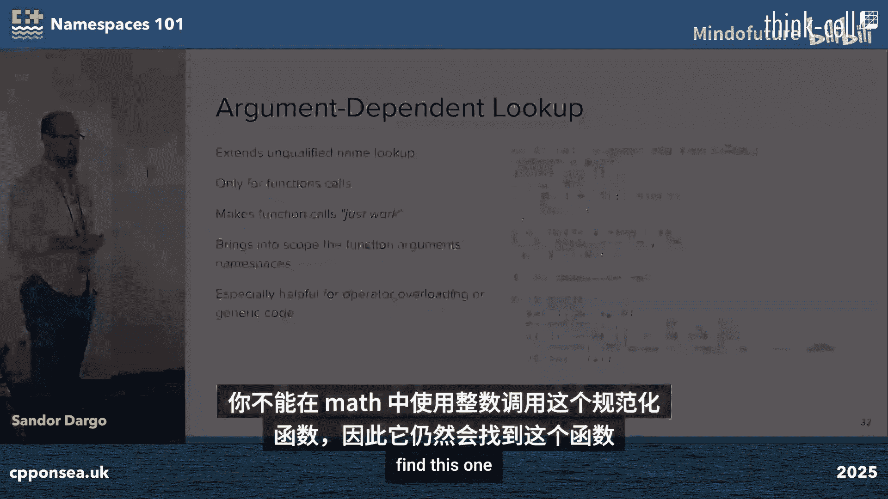

So it works。But。It's not really readable， right。So the same， what if we have normalized？

In the global scope。With a vector。It's a good question。

I think it's well defined what what happens and which one has a precedence。But we'd have to try that。

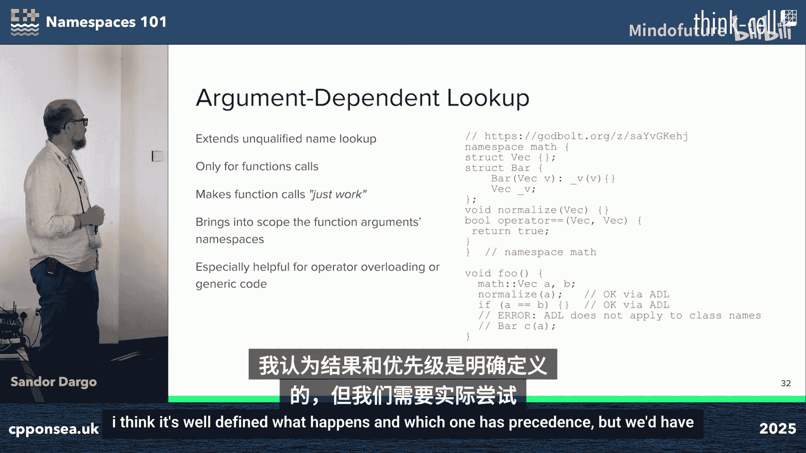

I would have to try that。

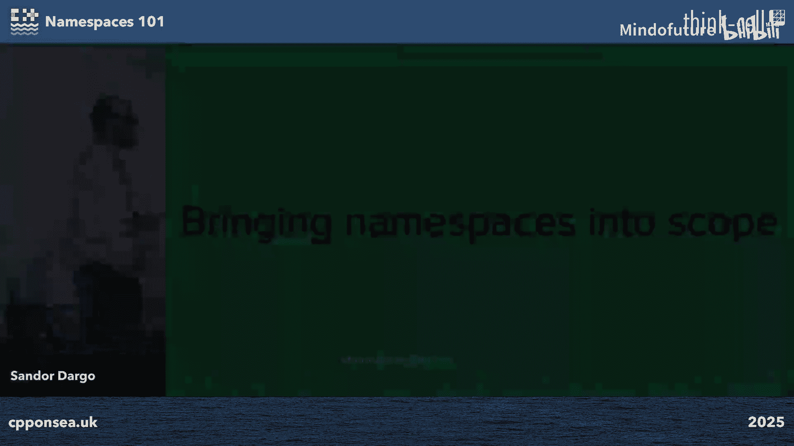

Still talking about。Namespace mechanic， how we can bring symbols from different namespaces into scope。

 We said that there are using directive， which looks like this using namespace and S where NS is a namespace。

Something that you should barely use， or I。Read some articles where they wrote that you should forget that this even exists this possibility。

 but okay， we here have our namespace Lib with its print function and then let's say in in another file we have main and we bring everything from Lib into into scope so we can just call print that's that's fine。

Seems it's nothing really malicious， but even here like， okay， you call print。

And you might ask the question， maybe not here because this is a short example。

 where does this print come from？How do you know， Well， you have to find it， Okay。

 or maybe if you use modern I， then you just hover on it and you will see where it comes from and you trust it。

 And it's fine4。 you ask pilot to tell you， well， joking。 But it might decrease the readability。😊。

Because， well， you know， you don't know where it comes from and it's a double H word as we will see because itute it pollutes the name space。

 So what is namespace pollution。We stopped for a second dude。Talk about pollution。

So that there are two long names based names。So， can you repeat it here that some name space may be very long and I just typed all over the place So you are saying that some namespaces are very long and you have to type them out。

 no， not really， it just decreases readability。 if you have very long namespace names and if you have to you know。

 type them all the time it is something like because the way you included another name space into your the name space。

 So you included very assumptions that。Quite simply name for that specific so。

Become part of a bigger name space， which can give people。 Yes， yes， yes。 I think it's more， more。

 more about that。 Yeah， so you take namespaces from one scope and you include it in in in your。

In your local scope， in your local namespace， whatever we will see。

 and then you just start having too many symbols in the same namespace and it increases also the the possibility for name clashes there and。

Even worse， in some cases， maybe something else will happen than than you would expect and maybe especially in a bit code base。

 you won't even realize until。Until there is a bug and you don't understand why these bug is。

 And then you have to debug。 And well， you will find it。 eventually。

 So the pollution is when you have just too many identifiers， too many symbols in a name space。

 and it can cause conflicts。And confusion。I think， yeah。

 I think that confusion is worse than than conflict， but maybe I'm。AlLoone with that。

 So here are a couple of examples for namespace pollution。

 So let's say that I have this helper header here。We do something bad。We say using namespace STD。

 so we introduce everything from the standard namespace into scope。

 then we open up namespaceF and there， well， we refine a function or we create a function called display and it uses C out without the STD qualification because well thanks to using namespace andD。

 we can do so。Then in our main CPP， we include this helper header。😊，And。Wei。

Right or own function called see out again， probably this is a terrible idea because see out is so well known that you should not have used this name。

 but well。You know。😊，Who hasn't seen that code。 So there we want to。

 to print something we didn't see out。 And then we call， we are in main and we call food display。

 That's fine。 It works。 But then we want to use。😊，Or see out that we just defined。Right up there。

But instead， we get an error。Because， oh， see how it doesn't work like that it turns out。

There is a conflict there， because we included。Heather。Which。Already introduced everything。

From the STD namespace into the current scope， meaning that， well， we didn't write in main CPP。

 anything like using namespace SD， but。It was written in one of the headers。That we included。

 and that's why it pollutes you know， our scope here and well。We have an Android。

But this's just one example。I brought you another one， which I。Borrowed from from Jason Turner。

 I think I edit this like last night。 I was， I was watching one of your videos about namespace pollution。

 And I really like this example。 So let's imagine that you have a name space where you have。😊。

Where you have a function called calculate， it takes a double， it returns a double。

 it does some mass in it。And then you include this header in main CPP。You say， well。

 let's use all the symbols from this namespace one， and you print the result of the calculation。

See that you call calculate with with two。 What， what do you expect to have。There's no trick here。

 There's no trick here。 It， It will be head fund for yeah。😊，And then。😊，Okay， we still have this one。

But then。We create another file where we open another header sorry。

 another namespace called namespace 2 and。There is another calculate function。It takes an int。

Returnient。And yeah， here。In these slides， you see very limited amount of code。

 but you can imagine that there are many more functions in these namespaces they just wouldn't fit here。

And， of course， the main would be much bigger as well。 And now we。Maybe for another calculation。

We want to use something else from namespace。 too。 We've wrote somewhere using namespace。And it st。

What will happen now。What's the output now。84， yes。s84， why。Exponment it your argument。 Yes。

 it will take the one with。It will take calculate function from N S2 because it that one takes an integer。

 and before we before， you know， N1 calculate word because well there was some implicit conversions there ongoing。

 but now there is a better option in the overload resolution said so it will take that one and maybe you know。

 it probably。In a longer example， this was not your intention。

 You just wanted to use something something else from from N2， but as a side effect。As a side effect。

 existing code started to behave differently。😊，That's why I said that。

Name space pollution can lead to conflicts。We saw an example for that。Or to confusion。

This is the confusion part and it worse because if it's in a big example。

 probably you don't realize that this is happening maybe you know months later。

 maybe some users will report some strange behavior and then you'll have to find it。

 you'll have to deal with this。So is it a good idea？To include namespaces like that。Probably no。

 well， not probably。No， it's not a good idea。So yeah。

 name space pollution is a real problem because with these clashes。

 you can get compilation errors or unexpected behavior。

 which is much worse and your maintenance will be。😊，More difficult。And even the readability suffers。

 as we said in the beginning， because you don't know just by looking at the code。

 what's going on and why yet there is。Space for using directives and that's for later on name spaces。

Because it's still true that using directives they pullute。But for lit， they are useful。😊。

Because otherwise you cannot use litals， so you must use them。

 but these are carefully designed and they do enhance the readability。

 So what are these literal name spaces so you think。

 for example stood chron litals and it will let you write code something like that auto duration equals5 s like five seconds and it's the same as writing st chrono seconds5 in this case the first version is just more readable so in this case the using directive is useful。

😊。

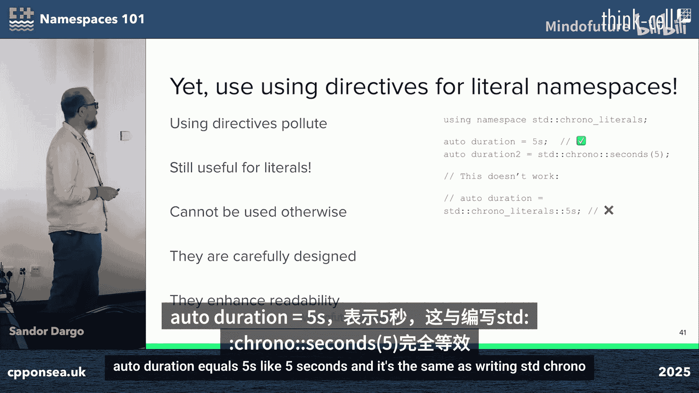

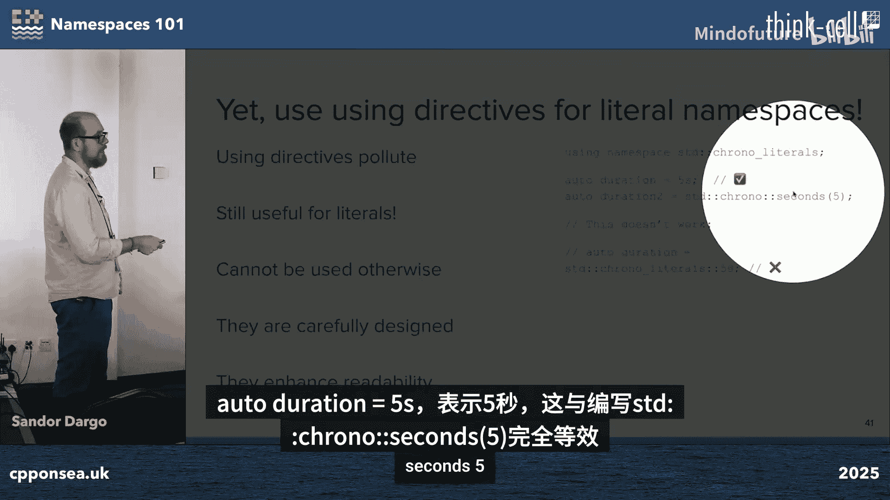

So if not using using directives， you can use using declarations。

 it's looked like this using and then you put a symbol and that means that in this case we only bring in Lib print。

 so we only bring in print the print function from the Lib namespace and nothing else， so。😊。

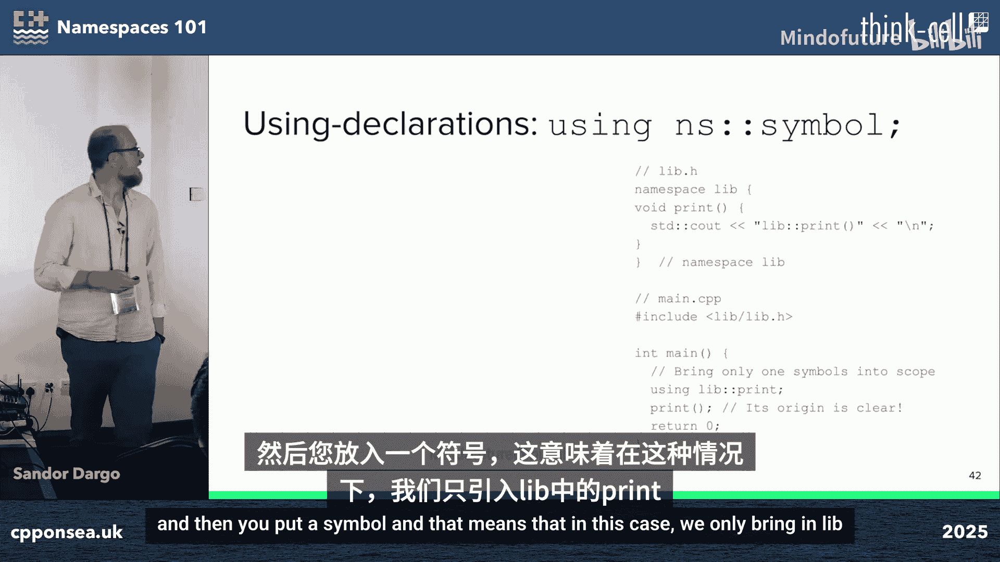

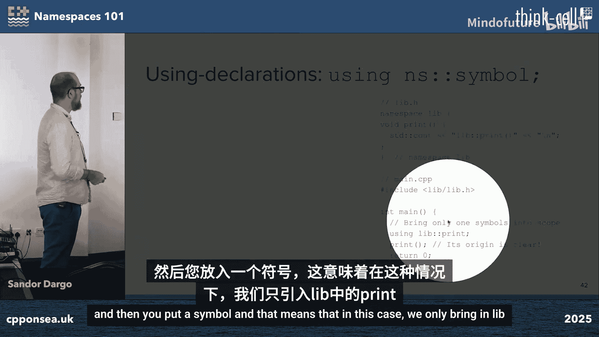

If the using declaration is close enough to the usage。Then you still know the origin of that same。

 so readability wise， it's okay。So you can use it with classes， functions， variables。

 enums scene C++ 20， even just with specific enumerators。It's better than the directive。

But it can still pollute。If if you don't use music wisely。

So using their declarations are better than using directives， but as we see here。

 this comparison operator， this greater than operator is used actually in two ways because it doesn't only。

😊，Mean it's better。 It also means that the using declaration has a higher priority than using directive。

 So in this case， we have using namespace。 A， we also have，'s a using directive。

 We have a using declaration using B， Col call X。 and we want to return X。

 So we get x from both cases， right。Which one wins。月啲。The B one， yeah。Yeah。

So if you introduce a symbol， both using declaration and using directive to using declaration will have priority。

Namespaces can be analyzed。You said earlier that it's a problem when you have to write very long namespaces。

 maybe nested namespaces all the time， and it can also decrease the readability。

To remediate that problem， you can shorten long name space names with redellialias。

 it might improve the readability。Might not necessarily， it depends what aliases you use。

And it doesn't pull you directly。 that's clear clear benefits here。 so you see that。😊，Again。

 here I didn't use long namespace names， but we have a column column B， column column C。

 so three level of deep nested namespaces， and we defined an areas for that with the line namespace。

 ABC， A column column B， column column C。And we can this。

We can still do qualified name glueups like that。 and if a is long， B is long and C is long。

 then maybe。This is good， maybe。Maybe it depends， you know， like。😊。

On the abbreviation you use because if you just use some some initials which。It's practical。

Maybe it won't be that readable。 It has to make sense。 Yeah， but it's， it's a possibility。 So still。

 if you use them in headers。You know， you increase the risk of redefinitions or shadowing。But well。

 that's that's a thing to consider because here， let's say we have lip HVP there。 we have my lip us。

 Then we define an AS M U for that。 But in another five， you。Open up a namespace called MU。

Which is there it's not an alias， you don't use an alias just like like that。

 and then okay what is what is used so it doesn't always improve readability and it can lead to problems it has to be used wisely and it's the best to use it to avoid such problems only in CPP files。

So if we talk about the impact on readability and maintainability。

 well using directives and using declarations， they pollute namespaces。

 they pollute your current scope， the using directive might decrease the readability still for literal namespaces。

 it's a good idea to use them and well in general using declarations are a better option to go with and also aliases can improve can improve readability。

😊。

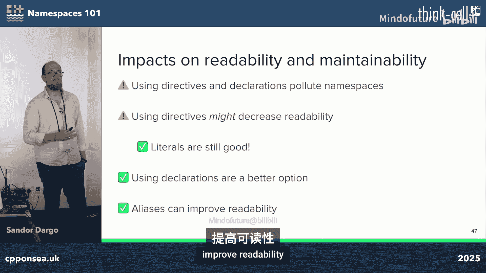

Now let's talk a bit about anonymous namespaces because not every namespace has a name。

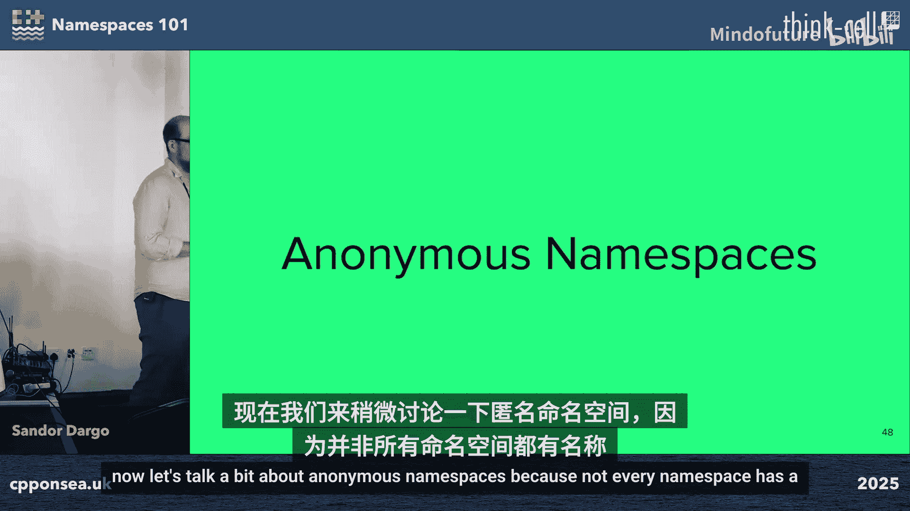

Some， well， I don't things Stais have no name， but what are they well。

 they limit the scope to internal linkage and they make symbols private to a given translation unit。

They。😔，Help us such avoiding clashes。And you can pretty much have the same。

Results with using static functions in CPP files， but anonymous namespaces are preferred。To。

 to do that。 So basically， when do you want to put something you know I in this name space。If it's。

If it's an implementation detail， if you don't need it anywhere else。

 then you can put it in an anonymous name space and you know that it will not escape from there you want nobody else will be able to use it so in this case we have an anonymous namespace where we define some helper function called really seconds to strings and you can use it in only in the very same translation unit。

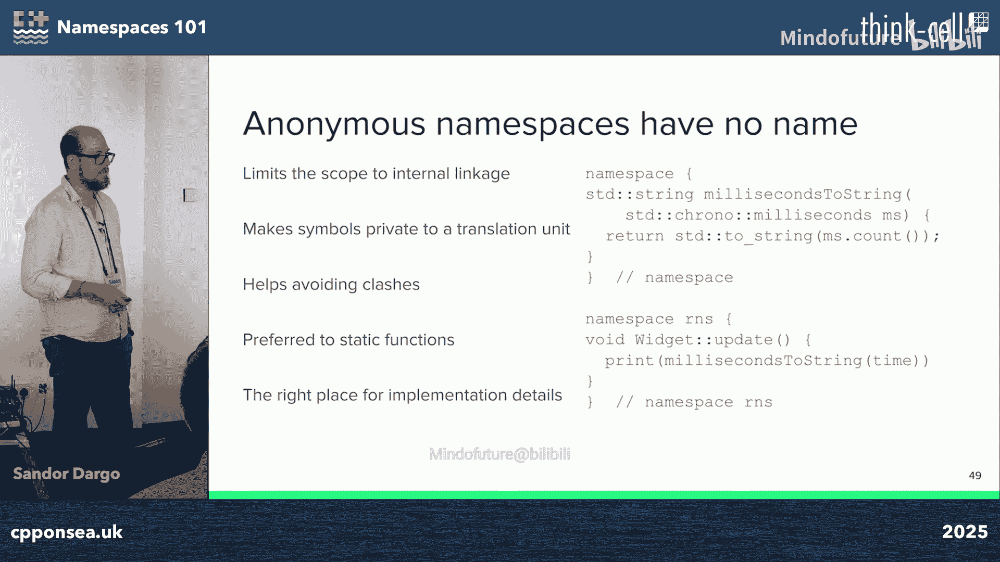

Now let's go through some best practices。 we still have 18 minutes if I'm not mistaken。

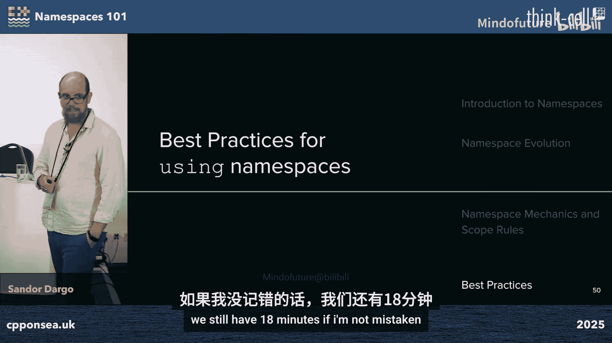

So。What is covered。Ecoding standards and style guides。 That's what we'll try to cover。

 We first start with the coursey plus plus guidelines。 and here are all the rules。

You don't have to read it。 It's not there for that。 But if you get the slides。

 here are all the links。 Okay， let's go through them so。

C5 place helper functions in the same namespace as the class they support。Because as such， well。

 they are seen as part of the class interface， in any case， where else on earth would you put them。

 right？😊，But still， it's good to know that that's where you should put them because it makes the relationship obvious and it allows is benefiting from argument dependent lookup。

 something we we had to look into earlier。 So here is the example， which if I remember， well。

 I took exactly from the core C plus plus。😊，Guidelines web page。

 So here we have a namespace Chronno and there we define all of type related time date related services。

 We also have these classes there like time and date but the heer functions are also there because that's where they should be and again。

 such relationship it's obvious and you can benefit from ADL。😊，The next one is C100。

68 doesn't matter。 Def overloaded operators in the namespace of their opera。

 because still it's about ADL。 You can benefit from argument dependent。 Look up as such。

 and it increases the readability and you won't have to deal with inconsistent definitions in different namespaces。

 So we have a namespace and where。I don't adhere to some style guides More on that later。

 we have ourstruct and the operator。The plus operator for that is defined in the very same name space。

 which just makes sense。Most for readability and ADR purposes。 because， again。

 if it wouldn't be there， then we wouldn't be able to write plus just like that。

 But we'd have to go through that long syntax that。That we discussed about。Next one。

 ever highly visible and constrained templates with common names， I think。When this was written。

 we didn't have concepts yet。 So now we have more general rules about that that you just don't want to write unconstrained templates in general。

 And you do want to。To constrain them in a readable and meaningful way。 But you know。

 the problem is that such temp arguments can match anything。

 and it can be dangerous with ADL or at least annoying。

 and I liked very much the sentence from the guideline itself。

 says that the committee cannot agree to exclude unconstrained templates from。A DL。

Maybe Ferby still around， we can ask him about that。

So here is an example we have astruct S in namespace pad and we have an unconstrained template there。

Then we have a fan plate。We have a namespace。T 0， where we define operator equals equals for an integer and for that S structure from bad namespace。

 probably we are against different guidelines here。 But okay。

 this is the example from core guidelines itself。 Okay。

 and then we have our test where we declare an S。Called bed。 We have a vector of integers。

 And what do we do there。We compare one with bad， which goes。

To T0 operator equals equals because it's with an integer。Right， and。With an instance of bad S。嗯。呃。

And then。We have。And other。Example， where we call size。On the vector， and we compare it。

With the same。With the same variable called bed。 but in this case， we go to bed namespace because。

V that size is not an integer。 It's size T。So we end up somewhere else where it was not really intended to。

 right。Yeah， but I think this example shows many bad examples that you shouldn't follow。Next one。

 use name use using namespace directs for transition。

 for foundation libraries or within a local scope because using namespace can lead to name clashes and even aD namespace and clsh with the standard library。

But it同 also says that。Sometimes consistent qualification is veros and distracting。

 I still think that it's better to be verbos and seemingly distractive than than end up with with problems like in this case where we。

Use using namespace， STD， we clearly should not， and then we what do we do？

We declare variable square root QrRT， and then we want to call the SQrRT function from namespace STD。

And there is， there is a。There is a cl there， so it doesn't work， so you have to be aware of this。

 just don't use using namespace STD， I think。And you won't run into such problems。

 don't try using namespace at Global scope in a header file。

 something we already discussed because it pollutes and it might introduce some order dependencies。

Here is the exception that we already discussed。 So I go through these just quickly because we didn't learn anything new。

 but this is also considered in the core guidelines。

 The next one to use namespace is to express logical structure。

 and I just love this one because because the core guidelines has so much things to。To tell about it。

 that， that's what you find there。 But joke aside。😊，You know。

 I don't know why maybe nobody took you know， the time to write it。

 maybe it's just too obvious because this is one of the reasons to use namespaces， but okay。

 let's use it as a reminder that namespaces are not only for avoiding name clashes。

 but also to represent the logical and or domain structure of of your program。And of course。

 if you use it well， it will improve the readability and modity。But well。

 I'm not sure if well go into very deep on that later。So don't use unnamed to name spaces。

 don't use anonymous name spaces in headers， use them in CPP files because as said。

 they give internal linkage。And if you start including headers withoutt name name spaces。

 which means that each of the CPP files， where you include them， they。

They will get the own version of these they will get the own version of the contents of anonymous namespaces。

 and it can lead to code b。 It can lead to violations of the ones definition rule and you know。

 probably you will。You will face some bugs if you use some static data in there。 So in these cases。

 you can just use normal namespaces。 it's better。 you can call them maybe detail。

And you might have to use in line with with them。 So yeah。

 instead of that bad practice where you create in header。 So this， this。

 this is about header files where you create an anonymous namespace。 and you define X。

 Y and the full function just use something called namespace detail highlighted right there。 okay。

Another rule use anonymous namespace for all internal non exported entities。Something we discussed。

So。If you something only in a given translation unit one CPP file there。

 you put it in an anonymous name space and it's very clear that it shouldn't be used anywhere else。

 and it's just not possible to use it anywhere else。

 so and it you should prefer the anonymous name space version over using the the aesthetic static keyword。

 Sorry， I didn't see。Sorry， you don't necessarily test them directly。

 You can test them indirectly because they are， you know。

 like helper functions and probably you want to use sorry。

 you want to test the functions that are using these helpers that's。That's how I would do it。

So do not add entities to namemespace STD。Because。Well， because of obvious reasons。

 but it might also lead to undefined behavior。But。Why would you want to do that， In fact。

 do you see any reason to do that。Please， two places。Yes。😊，あ。Structured by being。Is it about。

 I think， hashes。Oh yes， yeah， yeah。Yeah， but I also saw some examples。 Oh， and now I。

I'm freezing it。I saw some example where in unit tests。I think someone used it to be able to。

Craampfi standard sea out vector。Something， something like that， and。Well， we。

 we went with different。With with a different solution。

 because potentially it can be undefined behavior。 and we just don't want to to risk that。 And。

 it's a bad example so。Using creating like a function， writing a function。

 my utility within namespace， SD， it's not allowed thats。That's undefined behavior。Yes， this is。

 I think， what we did。😊，We defined operator equals equals for vectors。And。Poly U B。

 So we went with different。The different solution。But。😊。

To continue on that and and mention what Jason said sometimes。We have to do this。😊。

There are some exceptions when you have to open up the standard namespace because if the declaration depends on at least one user defined type and the specialization satisfies all the requirements of the original template。

 then there is an exception and you don't have to deal with undedefined behavior， for example。

 when you have to define hash function for your type。There is also the Google C+ plus style guide。呃。

Which is a widely used。Style guide that's why I collected the rules from here。

 it says you should use namespaces generously as much as you want。

 but using directives are forbidden。Use namespace aliases instead if you need them。Using declaration。

 So when you only introduce one symbol， that that's fine。

 as long as you do them at the right places and in line namespaces that we haven't really talked about since the beginning。

 they are forbidden， but allowed。For versioning purposes。

And they also mentioned what the core guidelines already said that you shouldn't use any English name spaces in header files。

And it also defines how you should some formatting rules。So you should use snake case with。

With namespace names， the top level namespaces must be globally unique and recognizable nested namespaces should avoid well known top level namespaces。

 so maybe you shouldn't write something like know my company on colonist SDD that's not a good idea。

 avoid that to all costs。And you don't have to intend the contents of namespaces。

 which is quite nice， especially when you have deeply nested namespaces。

And use some use closing comments。When you close a name space where you just。

Write namespace and the name as a comment， even for anonymous namespaces。

So this is wrong formatting because we have some indentation。

 this is good formatting because we don't have the indentation with you know。

 extra spaces and we also have thelos command。😊，So。But again。

 use whatever formatting you want to just be consistent。

And a few words about my experience with namespaces from a few different companies。

 so using declarations are usually fine everywhere， as I mean at every company。

 just use them in CPP files， not in headers， limit the using directives。

Don't even use them in their CPP files。Namespace aliases are fine， but not iner files。

There you should really avoid them and don't use very deeply nested name based structures because after a point。

 it you know it。It doesn't help with readability。It， it makes things worse。

 We work with the three levels， which。Can have sometimes a fourth level。

 The fourth level is for very big systems， and。In detail。So。We sometimes use things like implement。

 detail。Or maybe API namespace on a leaf level。 But that's the API is rare。 it， its just。An option。

 And you always have to fully qualify things in macros。 We'll see an example for that。

 And an interesting rule that we have is that。If you open up a foreign name space。Well。

 if you open up for namespaces a lot， that is often considered a code smell because it can show a high level of couplingpling between different systems that you should probably limit。

 but it's not a rule。It's more like a smell that you should think about it。

So I will jump on this quickly because we already discussed these。 I mentioned that。Well。

 you shouldn't go to the play because it can lead to different name clashes with with。

We don't qualify name lookup。We have only a few minutes left。

 so I want actually to show one example and then jump to to the conclusion。

 so this is the example that I wanted to show you always have to fully qualify in macros why well。

Don't use macros right， This is the first thing， but maybe sometimes you do for certain things and you cannot just you know。

 magically remove all the macros from big existing code bases。 why Because macros。

 even if they seem so。They are never part of a namespace。

Because they are exp before compilation and the preprocesor knows nothing about namespace as well。

 it's just about textual replacement and you might end up with some lookup issues if you don't fully qualify symbols in macros so let's look at this very dummy example we define a macro there WW with widget n and then you try to use this macro in another namespace。

😊，You might think。That。The W W。Is a part of the full name space because it's， it's。Be find there。

Well it's not。 It's not。 And as such。Well。It。Doesn't know anything about that widget that is。

Defined in name space food。 So to avoid such issues。

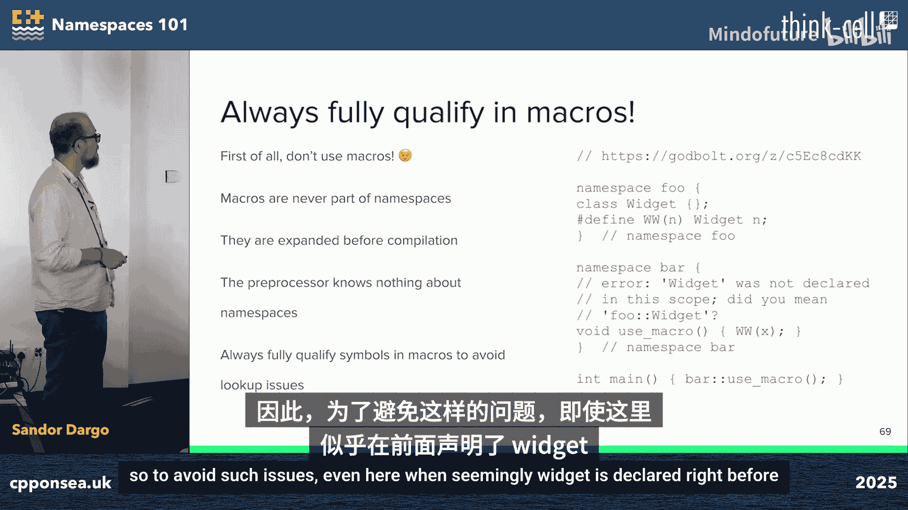

Even here， when seemingly widget is declared right before， you should have written。

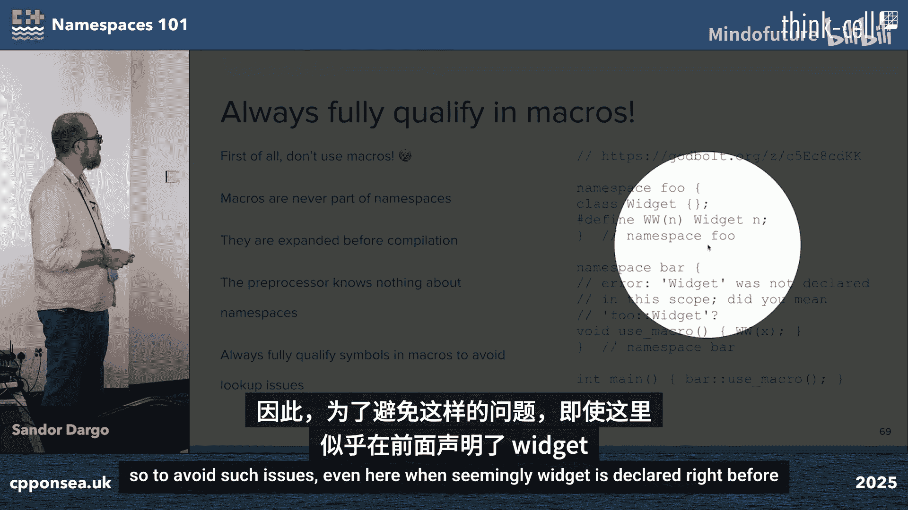

Who leg get。But you shouldn't just use。Such macros。哼。

So yeah this I mentioned that each usage of a different namespace is a sign of dependency。

 some are needed， you cannot remove some of them， but if you have too many of them。

 maybe you should think about it。Limiting your dependencies or rethinking your dependencies。

So I think that industry best practices are less permissive than the core guidelines， because course。

 because core guidelines mostly protects the global namespace and it cares about the SDDD namespace not only but mostly。

 but most of the coding guidelines protect user defined namespaces as well because well that's why they were written So it's high time to conclude because。

There must be like two minutes left。 key takeaways。

 Use namespaces to prevent name collisions and to organize your code。Avoid namespace pollution。

Prefer fine grain and nested namespaces over large monolithic ones。

But don't go too deep and keep naming consistent and meaningful throughout your project。

Some practical do's and donts。Do use namespaces to group related code。

 use using declarations in CPP files， only in CPP files， aliases are helpful。When they are helpful。

 sorry use them when they are helpful and you might use in line namespaces for。

 but don't use using namespaces TD in headers or anywhere else don't use over nested deeply。

Nested namespaces。And don't assume that readers know where a symbol is coming from。

And don't just dump everything into a name space you you have to think about how names how。

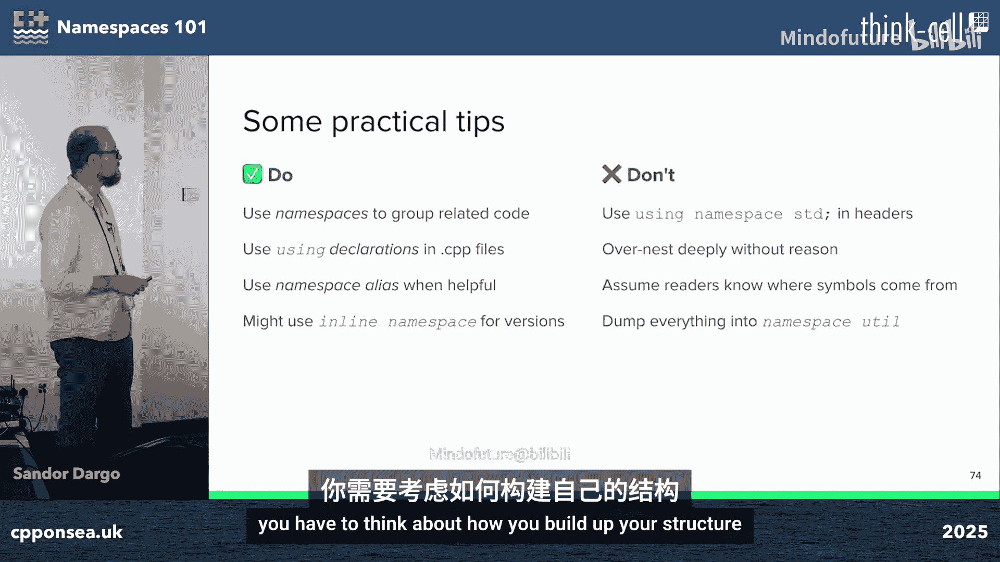

You build up your structure。And thank you very much that was it。

 I don't think we have a lot of time for questions， but I stay here if you want to two questions。😊。

