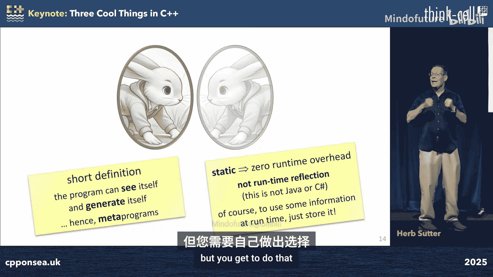
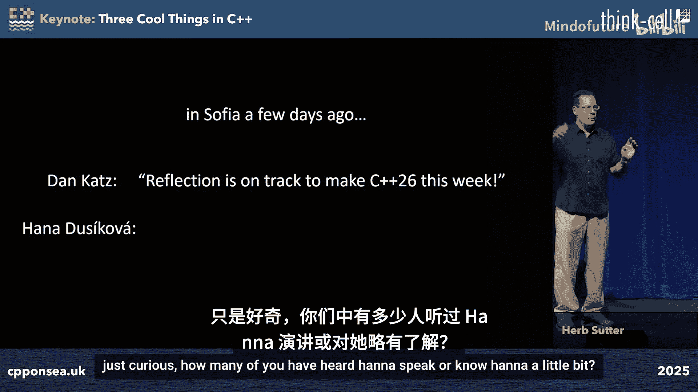
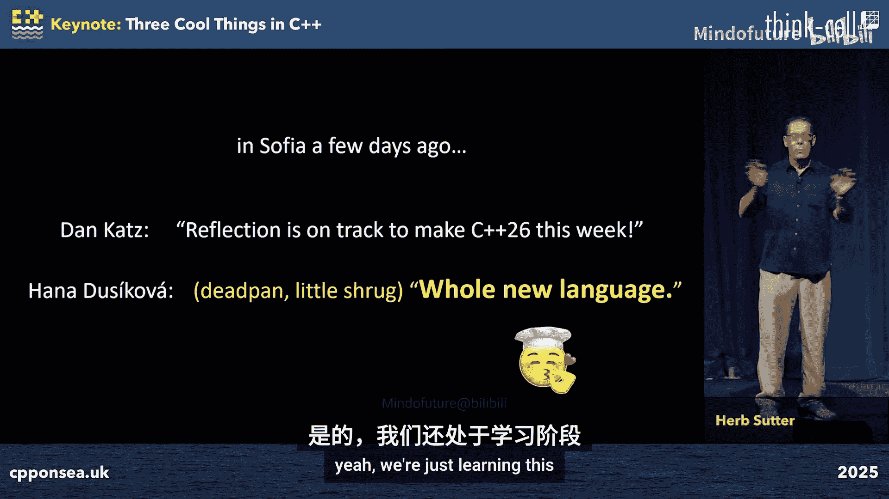
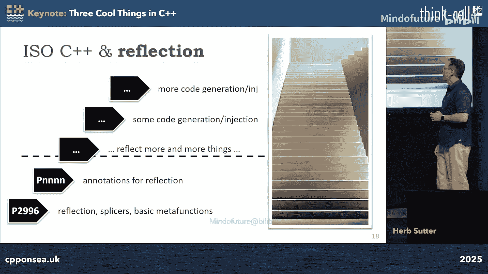
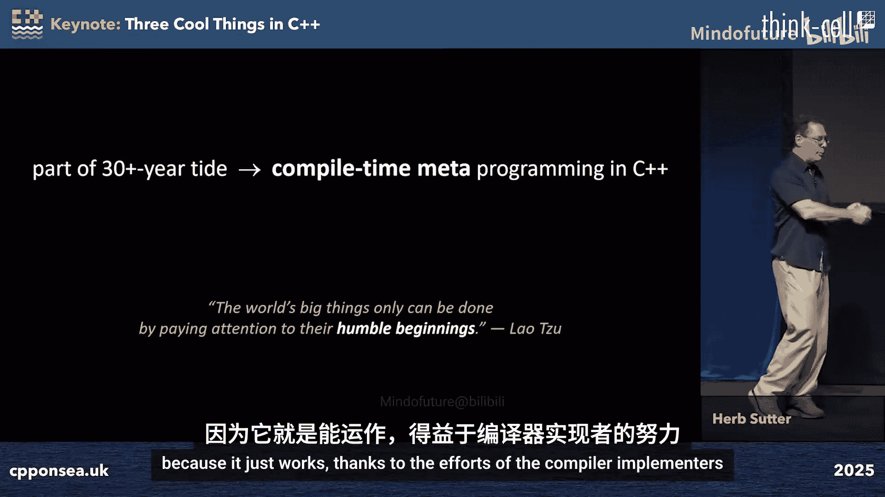
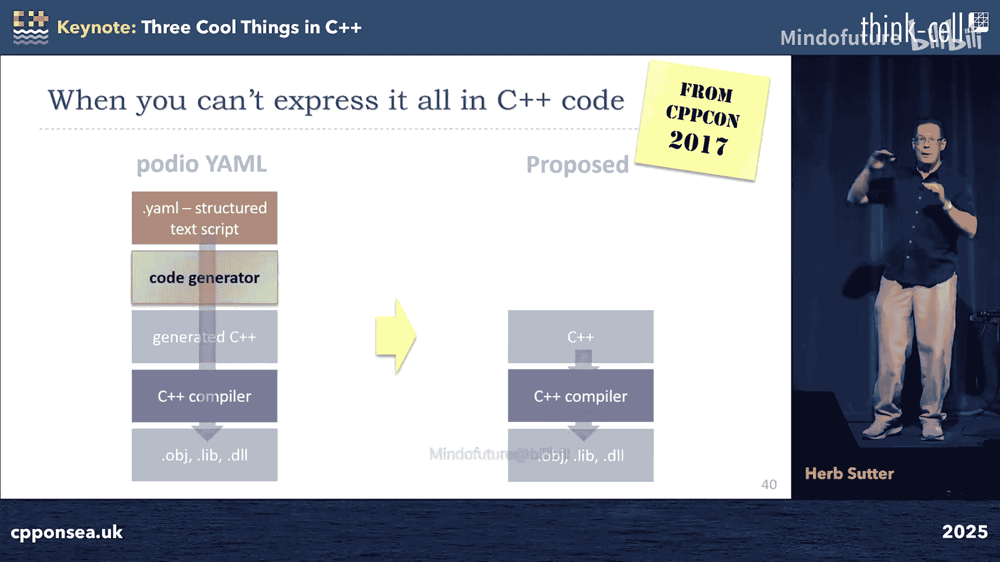
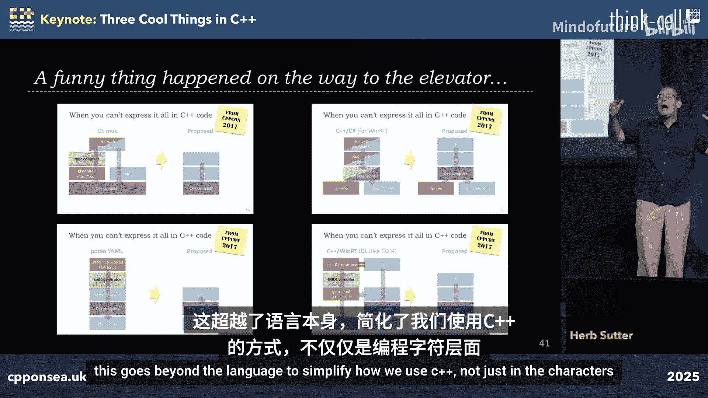
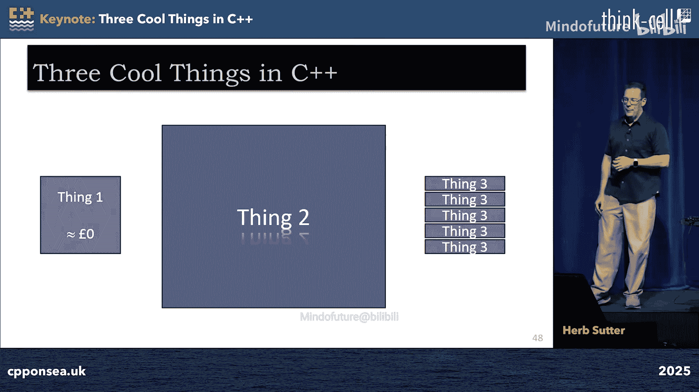

# 【Cpponsea】C++-On-Sea-2025大会-p26-P26_C++26_中_三个_很酷的_东西-安全_反射_std__execution-赫伯_萨特_2025--BV17V4GzjE6p_p26-

I have to acknowledge some things So roughly half of the slides， maybe a little less， are new。

 including ones I wrote yesterday， including there's one slide that Dan Katz。

 the the author of the clang， the current clang reflection implementation wrote on the flight home and emailed me and since posted it's been on Redddit。

 on Saturday night。 So there's new material here。 If you have seen my talks before。

Now if you've seen everything I've ever ever presented。

 youll recognize a little over half the slides that I've given before some of them several times。

 but there's quite a bit new， and I have a confession to make。

This is the first time I've ever given a talk with this title。

 but it's not the first time this title has been used at a SQL S conference。

So Scott Myers and I have worked together for many years before he retired。

 and one of the things he told me once was a trick because when you're a speaker at a conference。

 you have to send in your title an abstract well in advance， and he said， you know。

And if you've ever heard Scott speak， you know， that's how he talks， and said， you know。

If you don't know what to talk about， one thing you can do is put in a title if there's three cool things in C++。

 and then you can decide right up to the night before the talk what you're going to talk about。

And so Scott and I now live in the same city。 And so we have lunch about once a month。

 And so a month ago， I said， hey， Scott， remember that thing you told me for the first time ever。

 I just used that trick。😊，So thank you， Scott， for the inspiration and it turns out that I decided that we have topics that are very topical that turned out to be all about C++26。

 So in retrospect， I could say three cool things in C++ 26。And again。

 some of these slides you've seen before， but I'm going to give context。

 especially with what we just did 48 hours ago when the last standards meeting ended in Sofia。

 Bulgaria， and many of us in the room have flown straight here from there。

 So a lot of this has hot off the press from 48 hours ago because we work weekends。

So let's talk about some cool things in C++。I'm going to talk first about F one。

Then we're going to switch gears and talk about thing two。And then。Things3。

 but we're going to spend most of our time on thing 2。

 And if you see that these icons are intended to mean something。

 you could probably guess what the middle one is。We're going to spend most of our time on thing two because it is the biggest stinking thing that C+ Tu has seen in 20 years or well see for another 20 years。

So let's talk about it。 But first， let's talk about thing one。

 and the tag for thing one is it costs you about  zero pounds。In terms of costs to adopt。

 and I saved poundss because that's the local currency still， right？😀。Hey， hey。

 you go to a pubub in itss mill leaders except when it's essential leaders for champagne only divide by Ted。

 like， come on， be consistent。Or it's beer insider in which case is's Pis。 Don't get me started。

 I sent a photo of this to my wife yesterday。 But if you want to convert this to euros or US dollars。

 it is a really easy conversion。 You do not need to look up the exchange rate。If you're using crypto。

 I don't know。 That's pretty weird。But。I want to focus on three things in C plus plus and all but one of the slides in this section I've given before。

 but the key thing that ties them together is they have a very。

 very frictionfr adoption and adaptability matters just to editorialize a little。

 Any time you ship a new thing， whether it's a new standard or a new app on your phone or whether it's a new feature or library that you give to the next team or whenever you ship a new thing。

 It's always， you know your focused on this is my baby， It's so beautiful。 it's a snowflake。

 It's a beautiful crystal gem。And you're probably right。

And it will make no difference to the world if nobody can install it and use it。

So you always have to think not just about the thing and make it beautiful。

 but how does it plug into the world， how do people adopt it？

What does it cost if I ship a new standard of C++ and it requires a change to one in 100 lines of code of existing C++。

It will fail in the marketplace and will never get turned on。

Essentially get essentially zero adoption。So let's talk about things that have a great adoption story。

In C+ 26， we added for safety， a new kind of behavior for the first time。 in I think 30 years。

 we always had well defined。Implementation defined or implementation specified。

 so the standard doesn't say what it does， but your compiler manual must。Say a specific thing。

 and then there's undefined behavior， which is， you know。

 the usual meme is demons can fly out your nose， it can reform out your hard drive。

No nasal demons have ever actually been observed。Not literal ones， but we do see time travel。

 and we see a of checks that the program said should happen。

 we see leaking secrets and security vulnerabilities。So what we've added is erroneous behavior。

 and it is not undefined， It is well defined。But it is not good。

 it is well defined as being just wrong。And this actually is an important idea that quote is directly from the paper。

Which means we don't get time traveler leak secrets， but if you write。Ironous behavior。

The thing you need to know about it is the compile is required to do something well defined。

 and the mayor might not tell you what it is。And the compiler can inject code to detect that you did it and terminate your program immediately。

So writing EB in C Pos 26 can terminate， this part is not stressed enough。But if it continues。

 it will be well defined， but with erroneous values， and the first place that we use that， yay。

 we can celebrate one of the significant sources of security vulnerabilities and other bugs。

 accounting for something like I don't know， 5，10% is uninitialized local variables。If you don't。

 if theyre typed without a constructor， so you have like an inch on the stack or an array of them。

By default。The code compiles and runs without initializing any of its bits。In C++ 26。

 we made the blanket change that is not true。So just recompiling your code as C++ 26 will take all those stack local variables you never initialized。

And willll make them possibly terminate， but will make them。

 but usually will scribble values into them。 It will inject rights。 So there will be a tiny overhead。

 Usually it's something that you'll never notice。 And if you really do care， like。

 say you've got a big array on the stack and you really don't want to initialize it with dummy values because you're about to call men set。

 That's fine。 Just declare it and put the attribute indeterminate on it。

 I know it should be called that initialitized， but it's indeterminate because reasons。

 So just put the attribute square bracket square bracket interminate square bracket square bracket。

And now you might say， well， then C+ didn't really take away my undedefined behavior， No。

 we would never take a sharp knife from a C+ programmer。

We know we want to this is why would use C plus come on is because of the sharp knives。

All we've done is put the sharp knife in a drawer by default。

Instead of leaving it lying around the floor， and you have to explicitly in your source code。

 open the door by simply it's really easy。 it's a gresase door。 You just say indeterminate。

And you get exactly the same undefined behavior that you get today。

 You know you're about to override it。 It's saying， trust me。But the big advantage is。

 if you ever got it wrong， He said， trust me。 And it turned out that you weren't as trustworthy as you thought。

 and you have a bug。 You can grip your source code for the places you did this and look at those first。

 because likely the bug is there。 This is the equivalent of writing unsafe in safe languages。

 You're opting into unsafey。 We all want it， but you opt in。

And this is a treasure chest to this undedived behavior。So here is an example。 Where's Matt。

 I know you're in the room。 Wave Matt。Oh， right there， you're so far away， Matt。

I love somebody who will sit in the front row often it's like empty seats here。So right on GodBt。org。

 I'm letting it compile Explorer， but we call it Godbolols。It's uponnymous。

 you can't get away from it。Here are three functions。And I'm going to argue。

 at least for two of them， and possibly for the third。The programmer did nothing wrong。

 Three functions， three programmers。And they should all pass code review。

 like one might get a code review flag， but all should pass code review。Function 1。

Put some data on the stack for convenience for expository purposes。

 I'll make it characters and I'll make it with the values SRET。

Because it's say it's a secret of something sensitive， and then it does whatever it does and returns。

 right， So when you call the function it does its's work returns。

Function 2 do not be fooled by that it happens to be one line away on the slide。

Function 2 could be written by somebody completely different。

 Maybe it was written by Austin instead of by Matt。 They're sitting together， but maybe they did it。

 And maybe Austin hasn't even written this function yet。

 He's not going to write that for 10 until 10 years from now。And then I， poor smuck。

 I'm going to come along some day and write Ma。 And I'm going to assert this passes code of。

 I did nothing that I can see that violates any good coding guideline。 I simply。

 from the same function， call function 1， then call function 2。But what happens？

Function 1 allocates a stack frame， so bumps the stack pointer， puts 6 bytes of data 7， really。

 on the stack。Right。And then returns。Which only bumps the stock pointer back。 It does。

 It could legally， but never does in practice， overwrite the memory。

Because why we're about to scribble over it again， except what's the next thing we call F2 So we go into F2 first thing we do is we bump the stock pointer。

And then we start， we put an array of characters。 It could be of ints。 It could be anything。

 but it overlays without initializing that same storage that F1 left behind with a secret。

And now we can print that uninitialized variable。And we see the secret on we see it on GCC。

 we see it on K， we see it on MSVC， every major compiler today。With zero code changes。

 just recompile this code as C plus L 26， and you will not get secret disclosure。 Just sorry。

 this gives we get tickgle every time I say it still。It's true。 it's the honest， bd truth。

 Just recompile your existing code and it's safer。Now it's not totally cost free。

 it's probably cost free because this means that the powder will scribble values if you measure and that's an issue。

 use the attribute and deterant。But the cost is so low and measured in practice。

 The committee just blanket did this。 There's no opt in。

 We just made it the default in the whole language。 We said it's 2025 folks。 It's time。 Actually。

 this was done in 2024。And on the right hand side by the way。

 are the flags you can use on pre C plus L 26 competitorsrs today because they all have flags to do this。

 The one for Kang and Gcc is dash F trivial autovar and it equals pattern。 There's also equal0。

 I recommend equals pattern for reasons too long for this talk。But they're both good。

So that's a nice story。 There's another nice story At our previous meeting。

 I think this was just four months ago， correct me if I'm wrong in Hogggenberg， Austria。

 we adopted the hardened C+ L standard Library， which adds bound checking and for a couple of things。

 empty checking。For a large swath of the common types， containers， views of the standard library。

 So basically， all the popular subscript operators and the range like things， including front back。

 et cetera。Are now bounds checked and we don't say there's nothing in the standard that says how you turn it on。

 so it's implementation specified as you see your compiler documentation for what switch to set to turn it on。

But we have now specified and standardized a hardened， bound safe version。

 bound safer version of the C plus O standard library。So for a long time。

 people have been saying just one thing， they've been saying， could you please， please。

 pleased add bounces checking for span Subscript？This is that。 And 20 things more。

 This is not just a narrow fix。 This does actually give you bounds checking for span。

 but also for vector， for array， for string views， for strings。Why is this important？

Because of the top 10 miter security vulnerability categories every single year。

 at least two of the top 10 are always buffer overrun， read， buffer overrun，r。

They are by far the biggest category of memory safety errors in code。

And this does not address bound safety for everything， but it addresses a major swath and。

 and puts a safe paved road right through the high traffic area of C plus plus。

 And this isn't just something theoretical。 Here's from Apple's paper。About deployment experience。

 because Apple uses this in I O， Mac O S， and Google uses this， including in Google andromeda。

 So Google deployed this technology to hundreds of millions of lines of code with a performance impact as low as this is not a typo。

3%。And found over a thousand bugs， including security critical ones。Google andromed adopted this。

 The live C plus maintainers continue getting reports of people finding bugs using this。

 and it's been an astonishing success far more than the authors's thought My understanding is that Microsoft has already taken a group of its switches that did these things and has already packaged them and announced them I think a month or two ago on their hard C plus library。

 vendors are not waiting for C plus S 26 to ship next year because it's two more meetings till it's technically finalized。

 They're shipping the good bits right away So you know， this is just a good reminder。

 when you think about C plus 26。 It may seem far away。

 And when when when will will it be adopted when will it be implemented。

Client and GCC have already implemented2/3s of the SQL+26 language features。

The compilers are not waiting to give you the good stuff， so this is really great to see。And。

Here's a new slide because there's one other thing that we added in C+ S 26 that also falls in the category of gives you something for free。

So you if you've heard of the term trivial relocation， those are really the two key words。

 trivial means just copy the bits。Asster footnote， but be smart about it。 So， for example。

 if on a certain arm architectures， they have， they have。

Signing for the V table pointers in the object。Bit copy and update the signature。

 like platforms actually get to be smart about this。

So you get basically the performance efficiency of a bitco without losing your security implementation details。

 the special sauce for safety。But you also get relocation， which is you're atomically constructing。

 creating a new object and ending the lifetime of the old object and essentially copying the bits over。

  moving the contents。 Sometimes we've used terms like destructive move for something like this。

This is now standard。And。This means that the des can skip checks and branches， extra branches。

 so it's faster than move is。Because it's bits。And there are existing pre standardard uses。

 Priary Bloomberg， cute folly， Lipsy Kloss did variants of this。

 but less broadly because they were playing on the edge with undefined behavior。

 like they were doing this for the performance benefit。

 even though it was technically undefined behavior。

 and sometimes they had to kind of arm twist their compilers to let them do it with with safety overrides。

And I wanted to just call out one thing because there has been some confusion about this on social media。

This triple check mark。It is， was not true before。 earlier versions of the proposal did not have it was true that some trivially copyable types were not trivially relocatable。

 That has been fixed。 What was voted into sec equalus 26。

 Anything that's trivially copyable today is trivially relocatable。Plus。

 a lot more unique pointer vector are trivially relocatable in many cases。

As long as the types they contain are。So why has this happened in this section？

Here is an example of code that if you recompilile it as to see close to 26。Just gets faster。

Because it will just automatically be able to pick up relocation as soon as your standard library implementation has been updated to be tagged。

This should remind us a lot of C+ S 11 because one of the really juicy parts of C+ 11 was move semantics。

 but you didn't have to start writing new code and move everywhere in order to get or double a percent with a brand new two meanings everywhere to get advantage。

 take advantage of it。With C plus 11， you could just recompile your code to C plus S 11。

And notice that often， it was a bit faster。Because we just implicitly moved where we the language was smart and new to implicitly move。

 Same thing here。 The language and the standard library can implicitly know when to trivially relocate。

 And this is the best of all worlds。 Now， you won't get all the performance and you won't get all the just like you won't get all the safety。

Without by just recompiling。 But the fact that we're delivering some of it this way is important。

 And that's the， the cap of this section。Quantitatively， have you， Did you see what we're doing here。

 We're delivering。Autoomatically eliminating some fraction of security bugs and vulnerabilities and we're giving some percentage of speed up。

But qualitatively， without requiring people to make with zero or no code changes required。Now。

Do not get me wrong。 I have been frequently misquoted as saying， oh。

 her wants to give safety with no code changes。 That's a pipe dream。 I have never said that。

 They're quoting the first half of one sentence。 the first half of the sentences。

 we should deliver as much as we can without requiring code changes because Ad is important。

 Adopability is important。But， of course， we can't deliver all safety。

 all performance improvements without code changes。

 If you've got a rat's nest of owning raw pointers and you don't call delete in the right place or know who owns what。

 you're going to have to rewrite that code to make it safe。

 You can't just automatically say compiler be an oracle。But what we can do。Is deliver a。

Good size fraction at some percentage of safety improvements and the performance improvements with just recompile with C plus S 26。

And it's safer。And possibly a bit faster。That's a great adoption story because the first thing your're engineering。

 the Vice President will ask you when you talk about adopting a new compiler or a new standard version is say。

 great， how long is this going to take， how much of my code do I have to change before it compiles？

For these features， just rebuild what you got and it's better。That's a great adoption story。 And one。

 I hope that all my the I apps and the libraries that anybody ever ships keeps in mind。

 it's important not to just ship a jewel。But make the jewel adoptable so people use it。

So now let's talk。About thing 2。 Any guesses as to what thing2 is。Sorry。

I almost there was almost a thing for and that was contract， but I cut it for time。By the way。

 for the record， contracts are great。 Let me editorialize briefly。 I have heard some people say。

 and they mean well that the contracts we put into C plus plus 26。Are flawed in various ways。

 in particular， one that still gets said is that you can't do static analysis with them。

Microsoft's code QL team is shipping a product that is doing great static analysis for those contracts。

 come to CPPcon。 You will see it talk about it。So contracts， I love them。

 and I'm going to start using them more。 But let's talk about reflection。Until Saturday。

 until 48 hours ago。If you had to go back and look at all the polls。

 all the feature adoption polls that we ever took in the history you see++ in the committee。

I think the most impactful one ever was in July of 2007。

 when Brna Strstrep and Gabriel Dussterre's paper， first paper on Contex Bur。

Was added to to draft C+ S 11。Looking back now with hindsight， we can see what a huge shift that was。

 and a huge step forward。 And then， of course， we filled out。

 we continued finishing Cont Exper in 141720，23，26， We just added a Con experter exceptions。

 Why because reflection， Well， I'm going to get there。 Con expert exception handling。

 Almost everything now in the standard library and in the language。

Is available in Cons for compile time code。So I would， if I had to pick one before Saturday。

 I'd say that was the pivotal vote when we first voted to add Con per。

 I now think that has been eclipsed， but that was necessary。

 but not sufficient And it's now being eclipsed by the impact。 I think， of reflection， which。

 of course， depends on Cons per。 So on Saturday， the world changed。

Because I've been talking about perfection for a while， there have been prototypes for a while。

But it was formally made standard in draft， so that to go out for approval balloting。

 but in draft standard C+ plus 26，48 hours ago， and we are going to look back on that day this past weekend for the next few decades as a pivotal turning point for C++。

 and I'm going to try to support that。So what reflection is in a nutshell is simply the program。

 you can write program code that can see program code， like do a for arrange for loop。

On the member functions of a class。Could never， I've always been able to do range 4。

 but never on the program itself。 like you can actually navigate， think of it as， in many ways。

 a good way to think of it as an API to over your A S T。But it's more general and standardized。

And to generate itself， we have the tiniest little bit of generation in this first steps called splicing。

 Full actual generation is going to happen later。 but we're going to talk a lot about it in the next few slides。

 But that's why this is meta programs。 They're programs that can read and write programs that can read and write themselves。

 okay。😊，How many of you have done reflection in C sharpp or Java or another language？Right。

 it's super powerful， right？This is not that， this is way better。Not in two ways， first of all。

 and of course， you can't reflect everything yet。 we've only just started adding reflection。

 We'll add more in SQL S 29。 for example， you can't reflect on statements and expressions yet。

But you can reflect on types， functions， even parameter lists already。But when you do。

 it is not like C+ S and Java as C sharp and Java do， first of all。

 you'll be able to reflect more as I said， second， it's all at compile time。

So if you do a virtual method call in Java， right？It's going to。Cost some of them out of time。

 some of them out of cycles。If you make that same method call by using reflection。

 reflecting on that method and then calling it through the reflection。

 it's about four to five times slower。So still pretty fast。

 but everybody knows that C sharpp and Java reflection are a super powerful。

 enable really important libraries， but B slow。And there's run time overhead。

This is purely compile time。Now， if you want to compute something and save it till run time。

 you can do that。 I'll show you how。That you could just store store it as data。

 But unless you do that， it's 0，0，0， runtime， space or time overhead。Of course。

 then you have to decide what's where you want to balance compile and runtime。

 but you get to do that。

Same as with Con expert code。 In fact， it uses Con expert code。

Perhaps the best summary is when in Hana Dovva allowed me to use this。 So thank， thank you， Han。

 just curious。 how many of you have have heard Hanna speak or know Han a little bit。😊。

She's cool so she's。Very tall。 She's chair of the SG7。

 the compiled time programming group in our committee。 she's tall， very quiet， understated。

 a Czech European。And。Dan， who is the implementer， as I mentioned， of the clang implementation。

 the prototype of reflection， he told her a few days ago in the middle of the week， hey。

 it's going to make it。 A reflection is going to come up for vote on Saturday。

 we finished the wording review。And Hannah。In， it gave the perfect answer in her understated。

 quiet way。😊，She just gave a little shrug。And said。Whole new language。We don't know the half of it。

It is going to take us 10 years to figure out all the things we can do well with reflection。

 I'm not talking about abusing the feature because we all abuse new features， right， heaven help us。

 We know that。 No， just the legit uses。 I'm going to give you a few today that and I will bet that even if you've been doing reflection yourself or reading about it for 10 years。

 Ill bet I will amaze you with at least one of them and say， oh， that's right。 we can do that。 Yeah。

 we're just learning this。 We're just babes in the woods。 This is huge。

So thank you to all the people。And many more， there's way too many to list。And to the implementers。

 so of the 2996， I mean， Sean Baxter has done circle reflection， I've done CPP front reflection。

 so I'm not counting many other C+ S and C+ adjacent reflection implementations that we learn from。

But just the implementation primary features that we adopted。

 the seven papers we adopted on Saturday， thank you to David to Andrew and all his colleagues to Dan Katz for the EDG and clang prototypes。

 they both started around 2017， 2018， you've seen me live demo。

 the clang prototype before in my talks is starting in 2017 of 2017 C Pecon keynote and at ACCU where I first talked about metaclass。

So that was the function， the prototype we were using then to show like this is really important。

 let's do this。And so thank you to all of these folks。But this is a stage， this is a staircase。

 we're now shipping the first parts of reflection and they're useful。But we're going to ship more。

 It's like Con Expper。 we implemented the first part， and then we added more in later standards。

But even what we have as a Saturday is much bigger than the original context for。

So here are the papers we adopted 48 hours ago， I'm not going to go through them in detail。

 but you can see these on my blog。 this is a screenshot for my blog。

 The first main one is the main reflection paper for C+ 26， the foundation of reflection。

Then annotations， what are those。 I'll show you an example on Godbol Live， if I don't forget。

Slicing a base class sub object， we have that too， we have defined static string object array。

 which is making it easier to take compile time data and make it available at runtime。

 I actually use that in some examples， as you'll see。Expansion statement， that's template4。

 So that's the compile time for loop that you use to go to iterate over。

 say that the members of the class。Function parameter reflection。

 which wasn't in the original proposal， but made it into C+26 and this is an example of how we're going to keep adding more things that you can reflect on。

 they're not you can't reflect on everything yet， but we're adding more and more annotations。

 function parameters and error handling and reflection。

 how many of you already knew that in context per code you can throw exceptions。

We added that like two whole meetings ago， that is so seven months ago， that is so 2024。

Pre Christmas。 Well， we just added that， yes， In fact。

 exception handling at compile time is the error handling method for reflection code。😊。

So we did a lot， there's seven papers， not just one that we voted in。

And this is part of a 30 year arc ever since that first paper。

 where we discovered that we can actually use the template type system to compute stuff。

And then Brna came along and said， you know what， Brna and Gabby， you know。

 we really should be writing our compile time code in C plus plus that runs a compile time that doesn't just abuse the template type system that was never designed to compute stuff。

 I mean， have you seen template meta programs， Oh my goodness。

 We do it because we love the wonderful results， Not because we like this intax， not least。😊。

If you have a， if you have a kink， don't say so， don't tell your friends in confidence。 but me。

 I like to write normal SL S code just that runs at compile time。

 This was hugely controversial in 2007。By the way， how many of you are aware that because we have Con Exp per。

 that means that every C++ compile you will ever use for the rest of your careers includes a C+OS interpreter。

Yeah， a fewer than half the hands。 go think about what that means。 That has already lived reality。

 This has been true for over a decade， right， This is not news。

 but how many of us realize it because it just works thanks to the efforts of the compiler implementers。

So here's an example I've given before。 about one way to use reflection。

 I'm going to dwell on it because I think it's important but I am also going to show other examples and show what parts you can write today with what we just voted it on Saturday。

 So this is the very first time where some of these slides， not the next two slides。

 but where some of these slides are actually going to be code you can write in standard C plus draft standard C plus。

 that has never been true until Saturday。 So this is the first time ever for this。😊。

So here's the idea。 Today， we apply coding patterns if we were on the right。An interface in Java。

 we just say interface IF， write two methods and we're done kind of like that on the right hand side。

So the idea of meta classes is， well， if we had reflection and if we had compile time functions。

 hint we do consty Val functions。Then couldn't we use reflection to reflect on the thing on the right that the user actually wrote。

And just generate the thing on the left。BecauseAnd the way we do it is。

Interface is just a constant value function。 It's saying。

 apply this constant value function to this function body I just wrote。 And what does it do。

 It reflects on the thing you wrote， And it does three things。

 There are three important things that such a function could do。 It can apply defaults。 You know。

 you didn't write virtual or equals 0 on that。But you said interface。

 that's a word of power where I'm asking for a set of defaults。So by writing just one word。Oh yeah。

 every function is pure virtual by default。 Oh， it also means I I want a pure virtual deor if I didn't write one already。

It means sorry， it defaulted a virtual de if I didn't write it already， it means I want。

To suppress the copy and move functions because copying and move does not apply to polymorphic types。

 and therefore I need to resurrect to reinstate equals default。

 the default constructor because C++ rules。So。I didn't have to write that by hand。 I just opted in。

 I said， I want interface。 That gives me all those defaults。 It gives me generated functions。

And I can actually write error messages for that kind of type like， oh。

 you wrote a data member in your class interfaces cannot contain data members， and you can reject it。

 right。This is super powerful。And the fact that I can write this， I could write that function。

 And I've been showing this on stage for。8 years now， since 2017。

You can write it as 10 lines of code。I can debug code， I can test code。And as a bonus。

Not only am I expressing my intent directly， and therefore， I have to write less boilerplate。

 I know that's the thing the carrot that gets us all。 We get to write less boilerplate， but also。

 I write fewer bugs because I I don't get the boilerplate wrong。But you know what， you'll also。

 I am convinced that once we standardize this， which I expect to be in C plus S 29。

Including that syntax， which has been approved so far and encouraged by SG7。

 the compile time group for when we get generation。

So I hope this will be CQLS29 code exactly as shown。

It also means that I think everybody' is going to declare their types that way forever。

 like you will see this on every because it's so convenient。

 and that means you will never need to write equals default or equals delete again。Why。

Because you opt， you're not saying I'm just writing some fast。 I am writing an interface。

 I am writing a value type that's copyable and comparable。 I am writing a trait class。

 I am writing a proxy， like whatever it is。I'm writing a cute class。

I am writing a C+S winnerRT class。I am writing a documentnet class for C+ a CLI。

And it will just do the right thing because you've let the programmer create a word of power。

 a constitutional function that reflects and generates exactly what's needed。

So how do I do this today， so I've shown this these next three slides before。

 but I've added the not C plus plus 26， so I'm not saying this isn't C++ 26， it's not。

It's likely going to be in C plus 29。 And the reason is is because this code relies on actually running the function。

And generating the the the new type in the same translation unit。 We don't have that yet。

 We almost certainly will in 29。 There are already proposals for that that have been seen。

 And then we can immediately use it。 Notice I write class widget。The shorthand。

 but I say make it an interface。And then I can inherit from it。

 I can override the virtual functions because these become virtual and this code just shows that that works and you can look on compiler Explorer and this works today using the EDG prototype。

 which includes more than what's in got into C++ 26。 but this is working code in a C plus plus。

Stands track prototype。So what does that inter？I am still proposing my entire metaclass paper now no longer has to justify reflection。

 so 90% of my paper was please add reflection I can now make that a much shorter paper that just says。

Please add this one syntactic sugar。For this， so that this is the same as what's written here。

And that has been encouraged， so I hope that'll be C++29。But how is that interface implemented。

 Again， this is not in C plus S 26， but the the proposal。That was a wire， but how that happened。

The proposal is that I be able to basically write source code。

 it's currently the current proposal is a series of tokens。

 but you can read it like source code class。Pasted in the class name virtual。

 pasted the class name again， Cr prime equals default。 There's the destructor， et cetera。

 And this is composable because I can call other functions。

 It's just compile time functions in C plus plus。So you might be wondering where is the code that iterates over the member functions。

 Oh， that's in this helper class where and in this helper function。

 And just because I decided to make it reusable and it goes through and that would be actually template for now。

 template for the members of the prototype。 Just go through and again。

 inject the tokens that are the same as the signature of the prototype but add virtual and equals0。

 And this code works today on Godbol。In the EDG prototype， but it uses a couple of features。

 especially this token injection that's not yet part of C+26。Still being looked at。

 but it didn't make the cutoff for sequences 26。But that's pretty cool， right？

But wouldn't it be nice if we could write that today？Recall that I said it's step it's a staircase。

 We're adding some things。 We added reflection， Splicer's basic meta functions。

 We even added annotations to reflection， reflection on function parameters。

 And so we're partway through the reflect more and more things part。

 And then we're going to go further into the do source code generation and injection。

 do more source code generation and injection in the same file。

 And we needed those features in the code I just showed。 But I have a question for you。

 I'm going to tell you it's a trick question。😊，And those of you who were in the plenary room and heard my little speech on Saturday don't get to answer。

 I already told you the answer。 No fair。 to keep your head down。Does C++？26。

 as we voted in on Saturday， this brand spanking new shiny automobile。It supports reflection。

 Does it support。Generation， meaning creating more source code。 Yes， you Oh， yes， okay， so you。

 you gave the complete answer。 The little answer is， yes， because， well。

 just a little bit because we have splices So we can actually splice things in。

 I'll show you an example into specific places。 But yes。

 because you can just reflect and see out or spit to file is your friend。

 and you can generate whatever you want。 Now， that isn't really new， though， right。😊，I mean。

 you've always been able to write a program that prints another program。 In fact。

 one of the fun things that people often learn is how do you write a program when executed print itself。

 right， It's like how do you learning how to do that is a fun trick and see， right。😊。

But we never really do that。 Why not。Because。To generate more code， like。

 why would you just generate code deterministically that you already know what the code is。

 like why don't you just put it in your file， You just just write it。

This lights up when we have reflection because then we can reflect on parts of the program and generate modified versions of them or derived versions or expanded things from that。

 it's reflection that lights this up。So。That code I just showed you before was C+ 29， not 26。

 This code works today in as of Saturday in C++ 26。

 It's exact same thing except that instead of injecting the modified widget class right inside my own source file。

 I just spit it out to another file， and this works in Godbut today。

So the only adjustment we need to make to this。Yeah， and if you're tingling， wait for it。

 there's more， wait for it。The only adjustment to this slide I just showed you is that there's now two boxes。

The first box is one program and it produces something that can then be consumed by a different CPP source file。

And this just works。 You have to emit it， then tell your build system to build the dependencies based on that。

 but it's just just tell them about the dependency because the second file will include the generated file and you're done。

That will work in C+26 and here is the code that I wrote to test it and the Gobalt link to Dan Katzs's implementation。

 and all of this code works as a 48 hours ago。 This is standard portable code。

 assuming the standard is ratified as is we don't change the syntax during the ballot comment resolution。

And notice this very similar。 I'm just building up strings and iterating over the member functions。

 I'm making pretty names of things。 I'm adding at the bottom of the boiler platelate， the virtual de。

 the default constructor。 And I omitted a little air handling here just to make it simpler and fit on a screen。

 But as of 48 hours ago， this is draft of standard portable C plus plus。

 and compilers are racing to implement it。 Gcc has a partial implementation already。😊。

II am certain you will not need to wait three years to use this feature for real。

 The future is getting very， very close。Which is very nice after having talked about these examples。

 I've been on stage talking about this for eight years， and I've been accused of selling vaporware。

And it takes time because it's a heavy lift。 And thank you to all the people who helped lift。

 We are now in the future with virtually the identical syntax and structure that we've been talking about for eight years。

 and the future is stuff is getting real。 And it's a really cool thing。😊，In CPP front。

 I've already gone beyond it and implemented my own reflection so I can start playing with this。

 And I've shown these before。 You can have a copyable type， a value type。

 So class value is an ordered basic value that's copyable。 A class struck。

 like struck itself could just be now a meta class。 If the word wasn't reserved。

So I don't need a separate enum type anymore， don't I can make a flag eum man anineum as a me class。

It just injects context for members of the types you declare。

So I have demonstrated the proof of concept for this in CPP F。 Reggx is the biggest one yet。

 and thank you very much to Max Sagebaum of Dresden Unii Dresden， I think it is。

That showed a compile time rex written using reflection that is competitive in runtime performance to the gold standard。

 which is Hanna Dukovva's C Tre E and compiles faster。 Why。

 because we're expressing our intent directly， We can write the code directly instead of going through a lot of template instantiation or at least less template instantiation。

By the way， one of the first things you'll want to do is write one that's called print。

Because as you generate code。You will write bugs or you will want to see what's generated and so therefore you want to see。

 okay， did I generate the right thing as you're debugging your meta function？

So let me just go for a second and show you what this looks like， if I can。In compiler explore。

 I'll go back to that initial example。Oh， I need to take it out of full screen mode。😊。

Put it on the correct monitor。Go back into full screen mode。

Is that big enough for people at the back to sea or shall I go one bigger？One bigger。There we go。

So here is the example I showed。 and again， you can try this link yourself to to be sure that， hey。

 stop that。To be sure that it works as I advertised。So there's my prototype， my class widget。

 and all I do is to see out interface， and of course I could write this to a file。

 there's nothing special about the console I can put it anywhere I want。

 could put it on a wire and send it to another machine。And this generates， reflects over widget。

 and it does all these things。 It creates the duplicates the names and parameter of functions。

 makes them fewer virtual and does all the default just as we said， right， And again。

 I could add better hair handling。 But this is to show you the proof of concept。

 We all know how to write code。 So you know how to write all the the tests。

 like to put in the instructor only if the user didn't already write one。 It's easy code。

 And we all could figure out how to do that。 So I'm omitting it to keep it closer。

Keep it shorter and here is that code the same is pretty much the same as I just showed you。

But I want to show you a couple of things。 First of all。

 you might have noticed that one thing is different from what I showed down here。 I wrote G。

Takes a such string， right？ But what do I see over here， G T takes a。Basic string char。

 tar trades char， allocated char， well。That's not wrong。Insert the signfd。

 And there's nothing wrong with that。That's correct。But it's maybe not nice。

 So one thing that you can do， which I did。 and so I'm I was not lying when I showed you the screenshot where that actually said string is all you need to do is go up here。

 notice that when I go through， I add， I use this pretty name function。

 which is another constantve function I wrote， it's just an ordinary function that takes a reflection info。

 a metain。And gives you a string， compile time string， a string view。 That's all it is。

 This is a pretty normal function。And the default is to return the stood meta display string of type。

That's the function that you're going to get very used to using is to whatever I got。

 whatever reflection I got， display its string， its name。But what I can do。Is I can say， oh。

 by the way， if type is theallias of reflect stood string， if this happens to be stood string。

Then just clean up the name。 And so now even if in the and youll notice have changed on the right hand side there。

 G now returns a stood string。And this， of course， even now， if I had put in stood basic string char。

It would still clean up and say string。 So you could make this work however you want。

 You can duplicate the exact thing you you got that the user wrote， you can clean it up。

 You have all sorts of control here。 And one other thing。Let's say that you wanted。 And remember。

 I said there were annotations added。 Why would you want annotations so that we can reflect。

On annotations， which are basically an extension of attributes。Let's say that I wanted to。 I mean。

 I know that people are going to use my interfacefa meta function。

I want to give them some control knobs they can use， for instance。

 I want them to give them away where they can offer a class。

Where they can opt out where certain member functions are not going to be included in the interface。

 because maybe they're just housekeeping ones， right。You ready？So you could write equals suppress。

 this is not standard and it doesn't need to be。What is suppress。

 All I did was write an attribute suppress。 And did you notice that now only F is echoed and G is skipped。

Sain't magic。 It's just some simple code。 What I do。Is I just。

 instead of just iterating over every ordinary function。

 I say and that it doesn't have an annotation of with the type suppressed T。

And is suppressed T magical， no， it's not， it's just an ordinary type that I just wrote up here。

That's all it is。And if at this point， you are thinking。

 can I create directly create my own sub languagegu and C plus plus that that you can use to communicate and control my meta function exactly。

Remember， I said it was going to take us 10 years to figure out how to use the power that just came down from Olympus 48 hours ago。

Some people， let me use a little illustration here because if you don't mind a bit of Greek mythology。

Some people worry that adding reflection opens Pandora's box。And sure any feature can be misused。

I think the right metaphor。That really applies only to reflection and to context expert。

 Those are the only two things that I think rise to this level。To me。

 I think they're more about the gift of fire by Prometheus。一。

Will change the world We have a whole new language here that we're going to have to learn how to use。

 and it'll be a lot of fun to do。Now， having said that。In addition to all these things。

Let's just spend a slide thinking about what are all the things that we might be able to do with this feature。

And we're going to take some time to learn this。As a starter。

 all those things I just showed you and you can find the CPP F implementations。As of 48 hours ago。

Not all， but most of that code can be written in C+ S26 in a pretty direct translation。

Just without putting the result to a separate file。

 not yet in generating new code inside the same score file。

 we won't have that yet until post SQL is 26。And those are already a， how can I say this cleanly。

 a metric ton of functionality and simplification。But now think outside the box。

 what else could we do with this？What are you tell me some things you're already thinking about。

 Just yell it out。One at a time。 Game engine， anything specific。

Something alternative to unreal alternative to un too unreal。 Well， unreal， the， the library is good。

 but maybe some of the frameworks good。 Hold that thought。 What was the other one。Seralization。

 So Json serialization， Deialization。 that's on the screen。 Yes， your yours is a bit further down。

 yes。On a venerate what。Autto generate mock， any particular mock you have in mind。

 is it testing mock or cute mock you're talking about。You can do cute Mark too。Yes。

alternative CRTP in some cases。 Yeah， many cases。 Yes， alternative CRTP， another。

language integrate domain specific languages。 You guys are on a roll。 one more。 anybody。

 maybe this side of the room。Type era type erasure， yeah。

 just give me a look at this type and make a duplicate that has virtual functions for all the same name and signature virtual functions that could type erase exactly interface of is a common name for that。

While I just generate only C+ code， I'm generating text， I can generate other languages code。

I can generate Python JavaScript binders for my C++ type。At compile time without separate tools。

I can generate binary data。 Why limit ourselves a text。 So for an example， for Win RT in Windows。

 you need a winMD binary metadata file that contains the information about the comm types that you authored。

And we can already， as a 48 hours ago， as soon as implementations come out。

 do a lot of this with even just this first part of reflection。 Remember。

 it's not going to be everything。 You can't reflect on everything yet。

 and we're going to keep adding more。Without any side compilers。

 without proprietary language extensions now。Prediction。

Write this down and let's talk in 1 years and if I'm wrong， I'll buy you five beers。10 beers。

 because I'm confident。I hope the price of beer goes down in the next1 years。I've said this before。

 but I'm going to say in print， we are now in the standard。

 I can say for the first time on a direct path to sunset cute mark。

 to sunset C+ O CI as a compiler language extensions。

 to sunset C+ CX as compiler language extensions， and by the way， I don't hate these things。

 I led the design of those last two。I led the design of C+I， I led the design of C+ SX。

 and I got a lot of grief from people who were saying， why are you forking C++。

 Why are you trying to change the standard C++， and that was never the goal over the proposal。

In fact， some things from those like null pointer and Enum class are now standard in standard C++。

We only wrote those because C+ was not powerful enough to yet to express the things we needed to do。

 And that is why I have been on such a crusade to add reflection to the language。

 because I never want to build C plus L Ci and C+ X again as proprietary solutions。

 I want to write it in portable C plus S code。 And if that surprises you。

 go back to my CPcon talk video  eight years ago where I said those exact same words。

 And people did chose not to believe it。 but it's true。 And reality is getting real。

 This is a beginning。 we don't know yet。 And I told the committee in plenary session on Saturday。

 minutes after they approved this。Nobody in this room yet knows everything that we can do with the power that we just voted in。

It's going to take us a decade of joyous， wonderful learning to see everything we can do。

Speaking of cute mock， I'll go quickly through these because these are slides I've given before this idea of metaclasss saying。

 I'm not just writing any class so I get some generic defaults that might be right or not。

 I'm writing an interface， a value type， a trait type， that kind of thing。I'm writing a type。

 And then it's easy to write a meta function now。For the left hand side to generate the right hand side。

So that also means not only is the code simpler。But remember， our language and our compiler。

 like we love our code because that's the thing we touch。

 We love our language because we work on the C+ a standard。😊。

So we think they're the jewel and they're important。 and we love them。 And that's okay。

But we live in an ecosystem。 they plug into a whole ecosystem in order to work。 They need builders。

 linkers that like build systems， C ICD， debuggs， Ides， like it's an ecosystem。

 We can't just say it works in the compiler。 We're done。 does it work in In。 until you do that。

 It's not done， right， It's part of an ecosystem。That includes our build tool complexity。

 Every single one of us build C+ S code。Usually not like the hand the right hand side of the screen。

 but like the left hand side。 And certainly for cute， you have to do that today。 but with reflection。

We shouldn't need a mock compiler anymore。 Now， just to be clear， I do not work for cute。

 I do not speak for cute。 I am not making any product announcements for cute。

But I know that cute folks have been watching with great attention What we've been doing with C plus Plus。

 because Ma is a cost center for them。 That is， it's a necessary cost。

 not something they love to have to support。I certainly know that's the case in Microsoft。

 where I worked for over 22 years。Where for winner our tea interfaces。

 I would much rather write the right hand side than the left。Because it's simpler code。

 there's less code to write， fewer bugs to write， it's more convenient， more fun， faster。

 more robust。But also， the build environment gets better with reflection because today with C plus R C X。

 I have to have a compiler。That has non standard extensions。

Read a file that has non standard extensions that I can't use with anybody else's compiler。

 And that sucks。 I'd like to just write standard code that works on。

Any C++ compiler and can still spit out the same output that Com needs that the Windows Com system needs for what they call modern apps since Windows 8。

And if I'm doing this very same thing in calm directly， they just do the same thing。

 but they have the compiler be separate and the extra text in the file be separate。

 So I have two separate files to compile an interface definition language file that goes through an IDL compiler in middle。

And I wanted to do it just like compiling C+ plus code。

The left hand side is not just less convenient for you and me， as users。

It is a cost to Microsoft to support。But it's not just the big tech vendors。 when I gave thishawk。

 Axelelman immediately， when I gave it for the first time eight years ago。

 he immediately contributed the slide saying， yeah， we do that， too， at Cern。

 We have a yaml script that defines some stuff about a class。

 and we run it through a yaml compiler that spits out five different C plus plus classes for each one of these that are all related boilerp in some way。

😊，It would be great if we could stop writing Yaml and have maintain a separate Yal compiler and just write it in C plus。

 write the class name and members。😊，And just have it be transform。

 apply the right defaults and force the right rules， generate the same five classes。

During compilation。And as of 48 hours ago， they can do this as long as they splitit it to a separate file and then use that file。

 They can't do it in the same file yeah。But they were already doing it in a separate file， right。

 So Axel， you can now do this as of 48 hours ago， and you know。

 because you were in the room voting for it。 So yes。And so at the last CPB con。

 when I went through all this again because reflection was getting so real。

 so I brought out all these examples。

I put them up。Gave the talk， people seemed to like it， went back to my room to decompress。

Then I decided I need some coffee。 So I left my hotel room。

 started walking down the corridor toward the elevator。

 I was half way to the elevator when someone with the conference badge met me turned and started walking with me and said。

 hey， I love that talk。 You know what。😊，We actually have a custom in house source code generator that takes some inputs and generates C plus source code。

 and that if we only had this reflection， we could stop writing and maintaining and supporting that。

 It's such a pain to do that。And so that was nice to hear。 we got to the elevator elevator came ding。

 opened， we stepped in， doors closed， we went halfway down to the coffee。It stopped， ding doors open。

 somebody else wearing a conference badge walks in。Doesn't know him， looks at him。

 looks at me and says， oh， hey， I really liked your talk。Did you know at our shop。

 We have a custom C plus S code generator that generates all this C plus S code that we have to maintain and。

 we hate maintaining it。 It's a cost for us that we would just be able to do this with reflection。

 So now I've learned to ask the question， which I'm now asking you。😊。

How many of you now or in the past have worked in a shop or on a team that has the generate C++ code that you could do？

Don't tell me for a second， this isn't world changing because it not only makes our code better。

 it simplifies our build environment。 It our tool environment。

 Like this goes beyond the language to simplify how we use C++。

 not just in the the characters we write in a text editor。

One last example。This is the example that you might have seen on Reddit in the last 24 hours that Dan Katz wrote on the plane somewhere over the Atlantic on his way home from the Sofia Beating。

Because in C+ S26， we now have hash embed， how many of you love hash embed？

The rest of you can put up your hands later once you know what Hah and bed is， you will love it。

I think of include something else， so that something that's not a C++ file。But。😊。

If you're not used to these symbols yet， the the square brackets。

 colon and colon square bracket in that second highlighted。Part。

That is part of the first reflection proposal， it's called the Splice operator。

 and we're not actually using reflection here， but we're using part of that proposal to splice in source code so what we're doing here。

 this code is reading in a file which if it was this JSON file。

Is as if it was written at that location in the C plus L source file。

 but can be made separately in version control， etca。Could be reused by multiple clients。

Then we parse it， and we get a constant expert compile time。Honest to goodness C plus plus type。

 And I'm not showing the details of parse Json。 That function is more than two lines。

 but you can write this compile time function to parse the Json and print out。

That we've that we've parsed it。This is really powerful。I have been saying for the past year。

 reflection is going to dominate the next decade of C++。

 that is probably an understatement because a decade goes by real quick。

Making things easier that are hard today， things possible， that are not feasible today。

The first phase of this was added to draft standard T plus S just 48 hours ago。 It's exciting time。

 This has been a pivotal weekend。 We'll look back on for the next 10，20 years。So that was thing two。

Thing three is just two slides。And he guesses this what thing three is， I'm not good at iconography。

St stood exact。 Oh my goodness， Maybe I am good at。 maybe I don't suck so much in iconography。

 All right。Yes， it's to execution， AK sender receiver， AKA， C plus plus async model。

Every language is building an async model these days because they need to。

 This is essentially our async model。So very， very briefly at a super。

 super high level without showing you any of the most important knobs。

Let's say you had a simple synchronous function call。Today。

 you call a function and you call it and it returns immediately， which means it blocks。

 You do not execute the code that comes next until F finishes。

 So the code of F and the code that comes after it at the call site does not overlap。

The whole point of being asynchronous is that we decouple the call from the return。

 the launch from the joint。So that now even just using C++ 11 futures， we could。

 if you have a suitable future generating a thread pool or something。

 I've been showing this example for 15 years now， you could say pool。 run and use Passa Lambda。

 which but this returns immediately and gives you a future， which is a ticket redeemable for an int。

But the the may or may not be there yet， but you can continue executing。

 So this code runs potentially concurrently with F。 And then when you finally do need the value。

 you just ask for dot value。 And if it's already available， you just continue executing。 If it's not。

 you block and wait for it。 So it's a join point。But all I've done。

 the simple way to think about it is I've decoupled。The call and the return， the launch and the join。

This is how that same code looks in C plus 26。 This is standard code。

 And we also just just yesterday， Well， two days ago。

 also voted in basically thread portable thread pools for C plus plus。

 So assuming your variable is named and pool， you just say schedule pool。 and you're just。

You're gonna get used to pipe then。 Okay， just accept it。 Don't。

 don't go through all the stages of grief。 if you're not a functional programme or just。

Just say pipe then is what I incant。 And， and that's it's， it's okay。

 Soca you'll see it all over the place。 It's just pipe。 then。 Think of it as a big dot then。

Do this as a continuation。 And again， those two lines run potentially concurrently。

 and then I can wait by using sync weight。There's way more artistic execution than that。

 but that gives you the basic asynct model。And to me。

 the coolest thing about this is I have long taught the picture on the left。

I've been giving effective concurrency courses for 20 years。That。

Point out there are two fundamental and fundamentally different ways of， think parts of， we say。

 general concurrency or running work at the same time。The first is what I call concurrency。

 which is I run two different things independently。 So it's two different threads。

 Maybe they stay responsive。 I avoid blocking the U I thread by having a background worker thread。

 and they run independently and maybe communicate through message queuees or something like that。

That's about running two independent things， each at their own speeds independently。That's pillar1。

Pilar 2， parallelism also runs two things at the same time， but they're part of the same computation。

 So if I do a parallel sort。I do left and right Subre in parallel， right， left， right right， left。

 right， left， left， subtes in parallel。 So the things that are the tasks running in parallel are part of the same computation。

 This is what re enableables the free lunch on hardware。

 I'm using more hardware usually to get the answer faster。By decomposing a single computation。

 making it parallel， and then if necessary joining。 But these are very different。

 Just look at the the metrics， the requirements， the tools。There are four different purposes。

 they use different tools today， Open MP versus Open MPI are so like I don't oh my goodness。

They're not even the same thing。 Like， don't get them confused。 That eye makes a lot of difference。

The surprise to me was I never even dreamed it would be possible。

That a single async framework would do both of these jobs well to the point where for the past year。

 the concurrency folks had been coming to be saying stood exec is the best thing that's happened。

 that is finally a usable user interface for Co routines， which is pillar1。And at the same time。

 the KudDa folks are saying， and we've bought implemented a binding of this for KUDa where it runs competitively with KUuta for data parallel work on GPUs。

 that's pillarar2， and it's the same framework。I did not know that was possible。

So I am looking forward to learning a whole lot more about this。

 but as Jessica Wang said it to me on Saturday in the corridor at the Sanders meeting， yeah。

 just being able to use the same code for Cdy and the CPU， one's parallel， one's sequential。

 I can use the same code and to that I would add in video would say， oh and GPUs GPUs are good too。

So that's thing 3。 We've talked about things we get for free，0 cost， hardening。

Init automatically initialized sack variables that are erroneous behavior and trivial relocation。

 thing 2， reflection that's going to dominate our next decade。 thing 3。

 an async framework for C plus plus that does concurrency and parallelism。

This is not a small release， and it will affect every line of code we write so much that just like C plus S 11 felt like using a new language。

 as Brna said， because there was so much stuff in it that you just used every day。

 like range 4 auto variables， lambmbdas， right。You could look at pretty much any 10 or 20 lines of C plus code today and know。

 is it C plus plus 11 in the era， meaning everything since then so far， or is it pre c plus plus 11。

 You could see， Oh， it doesn't use La lambmbda。 It didn't use auto or deco type。

 It didn't use range 4。 Obviously， it's old code。 You can tell modern C plus plus Today is C plus plus 11 until now。

I think that C+ S 26 is going to do that again for the first time since C+ S 11。

 where the features we're getting in the C+ S26 era， not just 26， but also 29。

32 are going to change so we can open an editor and see 10 or 20 lines and immediately know because。

 well。I expect every class that you'll ever write in the future once we have it to be written with class per as to what kind of class I'm writing because why wouldn't you。

You'll just， you won't be able to look at a class definition without knowing its modern code。

 So a new second modern era， if you will， of C++。So I think those are three very cool things。

 and if I known and I was going to be talking about those three。

 I would have said three cool things in C++ 26。

Because they're all coming in 26。We have time for a couple of questions。 If you want to。

 I don't know if there's。

