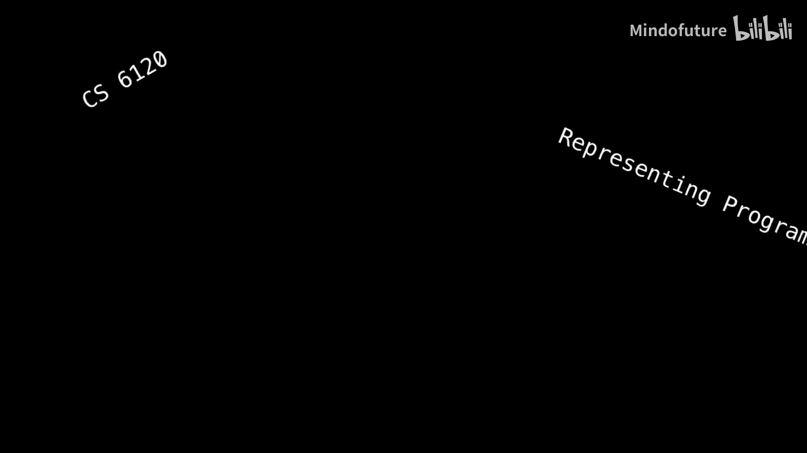
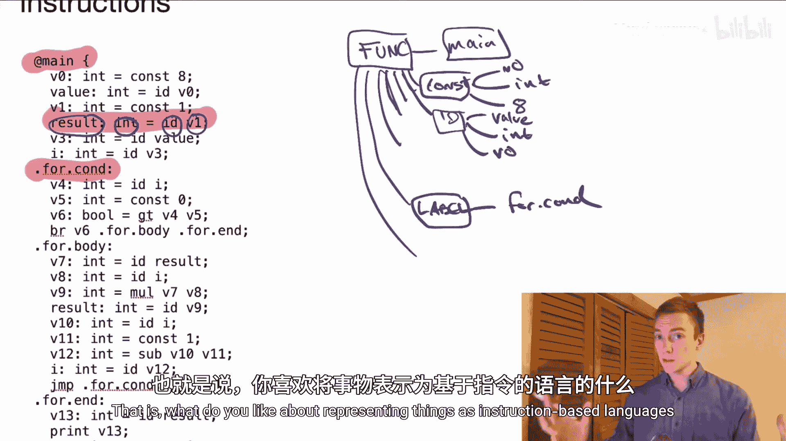
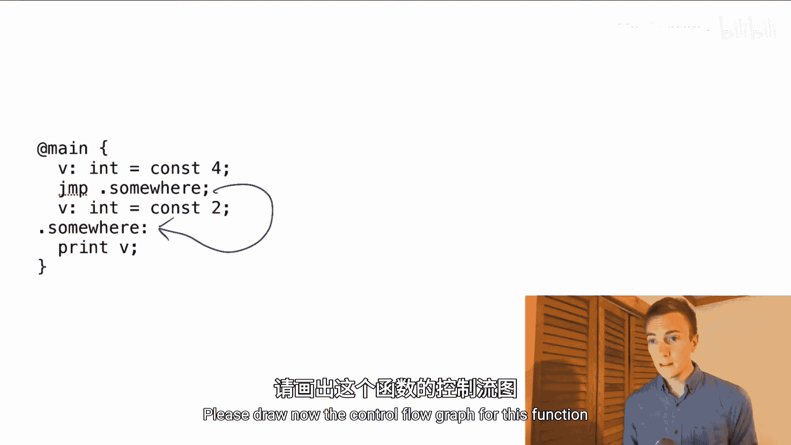
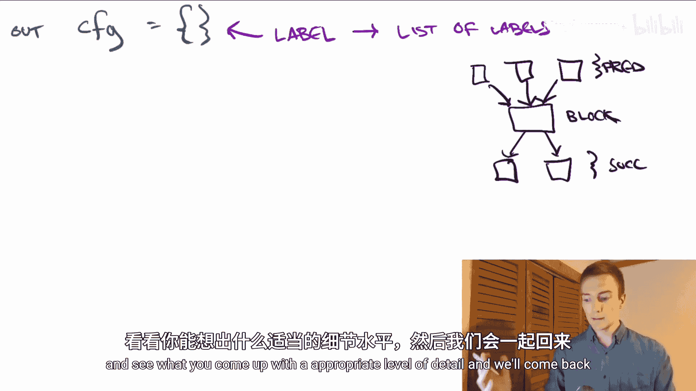
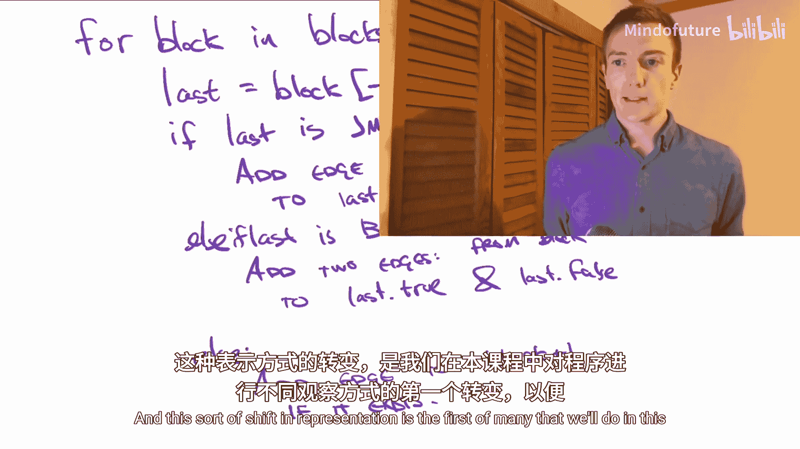

# 002：程序表示




在本节课中，我们将学习编译器如何表示程序。我们将探讨从文本到抽象语法树，再到基于指令的中间表示等多种表示方法，并重点介绍控制流图这一关键概念，它能让程序的结构和属性在编译器分析中变得更加清晰。

## 程序表示的含义

程序表示指的是在编译过程中，我们将程序视为何种形式来进行读取、转换并最终翻译成另一种语言。它决定了我们操作程序时所使用的抽象层次。

## 文本表示法 📝

最直观的程序表示方式是文本，即具体的语法。例如，在JavaScript中，程序看起来就像你在文本编辑器中输入的那样。

以下是文本表示法的优缺点：

*   **优点**：易于人类编写和阅读。
*   **缺点**：不适合进行程序转换。文本形式没有提供理解程序语义所需的正确抽象层次，而理解语义是进行转换的前提。

## 抽象语法树表示法 🌳

下一步自然的表示法是抽象语法树。AST是一种数据结构，它以树的形式抽象地表示程序的语法结构。树中的每个节点代表程序的不同部分。

例如，一个程序节点可能包含一个语句块，而语句块节点又包含多个子节点，如`let`语句、`for`语句等。

以下是AST表示法的优缺点：

*   **优点**：相比文本，它极大地简化了对程序行为的推理。它非常适合编写解释器，因为可以方便地使用递归函数遍历树节点来执行程序。
*   **缺点**：不同类型的树节点具有完全不同的语义和行为。编写一个能处理任意程序的编译器分析时，需要不断处理这些节点间的语义差异，这增加了复杂性。




## 基于指令的表示法 🧩

在本课程中，我们将主要使用一种不同的表示法：将程序表示为指令列表。这种表示法旨在使程序形式更加规整，便于编译器优化。

其核心思想是将程序转换为一种类似理想化汇编语言的形式。它主要由一个指令列表构成，每条指令都具有非常规整的形式：一个操作名和一组操作数。




例如，在为本课程设计的简单语言中，一条指令可能如下所示：
```
result: int = id v1
```
这条指令表示：读取变量`v1`的值，不做任何操作，然后将结果存入类型为`int`的变量`result`中。

以下是基于指令表示法的优缺点：

*   **优点**：形式极其简单、规整。所有指令共享相似的结构，这使得编写编译器分析（如优化）变得非常方便。
*   **缺点**：对人类程序员极不友好，几乎不会有人愿意用这种类似汇编的形式直接编写程序。

这种表示法也可以有AST，但其AST会非常扁平和简单。一个函数节点下可能只是一个包含所有指令和标签的大列表。

## 控制流图 🗺️

基于指令表示法，我们可以进一步提取程序结构以进行分析。第一种重要的结构是控制流图。

CFG的基本思想是：图中的每个顶点代表一条可执行的指令（不包括标签），顶点之间的边代表控制流的转移。

**构建CFG的步骤**：
1.  **识别指令节点**：将每条非标签指令作为一个节点。
2.  **添加控制流边**：
    *   对于顺序执行，从前一条指令节点画一条边指向下一条指令节点。
    *   对于`jump`指令，从该指令节点画一条边指向目标标签对应的指令节点。
    *   对于`branch`指令，从该指令节点画两条边，分别指向条件为真和条件为假时跳转的目标标签对应的指令节点。
3.  **标记入口和出口**：通常标记函数的第一条指令为入口节点，最后一条终止函数执行的指令为出口节点。

通过观察CFG，我们可以很容易地发现一些程序属性，例如永远无法执行到的“死代码”。

## 基本块 🧱

在CFG中，经常会出现由多条指令首尾相连形成的长链。我们可以将这些链聚合起来，形成基本块。

基本块的定义是：一个指令序列，其中控制流转移（跳转或分支）只能发生在块的开始或结束处。换句话说，一旦开始执行一个基本块的第一条指令，就必然会执行完该块的所有指令。

**识别基本块的规则**：
*   遇到`label`（标签）时，必须开始一个新的基本块。
*   遇到`jump`或`branch`这类终结指令时，必须结束当前基本块。

在基于指令的语言中，`jump`和`branch`指令被称为终结指令。

将程序表示为基本块级别的CFG，而非指令级别的CFG，可以简化编译器分析。在分析时，我们可以将基本块视为一个整体来推理。

## 从线性指令到控制流图：算法 🔧

我们需要算法将线性的指令列表转换为图结构的CFG。这个过程分为两步：

**第一步：形成基本块**
输入：线性指令/标签列表。
输出：一个列表，其中每个元素是一个基本块（即一个指令列表）。

伪代码思路：
```
blocks = []          # 存储所有基本块
current_block = []   # 当前正在构建的基本块

for instr in instruction_list:
    if instr is a label:
        # 标签意味着新块开始，结束当前块（如果非空）
        if current_block is not empty:
            blocks.append(current_block)
            current_block = []
    else:
        # 将指令加入当前块
        current_block.append(instr)
        if instr is a terminator (jump/branch):
            # 终结指令结束当前块
            blocks.append(current_block)
            current_block = []

# 处理最后一个块（如果非空）
if current_block is not empty:
    blocks.append(current_block)
```
同时，在此过程中需要建立一个从标签名到其对应基本块的映射字典（`label_to_block`），以备后用。




**第二步：构建控制流图**
输入：基本块列表 (`blocks`)，标签到块的映射 (`label_to_block`)。
输出：表示CFG的字典，键为基本块标识（可用其起始标签表示），值为该块的所有后继块标识列表。

伪代码思路：
```
cfg = {}  # 控制流图字典

for i, block in enumerate(blocks):
    block_id = get_label_for_block(block)  # 获取该块的标识（如首个标签）
    last_instr = block[-1]  # 基本块的最后一条指令

    if last_instr is a jump:
        target_label = last_instr.destination
        cfg[block_id].append(label_to_block[target_label])
    elif last_instr is a branch:
        true_label = last_instr.true_dest
        false_label = last_instr.false_dest
        cfg[block_id].append(label_to_block[true_label])
        cfg[block_id].append(label_to_block[false_label])
    else:
        # 没有终结指令，顺序执行到下一个基本块
        if i+1 < len(blocks):
            next_block_id = get_label_for_block(blocks[i+1])
            cfg[block_id].append(next_block_id)
        # 否则，当前块是出口节点
```

## 总结 📚



本节课我们一起学习了编译器如何表示程序。我们从最直观的文本表示开始，探讨了更利于机器处理的抽象语法树表示，并重点引入了本课程将使用的基于指令的中间表示法。为了在这种表示法上进行有效的分析，我们深入学习了控制流图的概念，它通过图结构清晰地揭示了程序的控制流。我们还介绍了基本块，它将连续的指令聚合起来，进一步简化了分析。最后，我们概述了将线性指令列表转换为基本块和控制流图的算法思路。这种从不同视角看待程序表示的方式，是编译器进行各种分析和优化的基础。