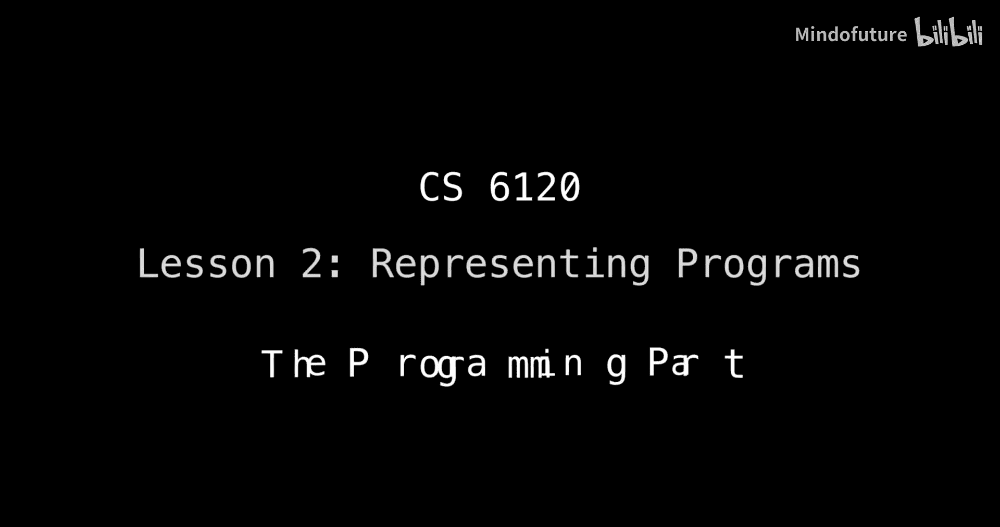
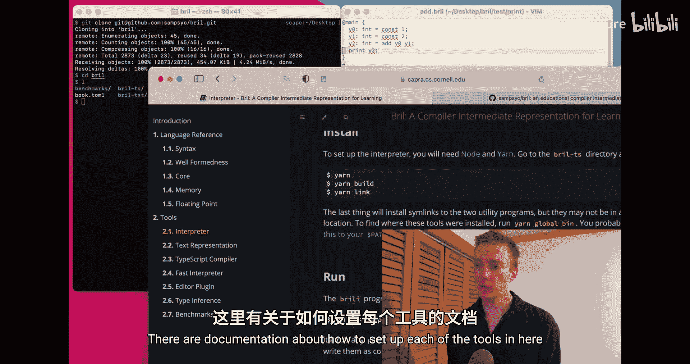
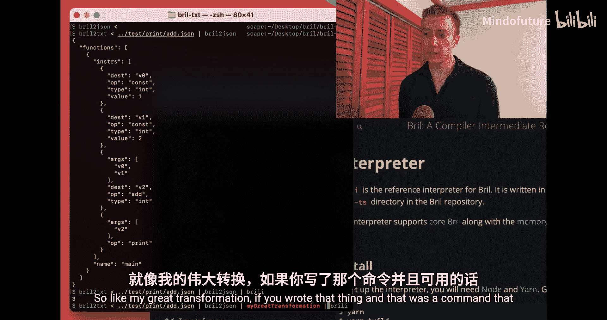
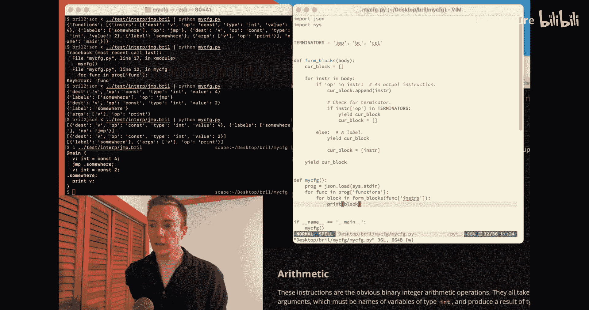
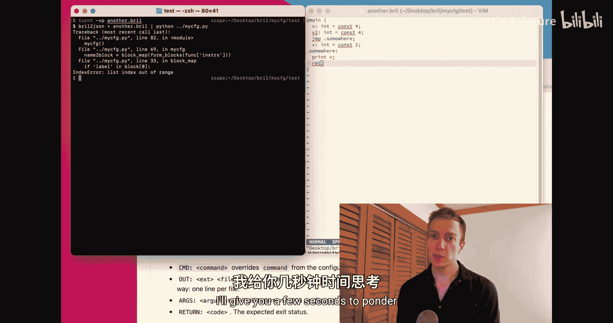
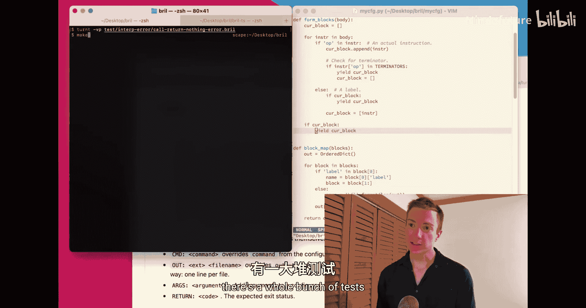

# 003：Bril语言入门 🚀



在本节课中，我们将动手实践，学习如何操作一种名为Bril的编程语言。Bril是康奈尔大学CS 6120课程专门设计的中间语言，它结构简单、规则清晰，非常适合用来学习编译器原理，而无需处理像C语言或LLVM那样复杂的现实世界语言和基础设施。

## 什么是Bril？ 🤔

Bril，全称“Big Red Intermediate Language”，是一个极其简单且高度规则的中间语言。它的核心思想是基于指令，并且你可以根据需要任意扩展它，使其功能更丰富。这意味着Bril不是一个固定的语言，你可以在其基础上添加任何你想要的扩展。我们将从语言的核心部分开始探索，但已经存在一些使其更有趣的扩展，当然你也可以添加自己的扩展。

Bril的官方主页和相关文档可以在课程网站上找到链接。你还需要查看包含大量基础设施和文档的GitHub仓库。这是一个“单体仓库”，意味着里面有许多相互关联的不同工具。



## Bril程序的表示 📄

Bril程序有一个规范的表示形式：JSON文档。JSON只是一种序列化格式，其优势在于几乎所有编程语言都有内置的库来解析和生成JSON文件。这意味着你不需要使用特定的语言来处理Bril程序，也无需自己编写解析器——这门课程的重点绝不是解析器。你只需要使用内置的JSON库就可以开始处理Bril文档。



以下是Bril程序JSON表示的一个简单示例：
```json
{
  "functions": [
    {
      "name": "main",
      "args": [],
      "instrs": [
        { "op": "const", "value": 2, "dest": "v1" },
        { "op": "const", "value": 3, "dest": "v2" },
        { "op": "add", "args": ["v1", "v2"], "dest": "v3" },
        { "op": "print", "args": ["v3"] }
      ]
    }
  ]
}
```
一个Bril程序在顶层是一个字典，其中`functions`键包含了程序中的所有函数。每个函数也是一个字典，包含名称、参数列表和指令列表。指令列表构成了函数体，每条指令本身也是一个JSON字典。

这个JSON程序对应着一种对人类更友好、更易读写的文本格式：
```
@main {
  v1: int = const 2;
  v2: int = const 3;
  v3: int = add v1 v2;
  print v3;
}
```
文本格式非常便于阅读和编写，但它**不是**Bril程序的规范表示。规范表示是给计算机用的JSON格式。文本格式只是一种适合人类使用的替代表示，两者之间存在一一对应的关系。

## 搭建Bril工具链 ⚙️

为了处理Bril程序，我们需要设置一些工具。最重要的两个工具是：
1.  **文本格式处理器**：用于在JSON和人类可读文本之间转换。
2.  **解释器**：用于实际执行Bril程序并输出结果。

以下是设置步骤：

**1. 克隆仓库**
首先，克隆包含所有工具的GitHub仓库。

**2. 设置解释器 (TypeScript)**
解释器位于`bril-ts`目录中。你需要`yarn`包管理器（也可以使用`npm`）。
```bash
cd bril-ts
yarn install      # 安装依赖
yarn build        # 编译TypeScript代码
yarn link         # 将`bril`命令链接到全局路径
```
现在，你可以通过`bril`命令来运行JSON格式的Bril程序了。例如，运行测试目录中的加法程序：
```bash
bril < test/ts/add.json
```

**3. 设置文本格式工具 (Python)**
文本工具位于`bril-text`目录中，使用Python编写。你需要Python的包管理工具`pip`。
```bash
cd bril-text
pip install --user -e .  # 以“可编辑”模式安装，便于更新
```
安装后，你将获得两个新命令：
*   `bril2text`：将JSON格式的Bril程序转换为文本格式。
    ```bash
    bril2text < test/ts/add.json
    ```
*   `bril2json`：将文本格式的Bril程序解析并转换为JSON格式。
    ```bash
    bril2json < my_program.bril
    ```
你可以利用Unix命令行管道组合这些工具，构建有趣的处理流程。例如，如果你想在程序执行前应用自己的优化转换，可以这样操作：
```bash
bril2json < my_program.bril | my_optimization_tool | bril
```

## 实践任务：构建控制流图 🧱




本节课的实践任务是加载Bril程序，并编写代码对它们进行处理。任务本身不必很复杂，主要是为了让你熟悉Bril生态系统和处理程序的感觉。

接下来，我们将一起动手，为Bril程序构建控制流图，也就是像上一节课那样形成基本块。你可以使用任何你喜欢的编程语言跟随操作，这里我们将使用Python，因为它能非常方便地编写类似伪代码的处理算法。

### 第一步：加载Bril程序

首先，我们从零开始，创建一个Python脚本来加载Bril程序。
```python
import sys
import json

def main():
    # 从标准输入读取JSON格式的Bril程序
    bril_json = sys.stdin.read()
    program = json.loads(bril_json)
    # 程序可能包含多个函数，我们遍历处理
    for func in program['functions']:
        print(f"Processing function: {func['name']}")
        # 获取函数体指令列表
        instrs = func['instrs']
        # 接下来将在这里处理指令，形成基本块
        # ... (后续代码)

if __name__ == "__main__":
    main()
```
你可以通过管道将Bril程序输入这个脚本：
```bash
bril2json < test/ts/jump.bril | python my_cfg.py
```

### 第二步：形成基本块

上一节我们加载了Bril程序，本节中我们来看看如何根据指令列表形成基本块。基本块形成的算法核心是：遇到标签或终止指令时，结束当前块并开始一个新块。

以下是实现该算法的`form_blocks`函数：
```python
def form_blocks(instrs):
    cur_block = []  # 当前正在构建的基本块
    for instr in instrs:
        # 判断当前项是指令还是标签
        if 'op' in instr:
            # 是指令
            cur_block.append(instr)
            # 检查是否为终止指令
            if instr['op'] in ['jmp', 'br', 'ret']:
                yield cur_block
                cur_block = []  # 开始新的空块
        else:
            # 是标签
            if cur_block:
                yield cur_block  # 结束前一个块
            # 新块以该标签开始（标签本身也放入块中，便于后续引用）
            cur_block = [instr]
    # 处理函数末尾可能剩余的指令
    if cur_block:
        yield cur_block
```
我们需要将这个函数集成到主程序中，并处理一个重要的边界情况：在终止指令和函数末尾（或下一个标签）之间可能没有指令，这会产生空块。我们需要在yield之前检查当前块是否非空。
```python
def form_blocks(instrs):
    cur_block = []
    for instr in instrs:
        if 'op' in instr:
            cur_block.append(instr)
            if instr['op'] in ['jmp', 'br', 'ret']:
                if cur_block:  # 避免yield空块
                    yield cur_block
                cur_block = []
        else:
            if cur_block:
                yield cur_block
            cur_block = [instr]
    if cur_block:
        yield cur_block
```

### 第三步：为基本块命名并构建CFG

现在我们已经有了基本块列表，接下来需要构建完整的控制流图。这需要我们知道每个块的后续块是哪些。

首先，我们创建一个函数`block_map`，为每个基本块生成一个唯一的名称。如果块以标签开头，就用标签名；否则，我们生成一个像`b0`、`b1`这样的名字。
```python
from collections import OrderedDict

def block_map(blocks):
    out = OrderedDict()  # 使用OrderedDict保持块顺序
    for block in blocks:
        # 检查块的第一项是否为标签
        if 'label' in block[0]:
            name = block[0]['label']
            # 块内容不包括标签本身
            out[name] = block[1:]
        else:
            # 生成唯一名称，例如 b0, b1, ...
            name = f"b{len(out)}"
            out[name] = block
    return out
```
接着，我们编写`get_cfg`函数，利用块名称映射来计算控制流图。控制流图是一个字典，将块名称映射到其后续块名称的列表。
```python
def get_cfg(name_to_block):
    cfg = {}
    # 获取有序的块名称列表
    block_names = list(name_to_block.keys())
    for i, (name, block) in enumerate(name_to_block.items()):
        successors = []
        # 获取块的最后一条指令
        last_instr = block[-1]
        # 根据最后一条指令的类型决定后续块
        if last_instr['op'] == 'jmp':
            # jump指令的labels字段指明了目标块
            successors = last_instr['labels']
        elif last_instr['op'] == 'br':
            # branch指令的labels字段指明了两个目标块
            successors = last_instr['labels']
        elif last_instr['op'] == 'ret':
            # return指令没有后续块
            successors = []
        else:
            # 非终止指令，后续块是顺序上的下一个块
            if i + 1 < len(block_names):
                successors = [block_names[i + 1]]
            else:
                # 已经是最后一个块，没有后续
                successors = []
        cfg[name] = successors
    return cfg
```
最后，我们可以用Graphviz的DOT语言将CFG可视化输出：
```python
def print_dot(cfg):
    print("digraph cfg {")
    for node in cfg:
        print(f'  {node};')
    for node, succs in cfg.items():
        for succ in succs:
            print(f'  {node} -> {succ};')
    print("}")
```
在主函数中调用这些函数：
```python
def main():
    bril_json = sys.stdin.read()
    program = json.loads(bril_json)
    for func in program['functions']:
        instrs = func['instrs']
        blocks = list(form_blocks(instrs))
        name_to_block = block_map(blocks)
        cfg = get_cfg(name_to_block)
        print_dot(cfg)
```
运行脚本并生成图片：
```bash
bril2json < test/ts/jump.bril | python my_cfg.py | dot -Tpng -o cfg.png
```

### 第四步：使用Turnt进行测试 🔧

为了确保我们的CFG生成器在各种程序上都能正确工作，我们需要进行测试。这里推荐使用一个名为`turnt`的简单测试工具。它通过运行命令并比较输出与预存的期望输出来工作，非常适合编译器类的小工具测试。

首先安装`turnt`：
```bash
pip install turnt
```
为你的CFG脚本创建一个测试目录，并添加一个`turnt.toml`配置文件：
```toml
command = [
    "python", "../my_cfg.py",
    "{filename}",
]
```
然后，将Bril测试程序（如`jump.bril`）复制到测试目录。运行`turnt`进行测试：
```bash
turnt jump.bril  # 首次运行会显示差异，因为没有期望输出
turnt jump.bril --save  # 将当前输出保存为期望结果
turnt jump.bril  # 再次运行，应该显示测试通过
```
你可以添加更多测试用例（例如包含多个指令、分支、返回等的程序），并利用`turnt`快速验证你的实现是否正确，或在重构后是否引入了回归错误。




## 总结 📚



本节课中我们一起学习了Bril中间语言的基础知识。我们了解了Bril的JSON规范表示和人类可读的文本表示，搭建了包含解释器和文本转换工具的开发环境。通过动手实践，我们实现了一个Bril程序的控制流图生成器，包括基本块划分、块命名和后续关系计算。最后，我们还介绍了使用`turnt`工具进行自动化测试的方法，这能帮助我们构建稳健的编译器处理流程。掌握这些是后续进行更复杂编译器优化和转换的基础。如果在使用Bril基础设施过程中有任何疑问，欢迎在课程讨论区提问。