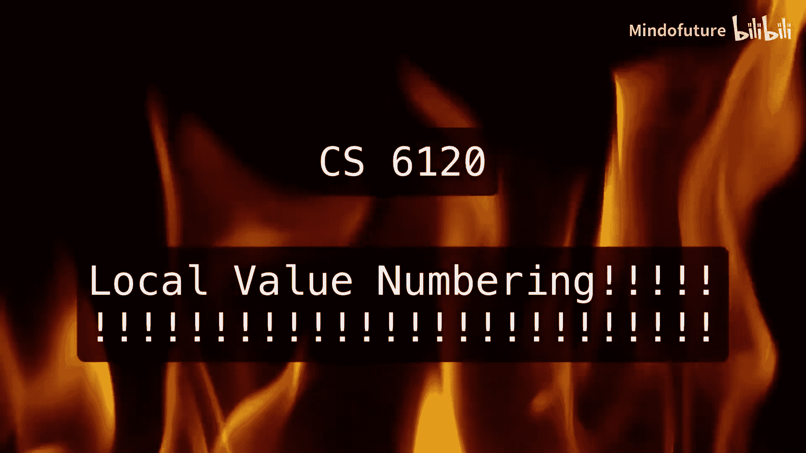
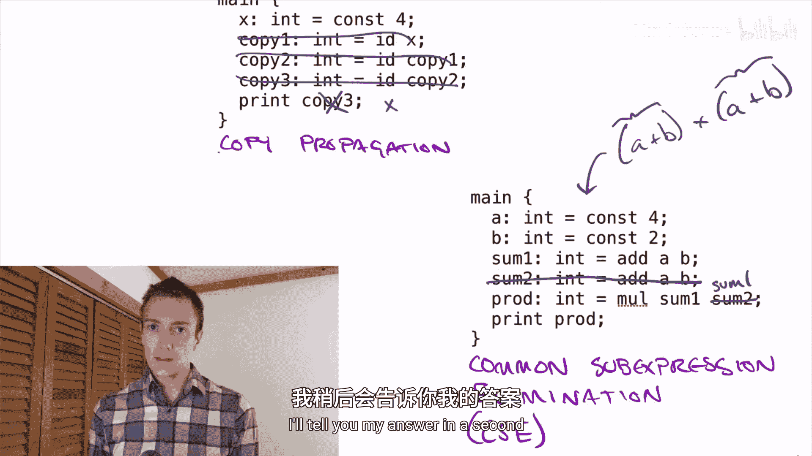
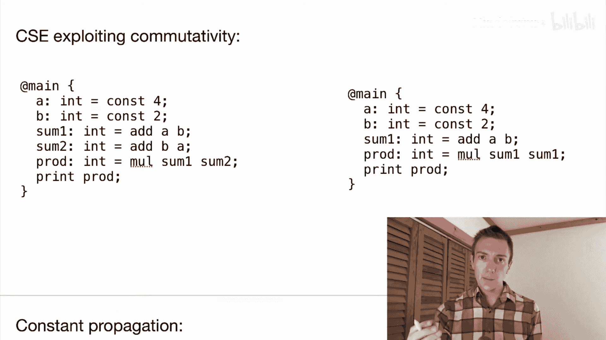
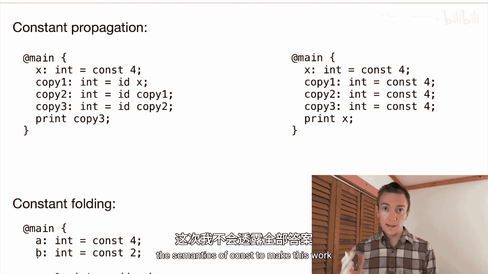
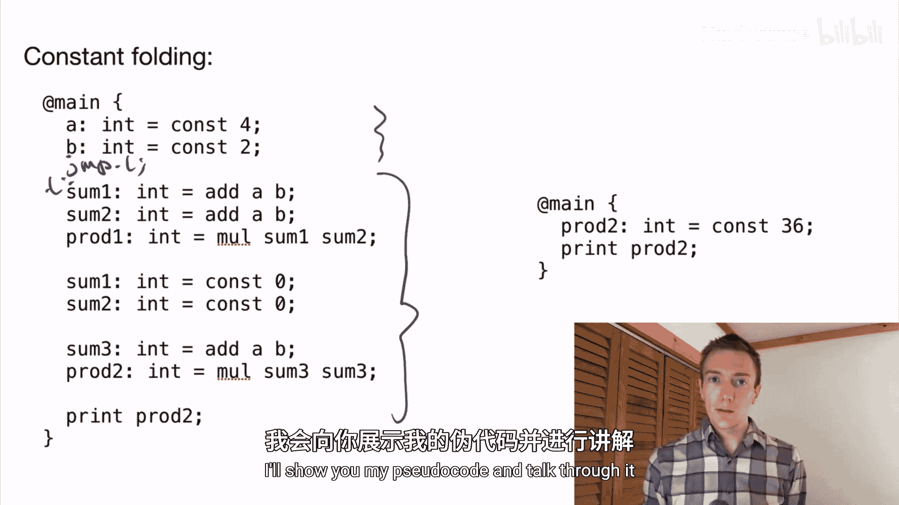
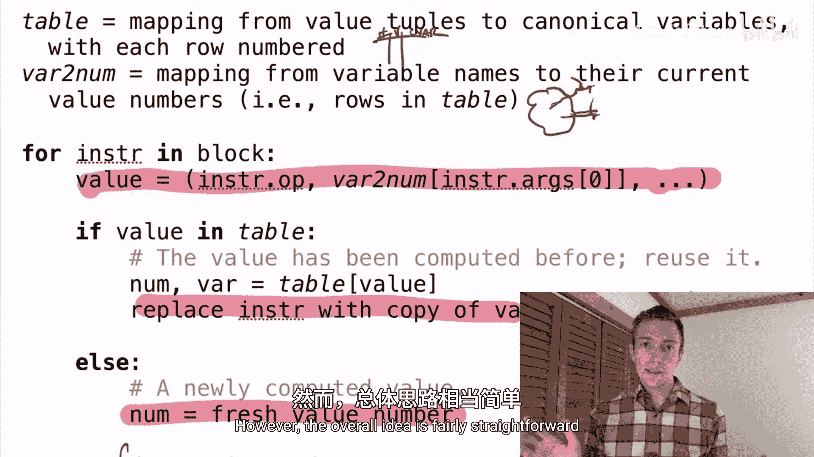

# 005：局部值编号






## 概述
在本节课中，我们将学习一种名为**局部值编号**的优化技术。这项技术能让我们一次性识别并消除基本块中的多种冗余形式，包括死代码消除、复制传播和公共子表达式消除。我们将通过理解其核心思想、数据结构和工作流程来掌握这项技术。

## 从冗余到值编号
上一节我们介绍了三种常见的程序冗余形式。本节中我们来看看它们背后的共同点。

这三种冗余的根本原因在于，程序通过变量名来指代计算，而实际上我们更应该关注变量所代表的**底层值**。如果我们能区分“值”和“存储值的变量”，那么这些冗余就会自动显现并易于消除。

*   **死代码消除**：值编号方法会意识到同一个变量名被用于存储两个不同的值，从而区分它们，使得其中一个未被使用的值（及其变量）变得明显，便于删除。
*   **复制传播**：值编号哲学认为，程序中只有一个核心值（例如常数`4`），它被重复存储到多个变量中。从值的角度看，这是浪费。如果我们能将这个值与所有存储它的变量解耦，那么多余的变量就会消失。
*   **公共子表达式消除**：值编号方法会识别出`sum1`和`sum2`这两个变量存储的是同一个值（`a + b`）。在后续使用这些变量的计算中，只需使用其中一个即可，从而消除冗余计算。

## 核心数据结构与算法思想
理解了值编号的哲学后，我们来看看其具体实现的核心思想。下一节我们将通过一个具体例子来演示。

局部值编号算法围绕一个核心数据结构展开。

**值表 (Value Table)**
这是一个为程序中计算出的每个“值”分配唯一编号并记录其规范存储位置的表格。
```
| 编号 |        值 (Value)       | 变量 (Variable) |
|------|-------------------------|-----------------|
|  1   | const 4                 | a               |
|  2   | const 2                 | b               |
|  3   | add(值#1, 值#2) -> a+b | sum1            |
```
*   **编号**： 为每个独特的“值”分配的唯一自然数。
*   **值**： 对计算本身的抽象表示，是一个可以比较的元组（例如 `add(1, 2)`），其中参数是引用表中其他值的**编号**，而非变量名。这实现了值与变量名的解耦。
*   **变量**： 该值当前被存储的“规范位置”（即变量名）。

**环境映射 (Environment Map)**
算法会像解释器一样逐条执行基本块中的指令，但并非记录具体的运行时值，而是记录每个变量当前对应哪个**值编号**。
```
环境: { a -> 值#1, b -> 值#2, sum1 -> 值#3 }
```
通过结合**值表**和**环境映射**，我们可以在不知道具体输入的情况下，静态地跟踪基本块中所有计算的值流图。

## 算法流程详解
现在，我们通过公共子表达式消除的例子，一步步走查局部值编号算法的具体流程。我们将同时展示如何构建数据结构以及如何即时优化程序。

初始状态：值表和环境均为空。
```
程序: a: int = 4;
      b: int = 2;
      sum1: int = a + b;
      sum2: int = a + b;
      prod: int = sum1 * sum2;
      print prod;
```

**处理 `a: int = 4;` 和 `b: int = 2;`**
*   扫描值表，未找到值 `const 4` 和 `const 2`。
*   在值表中创建新行，分配编号1和2。规范变量设为 `a` 和 `b`。
*   更新环境：`a -> #1`, `b -> #2`。
*   **重建指令**：由于是新值，重建的指令与原指令相同。

**处理 `sum1: int = a + b;`**
1.  **构造值**：查环境得 `a -> #1`, `b -> #2`。构造值元组 `add(#1, #2)`。
2.  **查表**：表中无 `add(#1, #2)`。
3.  **插入新值**：在值表新增一行，编号3，值=`add(#1, #2)`，变量=`sum1`。
4.  **更新环境**：`sum1 -> #3`。
5.  **重建指令**：查表，值#3的规范变量是`sum1`，参数#1和#2的规范变量是`a`和`b`。因此重建为 `sum1: int = a + b;`（与原指令相同）。

**处理 `sum2: int = a + b;`**
1.  **构造值**：`a -> #1`, `b -> #2`，构造值 `add(#1, #2)`。
2.  **查表**：发现值表中已存在 `add(#1, #2)`（编号3）。
3.  **利用冗余**：**不**创建新表项。将`sum2`在环境中的映射指向已存在的值编号3：`sum2 -> #3`。
4.  **重建指令**：由于值已存在，其规范变量是`sum1`。因此将原指令替换为复制操作：`sum2: int = id sum1;`。这消除了冗余计算。

**处理 `prod: int = sum1 * sum2;`**
1.  **构造值**：`sum1 -> #3`, `sum2 -> #3`。构造值 `mul(#3, #3)`。
2.  **查表**：表中无 `mul(#3, #3)`。
3.  **插入新值**：在值表新增一行，编号4，值=`mul(#3, #3)`，变量=`prod`。
4.  **更新环境**：`prod -> #4`。
5.  **重建指令**：查表，值#4是新值，需重建计算。其参数#3的规范变量是`sum1`。因此重建为 `prod: int = sum1 * sum1;`。这里用`sum1`替代了`sum2`。

**处理 `print prod;`**
*   查环境 `prod -> #4`，查表得值#4的规范变量是`prod`。
*   重建指令为 `print prod;`。




**最终优化结果**
经过局部值编号重建和一次简单的死代码消除（删除未被引用的`sum2: int = id sum1;`），我们得到：
```
a: int = 4;
b: int = 2;
sum1: int = a + b;
prod: int = sum1 * sum1;
print prod;
```
我们成功实现了公共子表达式消除。




## 扩展：实现更多优化
基本的局部值编号框架可以通过引入对语言语义的细微认知，来轻松实现其他优化。以下是几个例子：

**1. 复制传播**
*   **目标**：将 `x: int = id y; y: int = id z; ... print x;` 优化为 `... print z;`。
*   **实现**：在构造值元组时，若遇到 `id(#n)`，则直接将其视为与值编号 `#n` 相等。这样，所有传递链最终都会指向最初的变量。




**2. 利用交换律**
*   **目标**：识别 `add(a, b)` 与 `add(b, a)` 为同一值。
*   **实现**：在构造值元组（如 `add(#1, #2)`）后，对可交换操作符的元组进行**规范化**，例如确保参数编号总是非递减的（`add(#1, #2)`）。这样，`add(#2, #1)` 会被规范化为 `add(#1, #2)`，从而在查表时匹配成功。

**3. 常量折叠**
*   **目标**：将 `a: int = 4; b: int = 2; c: int = a + b;` 优化为 `c: int = 6;`。
*   **实现**：在重建指令阶段，如果发现某个操作（如 `add`）的所有参数都是常量值（在值表中对应 `const`），则可以直接计算其结果，并用一个新的常量值指令替换原计算指令。

## 算法伪代码
以下是局部值编号算法的核心伪代码，涵盖了值表构建、冗余替换和变量重命名。

```pseudocode
函数 LVN_优化基本块(基本块):
    // 初始化数据结构
    值表 = 空映射 // 键：值(Value)，值：(编号， 规范变量)
    环境 = 空映射 // 键：变量名， 值：值编号
    下一个编号 = 1

    对于 基本块 中的每一条指令 instr:
        // 1. 为当前指令计算“值”元组
        //    根据 instr 的操作类型和参数（通过`环境`映射转换为值编号）来构造
        值元组 = 构造值元组(instr, 环境)

        // 2. 检查该值是否已存在于值表中
        如果 值表.包含键(值元组):
            // 情况A: 冗余值
            (已存编号, 规范变量) = 值表[值元组]
            // 用复制操作替换原指令
            instr' = 创建ID指令(instr.目标变量, 规范变量)
       否则:
            // 情况B: 新值
            // 处理可能的变量重命名（如果目标变量后续会被覆盖）
            如果 instr.目标变量 将在本基本块后续被写入:
                新变量名 = 生成新鲜变量名()
           否则:
                新变量名 = instr.目标变量

            // 更新值表
            值表[值元组] = (下一个编号, 新变量名)

            // 重建指令：用规范变量替换所有参数
            instr' = 用规范变量重建指令(instr, 值表, 环境)

            // 为下一个值准备新编号
            下一个编号 += 1

        // 3. 更新环境：目标变量现在指向这个值编号
        //    （注意：如果重命名了，这里用新变量名更新环境）
        环境[instr'.目标变量] = 从值表或已存编号获取的编号

        // 4. 用优化后的指令替换原指令
        替换 instr 为 instr'

    返回 优化后的基本块
```
**关于变量重命名的说明**：当程序对同一变量多次赋值时（如 `x = a+b; ... x = ...; ... y = a+b;`），第二次计算 `a+b` 时，`x` 已不再持有该值。为了安全地复用第一次的计算结果，算法需要为第一次的结果创建一个新变量（如 `x'`）来存储，并让后续引用指向 `x'`。伪代码中通过检查“目标变量后续是否被写入”来条件性地触发重命名。



## 总结
本节课我们一起学习了**局部值编号**这一强大的编译器优化技术。我们首先理解了其核心思想：将程序视角从“变量”转向其背后的“值”，从而统一看待多种冗余。接着，我们深入探讨了其核心数据结构（值表和环境映射）以及逐指令处理、即时重建的算法流程。通过一个详细的例子，我们看到了它如何消除公共子表达式。最后，我们了解到通过向基本算法中注入简单的语义规则（如 `id` 的恒等性、加法的交换律），可以轻松实现复制传播、常量折叠等更多优化。局部值编号为理解和实现多种局部优化提供了一个统一而优雅的框架。