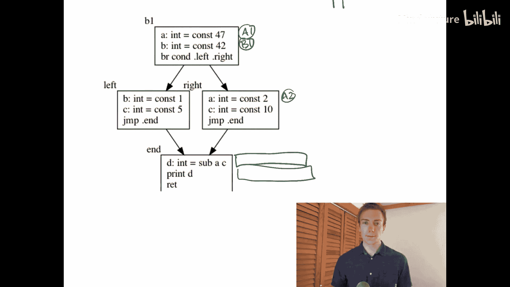
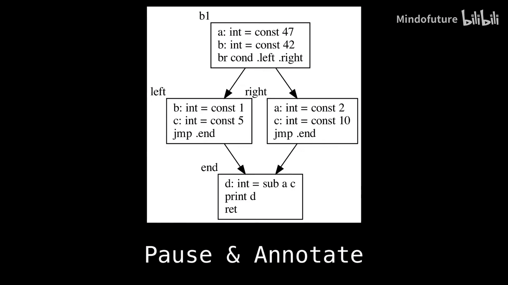
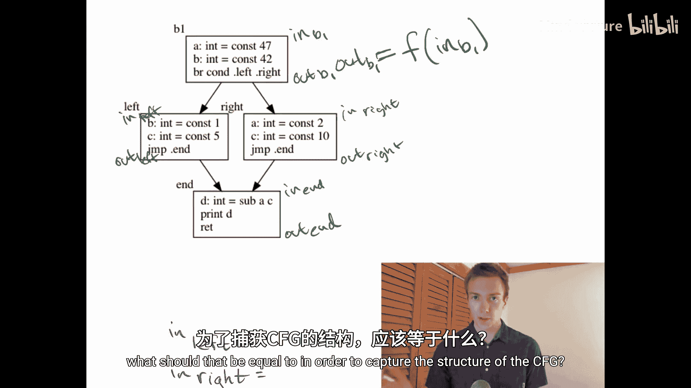
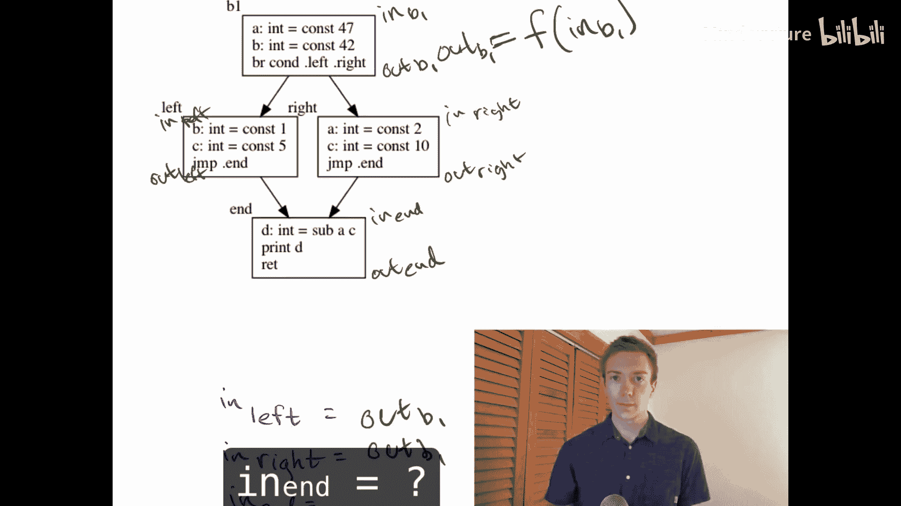
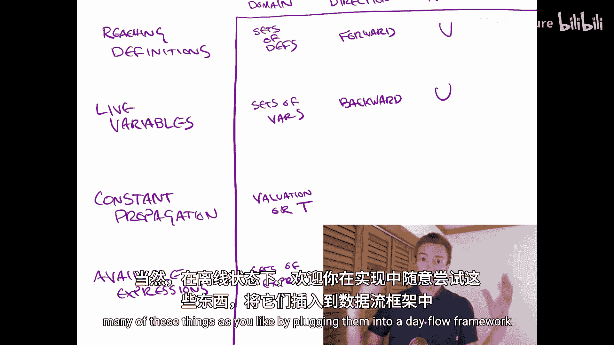
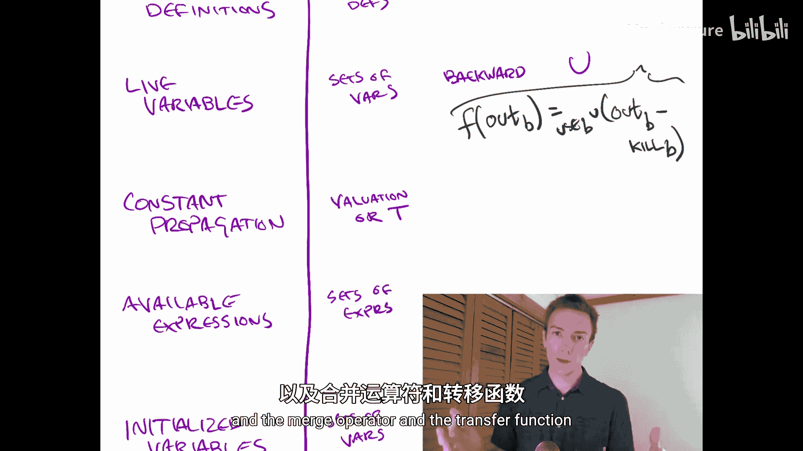

# 006：数据流分析

在本节课中，我们将学习一种名为**数据流分析**的通用技术，它能够将许多局部分析组合起来，形成可以处理任意控制流图的全局分析。我们将从理解什么是全局分析开始，然后学习如何将一个问题（例如“到达定值”）形式化为数据流问题，最后了解一个通用的求解算法。

## 什么是全局分析？

上一节我们介绍了局部优化技术。本节中我们来看看全局分析，这是一种对程序控制流敏感的分析方法。

让我们看一个简单的程序。假设我们的任务是对这个程序进行某种常量传播分析，即我们想知道在程序最后打印 `A` 和 `C` 的差值时，它们可能是什么常量。要回答这个问题，不能只看最后的基本块，而必须查看整个控制流图，以确定哪些对 `A` 和 `B` 的赋值（即定义）在打印时仍然有效。这是一个全局属性。

对于任意的控制流图，仅靠上节课学习的LVN那种按指令顺序扫描和更新的方法是不够的。例如，移动基本块的位置不会改变程序语义，但会破坏那种对指令顺序敏感的分析。因此，我们需要一种能处理任意控制流图拓扑结构的通用框架，这就是数据流分析。

## 一个具体的全局分析问题：到达定值

在深入框架之前，我们先来具体化一个全局分析问题，并学习如何将其设置为数据流问题。

我们要解决的问题是**确定到达定值**。以下是相关的核心概念定义：

*   **使用**：一条指令是其所有参数的使用。例如 `print a` 是变量 `a` 的一个使用。
*   **定值**：任何写入变量的指令（在Brille中称为值指令）都是对该变量的一个定值。
*   **可用定值**：一个定值如果能“到达”某个程序点，则在该点可用。
*   **杀死**：一个定值会“杀死”同一变量所有当前可用的定值（即覆盖了该变量）。





**到达定值**的正式定义是：如果存在一条从定值 `D` 到使用 `U` 的CFG路径，并且沿着这条路径没有对同一变量 `V` 的其他赋值（即 `D` 没有被杀死），那么定值 `D` 就能到达使用 `U`。

因此，到达定值分析问题就是：对于程序中的每一个定值和每一个使用，确定该定值是否能到达该使用。

### 手动求解示例

请观察以下控制流图，为每个定值命名（例如 `a1`, `a2`, `b1`），然后找出能到达图中三个使用点（分支指令对 `cond` 的使用，以及最后基本块中对 `A` 和 `C` 的使用）的定值集合。

经过分析，答案是：
*   在分支指令处：`cond1`, `a1`, `b1` 到达。
*   在赋值 `d = a + c` 处（它既是定值 `d1`，也是使用）：`cond1`, `a1`, `b1`, `a2`, `b2`, `c1`, `c2` 都到达。
*   在最后的打印语句处：除了上述所有定值，`d1` 也到达。

你通过人脑观察CFG中的所有路径解决了这个问题。但对于复杂的图或循环，这种方法将变得难以处理。为此，我们需要数据流框架。

## 数据流框架：通用配方

数据流框架是一个“配方”，你可以将特定分析问题的信息作为“原料”输入，然后使用一个通用的求解算法得到全局分析的结果。

这个通用思路可以归结为以下四个步骤：

1.  **确定计算量**：首先，确定你想在程序的每个点计算什么信息。在数据流设置中，我们通常在**每个基本块的开始和结束处**计算这个信息。对于到达定值，就是在这些点计算“到达的定值集合”。

2.  **编写局部转移方程**：为每个基本块编写一个方程，将块开始处的状态与块结束处的状态联系起来。这相当于对每个块进行**局部分析**，可以暂时忽略整个CFG的结构。




3.  **建立边约束方程**：根据控制流图的边，建立方程来联系不同基本块之间的信息。例如，一个基本块结束处的信息必须与其后继基本块开始处的信息相关联。




4.  **求解方程组**：将上述所有方程（块的转移方程和边的约束方程）组成一个方程组，交给一个现成的数据流求解器。求解器会告诉我们每个基本块入口和出口处的信息值。

数据流分析的奇妙之处在于，你不需要每次都从头发明求解算法。你可以使用一个通用的求解算法，只需为不同的问题提供不同的“原料”（初始值、合并函数、转移函数）。

### 建立方程系统

为了使上述概念更具体，我们引入变量。为每个基本块 `B` 定义两个变量：
*   `in[B]`: 块 `B` 开始处的信息。
*   `out[B]`: 块 `B` 结束处的信息。

对于每个块，其**转移函数** `F_B` 建立了 `in[B]` 和 `out[B]` 的关系：
`out[B] = F_B(in[B])`

对于CFG中的边，我们需要建立约束。考虑一个块 `B` 有多个前驱（例如 `Left` 和 `Right`）的情况，`in[B]` 应该如何计算？它不能简单地等于某个前驱的 `out`，而需要一种方式来**合并**所有前驱块传来的信息。这就引出了**合并函数**的概念。

### 填写“配方表”：以到达定值为例

要为特定分析实例化数据流框架，我们需要填写以下“配方表”：

1.  **初始值**：对于函数第一个（入口）基本块开始处的信息，应该是什么？对于到达定值，这是函数参数的定值集合。
    `in[entry] = { 所有函数参数的定值 }`

2.  **转移函数**：给定 `in[B]`（到达块B开始处的定值集合），如何计算 `out[B]`？需要考虑块内的指令会生成新定值和杀死旧定值。
    `out[B] = (in[B] \ kill[B]) ∪ gen[B]`
    其中 `gen[B]` 是块 `B` 中产生的定值集合，`kill[B]` 是块 `B` 中杀死的定值集合。

3.  **合并函数**：当一个块有多个前驱时，如何根据前驱块的 `out` 值计算该块的 `in` 值？对于到达定值，合并操作是**集合并集**。
    `in[B] = ∪_{P是B的前驱} out[P]`

一旦填写了这个表，我们就完整定义了一个数据流问题，接下来就是求解它。

## 通用求解算法：工作表算法

以下是经典的**工作表算法**伪代码，用于求解数据流问题。它的简洁和通用性令人惊叹。

```
worklist = 所有基本块的集合
for each block B:
    in[B] = ⊥ (偏序的底元素，如空集)
    out[B] = ⊥

in[entry] = 初始值 (如函数参数定值集)

while worklist 非空:
    从 worklist 中取出一个块 B
    old_out = out[B]
    // 1. 合并前驱信息
    in[B] = merge( {out[P] for P in B的前驱} )
    // 2. 应用转移函数
    out[B] = transfer(B, in[B])
    // 3. 若输出改变，则通知后继
    if out[B] != old_out:
        for each S in B的后继:
            if S 不在 worklist 中:
                将 S 加入 worklist
```

算法从初始化开始，然后循环处理工作表。每次取出一个块 `B`：
1.  通过**合并函数**计算 `in[B]`（合并所有前驱的 `out` 值）。
2.  通过**转移函数**计算 `out[B]`。
3.  如果 `out[B]` 发生了变化，那么所有后继块 `S` 的 `in[S]` 都可能需要更新，因此将 `S` 加入工作表。

只要提供的“原料”满足一定条件（主要是单调性），这个算法就保证会终止并给出正确解。

### 前向与后向分析

到达定值是一个**前向数据流分析**：信息从入口块开始，沿着CFG边向前（从前驱到后继）传播。

也存在**后向数据流分析**，信息从出口块开始，向后（从后继到前驱）传播。工作表算法可以很容易地推广到后向分析，只需交换 `in`/`out` 的角色，并将“前驱”和“后继”的概念对调即可。

### 处理循环

数据流求解算法最棒的特性之一是它能自动处理带循环（CFG中有环）的程序。即使路径有无穷多条，算法也能收敛并给出满足方程组的正确解。

## 正确性的要求：单调性与偏序

并非任意定义的函数都能保证算法收敛。数据流分析能工作的一个关键要求是**单调性**。

我们需要在计算的值（例如集合）上定义一个**偏序**（如集合的包含关系 ⊆）。这个偏序应该有顶元素（⊤，如全集）和底元素（⊥，如空集）。

*   **初始值** 通常是偏序的底元素（⊥）。
*   **合并函数** 必须是该偏序上的**下确界**（meet）操作。对于集合和 ⊆ 偏序，下确界就是交集；但对于到达定值，我们实际需要的是上确界（并集），这意味着我们使用的偏序是“被包含于”（⊇），其下确界才是并集。这说明了偏序选择与问题定义相关。
*   **转移函数** 必须是**单调**的：如果 `x ⊑ y`，那么 `transfer(x) ⊑ transfer(y)`。

满足这些条件，就能保证工作表算法终止并找到“所有路径解”的下确界，即正确解。

## 实例化框架：更多数据流分析

数据流框架非常强大，可以用于解决多种全局分析问题。以下是几个例子：

| 分析名称 | 描述 | 用途 |
| :--- | :--- | :--- |
| **到达定值** | 计算在程序点可用的定值集合。 | 常量传播、依赖分析。 |
| **活跃变量** | 计算在程序点之后会被使用的变量集合。 | 死代码消除、寄存器分配。 |
| **常量传播** | 确定变量在程序点是否保证为常量值。 | 优化，用常量替换变量。 |
| **可用表达式** | 计算在程序点之前已计算过的表达式集合。 | 全局公共子表达式消除。 |
| **初始化变量** | 跟踪变量在程序点是否已被赋值。 | 编译时未初始化变量检查。 |
| **区间分析** | 计算变量可能取值范围的区间。 | 边界检查消除、优化条件分支。 |

要解决这些问题，只需为每个分析定义其“配方表”：值域（计算什么）、方向（前向/后向）、合并函数和转移函数。

### 示例：活跃变量分析（后向分析）




活跃变量分析是一个典型的**后向分析**。
*   **值域**：变量集合。
*   **方向**：后向。
*   **合并函数**：并集（∪）。因为一个变量只要在任一后继路径上活跃，它在前驱块末尾就是活跃的。
*   **转移函数**：给定 `out[B]`（块B结束后的活跃变量集），计算 `in[B]`（块B开始前的活跃变量集）。
    `in[B] = (out[B] \ def[B]) ∪ use[B]`
    其中 `use[B]` 是块B中使用的变量集合，`def[B]` 是块B中定义的变量集合。其含义是：块末尾活跃的变量，如果在本块中被重定义，则它在块开头就不活跃了；此外，在本块中使用的变量，在块开头是活跃的。

鼓励你尝试为其他分析（如常量传播）填写这个表格，并在你的编译器实现中实践。

## 总结

本节课我们一起学习了数据流分析的核心内容。我们首先理解了为什么需要全局分析以及它与局部分析的区别。然后，我们以**到达定值**为例，学习了如何将一个全局分析问题形式化。接着，我们介绍了**数据流框架**这个通用“配方”，它包括确定计算量、编写转移函数、定义合并函数和建立边约束。我们详细讲解了通用的**工作表求解算法**，以及保证算法正确的关键——**单调性**和**偏序**概念。最后，我们看到了数据流框架如何通过实例化应用于多种不同的全局分析问题，如活跃变量分析。



通过掌握数据流分析，你获得了为编译器编写强大、正确的全局优化和分析遍的坚实基础。