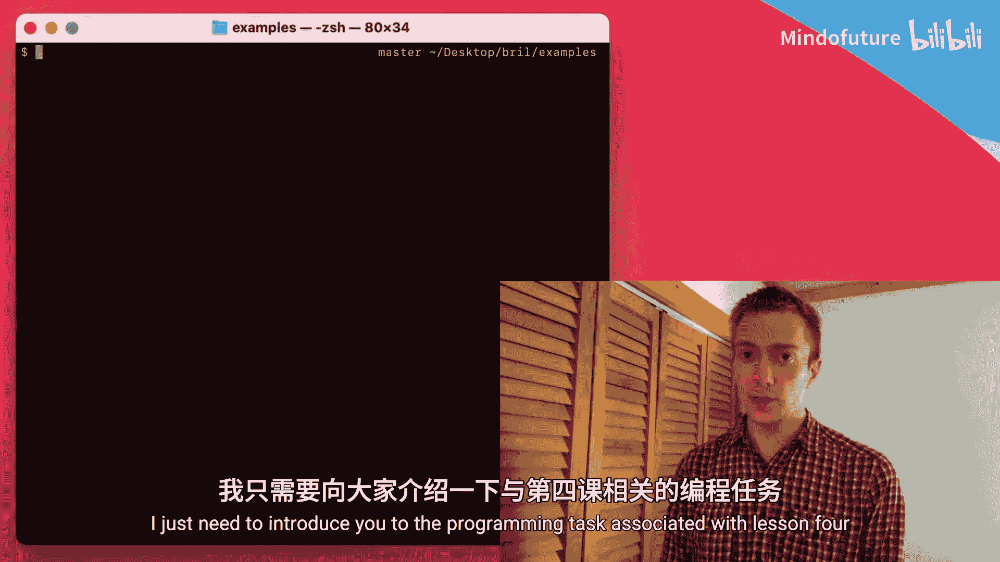
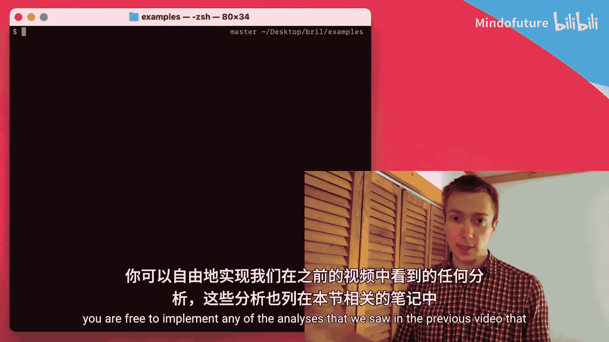
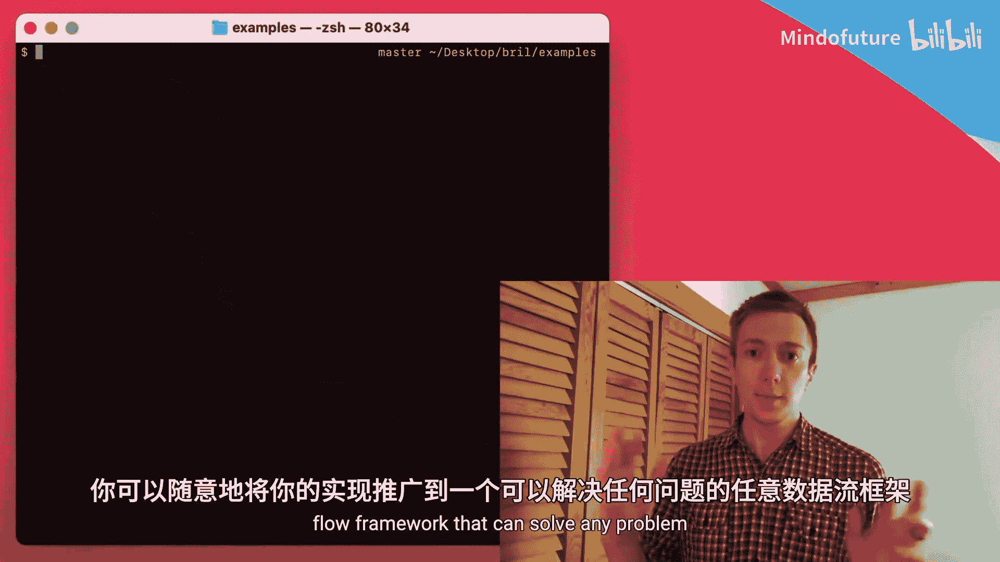
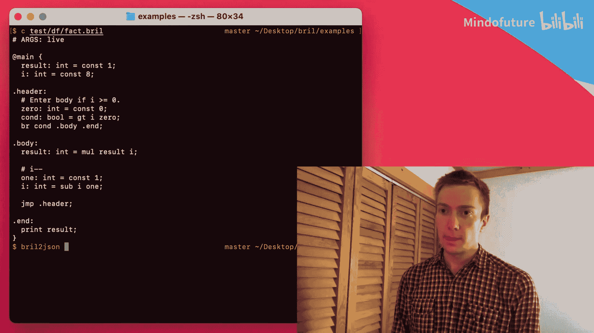
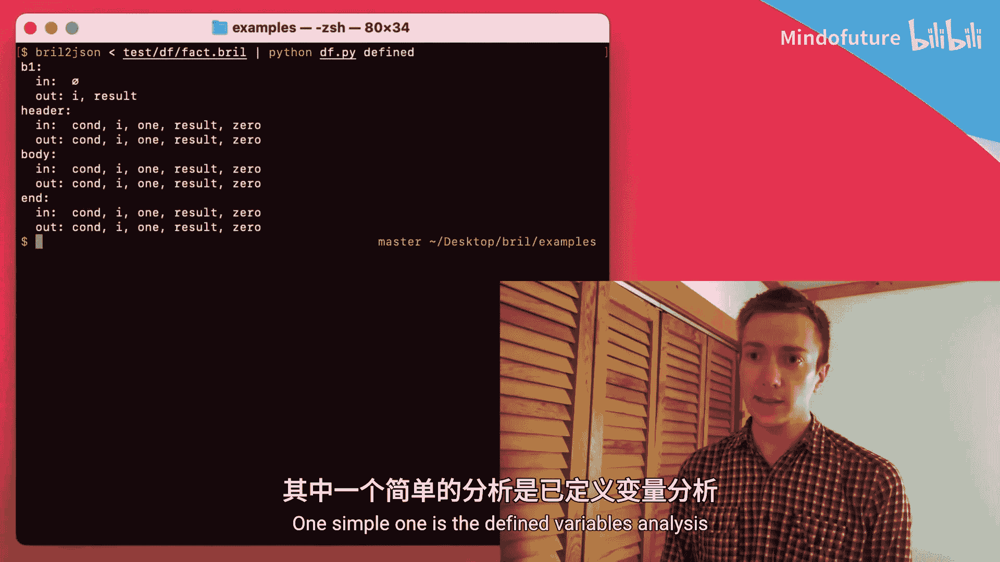
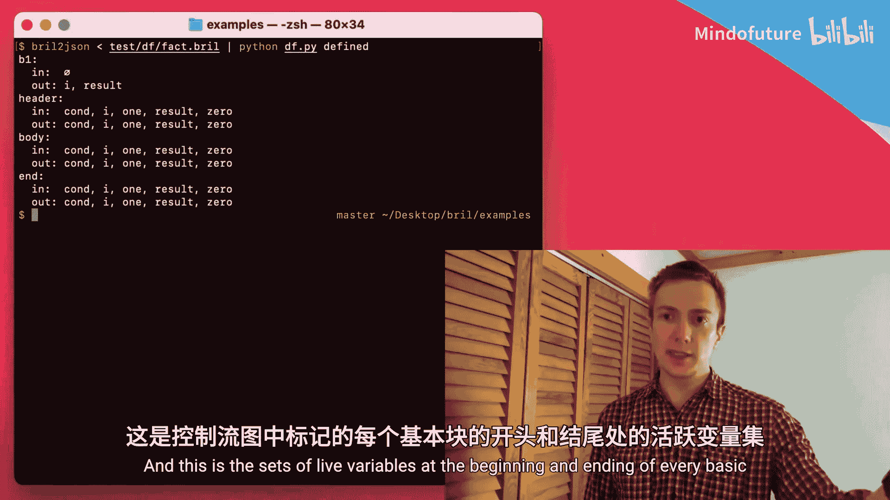
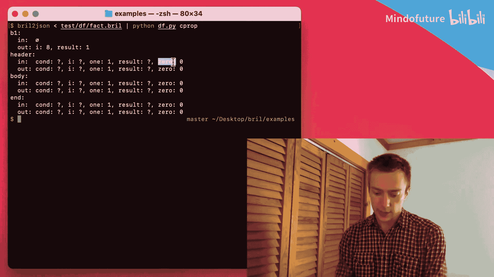

# 007：数据流分析实现任务 🎯

在本节课中，我们将学习如何实现一个数据流分析。与之前的任务不同，本次任务不涉及程序转换，仅需实现分析本身。我们将介绍任务要求、可选的分析类型、实现策略以及测试技巧。

## 任务概述

本次编程任务的核心是实现一个数据流分析，并通过测试验证其正确性。

以下是任务的具体要求：

*   **分析类型**：你可以选择实现我们在上一课视频或课程笔记中提到的任何一种数据流分析。例如，实现一个简单的**到达定义分析**作为起点是完全可行的。
*   **实现策略**：你可以选择实现一个特定的分析，也可以将其推广为一个通用的数据流框架，使其能够通过参数化解决多种不同的问题。

## 实现建议

上一节我们介绍了任务要求，本节中我们来看看具体的实现建议。

强烈建议你在实现的第一阶段，先让一个具体的分析正常工作，不要一开始就尝试过度泛化。先选择一个你想运行的具体数据流分析并实现它。

一旦你成功实现了一个分析，如果还有额外时间并且充满热情，再从那里进行推广。在完成一次具体实现后，推广工作并不会太难，但我不建议在选定具体分析之前就试图构建完全通用的框架。

## 示例与输出

为了帮助你理解，这里有一个示例。假设我们有一个阶乘函数的实现程序。

我们可以使用一个简单的数据流分析来运行它。首先，像往常一样，将程序编译（或转换）为中间表示。

然后，将其输入到我的通用数据流求解程序中。该程序内置了几种分析，其中一个简单的例子是**已定义变量分析**。这个分析甚至比活跃变量分析更基础，它只是计算在程序当前点之前被写入过的所有变量集合。

分析结果会以控制流图中每个基本块开始和结束处的集合形式输出，并标注出来。

你可以使用这个“已定义变量分析”作为热身练习。不过，对于最终提交的任务来说，它可能有点过于简单了。

你还可以实现其他各种分析。例如，在我的实现中，我完成了活跃变量分析，也利用我的数据流框架实现了一个简单的常量传播分析。

对于输出结果的解读方式是：如果我不知道一个变量的值（即无法证明它在当前点是常量），则该变量会被标记为问号。例如，程序中可能有一个名为`one`的变量，它在程序的每个点都被保证持有值`1`，变量`zero`同理。

你可以尽情发挥，根据可用的时间，构思并实现任何你想要的数据流分析。如果你真的愿意，甚至可以实现一个完全通用的框架和上百种不同的数据流分析。

## 测试技巧

我想展示一个在测试时可以使用的小技巧。你可能会想到设置单元测试来验证分析结果是否符合预期。

如果你使用测试框架（如Tt）的`Args`功能，你可以看到我已经设置了测试命令，以便向我的数据流分析传递任意参数。

因此，如果你想运行多个数据流分析，并且希望通过命令行传递分析名称，你也可以这样做。你可以在文件中指定要使用的数据流分析，但测试框架也有一个`Args`标志。例如，我们可以为某个程序指定使用“live”（活跃变量）或“defined”（已定义变量）分析。

这样，你就不需要每次都记住整个命令管道，如果你以这种方式设置分析，可以非常轻松地在同一程序上运行多个数据流分析。

祝你好运，如果在本课相关的讨论中有任何问题，请务必提问。

## 总结

本节课中，我们一起学习了第四课的编程任务：实现一个数据流分析。我们明确了任务目标是实现分析而非转换，介绍了可选的实现路径（从具体分析入手或构建通用框架），并给出了先实现再推广的实践建议。最后，我们还学习了一个利用测试框架参数化运行不同分析的实用技巧。现在，你可以开始着手实现你自己的数据流分析了。