# 009：静态单赋值形式 (SSA)

在本节课中，我们将要学习静态单赋值形式。这是一种程序表示方法，也是一种哲学思想，它能让许多程序分析工作变得简单得多。

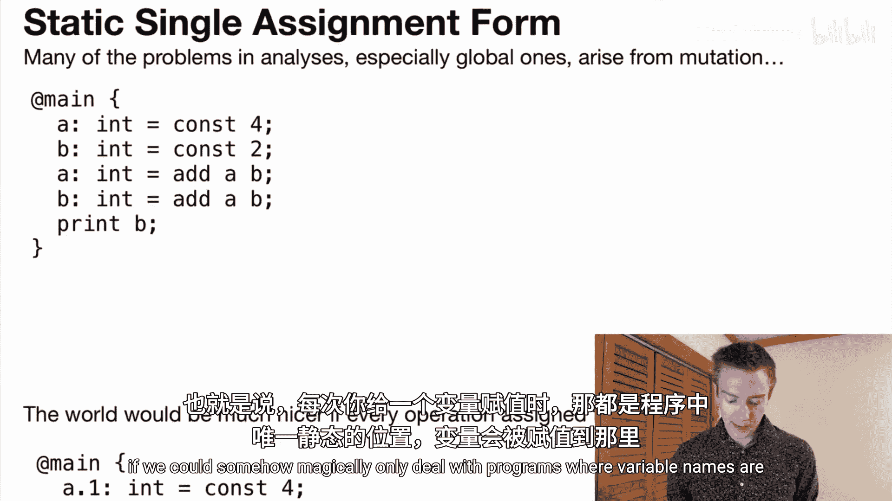

## 概述

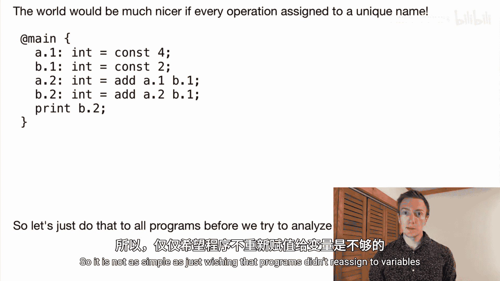

静态单赋值形式是一种程序表示方法，其核心思想是确保程序中的每个变量在整个函数范围内只被赋值一次。这种表示法消除了变量名冲突带来的困扰，使得数据流分析、常量传播和死代码消除等优化变得更加直接和清晰。

## 为什么需要 SSA？🤔

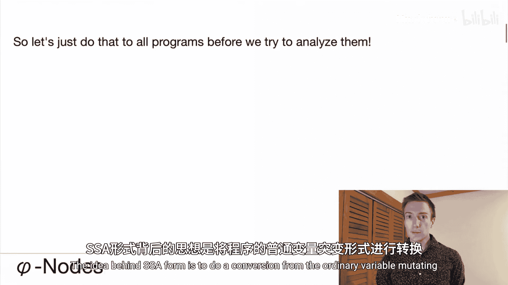

在实现优化时，我们经常需要处理变量名冲突的问题。在普通的命令式程序中，变量可以被反复赋值，这给分析带来了复杂性。

例如，考虑以下简单的 Bril 程序：
```bril
main {
  a: int = const 5;
  b: int = const 3;
  a: int = add a b;
  b: int = mul a b;
  print b;
}
```
这个程序对 `a` 和 `b` 进行了重新赋值。当我们想优化这个程序（例如进行常量传播或死代码消除）时，不仅要处理优化逻辑本身，还要处理同一变量名被重复使用的事实。

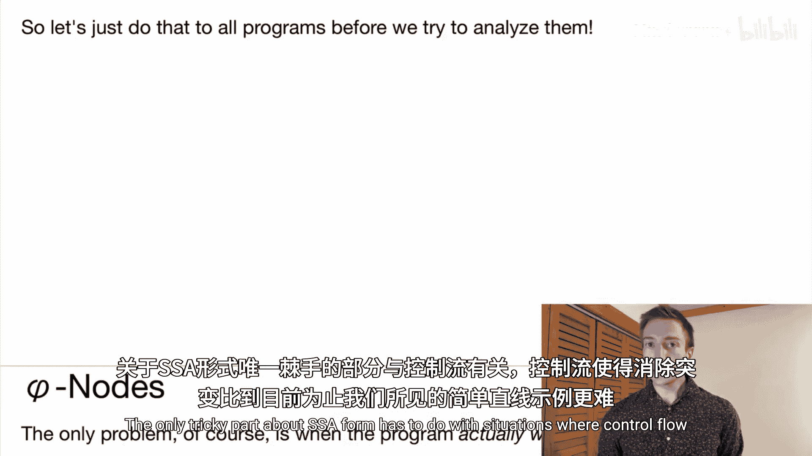

如果能将程序转换为以下形式，事情会方便得多：
```bril
main {
  a1: int = const 5;
  b1: int = const 3;
  a2: int = add a1 b1;
  b2: int = mul a2 b1;
  print b2;
}
```
在这里，`a1` 和 `a2` 是完全不同的变量。当执行 `print` 时，要打印的 `b2` 的来源是清晰明确的，因为它在程序中只有一个静态赋值位置。

如果程序中的每个变量都只被赋值一次，我们就可以排除一类在优化时经常困扰我们的问题。然而，在命令式语言中，变量重赋值是普遍存在的，因此我们需要一种更复杂的方法来实现这个目标。

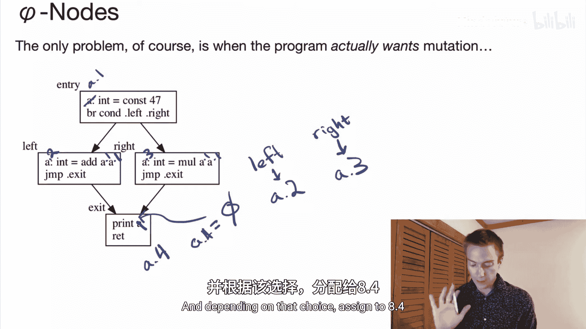

## SSA 的核心思想 💡

SSA 形式的核心思想是将普通的、允许变量多次赋值的程序（如 Bril）转换为一种静态单赋值形式。在这种形式中，每个变量在程序文本中恰好只被赋值一次。

转换过程通常分为三步：
1.  **转换为 SSA 形式**：将程序转换为静态单赋值形式。
2.  **在 SSA 形式上进行优化**：利用 SSA 形式的优良特性进行各种优化。
3.  **转换回普通形式**：在优化完成后，将程序转换回普通的、允许变量重赋值的格式，以便在真实的机器上高效执行，因为真实机器需要复用存储位置（如寄存器和内存）。

上一节我们介绍了 SSA 的基本概念，本节中我们来看看转换过程中的一个关键挑战：如何处理控制流。

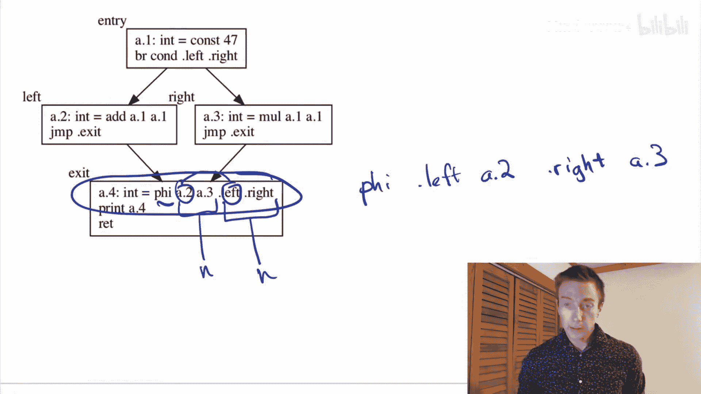

## 控制流带来的挑战：Φ 节点 🧩

将直线代码（无分支和循环）转换为 SSA 形式相对简单，只需重命名变量即可。但当程序包含控制流（如条件分支和循环）时，情况就变得复杂了。

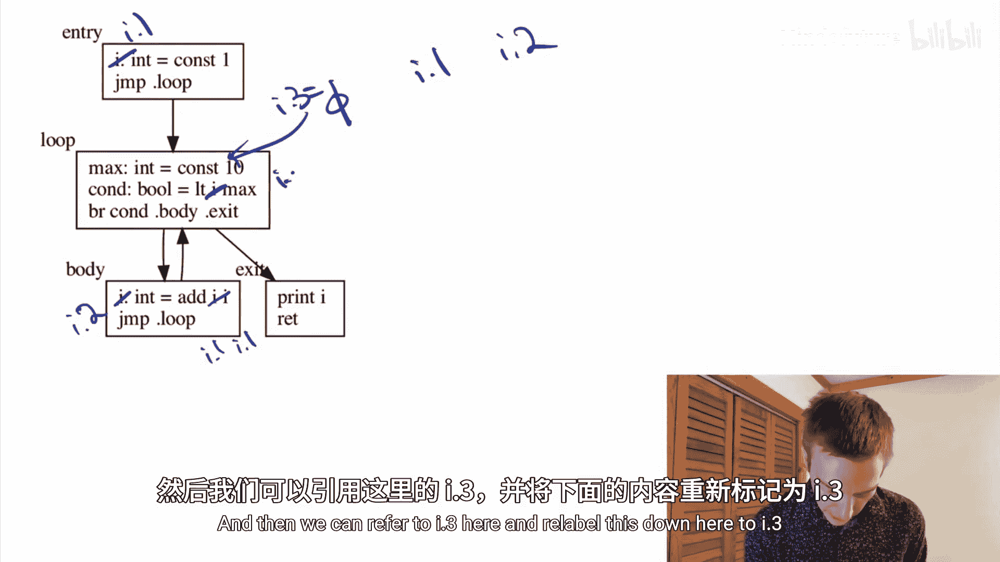

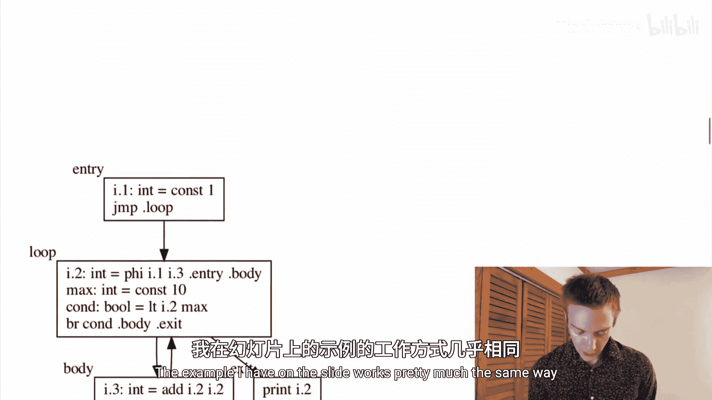

考虑以下控制流图表示的程序：
```
[Entry]
  |
  v
[A] a = 1
  | \
  |  \ (if condition)
  |   \
  v    v
[B] a = a + 1  [C] a = a * 2
  |    |          |    |
  |    v          |    v
  +--->[D] print a <---+
```
我们尝试像之前一样重命名变量：
1.  将 `[A]` 中的 `a` 重命名为 `a1`。
2.  将 `[B]` 中对 `a` 的引用和赋值分别改为 `a1` 和 `a2`。
3.  将 `[C]` 中对 `a` 的引用和赋值分别改为 `a1` 和 `a3`。

现在问题来了：在 `[D]` 中，我们应该打印哪个 `a`？是 `a2` 还是 `a3`？这取决于程序执行时走了哪条控制流路径。我们不能简单地选择其中一个，因为另一个可能未定义。

为了解决这个问题，SSA 形式引入了一个特殊的指令：**Φ 节点**。Φ 节点像一个魔法指令，能根据之前控制流的历史来选择值。

我们可以在 `[D]` 块的开始处插入一个 Φ 节点：
```
a4: int = phi a2 a3 .B .C
print a4
```
这个 Φ 节点的语义是：如果进入当前块 `[D]` 的前一个块是 `.B`（标签），则选择 `a2` 的值；如果前一个块是 `.C`，则选择 `a3` 的值。然后将选出的值赋给新变量 `a4`。

Bril 语言有一个 SSA 扩展，包含一个 `phi` 指令，其写法如下：
```
dest: type = phi arg1 arg2 ... label1 label2 ...
```
指令中变量和标签的顺序并不重要，`phi a2 a3 .B .C` 与 `phi .B a2 .C a3` 在内部表示上是完全等价的。

## 循环中的 Φ 节点 🔁

让我们看一个包含循环的更复杂例子，以巩固对 Φ 节点必要性的理解。
```
[Entry] i = 0
         |
         v
      [Loop] (i < 10)?
        / \
       /   \
      v     v
[Body] i = i + 1   [Exit] print i
       \          /
        \        /
         v      v
         [Back edge to Loop]
```
尝试重命名变量 `i`：
1.  将 `[Entry]` 中的 `i = 0` 重命名为 `i1 = 0`。
2.  在 `[Loop]` 的条件判断中，我们需要 `i` 的值。这个值可能来自初始化的 `i1`，也可能来自上一次循环体执行后更新的值。因此，这里**需要插入一个 Φ 节点**。假设它为 `i2 = phi i1 i3 .Entry .Body`。
3.  将 `[Body]` 中的 `i = i + 1` 重命名为 `i3 = add i2 const 1`。
4.  将 `[Exit]` 中的 `print i` 改为 `print i2`（使用循环头 Φ 节点的结果）。

通过这个例子可以看到，Φ 节点对于正确表示命令式程序的语义是必不可少的，尤其是在存在变量更新的循环中。它不仅仅是重命名变量以消除“坏习惯”，而是 SSA 形式表示程序语义的核心机制。

理解了 Φ 节点的作用后，接下来我们需要一个系统的算法来决定在何处插入它们。

## 转换为 SSA：支配边界算法 🧠

我们需要一个通用规则来确定在控制流图的何处插入 Φ 节点。核心思想是：**在控制流汇聚的地方，如果来自不同路径的值都赋值给了同一个原始变量，就需要 Φ 节点**。


更精确地说，如果一个变量 `X` 在多个基本块中被定义（赋值），那么在所有这些定义的**支配边界**上，都需要为 `X` 插入 Φ 节点。

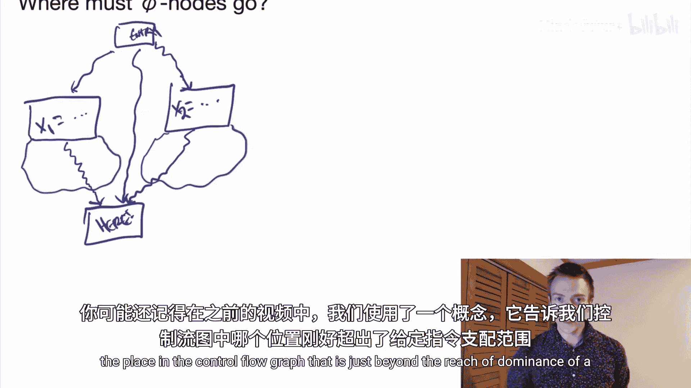

**支配边界** 是指这样一个基本块集合：它们**不被**定义块 `A` 所支配，但**存在**一个前驱块被 `A` 所支配。可以理解为，支配边界就是“支配区域”的“边缘地带”，控制流从这里开始，定义 `A` 不再是唯一可到达的定义。

将程序转换为 SSA 形式的算法主要分为两步：
1.  **插入 Φ 节点**：利用支配边界信息，确定所有需要插入 Φ 节点的位置。
2.  **重命名变量**：遍历支配树，为所有变量生成唯一的、带版本号的新名字。

在第一步和第二步之间，程序会处于一个“中间状态”，其中包含许多操作数还是旧变量名的 Φ 指令，这看起来有些奇怪，但这是必要的过渡步骤。

以下是插入 Φ 节点算法的概要：
```
for each variable v in program:
    // 初始化：找到所有对 v 进行定义（赋值）的基本块
    def_blocks = {all blocks that define v}

    // 工作列表算法，处理所有定义块及其支配边界
    worklist = def_blocks
    while worklist is not empty:
        block = worklist.pop()
        for each block df in dominance_frontier(block):
            if df does not already have a phi for v:
                insert `v = phi v v ...` into df (with appropriate number of arguments)
                add df to def_blocks // 因为phi指令也定义了v
                if df was not already in def_blocks:
                    worklist.push(df)
```

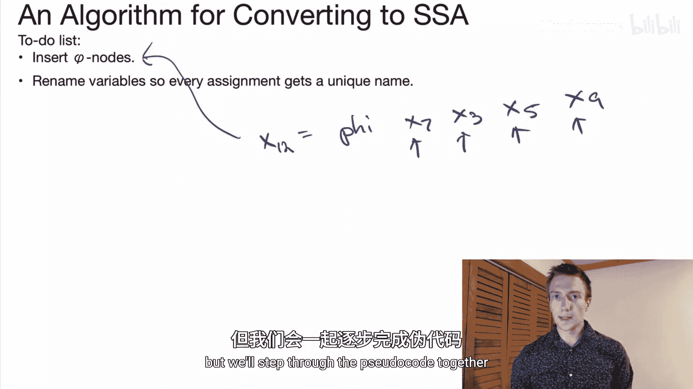

## 转换为 SSA：变量重命名算法 🔢

插入 Φ 节点后，我们需要进行变量重命名，为每个赋值创建唯一的名字。这通常通过一个递归遍历支配树的算法来完成。

算法需要的主要数据结构是一个**栈**，为每个原始变量名保存其当前有效的新名字（如 `x` 的栈可能包含 `x1`, `x5` 等）。

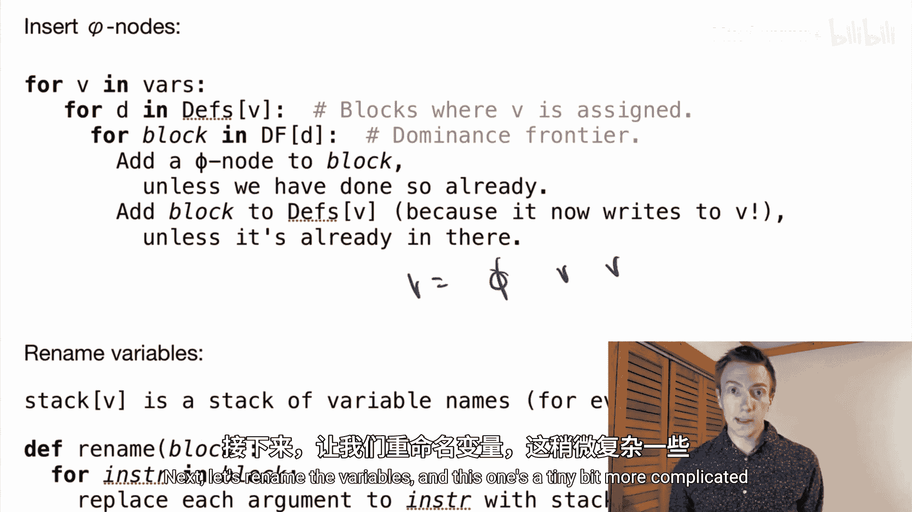

以下是重命名算法的递归函数概要：
```
// 全局：为每个旧变量名维护一个栈 counter[v] 和 stack[v]
rename(block):
    // 1. 重命名本块中的所有普通指令
    for each instruction instr in block (excluding phi functions at the start):
        // 重命名指令中使用的所有变量（操作数）
        for each used variable v in instr.arguments:
            replace v with the current top name from stack[v]
        // 为指令定义的目标变量生成新名字
        if instr defines a variable v:
            new_name = generate_new_name(v) // e.g., v_{counter[v]++}
            replace the destination variable with new_name
            push new_name onto stack[v]

    // 2. 重命名后继块中的 phi 指令参数（对应于本块的控制流边）
    for each successor block succ of block:
        for each phi instruction phi_instr at the start of succ:
            // 找到对应本块（block）流入边的那个参数位置
            let idx = the index corresponding to the label of `block` in phi_instr
            let v = the old variable name used in phi_instr.args[idx]
            replace phi_instr.args[idx] with the current top name from stack[v]

    // 3. 递归处理所有本块在支配树中直接支配的子节点
    for each child c of block in the dominance tree:
        rename(c)

    // 4. 恢复栈状态（弹出本块中生成的新名字）
    for each instruction instr in block that defined a variable v:
        pop stack[v]
```
算法从入口块开始调用 `rename(entry_block)`。通过这种方式，我们能够系统地给所有变量赋予唯一的 SSA 名称，同时保证 Φ 节点在各个控制流汇聚点能正确引用不同版本的值。

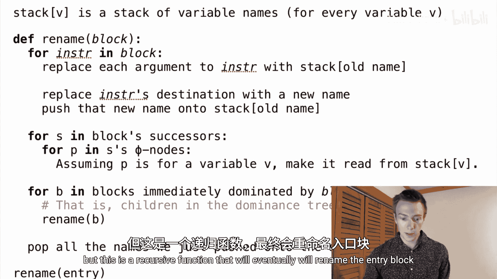

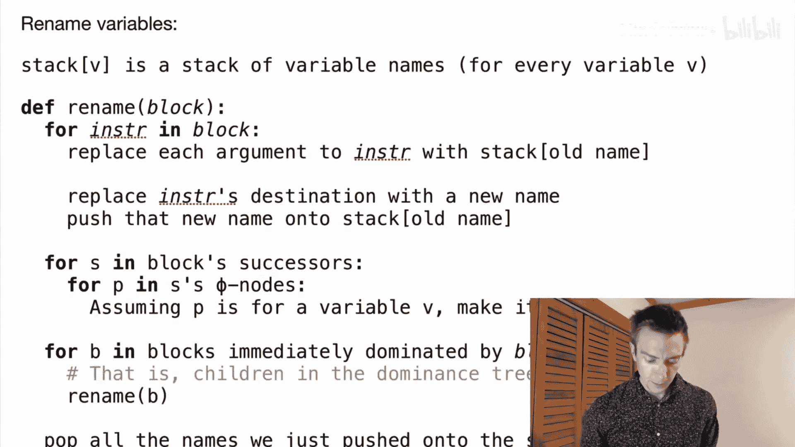

## 从 SSA 形式转换回来 🔄

在 SSA 形式上完成优化后，我们需要将其转换回普通的、允许变量重赋值的格式，因为真实硬件没有 Φ 指令，并且为每个静态赋值使用不同的物理存储位置效率极低。

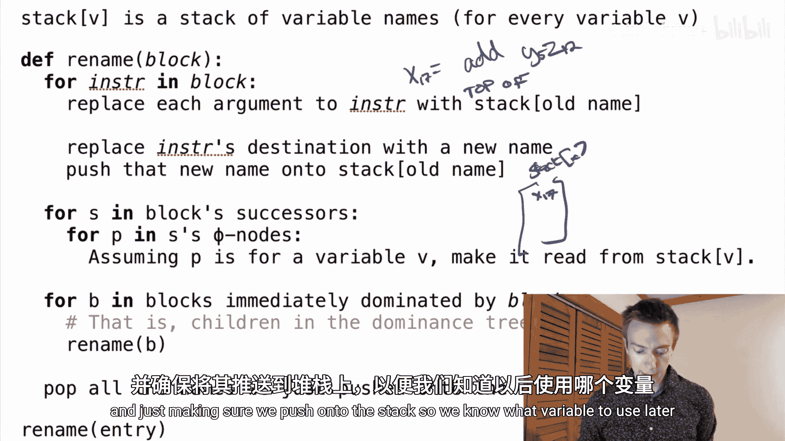

转换的核心思想是消除 Φ 节点。对于每个 Φ 指令：
```
v = phi v1 v2 ... label1 label2 ...
```
我们需要在流向该块的各条路径上，在紧邻该块之前插入新的基本块，并在这些新块中执行简单的复制操作。

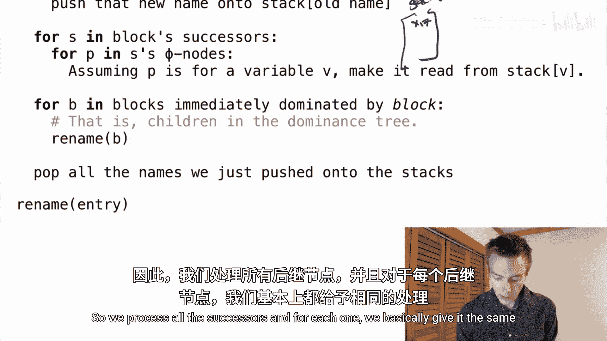

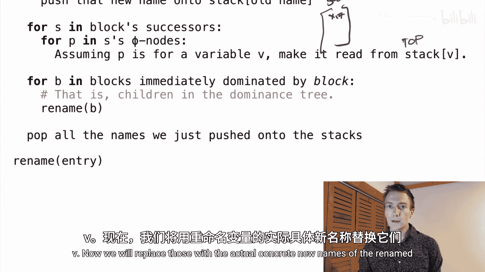

例如，对于一个有两个前驱的块 `B` 中的 Φ 节点：
```
// In block B (predecessors A1, A2)
v = phi v1 v2 .A1 .A2
```
我们可以：
1.  在边 `A1 -> B` 上插入一个新块 `A1'`，其中包含指令 `v = id v1`，然后将边改为 `A1 -> A1' -> B`。
2.  在边 `A2 -> B` 上插入一个新块 `A2'`，其中包含指令 `v = id v2`，然后将边改为 `A2 -> A2' -> B`。
3.  删除原始的 Φ 指令。

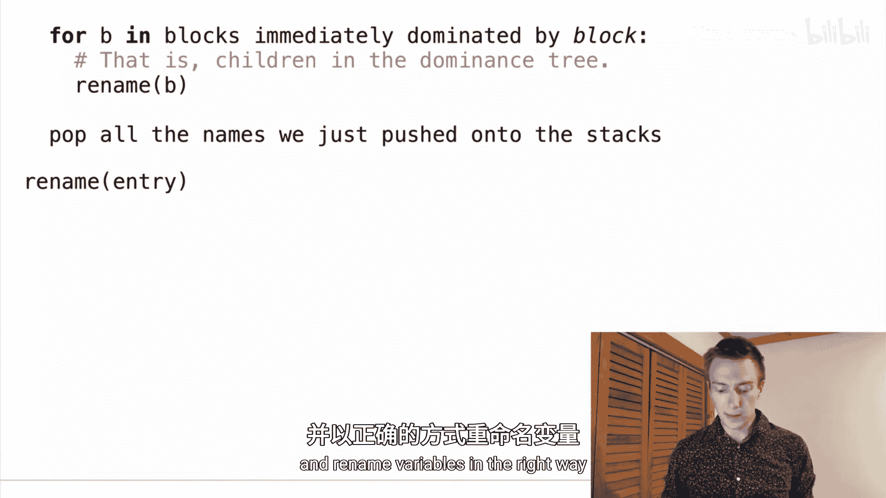

这样，我们就用控制流路径上的显式复制操作替换了隐式的 Φ 选择操作，恢复了程序的普通赋值形式。这个简单的复制插入算法足以保证正确性，但可能会引入一些不必要的复制操作。编译器文献中存在更复杂的算法来最小化这种开销。

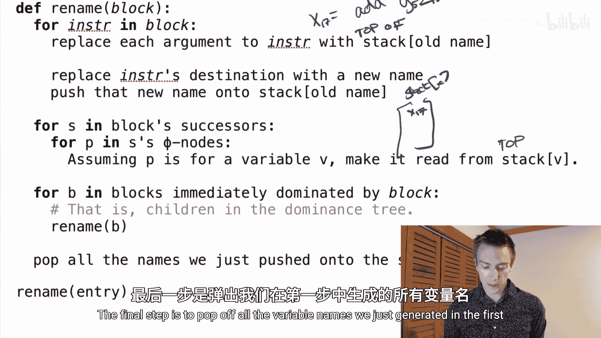

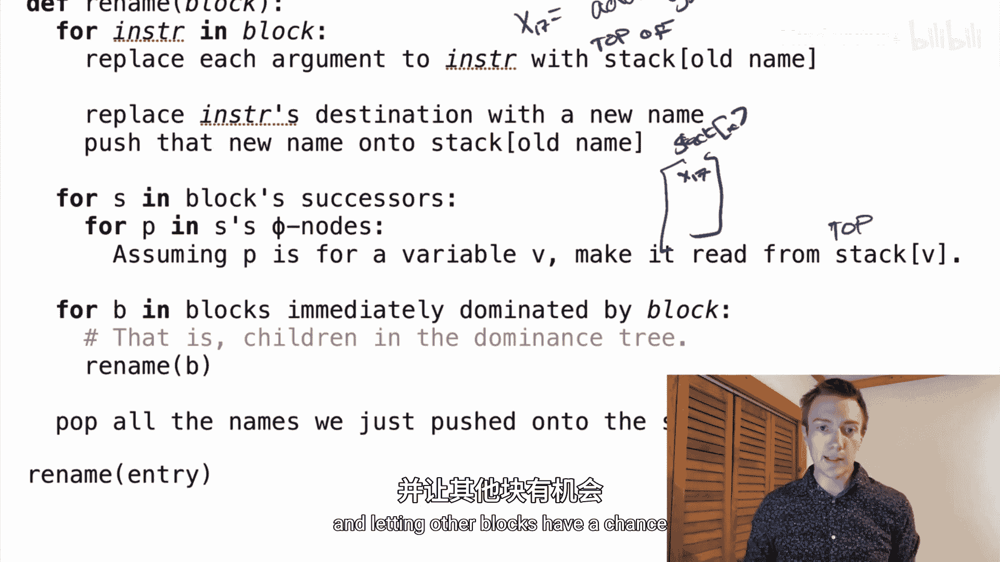

## SSA 的哲学意义 🌟

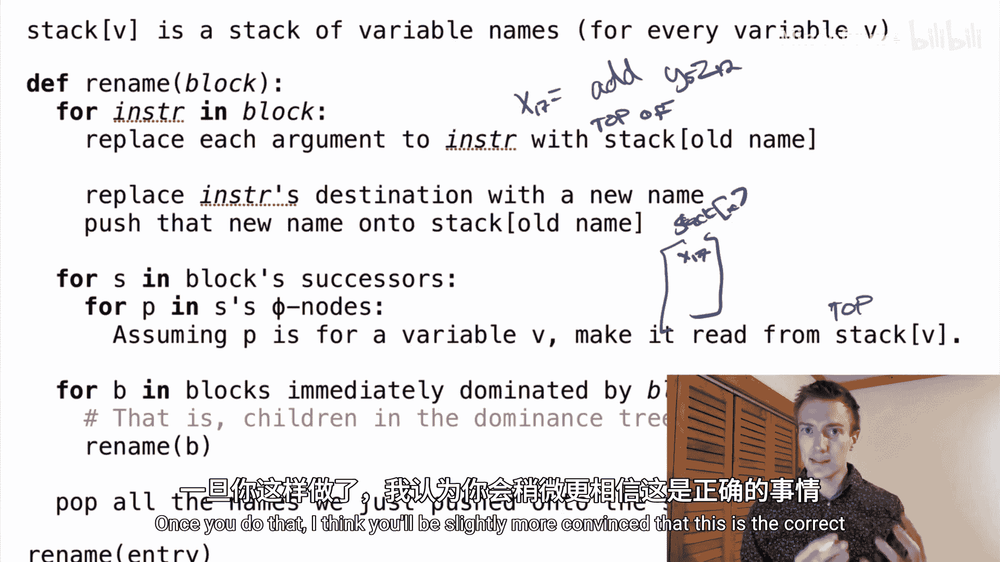

SSA 不仅仅是一种程序形式的限制，它更是一种思维方式的转变，改变了我们分析和优化程序的方式。在 SSA 形式下，几个原本不同的概念融合在了一起：

1.  **定义与变量合一**：由于每个变量只被定义一次，变量名和它的定义点（指令）可以视为同一实体。在做“到达定义”分析时，无需再区分是哪个赋值语句，变量本身即代表了其唯一定义。
2.  **指令即静态值**：在局部值编号中，我们将值抽象为指令计算的结果。在 SSA 中，值可以直接被视为指令本身。例如，指令 `x = add y z` 本身就可以看作是“将 `y` 和 `z` 相加”这个值的规范来源。
3.  **数据流图即程序**：SSA 形式中，指令的参数可以看作是数据流图中的边。指令是节点，变量引用是指向定义该值的指令节点的指针。在内存表示中（如 LLVM IR），指令直接包含指向其操作数指令的指针，变量名在很大程度上变成了可选的、便于人类阅读的注解。这使得程序文本同时也是一幅清晰的数据流图。


这种表示法的转变，使得程序的结构和数据依赖关系变得更加显式和易于分析。

## 总结

本节课中我们一起学习了静态单赋值形式。
*   **动机**：SSA 通过确保每个变量只被赋值一次，简化了编译器优化中的变量分析。
*   **核心机制**：引入 **Φ 节点** 来处理控制流汇聚点上的值选择问题。
*   **转换算法**：使用 **支配边界** 分析来定位需要插入 Φ 节点的位置，然后通过递归遍历支配树进行系统的 **变量重命名**。
*   **逆向转换**：通过在各条控制流路径上插入复制操作来消除 Φ 节点，将程序转换回高效的普通形式。
*   **深层意义**：SSA 不仅是一种中间表示，更是一种将程序表示为 **数据流图** 的哲学，它统一了变量、定义和值等概念，极大地简化了程序分析和优化。

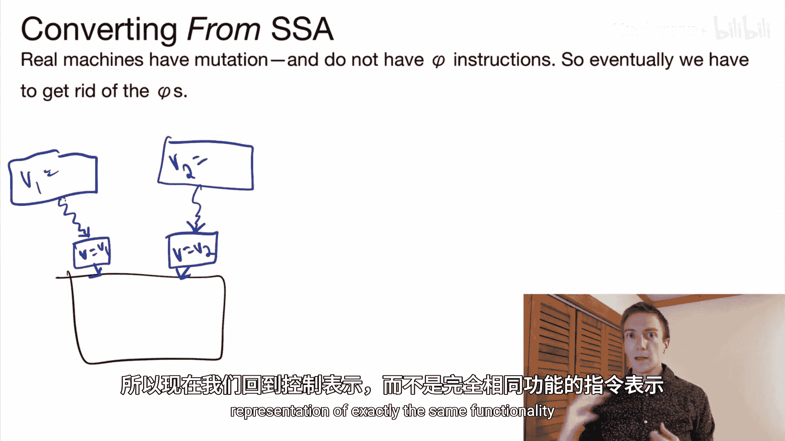

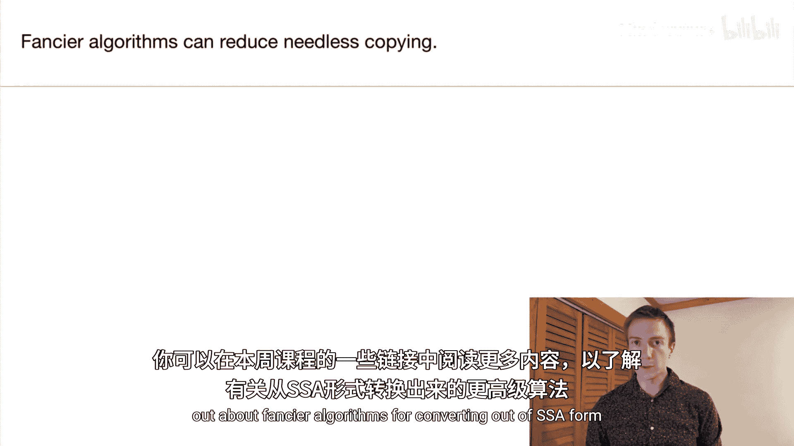

掌握 SSA 是理解现代编译器优化技术的重要基石。