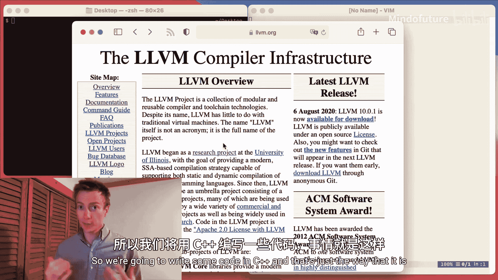
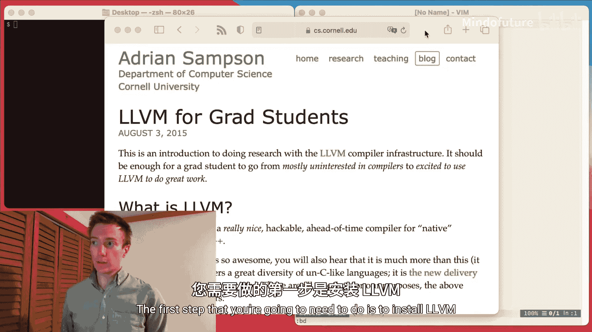
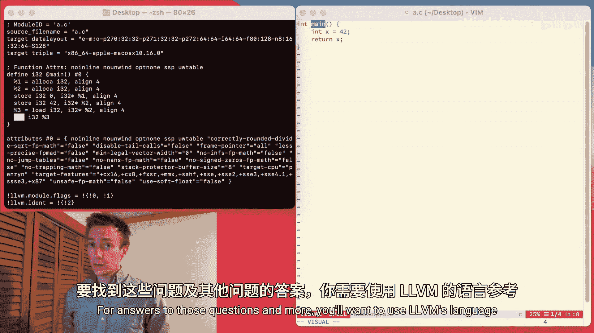
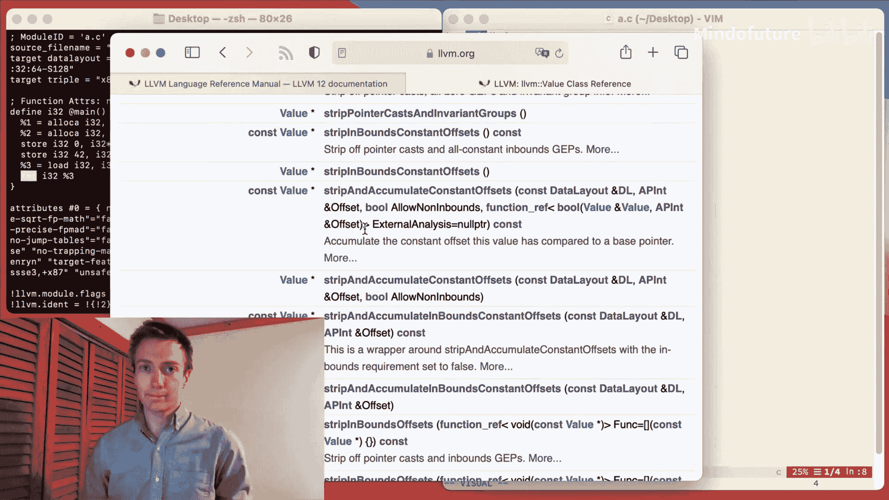
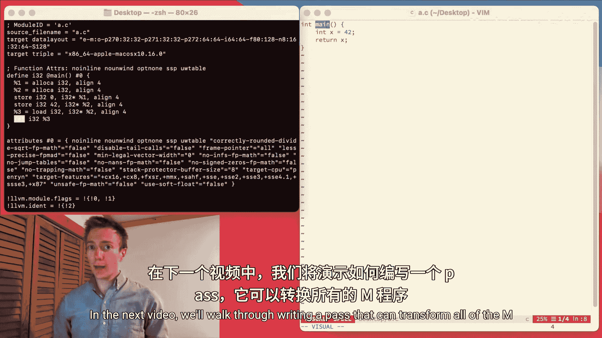

# 010：LLVM入门

在本节课中，我们将学习如何使用LLVM来转换和优化程序。LLVM是一个极其流行的编译器基础设施，支持C语言以及其他如Rust等语言。我们将了解其SSA形式的中间表示，并学习如何利用其强大的API来快速设计自己的模块化程序转换过程。

## 概述

LLVM是一个被广泛使用的真实编译器基础设施，与我们在本课程中一直使用的教学工具Bril形成对比。它提供了更接近工业实践的体验，允许我们编译和运行真实的软件，并利用其庞大的优化库。然而，这种真实性也带来了更高的复杂性。本节课将引导你安装LLVM，探索其IR，并熟悉其核心文档资源。

## LLVM简介

LLVM拥有一个非常酷的龙形标志。需要明确的是，“LLVM”现在不代表任何缩写。

我们选择使用LLVM，是因为它拥有设计精良的SSA形式中间表示以及一个出色的API。这个API使得通过设计自己的模块化Pass来快速、高效地转换程序成为可能。

从非常抽象的角度看，LLVM像是Bril的“超级增强版”。这并非巧合，因为Bril的设计正是以LLVM为蓝本。Bril的IR可以看作是LLVM中间表示的一种理想化形式。

同时，LLVM在另一种意义上与Bril截然相反。LLVM是真实世界中真正运行的基础设施。你现在观看这个视频所使用的软件链中，很可能就有部分是由LLVM编译的。它是人们实际使用的严肃基础设施，而Bril是一个教学工具。因此，LLVM比Bril要真实得多，它让我们能够编译和运行真实的软件，转换能在真实架构上运行的程序，并使用现有的、包含大量出色优化的库。



然而，凡事都有两面性。正因为LLVM如此贴近现实，它也比Bril更难使用。Bril中许多理想化的特性，在LLVM中都被无情地现实化了。因此，我们必须处理许多在Bril中可以忽略的现实问题，例如处理文件操作等。

还需要注意的是，LLVM是用C++编写的，因此我们也将使用C++来编写代码。这与使用Bril时可以选择任意语言形成了鲜明对比。



## 学习资源

在本节课中，我们将使用一篇我很久以前写在博客上的教程，它至今仍然适用。这篇教程名为《给研究生的LLVM指南》，你可以在本节课的笔记中找到它的链接。它将引导你理解LLVM背后的概念，并通过编写一个能操作LLVM代码的Pass来让你入门。我不会在视频中复述博客的每一个字，因此鼓励你边看视频边阅读那篇博客文章。

## 安装LLVM

第一步是安装LLVM。具体安装细节在此不赘述，但通常可以通过你使用的包管理器来安装。

例如，在macOS上，我使用Homebrew包管理器，只需执行 `brew install llvm`。请注意，macOS用户需要从Homebrew单独安装LLVM，而不是使用Xcode自带的版本，这样才能编写Pass。

你还需要安装CMake。以下是在Mac上通过Homebrew安装的完整命令：
```bash
brew install llvm cmake
```

你可以在教程中找到更多笔记，指导你如何在你的系统上安装LLVM。

现在请暂停视频，确保你已成功安装LLVM，并且可以运行 `clang --version` 命令，得到类似 `clang version 10.x.x` 的输出。完成后请继续。

## 探索LLVM中间表示

现在你已经安装了LLVM，接下来可以查看它的中间表示长什么样，看看作为一门编程语言，这个“超级增强版Bril”是什么样子。

我们将通过编写一个C程序来实现。这里写一个非常小的C程序：
```c
int main() {
    int x = 42;
    return 42;
}
```

我们将使用clang来编译这个程序。Clang是LLVM的C语言前端，它负责解析C程序并将其编译为LLVM的内部表示，然后使用LLVM继续编译为机器码。不过，我们现在只想打印出中间表示，而不是一路编译到机器码。

为了做到这一点，你需要几个特定的标志：
```bash
clang -emit-llvm -S -o - test.c
```
*   `-emit-llvm` 指示生成LLVM IR。
*   `-S` 指示生成汇编文本（即IR文本），而不是二进制。
*   `-o -` 指示输出到标准输出。当然，你也可以选择输出到文件。

执行命令后，它会将程序编译为中间表示。输出内容很多，可能有点难以理解，但主要部分是这个函数的定义。你可以看到它确实与Bril有相似之处：这里有一个函数定义，名称是`main`，直接来自我们的源程序。

函数体由一系列指令组成。有些指令的名称甚至和Bril中一模一样，例如，有一个 `ret` 指令用于从函数返回值。LLVM的类型系统要复杂得多。你首先会注意到整数类型具有任意位宽，例如 `i32` 表示32位整数，LLVM用它来实现这个C程序。

函数体由 `alloca` 指令（在栈上分配空间）、`store`、`load` 指令以及最后的 `return` 指令组成。你会看到使用了变量来存储中间值，就像在Bril中一样。例如，`%1`、`%2` 和 `%3` 都是函数局部的变量，你可以粗略地将它们视为我们在Bril程序中赋值和读取的变量。

然而，LLVM的IR是SSA形式的。与Bril可以选择是否为SSA形式不同，每个LLVM程序都是SSA形式。因此，当我们引用 `%3` 时，这只是一个便于阅读文本格式程序的友好名称。实际上在LLVM内部，`ret` 指令有一个指向这个 `load` 指令的指针，表明它从那里获取值。所以，LLVM在最基本的层面上就内嵌了这种SSA哲学。

## 查阅文档



要开始你的LLVM黑客之旅，熟悉文档至关重要。你将经常需要查阅文档来理解LLVM中发生的几乎所有事情。

你经常需要查找的一大类内容是各种指令的作用。例如，`alloca` 指令是什么？`store`、`load`、`ret` 又是什么？要回答这些问题以及更多，你需要使用LLVM的语言参考手册。你可以直接搜索“LLVM LangRef”来找到这个页面。

这是一份非常长的文档，包含了关于LLVM结构和类型系统的全部内容，以及对单个指令的描述。例如，我们可以查找 `load` 指令，从而获得关于其所有可能参数和在LLVM程序中的确切语义的详细信息。在学习本课程的过程中，你需要熟悉LLVM语言参考手册。

另一个你将频繁使用的重要资源是LLVM API的基于Doxygen生成的内部文档。为此，我经常通过谷歌搜索“LLVM”加上我正在寻找的C++类或方法名来查找。例如，我可以搜索“LLVM Value”，我的谷歌搜索历史会引导我找到LLVM的Doxygen文档。

这里包含了大量信息，包括类层次结构和该类包含的所有内容。我必须强调，在使用LLVM时，你必须不断地查阅文档。除了不断阅读文档，我不知道还有什么更好的方法来驾驭LLVM并成为专家。你将一手拿着浏览器，一手拿着文本编辑器，这就是你在LLVM生态系统中前进的方式。



## 总结



在本节课中，我们一起学习了LLVM的基础知识。我们了解到LLVM是一个强大且被广泛使用的真实编译器基础设施，其核心是基于SSA的中间表示。我们介绍了如何安装LLVM，如何通过clang查看C程序生成的LLVM IR，并强调了持续查阅官方语言参考手册和API文档对于学习和使用LLVM至关重要。在下一课中，我们将动手编写一个能够转换LLVM程序的Pass。