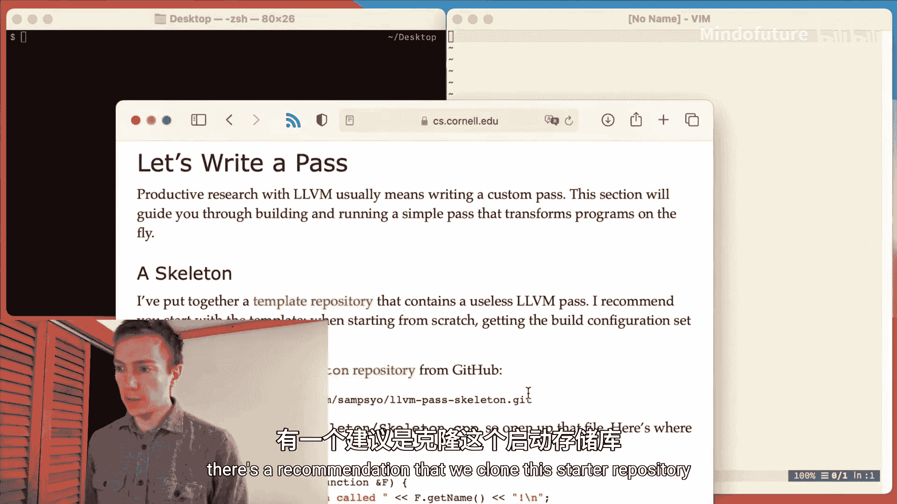
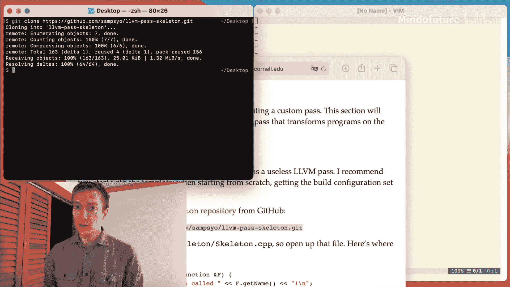
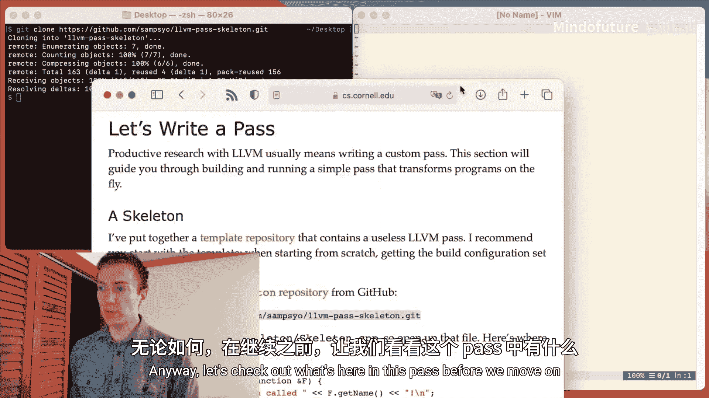
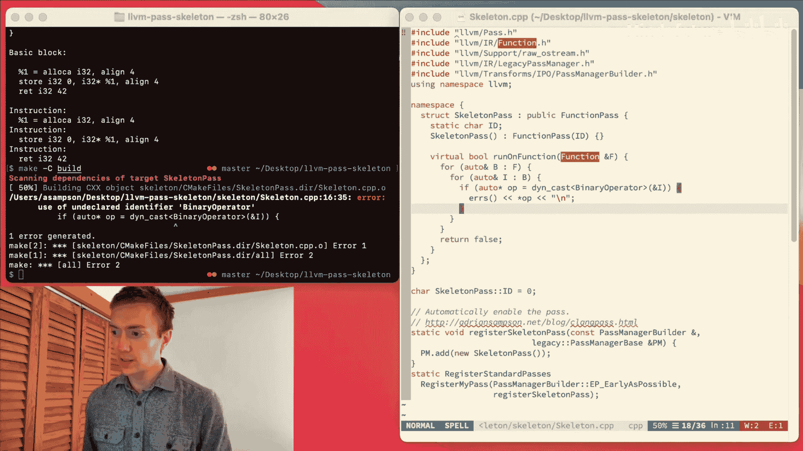
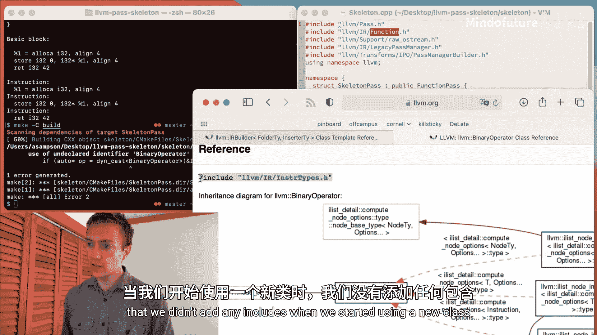
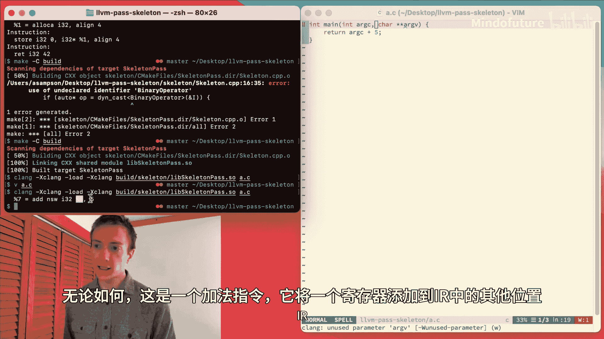
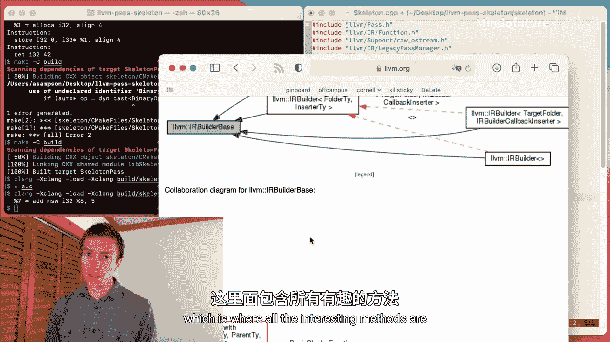
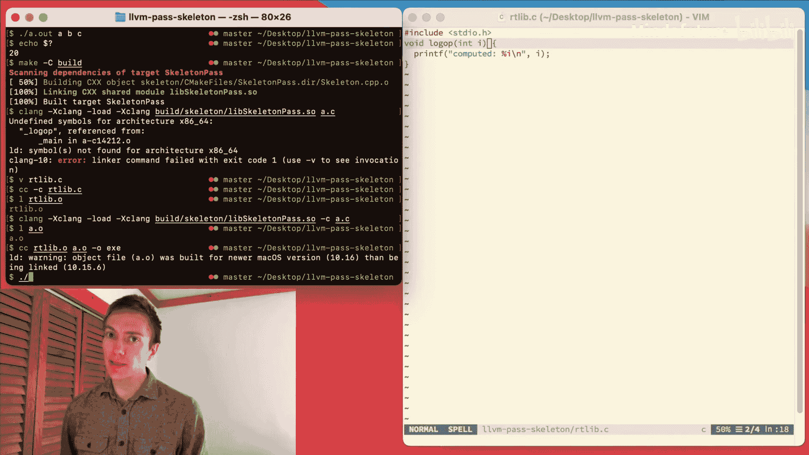
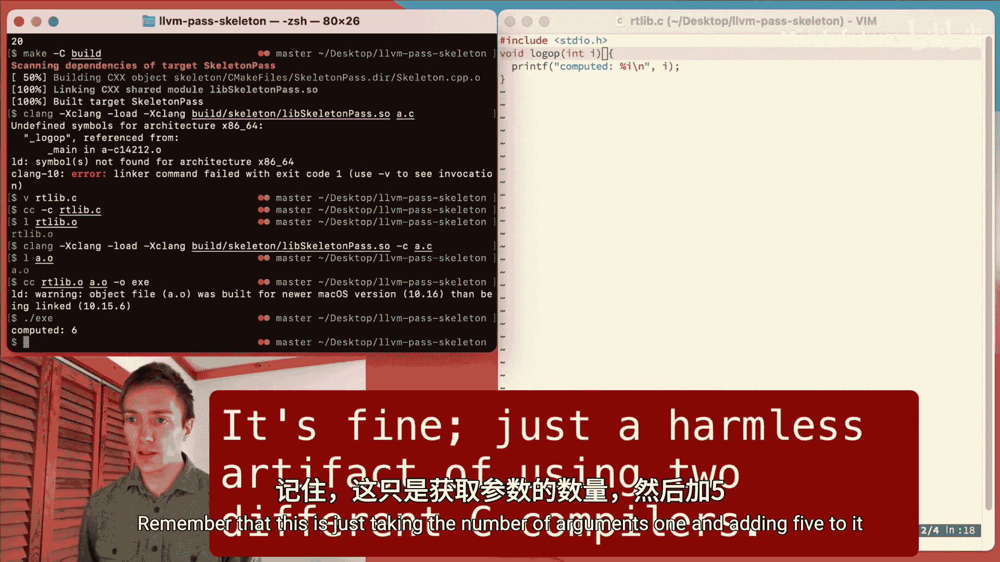
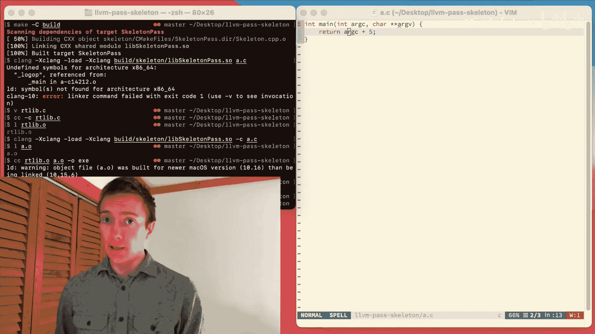

# 011：编写一个LLVM Pass 🛠️







在本节课中，我们将学习如何编写一个LLVM Pass。我们将从创建一个简单的“空”Pass开始，逐步深入到如何遍历、分析和修改LLVM中间表示（IR），最终实现一个能调用自定义运行时库的Pass。

## 概述

LLVM Pass是分析和转换LLVM IR程序的核心机制。通过编写Pass，你可以对程序进行静态分析、优化或插入自定义的插桩代码。本节教程将引导你完成创建第一个Pass的完整流程。

---

## 获取并构建初始代码库 🚀

上一节我们介绍了LLVM IR的基础知识，本节中我们来看看如何动手编写一个Pass。

首先，你需要克隆一个初始代码库。强烈建议你使用这个初始库，而不是从零开始，因为构建系统的配置过程可能比较繁琐。

以下是获取和构建的步骤：

1.  克隆初始代码库。
2.  代码位于 `skeleton/` 目录中，核心文件是 `skeleton.cpp`。
3.  使用CMake进行构建。你需要设置 `LLVM_DIR` 环境变量来指向你的LLVM安装路径中的 `lib/cmake/llvm/` 目录。
4.  执行 `cmake ..` 和 `make` 命令来编译Pass，最终会生成一个共享库文件（例如 `libSkeletonPass.so`）。

## 理解Pass的基本结构 📝

现在，让我们查看Pass的骨架代码，了解其基本结构。

`skeleton.cpp` 文件非常简短。这个Pass是 `FunctionPass` 的一个子类，这是LLVM文档中定义的一种Pass类型。它的核心是一个 `runOnFunction` 方法。

```cpp
bool runOnFunction(Function &F) override {
  errs() << "函数名: " << F.getName() << "\n";
  return false;
}
```
*   `runOnFunction` 方法接收一个 `Function` 对象作为参数，它代表了像 `main` 这样的函数。
*   目前，它只做最简单的事情：打印出函数名。
*   方法返回 `false` 表示我们没有修改这个函数。当我们后续需要修改函数时，将返回 `true`。
*   `errs()` 是一个类似于C++中 `std::cerr` 的输出流，用于打印调试信息。

## 运行你的第一个Pass 🎉

构建完成后，让我们实际运行这个Pass。





你需要使用与构建Pass时相同的LLVM安装中的 `clang`。运行Pass需要一些特定的命令选项。

```bash
clang -Xclang -load -Xclang /path/to/libSkeletonPass.so main.c
```
这条命令会编译 `main.c` 文件，并在编译过程中加载并运行我们的Pass。你将在输出中看到Pass打印出的函数名。恭喜你，你已经成功编译并运行了你的第一个LLVM Pass！



## 探索LLVM IR的对象层次结构 🔍

为了更深入地操作程序，我们需要了解LLVM IR在内存中的对象表示。

LLVM程序作为Pass的操作对象，就是一系列C++对象。以下是最重要的几个类：

*   **`Module`**： 可以粗略地对应一个原始的C源文件，它是一个容器，包含了最终会被翻译成目标文件的所有内容，如函数和全局变量。
*   **`Function`**： 包含在 `Module` 中，代表一个函数（如 `main`）。
*   **`BasicBlock`**： 包含在 `Function` 中，代表基本块。
*   **`Instruction`**： 包含在 `BasicBlock` 中，代表单条指令。



LLVM的基础设施已经帮你完成了将代码组织成基本块、并以SSA形式连接指令的工作，这使得在其上构建工具比在原始汇编上更简单。

## 遍历并打印IR对象 🖨️

作为调试和熟悉层次结构的方法，我们可以修改Pass来遍历并打印这些对象。

我们可以使用基于范围的for循环和 `auto` 关键字来轻松遍历。

```cpp
for (auto &B : F) { // 遍历函数中的每个基本块
  errs() << "基本块:\n";
  for (auto &I : B) { // 遍历基本块中的每条指令
    errs() << "  指令: " << I << "\n";
  }
}
```
这段代码会打印出函数中每个基本块内的每条指令。通过打印 `Function`、`BasicBlock` 或 `Instruction` 对象本身，LLVM会将其序列化为文本形式输出，这对于调试非常有帮助。

建议你暂停视频，尝试在自己的Pass中编写这段遍历代码，并探索打印其他对象。

## 模式匹配与指令替换 ⚙️

接下来，我们将让Pass变得更有趣：识别特定的指令模式并替换它。这是任何有意义的LLVM Pass都需要做的两件核心事情。

我们将做一个简单的转换：找到程序中的第一个二元操作指令（如加、减、乘、除），并将其替换为乘法指令。

以下是实现步骤：

1.  **识别二元操作符**： 使用 `dyn_cast<BinaryOperator>(&I)` 尝试将指令 `I` 转换为 `BinaryOperator*` 类型。如果转换成功（指针非空），则说明 `I` 是一个二元操作符。
    ```cpp
    if (auto *op = dyn_cast<BinaryOperator>(&I)) {
        // 找到二元操作符
    }
    ```
2.  **创建新指令**： 使用 `IRBuilder` 来创建新的指令。`IRBuilder` 是LLVM库中用于构建指令的实用工具。
    ```cpp
    IRBuilder<> builder(op);
    Value *lhs = op->getOperand(0);
    Value *rhs = op->getOperand(1);
    Value *mul = builder.CreateMul(lhs, rhs);
    ```
3.  **替换旧指令**： 找到所有使用旧指令结果的地方，将其替换为使用新指令的结果。
    ```cpp
    for (auto &U : op->uses()) {
        User *user = U.getUser();
        user->setOperand(U.getOperandNo(), mul);
    }
    ```
4.  **返回修改标志**： 由于我们修改了函数，`runOnFunction` 方法需要返回 `true`。

完成这些步骤后，重新构建并运行Pass。你可以创建一个简单的测试程序（例如 `return argc + 5;`），分别用普通 `clang` 和启用Pass的 `clang` 编译，并观察程序返回值的不同，以验证转换是否生效。

## 插入运行时库调用 📞

有时，我们想执行更复杂的操作，比如在特定事件发生时打印日志。直接在Pass中生成调用 `printf` 的所有LLVM指令会很繁琐。更简单的方法是插入对自定义运行时库函数的调用，然后将该库与主程序链接。

以下是具体方法：

1.  **获取或声明运行时函数**： 在Pass中，我们需要获取将要调用的函数的引用。首先通过 `F.getParent()` 得到当前函数所在的 `Module`，然后使用 `Module::getOrInsertFunction` 来声明或获取一个函数。
    ```cpp
    Module *M = F.getParent();
    LLVMContext &Ctx = F.getContext();
    FunctionCallee logFunc = M->getOrInsertFunction("logOp",
                                                     Type::getVoidTy(Ctx),
                                                     Type::getInt32Ty(Ctx));
    ```
2.  **插入函数调用**： 找到想要插桩的点（例如在某个指令之后），使用 `IRBuilder` 创建 `CallInst` 指令。
    ```cpp
    IRBuilder<> builder(op->getNextNode()); // 设置在 op 之后插入
    builder.CreateCall(logFunc, {op}); // 调用 logOp，传入 op 的结果作为参数
    ```
3.  **编写运行时库**： 用C语言实现 `logOp` 函数，并单独编译成目标文件。
    ```c
    // rtlib.c
    #include <stdio.h>
    void logOp(int value) {
        printf("计算了值: %d\n", value);
    }
    ```
    ```bash
    cc -c rtlib.c -o rtlib.o
    ```
4.  **分别编译并链接**：
    *   用你的Pass编译主程序：`clang -Xclang -load ... -c main.c -o main.instr.o`
    *   链接所有对象文件：`cc rtlib.o main.instr.o -o final_program`

运行 `final_program`，你将看到来自运行时库的打印输出。这种技术让你可以用熟悉的C语言编写复杂的插桩逻辑，而不是直接生成LLVM指令。

## 总结



在本节课中，我们一起学习了编写LLVM Pass的完整流程：



1.  **搭建环境**： 获取初始代码库并使用CMake构建Pass。
2.  **理解框架**： 认识了 `FunctionPass` 和 `runOnFunction` 方法的基本结构。
3.  **遍历IR**： 学习了如何遍历 `Module`、`Function`、`BasicBlock` 和 `Instruction` 的对象层次结构。
4.  **转换程序**： 掌握了使用 `dyn_cast` 进行模式匹配，使用 `IRBuilder` 创建新指令，以及替换指令用法的方法。
5.  **集成运行时库**： 了解了如何声明外部函数、在IR中插入调用，并将自定义的C语言运行时库与插桩后的程序链接。



你现在已经掌握了开始探索LLVM的基础工具。LLVM是一个庞大的库，内置了许多分析和优化功能，可以用来构建处理类C程序的强大工具。你的任务是构思一个有趣的想法，并将其实现为一个LLVM Pass。请尽情探索，并在熟悉LLVM基础设施的过程中多提问题。