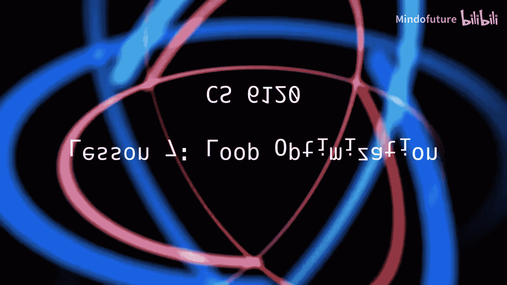
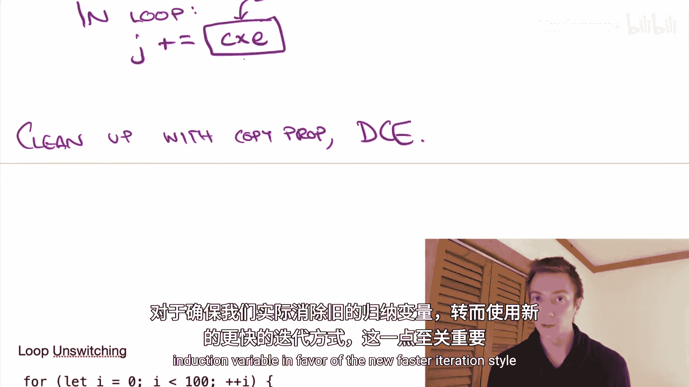
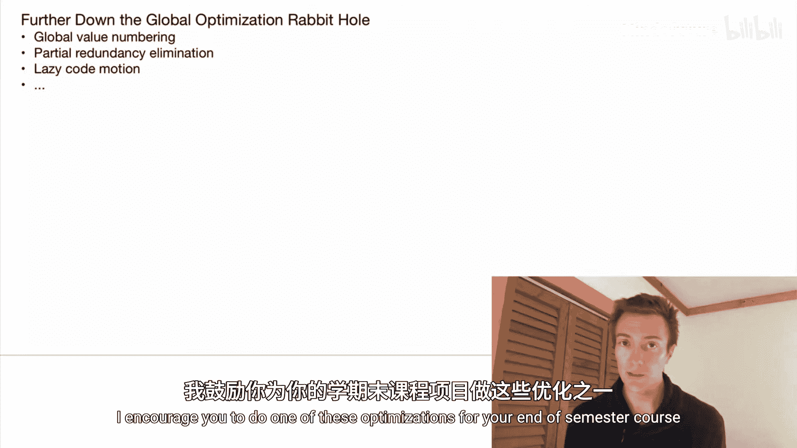

# 012：循环优化 🌀




在本节课中，我们将学习几种经典的循环优化技术。这些优化主要应用于自然循环，旨在提升程序性能，减少不必要的计算和内存访问。接下来的几周，你的任务是选择并实现其中一种优化。

## 概述

上一节我们介绍了如何识别自然循环。本节中，我们将具体探讨几种循环优化技术，包括归纳变量消除、循环不变量外提、循环切换和循环融合。这些优化能有效减少循环内的计算开销和内存访问。

## 自然循环回顾

首先，我们需要回顾如何识别自然循环。自然循环对应着编程语言中的 `for`、`while` 和 `do while` 等循环结构。它们是控制流图中由基本块组成的强连通分量，并且具有唯一的入口块。

所有本节描述的优化都应用于自然循环。因此，实现优化的第一步通常是识别控制流图中的自然循环。

## 循环不变量外提

在之前的课程中，我们以循环不变量外提为例，介绍了应用于自然循环的优化。循环不变量外提识别循环中值不变的表达式，例如 `A * B`，并将其计算移到循环外部。

以下是循环不变量外提的基本步骤：
1.  识别循环不变量表达式。
2.  将该表达式的计算移到循环的入口块（前置头）中。
3.  在循环内部，将原表达式替换为对新计算结果的引用。

通过这种方式，我们避免了在每次循环迭代中重复计算相同的值。

## 归纳变量消除

接下来，我们看看归纳变量消除。这种优化在与数组访问结合时尤其有用。

考虑以下访问数组 `A` 的循环：
```c
for (int i = 0; i < 100; i++) {
    ... = A[i];
}
```
在类C语言中，`A[i]` 的计算通常涉及基地址 `A` 加上偏移量 `i * stride`（`stride` 是数组元素的大小）。每次迭代都需要进行乘法和加法。

归纳变量消除旨在将这种下标访问转换为更高效的指针递增方式。我们引入一个指针变量 `a_i`，初始指向 `A`，每次迭代只需将其增加 `stride`，从而将乘加操作简化为一次加法。

以下是实现归纳变量消除的三个基本步骤：

**第一步：识别基本归纳变量**
在循环中寻找形如 `i = i + C`（其中 `C` 是循环不变量）的语句。这表示变量 `i` 在每次迭代中以固定值递增，我们称其为基本归纳变量。注意，在SSA形式中，识别此类模式需要额外处理。

**第二步：识别派生归纳变量**
寻找基于基本归纳变量 `i` 的仿射表达式，形如 `j = C * i + D`，其中 `C` 和 `D` 是循环不变量。变量 `j` 被称为派生归纳变量，这正是我们希望消除的计算。

**第三步：执行替换**
1.  在循环前置头中，将 `j` 的初始值设为 `D`（即 `i` 为初始值时的计算结果）。
2.  在循环体内，将 `j` 的更新替换为 `j += C * step`，其中 `step` 是 `i` 每次迭代的增量。`C * step` 本身是循环不变量，可以预先计算并存储在临时变量中。
3.  替换完成后，可以删除旧的 `j` 定义，并用新的 `j` 替换所有对旧 `j` 的引用。

优化后，务必进行复制传播和死代码消除，以清理不再需要的旧归纳变量。

## 循环切换




循环切换优化处理循环内部嵌套条件分支的常见模式。

当发现循环内部有一个 `if` 语句，并且其判断条件不依赖于循环迭代（即循环不变量）时，我们可以将 `if` 语句移到循环外部。这样，原来的单个循环被转换为两个独立的、更简单的循环，分别执行原 `if` 语句的 `then` 分支和 `else` 分支，从而消除了每次迭代中的分支判断开销。

此优化依赖于循环不变量分析来识别条件，并在控制流图层面进行结构重组。

## 循环融合

循环融合尝试将两个相邻的循环合并为一个。

此优化适用于两个循环具有相同的迭代结构（即使用相同的归纳变量和边界）。发现这种机会需要用到前面介绍的归纳变量分析。

融合的基本思想是将两个循环体复制粘贴到同一个循环中。但必须确保这种转换是安全的，关键在于第二个循环体的执行顺序可以调整到第一个循环体的每次迭代之后执行，而不影响最终结果。

这通常需要进行数据依赖分析，确保第二个循环的写入不会影响第一个循环的读取。

循环融合的收益不仅仅是减少分支开销。在某些计算领域，尤其是涉及中间数组读写时，收益更大。例如，如果第一个循环写入数组 `B`，第二个循环从 `B` 读取，并且在循环之后 `B` 不再被使用，那么融合后可以直接将第一个循环的计算结果传递给第二个循环，避免了对中间数组 `B` 的写入和读取，显著减少了内存访问。

这种优化在机器学习编译器中至关重要，例如，可以将矩阵乘法（全连接层）与逐元素的非线性激活函数（如ReLU）融合，避免将中间结果写回内存再读出的开销，从而极大提升性能并降低内存带宽需求。

## 其他循环优化

除了上述几种，还有许多其他的循环优化技术，例如：
*   **循环展开**：复制循环体以减少循环控制开销。
*   **循环交换**：改变嵌套循环的内外顺序以改善数据局部性。
*   **循环剥离/分裂**：将循环的前几次迭代单独执行，使主循环更简单。
*   **局部性变换**：调整循环内数据的访问模式，使其更适应缓存。

由于程序大部分执行时间都花在循环上，因此针对循环的优化至关重要。

## 总结

本节课我们一起学习了几种经典的循环优化技术：归纳变量消除、循环不变量外提、循环切换和循环融合。这些优化通过消除冗余计算、减少分支判断和内存访问来提升程序性能。理解并实现这些优化是编译器后端工作的重要组成部分。



本课程关于经典全局优化的部分到此告一段落。后续课程将转向程序分析的其他方面以及语言实现的其他环节。如果你对此类优化特别感兴趣，可以参考其他研究生级别的编译器课程资料进行深入探索。现在，请选择一种优化开始你的实现任务吧。