# 013：过程间分析 🧠

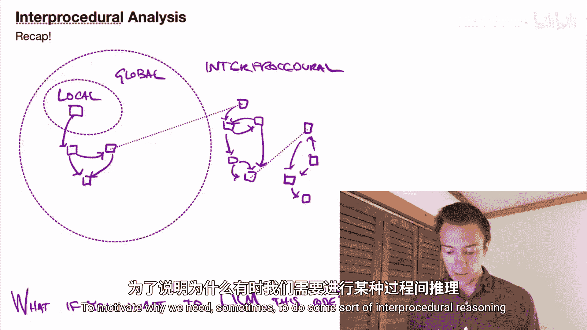

在本节课中，我们将要学习过程间分析。这是编译器优化的下一个层次，它超越了单个函数，着眼于多个函数之间的调用关系，以进行更深入的优化。

## 概述

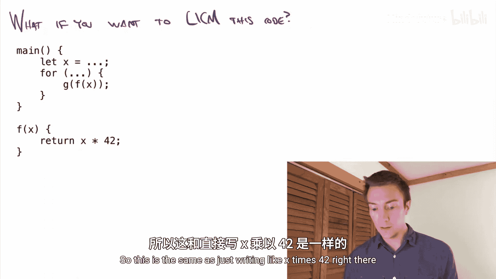

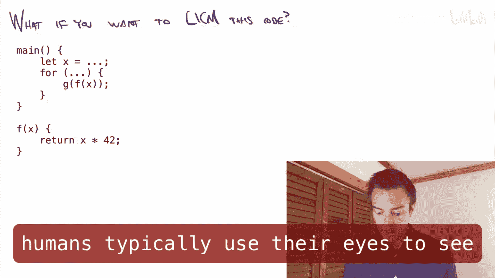

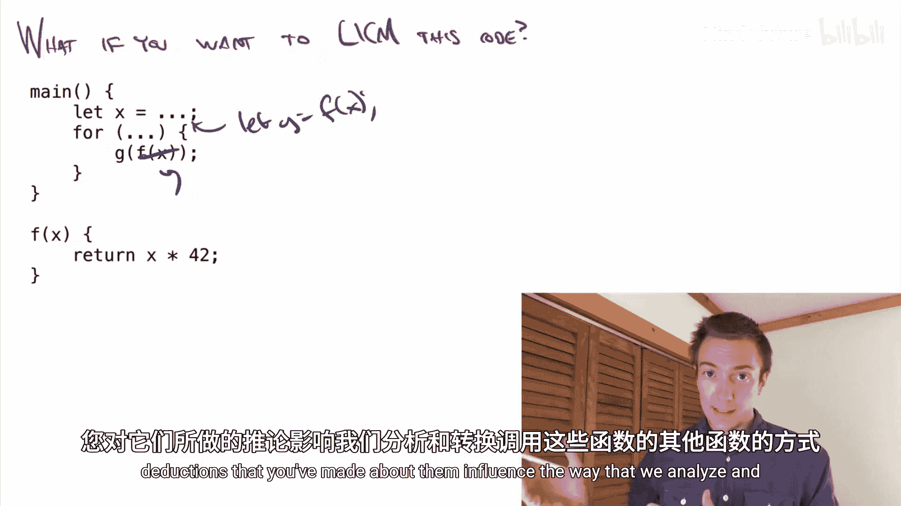

到目前为止，我们已经学习了局部分析和优化（作用于单个基本块）以及全局优化（作用于整个函数并考虑控制流）。过程间优化是更进一步的层次，它分析多个函数，并需要考虑函数之间的调用关系。

## 为什么需要过程间分析？

为了理解为什么有时需要进行过程间推理，请考虑以下函数。

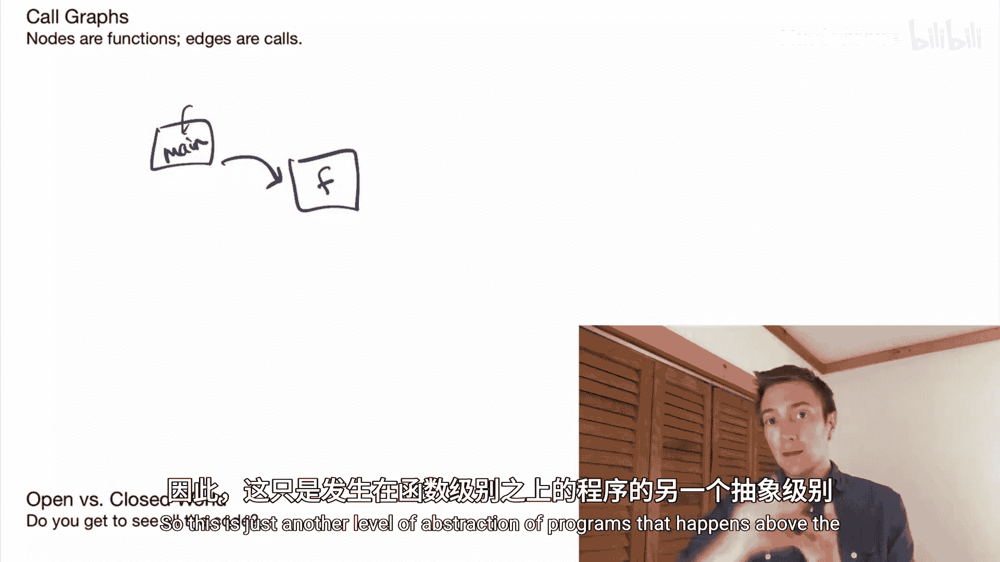

```pseudocode
function main():
    for i in range(100):
        x = i * 42
        y = F(x)
        print(y)

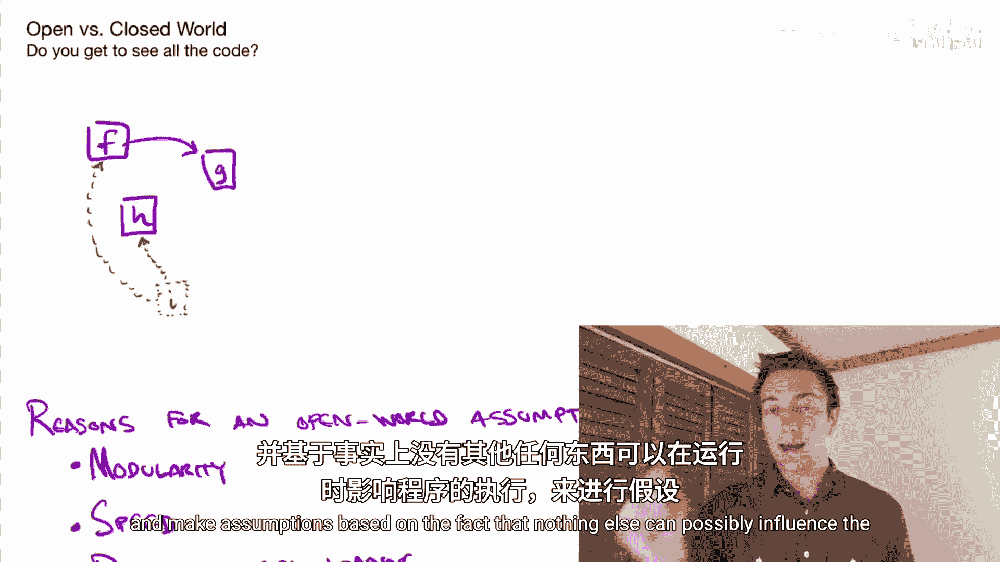

function F(a):
    return a * 42
```

这是一个伪代码示例。假设你想进行循环不变量代码外提。你希望利用的洞察是，函数 `F` 只是将其参数乘以 42。因此，`y = F(x)` 等同于 `y = x * 42`。我们的大脑可以看出这是一个循环不变量。如果我们能将 `y = F(x)` 移出循环并重用 `y`，那将非常棒。然而，仅靠全局分析无法做到这一点，因为它需要查看另一个函数（`F`）的内部，才能确定是否可以将对 `F` 的调用移出循环。

过程间分析的核心就是关于这一点：获取一个函数的事实，并让你对这些事实所做的推论，影响我们分析和转换调用这些函数的其他函数的方式。

## 调用图

与许多其他编译器主题一样，过程间优化有一个我们需要关注的核心数据结构，那就是**调用图**。你可以将其粗略地视为控制流图在过程间分析层面的类比。调用图非常简单：节点是函数（例如，前面例子中的 `main` 和 `F`），边表示从一个函数到另一个函数的调用。它不可能比这更简单了，它只是表示函数之间调用网络的一种方式。

你可以想象放大调用图中的单个节点，将其展开为完整的控制流图，然后再放大该图中的节点，将其展开为基本块。因此，这只是发生在函数级别之上的程序的另一个抽象层次。

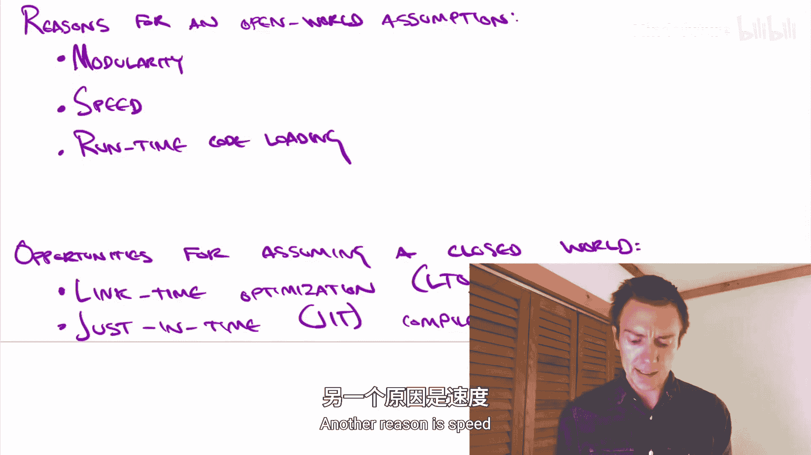

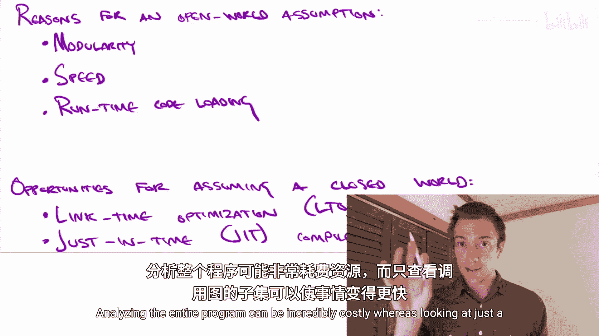

## 开放世界与封闭世界假设

决定如何进行过程间分析的一个大问题是，你假设自己处于**开放世界**还是**封闭世界**。

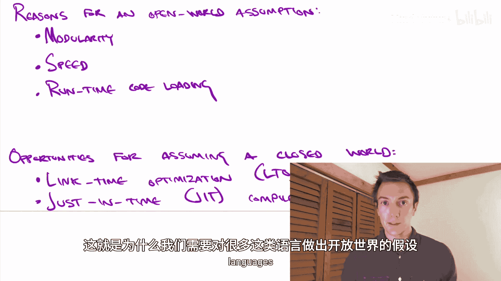

在开放世界假设中，你假设只能看到最终将运行代码的一部分。你看到一些代码，但必须想象其余代码会发生其他事情。你看到一些函数，但必须想象还有其他函数或类会影响程序的执行。

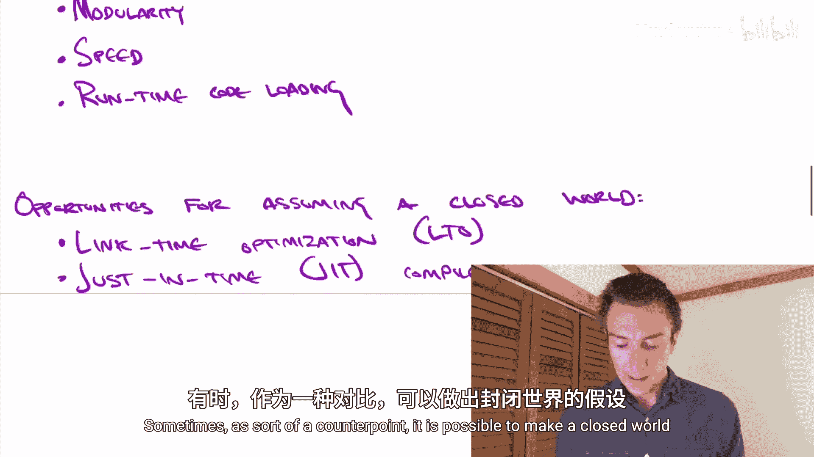

在封闭世界假设中，你有更大的优化潜力，因为你可以假设你看到的代码就是全部。你可以分析整个程序，并基于运行时不可能有其他东西影响程序执行这一事实做出假设。

为了说明我的意思，这里有一个小小的调用图，包含 `F`、`G` 和 `H`。如果你看到一个调用图显示 `F` 调用 `G`，而两者都不调用 `H`，并且 `H` 也不调用它们。如果你单独看到这些，你可能会倾向于认为可以安全地删除 `H` 的定义，因为实际上没有人在调用它。在过程间级别，这是一个函数级别的死代码。**如果**你可以做出封闭世界假设，即如果你被允许看到所有代码，那么这是正确的。但是，如果你必须假设其他代码可能正在执行，那么可能还有其他函数（例如 `I`）会调用 `H` 和 `F`。在这种情况下，`H` 就不是死的。例如，`I` 可能是你没有看到的主函数。在这种情况下，不允许删除 `H`。

一般来说，当你在开放世界假设下，你必须假设我们尚未看到的其他代码可以做任何事情，例如调用任何函数。因此，没有函数可能是死的或可删除的。

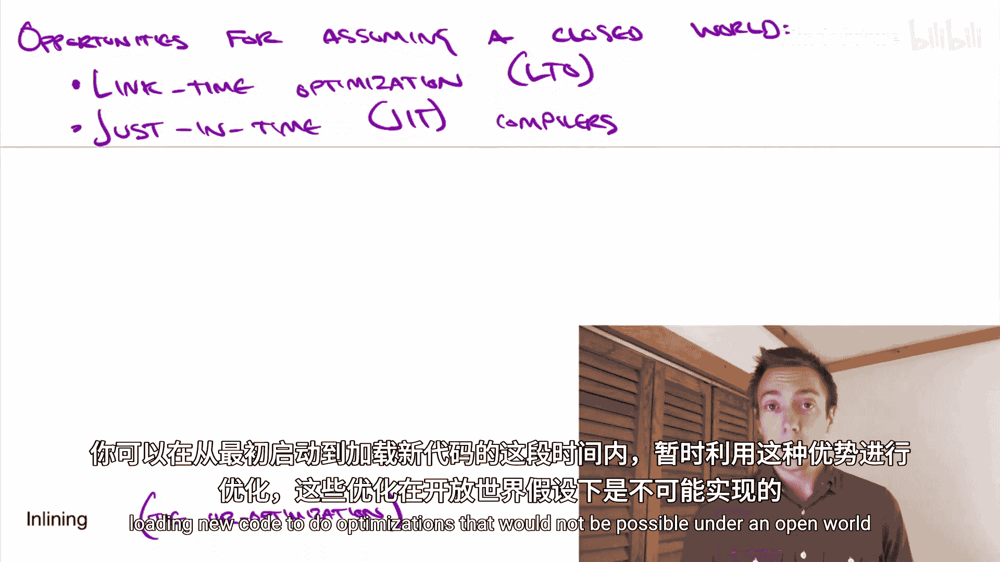

这听起来很有问题。为什么我们还要做开放世界假设？它似乎会限制你想在过程间分析中做的很多事情。确实，它相当有限制性，但由于许多你无法在大多数编译器中回避的原因，它也非常实用。

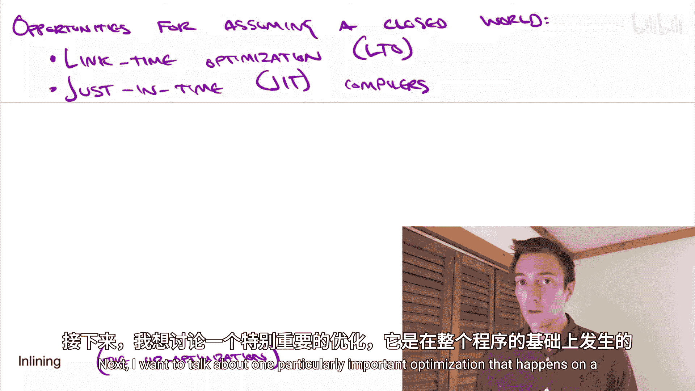

以下是为什么在实践中你通常需要做出开放世界假设的一些原因，这也限制了过程间分析的能力。

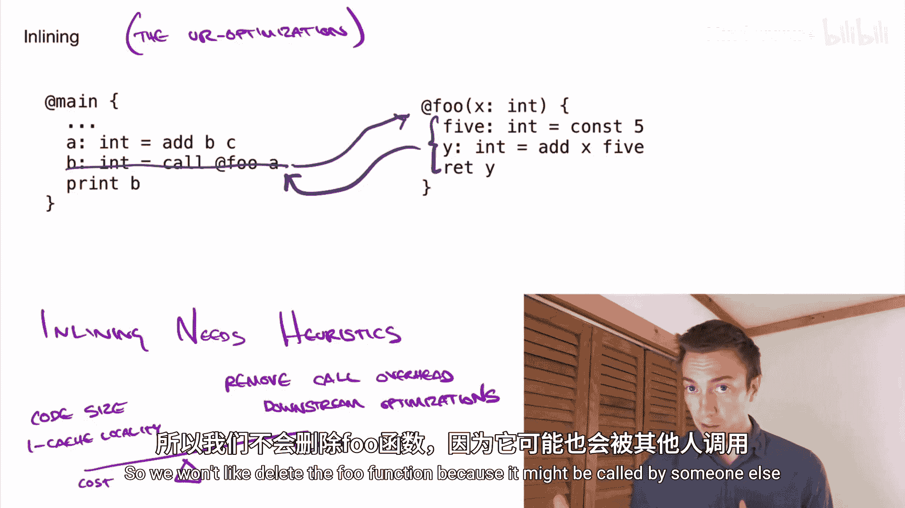

*   **模块化**：例如，在编译 C 程序时，你可能习惯于将 `.c` 文件编译为 `.o` 目标文件，并概念上为许多单独的源文件并行执行此操作，最后将它们链接在一起。这有很多好处，意味着构建是可并行化的、增量的。如果你更改一个文件，则不必重新编译整个项目。这对于开发人员的生活质量等方面极其重要。因此，在编译每个源文件时，你需要假设你不知道其余源文件中会发生什么。这是大多数时候过程间分析必须做出开放世界假设的一个非常重要的原因。
*   **速度**：分析整个程序可能成本极高，而仅查看调用图的一个子集可以使事情进展得更快。当你开始讨论分析整个程序时，你会开始运行非常缓慢的优化，这些优化可能会达到收益递减点。
*   **运行时代码加载**：最后，在某些语言中存在运行时代码加载的可能性。例如，在 JavaScript 或 Python 中，可以 `eval` 并因此运行一些你尚未看到的代码。因此，即使你能向自己保证已经看到了程序中的所有代码，并且愿意花时间分析它，你也不能确定当你最终 `eval` 某些内容或从服务器加载另一个 JavaScript 程序并概念上将其与程序的其余部分链接时会发生什么。即使在 Java 中，也可以在运行时加载类。这是 Java 规范中一个非常复杂的部分，涉及如何以及何时加载类。因此，在某些时候，你必须假设有可能运行一些你未预料到的、根据你的优化会做“坏事”的代码。这就是为什么我们需要为许多这些语言做出开放世界假设。

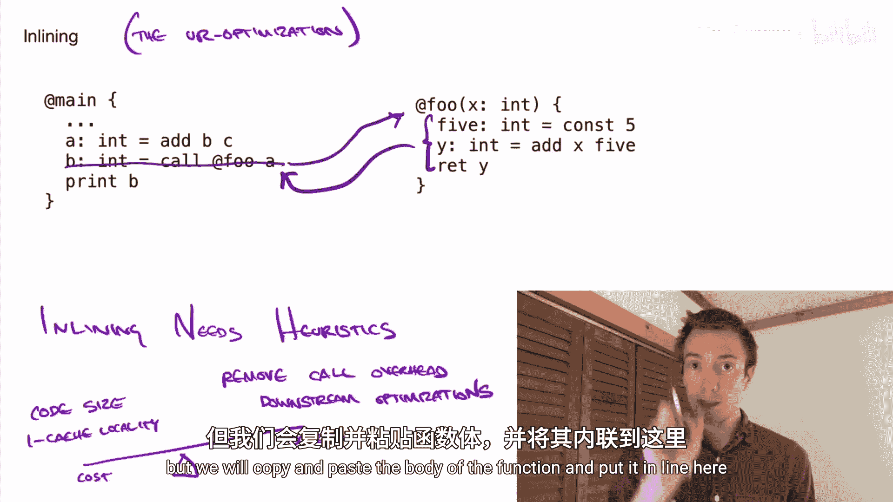

## 封闭世界假设的应用场景

有时，作为对比，也有可能做出封闭世界假设，并获得相应的好处，即知道没有其他代码将作为程序的一部分执行。

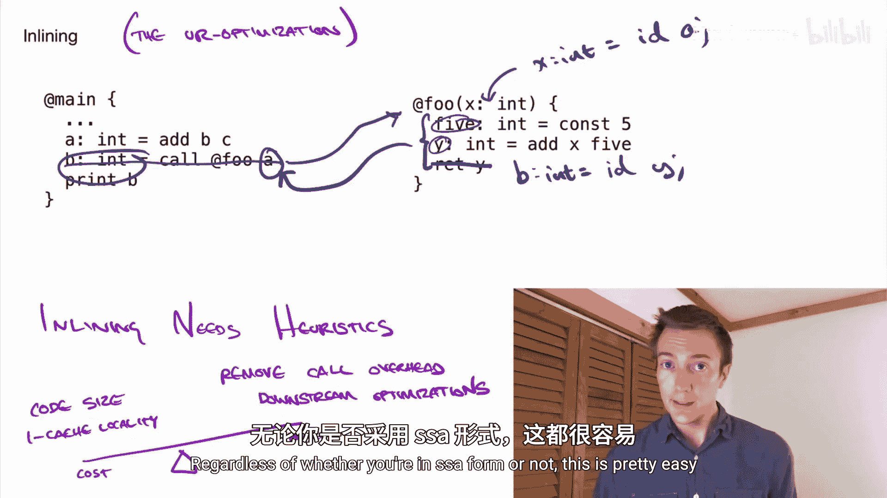

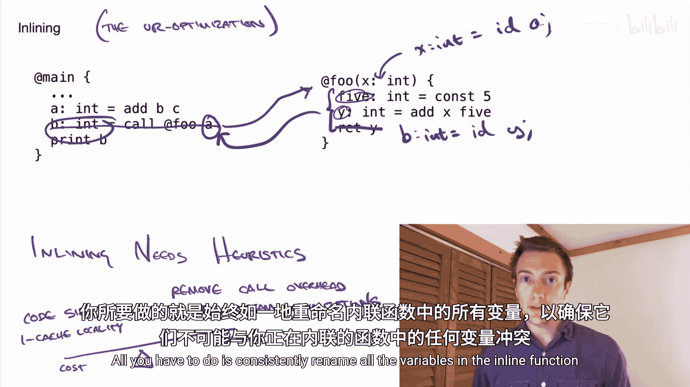

在实践中，今天发生这种情况的两个主要场景是：

1.  **链接时优化**：LTO 是本机代码编译器中的一个次要优化阶段，发生在你将所有 `.c` 文件编译为 `.o` 文件并最终将它们链接在一起之后。LTO 提供了一个机会，在对单个文件进行优化之后，现在做出整个程序假设，重新优化代码。既然你现在可以看到将进入可执行文件的所有代码，你就可以进行比在单个文件上使用开放世界假设时更多的优化。
2.  **即时编译器**：即时编译器有时也会做出封闭世界假设。即时编译是指你不是提前编译代码然后稍后运行，而是在代码运行前立即编译它。在 JIT 编译器中，整个程序假设或封闭世界假设的工作方式是**临时性**的。也就是说，你可以临时假设你已经看到了将要执行的所有代码，执行程序一段时间，然后如果你运行到一个需要加载更多代码的地方（例如，为 Java 从磁盘加载另一个类文件），那么你必须重新审视你在优化期间基于整个程序假设所做的假设，然后可能在新代码存在的情况下重新编译程序。无论如何，你可以在从最初开始到加载新代码的这段时间内，暂时利用封闭世界假设的优势，进行在开放世界假设下不可能实现的优化。

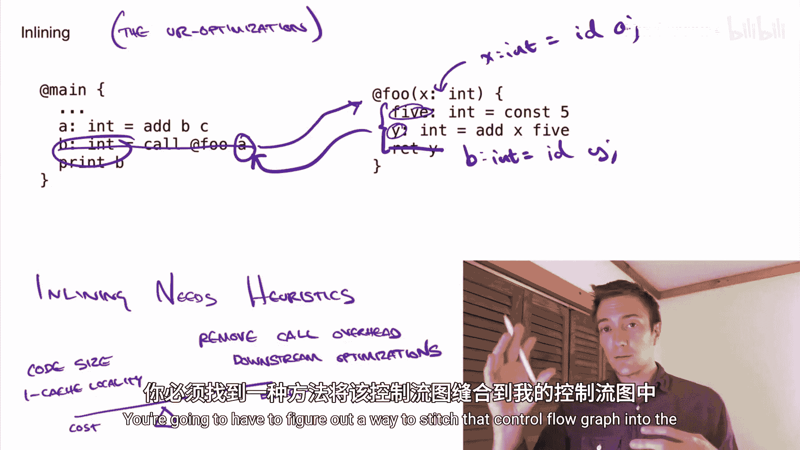

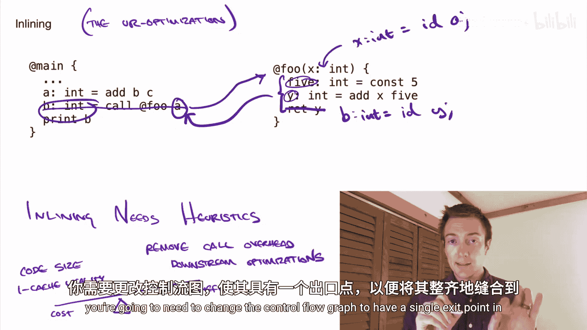


## 内联优化

接下来，我想讨论一个特别重要的、在整个程序基础上进行的、过程间的优化，那就是**内联**。

内联是一个非常简单的想法。基本上，它就是说，如果你有一个像这样的调用（在这个 Bril 程序中，从函数 `main` 调用函数 `foo`），你可以删除这个调用，并获取函数体的代码，直接复制粘贴到这里。我们不会删除 `F` 函数，因为它可能也被其他人调用，但我们会复制粘贴函数体并将其内联到这里。

为了修复对参数和返回值的引用，我们还需要做几件事。现在，请暂停视频，写出这对函数内联版本的代码。也就是说，写一个新版本的 `main`，其中内联了 `foo` 的代码，并思考你需要做哪些步骤来更改 `foo` 代码，使其现在适合放入 `main`。

我认为主要有三个步骤。你必须处理参数、返回值，最后还必须处理其余的变量名。

*   **处理参数**：最简单的方法就是用一个移动指令（例如 Bril 中的 `id` 指令）来实现这个参数。例如：`x: int = id a`。
*   **处理返回值**：当然，我不想在这里从这个函数返回。相反，我需要将其赋值给函数调用返回的同一个东西。例如：`b: int = id y`。这样我就模拟了返回值 `y` 并将其放入 `main` 函数中变量 `b` 的效果。
*   **重命名变量**：最后是最枯燥的部分，你需要确保 `foo` 函数体中使用的变量不会影响 `main` 中发生的任何事情，无论你是否处于 SSA 形式。这很容易，你只需要一致地重命名内联函数中的所有变量，以确保它们不可能与你要内联进去的函数中的任何变量冲突。

这个小例子完全没有涉及控制流。你也必须处理控制流。例如，想象一下，如果 `foo` 内部有分支和跳转，你将需要找到一种方法将该控制流图缝合到 `main` 的控制流图中。如果 `foo` 有多个返回语句，你将需要更改控制流图以具有单个出口点，以便整齐地将其缝合到 `main` 中，而不使用 `return` 指令（当然，`return` 会从错误的函数返回）。无论如何，内联的机制实际上并不那么复杂。

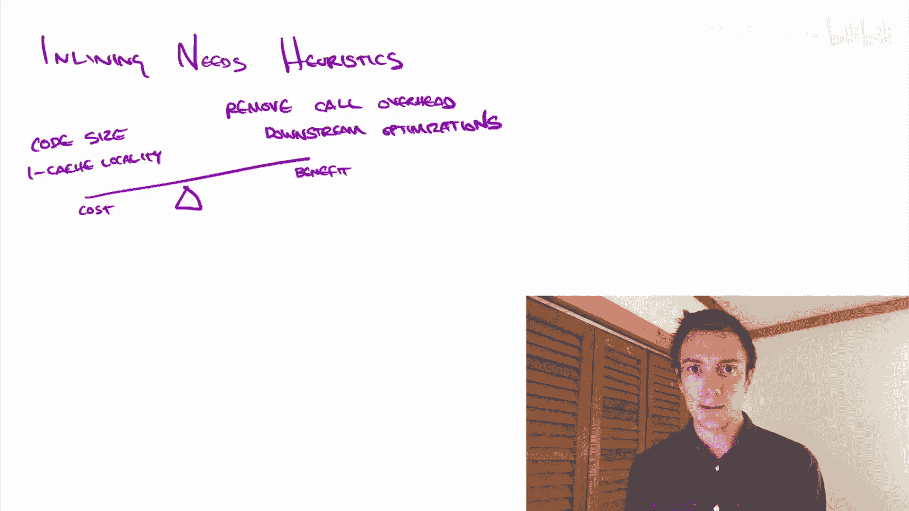

复杂的是决定何时应用它。

我喜欢这样思考：内联有**成本**和**收益**，两者都是量化的，有时很难预测。

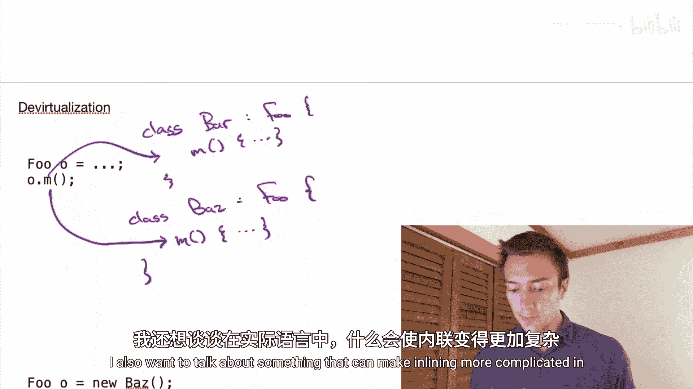

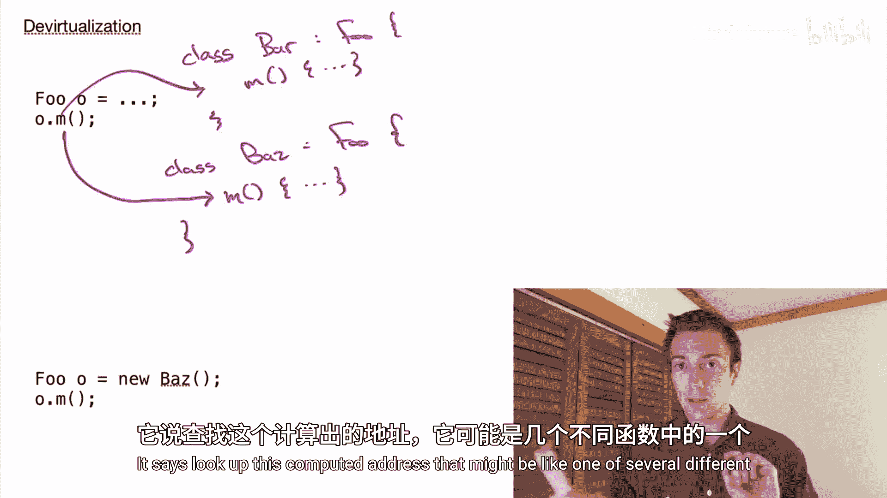

*   **成本**：你增加了程序的代码大小。在极限情况下，如果你试图将所有内容都内联到 `main` 中，代码大小会呈指数级爆炸。如果你的程序调用图中有无界递归，通常甚至不可能做到这一点。代码大小爆炸不仅会导致你的可执行文件中包含大量汇编代码，还可能因为 CPU 的局部性和指令缓存而减慢程序速度。代码过多并在其中疯狂跳转，意味着 CPU 中某些结构（这些结构经过调整，具有有限的大小，因此针对有限大小的程序进行了优化）在你通过将所有内容内联进来使程序变得巨大时会非常“难过”。这不仅在极端情况下成立，每次你内联某些内容时，都会略微增加对指令缓存的压力，从这个角度使你的程序变慢一点。
*   **收益**：首先是消除调用开销。现在你不再需要处理跳转到函数的指令开销，也不必担心在汇编级别操作参数以使函数调用工作。所有这些都消除了一些开销。但真正的收益，我认为是内联如此重要的主要原因，是**二阶收益**，即它启用了下游优化。这就是为什么内联有时被认为是编译器所做的最重要的优化。当你将内容从一个函数内联到另一个函数时，你解锁了在目标函数中进行更多优化的机会。在某种程度上，你通过内联，赋予了通常局限于单个函数的局部和全局分析以过程间的超能力。因此，如果你有一个非常好的策略来决定何时内联是有利可图的，那么像复制传播和循环不变量代码外提这样的优化都可以变得更强大。

但关键是你需要平衡这些在速度和大小上的成本与在开销和下游优化方面的收益。因此，你需要某种启发式方法来决定何时内联是好的，何时是个坏主意。

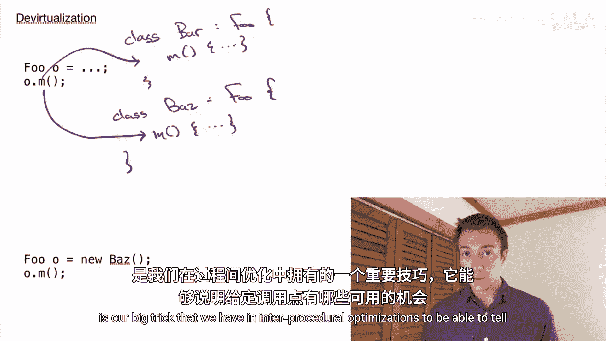

当然，你可以想象有大量不同的启发式方法，用于尝试猜测何时将一个函数内联到另一个函数是个好主意。一个非常简单的开始方法是仅使用函数大小的阈值。也就是说，你不想内联太大的函数，因为它们会通过复制太多代码而爆炸代码大小，但你确实想内联相当小的函数。当然，这与直接预测下游优化的潜力无关，但它可以是一个相当好的启发式方法。这里的一切都将是启发式的，你无法在每种情况下都完美预测这一点。所以，如果你要实现一个内联器，你基本上必须想出一个启发式方法，坚持使用它，凭经验测量它，看看你是否错过了大的机会，并随着时间的推移改进它。对于什么是最好的内联启发式方法，没有完美的答案。

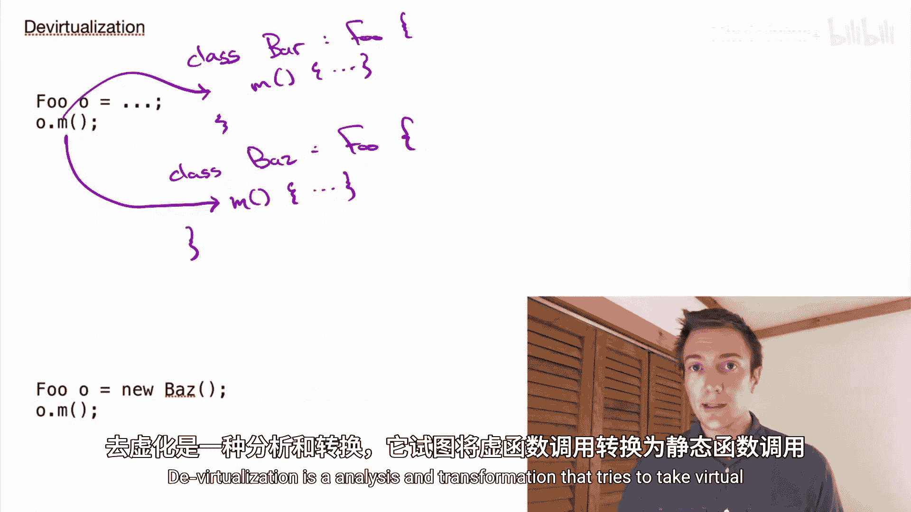

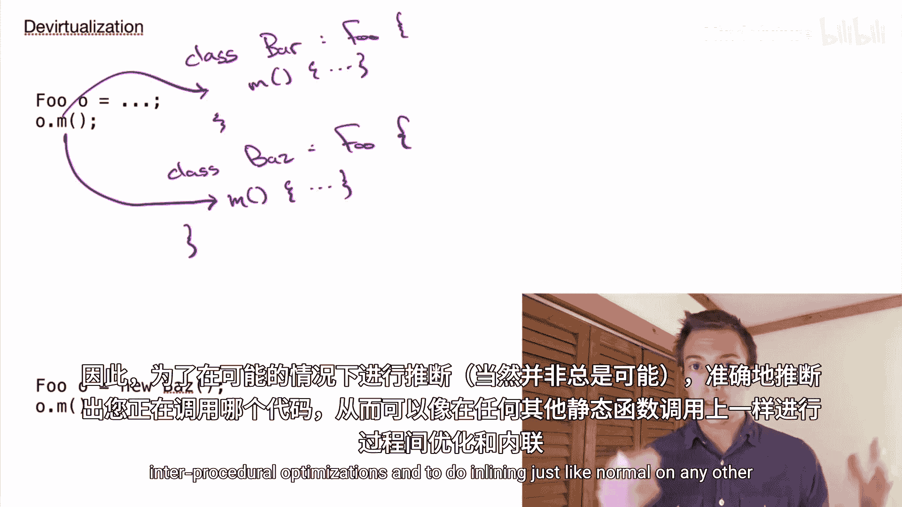

## 虚函数调用与去虚拟化

除了传统的内联，我还想讨论一些在现实语言中可能使内联变得更复杂的东西，那就是**虚函数调用**。Bril 没有虚函数调用，但基本上，所有面向对象的语言和许多其他非面向对象的语言都有某种虚函数调用。如果你习惯于在汇编层面思考虚函数调用，它只是一个间接跳转。也就是说，它不是跳转到某个特定常量地址的函数，而是查找一个计算出的地址，该地址可能是几个不同函数之一，然后调用那个函数。当然，虚函数调用在面向对象的语言中随处可见，就像我在屏幕上展示的这个类似 Java 的小语言一样。

对 `o.m()` 的函数调用并不一定告诉你我们具体要调用哪个 `m`。例如，这个 `o`，它的静态类型是 `Foo`，但我展示了 `Foo` 有两个不同的子类，它们都重写了 `m` 方法，并且超类中可能也有 `m` 的定义。这意味着当你静态地看到 `o.m()` 时，你不可能每次都确切知道我们将要调用哪个方法。这取决于 `o` 的运行时类型，即我们在运行时引用的实际对象的类型。

虚函数调用中的这种模糊性，对于过程间优化来说是一个大问题，因为它意味着我们不能进行内联。请记住，内联是我们进行过程间优化的一大技巧，能够判断给定调用点有哪些机会可用。我们必须假设这可能是这个函数，也可能是另一个函数，这可能会非常有限制性。

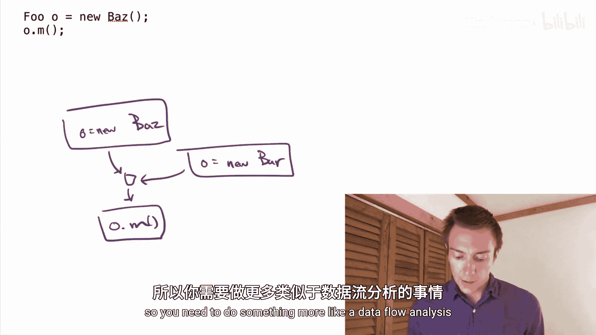

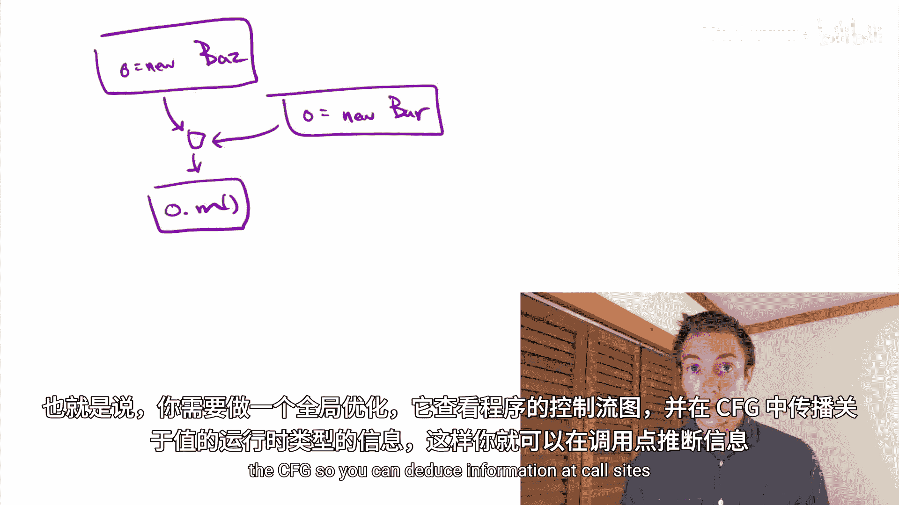

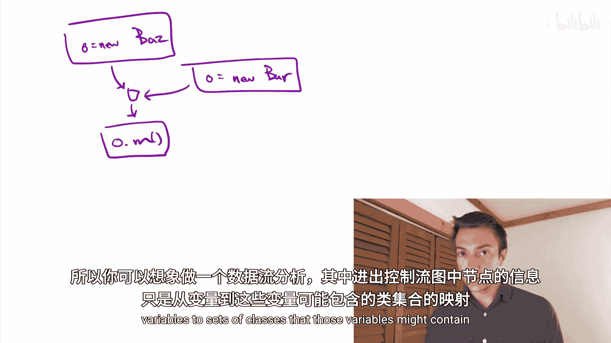

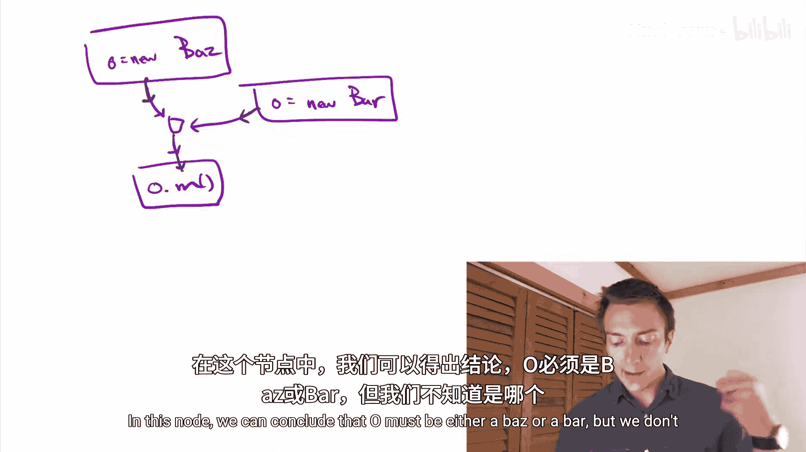

**去虚拟化**是一种分析和转换，试图将虚函数调用转变为静态函数调用。目的是在可能的情况下推断出你正在调用哪个代码，从而使过程间优化成为可能，并像对任何其他静态函数调用一样正常进行内联。

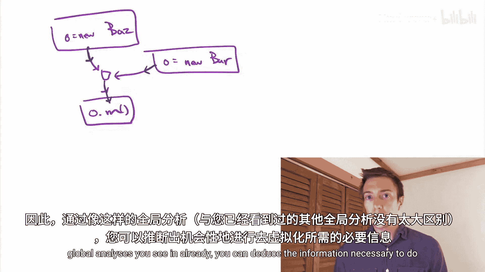


去虚拟化通常是一个非常困难的问题。然而，有一些简单的情况可以让你相信它有时是可能的。看看这段非常小的代码。如果我们知道对 `o.m()` 的调用发生在 `o` 初始化之后，那么我们肯定知道 `o` 在运行时具有什么类型。也就是说，`o` 只能有一个可能的类，它肯定是 `Bar`。所以我们肯定知道这个东西调用的是哪个方法 `m`。这是一个非常简单的去虚拟化机会。你不需要知道太多就能知道，这个技术上是一个虚函数调用的东西可以变成一个直接函数调用。

一般来说，你并不总是这么幸运。你并不总是在初始化之后立即有方法调用。因此，你需要做一些更像数据流分析的事情。也就是说，你需要进行一个全局优化，查看程序的控制流图，并通过控制流图传播关于值的运行时类型的信息，以便你可以在调用点推断出信息。你可以想象做一个数据流分析，其中流出和流入控制流图节点的信息只是一种从变量到这些变量可能包含的类集合的映射。例如，在退出这个控制流图节点时，我们知道 `o` 唯一可能的类是 `Bar`。类似地，在离开这个节点时，我们知道 `o` 唯一可能的类是 `Baz`。可能根据图中这个节点其余部分的内容，我们可以得出结论，`o` 必须是 `Baz` 或 `Bar`，但我们不知道是哪一个。因此，通过全局分析，你可以推断出进行机会主义去虚拟化所需的信息，但当然，有时你仍然会留下间接函数调用，对此你无能为力。

## 上下文敏感性

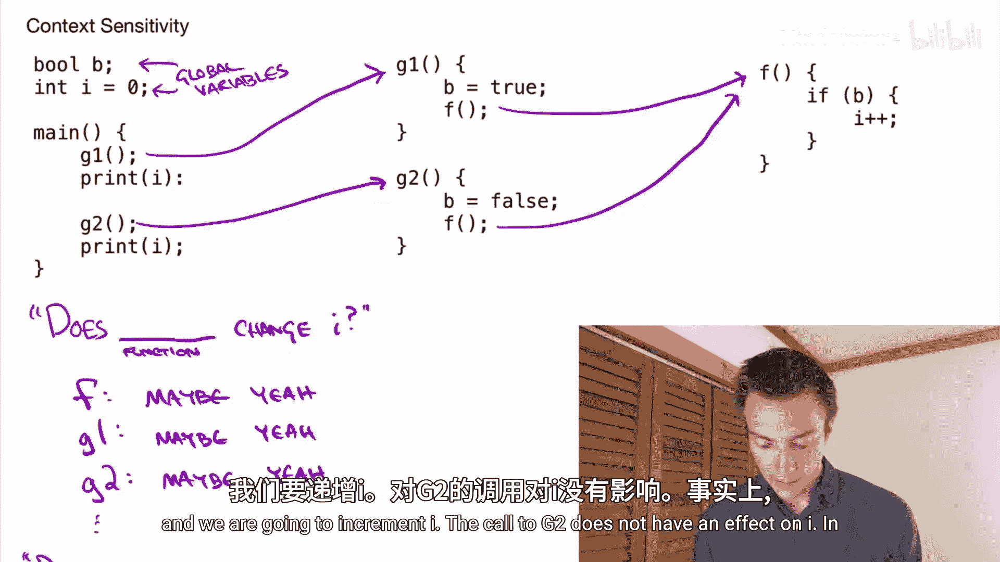

这是我想向你介绍的、对过程间分析至关重要的最后一个概念：**上下文敏感性**。粗略地说，上下文敏感性是关于使用上下文信息来消除执行相同代码的不同情况之间的歧义。

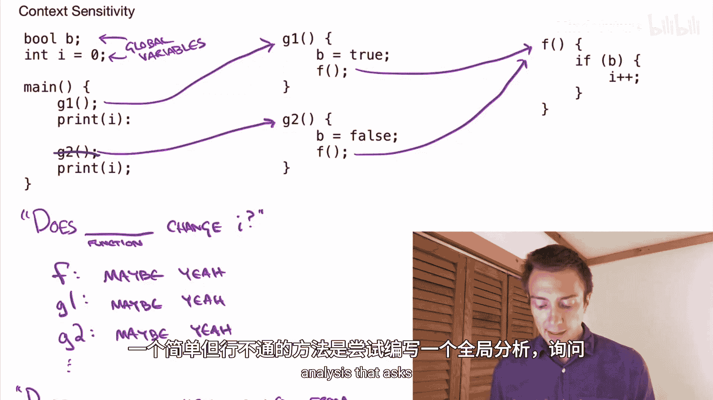

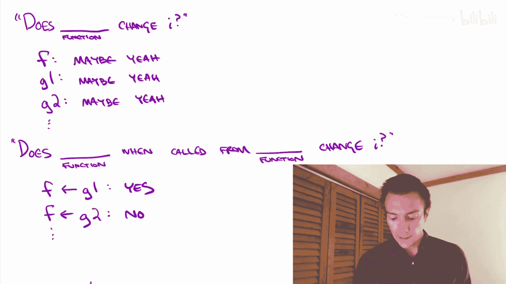

为了说明这一点，我将向你展示这个有点棘手的程序，它使用了可变的全局状态。请原谅我，这是一个非常人为的例子，但我试图展示在这个程序中消除死代码的可能性。简单概述一下，我们有一个 `main` 函数，它调用 `g1` 和 `g2`。在这两种情况下，这些函数都调用函数 `f`。`f` 可能会递增 `i`。`main` 将在每次调用后打印出 `i`。所以它会在每个点打印出类似 0、1 或 2 的值。无论如何，两个 `g` 函数都设置了一个布尔标志 `b`，`f` 用它来决定是否要增加 `i`。

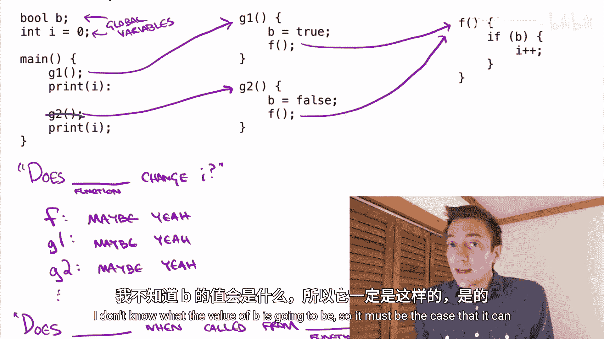

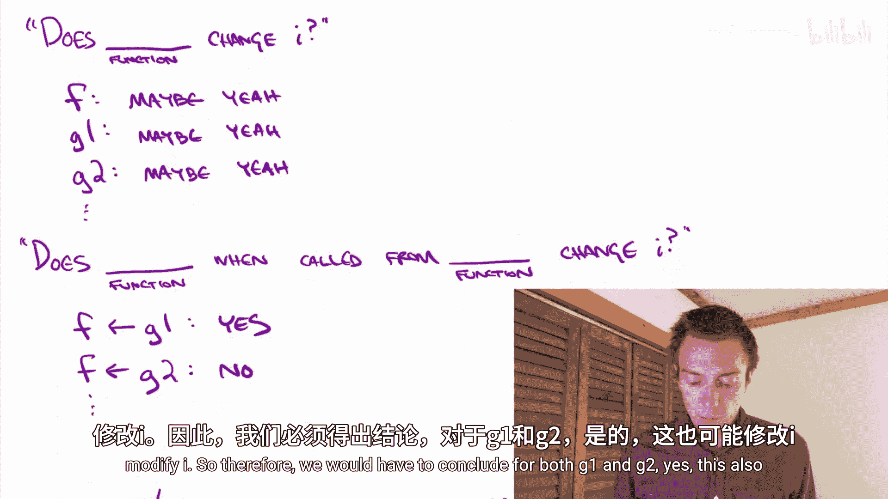

现在请暂停视频，盯着这段代码看一会儿，确保你理解它。

我想在这里强调的重要一点是，对 `g1` 的调用会影响 `i`，因为在那里 `b` 为真，我们将递增 `i`。对 `g2` 的调用**不**影响 `i`。事实上，它对堆没有影响。因此，一个非常复杂的过程间分析应该能够消除这个对 `g2` 的调用，并证明我们可以在不执行对 `g2`（及其对 `f` 的调用）的情况下打印出相同的值两次。那么，我们如何实现这一点呢？

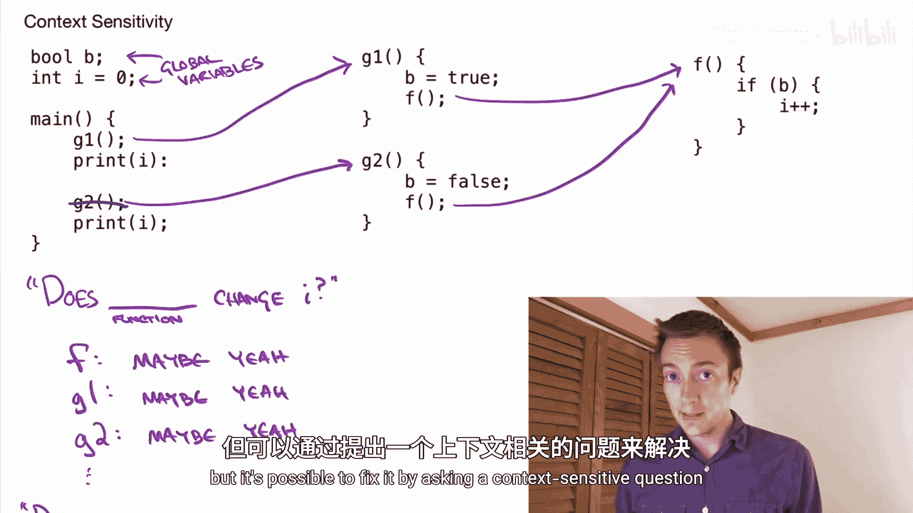

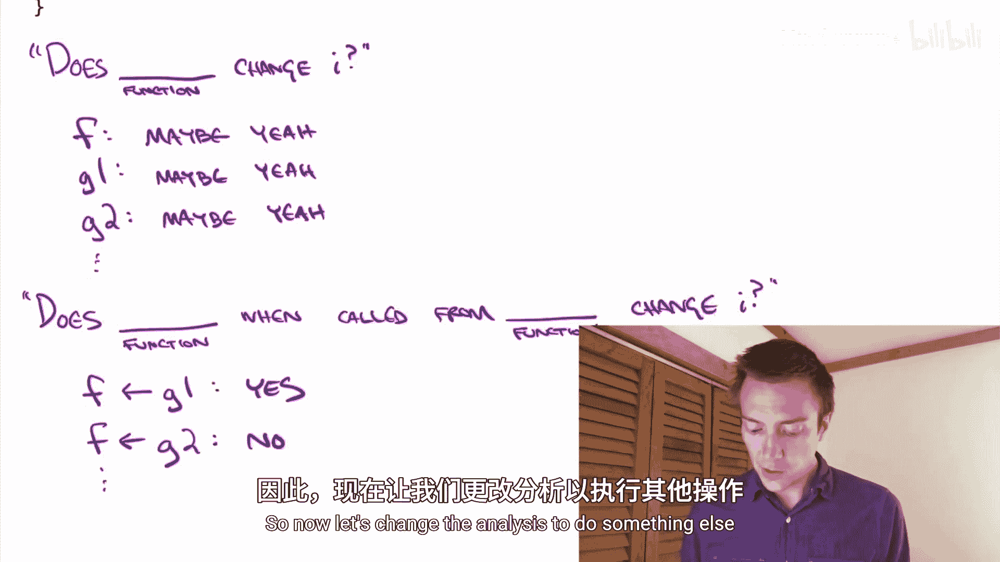

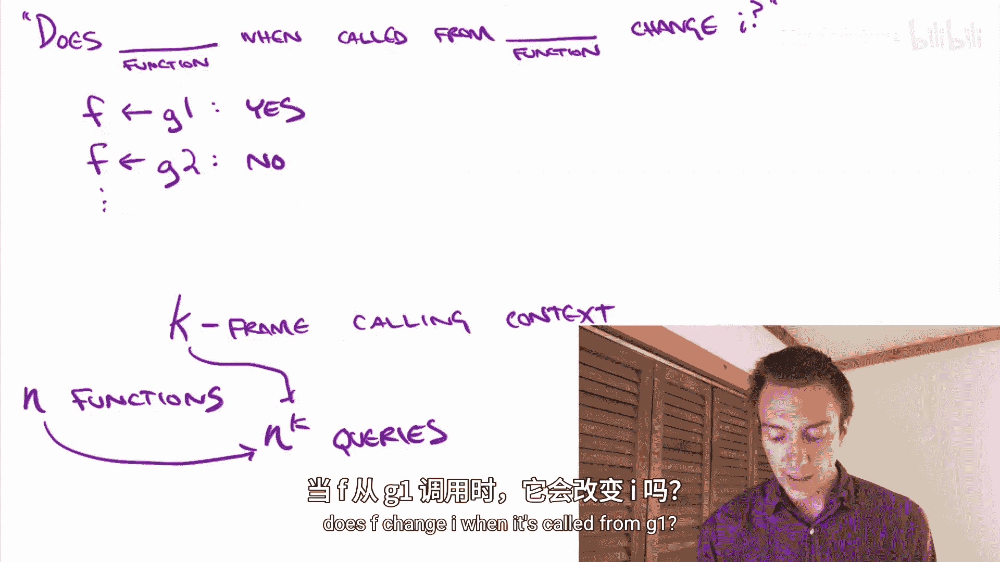

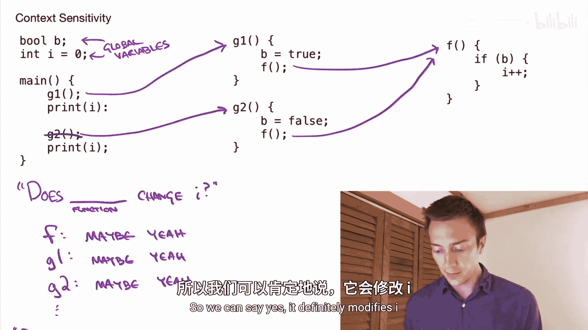

一个简单但行不通的方法是尝试编写一个全局分析，询问函数是否会改变 `i`。如果我们分析 `f`，我们将不得不说“是的，它可能会”，因为如果我们对 `f` 进行全局分析，它会说我们不知道 `b` 的值将是什么，所以它肯定可能会修改 `i`。因此，我们将不得不为 `g1` 和 `g2` 得出结论：“是的，这也可能修改 `i`，因为它包含一个调用，而该调用指向一个我们先前推断可能修改 `i` 的函数。” 这本身并没有让我们取得任何进展。我们不得不保守地假设 `g1` 和 `g2` 都可能修改 `i`，因为 `f` 可能修改 `i`。

这在几个方面令人失望，但可以通过提出一个上下文敏感的问题来修复它。现在让我们改变分析来做别的事情。与其只是问“这个函数是否修改 `i`”（针对每个函数），不如问“当从另一个函数调用时，这个函数是否修改 `i`？” 所以我们现在会有不同的问题。与其问“`f` 是否可能改变 `i`”，我们会问“当从 `g1` 调用时，`f` 是否改变 `i`？” 现在可以进行更多的过程间推理了。也就是说，当 `f` 从 `g1` 调用时，我们知道在整个 `f` 的调用期间 `b` 为真。所以我们可以说“是的，它肯定修改 `i`”。

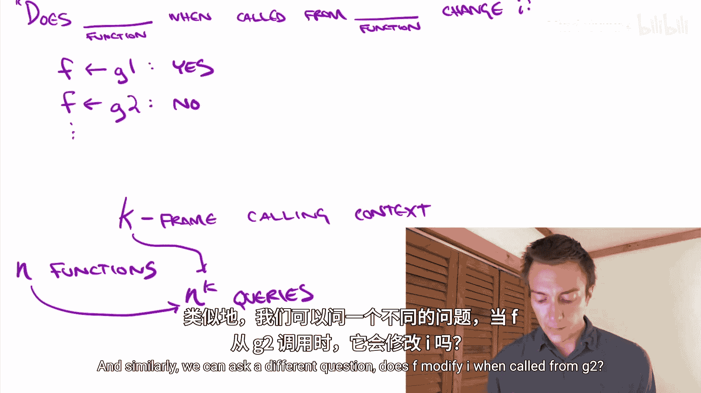

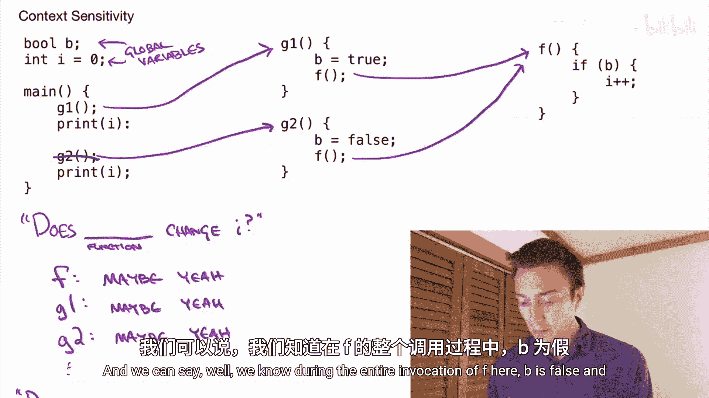

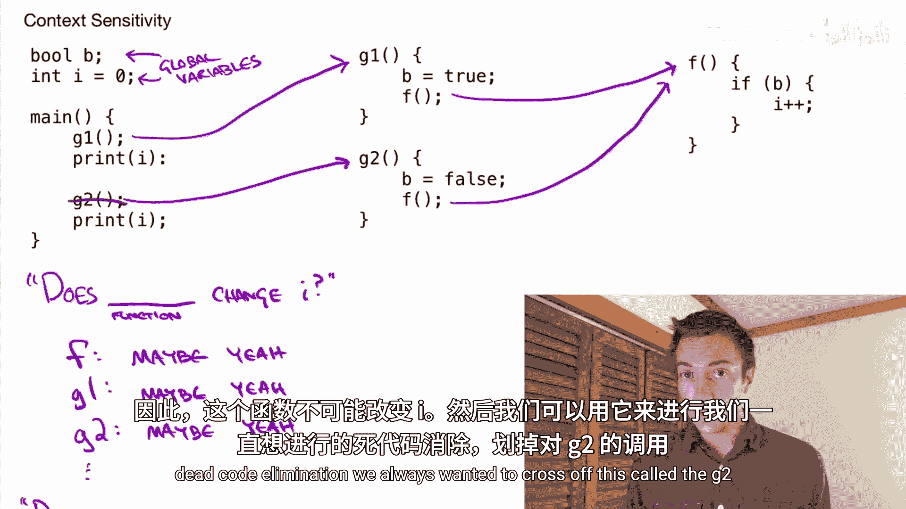

类似地，我们可以问一个不同的问题：“当从 `g2` 调用时，`f` 是否修改 `i`？” 我们可以说，在整个 `f` 的调用期间，`b` 为假，因此这个函数不可能改变 `i`。然后我们可以用它来进行我们一直想要的死代码消除，划掉这个对 `g2` 的调用。

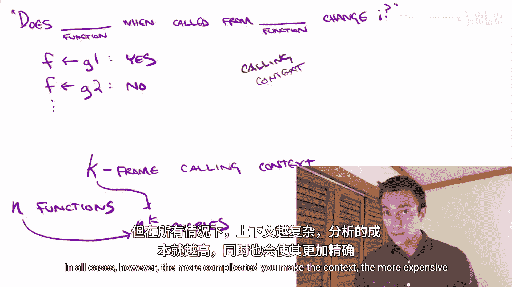

我们向分析提出的问题的这种改变，即引入了**上下文敏感性**。也就是说，我们不仅仅询问正在执行的代码，还询问执行所处的上下文。在上下文敏感分析中，你可以使用许多不同形式的上下文。这种称为**调用上下文**。

顾名思义，我们询问当从某个上下文调用时（在该上下文中，栈上紧接在 `f` 之前的顶层函数是对其他函数（如 `g1` 或 `g2`）的调用），关于 `f` 我们能知道什么。这就是 `f` 的调用上下文。

一般来说，进行上下文敏感分析需要玩很多游戏来准确定义你的上下文将是什么。也许可以是关于堆当前状态的一些信息，也许可以是关于参数的一些信息，也许是调用上下文，也许是所有这些事情的混合。然而，在所有情况下，你使上下文越复杂，你就使分析越昂贵，同时也使其更精确。

以调用上下文为例，我们到目前为止使用了一帧调用上下文。也就是说，我们查看函数，并查看调用该函数的单个函数。但是，当然，我们可以通过提出更精确的问题来区分程序中的不同行为，例如，也许你有不同的行为，这些行为由调用栈上的第三件事（即调用你的函数的调用者）来区分。现在你可以进行更精确的分析。一般来说，如果你使用一个 K 帧调用上下文，并且你有 n 个函数，可能很容易看出你需要指数级数量的查询来回答这些问题。因此，在最坏情况下，随着你为上下文敏感分析向调用上下文添加更多帧，你的分析可能会变得指数级更慢。它可能会变得更精确，但在某些时候，会出现收益递减。因此，在上下文敏感分析中，你需要玩的游戏是精心设计你需要的上下文，以便精确地回答那些问题，即尽可能有效地消除模糊情况的歧义，以进行良好的优化，而不是过度设计，不是说我们有一个无限的调用上下文并分析程序可能运行的每一种可能方式。最终，你只是在探索程序的所有执行，这是一个糟糕的想法。但总的来说，采用一个过程间分析，并混合一点精心设计的上下文，可以赋予你的过程间分析在没有添加上下文的情况下不可能获得的能力。

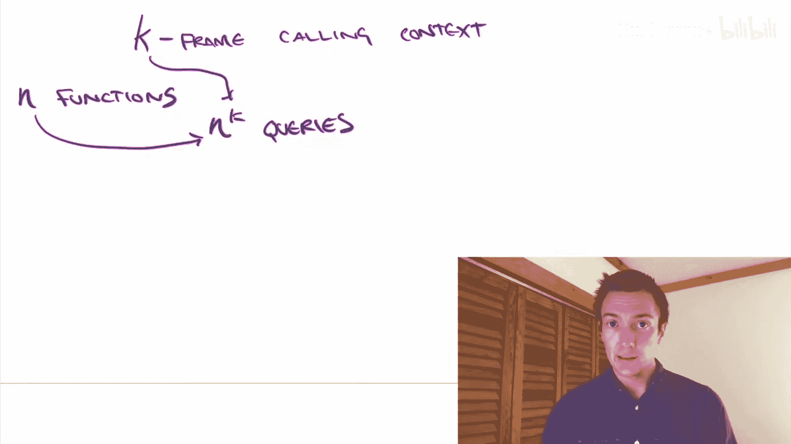

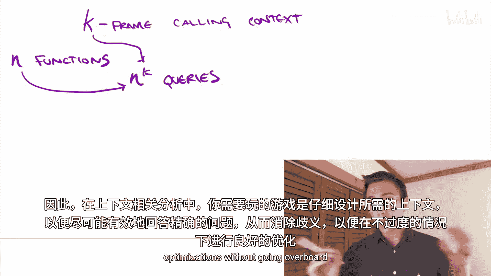

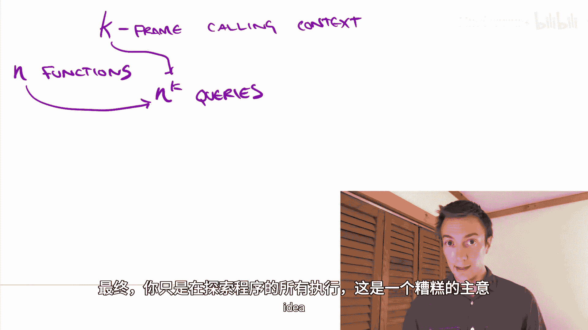

## 总结

本节课我们一起学习了过程间分析这个广阔领域的旋风式概述。它们可以是非常强大的分析，我们将在未来看到如何在这些概念的基础上进行构建，例如在下一课中进行别名分析时。但我认为你需要从这节课中带走的主要东西是了解其中的权衡是什么，即在做出封闭世界假设的好处与迫使你做出开放世界假设的实际约束之间，以及在使用上下文敏感性时的性能权衡。

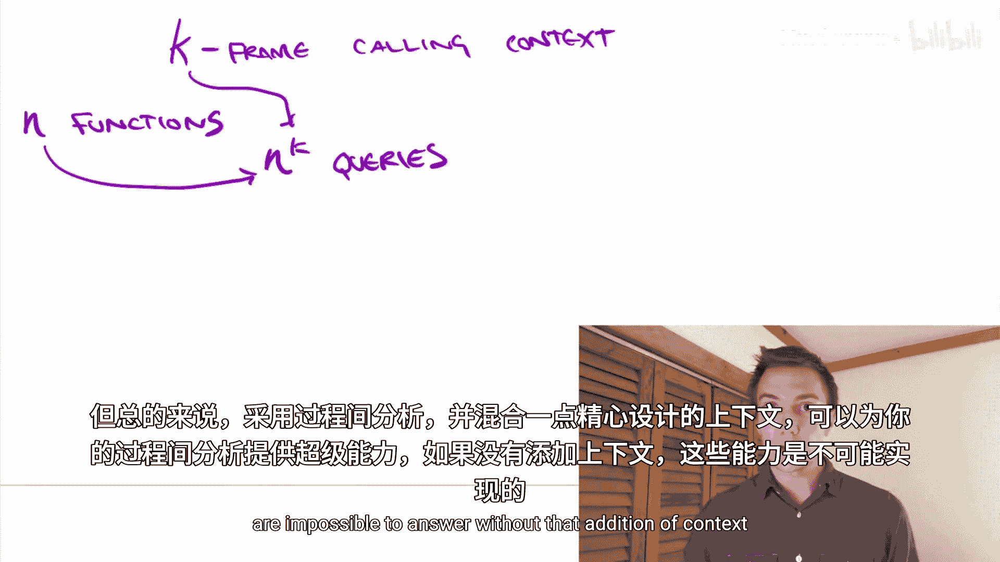

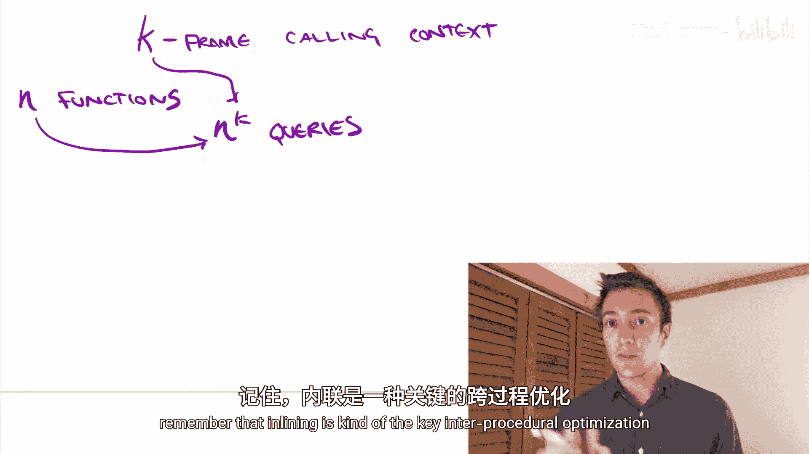

如果你从这节课中没有学到其他东西，请记住，内联是关键的过程间优化。如果一个邪恶的巫师诅咒你，注定你一生中只能实现一个过程间分析，并且永远不能实现任何其他分析，你应该让那个分析成为内联。有很多不同的方法可以做好内联，一旦你做到了，你就可以解锁你所知道的关于局部和全局优化的所有潜力。