# 014：别名分析 📚

在本节课中，我们将要学习指针分析，也称为别名分析。顾名思义，这种分析旨在处理使用指针的程序。我们将探讨为什么需要关心指针以及内存的加载和存储操作。

## 为什么需要指针分析？🔍

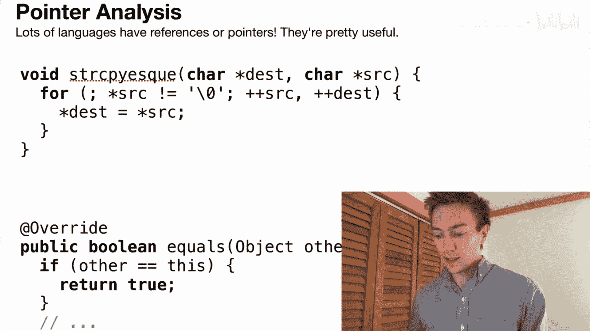

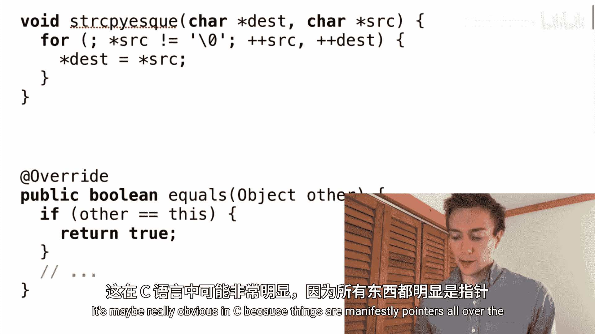

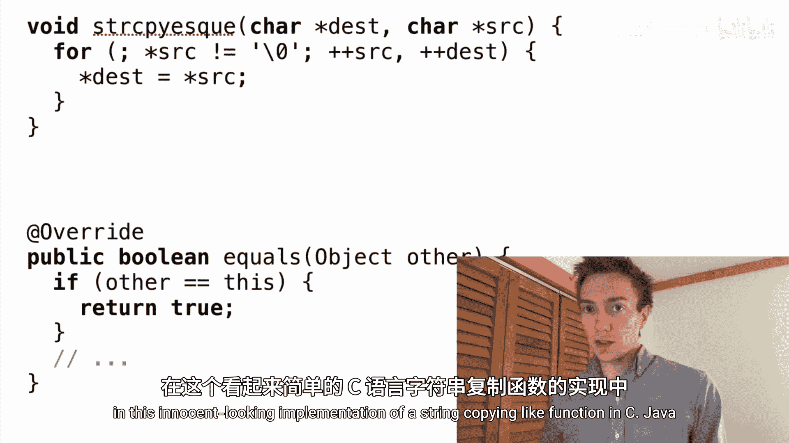

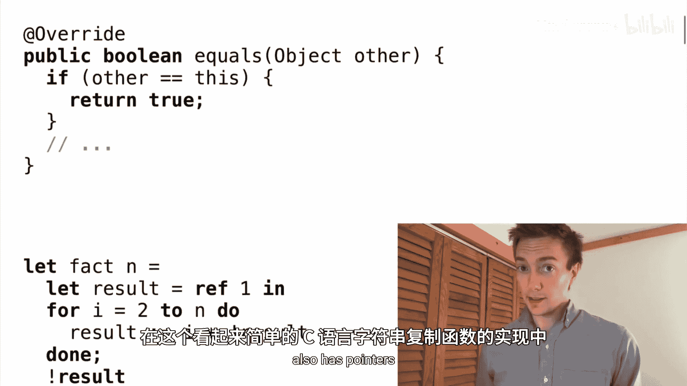

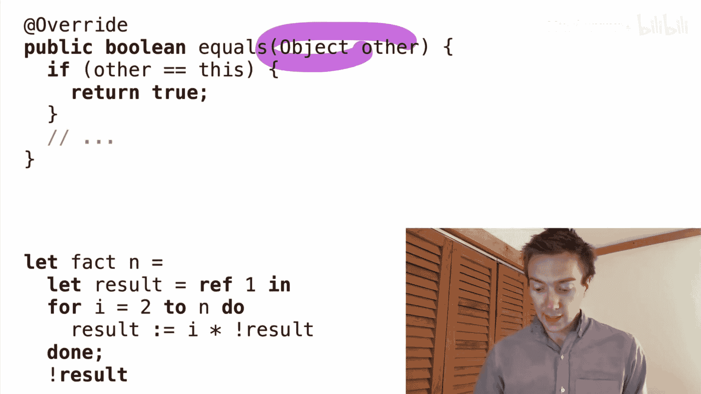

上一节我们介绍了指针分析的基本概念，本节中我们来看看为什么指针如此普遍且重要。

几乎所有你使用过的编程语言都包含指针。在C语言中，指针的使用非常明显，例如，每次看到星号`*`，就表示涉及指针。以下是一个看似简单的C语言字符串复制函数实现：


```c
void strcopy(char* dest, char* src) {
    while (*src != '\0') {
        *dest = *src;
        dest++;
        src++;
    }
    *dest = '\0';
}
```

Java语言也使用指针。虽然你可能不常看到星号，但除了`int`或`boolean`等基本类型外，所有普通对象类型或数组类型在底层都使用指针。例如，当你编写一个接收对象并调用`equals`方法进行比较时，实际上是在进行指针比较。


Ocaml语言也广泛使用指针，既有隐式使用，也可以通过`ref`关键字和`!`操作符（相当于C语言中的解引用星号`*`）显式使用。

总而言之，指针无处不在，因此在存在指针的情况下分析和优化程序是有意义的。

## 指针与别名问题 ⚠️

上一节我们看到了指针的普遍性，本节中我们来看看指针带来的一个核心挑战：别名问题。

考虑以下类似C语言的程序：

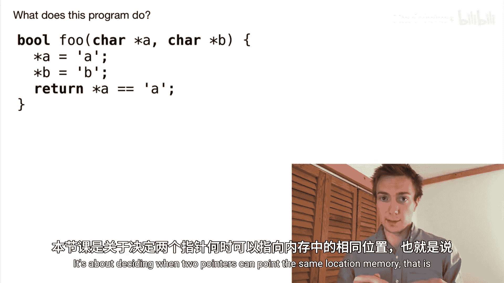

```c
int foo(int* a, int* b) {
    *a = 'A';
    *b = 'B';
    return *a == 'A';
}
```

一个简单的答案是，这个函数总是返回`true`。因为我们向`a`指向的位置写入字母`'A'`，然后从`a`中读取它，期间没有改变它，所以它必然仍然等于`'A'`。

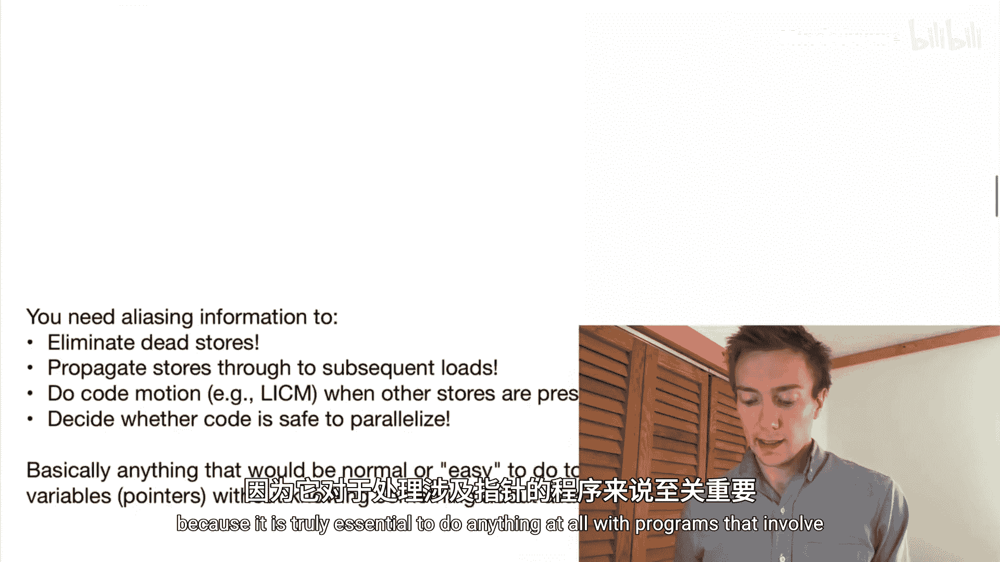

然而，这个答案是错误的。原因在于，当两个不同的指针可能指向内存中的同一位置（即别名）时，情况就变得复杂了。如果`a`和`b`指针指向内存中的同一位置，那么函数将返回`false`，因为我们向同一位置存储了不同的值（`'B'`）后才读取它。

因此，我们可能希望进行的优化（例如消除看似无用的存储操作）在存在指针和别名的情况下可能无法进行。这正是本课要讨论的内容：判断两个指针何时可以指向内存中的同一位置，即它们何时可以互为别名。

## 别名分析的重要性 🎯

上一节我们通过一个例子看到了别名问题，本节中我们来看看为什么别名分析对编译器优化至关重要。

别名分析对于处理涉及指针的程序至关重要。任何在没有指针的普通程序中看似简单直接的操作，在存在别名可能性的情况下都会变得困难或不可能。

以下是几个例子：
*   **消除无用存储**：我们无法消除一个看似不再使用的指针存储操作，因为后续的读取可能通过别名指针访问同一位置。
*   **传播优化**：无法将一个存储操作的值传播到后续的加载操作以消除两者，因为中间可能有一个指向完全不同指针的存储操作，如果它们互为别名，就会破坏优化机会。
*   **循环不变代码外提**：由于指针可能通过循环体中使用的其他指针被修改，因此无法确定某些代码是循环不变的。
*   **自动并行化**：别名分析是实现程序自动并行化的主要瓶颈。要确保希望并行运行的代码片段相互独立（即一个写入时，另一个不需要读取该值），通常需要知道所涉及的指针不可能互为别名。当存在别名时，必须做出保守假设，自动并行化的尝试就会失败。

因此，别名分析对于所有这些优化，以及处理涉及指针的代码的任何操作，都是非常重要的分析。

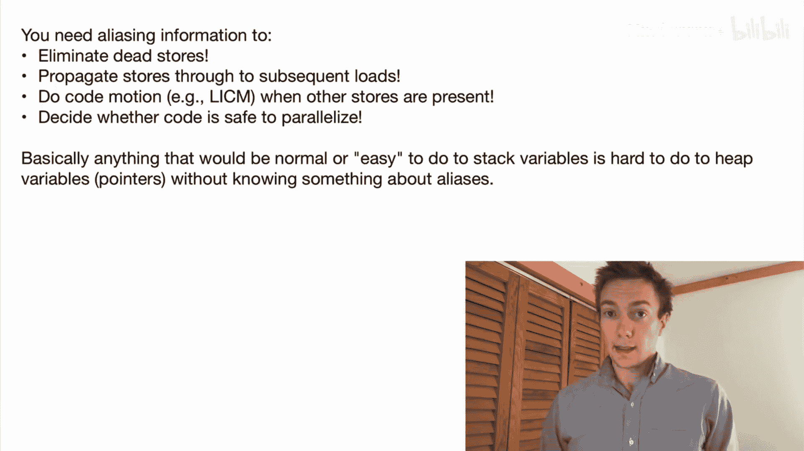

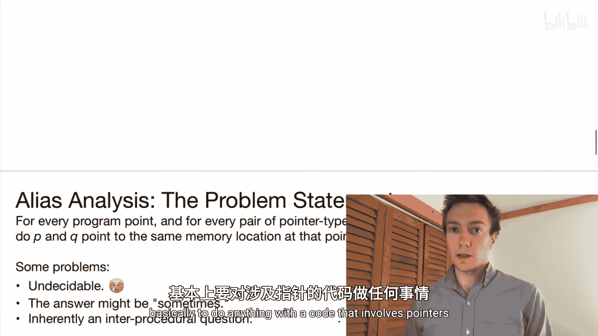

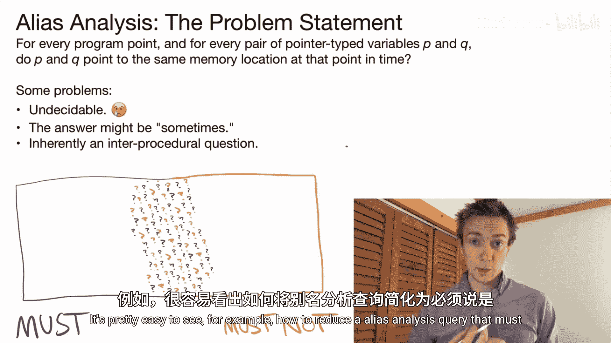

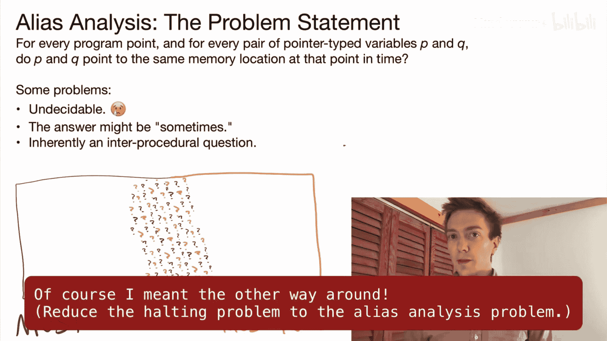

## 别名分析问题定义 ❓

上一节我们了解了别名分析的重要性，本节中我们来正式定义别名分析问题。

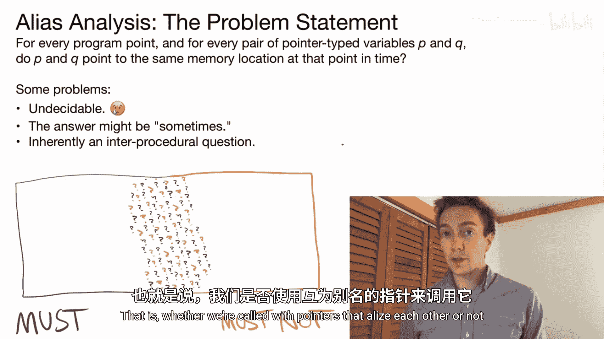

别名分析会针对程序中的每个点（例如Brill程序中的每条指令），以及每一对指针类型的变量（即任何看起来像`pointer to something`的类型），提出这样的问题：这两个指针在该时间点（即该程序点）是否可能指向内存中的同一位置？

这个问题存在几个难点，最根本的是它是不可判定的。如果我们试图总是完美地回答两个指针是否可能别名，就会遇到类似停机问题的问题。很容易看出如何将一个必须回答“是”或“否”的别名分析查询简化为停机问题。

因此，我们必须处理近似解。通常，即使近似回答这个问题也可能非常耗时。很多时候，对于“这两个东西可能互为别名吗？”这个问题的答案将是“可能”。也就是说，我们不确定，但在程序的某些执行中它们可能互为别名，在其他时候则可能不会。

最后，这本质上是一个过程间问题。即使是像之前展示的字符串复制函数这样简单的函数，其别名行为也取决于传递给函数的参数，即调用时使用的指针是否互为别名。


## 别名分析的分类与查询 🔢

上一节我们定义了问题，本节中我们来看看如何对分析结果进行分类。

通常，别名分析问题的设置使我们能够回答“是”、“否”或“可能”。我们希望将变量对分类为：
1.  **必须别名**：在程序的每次执行中，这两个指针完全相同。
2.  **必须不别名**：它们可以是任何值，但永远不可能彼此相同。
3.  **不知道**：它们有时可能互为别名，但我们没有明确的答案。

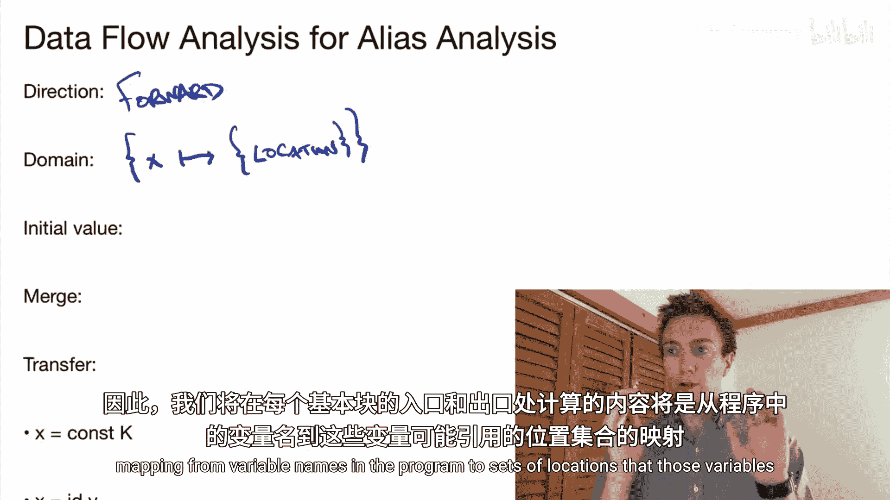

不幸的是，指针分析的残酷现实是，大多数问题的答案最终都会落入中间类别。也就是说，大多数时候，我们既无法证明事物从不互为别名，也无法证明它们总是互为别名。

为了有益于编译器优化，别名分析通常设置为使用 **“可能别名”查询**。可能别名查询要求分析回答“是”或“否”，其中“是”表示这两个东西可能互为别名（但我们不确定），“否”表示我们确信它们一定不互为别名。优化器可以在别名分析回答“否”时利用该信息进行有趣的优化。然而，如果分析回答“是”，那么我们实际上什么都不知道，因此优化通常会受到限制。

## 基于数据流的别名分析框架 🏗️

上一节我们讨论了查询类型，本节中我们尝试使用数据流框架设计一个简单的“可能别名”分析。

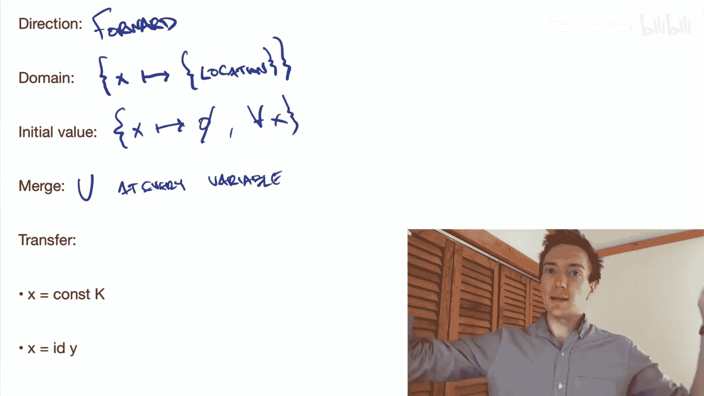


我们将尝试设计一个数据流分析，来回答两个指针值何时可能指向同一位置。同样，如果我们确定它们不指向同一位置，我们会说“否”；如果它们可能指向也可能不指向同一位置，我们会说“可能”。

我将设置数据流框架的前几个部分，其余部分留给你来填充。这将是一个前向分析，即从入口块开始，沿着数据流图向前传播。


对于定义域，我将进行设置，使得我们有一个从变量到某种内存位置的映射。因此，我们将在每个基本块的入口和出口计算一个从程序中的变量名到这些变量可能引用的位置集合的映射。

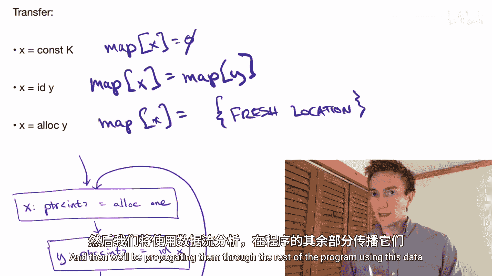

这样，我们就可以通过进行集合交集来回答“可能别名”查询。也就是说，如果你问我`X`和`Y`在程序的这一点是否可能互为别名，你将查找该程序点对应的数据结构，获取`X`和`Y`的关联集合（位置集合）。如果这些集合相交，那么我们就说“是，它们可能互为别名”。如果交集为空，那么我们就说“否，它们一定不互为别名”，从而可以进行有趣的优化。

以下是数据流框架的关键部分：

*   **初始值**：将每个变量映射到空集。也就是说，变量在初始时不能引用任何内存位置。
    *   公式：`∀x, map(x) = ∅`
*   **合并函数**：对每个变量，取需要合并的映射（至少两个），将这些映射中每个变量关联的集合进行并集操作。也就是说，当我们合并控制流时，变量`X`可以引用来自左侧或右侧的任何位置。
    *   公式：`merge(map1, map2)[x] = map1(x) ∪ map2(x)`
*   **传递函数**：需要考虑三种指令：常量赋值、复制（ID）和分配（allocation）。
    *   **常量赋值**（如 `x = 5`）：在输出的映射中，将`x`的关联集合设置为空集，因为它是一个常量，不是指针。
        *   代码：`out[x] = ∅`
    *   **复制**（如 `x = id y`）：将输出映射中`x`的关联集合设置为与`y`相同的所有位置。
        *   代码：`out[x] = in[y]`
    *   **分配**（如 `x = alloc(...)`）：需要生成一个新的内存位置来表示这次分配。我们将计算一个**新鲜**的内存位置，并说明`x`当前唯一可能引用的就是那个内存位置。这是关键所在：内存位置最初来源于分配点，然后我们通过数据流分析在程序的其余部分传播它们。
        *   代码：`let l = fresh_location() in out[x] = {l}`

## 堆模型与分配点抽象 🧱

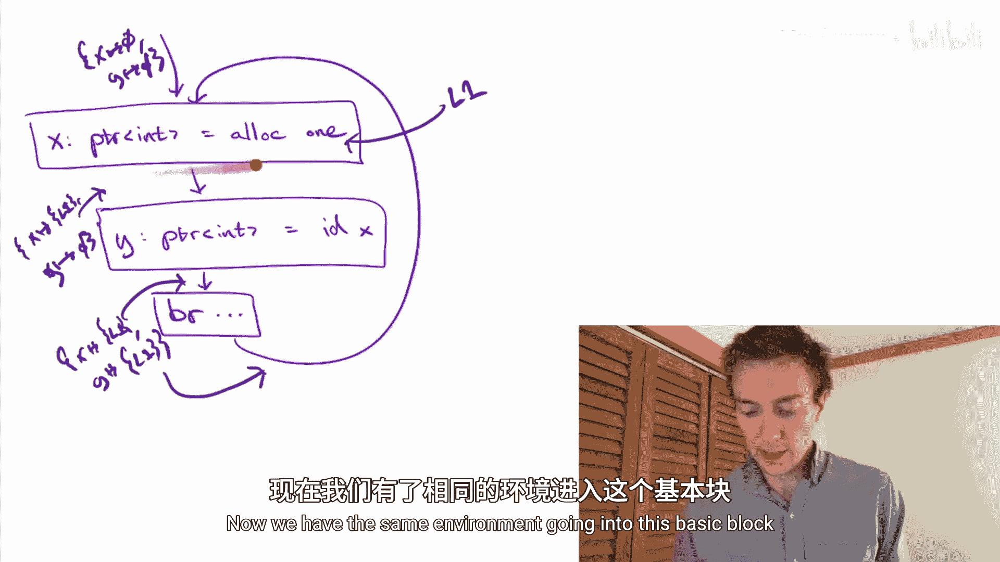

上一节我们设计了分析框架，本节中我们通过一个例子来运行它，并会遇到一个关键问题。


让我们尝试在幻灯片上的这个小CFG上运行这个分析。这个程序只使用两个变量`X`和`Y`。

1.  程序开始时，`X`映射到空集，`Y`映射到空集。
2.  在第一个基本块上执行传递函数后，其中有一个分配操作，这意味着我们需要将一个内存位置与`x`关联起来。因此，在这之后，我们有一个映射：`Y`仍然映射到空集，但`x`现在映射到我们称之为`location1`（L1）的位置。所以`x`只能包含来自该位置的值。
3.  接下来，我们处理涉及复制的传递函数，现在`X`和`Y`都将映射到包含位置L1的同一集合。
4.  下一步是分析仅包含分支的基本块。分支当然不影响指针。因此，我们将得到相同的值，即`X`和`Y`都映射到包含L1的集合，从该分支流出，并因此再次回到循环顶部。
5.  然后我们需要运行合并函数，因为我们将控制流合并到这个基本块的顶部。最终我们将再次得到这个映射，即`X`和`Y`都映射到L1。

现在我的问题是：当我们第二次为这个基本块运行传递函数（即再次为`x`执行分配操作）时，我们应该如何处理？环境应该如何改变？

最自然的答案是，我们需要生成一个新的新鲜位置。因为这是概念上第二次循环，所以这里分配的内存肯定是一个单独的位置。当然，这样做的问题在于它不会收敛。我们将不断循环，生成新的内存位置，回到循环顶部，并得到不同的输入值。因此，我们需要再次重新运行循环的分析，每次都会生成一个新的内存位置，这将永远运行下去，永不收敛。

通过每次分析这个基本块时都生成一个新的内存位置，我们把自己逼入了死角，就像实际上在运行程序，每次循环都生成一个新的内存位置。这对于静态分析来说根本行不通。

我认为，唯一合理的做法是**将单个内存位置与每个静态分配点关联起来**。也就是说，当我们再次分析这个基本块时，我们不会生成新的位置L2，而是将相同的内存位置L1与变量`X`关联起来。

这看起来有点奇怪，因为我们知道当两次运行同一个循环并进行两次分配时，我们得到的并不是同一个内存位置。但这里的情况是，我们需要用一个静态的、过度近似内存实际工作方式的模型来抽象掉程序的实际执行。

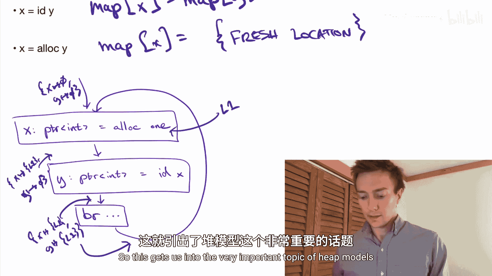

这就引出了一个非常重要的话题：**堆模型**。堆模型基本上回答了这个问题：什么是内存位置？如果我们用“内存位置是实际的具体指针（即指向内存中某个位置的实际数字）”来回答这个问题，那么当我们试图在每次循环中生成新的内存位置时，就会遇到不终止和过度精确的问题。因此，我们需要一种内存抽象，使我们能够以可计算、可处理的方式进行别名分析。

我能想到的最直接且非常有效的堆模型是：**将程序中的每个分配指令与一个单独的内存位置关联起来**。这意味着我们的内存抽象是：是的，程序运行时有很多实际的指针，但我们将从这个分配点分配的所有指针分组，并在我们的指针抽象域中称它们都为位置一。

这使我们无需跟踪实际指针，并为我们提供了解决别名分析问题所需的可处理性。当然，这会影响分析的精度。这意味着当我们在运行时有两个来自同一分配点的不同指针时，在我们的分析中，我们会认为它们是内存中的同一位置。这显然是不正确的，它们并不是内存中的同一位置。但对于我们的分析目的来说，这是保守的，因为我们进行的是“可能别名”分析。这只会导致我们更频繁地回答“是，这两个东西可能互为别名”，请记住，这是一个令人失望且无用的答案。回答“是，这两个东西可能互为别名”总是安全的，因为我们不会用它来做任何有趣的优化。只有在有可能别名的情况下回答“否”（即两个东西一定不别名）才可能不安全。

因此，内存域的抽象使我们变得保守，因为我们将从别名分析中得到不那么有用的答案。另一方面，它使得进行分析成为可能。这是一个相当不错的权衡。

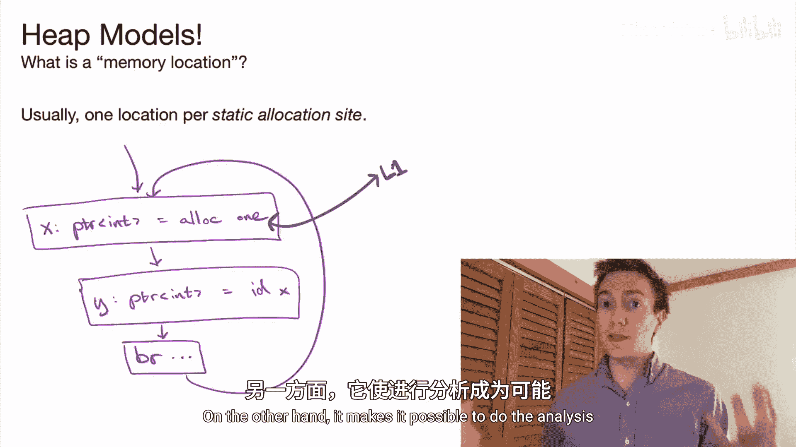

## 上下文敏感性与总结 📝

上一节我们讨论了堆模型，本节中我们来看看如何通过上下文敏感性来提高别名分析的精度。

我想讨论的最后一个方面是将上下文敏感性引入别名分析。我们在上一节关于过程间分析的课程中讨论了上下文敏感性的一般概念。别名分析可以变得非常过程间化，也就是说它绝对涉及函数之间的许多交互。因此，引入某种上下文敏感性（如调用上下文）通常是有意义的，以使你的别名分析更加精确。

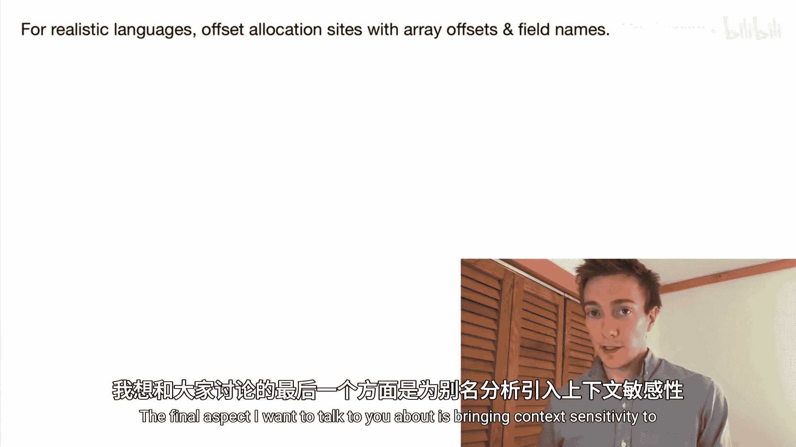

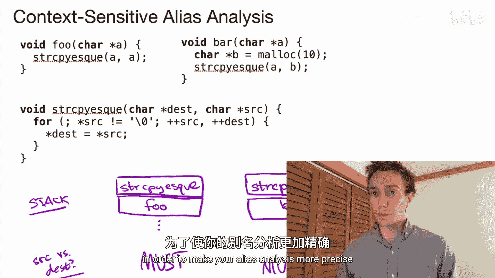

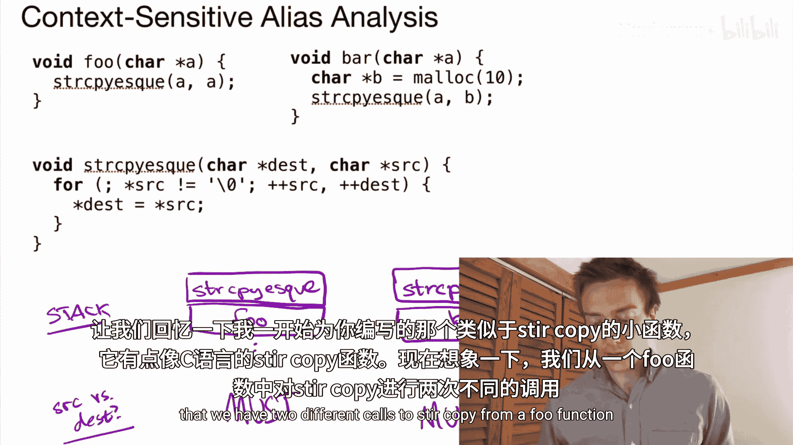

为了说明这一点，让我们回顾一下一开始为你编写的那个类似字符串复制的小函数。现在，假设我们有两个不同的调用：从`foo`函数和`bar`函数调用`strcopy`。在一种情况下，你使用完全相同的指针调用它（即`strcopy(a, a)`）。在某些情况下，我们分配一个新东西并传递给`strcopy`，因此这两个指针不可能互为别名。

一个不尝试使用过程间信息、不尝试使用调用上下文的简单别名分析将不得不说这两个东西可能互为别名，因此这个函数会做一些相当奇怪的事情，而不是进行正确的字符串复制。

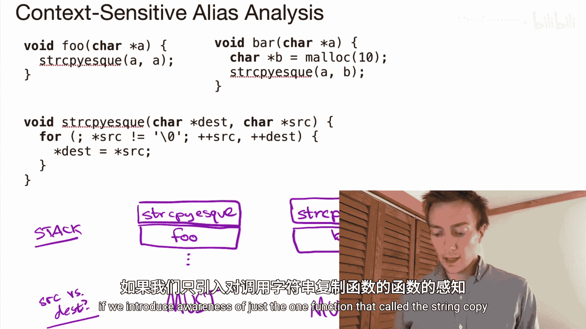

另一方面，如果我们引入一点调用上下文，即如果我们引入对调用字符串复制函数的那个函数的感知，我们可以得出结论：在`foo`的上下文中，这两个东西肯定互为别名；而在`bar`的上下文中，它们一定不互为别名。这要有用得多。

当然，与任何上下文敏感的过程间分析一样，这里在精度和成本之间存在非常尖锐的权衡。对于别名分析，精度指的是可以回答为“必须别名”或“必须不别名”的别名分析查询对的比例，而不必落入我之前展示的图中不确定的中间区域。添加上下文使别名分析更精确，但当然也使其成本高得多。因此，在某个点上，你获得的额外精度相对于花费更多时间分析程序的成本而言，收益是递减的。

总的来说，拥有一个可扩展（即高效）且能分析大型程序，同时精度又很高的别名分析，是一个巨大的开放性研究问题。这一点怎么强调都不为过。有一个完整的研究社区致力于开发既快速又精确的良好别名分析。那里有大量的研究。我留下了一些链接，特别是一些从事别名分析研究的人员编写的非常棒的教程，让你了解仅针对这一种分析就有多么广泛的研究。它之所以如此重要，是因为正如我们在课程一开始所看到的，做好别名分析是完成任何涉及操作指针的程序转换的关键。因此，任何你希望进行的与内存相关的优化，都必须首先依赖于别名分析，然后才能真正开展工作。这就是为什么它在编译器优化研究中如此核心。

---


**本节课中我们一起学习了**：
1.  指针在编程语言中的普遍性及其带来的别名问题。
2.  别名分析对于编译器优化（如消除无用代码、传播优化、循环优化和自动并行化）的重要性。
3.  别名分析问题的正式定义及其不可判定性，导致我们需要近似解和“可能/必须/不知道”的分类。
4.  如何构建一个基于数据流框架的简单“可能别名”分析，包括定义域、初始值、合并函数和传递函数。
5.  在分析循环中的分配时遇到的收敛性问题，以及通过**堆模型**（将内存位置抽象为与静态分配点关联）来解决的必要性。
6.  通过引入**上下文敏感性**（如调用上下文）可以提高别名分析的精度，但这需要在精度和分析成本之间进行权衡。
7.  高效且精确的别名分析仍然是一个活跃且重要的研究领域。