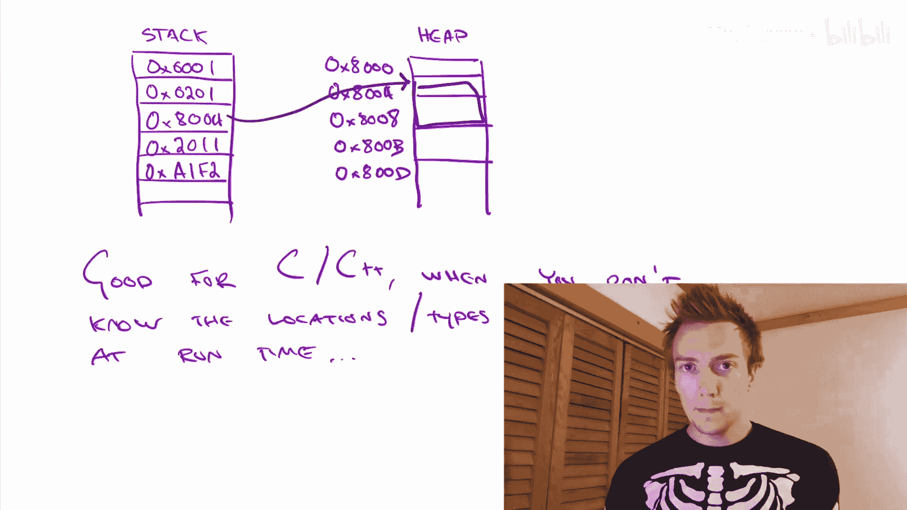
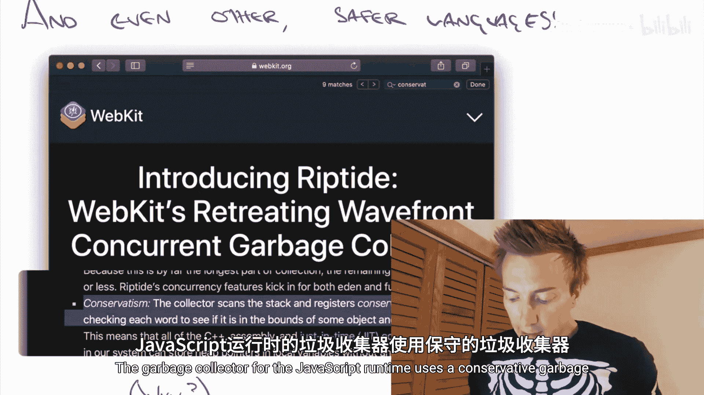
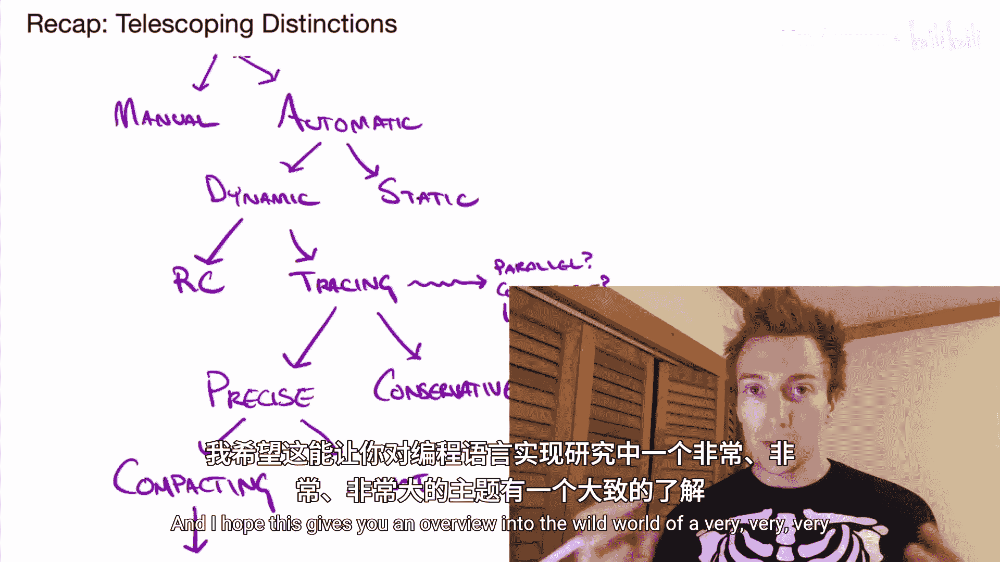

# 015：内存管理 🧠

在本节课中，我们将要学习自动内存管理，即垃圾回收。手动管理程序内存极其困难且容易出错，因此自动内存管理至关重要。

## 概述

自动内存管理的核心目标是让程序员无需手动调用 `free` 来释放内存，而是由编译器和运行时系统在必要时自动回收内存。这能有效避免一系列严重的内存错误。

## 手动内存管理的挑战

以下是手动管理内存时常见的错误类型：
*   **双重释放**：多次释放同一块内存。
*   **释放后使用**：使用已被释放且可能已被重用的内存。
*   **读取未初始化内存**：访问未赋初值的内存区域。
*   **内存泄漏**：忘记释放不再使用的内存。
*   **缓冲区溢出**：读写超出分配内存的边界，可能影响相邻内存。

微软安全团队去年的报告指出，其70%的安全漏洞源于内存不安全语言中的内存管理错误。这凸显了自动内存管理的必要性。

## 内存管理语言分类

我们可以将编程语言按内存管理方式分类：
*   **手动管理**：程序员负责分配和释放内存。代表语言：C、C++。
*   **动态自动管理**：运行时系统自动回收内存。这是大多数现代语言采用的方式，例如 Java、Python、JavaScript、Go、Haskell 等。
*   **静态自动管理**：在编译时完成所有内存管理决策。代表语言：Rust（主流语言中几乎唯一）。

由于静态分析程序以确定内存释放时机极其困难（例如，依赖用户输入或复杂数据结构语义），本课程重点讨论动态自动内存管理技术，即垃圾回收。

## 垃圾回收的基本概念

在垃圾回收中，我们不再追求在内存“绝对不再使用”的精确时刻释放它（这很难判断），而是采用一个更可行的标准：**释放不可达的内存**。

### 内存图与可达性

程序的数据结构可以视为一个图：
*   **顶点**：堆上分配的对象（我们想要管理的内存）。
*   **边**：对象内部的指针。
*   **根**：可以直接访问堆中对象的入口点，包括栈上的局部变量和全局变量。

一个对象是**可达的**，当且仅当存在一条从某个根出发，通过指针链可以到达该对象的路径。反之，如果一个对象从任何根都不可达，那么它就是**不可达的**，可以被安全回收。

### 术语
*   **回收器**：负责查找并释放垃圾内存的运行时系统。
*   **赋值器**：用户实际运行的程序。
*   **存活**：对象在未来会被再次使用。
*   **死亡**：对象在未来不会被再次使用。

## 主要垃圾回收策略：引用计数 vs. 标记-清扫

自动内存管理主要有两大思路，它们在多个维度上有所不同。

### 1. 引用计数
**核心思想**：每个对象关联一个计数器，记录指向它的引用数量。当计数器归零时，立即释放该对象。

**关键特征**：
*   **元数据**：每个对象需要存储一个引用计数字段。
*   **执行时机**：在每次指针更新（创建、修改、销毁指针）时立即执行计数操作。
*   **工作原理**：指针指向新对象时，新对象的计数加1，旧对象的计数减1。如果旧对象计数减为0，则释放它，并递归地对其指向的所有对象执行减1操作。

### 2. 标记-清扫（追踪式GC）
**核心思想**：定期从根集合开始，遍历整个对象图，标记所有可达对象。遍历结束后，所有未被标记的对象即为垃圾，将其释放。

**关键特征**：
*   **元数据**：通常不需要为每个对象永久存储额外元数据，但在标记阶段需要临时记录访问状态（如使用颜色：白、灰、黑）。
*   **执行时机**：周期性、批量执行，而不是在每次指针更新时。
*   **工作原理**：
    1.  **标记阶段**：将所有对象初始化为“白色”。将根对象标记为“灰色”（待处理）。循环处理灰色对象：将其标记为“黑色”（已处理），并将其指向的所有白色对象标记为灰色。直到没有灰色对象为止。
    2.  **清扫阶段**：遍历堆，释放所有仍然是“白色”的对象。

## 两种策略的优缺点对比

上一节我们介绍了引用计数和标记-清扫的基本原理，本节我们来深入比较它们的优劣。

### 引用计数的优点
*   **确定性**：内存释放与指针更新操作同步发生，行为可预测。
*   **简单性**：实现和理解相对直观，没有复杂的图遍历算法。
*   **平摊开销**：回收工作分散在程序执行过程中，避免了长时间的“世界停顿”。

### 引用计数的缺点
*   **循环引用**：无法回收形成循环引用但整体不可达的对象组，这是其根本性局限。许多语言（如Python）需要辅助的标记-清扫GC来处理循环。
*   **每次指针更新的开销**：每次指针赋值都需要更新计数器，增加了赋值器的开销。
*   **计数器空间开销**：每个对象需要额外的存储空间。

### 标记-清扫的优点
*   **能处理循环引用**：从根出发的遍历能正确识别出不可达的循环结构。
*   **赋值器速度快**：在两次GC之间，赋值器没有额外的内存管理开销。
*   **更灵活的设计空间**：催生了后续多种高效的变种算法。

### 标记-清扫的缺点
*   **“世界停顿”**：在标记-清扫期间，通常需要暂停所有赋值器线程，可能导致明显的延迟。
*   **实现复杂性**：高效的标记-清扫GC（尤其是并发、增量式等变种）实现非常复杂。
*   **非确定性延迟**：GC触发时机和持续时间可能不确定。

## 标记-清扫回收器的进阶分类

标记-清扫回收器本身也是一个广阔的研究领域，发展出了多种重要的变体。

### 精确式 vs. 保守式回收器
*   **精确式回收器**：语言实现能准确知道哪些数据是指针（例如通过类型信息）。这是大多数内存安全语言的GC采用的方式。
*   **保守式回收器**：无法准确区分指针和普通整数值（如在C/C++中）。它扫描内存（如栈），将任何看起来像合法指针的值（如指向已分配堆内存区域的地址）都当作根来处理。它**保证不释放存活对象**，但**可能无法释放所有垃圾**（有些整数恰好看起来像指针）。

保守式GC听起来低效，但有其实用价值：
1.  它使得为C/C++等内存不安全语言添加垃圾回收成为可能。
2.  即使在内存安全语言中（如JavaScriptCore），有时也采用保守式扫描栈和寄存器，以简化实现或避免为所有位置维护精确的指针映射。
3.  研究表明，许多数据结构对保守式GC的误判具有“鲁棒性”，额外内存开销有界。
4.  在64位机器上，地址空间非常稀疏，一个随机整数恰好看起来像合法指针的概率远低于32位机器，因此保守式GC在64位架构上表现好得多。

### 并行、并发与增量式回收器
*   **并行回收器**：使用多个线程并行执行标记-清扫工作，以利用多核CPU加速GC过程。
*   **并发回收器**：赋值器和回收器在不同的线程上**同时运行**。目标是消除或极大减少GC导致的程序停顿。
    *   **优点**：低延迟，适用于实时应用。
    *   **挑战**：需要复杂的同步机制，实现极其复杂，且同步开销可能降低整体吞吐量。
*   **增量式回收器**：一种“停顿时间更短”的“世界停顿”回收器。它将一次完整的GC工作分解成许多小步骤，在多次短暂的停顿中完成。提高了响应的平滑性。

### 压缩/拷贝/移动式回收器
**目标**：解决内存碎片化问题。当堆中存在大量小空闲块但无法满足大对象分配时，即使总空闲内存足够，也会导致分配失败。

**核心思想**：在回收过程中，将存活的对象移动（拷贝）到堆的一端，从而在另一端形成连续的大块空闲内存。

**关键挑战**：移动对象后，所有指向该对象的旧指针都会失效（成为悬垂指针）。回收器必须找到并更新所有这些指针。

**解决方案策略**（供思考）：
*   维护一个中间层（句柄）来间接访问对象，移动对象时只需更新句柄。
*   在对象移动后的原位置放置一个“转发指针”，指向新位置。当遍历到旧指针时，通过转发指针找到新地址并更新该指针。
*   利用“读屏障”或“写屏障”，在程序访问或修改指针时，动态地将其更新到新地址。

#### 半空间回收器
一种简单直观的移动式回收器实现：
1.  将可用堆内存平分为两个空间：From空间和To空间。
2.  程序始终在From空间中分配新对象。
3.  当From空间满时，启动GC：从根集合出发，标记From空间中所有可达对象，并将它们**拷贝**到空的To空间中。
4.  GC结束后，**交换From和To空间的角色**。原来的From空间（现在包含垃圾）被整体留作新的To空间，下次GC时再被清空使用。

**优点**：实现简单，完全消除碎片。
**缺点**：内存利用率最高只有50%。

#### 分代式回收器
**理论基础**：弱分代假说——**大多数对象朝生夕死**。即，在任意一次GC中，死亡的对象更可能是最近才分配的，而存活了较长时间的对象很可能继续存活。

**设计**：将堆划分为两个或更多“代”（例如，年轻代、老年代）。新对象在年轻代（“ nursery ”）中分配。
*   年轻代空间小，GC（称为“次要回收”）发生频繁，因为这里垃圾比例高。
*   如果一个对象在年轻代经历多次GC后仍然存活，则将其“晋升”到老年代。
*   老年代空间大，GC（称为“主要回收”）发生频率低，因为这里对象死亡率低。

**优点**：将GC工作量集中在最可能产生垃圾的区域，提高了回收效率，减少了停顿时间。这是现代高性能GC（如HotSpot JVM、.NET CLR的GC）的核心技术。

## 总结

本节课我们一起学习了自动内存管理的核心知识。我们从手动管理的弊端出发，了解了自动管理的必要性。我们深入探讨了垃圾回收的两大基本策略——引用计数和标记-清扫，并对比了它们的优缺点。随后，我们聚焦于标记-清扫回收器，学习了其多种重要的进阶分类：精确式与保守式、并行、并发与增量式，以及为了对抗碎片而引入的压缩/移动式回收器，其中重点介绍了半空间回收器和基于弱分代假说、效率极高的分代式回收器。理解这些概念和权衡，对于设计、实现或选择适合特定场景的编程语言内存管理系统至关重要。