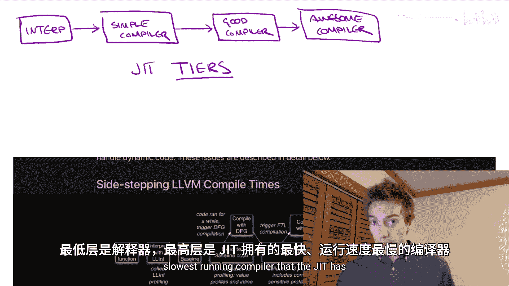
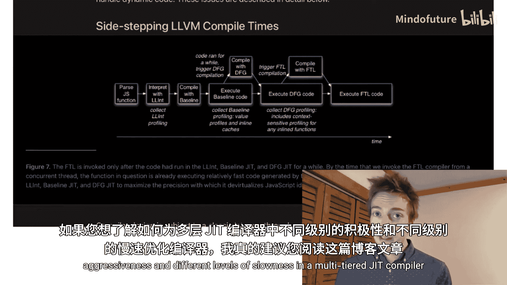

# 016：动态编译器概述

在本节课中，我们将要学习即时编译（JIT），也称为动态编译。这与我们之前课程中讨论的提前编译或静态编译形成鲜明对比。我们将探讨动态编译的基本原理、架构以及两种主要实现方式：方法JIT和追踪JIT。

## 静态编译与动态编译

上一节我们介绍了编译器的基本概念，本节中我们来看看静态编译与动态编译在时间上的根本区别。

在静态编译中，编译阶段与程序执行阶段在时间和上下文上是分离的。你可以将编译好的程序想象成存放在软盘上，然后通过邮政服务寄送到目的地执行。

即时编译或动态编译则截然不同。编译阶段和执行阶段紧密相邻，甚至相互交织。你放在软盘上的不是完全编译好的程序，而是源代码或某种中间表示，仍然需要执行编译工作。这意味着，在程序执行的同时，可能还需要进行一些转换和优化。

实际上，动态编译通常比这更复杂。编译和执行通常是混合在一起的，编译器可以观察程序的执行并重新进行优化。在现实世界中，即时编译器确实将程序执行和编译的概念融合在一起。

## 为何需要动态编译？

既然提前编译简单明了，为什么还要进行动态编译呢？动态编译主要有两大优势，它们相互关联。

主要优势在于，即时编译可以利用提前编译无法获得的信息。动态编译器可以观察程序的执行，例如程序运行时的实际输入。这类信息对提前编译器是绝对不可用的。

第二个主要原因是，一些编程语言的语义特性极大地受益于运行时信息对编译器的可用性。这指的是那些具有大量动态语义特性的语言，例如动态类型语言，如JavaScript、Python和Ruby，以及开创JIT先河的Smalltalk。

在这些语言中，很难通过静态分析来准确判断程序的行为，从而生成简单的目标代码。原因是语言本身的语义内置了大量动态检查，一个简单的提前编译器即使在执行最简单的操作时也需要每次都进行这些检查。

例如，考虑Python中的表达式 `A + B`。`A + B` 听起来简单，但在Python中，根据语言语义来解释它是一个非常复杂的过程。你需要进行大量繁重的工作来计算 `A + B`，因为我们从根本上不知道 `A` 和 `B` 的类型。Python语义要求你尝试调用对象 `A` 上名为 `__add__` 的方法，并将 `B` 作为参数传递给该方法。

如果我们能知道 `A` 和 `B` 是32位浮点数，那么我们可以将其编译为一条机器指令，而不是通过字符串名查找方法、传递参数、可能在类层次结构中查找重载等开销巨大的操作。问题在于，在Python中，很少有情况能静态确定这一点。因此，如果我们拥有动态信息，例如在程序执行期间观察到 `A` 和 `B` 的类型都是浮点数，那么我们就可以编译一个仅在这些条件下工作的更快版本代码。这在静态环境下根据程序定义可能是错误的，但了解动态执行信息使我们能够进一步优化。

## 关于术语的说明

我想强调几个关于术语的要点。

首先，我不喜欢人们将编程语言分类为“解释型语言”或“编译型语言”，例如说Python或JavaScript是解释型语言，C或Rust是编译型语言。这似乎暗示了语言必须被编译或解释是其根本属性。当然，在编译器课程中，我们知道事实并非如此。编程语言的概念与其实现的概念是分离的。可以为C或Rust编写解释器，也可以为Python或JavaScript编写编译器。事实上，存在许多编译器。因此，重要的是不要混淆，认为语言有使其必须采用特定实现方式的根本属性。当然，语言的某些特性确实使其更适合动态编译而非静态编译，但这与说某物是“解释型语言”非常不同。

其次，在现代，编译器与解释器之间的界限是一个谱系，通常没有一条清晰的分界线将两者分开。最大的表现是，即使是我们准确认为是解释器的语言实现，其内部也常常包含编译器。例如，CPython是Python编程语言的主要实现，它被准确地概括为Python解释器。然而，它内部仍然有编译器的成分。它从Python源代码文本开始，解析成抽象语法树，但解释器并不直接操作AST。相反，存在一个从AST到称为字节码格式的编译器，这是一种基于指令的表示，类似于Bril或LLVM。然后，解释器（CPython实现的主要组件）运行在该字节码表示上。这不仅编写起来更简单，而且通常比递归遍历AST快得多。因此，即使是CPython这样的解释器，其内部也有编译器。许多被称为解释器的语言实现都是如此。同样，许多动态编译器内部也包含解释器。这都说明，虽然将某个实现概括为解释器或编译器是有用的，但从抽象层面深入一层看，情况通常会更复杂一些。

## 即时编译器的基本架构

现在我们来谈谈如何进行即时编译。我想讨论大多数即时编译器共享的高级结构。

大多数JIT通过耦合解释器模式和执行编译代码的模式来工作。

我们需要这两种模式有几个原因。首先，我们需要一种方法来观察程序的执行，以获取JIT应该能够观察到的关于程序的所有丰富的动态信息。然后，我们可以将这些信息输入编译器，编译器利用这些信息进行优化以生成编译代码。因此，解释器在某种意义上存在，是为了让我们在准备好编译程序之前观察程序执行的事实。

第二个原因是，由于我们是在线进行编译（即在程序执行期间），编译速度非常重要。也就是说，如果我们在执行程序之前必须进行大量编译，程序启动可能会非常慢。因此，解释器也作为一种快速启动模式存在。也就是说，我们可以在进行任何转换之前立即开始解释程序。然后，一旦我们观察了足够多的程序信息，就可以切换到编译代码模式。

你可能会注意到，在这个流程图中，还有一条从编译代码回到解释器的反向边。那么，为什么在切换到编译模式、执行这个非常快的优化代码后，还要切换回解释模式呢？

这有两个原因。再次强调，第一个原因是我们不想一次性编译所有代码。也就是说，我们可能有一些被频繁执行的热点例程。我们会编译这些例程，因为花费额外时间进行编译是值得的。但有些代码会留在解释模式，因为它们并不那么重要。如果它们只占总执行时间的0.01%，那么花费时间编译这些代码就不值得。

第二个原因是，我们在编译代码中进行的许多优化通常依赖于那些动态假设，即我们从程序执行中获得的信息。这意味着这些优化后的程序是针对特殊情况进行优化的，它们不是程序的通用实现。因此，即时编译器通常需要观察执行过程，即使是在执行编译代码时，也要确保这些假设没有被违反。例如，如果我们知道之前在Python示例中的表达式 `A + B` 大多数时候处理的是浮点数，但有时最终遇到了字符串加法，我们必须抛出适当的异常以便程序处理。这在仅针对浮点数的、高效的、专门的代码版本中并未实现。因此，我们需要一种方法切换回解释器模式来运行异常情况，即在较慢的模式下处理程序的完整语义。

这是一个稍微详细一些的状态机。我们从解释模式开始并观察。当某些代码变“热”时（“热”意味着它被执行了很多次，因此我们认为值得编译），我们就从普通的解释模式（应该是相当轻量级的）转换到一个通常更慢的分析模式。也就是说，既然这个函数已经运行了10次，让我们在第11次以分析模式运行它，以便观察其类型、分支走向等信息。然后，一旦我们分析了代码，就将所有这些信息和代码输入到我们的优化编译器中。这个编译器看起来非常像一个普通的提前编译器，只是它被包含在运行时系统中。此外，它还可以访问分析信息。从这个意义上说，它就像一个基于配置文件的或反馈驱动的优化编译器。它生成编译代码，然后我们可以执行一段时间。最终，如果我们发现生成此编译代码时所做的假设无效（例如类型错误），那么我们必须经历一个称为“去优化”的过程，在这种情况下，我们返回到解释模式。然后，最终，我们将通过顶部再次回到编译模式。或者，我们可能会遇到之前编译过的代码，并转换到执行先前编译的代码，而无需再次经过编译器。

这意味着任何JIT编译器的配方通常至少包括一个解释器、一个分析模式和一个可以使用该分析信息以及其他内容（如判断代码何时变热的启发式方法，以及在解释模式和编译模式之间流畅转换的方法）的优化编译器。

大多数现代JIT的另一个特点是，仅仅区分解释器中的快速启动/慢速执行和编译代码中的慢速启动/快速执行是不够的。实际上，在两者之间拥有梯度是有意义的。因此，当今许多JIT都有多个层级。不仅仅是解释器和编译器，而是解释器、一种运行较快但优化较差的“慢速”编译器、一个优化编译器，甚至可能还有一个超级优化编译器。JIT的状态机负责在所有这些不同的组件之间切换各个代码片段。这些被称为JIT的层级，最低层是解释器，最高层是JIT拥有的运行最慢但生成代码最快的编译器。

例如，我有时会提到苹果的JavaScriptCore JavaScript编译器，它有很多精彩的博客文章描述其编译器的架构。这张图取自一篇博客文章，当时他们引入了第四层优化。之前他们有三层，这次在JavaScript编译器中引入了第四层优化。你可以看到，这里有一个解释器，一直到他们称为FTL层的最高层。据我所知，JavaScriptCore编译器仍然有四层，尽管现在看起来与2014年有很大不同。如果你想了解在多层级JIT编译器中如何为不同级别的激进程度和不同级别的编译速度优化编译器的一些细节，我强烈推荐阅读这篇博客文章。

## 方法JIT与追踪JIT

我们已经看到了构成任何JIT编译器的基本要素，现在我想向你们展示构建JIT的两种截然不同的哲学之间的区别。

它们被称为方法JIT和追踪JIT。方法JIT是那种基于我目前给出的描述你可能会猜测要构建的“正常”东西。

方法JIT一次编译一个函数。也就是说，如果你有一个名为 `F` 的函数，如果该函数 `F` 被调用了，比如说500次，那么你决定是时候编译它了，然后将 `F` 的执行从解释模式转换到编译模式。也许你会为不同的参数创建 `F` 的不同变体。无论如何，你进行编译的单位是源语言中存在的一个函数或类似函数的东西。

它们有一个有点古怪的名字。我认为如果叫函数JIT会更合理。但我猜测它们之所以被称为方法JIT，是因为JIT与Java编程语言紧密交织在一起。而Java人坚持认为他们没有函数，只有方法。在Java中它们被称为方法，没有函数这种东西。所以我认为这就是为什么这被称为方法JIT，尽管可能更合理的叫法是函数JIT。

另一种JIT则相当有趣。它不是一次编译、分析、解释然后编译整个函数或类似函数的代码单元，而是提取通过控制流图执行的一条路径。这甚至可以是跨过程的。因此，这可以像穿过单个函数，或者可能跳转通过多个函数，一条遍历代码的单一热点路径，我们会提取其中一条并将其编译为直线型代码。我在这里画了一个小的控制流图，并画出了你可能通过该CFG执行的一条路径，例如从A开始，然后向下经过G，这可能是代码运行的一种方式。追踪JIT的思想是观察执行过程，而不是将整个东西编译成在A处有分支、在C处有分支等的代码，我们将完全省略C和F，因为它们从未执行。相反，我们只编译实际执行的那部分代码，即实际执行过的基本块。我们将把来自A、然后B、然后D、然后E、然后G的代码串在一起，创建这个只包含实际执行指令、没有任何分支的直线型程序。然后我们将其编译为没有任何分支的普通直线型代码，这意味着在未来，当我们在某些假设下从A开始执行这个函数时，我们可以直接执行这个捕获了我们上次执行该函数时观察到的行为的、极快的无分支路径。当然，我们需要小心处理何时回退到更复杂的执行（即实际包含C和F代码的情况），以防需要运行它们。但在常见情况下（希望未来行为与过去行为匹配的常见情况），我们可以用这个非常简单的无分支直线型代码来模拟遍历CFG的这条路径。

因此，这通常是一种有利的方式来简化代码，这在没有分析信息、进行简单的提前编译时是不可能的。此时一个常见的问题是，方法JIT和追踪JIT哪个更好？我很希望你现在暂停视频，尝试自己回答：哪个更好，它们在哪些方面更好？尝试为两者想出优缺点。

优秀的想法。如果你能将它们发布在本课程相关的讨论帖中，我将非常感激。总的来说，我听到了很多相互矛盾的信息。我听说追踪JIT更容易实现，但在极限情况下性能较差。我听说方法JIT做的是完全相同的事情，也许它们更容易实现，但与你可以应用于程序的追踪转换的强大能力相比，其性能有限。我认为这个问题尚无定论。我不认为构建JIT有一条唯一正确的道路。我认为双方都有论据。根据轶事，我相信大多数人构建JIT的主导方法是方法JIT，即许多你熟悉的JavaScript编译器、许多主流的Java编译器。这些都是简单风格的方法JIT。然而，也有一些非常著名的追踪JIT。例如，Python的PyPy JIT，它是CPython之外主要的、高效的Python实现。那是一个追踪JIT。事实上，它做了一件了不起的事情：为了生成机器码，它追踪Python的解释器。这只是证据，表明在两个类别中都有成功的JIT例子。我不认为有一个必然的结论表明一个明显优于另一个。

然而，我想更详细地向你演示构建一个追踪JIT的感觉。我将通过为一个简单玩具程序构建优化代码的追踪过程来做到这一点。

这是一个完全人为设计的、无聊的程序，看起来有点像JavaScript语法，我们将追踪这个程序。这个程序从 `main` 开始，它执行一些算术运算，定义一些新变量并返回一个值。这里有一个函数 `F` 的调用，它只是从一个变量中减去1。我告诉过你这是一个非常愚蠢的程序。还有一个 `G` 的调用。不用担心 `G` 做什么，因为我们实际上不会执行它。关于追踪的一点是，我们只编译这个程序中代码的一个子集，即对应于我们实际执行的追踪路径的子集。

让我们想象一下，我们用 `x = 42` 来追踪这个程序。也就是说，我们以参数42启动程序，并追踪执行过程。当然，发生的第一件事是运行这条语句，然后我们需要进行这个比较，结果证明为真。所以我们将执行真分支体，最后返回 `z`。这就是程序的执行。假设你是一个追踪JIT编译器，并且你决定是时候编译 `main` 函数了。这意味着你将在解释这个函数期间追踪执行过程，写下沿着程序路径执行的每条语句。

因此，我们要做的第一件事是 `y = x + 1`。这是关于追踪的第一件有趣的事情。在这次执行期间，我们知道 `x` 是42。所以也许这里要做的是说，嗯，我们可以即时简化，说 `y` 是42加1，或者也许我们可以直接得出 `y` 是43。现在我们有了更简单的代码。但是，当然，这将是一个糟糕的主意，因为我们实际上并不期望用完全相同的参数调用 `main` 一百万次。我们只是假设，我们在某种意义上类似地执行（即走相同的路径），但不是拥有完全相同的值。因此，这意味着我们将保留计算 `y = x + 1`，说明在这次执行中，我知道 `x` 是42，因此 `y` 是43，但我们会说我们只是写下执行的代码，而不将参数的实际值折叠进去。

下一步是计算 `x < 100`。我们肯定想将其作为追踪的一部分写下来。但是当我们这样做时，出现了控制流的分歧，即当我们决定要走程序的一条路径（走到这里而不是那里）时，我们需要在追踪中记录，这个追踪在这一点上经历了控制分歧。也就是说，这个追踪只适用于那些遵循我们正在执行的相同路径的路径。因此，追踪JIT通常做的是引入一个特殊的语句，你可以将其放入追踪代码中，称为守卫。也就是说，会有一个实际的名为 `guard` 或类似的语句，在我们从这个程序中得到的发出追踪中，它表示：如果这个条件为假，则在此处中止。如果为真，则继续执行直线型代码。如果为假，那么我们有一些工作要做。我们必须恢复并退出编译代码，转换回完全通用的解释代码的执行。

因此，我们将插入那个守卫，以捕获在 `if` 处发生的控制流分歧的影响。然后我们可以像正常一样继续追踪，也就是说，我们只需复制这段代码并写下 `z = f(y)`。目前我是在过程内进行，即不进入函数 `F` 内部。最后，我可以写下 `return z`。

我们最终得到了这段我预先准备好的、带有守卫的直线型代码。当我说直线型时，我的意思是它没有任何控制流分歧。然而，这有点谎言，因为它确实有守卫指令。守卫指令不会做一些完全不直线的事情，比如跳转到代码后面的某个地方，但它们确实会跳出这里，即中止这个直线型程序的执行。追踪的思想是，我们可以保留这些守卫，而不必太担心它们失败的情况。也就是说，我们将无情地优化所有守卫都成功的场景。我们仍然能够检测到何时出错，但我们会说，即使从守卫为假恢复到解释器执行需要很长时间，也是可以的。也就是说，如果从守卫为假恢复到解释器执行是一个非常昂贵的操作，那可能会非常慢，因为我们将针对常见情况进行优化。我们希望的是，比如99%的时间守卫都为真。因此，我们将使这种情况尽可能快，可能以使得守卫为假时恢复非常慢为代价。

为了进一步细化这个追踪，我将想象我们稍微改变一下追踪。也就是说，它不再是一个过程内追踪，而是一个过程间追踪，即当你调用函数时，它会继续追踪该函数执行过程中的代码，然后返回。我希望这相当容易理解如何做到。事实上，这可能比保留函数调用更容易。我们需要做的是，不仅仅是放入这个调用 `z = f(y)`，我们只需要在追踪时插入从调用 `F` 开始执行的所有计算。这样就产生了看起来像这样的代码。也就是说，我们只需将参数分配给 `F` 的参数 `y`，然后我们只需将函数 `F` 体中唯一存在的语句放在这里。现在我们有了一个更简单的追踪。因此，进行过程间追踪对于让你得到更简单的代码非常有帮助，在这些代码中你可以做出更多假设并进行更出色的优化。

## 追踪优化

优化是我们接下来要做的事情，我想向你展示如何对这个追踪进行一些优化，这些优化非常容易进行，因为我们是直线型代码，只是一个带有这些守卫侧出口的单个基本块。

我想对这个代码做的第一件事是，我想把这个守卫表达式尽可能早地放置。一般来说，尽早检查守卫对我有利，原因有几个。首先，快速失败是好的，在你发现错误并必须恢复之前，尽量少做计算。第二个原因是，如果我们移动守卫，那么我们可以在相同的假设下优化更大、连续的区域代码。在这种情况下，这段代码碰巧基本上是SSA形式，如果我们优化追踪，这可能是个好主意。因此，将这个守卫移到顶部是完全有效的，因为在我们执行之前没有对 `X` 的赋值。我们得到了这个漂亮的、非常简单的代码，它只是给变量赋值，中间没有任何守卫。

现在，我们可以做一些非常简单的事情，比如局部值编号，来重新解释这段代码，并说明在假设下（现在我们有了那个糟糕的、带有一堆控制流的复杂代码），在假设 `x < 100` 下，我们需要做的就是这段代码或与之等效的代码。通过盯着看一会儿，你可以看到我们可以折叠一些拷贝，可以对算术指令进行一些规范化。最终，我们所做的是取 `x`，加1，然后从中减1，然后返回结果。这完全等同于直接返回 `x`。因此，我们最终在假设 `x < 100` 的条件下将所有代码优化掉了。我必须指出，这是追踪JIT最酷的事情之一。它可以进行在程序的正常表示中似乎不合适的优化。也就是说，以前我们必须给变量加1，然后进入分支看看是否要从该变量中减1。再次强调，有可能进行一种优化来有条件地抵消这一点，但如果我们首先追踪程序，即如果我们首先只提取我们曾经关心的、通过CFG、通过过程间CFG的那一条路径，那么做这种优化就容易得多。也就是说，我们只提取这一条路径并说，只要这个守卫成立，那么我们知道我们不必担心任何其他代码。这意味着我们不必担心加1或减1，它们可以相互抵消。这就是追踪JIT的魔力。我们能够获取复杂的程序，从中提炼出非常简单的追踪路径，从而进行可能在其他情况下无法实现的出色优化。

## 总结与下节预告

本节课中我们一起学习了即时编译（JIT）的基本概念。我们探讨了动态编译与静态编译的区别，理解了为何动态编译对于某些语言（尤其是动态语言）至关重要。我们介绍了JIT的基本架构，包括解释器、分析模式和优化编译器的多层级协作。最后，我们深入探讨了两种主要的JIT实现哲学：方法JIT和追踪JIT，并通过一个具体例子演示了追踪JIT如何提取执行路径并进行激进优化。

在下一个视频中，我将引导你了解我对Bril语言所做的一个扩展，使其能够进行一些追踪操作。本课程的任务将是实现Bril的一个追踪机制。正如你可能已经猜到的，你将需要做一些非常类似于我刚才展示的例子的事情。它不会是一个完整的多层级JIT的概念，但它应该让你感受到构建一个超越标准提前编译器的追踪JIT的潜力。