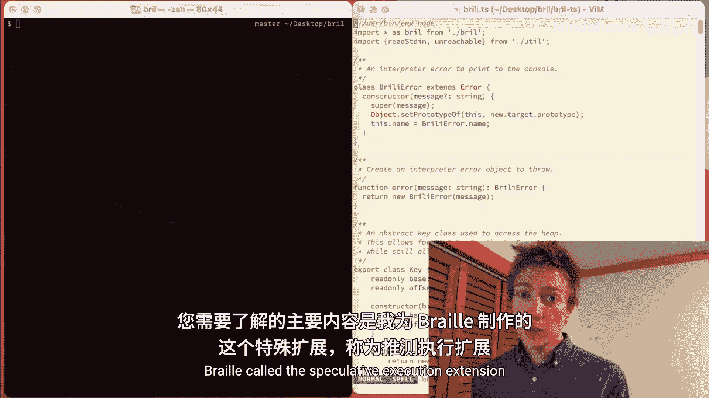
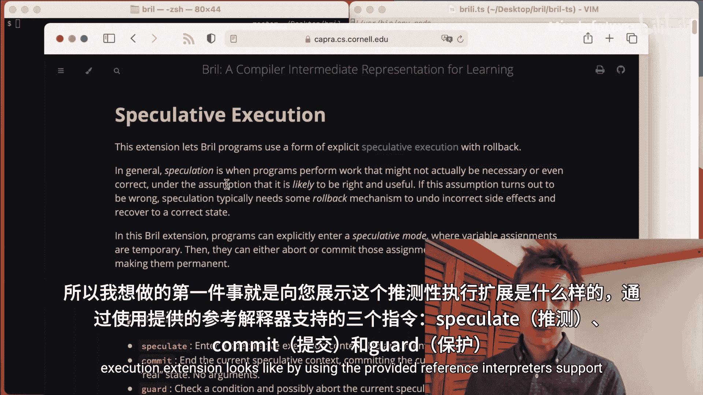
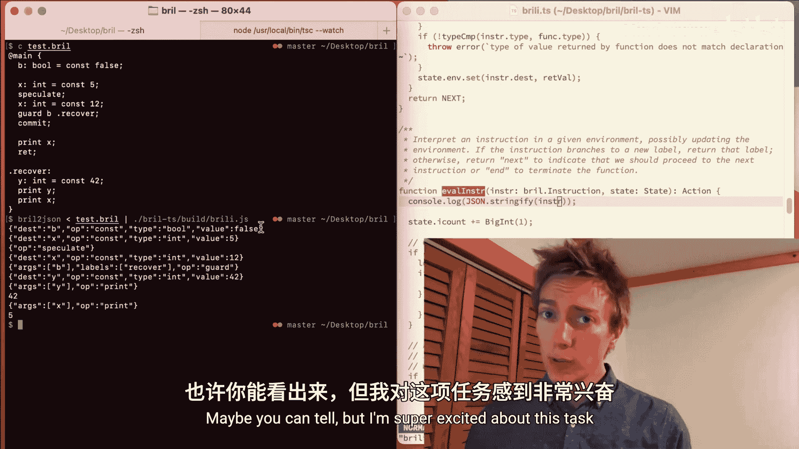

# 017：基于推测的追踪优化 🚀

在本节课中，我们将学习如何为Briille程序构建一个基于追踪的优化器。核心是理解一个名为“推测执行”的特殊扩展，它允许我们模拟硬件中的推测执行行为，从而在不构建完整即时编译基础设施的情况下，探索追踪优化的魔力。



## 推测执行扩展介绍 🔍



上一节我们概述了课程目标，本节中我们来看看实现目标的关键工具：推测执行扩展。这个扩展的灵感来源于现代CPU中的推测执行，它在Briille表示中仅以几条额外指令的形式存在。

这些指令是：
*   **`speculate`**: 进入一个模拟的世界状态，在此状态下对变量的修改不会立即生效。
*   **`commit`**: 提交所有在推测状态下做出的修改，使其真正生效。
*   **`guard`**: 检查一个条件。如果条件为真，则无事发生，继续在推测状态下执行；如果为假，则中止推测区域，并自动回滚所有对变量的修改。

这使得实现追踪优化成为可能：我们可以对程序状态进行试探性修改，并在需要时轻松回退到未优化的完整程序执行。这与JIT中从编译代码切换到解释代码的模拟过程类似。需要强调的是，这一切都将作为程序的提前转换发生，这比典型的JIT实现更简洁。

## 推测执行指令实战演示 💻

了解了核心概念后，我们通过实际操作来看看这些指令如何工作。我们将使用支持`speculate`、`commit`和`guard`指令的参考解释器进行演示。

首先，我们创建一个普通的Briille程序。进入推测模式的方法是执行`speculate`指令。之后，我们可以修改程序状态，例如将变量`x`赋值为12。要使这个修改真正生效，必须执行`commit`指令。

**注意**：强烈不建议在推测状态下执行像`print`这样的副作用操作，因为一旦`guard`失败，这些操作无法回滚。虽然规范并未禁止，但最好在状态被提交后再执行此类操作。

`guard`指令需要两个参数：一个条件和一个失败时跳转的标签。如果条件为真，则继续执行；如果为假，则跳转到指定标签，并回滚到开始推测时的世界状态。

以下是一个示例代码片段，展示了推测执行的基本流程：
```braille
main:
    x = const 5
    speculate
    x = const 12
    guard (b, recovery_label)
    commit
    print x
    ret
recovery_label:
    y = const 42
    print y
    print x // 此处x的值应为回滚后的旧值5
    ret
b:
    const false
```

## 扩展语义细节与注意事项 📝

在深入实践之前，我们还需要了解该扩展的一些语义细节。

以下是关于推测执行扩展的两个重要说明：
1.  **支持嵌套推测**：你可以在一个推测区域内开始另一个推测，内部区域的`commit`会提交到外部区域，最终仍需对外部区域执行`commit`才能生效到真实世界。推测可以组合使用。
2.  **内存扩展的回滚**：如果结合内存扩展使用，推测代码中对内存的修改在`guard`失败时**不会**自动回滚。如果你希望构建一个能处理内存写入的高级追踪优化器，需要自行设计某种事务性语义来管理这些内存更新，以便在出错时回滚。

## 生成追踪：修改参考解释器 🛠️

现在，我们来看构建优化器所需的另一个关键部分：如何首先生成程序执行的追踪。推荐的方法是直接修改参考解释器，使其在运行程序时打印出执行的指令，从而得到我们想要的追踪。这样你就不必从头编写一个特殊的追踪解释器。

参考解释器的源代码位于`Briille.ts`下的`Briille.i`文件中。虽然代码较长，但结构简单。你需要关注的起点是`evalInst`函数，它负责执行每一条指令，其中包含一个处理所有指令的大型`switch`语句。

你的任务就是修改解释器，使其输出执行信息，供后续用于转换原始程序。核心是在指令执行时将其打印出来。建议在`evalInst`函数的顶部进行操作，`inst`参数就是指令的JSON表示形式。

最简单的实现方式是使用`console.log(inst)`，或者为了格式统一，使用`JSON.stringify(inst)`后再打印。这样，每当解释器执行一条指令，你就能在控制台看到其JSON表示。

修改解释器后，你可以通过`tsc --watch`命令自动重新编译。然后，像往常一样通过解释器运行Briille程序（例如：`braille-to-json < test.briille | node path/to/braille-i`），就能看到每条被执行指令的JSON输出。

## 任务核心与总结 🎯

本节课我们一起学习了为Briille程序构建追踪优化器的核心知识。

**核心流程总结如下**：
1.  **生成追踪**：通过修改参考解释器，在程序执行时捕获指令序列（追踪）。
2.  **优化追踪**：对捕获到的指令序列应用优化。
3.  **集成回程序**：将优化后的追踪以推测执行代码块的形式，缝合回原始程序中。优化后的程序行为应与原程序一致，但能机会性地进入推测模式快速执行，或在失败时中止并回退到正常执行。



请记住，本任务的重点在于体验从零构建一个追踪优化器的过程，理解追踪编译器的本质，而不必进行过于复杂或耗时的优化。我期待看到大家的成果，也欢迎在完成作业过程中分享你的体验。