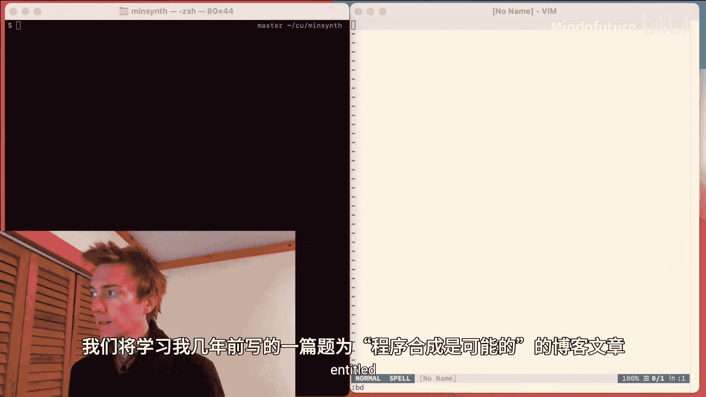
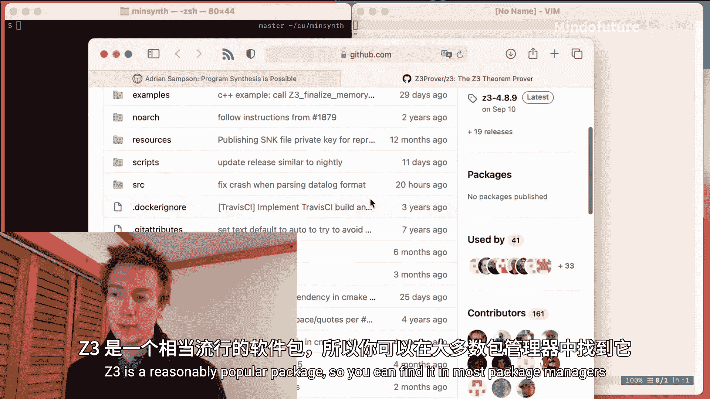
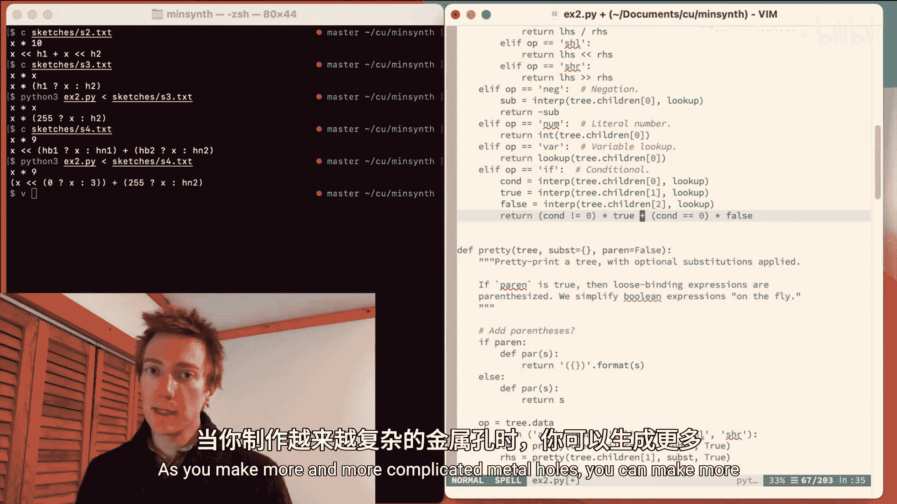

# 018：程序综合

## 概述
在本节课中，我们将学习程序综合的基本概念。程序综合是一系列技术的总称，其目标是自动生成符合给定规约的程序。我们将从零开始，构建一个基础的程序综合器，并了解如何利用现成的自动化推理工具（如SMT求解器）来实现这一目标。

## 什么是程序综合？
程序综合是一个非常宽泛的术语，涵盖了一系列试图自动生成符合规约的程序的技术。

其核心思想是，你只需输入一个描述程序应做什么的规约，程序综合器就会输出一个程序。

“规约”这个概念包含了很多可能性，其解释非常广泛。

有时，规约指的是函数输入与输出之间的逻辑关系。

有时，规约仅指几个示例，综合器的任务是填充其余细节。

甚至有人认为，我们可以从自然语言描述中综合出程序。

这听起来有点像科幻小说：我们只需给出一个描述，比如一个逻辑公式，就能得到一串机器指令；或者给出一个非常精确的函数类型，就能得到一个OCaml函数。

但这确实是一个活跃的研究领域，因为它听起来非常令人兴奋。

对程序综合能力的一种卡通式理解是，它将取代我们程序员的所有工作。这在我看来不太可能，但这并不意味着程序综合完全是虚构的。即使在今天，也存在许多在受限领域中，从某种形式的规约自动生成程序非常有用的例子。

## 程序综合的应用实例
一个常见的模式是，你有一个语义非常受限的领域特定语言，在其中导航需要花费相当大的精力。而程序综合为程序员提供了一种更简单的方式来表达他们的意图。

一个非常著名的已部署的程序综合实例是Excel中的“快速填充”功能。它会根据几个示例，尝试猜测你试图编写的、用于关联输入和输出的公式。

## 构建基础程序综合器
起初，程序综合的想法可能看起来有点像魔法，或者像是使用了自动定理证明器这类高级工具，又或者使用了复杂的基于搜索的技术。我们似乎能从完全不像程序的东西，凭空生成一个程序。

然而，实际上我并不认为程序综合的基础知识，尤其是在借助出色的现成自动化推理工具时，有那么复杂。程序综合的基础一点也不神奇。

在本节中，我们将从头开始，逐步构建一个基础的程序综合器。我们将参考我几年前写的一篇博客文章，标题是“程序综合是可能的”。我写这篇博客文章是为了作为编程语言和编译器课程的教学单元。

这篇博客将指导你构建一个程序综合工具。我鼓励你经常暂停视频，跟上进度并自己动手编程。你也可以在GitHub上找到我的完整实现，但我认为从头开始构建的过程更具启发性。

我将使用Python来完成，但你可以使用任何你喜欢的工具。Python将使你更容易跟随我的指导。

## 从SMT求解器Z3开始
我说过我们要从头开始，但这并不完全准确，因为我们实际上要从一个非常强大的现成开源工具开始，这个工具叫做“可满足性模理论求解器”，简称SMT求解器，具体来说是微软研究院开发的Z3。

SMT求解器是现代许多综合技术的基础。我们将看到如何利用定理证明器来构建程序综合器。

因此，本课程的第一步是安装Z3。如果你要使用Python，你还需要Z3的Python绑定。这并不难，Z3是一个相当流行的包，所以你可以在大多数包管理器中找到它。你可能不需要从源代码编译。例如，我在Mac上，只需运行 `brew install z3` 即可。

此时，你应该可以启动Python解释器并输入 `import z3` 而不出错。这将为我们提供一个使用Z3的便捷接口。

像任何SMT求解器一样，Z3的工作原理是接收一个逻辑公式，并判断它是可满足的还是不可满足的。当然，它也可能超时，那样我们就得不到有用的答案。

SMT类似于SAT，因为我们试图解决一个可满足性查询。但SAT只处理布尔公式，其中所有变量只能是真或假。SMT求解器在类似SAT的框架基础上，增加了所谓的“理论”。理论是变量的领域以及这些变量在查询中可以涉及的操作。例如，你可以说 `x > y`，其中x和y都是整数；或者你可以说 `a + b = c`，其中a、b、c都是32位浮点数。整数和浮点数就是被插入到类似SAT的框架中以构成SMT求解器的理论。正是这些理论使得SMT求解器在推理程序语义时如此有用。

## 演示Z3的能力
我首先将向你演示SMT求解器，特别是Z3，单独使用时能做什么，仅仅是通过发出查询。说实话，我经常对现代SMT求解器能够相对快速地得出的洞察力感到震惊。

下一步将是了解如何将SMT查询转化为实际的程序综合。

让我们从一个空的Python程序开始，输入 `import z3` 来启动。Z3的Python绑定有许多方便的运算符重载，用于编写SMT公式。

开始的方法是先声明一个变量。所以，如果我写 `z3.Int('x')`，这会声明一个名为`x`的SMT变量，类型为整数，使用Z3 SMT求解器中的整数理论。

现在你可以做一些事情，比如如果你直接将它除以7，这实际上不会执行除法。Z3的Python绑定重载了除法运算符，意思是“创建一个表示SMT变量x除以7的公式”。所以我可以将这个结果（同样是一个公式对象）绑定到一个变量，并尝试打印它。

如果我运行这个，我会得到公式 `x / 7`，这完全不出所料。

为了将其变成一个可以判断是否可满足的布尔公式，我可以使用双等号（同样被重载了）。我们会得到一个公式，当对于所有x值，除以7等于6时为真。现在，如果我们能解这个公式就好了，也就是找到一个使这个公式成立的x值。这正是SMT求解器的用途。

我们可以写一个小函数来以最直接的方式调用Z3。我们需要创建一个求解器，向其中添加一个公式，然后调用`check`方法运行求解器，看这个公式是否可满足，然后返回`s.model`。模型就是公式的一个赋值，对于一个可满足的公式，模型给出了使公式为真的变量值，这就像是公式可满足性的一个证明。

我会用标准的Python方式写一个主程序。现在，我不再只是打印这个公式，而是可以打印这个公式的解。这将运行求解器，获取模型，并告诉我一个合适的x值。x是42，正如我所希望的，太棒了。

我希望这能让你了解SMT求解器的强大之处。你可以编写这种类似SAT的逻辑查询，这些查询可以通过布尔连接符任意连接，并对实际变量进行比较，然后你可以要求求解器给出使公式为真的变量赋值。

在本教程中，我将使用位向量理论，而不是整数。位向量不是可以无限大的理想化整数，而是像实际计算机中那样的有限表示。

所以，除了使用`Int`，我们也可以使用`BitVec`。例如，我们可以写 `y = z3.BitVec('y', 8)`。这里，`y`是一个8位的集合，我们可以将其视为整数。例如，我们可以说`y << 3 == 40`，然后我们可以打印这个公式的解。太棒了。

另一个使SMT求解器超级有用的特性是它们也有量词。也就是说，你不仅可以要求“找到一个使这个顶层量化公式为真的y值”，我们还可以写“对于所有”和“存在”这样的量词。例如，做“对于所有”的方式是写 `z3.ForAll([z], z * n == z)`。我需要给出我们想要量化的变量列表，然后是一个子公式。我想知道使这个公式对所有可能的z都成立的n值是什么。我将这个绑定到公式，然后打印解。完全不出所料，它告诉我们，使这个成立的n的例子是1，即任何数乘以1等于它本身，你可能已经猜到了。但Z3也知道这一点。

好了，现在你理解了SMT本身。现在我想转向，如何将这些SMT公式变成更像一个真正的程序综合器的东西。

## 转向程序综合
我在开头说过，程序综合器对“规约”有许多不同的定义。程序综合应该接收某种规约并生成程序。

我们将使用的规约是一个参考程序。也就是说，我们将接收一个现有程序，并尝试找到一个功能等效、但希望运行更快的程序。我们将结合一个称为“草图”的额外信息来使用它。

基于草图的程序综合接收一个部分程序，并尝试完成它。这比试图从头开始综合整个程序要容易得多。对于需要量化所有可能表达式的SMT求解器来说，简单是好事。

为了说明这一点，我将尝试综合使用位操作代替算术运算的更快程序版本。例如，你可能知道，如果你写 `x * 2`，其中x是一个位向量（即实际的计算机整数），这等同于将x左移一位。假设我们处于一个想要做乘法但记不清规则的情景。我们只记得我们想做左移，但不知道移多少位。所以这将提出类似这样的问题：这是我们的参考程序，它是 `x * 2`。我知道有一个更快的程序与这个完全等价，它看起来像 `x << ??`。这里的`??`在基于草图的综合中通常被称为“洞”。我们想猜测一个洞的值（即放在这里的表达式）来使这个等式成立。这就是我们本教程的程序综合任务。

## 实现基础综合
以下是在最基本设置中使其工作的方法。

我们将建立几个公式，分别代表参考实现和我们想要填充的草图。

所以，我将从尝试写下参考实现开始，我们需要在SMT公式中完成这一点。我们需要像之前构建单个查询时那样，声明位向量变量。

然后我说，我的“慢表达式”，也就是我们在这里要使用的参考程序，就是 `x * 2`。

现在我需要草图，也就是我们想要完成的“快程序”。为此，我将创建一个“洞”。我称之为`h`，因为你不能在Python中把变量叫做`??`。所以这应该是我们试图填充的洞。因此，快表达式（即草图）将是 `x << h`。

我们的问题是：什么`h`值能使这个表达式与另一个程序等价？

我们有了这两个表达式。现在我们需要构建一个公式，传递给SMT求解器，要求它完成草图。我们可以用量词来实现这一点。我们需要一个“对于所有”的陈述，即对于所有可能的x值，这两个东西是等价的。所以我会说 `ForAll([x], slow_expr == fast_expr)`。

我想提醒你，这里并没有发生实际的比较。这个重载的双等号并不是在判断这个表达式是否等于那个表达式（是或否）。它返回一个新的公式，然后我们将求解这个新公式。所以这个重载操作接收两个公式，并产生一个由双等号连接的新公式，然后交给Z3处理。因此，这个东西不是真或假，它本身也是一个公式。我无法更加强调这一点：运算符重载是神奇而惊人的，但有时也会有点令人困惑。

所以这就是我们实际想要的目标公式：我们想找到一个`h`值，使得这个公式对所有x都成立。如果我们能做到这一点，那么我们就完成了程序，即通过填充洞，得到了一个与参考程序形式规约相匹配的程序，从而完成了一种非常基础的程序综合。

让我解这个看看我们得到什么。太好了，是1。我们甚至可以多试几次，比如 `x * 4` 等价于左移多少位？是2，太棒了。所以我认为这起作用了。也就是说，如果你眯起眼睛看，我们确实在进行某种程序综合。

## 迈向真正的编程语言
不过，我必须承认，这感觉不太像程序综合，因为这里并没有真正的编程语言。我们所做的只是编写变成Z3表达式的Python表达式，然后求解这些东西。

所以下一步是将其转化为操作更像真正编程语言的东西，拥有真正的解释器等。

现在，我给你一点时间暂停并跟上进度，玩玩Z3，看看它能做什么。我向你挑战，例如，找到一个让Z3花费很长时间（比如超过几毫秒）的公式。看看你在这里能问Z3什么问题，并在合理时间内得到结果的极限在哪里。

## 构建语言解释器
让这种手动操作公式的方式感觉更像我们在真正的编程语言上进行真正的程序综合的第一步，是拥有一个实际的语言。为此，我们当然需要编译器中最迷人的话题之一：解析器。我们需要为我们正在综合的编程语言编写一个解析器。

我在这里要快进一点。我有一个预先写好的解析器。如果你想，你可以使用和我一样的解析库，叫做Lark。Lark很酷，它内置了几种不同的解析算法，我发现它定义语法的语法非常直观。

这是我预先写好的语法。它看起来像这样。我们将有一个只包含简单算术表达式的语法。所以我们将有加、减、乘、除、左移和右移。然后我还会加入否定操作。总之，这个小小的语言只能做位向量上的算术运算。我还会加入这些`if`表达式，即三元表达式，如 `表达式 ? 表达式 : 表达式`，意思是如果这个非零，则使用这个，否则使用那个。

现在我有了这个语法，我将修改下面的主程序，使用这个语法来解析来自字符串的程序。所以我可以直接说，这是我的解析器，`lark.Lark`给它语法。例如，我就写 `(x * 3) << y`。好的，很棒的程序。我们可以打印出来，只是为了让你相信我的解析器在工作。当然，你需要安装Lark，我要提醒你，它在Python包索引中的名字不是`lark`，而是`lark-parser`。

好了，现在我有了这棵树。对于这个微小的编程语言，我有了一个语法树。

当你从零开始创造一个编程语言时，接下来可能需要的是一台解释器。所以我们也要写一个解释器。我会写一个尽可能简单的解释器。我们接收这样一棵树，比如顶部是`shift_left`，然后它有一些子节点。我会说，如果`tree.data`等于`'add'`，那么左边是`interp(tree.children[0])`，右边是递归调用解释器在`tree.children[1]`上的结果，然后我们返回`lhs + rhs`，因为我们在加法的情况下。

我在这里也要快进一点，填充解释器的一堆情况，但我们做的没什么特别的，都是你以前见过的。我只是要写一个完全正常的解释器，递归处理这些东西。

我覆盖了加、减、左移、右移，所有普通的二元运算符。我有否定运算符。我有字面量数字，所以我们只是从语法树中取出字符串并返回其整数值。我们还有变量查找。

这是第一个有点棘手的地方。我将让这个解释器函数接收一个查找函数来告诉我们如何处理变量，然后我只是调用那个函数来获取变量的名字。所以这里没什么特别的，我们只是使用一个查找函数作为映射，在我们的解释器中解析变量名。

接下来我要做的是实现条件语句。我会用一种稍显奇怪的方式来实现，稍后我会揭示其目的，但解释的实际机制并不奇怪。我们必须递归地评估条件、真分支和假分支。然后我会用比较和乘法来做这个奇怪的事情，即将条件与零比较的结果相乘，以得到我想要的结果。我知道这看起来有点奇怪，但你可以盯着看一会儿，并说服自己它确实是在做`if`，并且像这种语言的解释器一样工作。

如果你相信了这一点，那么我们就可以解释我写在这里的这个小表达式了。也就是说，如果我能想出一个……我需要解释这棵树，但我需要某种方法来查找X和Y的值。如果我没有X和Y的值，这没什么意义。所以为此，我猜我会创建一个小环境字典。比如说`x`是2，`y`是9。然后我们创建一个可以被调用的函数。所以我会说，对于某个变量，就在环境中查找那个东西。如果我们这样做，我现在应该能够解释我刚写的这个表达式，并得到一个实际的值。它成功了，太棒了。现在我们有了一个解释器。这只是一个小插曲，用来创造一个我们将要进行综合的实际语言。

## 符号解释与约束生成
现在来一些真正有趣的魔法，这将依赖于Python和运算符重载来实现。

我们将获取这个解释器，并一举将其转化为一个约束生成器。到目前为止，我们这里有一个在具体值（如实际数字2和9）上运行表达式的解释器调用。我们实际想做的是运行相同的解释器，但是在符号值上运行，即在Z3变量上运行。所以我们会给它一个名为`X`的变量和一个名为`Y`的变量，并要求解释器构建一个公式，该公式的语义与我们解释这个函数的方式等价。

我们这里需要的技巧是，与其给出一个实际的环境，不如给出一个查找函数，每次你引用一个变量时，它会凭空变出一个与该编程语言中变量对应的Z3变量。

为此，给定变量名，我就调用Z3库，说我们将用那个名字和8位大小创建一个位向量变量。

这意味着，当我从变量规则中得到这个变量时，我就在解释器中返回它。然后最终，通过递归调用，我们会做一些事情，比如将一个常量与一个变量相乘或左移。然后正如你之前看到的，通过运算符重载的魔力，这实际上并不是将一个数左移某个量，它只是创建了一个表示左移的新公式，然后我们可以将其发送给Z3求解。

所以如果我现在运行这个，我们不会得到数字3072。我从下面的环境中移除了所有实际数字。相反，我们应该得到一个Z3公式，它代表了对于任意X和Y变量，这个程序的语义。事实上，我们确实得到了，它看起来像这样。它看起来和输入完全一样，但意义非常不同。现在，这是程序语义作为SMT公式的表示。这就是关键。这就是我们通过将解释器重新解释为约束生成器，来对这个程序语言进行综合所需要的东西。

我们快成功了。

## 整合草图综合
我们现在要把刚才看到的基于草图的综合范式带回到这个语言中。

我希望它的工作方式是，我有两个不同的程序，都用同一种语言编写，都以同样的方式解析。

所以我会说，我们从一个我们想要找到更快实现的“慢程序”开始。比如说 `x * 10`。

我们想要填充洞的“快程序”（即草图）将通过左移某位并加上左移另一位来实现。所以这比之前稍微增加了一点难度，有点难记你到底需要把哪两个不同的移位加在一起才能得到非2的幂的结果。

不过，为了能够重用我之前完全相同的语法，我将引入一个命名约定：任何以`H`开头的东西都被视为一个洞。这样我们就可以区分这两个洞。我称第一个洞为`H1`，第二个为`H2`。我们需要使用它们来填充第二个程序中的所有以`H`开头的变量，使其与第一个程序等价。

为此，我只需要解析这两个东西。

我想运行我们的符号解释器（即我们的普通解释器，但为所有变量使用符号值）。我为自己写了一个方便的函数来做这件事，你可以在第二个示例文件中找到，叫做`z3_expr`之类的。无论如何，我会从我预先写好的代码中借用这个。这个函数并不花哨，它接收你想要解释的树，然后通常你可以向解释提供现有的变量，否则它只是在你第一次引用变量时惰性地创建一个变量。所以它只是用这个特殊的、惰性创建变量的查找函数来调用解释器，然后返回我们使用的变量集合以及通过惰性求值表达式添加的新变量。

所以我们可以这样做，我们可以对这两个东西都调用`z3_expr`。

我们应该得到我们想要使其等价的两个程序。

下一步只是一点小技巧，从这些东西中提取出洞。也就是说，我们将得到变量。我称这些为程序1的变量，然后像把变量1输入到这里，我会得到更新后的变量2。我想要的是没有所有洞的变量。所以在这个例子中，我想要像`X`（或者如果我们用了`Y`），但不包括`H1`和`H2`。为此，我会用一点Python技巧来构造一个字典。以`H`开头意味着它是`H1`之类的，这只是对变量名字符串的一个操作。

现在我们需要构造我们想要交给Z3的公式。这将看起来就像之前一样，我们需要“对于所有”变量，而不仅仅是对于`x`。所以是`z3.ForAll`。那是所有像`X`这样的东西，然后我说我希望对于所有这些变量，慢程序等于快程序。同样，这是在构造一个将这两个东西设置为相等的公式。

所以我现在真正需要做的就是求解目标。如果我这样做了，我将获得所有变量的值。这告诉我，如果我先将其左移1位，然后加上将其左移3位的结果，我可以获得与将x乘以10相同的效果。

这太棒了。我们现在有了一个真正的程序综合器。例如，我可以问是否可能对12这样做。它告诉我，是的，可以。对于11呢？不行，这显示模型不可用，因为这是不可满足的。也就是说，没有你可以用来填充这个的洞的组合。

## 扩展：综合表达式而不仅仅是常量
在实际名为`ex2`的文件中，我做了几件更高级的事情。`ex2`做了完全相同的事情，像之前一样进行惰性设置，并执行与我们之前相同的综合目标。现在做了一些稍微复杂的事情，只是为了美观，将洞的值插值回程序中，并且它会对文本文件进行此操作。所以它实际上会从文本文件加载程序，只是为了让它感觉更像一个编程语言。

例如，如果你看我的GitHub仓库中的`sketches`目录，有一堆看起来像这样的文件。也就是说，慢程序和带洞的快程序分别写在两行上。然后我们可以对其中一些东西运行`ex2`。例如，我可以运行 `sketches/s1`。这会说，如果你想要 `x * 8`，并且你想将其适配为 `x << ??`，你可以将其左移3位，并将其插值回程序。

让我们再试几个草图。`s2`是我们刚看到的，我就不运行了。`s3`这个更有趣一点。它在示例目录中，为了说明一个观点。

这个观点是，到目前为止，我们做了一些感觉像是综合的事情，但从某种意义上说，我们所做的只是综合常量放入变量中。也就是说，我们要求的是可以放入给定洞的实际位向量值。

但这感觉不太像是在生成程序。它有点像在生成程序，但实际上只是在生成程序的常量。

那么，我们如何生成整个表达式呢？这就是技巧所在。我们实际上根本不需要改变我们的综合引擎，因为它已经支持条件语句（那些三元表达式）。例如，如果我们想做一个约束更少的草图版本，我们不知道是要乘以一个变量还是一个常量，我们可以将其表示为一个条件。也就是说，将整个括号内的表达式视为一种“元洞”。在实际系统中，你只需让程序员写下类似 `x * ??` 的东西，然后自动将其扩展为这个布尔表达式。

这个布尔表达式说：我不确定为了达到目的，我是想要变量X（即引用已存在的变量）还是一个常量。也就是说，你通过选择第一个洞（它决定使用哪种表达式）来为我选择。然后根据表达式的种类，可能需要填充额外的洞来使其工作。

如果你眯起眼睛看，我们已经构建了一个程序综合器，它不再仅仅综合常量，而是综合表达式。它通过将选择使用什么表达式本身编码为一个变量来实现这一点。

我想演示一下这也行得通。确实如此，它选择了我们需要将x乘以x。

为了让这更有趣，现在我们可以将使用元洞的想法推向逻辑结论。所以这表示，我想做 `x * 9`，并且我认为我必须通过左移某位加上某位来实现。所以我知道我需要用别的东西来偏移。但在两种情况下，我都假装我完全不知道我想要什么样的表达式。这里我使用了一个非常简单的三元表达式，它再次在变量和常量之间选择。所以这里是布尔洞，用于在每个位置选择做什么。然后它可以选择是使用X（引用现有变量）还是综合一个常量。

这告诉我们，我们想左移3位然后加上X。也就是说，它为第一个元洞选择了一个常量，为第二个元洞选择了一个变量。

虽然你可以看到，你可以将其推向逻辑结论。通过巧妙地嵌套整数、比较和表达式，你可以让这个综合器综合许多不同的表达式。也就是说，它不必只在变量和常量之间选择，它可以说，嗯，我不确定是需要一个变量、一个常量，还是一个移位（其中一边要么是变量要么是常量）。你可以做到有限的深度，并提出一些非常复杂的综合问题。

这是让Z3超时的可靠方法。但它向你展示了，即使这个范式始于简单的常量综合，也足以提出有趣的问题，让我们在给定无限时间的情况下，让Z3为我们编写真正的程序。

当然，做所有这些三元运算符技巧需要我在之前写解释器时提到的那个奇怪技巧。也就是说，这个条件语句的情况。在Python中，明显的做法是：我们已经求值了条件、真值和假值，这些都是常量，所以我可以直接说 `真值 if 条件 else 假值`，这相当于我们源语言中的问号冒号。当然，如果真值、条件和假值都是符号值，这就不行了，特别是如果条件是符号值。Python的`if`不能那样工作，它不能被重载来做不同的事情，不像Python中的等号、左移、右移等操作。所以我们需要找到另一种方法来生成一个等价的Z3表达式，就是这个。这个表达式在普通解释器模式和Z3运算符重载模式下都能工作，因为它不使用`if`，只使用不等于、乘法和加法等操作。这就是我如何在解释器中偷偷加入一个既能在普通解释器模式下工作，又能在符号解释器模式下工作的条件分支。但一旦你这样做了，你就有了一个相当通用的程序综合器。随着你制作越来越复杂的元洞，你可以提出越来越复杂的综合问题。

## 总结与任务
所以，你本课的任务是从这个范式开始，跟随教程，让自己运行一个像这样的真正的程序综合器，然后让它更有趣。这完全是开放式的。你可以添加任何你想要的功能。像往常一样，不需要在这上面花费大量时间，但我对你提出什么来使这个语言更具表现力很感兴趣。我也对你开始遇到可扩展性问题的地方感兴趣，即处理复杂和大型程序。

可扩展性是程序综合的难点。很多文献都是关于让这些在小例子上有效的技术扩展到程序员在现实世界中真正想要综合的真正复杂程序上。

祝你好运，综合愉快。