# 【康奈尔大学-•-中英】高级编译器项目教程-CS-6120（Advanced-Compilers，2020）-p01-P01-Lesson-1--Video-on-Demand--BV1gE9ZYsEUm_p1-

Hello and welcome to the first lesson of CS6120 for Fall of 2020。

I am super excited for this semester and I'm excited to get our hands dirty with a bunch of gnarly compiler implementation stuff。

To get things started， I want to have a brief conversation。

 an asynchronous discussion about why we bother studying compilers。

And I think that it's really easy to get the impression that the reason for studying compilers for doing research on compilers and for building compilers is to make programs go faster。

 That's what your compiler does。 it sort of takes that we can sort of see most visibly and how compilers get better over time that is that you take the same code and you compile it with a better compiler and it generates faster code and this is indeed one of the big classic areas within compilers compiler optimization is a big important topic that we're going to be spending lots of time on in this class。

 however， I wanted to emphasize that just making programs go faster is just one tiny thing that we do within research and compilers and that this class is going to be about the much broader set of topics that you might call language implementation that is。

Doing what it takes to take a programming language out of the theoretical realm of the human's mind and turn it into code that can actually execute one way or the other。

 and yes it's important that that code goes fast， it's important that it be efficient。

 but there's many， many other things that go into making a compiler。

 a compiler that are parts of implementing programming languages。So。

If you can right now I'd like you to pause this lecture and think a little bit more about what goes into the implementation of a programming language other than just compiler optimizations。

 and if you say parsing， you are immediately kicked out of this class that's just a joke but this class is not going to be about parsing programs。

 that is a part of lots of compilerless courses out there。

 but the course is going to be about the sort of the deeper topics of the semantics of programs。

 so not just thinking about the syntax， but how we implement the kind of the meat of what programs actually mean。

So you can。Pause this video here and。Answer this question in the discussion topic associated with this lesson。

Did you know that lessons in 6120 this semester come with discussion topics。

 They do Let me show how to get there。 The way you get there is you go to the 6120 website and there's a tab over the top called Lessons So far there's only one lesson。

 the one that you're watching right now But for a given lesson there's a discussion link which takes you to a topic within a Z space and this is where you can respond to things that are directly about this video or anything else within this lesson unit I'd like you to respond now with just brainstorming what goes into the implementation of a programming language。

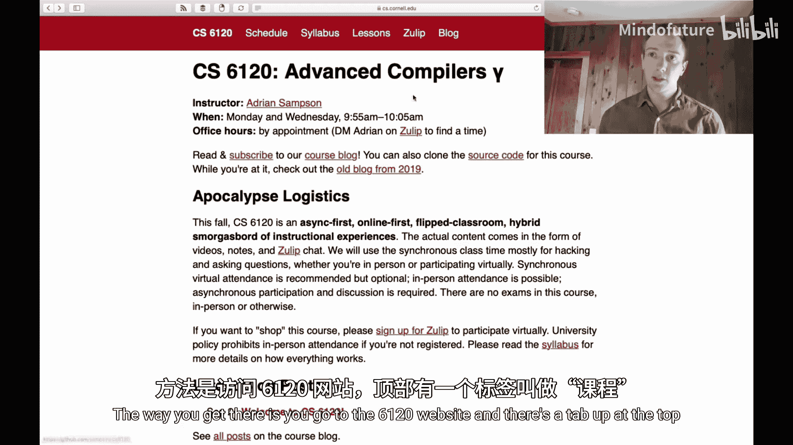

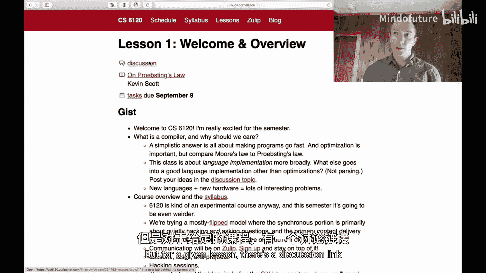

To get things started， I have one idea， which is。That some language implementations do a lot of checking at runtime to enforce invariance。

 that is to rule out common classes of errors by checking for them and throwing exceptions at runtime。

 dealing with all those exceptions is part of the implementation of a language and it's something that we will consider as part of the broad topic of language implementation in this class so think of one of these things and please post it in the associated discussion thread。

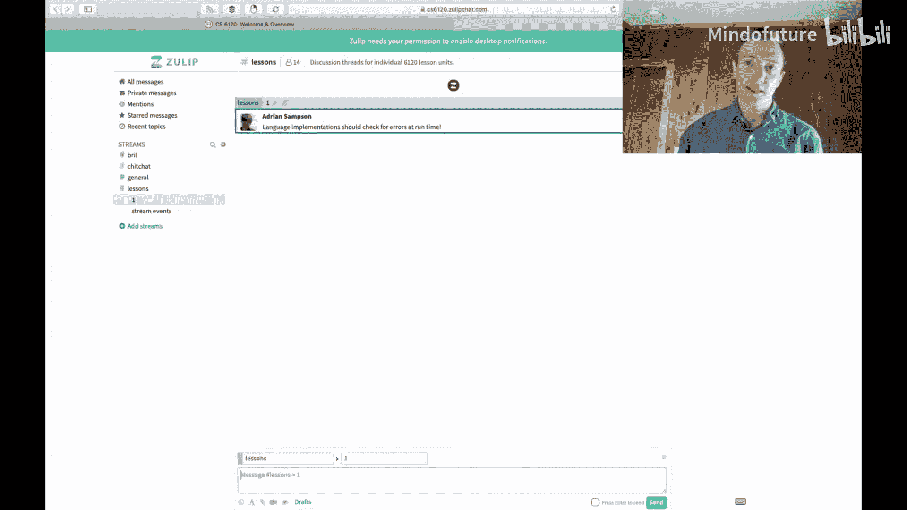

Thanks for all the great ideas that you've just posted to at the Zooulu topic。

I wanted to spend a little bit more time thinking about the optimization question。

Asssociated with every lesson in 6120 is some optional reading that you can do ahead of time you probably didn't do this reading because it's the first day of class and I didn't even tell you to look for reading to do it associated with every lesson。

 but we can look over a little bit now it's just a really small paper that I think you might get a kick at it。

So on the webp page for a given lesson， there are some links at the top to optional reading like indicated by this little book icon。

 so if you follow this link to ProbeSting's Law， you can find a short article written about a law of computing that is essentially a little bit of a joke。

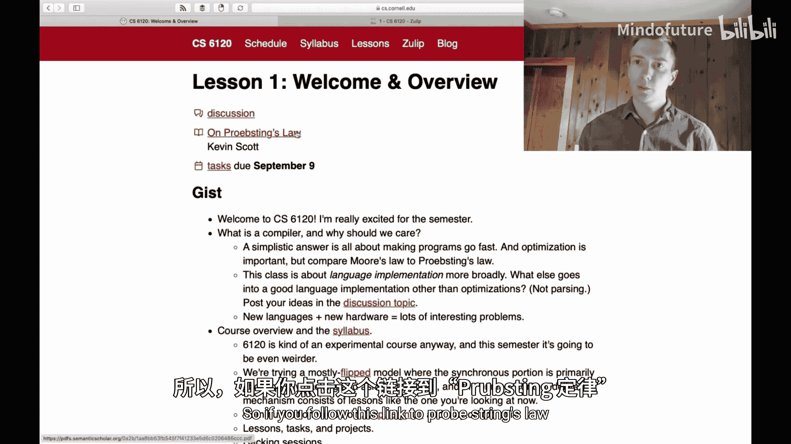

嗯。In particular， if you've heard of Moore's law， you've probably heard of Moore's Law is a subject of great cliche and great renown at this moment。

 Moore's law says that roughly speaking， every 18 months or so。

 the performance of computer hardware roughly doubles， and this， of course。

 was true during the heyday that ended around 2005 or so when scaling and transistor density really did translate into performance。

😊，Pro Sing's law is a joke about the significance of compilers research that says the performance of optimized of the resulting coper of optimizing compilers doubles every 18 years so it's kind of a joke to put in perspective like what what。

Like the relative magnitude of the impacts of the people who work on making transitistors smaller and smaller versus the people who work on making compilers better and better I think that it was originally given that name by a guy named Probstring as a joke like it wasn't actually expecting this to be born out in reality but I encourage you to give this paper read It's just a short read by someone who like so went back and said。

 well， it was kind of a joke that is it actually true and they went through some machines of the time went back to earlier versions of compilers。

 compiling C programs and observed that actually yeah。

 it kind of is true that is like roughly speaking over time the performance like does kind of follow and exponential but it really really slow exponential compared to。

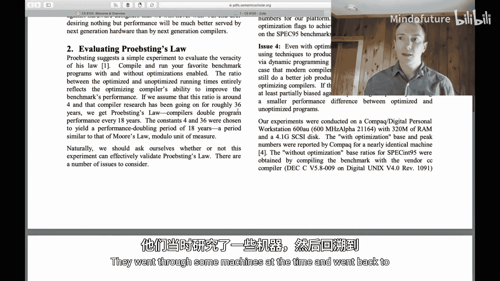

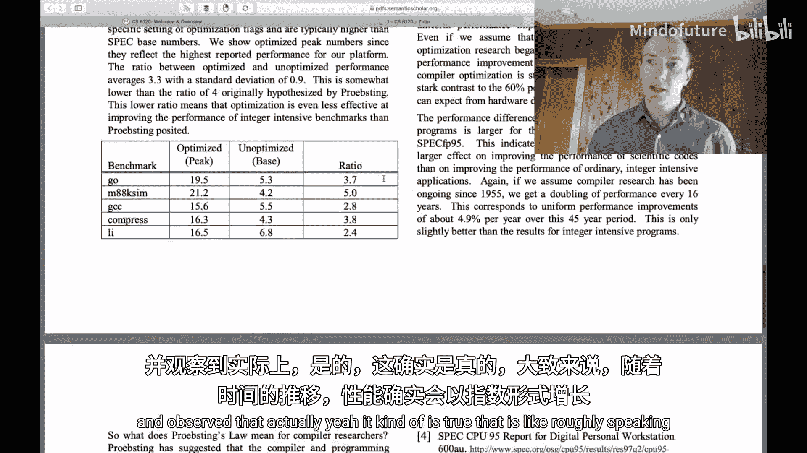

Compared to the performance that is yielded by more and more transistors turning into better and better CPUs。

This is all just sort of a tool to emphasize the fact that language implementation is should not be limited only to compiler optimization。

 I believe that compiler optimization are super important。

 Compr optimization are not just about optimizing ordinary C programs for ordinary CPUs。

 I think at this moment in particular， the the there's an explosion of need for new compilers。

 And the reason for this is that there is。A rapid expansion in the number of programming languages that people want to write and the number of different kinds of hardware that people want to target to that is about the expansion in programming languages。

 it's not just about general purpose languages， if you've ever used R for example or if you've ever used Tensorflow these things all sort of count as domain specific languages for one purpose or another that people actually want to get good performance out of and it's not just limited to one or two high profilefi examples。

I believe that domain specific images are really proliferating because they're found to be a better way to match the semantics of how people think when they want to express programs to computers and at the same time。

 because of the end of Moore's law， the diversity in hardware targets is also in the middle of expanding。

 you may know， for example， about Google's TPU being deployed in their data centers for writing machine learning workloads。

 but there's also just in everyone's cell phone， dozens and dozens of specialized hardware units that just do one particular thing very well。

We're kind of running into this n times M scaling problem where the number of programming languages that people want to compile is expanding very rapidly。

 that's M and the number of hardware targets that people want to to compile too that's M is also expanding very rapidly so either of those two things by itself would mean that we have a great need for new compilers to compile new languages to hardware。

 but the fact that they are both expanding at the same time means that that's a multiplicative effect and there's a huge demand for new compilers that do new kinds of optimizations for new kinds of hardware and new kinds of domain specific semantics。

Just as an anecdote， I think it it's almost a cliche at this point when you go to computer architecture conferences。

 I spend half no time as a computer architect that people are building lots of hardware that they find super interesting and can do one or two things extremely well。

 Novel hardware is super exciting for individual applications。

 but nobody knows how to write compilers that unlock the full potential of those domain specific hardware accelerators that。

😊，Specialized hardware is not actually something that anyone wants if it's too narrowly targeted。

 and if people as is the dominant trend in computer architecture conferences。

 if grad students have to manually write assembly code for every new accelerator they develop for every application they want to compile to it。

The problem is that we don't know that the science of compilers is not advanced yet。

 the science of language implementation has not caught up with the massive explosion to main specific languages and novel hardware targets。

All of this together means that it's an extremely important time to be focusing on compiler research and to focus beyond just the classic but very important notion of just optimizing programs of just optimizing programs。

 but to take into account all the other things that we want to get out of a language implementation。

 including correctness and security and debugability， all of these things matter。

 all these things matter and all of them are surprisingly hard to do。

 and we're going to need to do them many times over if we're going to capitalize on this explosion of diversity in both languages and hardware targets。

That concludes my excitable motivation about why we're studying compilers and language implementation more broadly in Sy120 I want to now take you to the syllabus to talk about how this class is going to work。

And I have to give the qualifier that in general I have no idea how this class is going to work relative to other semesters。

 this is a time of incredible uncertainty and we will just have to see how this goes。

 I'm going to give you my best guess about how things are going to run for this fall。

 but I ask you for your patience to bear with me while we figure it out on the fly。

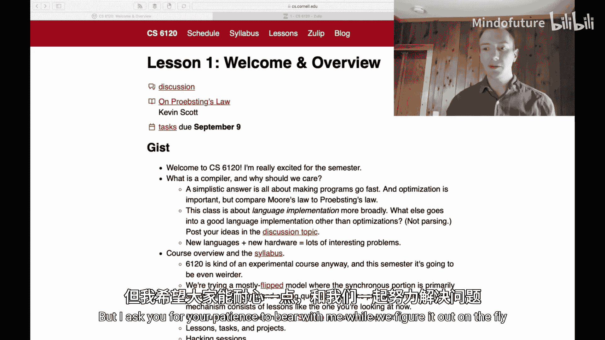

On the 6120 website there is a tab at the top of the syllabus。

 and we're going to go through a few of the details right now。

One thing we've already seen is that we're using this chat tool called Zullip which is a kind of like weird open source slackcklike thing that has a few cool features that I think will make it exciting to try versus 2120 again thanks for bearing with me while we try this out we're going to do all the communication through Zoolip so it's really important that you sign up for it and that you pay attention to it we're going to do a lot of required discussion participation that happens on Zoolip so you need to familiarize yourself with it and to actually participate when it comes time。

There's a bunch of links to Zooulu there's apps for all the platforms you can get and they are perfectly fine the iOS1 is actually sort of garbage。

 but that's not right here nor there。

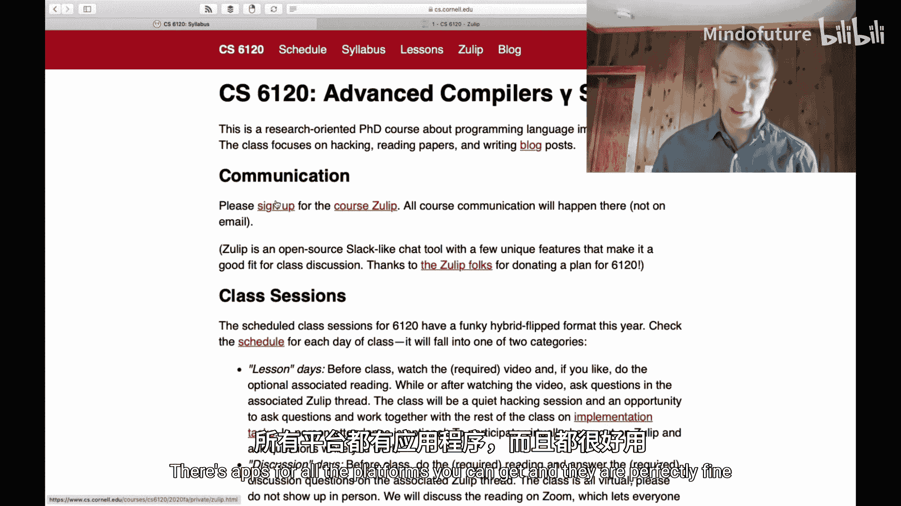

And there also links throughout the webage that go to individual threads of conversation called topicss in Zooit that we'll be using and you can just use a Z from your browser as well。

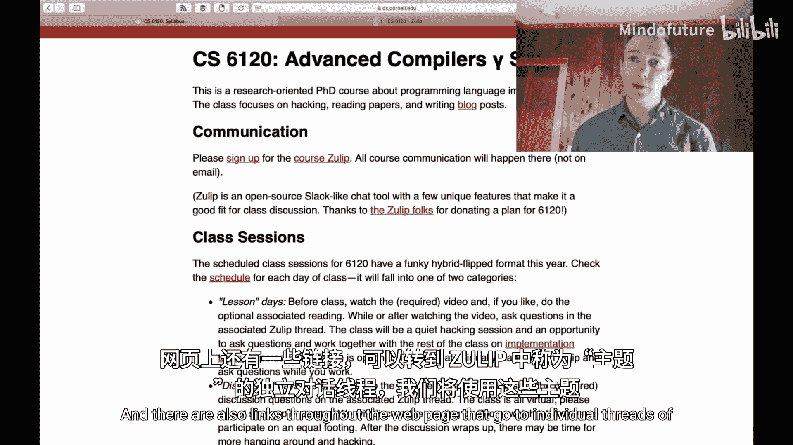

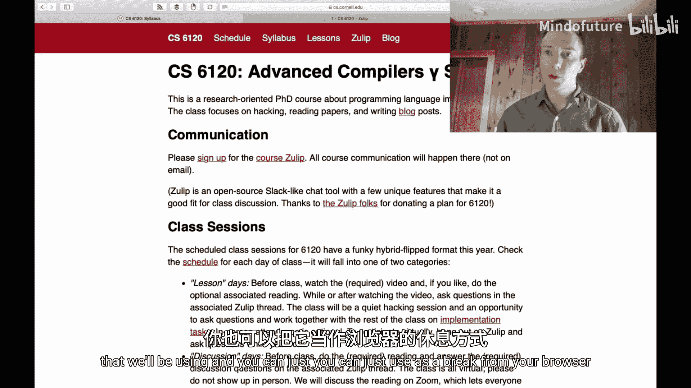

Okay so let's talk about what is happening in the actual class session so normallymin this class is 955 to 10 something 955 to 11 something other on Mondays and Wednesdays。

 but most of the actual stuff that we're doing will be asyronous in particular I'm trying out I want to try out to deal with the complexity of like hybrid in-person virtual scheduling I'm interested in that most of our class sessions being flipped in the sense that you'll be watching videos and reading materials offline like you're doing right now with this video and then the actual class sessions the majority of them will be kind of quiet work times and you can come and hang out in person。

 hopefully outside some of the time and hack and ask questions ask questions on Zoolip if you are in Ithaca and if you're remote then you can join those things by hanging out on Zoolip and silently hacking and asking questions and participate just as much as anybody else because everything will be sort of coordinated around are。

Our funky chat system。

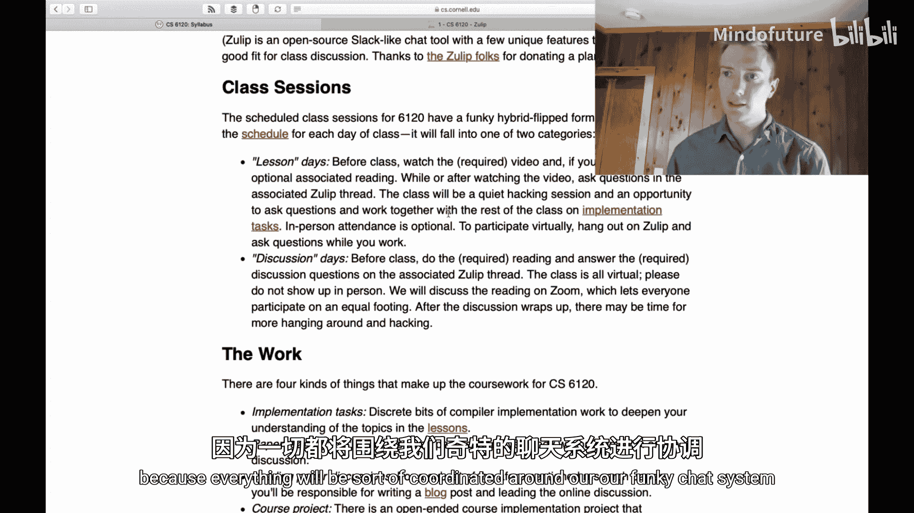

But in general， these classes will be divided slightly more granularly than that if you look at the schedule schedule is a tab at the top of the webage as well you will see that there are sort of two types of classes the first one which is today is that the class has lesson content in it and this has a link to a particular lesson that here we'll have a video once it's done being recorded and there's some notes and there's some tasks to complete more on this in a second but you can before these classes do the optional reading associated with them and watch the video and then when we show up we'll just be doing just be doing sort of silent work time and the flipped classroom style on the tasks associated with a given lesson。

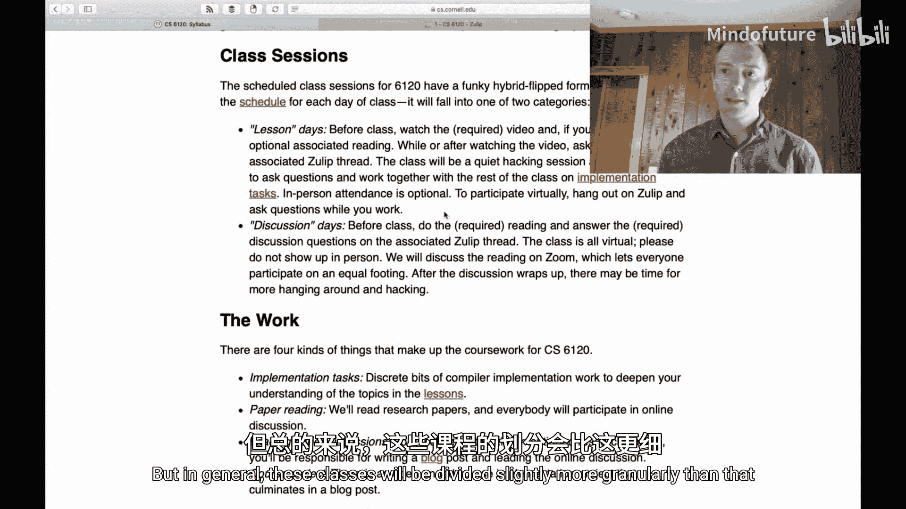

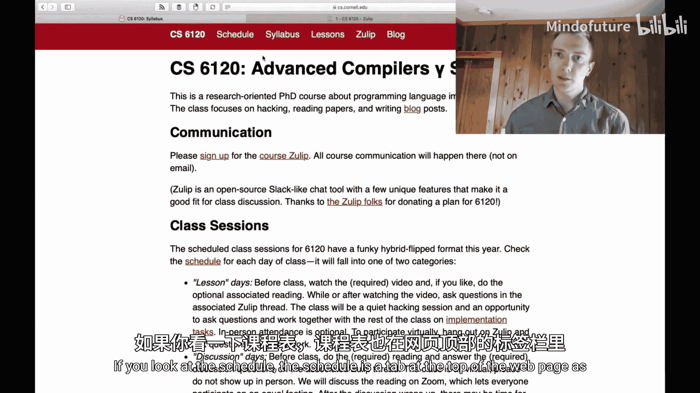

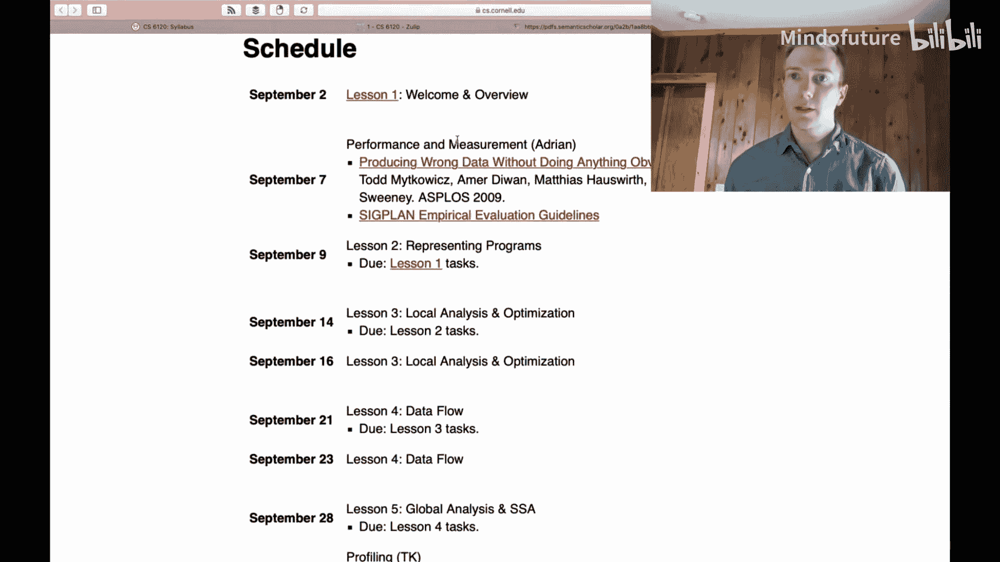

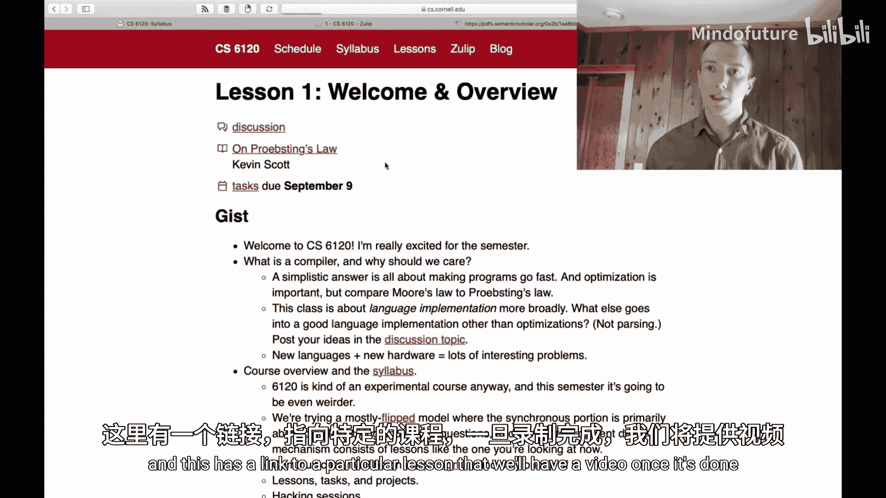

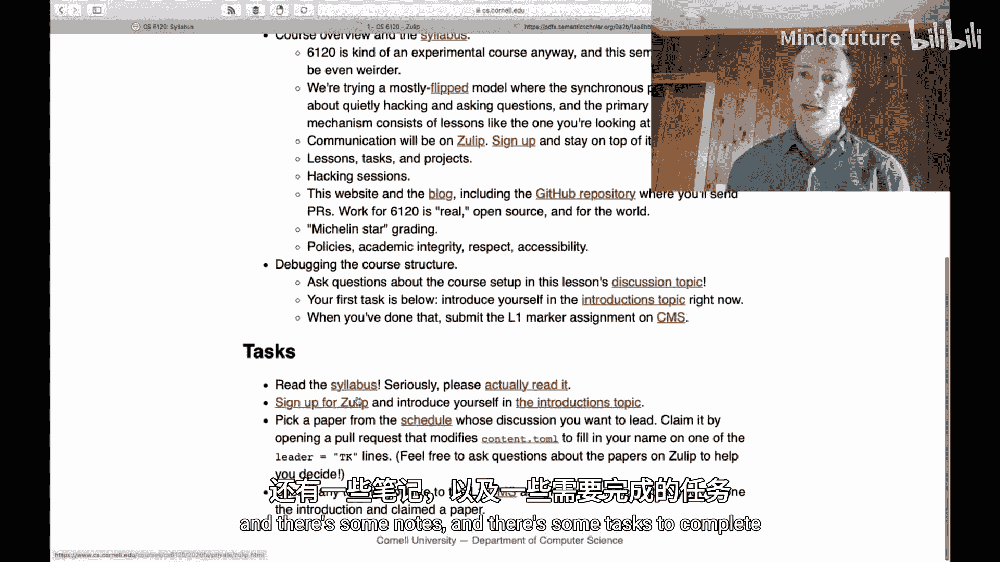

On some other days there will be a discussion to be had。

 so there's some reading material you that is not optional but is actually required to do ahead of time the first one will be on Monday。

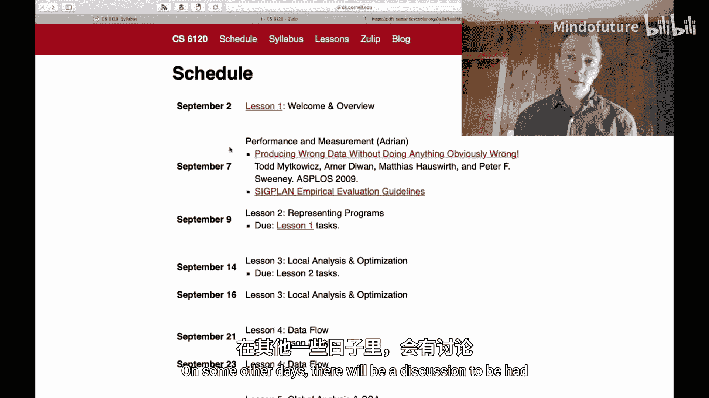

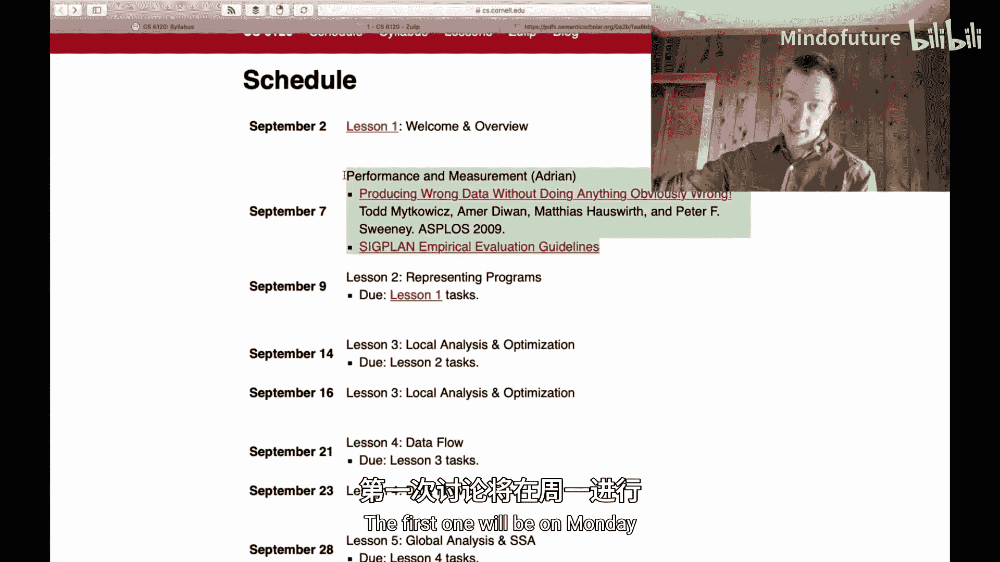

And the difference with these is that we will not have any inperson content and the reason for this is that we're going to have a discussion a live discussion on Zoom so I just cannot even fathom how work to have a productive discussion where some people are in person and some people are remote on Zoom that just seems like totally unworkable to me so for those days for the discussion days those things are going to be all virtual they're going to be all on Zoom so please join at the appointed time synchronously for for a short discussion that the leader for a given paper will be conducting it's not going to take the entire class time the rest of it is going to go back to the sort of flipped class work time but we will have a chance to sort of follow up on the discussion that happened asynchronously over zoolip in prior in the days leading up to the class so just to summarize when you are participating in this class it's important that you go to the schedule every so often and look at the upcoming days and see whether they are。

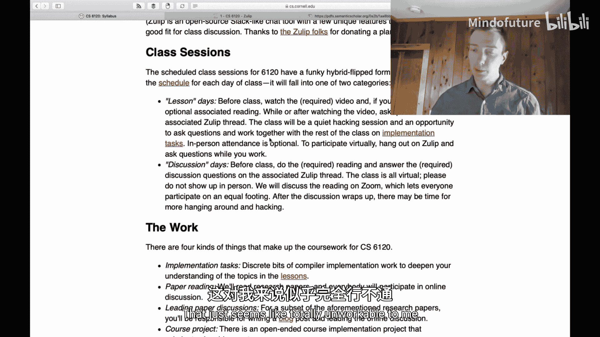

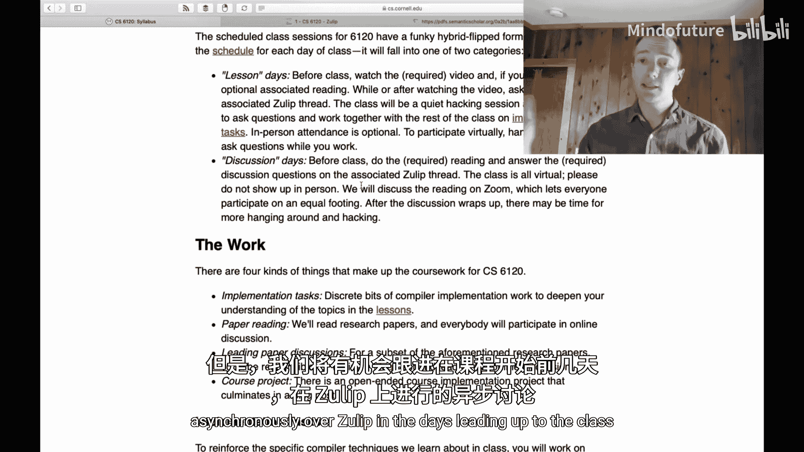

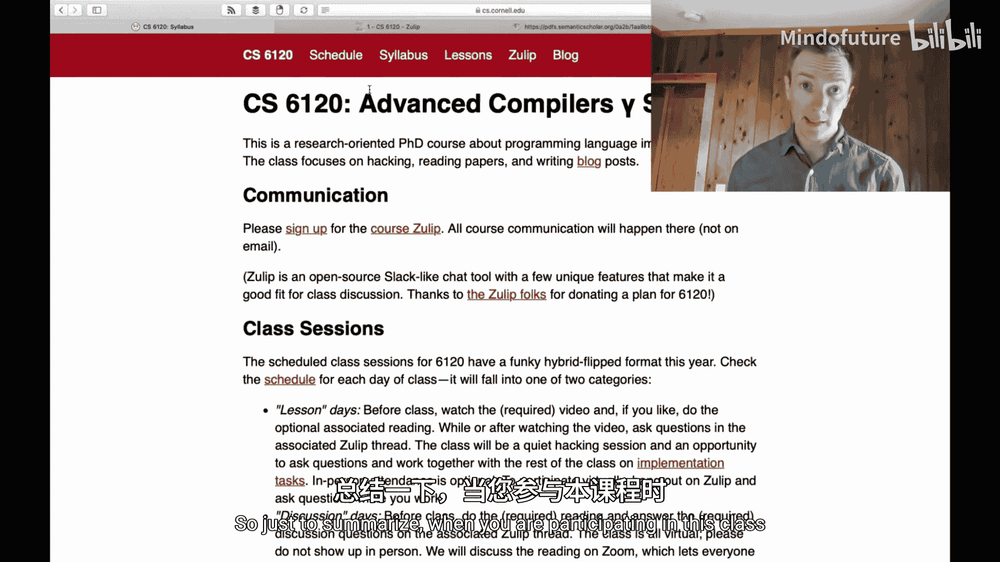

Discussion days in which case we're going to actually have a discussion and you have homework to do beforehand about and the homework you have did beforehand is reading and participating in discussion on Zoolip。

 or they are lesson days in which case your homework is to watch the videos and to do the optional reading but the actual work that we'll be doing will be starting in class so that everyone's working together can ask each other questions。

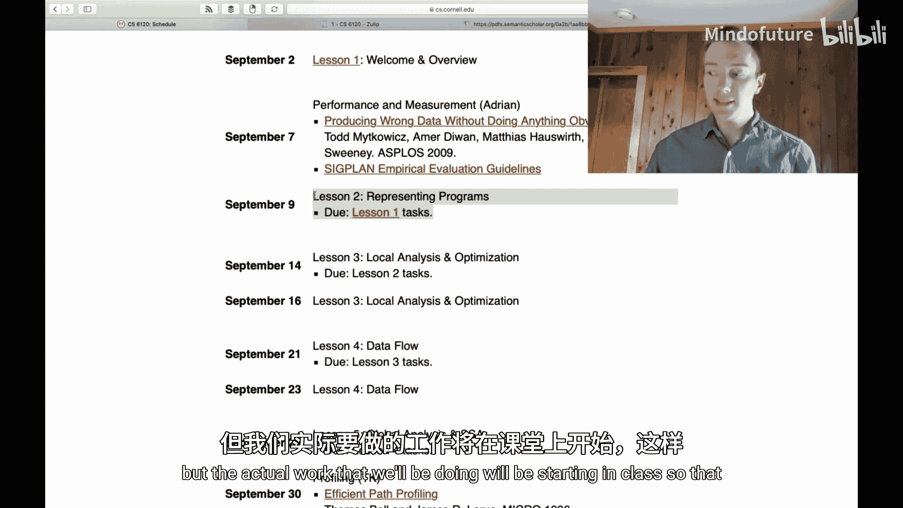

I hope that makes sense。

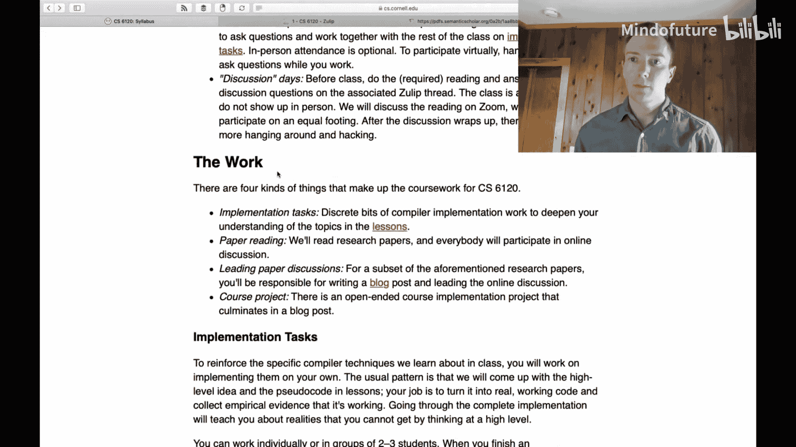

So the next thing to talk about from the syllabus is like the actual work that we'll go into the class。

 there are four things that you have to do of various shapes and sizes。

 the first one is a smaller implementation tasks that are associated with the lesson so they're meant to kind of follow up on the things that you'll learn in a video like this and they're sort of small self-contained tasks that are still nonetheless have some interpretation to them that you will that you then that you complete on a fairly short turnaround so like most of the deadlines are about a week away for these things。

There are tasks associated with this lesson， which I'll get to at the end， they are no big deal。

 but they are due in a week。

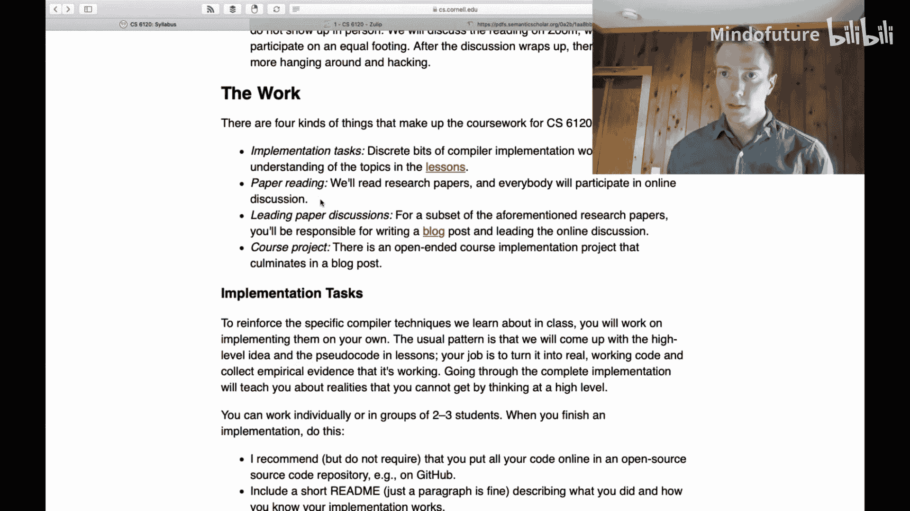

The next thing that you have to do that you'll be greatd on is reading the research papers and participating in discussion。

 so participate in the discussion asynchronously on Zlip and then when you come sign for synchronous discussion if you're participating synchronously participate by talking on Zoom for one paper I think for the entire semester。

 you will be leading that discussion， so your job is to read the paper ahead of time and to lead the discussion by doing the following things。

 writing a blog post。Which can come with an optional video if you want。

Leading the online discussion on Zoo up ahead of time。

 that means coming up with discussion questions and getting people to actually answer them and engage and then finally leading the synchronous discussion that happens on Zoom so you' will do this one time throughout the entire semester the rest of the time you're just a participant。

Then finally there is a course project so at the end in this is totally separate from the sort of smaller implementation tasks。

 the course project is a kind of entirely open ended to kind of do whatever you want that's related to compilers thing and there's details about that later。

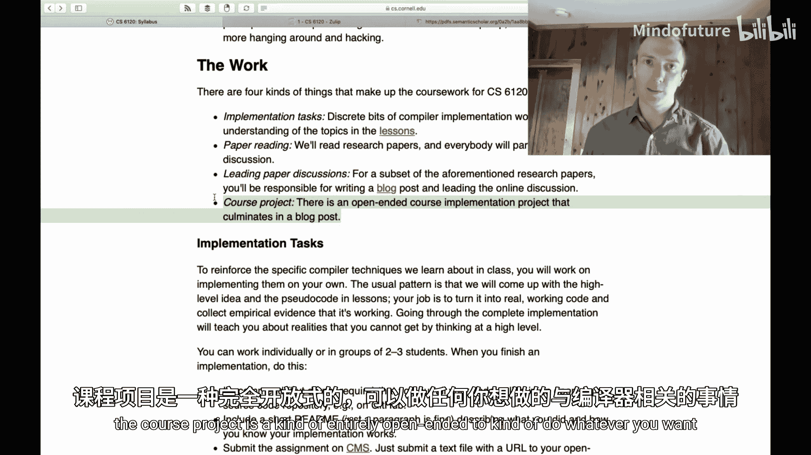

Okay， so number one， let's talk a little bit more about these implementation tasks。

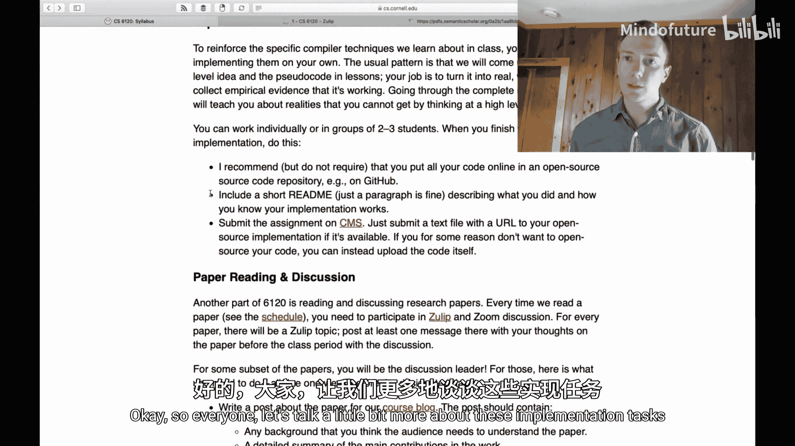

The tests for lesson one are fairly straightforward。 There are four of them they are not complicated。

 theyre just meant to get you familiar with things and to get you to do a couple of like kind of classwar up things。

 The first thing you to do is actually read the syllabus。

 you're getting some information now but I would really appreciate it if you were to like read all the actual details there The second is to sign up for Zlip and to introduce yourself So this links to the introductions topic on Zooip that you can follow it right there and just write a couple of sentences about yourself you can see my prompt at the top。

The next thing you need to do is pick a paper from the class schedule that you will lead the discussion of。

 So the if you follow this to the schedule， you'll see that there are lots of papers that say a T K next to them。

 So for a given day， someone is supposed to be leaving this。

 but we don't know who if you go to this link， you'll be LED to the。

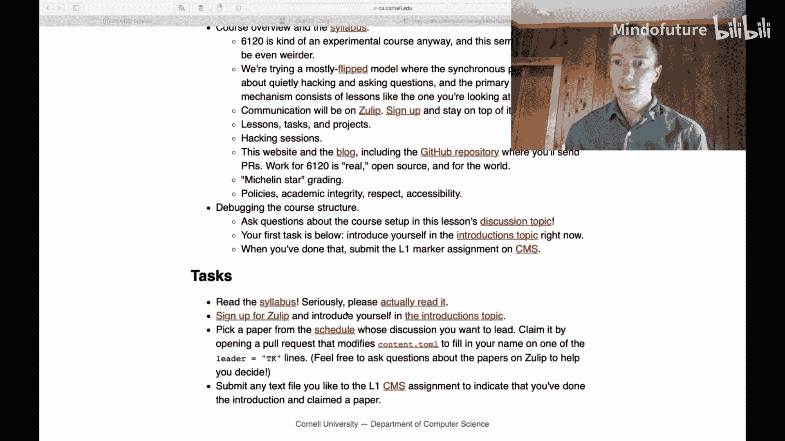

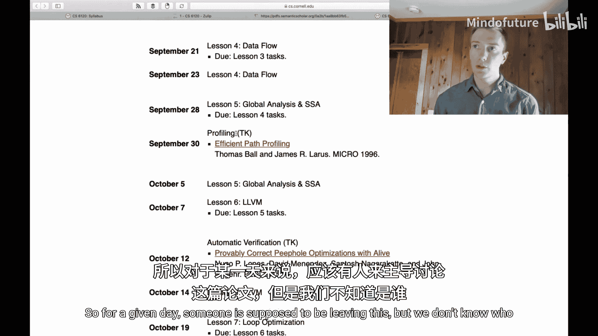

GitHub repository for this course。 I didn't mention before， but this course is entirely open source。

 Everything is on Github that you can possibly imagine。 This is the repository on Gitthub。

 this is by username and this is the repository and everything that runs the website which is everything that runs the course is open source in this repository So that includes this funky file that that lists everything we're gonna to be doing in every day on every class day So for example。

 this is a class day where' reading a paper by Lopez at all about automatically verifying a domain physical language for specifying people optimizations It is really sweet paper。

 so somebody needs to leave this。 your job is to open a pull request to put your name in right here that is to claim one paper throughout the entire semester you can fork this repository you can use Gitthubs in browser editor thing to add your name but please do that as part of the task。

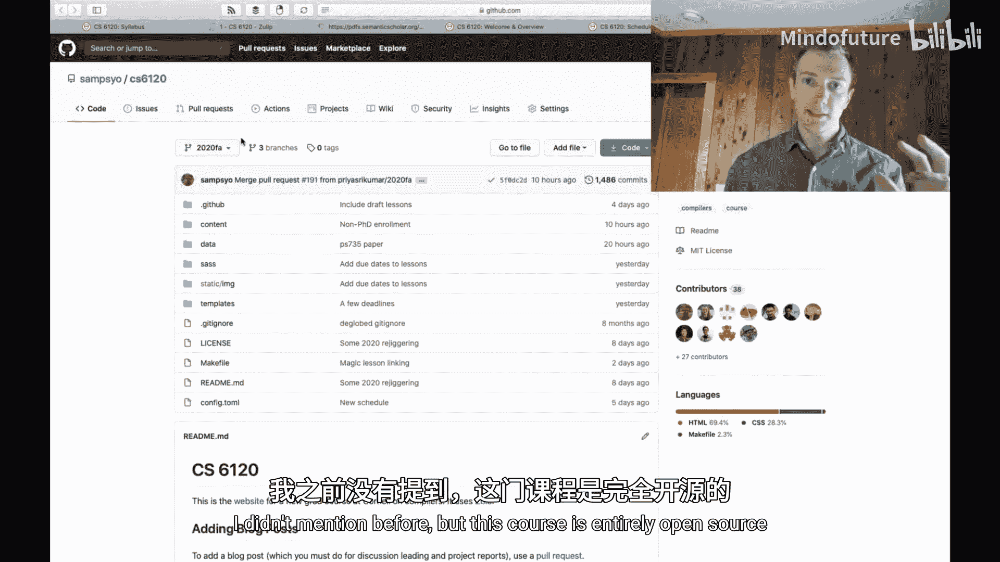

The task the last task is to tell me that you did it。

 And this is true of all tasks associated with lessons。

 you'll log into CMS and find the appropriate task。

 This one is the L1 intro tasks and you just need to basically input a marker to say that you did the thing So for this thing there not really anything to turn in CMS doesn't let me have nothing to turn in so you can just submit like an empty text file。

 there's like a text file submission thing you just need to like submit something just to say that you've done it for every other one。

 I encourage you， I don't require you， but I encourage you to do all your work as open source。

 So just like the rest of this course， you'll make like a Github repository or a bit bucket repository if you're into that kind of thing and you will do all your work there and the thing that you'll submit is just the URL to that repository to say that I have done this thing You're don't into submit any code there unless you strenuously object to having your work be open source in which case you can。

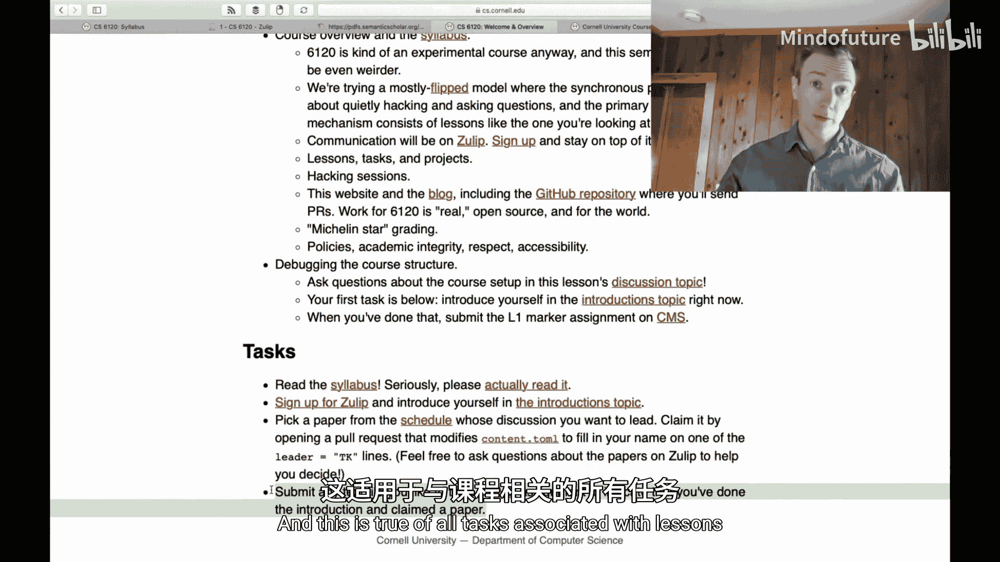

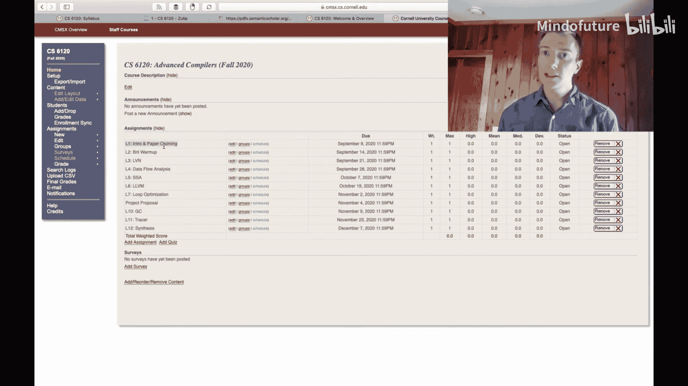

In which case you can upload your source code instead。

 but I really do strongly encourage you to do everything open source this class is really meant to run on the honor system that is that like the tasks are meant to deepen your understanding by going through the motions of actually doing something actually seeing it through all the way to the end and struggling with the hard problems yourself as opposed to just looking up the solution that someone else had So please do everything open source and please use your own judgment and don't look at other people's implementations and thus you totally want to cheat yourself out of the opportunity to struggle with things and figure out yourself and therefore actually deepen your understanding of the topics in the course So there's the implementation task one thing I didn't mention is that you're allowed to working groups if you want to your homework working groups of two or three students if you like you can also working give it Julie totally up to you CMs will let you form groups if you want。

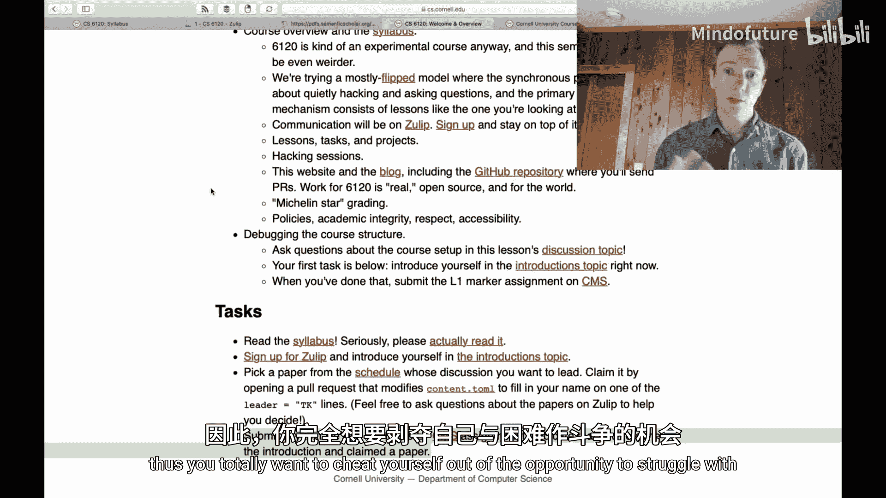

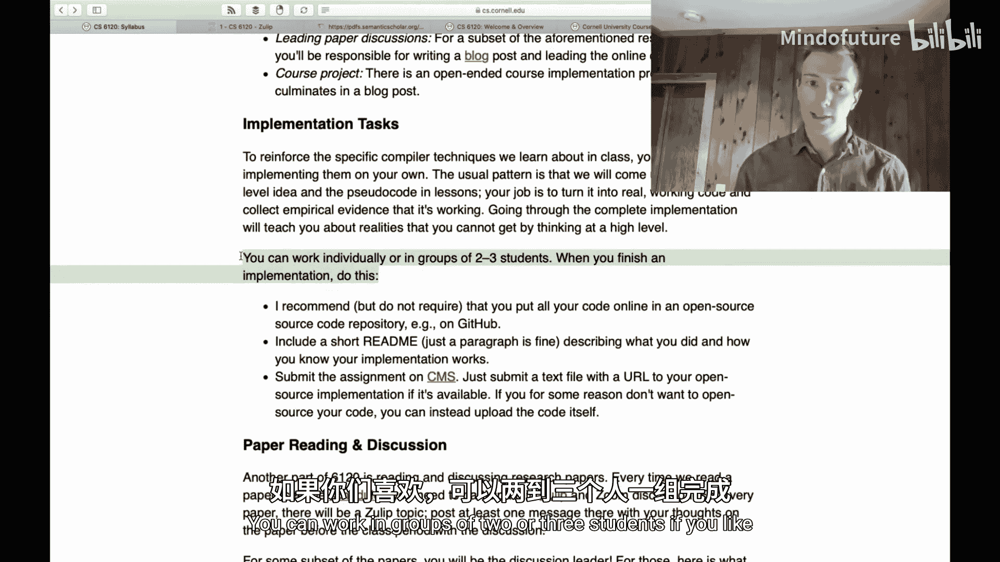

The next ingredient is this discussion stuff， so as I said many times before。

 for the discussion classes ahead of time you need to read the paper and you need to participate in the Zoo discussion where does the Zoo discussion come from that comes from the discussion leader for the first discussion that's going to be me so you can see how this goes。

The things that you need to do include writing a blog post。

 I have advice here about what exactly needs to go into a blog post that gives sort of your critical reaction to what's going on in the paper。

 This is not meant to be just a summary this is meant to be your opinion about what's going on in the paper you can if you like record a video to go along with your blog post you don't have to do this but just in case you want to participate in the 2020 style of education go for it。

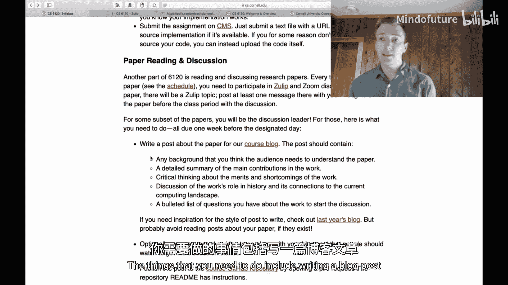

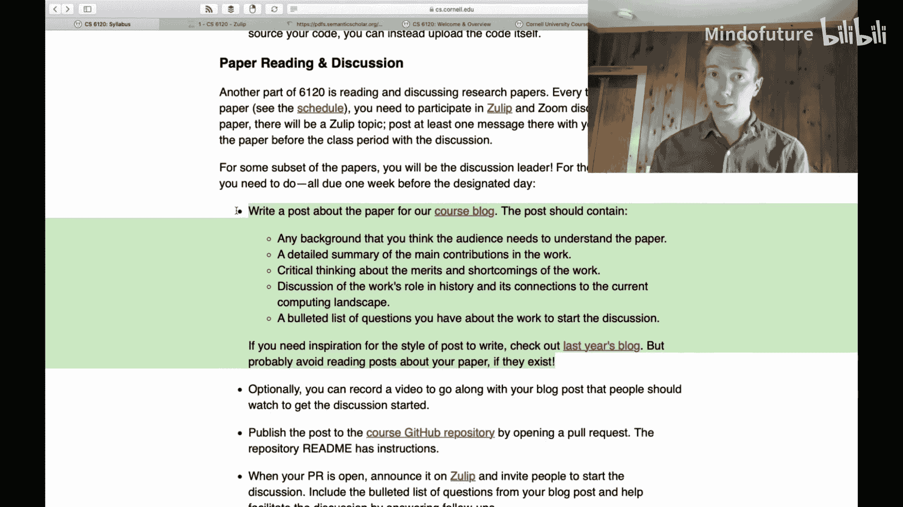

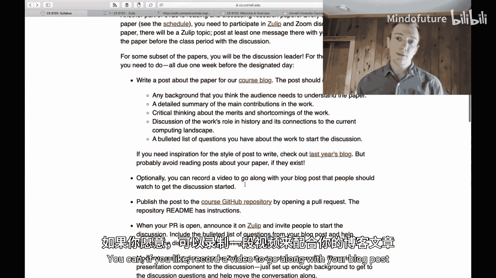

You will use a pull request to publish your your post to the Gitub repository that will automatically make it live and go on the internet I will review it and probably have feedback for you during the poll request process all of that is oh yeah sorry you also need to once your poll request is open so even before I'd necessarily give you feedback you have to announce it on Zoo that is they have to like give people a chance to read your your work before it's even ready and to possibly give you feedback I will definitely give you feedback whether people are welcome to as well all of that stuff is do one week before the class that actually has the discussion in it so that we can have a week of discussion so as part of your。

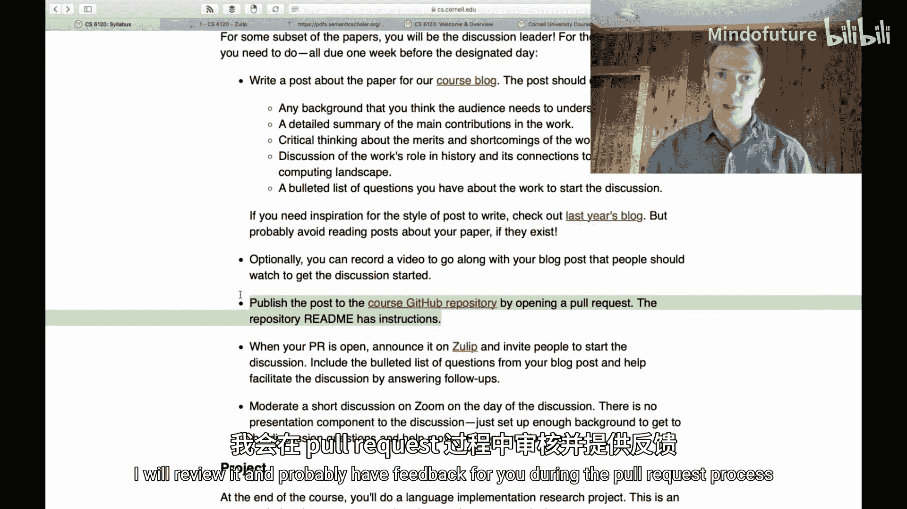

Your。Your discussion， you as part of your blog posts。

 you will have some bulleted questions that you have discussion questions to get things started and you will post those into the Zooulu thread where you announce your poll request and your brand new blog post and you'll get people to engage on those questions。

Everybody else is required to participate in that discussion that is required to read the paper and say something。

 who cares something in response to it， possibly in response to your discussion questions that you came up with。

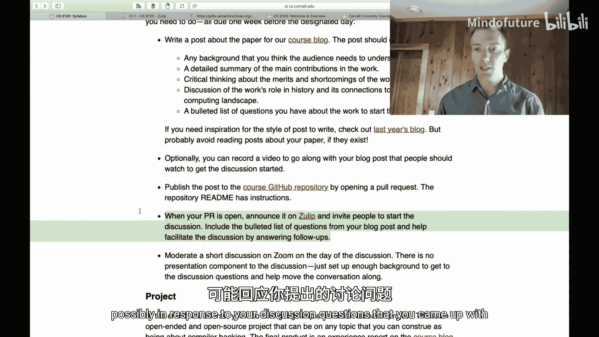

Then finally， on the actual day of the discussion on Zoom。 and again。

 this is one that does not happen at all in person is only on Zoom。

 you will moderate the discussion on that thing。 Don't prepare a presentation that is like don't go through a bunch of slides。

 You can have a visual aid if you want just to like sort of organize the discussion。

 But the point is you don't need to summarize stuff for people that will already have read it。

 You just need to be doing the kind of the live version of what you did for your blog post that is giving your reaction to it。

 giving trying to bring a critical lens to the paper that you brought and to get everyone to participate It is your job to get everybody to speak up and to participate as equitably as possible。

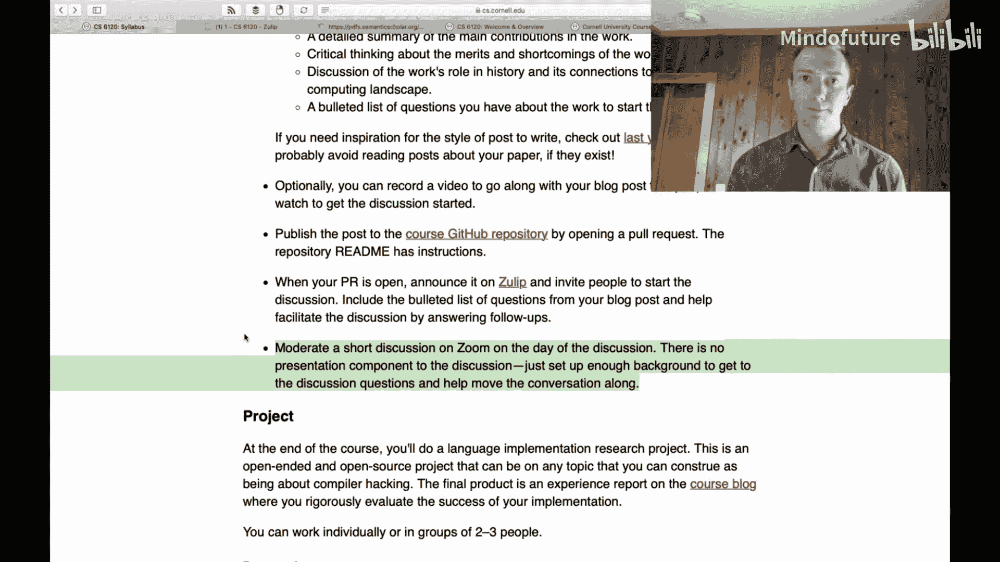

Okay， so those are discussions both participating in and leaving so the final thing is a project I'm not going to go into a lot of details you can learn about the project online it's going to be a totally standard course project that is openended。

 you can of do whatever you want that is related to compilers。

 you can build on the implementation tasks you did during the semester。

 do something totally different， do something connected to your research。

 whatever you can see the details here， deadlines you can find on the schedule as well。

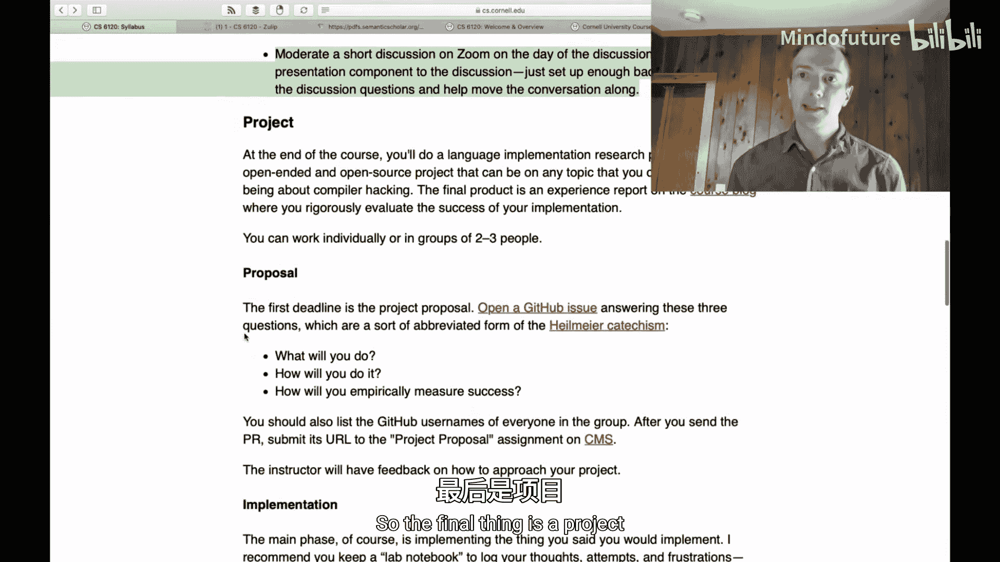

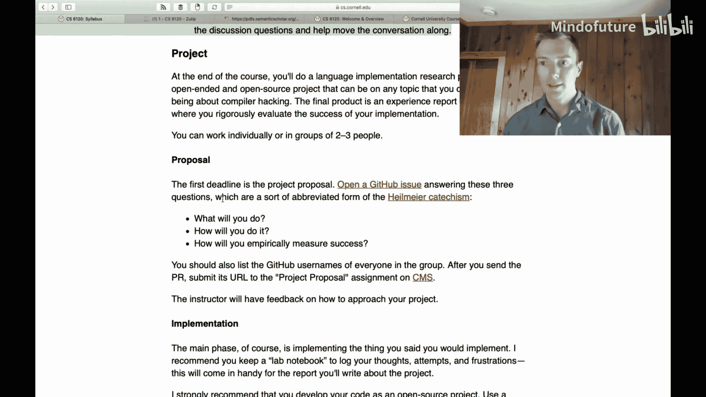

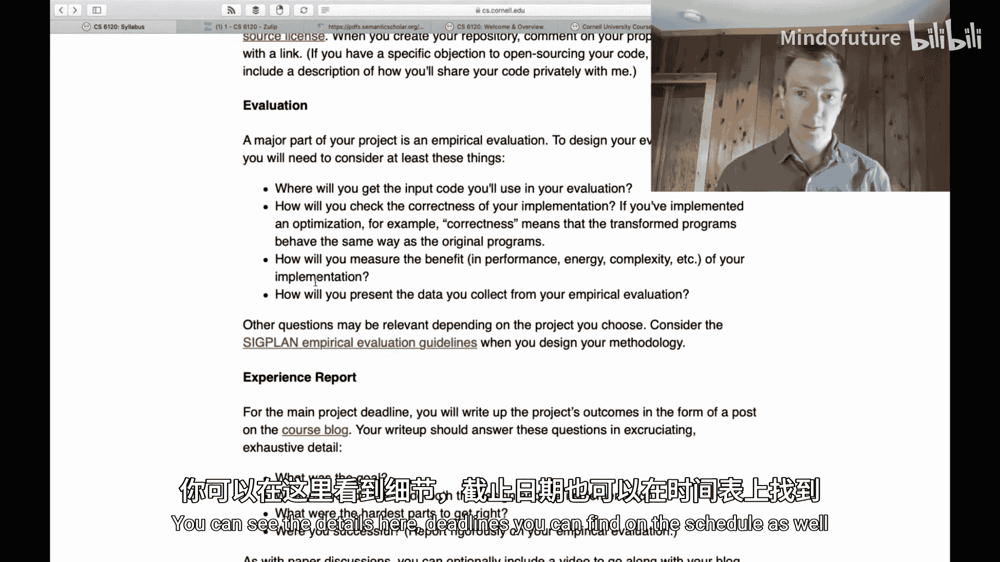

There is going to be a blog post at the end of the project。

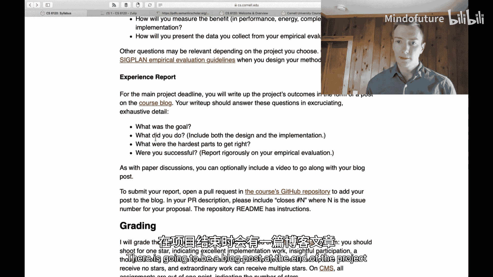

So for all of this stuff， we're going to be using a。

Grading system that we started using last year with the first offering of 6120。

 which is the Michelin Star system， that is if you do a really excellent job that is astonishing in its breadth and depth you get a Michelin star It's meant to recall that like even a single Michelin star in the Michelin guide is a remarkable achievement So if you do a remarkable job and you turn in something that you're proud of。

 you get a Michelin star for that assignment， it is possible to earn multiple Michelin stars by being truly exceptional it's possible to get not a star if your work is merely okay and that's fine too。

 you can turn in merely acceptable work from time to time that's cool doesn like who really cares about grades The Michelin Star will turn into the final course grades if you consistently get a Michelin star that means an A if you consistently get if you consistently miss Michelin Star then that will slowly reduce the grade。

getThe mission Star system is meant to get us out of the business of grabbing about individual points and scores。

 which I think is wholly inappropriate for this like open source hacking oriented class that we're going to do for 6120。

 instead meant to focus on what really matters， which is doing a great job and being proud yourself of what you turn in。

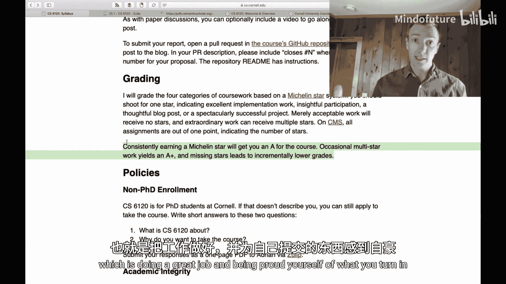

I final few note on a few policies so the first thing is that this is a class for PhD students if you are not a PhD student it's still possible to take this course。

 but you need to have a special permission to do it you I。Give you the directions here。

 you just send me a short application that answers two questions。

 so undergrads who are studioly motivated can still take this course。

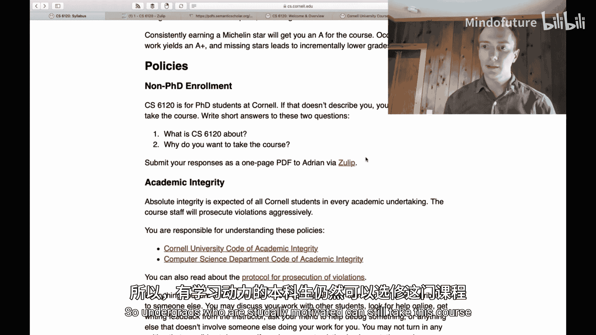

There are some policies here about academic integrity I think that you will find them completely unsurprising。

 the things that you turn in that is like the stuff that you represent as your work has to be actually your work you are in this class it's meant to be open source and the world is open to you to figure out how to do the stuff you just have to actually do the work yourself if any of this enters a gray area just contact me and we will resolve it。

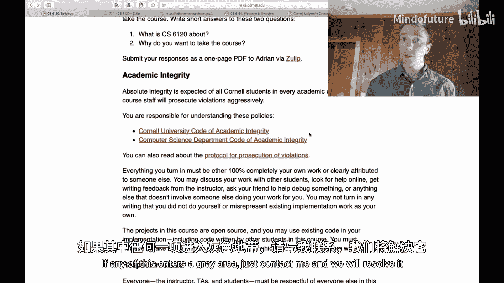

I care deeply about respect within the bounds of this classroom。

 even though it's for the most part not even really a classroom。

 it is super important that everyone participate in a class because it's meant to be discussion oriented。

 be as respectful of each other as possible， this means being careful about your language for example。

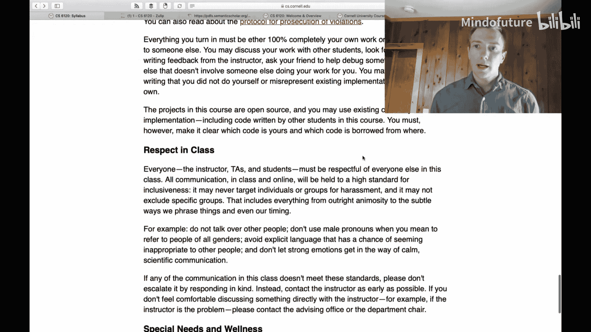

One thing that you should absolutely not do is if you are participating in a discussion and you need to bring up a kind of example person。

 one thing you should not do is try to make up the gender for that person for no particular reason that is like to assume assume that the programmer。

 the notional programmer for a compiler is mail for instance。

 don't do that just don't use a gender for that person just use they or them in general be respectful of all identities within this class if you ever notice a problem with respect within the class please bring it to me or you can go over my head to the department chair。

And if it doesn't seem like something that I can deal with。

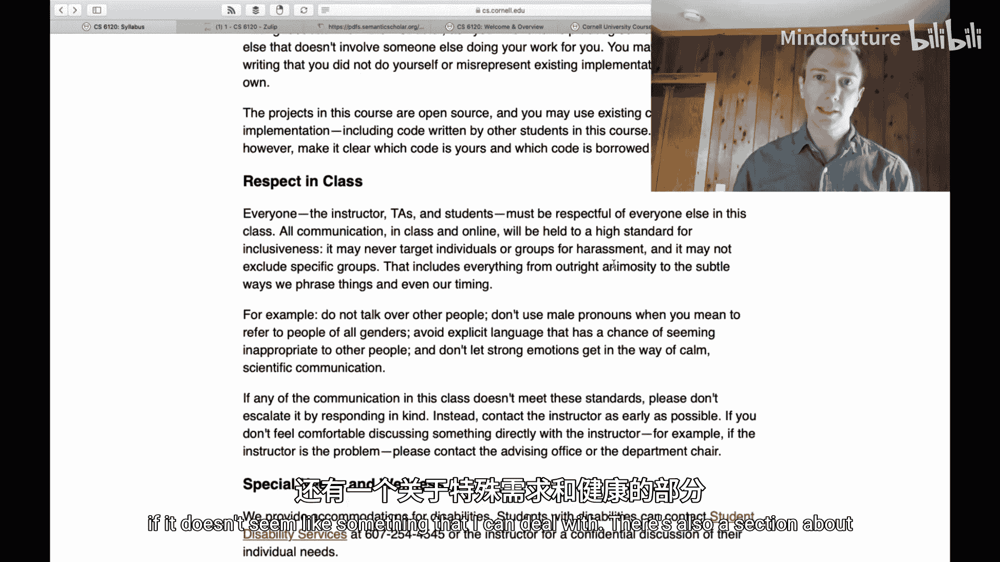

There's also a section about special needs and wellness。

I want this class to be accessible to everyone if there are any particular。

If there are any particular things that this class can do or that I can do to make this class accessible to you。

 please feel free to let me know， please also feel free to go through the Student Disability Services Office to get an official determination。

 but I'm also happy just to chat about it， just send me a message on Zooip。

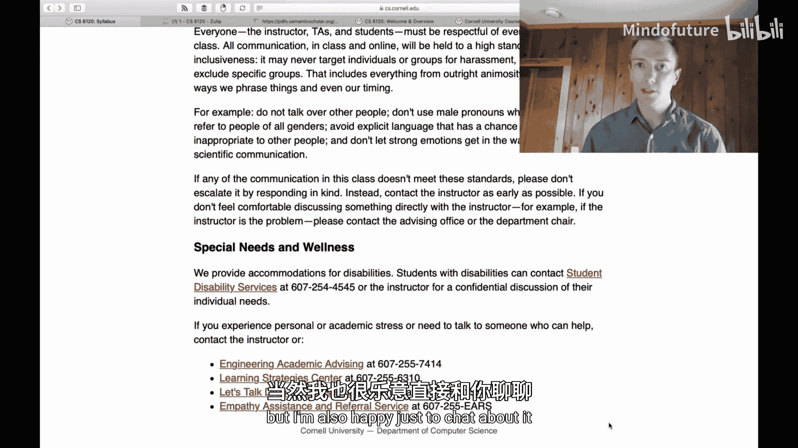

So that's about it， this is the first video I've ever recorded for class prered as part of the course materials。

Thanks for bearing with me， I guess right now will be an excellent time if you haven't done it already to follow this link to the Inuctions topic on Zoolip and to introduce yourself。

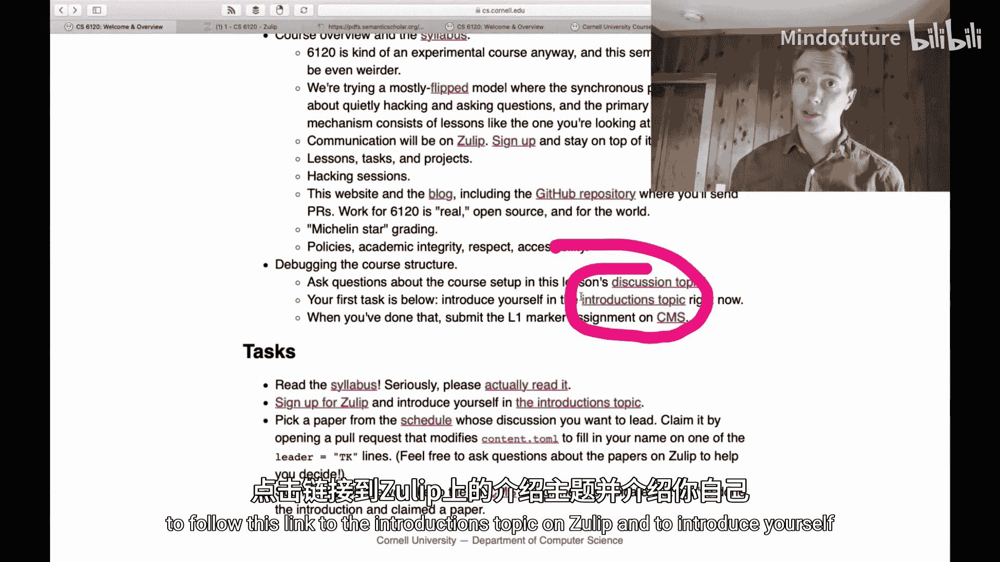

See you next time， thanks。